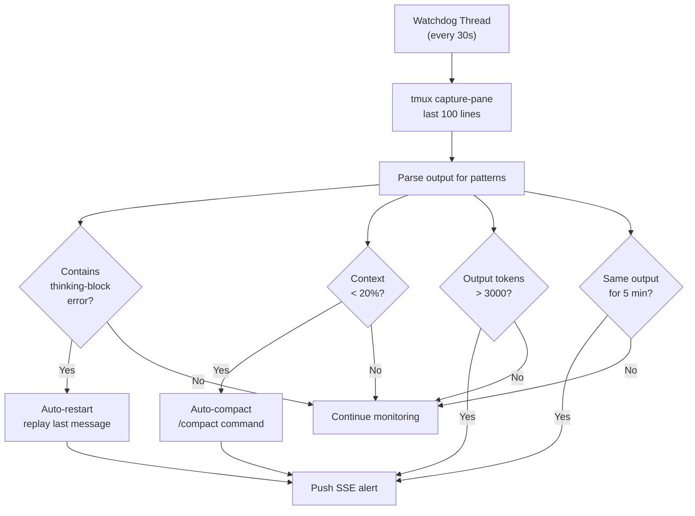
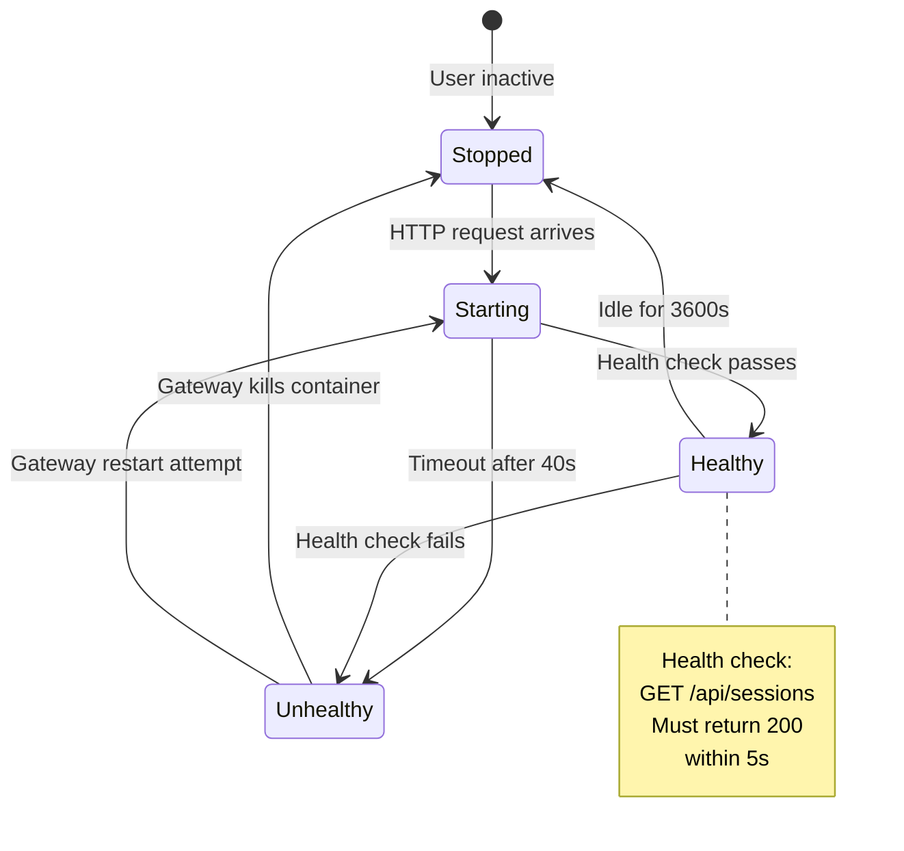
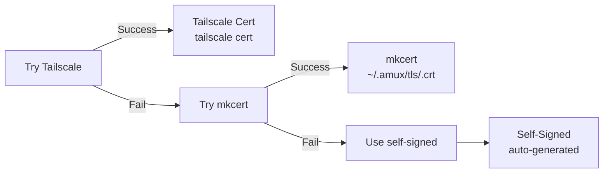
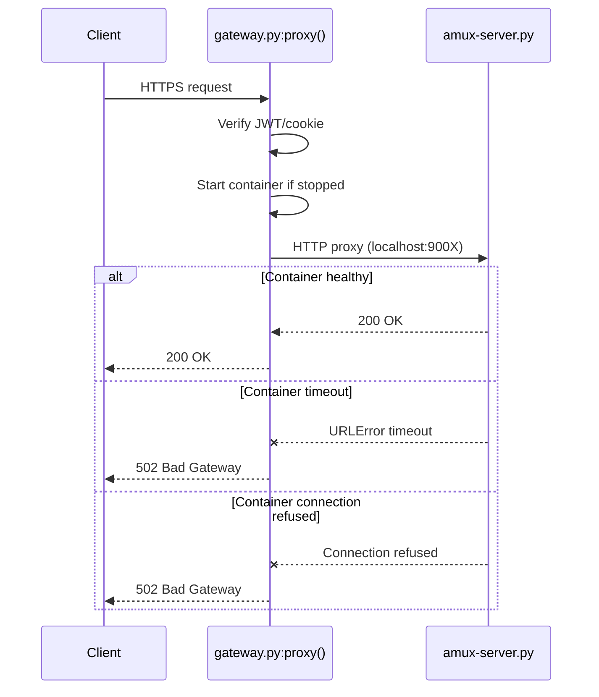
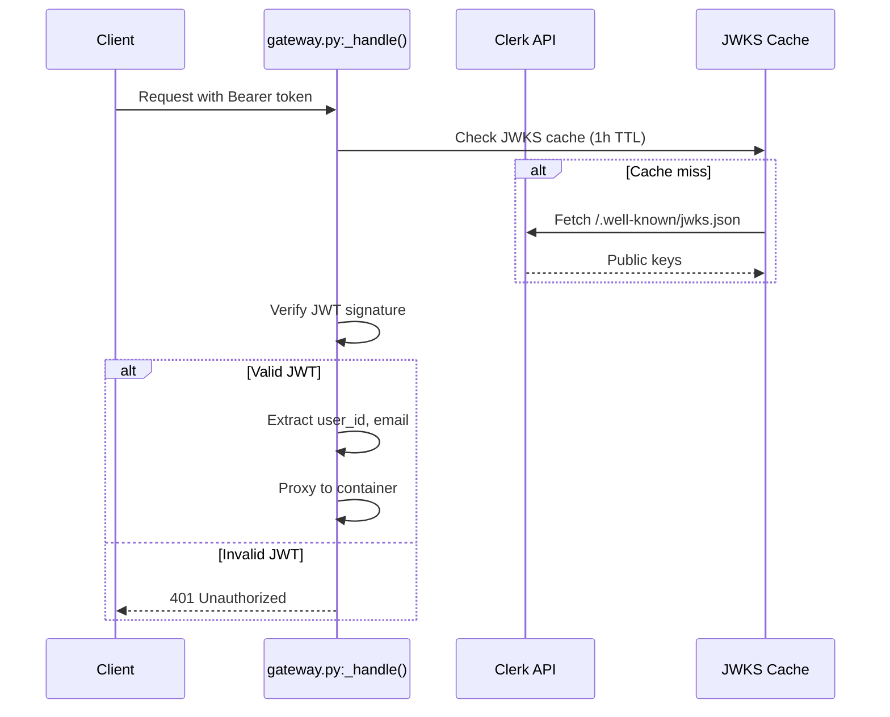

<!-- source: DeepWiki mcp.deepwiki.com · repo mixpeek/amux · page 11.3 Troubleshooting · fetched 2026-10-27 -->

# Troubleshooting

<details>
<summary>Relevant source files</summary>

The following files were used as context for generating this wiki page:

- [amux](amux)
- [amux-server.py](amux-server.py)
- [cloud/gateway/gateway.py](cloud/gateway/gateway.py)
- [cloud/setup.sh](cloud/setup.sh)
- [test.mjs](test.mjs)

</details>


This page documents common failure modes in amux, diagnostic procedures, and recovery steps for both local and cloud deployments. For general operations and monitoring, see [Operations](#11). For backup and disaster recovery, see [Backup & Recovery](#11.2).

## Failure Categories

Amux troubleshooting falls into five main categories:

| Category | Scope | Detection | Auto-Recovery |
|----------|-------|-----------|---------------|
| Session failures | Individual Claude Code sessions | Watchdog every 30s | Yes (corruption restart, context compact) |
| Container failures | Docker containers (cloud only) | Health checks every 60s | Yes (idle reaper, startup retry) |
| Network failures | TLS, proxy, connectivity | HTTP error codes | Manual intervention |
| Database failures | SQLite locks, corruption | Write errors | Litestream restore |
| Integration failures | MCP servers, external APIs | API error responses | Manual restart |

---

## Session Failure Diagnosis

### Detection Flow



**Sources:** [amux-server.py:1430-1670]()

### Common Session Errors

| Error Pattern | Cause | Auto-Recovery | Manual Fix |
|---------------|-------|---------------|------------|
| `thinking-block` syntax error | Claude Code corruption | Yes (restart + replay) | `amux stop <name> && amux start <name>` |
| `Context window exhausted` | Token limit reached | Yes (auto-compact) | Send `/compact` manually |
| `tmux: session not found` | Session crashed unexpectedly | No | Check `~/.amux/logs/server.log` for errors |
| `ANTHROPIC_API_KEY not set` | Missing API key in env | No | Set in `~/.amux/server.env` |
| `Permission denied` | Directory access issue | No | Check working directory permissions |
| Infinite approval loop | YOLO mode disabled, auto-respond off | No | Enable YOLO or set `yolo: true` in session config |

### Session Recovery Procedure

**Step 1: Check session status**

```bash
amux ls
# Look for missing sessions or * running indicator
```

**Step 2: Inspect logs**

Local deployment:
```bash
tail -50 ~/.amux/logs/server.log
```

Cloud deployment:
```bash
docker logs amux-user-<USER_ID>
```

**Step 3: Verify tmux session**

```bash
tmux ls | grep amux-
# Should show: amux-<name>: 1 windows ...
```

If tmux session is missing but amux shows running:
```bash
# Force reset session state
rm ~/.amux/sessions/<name>.env
amux register <name> --dir /path --model opus
```

**Step 4: Check Claude Code binary**

```bash
which claude
claude --version
# Should show @anthropic-ai/claude-code version
```

**Step 5: Restart with verbose logging**

```bash
amux stop <name>
amux register <name> --verbose --dir /path
amux start <name>
```

**Sources:** [amux:287-319](), [amux-server.py:81-95]()

---

## Container Troubleshooting (Cloud)

### Container Health State Machine



**Sources:** [cloud/gateway/gateway.py:233-275]()

### Container Startup Failures

Container startup failures manifest as 502 Bad Gateway errors when accessing `cloud.amux.io`. The gateway attempts to start containers on-demand but may fail due to:

| Failure Mode | Symptom | Diagnostic Command | Fix |
|--------------|---------|-------------------|-----|
| Docker daemon down | `502 Bad Gateway` (all users) | `docker ps` on VM | `systemctl restart docker` |
| Port conflict | Container starts but proxy fails | `netstat -tulpn \| grep 900[0-9]` | Check `gateway.db` for port allocation |
| Volume mount failure | Container exits immediately | `docker logs amux-user-<ID>` | Recreate volume: `docker volume rm amux-data-<ID>` |
| Image missing | `docker compose up` fails | `docker images \| grep amux-cloud` | Re-pull: `docker pull <image>` |
| Health check timeout | Gateway shows "starting..." forever | `docker inspect amux-user-<ID>` | Increase `HEALTH_TIMEOUT` in compose template |

### Container Health Check Details

The health check runs inside each container and tests `amux-server.py` readiness:

```bash
# View health status
docker inspect -f '{{.State.Health.Status}}' amux-user-<USER_ID>
# Should return: healthy

# View last 5 health check results
docker inspect -f '{{json .State.Health}}' amux-user-<USER_ID> | jq
```

Health check definition: [cloud/docker/docker-compose.template.yml:healthcheck section]()

The check calls `curl -f http://localhost:8822/api/sessions` every 30 seconds. If 3 consecutive checks fail, the container enters `unhealthy` state.

### Idle Reaper Debugging

The gateway's idle reaper stops containers that have been inactive for `IDLE_SECONDS` (default 3600):

```python
# Check last_seen timestamps in gateway database
sqlite3 /var/amux/gateway.db "SELECT id, email, datetime(last_seen, 'unixepoch') FROM users ORDER BY last_seen DESC LIMIT 10;"
```

To disable idle reaping for testing:
```bash
export IDLE_TIMEOUT=999999
systemctl restart amux-gateway
```

**Sources:** [cloud/gateway/gateway.py:376-393]()

### Container Network Isolation

Each user container is isolated on a Docker bridge network. If proxying fails:

**Step 1: Verify port allocation**
```sql
sqlite3 /var/amux/gateway.db "SELECT id, port FROM users WHERE id='<USER_ID>';"
```

**Step 2: Test direct connection to container**
```bash
curl -v http://127.0.0.1:<PORT>/api/sessions
# Should return JSON, not connection refused
```

**Step 3: Check gateway proxy logs**
```bash
journalctl -u amux-gateway -n 100 --no-pager | grep '<USER_ID>'
```

**Sources:** [cloud/gateway/gateway.py:396-458]()

---

## Network and TLS Issues

### TLS Certificate Problems

#### Local Deployment Certificate Chain



**Sources:** [amux-server.py:2080-2140]()

#### Certificate Diagnostics

**Check which certificate source is active:**
```bash
grep "using.*certificate" ~/.amux/logs/server.log | tail -1
# Shows: "using Tailscale certificate" or "using mkcert" or "generated self-signed"
```

**Test TLS handshake:**
```bash
openssl s_client -connect localhost:8822 -servername localhost < /dev/null
# Look for "Verify return code: 0 (ok)" or error messages
```

**Common TLS errors:**

| Browser Error | Cause | Fix |
|---------------|-------|-----|
| `NET::ERR_CERT_AUTHORITY_INVALID` | Self-signed cert not trusted | Click "Advanced" → "Proceed" or install mkcert CA |
| `SSL_ERROR_RX_RECORD_TOO_LONG` | Server sent HTTP instead of HTTPS | Check port—server runs HTTPS on 8822 |
| `Connection refused` | Server not running | Check `amux serve` process |
| `DEPTH_ZERO_SELF_SIGNED_CERT` (Node.js) | Strict TLS validation | Set `NODE_TLS_REJECT_UNAUTHORIZED=0` (dev only) |

**Install mkcert for trusted local certs:**
```bash
brew install mkcert  # macOS
mkcert -install      # Trust local CA
# Restart amux serve — it will auto-detect and use mkcert
```

### Cloud Gateway Proxy Failures

The gateway proxies all requests to user containers. Proxy failures return `502 Bad Gateway` with details in the error body:

**Proxy failure flow:**



**Sources:** [cloud/gateway/gateway.py:396-458]()

**Debug proxy failures:**

```bash
# Check gateway logs
journalctl -u amux-gateway -f

# Test container directly (bypassing gateway)
curl http://127.0.0.1:9000/api/sessions  # Replace 9000 with user's port

# Verify gateway can reach container
docker exec -it amux-user-<ID> curl http://localhost:8822/api/sessions
```

**SSE connection drops:**

SSE (Server-Sent Events) streams can drop if the gateway proxy times out. The gateway refreshes `last_seen` every 60 seconds during active SSE connections to prevent idle reaping:

[cloud/gateway/gateway.py:418-437]()

If SSE drops frequently, increase the proxy read timeout in gateway deployment.

---

## Database Issues

### SQLite Lock Contention

Amux uses SQLite with WAL mode enabled for concurrent reads/writes. Lock contention is rare but can occur under heavy load.

**Symptoms:**
- API requests return `500 Internal Server Error`
- Logs show `database is locked` errors
- Web dashboard shows spinner indefinitely

**Diagnostic queries:**

```bash
# Check if database is in WAL mode
sqlite3 ~/.amux/amux.db "PRAGMA journal_mode;"
# Should return: wal

# Check for stale WAL files
ls -lh ~/.amux/amux.db*
# Should see: amux.db, amux.db-shm, amux.db-wal
```

**Recovery:**

```bash
# Checkpoint and vacuum
sqlite3 ~/.amux/amux.db "PRAGMA wal_checkpoint(TRUNCATE); VACUUM;"

# If checkpoint fails, force WAL mode re-enable
sqlite3 ~/.amux/amux.db "PRAGMA journal_mode=DELETE; PRAGMA journal_mode=WAL;"
```

**Sources:** [amux-server.py:1905-1920]()

### Database Corruption Detection

Litestream continuously backs up `amux.db` to Cloudflare R2 (cloud) or local `.litestream/` directory. If corruption is detected:

**Check database integrity:**
```bash
sqlite3 ~/.amux/amux.db "PRAGMA integrity_check;"
# Should return: ok
```

**Restore from Litestream backup:**

Cloud deployment:
```bash
docker exec amux-litestream-<USER_ID> litestream restore -o /tmp/restored.db /root/.amux/amux.db
docker exec amux-user-<USER_ID> cp /tmp/restored.db /root/.amux/amux.db
docker restart amux-user-<USER_ID>
```

Local deployment:
```bash
litestream restore -o ~/.amux/amux.db.restored ~/.amux/amux.db
mv ~/.amux/amux.db ~/.amux/amux.db.corrupt
mv ~/.amux/amux.db.restored ~/.amux/amux.db
```

**Sources:** [cloud/litestream/litestream.yml]()

### Board Sync Conflicts

The board system uses `updated_at` timestamps and tombstones for conflict-free sync. If the dashboard shows stale data:

**Force full sync:**
```javascript
// In browser console
localStorage.removeItem('board_last_sync');
location.reload();
```

**Verify sync endpoint:**
```bash
curl -sk "https://localhost:8822/api/sync?since=0" | jq '.ts'
# Returns current server timestamp
```

The sync system includes soft-deleted issues with `deleted > 0` to propagate deletions across clients:

[amux-server.py:2620-2680]()

---

## Self-Healing Diagnostics

### Watchdog Thread Status

The watchdog runs in a background thread and logs all actions to `server.log`. To verify it's running:

```bash
# Check for recent watchdog activity
grep "watchdog" ~/.amux/logs/server.log | tail -20

# Expected output every 30 seconds:
# 2025-01-15 10:30:00 [watchdog] checked 3 sessions
```

If no watchdog logs appear, the thread may have crashed. Restart the server:
```bash
# Local
pkill -f amux-server.py
amux serve

# Cloud
docker restart amux-user-<USER_ID>
```

**Sources:** [amux-server.py:1430-1520]()

### Auto-Recovery Throttling

To prevent restart loops, auto-recovery actions are throttled per session:

| Action | Cooldown | State Variable |
|--------|----------|----------------|
| Auto-restart (corruption) | 300 seconds | `_session_auto_actions[name]['last_restart']` |
| Auto-compact (context low) | 600 seconds | `_session_auto_actions[name]['last_compact']` |
| Auto-respond (YOLO) | None | Immediate |

**Check auto-recovery state:**
```bash
# In Python REPL on server
import amux-server
print(amux-server._session_auto_actions)
```

This shows the last auto-action timestamp for each session. If a session is stuck in a failure state, reset the throttle:

```python
# Clear restart throttle for session 'api'
_session_auto_actions['api']['last_restart'] = 0
```

**Sources:** [amux-server.py:195-196](), [amux-server.py:1545-1600]()

### Alert System

Auto-recovery events push alerts to the SSE `/api/events` stream and append to the in-memory ring buffer:

```bash
# Watch live events (requires httpie or curl with --no-buffer)
http --stream GET https://localhost:8822/api/events Accept:text/event-stream

# Recent events (JSON)
curl -sk https://localhost:8822/api/events | jq '.[-10:]'
```

**Sources:** [amux-server.py:104-128]()

---

## Integration Failures

### MCP Server Connection Errors

MCP servers are spawned as child processes (stdio) or called via HTTP (url). Connection failures appear in session output as tool errors.

**Diagnostic procedure:**

**Step 1: Verify MCP config syntax**
```bash
python3 -c "import json; json.load(open('~/.amux/mcp.json'))"
# Should exit silently if valid
```

**Step 2: Test MCP server directly**

For stdio servers (e.g., `gdocs`):
```bash
npx @modelcontextprotocol/server-gdrive
# Should output JSON-RPC handshake messages
```

For url servers (e.g., `mixpeek`):
```bash
curl -X POST https://mcp.mixpeek.com/mcp \
  -H "Authorization: Bearer $MIXPEEK_API_KEY" \
  -H "Content-Type: application/json" \
  -d '{"jsonrpc":"2.0","method":"tools/list","id":1}'
```

**Step 3: Check environment variable substitution**

MCP config uses `${ENV_VAR}` placeholders resolved from `~/.amux/server.env`:

```bash
# Verify env vars are set
grep GDRIVE ~/.amux/server.env
grep MIXPEEK ~/.amux/server.env
```

If missing, add to `server.env` and restart:
```bash
echo "MIXPEEK_API_KEY=your-key-here" >> ~/.amux/server.env
amux serve  # Local
docker restart amux-user-<USER_ID>  # Cloud
```

**Sources:** [amux-server.py:36-47](), Diagram 5 (Integration Architecture via MCP)

### Anthropic API Failures

Claude Code sessions fail immediately if the Anthropic API key is invalid or quota exceeded.

**Check API key:**
```bash
curl https://api.anthropic.com/v1/messages \
  -H "x-api-key: $ANTHROPIC_API_KEY" \
  -H "anthropic-version: 2023-06-01" \
  -H "content-type: application/json" \
  -d '{"model":"claude-3-5-sonnet-20241022","max_tokens":10,"messages":[{"role":"user","content":"hi"}]}'

# Should return: {"id":"msg_...", "content":...}
# If invalid: {"error":{"type":"authentication_error",...}}
```

**Quota exceeded:**
Sessions hang with "Waiting for API response..." and eventually timeout. Check usage at `console.anthropic.com`.

**Fallback model configuration:**

If a requested model is unavailable, Claude Code falls back to the default. Specify fallback in session flags:
```bash
amux register prod --model claude-opus-4-20250514 --fallback-model claude-sonnet-4-20250514
```

---

## Cloud-Specific Issues

### Clerk Authentication Failures

The gateway verifies Clerk session JWTs on every request. Auth failures return `401 Unauthorized`.

**JWT verification flow:**



**Sources:** [cloud/gateway/gateway.py:316-348]()

**Debug auth failures:**

```bash
# Check gateway logs for auth errors
journalctl -u amux-gateway | grep "auth.*failed"

# Decode JWT locally (replace YOUR_JWT)
echo "YOUR_JWT" | cut -d. -f2 | base64 -d | jq
# Check 'sub' (user_id) and 'exp' (expiration)
```

**Session cookie issues:**

The gateway issues HMAC-signed cookies after JWT verification. Cookie verification fails if:
1. Cookie secret changed (cookies invalidated—users must re-login)
2. Cookie expired (7 day max age)
3. Cookie signature mismatch (tampering attempt)

**Fix:** Clear cookies and re-login at `cloud.amux.io`.

**Sources:** [cloud/gateway/gateway.py:277-303]()

### Litestream Replication Lag

Litestream replicates `amux.db` to Cloudflare R2 continuously. Replication lag appears as data loss if a container crashes before replication completes.

**Check replication status:**
```bash
docker exec amux-litestream-<USER_ID> litestream databases
# Shows: generation, lag, last snapshot time
```

**Force immediate snapshot:**
```bash
docker exec amux-litestream-<USER_ID> litestream snapshots /root/.amux/amux.db
```

**Restore from specific generation:**
```bash
docker exec amux-litestream-<USER_ID> litestream restore -if-replica-exists \
  -generation <GEN_ID> \
  -o /tmp/restored.db \
  /root/.amux/amux.db
```

**Sources:** [cloud/litestream/litestream.yml](), Diagram 1 (Complete System Topology)

### S3 File Sync Failures

The sync container uploads files from `~/.amux/` to S3 every 5 minutes (excluding database files). Sync failures don't block the main container.

**Check sync logs:**
```bash
docker logs amux-sync-<USER_ID> --tail 50
```

**Common sync errors:**

| Error | Cause | Fix |
|-------|-------|-----|
| `AWS credentials not found` | Missing `R2_ACCESS_KEY` env var | Restart with correct env vars |
| `Access Denied` | Incorrect R2 permissions | Verify bucket policy allows PutObject |
| `NoSuchBucket` | Bucket doesn't exist | Create R2 bucket named `amux-cloud-users` |
| Sync container exits (code 0) | Completed sync, no restart needed | Normal—container runs as one-shot job |

**Manual sync trigger:**
```bash
docker restart amux-sync-<USER_ID>
```

**Sources:** [cloud/docker/docker-compose.template.yml:sync service]()

---

## Emergency Procedures

### Hard Reset (Local)

If all else fails, reset amux to a clean state:

```bash
# Stop all sessions
amux stop-all

# Kill server
pkill -f amux-server.py

# Backup data
mv ~/.amux ~/.amux.backup.$(date +%s)

# Fresh start
mkdir ~/.amux
amux serve
```

Restore sessions from backup:
```bash
cp ~/.amux.backup.*/sessions/*.env ~/.amux/sessions/
```

### Hard Reset (Cloud Container)

For a single user container:

```bash
# SSH to gateway VM
ssh root@<tailscale-hostname>

# Stop container
docker compose -f /var/amux/users/<USER_ID>/docker-compose.yml down

# Delete volume (destroys all data!)
docker volume rm amux-data-<USER_ID>

# Recreate from template
cd /opt/amux-cloud/gateway
./regenerate-compose.sh <USER_ID>

# Start fresh
docker compose -f /var/amux/users/<USER_ID>/docker-compose.yml up -d
```

The new container will restore `~/.amux/` files from R2 on startup (except `amux.db`, which must be manually restored from Litestream if needed).

**Sources:** [cloud/gateway/gateway.py:245-272]()

---

## Log File Locations

| Component | Local Path | Cloud Path (in container) |
|-----------|-----------|---------------------------|
| Server logs | `~/.amux/logs/server.log` | `/root/.amux/logs/server.log` |
| Session JSONL | `~/.claude/projects/<dir>/conversation-*.jsonl` | Same |
| Gateway logs | N/A (local only) | `journalctl -u amux-gateway` |
| Docker container | N/A | `docker logs amux-user-<ID>` |
| Setup script | N/A | `/var/log/amux-setup.log` |
| Watchdog | N/A | `journalctl -u amux-watchdog` |

**Sources:** [amux-server.py:78-95](), [cloud/setup.sh:96-124](), [cloud/gateway/gateway.py:1-10]()

---

