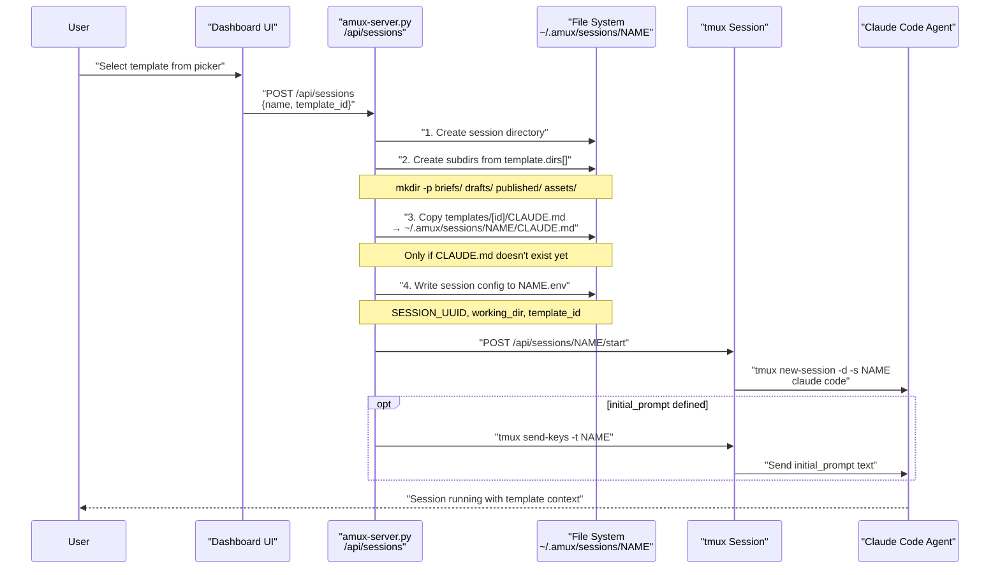
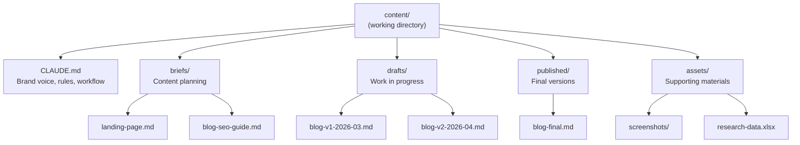
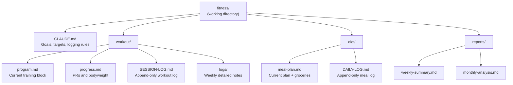

<!-- source: DeepWiki mcp.deepwiki.com · repo mixpeek/amux · page 13 Templates · fetched 2026-10-27 -->

# Templates

<details>
<summary>Relevant source files</summary>

The following files were used as context for generating this wiki page:

- [.github/workflows/backup-cloud.yml](.github/workflows/backup-cloud.yml)
- [.github/workflows/deploy-cloud.yml](.github/workflows/deploy-cloud.yml)
- [cloud/docker/docker-compose.template.yml](cloud/docker/docker-compose.template.yml)
- [templates/README.md](templates/README.md)
- [templates/content-creator/CLAUDE.md](templates/content-creator/CLAUDE.md)
- [templates/content-creator/template.json](templates/content-creator/template.json)
- [templates/fitness-tracker/CLAUDE.md](templates/fitness-tracker/CLAUDE.md)

</details>


## Purpose and Scope

This document describes the template system in amux, which provides pre-configured session starters for common workflows. Templates combine a `CLAUDE.md` instruction file, directory scaffolding, and optional initialization prompts to enable rapid session bootstrap without manual setup.

For information about creating and managing sessions themselves, see [Session Management](#2.1). For the web interface where templates are selected, see [Web Dashboard](#6).

---

## Template Structure

A template is a directory under [templates/]() containing two required files: `template.json` (metadata and configuration) and `CLAUDE.md` (instructions for Claude Code).

### File Organization

```
templates/
├── README.md                       # Template system documentation
├── software-project/               # Example template ID
│   ├── template.json               # Required: metadata and config
│   └── CLAUDE.md                   # Required: Claude instructions
├── fitness-tracker/
│   ├── template.json
│   └── CLAUDE.md
├── content-creator/
│   ├── template.json
│   └── CLAUDE.md
└── [template-id]/                  # Custom template
    ├── template.json
    └── CLAUDE.md
```

**Sources:** [templates/README.md:1-52]()

---

## Template Configuration Schema

The `template.json` file defines template metadata and session initialization behavior.

### Schema Fields

| Field | Type | Required | Description |
|-------|------|----------|-------------|
| `id` | string | Yes | Template identifier, must match folder name |
| `label` | string | Yes | Human-readable name shown in UI |
| `icon` | string | Yes | Emoji displayed in template picker |
| `description` | string | Yes | 1-2 sentence explanation shown when expanded |
| `tags` | string[] | Yes | Categorization tags for filtering |
| `dirs` | string[] | Yes | Subdirectories to create in working directory |
| `initial_prompt` | string | No | Text sent to Claude immediately after session start |

### Example Configuration

```json
{
  "id": "content-creator",
  "label": "Content & Marketing",
  "icon": "✍️",
  "description": "Produce blog posts, video scripts, marketing copy...",
  "tags": ["content", "marketing", "writing", "GTM"],
  "dirs": ["briefs", "drafts", "published", "assets"],
  "initial_prompt": "Read CLAUDE.md. Tell me the brand voice..."
}
```

**Sources:** [templates/README.md:27-39](), [templates/content-creator/template.json:1-9]()

---

## Template Instantiation Workflow

When a user selects a template during session creation, amux performs the following operations:



**Key Behavior:**
1. Directory structure from `template.dirs[]` is created before session starts
2. `CLAUDE.md` is copied only if one doesn't already exist (preserves user edits)
3. `initial_prompt` is sent after Claude loads, allowing the agent to read `CLAUDE.md` first
4. Template ID is persisted in session config for tracking

**Sources:** [templates/README.md:5-8]()

---

## Built-in Templates

amux includes five production-ready templates covering common workflows.

### Template Comparison

| Template | ID | Primary Use Case | Directory Structure | Key Features |
|----------|----|--------------------|---------------------|--------------|
| 💻 Software Project | `software-project` | Coding, feature work, bug fixing | Standard project layout | Development rules, testing patterns |
| 💪 Fitness Tracker | `fitness-tracker` | Workout logs, nutrition tracking | `workout/`, `diet/`, `reports/` | Structured logging, progress tracking |
| 🔬 Research & Analysis | `research-analysis` | Deep research, market analysis | Research organization | Source tracking, analysis frameworks |
| 🏠 Personal / Life Admin | `personal-admin` | Home projects, planning | Task/project organization | GTD-style organization |
| ✍️ Content & Marketing | `content-creator` | Blog posts, video scripts, social | `briefs/`, `drafts/`, `published/` | Brief → draft → publish workflow |

**Sources:** [templates/README.md:10-18]()

---

## Template Details: Content Creator

The content creation template demonstrates advanced template design with multi-stage workflows.

### Directory Structure



### Workflow Definition in CLAUDE.md

The template enforces a five-stage content workflow:

```
1. Brief → Create briefs/[slug].md with topic, angle, keywords, CTA
2. Outline → Claude proposes structure, requires approval
3. Draft → Write to drafts/ with version suffix
4. Revise → Iterate with dated versions (v2-2026-03.md)
5. Publish → Move final version to published/
```

### Initial Prompt Design

```json
{
  "initial_prompt": "Read CLAUDE.md. Tell me the brand voice in 3 adjectives, who the target audience is, and what content types we produce. Then ask what we're creating today."
}
```

This prompt forces Claude to immediately parse and internalize the brand context before requesting user input, ensuring all subsequent work adheres to defined voice and audience.

**Sources:** [templates/content-creator/CLAUDE.md:1-62](), [templates/content-creator/template.json:1-9]()

---

## Template Details: Fitness Tracker

The fitness template demonstrates structured data logging with append-only logs and automated analysis.

### File Structure and Purpose



### Logging Rules in CLAUDE.md

The template defines precise logging formats that Claude must follow:

**Workout Log Format:**
```markdown
| DATE | Day N | Exercise | Weight | Sets | Reps (actual) | Notes |
```

**Diet Log Format:**
```markdown
## YYYY-MM-DD
| Meal | Food | Calories | Protein (g) |
| ---- | ---- | -------- | ----------- |
| ... | ... | ... | ... |
**Day total: X kcal / Yg protein** ✅/❌ target
```

### Analysis Rules

Claude is instructed to:
- Compare recent logs to targets when asked "how am I doing?"
- Suggest weight increases when top of rep range is hit for 2 consecutive sessions
- Never suggest skipping rest days or training beyond program
- Generate weekly summaries every Sunday if requested

**Sources:** [templates/fitness-tracker/CLAUDE.md:1-61]()

---

## Creating Custom Templates

### Step-by-Step Process

1. **Create Template Directory**
   ```bash
   mkdir templates/my-workflow
   cd templates/my-workflow
   ```

2. **Define `template.json`**
   ```json
   {
     "id": "my-workflow",
     "label": "My Workflow",
     "icon": "🎯",
     "description": "Brief description for UI picker",
     "tags": ["workflow", "automation"],
     "dirs": ["inputs", "outputs", "logs"],
     "initial_prompt": "Read CLAUDE.md and ask for today's task"
   }
   ```

3. **Write `CLAUDE.md`**
   - Define goals, rules, and file structure
   - Use `[placeholder]` for user-specific values
   - Include explicit logging/tracking rules
   - Add "When I say X, do Y" behavioral rules

4. **Submit Pull Request**
   - Templates are version-controlled with the codebase
   - New templates benefit all users in cloud deployment

**Sources:** [templates/README.md:20-39]()

---

## CLAUDE.md Guidelines

The `CLAUDE.md` file serves as the agent's instruction manual. Effective templates follow these principles:

### Structure Best Practices

| Section | Purpose | Example |
|---------|---------|---------|
| **Goals** | Define objectives and success criteria | "Primary goal: Ship v2.0 by EOQ" |
| **File Structure** | Show directory tree with annotations | `` `content/\n├── drafts/\n└── published/` `` |
| **Workflow** | Step-by-step process definitions | "1. Brief → 2. Outline → 3. Draft" |
| **Logging Rules** | Precise format specifications | "Log format: `\| Date \| Exercise \| Sets \|`" |
| **Working Rules** | Behavioral instructions | "When I say 'ship it', run tests then deploy" |

### Placeholder Conventions

Use `[placeholder]` syntax for values the user must customize:

```markdown
## Brand
- Company/project: [Name]
- Brand voice: [e.g. "Direct, technical, no fluff"]
- Target audience: [who they are, what they care about]
```

This signals to users which sections require configuration before first use.

### Readability Optimization

- **Keep it skimmable:** Claude reads `CLAUDE.md` at every session start
- **Use short sections:** 3-5 bullet points maximum per section
- **Concrete over abstract:** "Log to `workout/SESSION-LOG.md`" not "log your workouts"
- **Include examples:** Show exact formats for structured data

**Sources:** [templates/README.md:41-47](), [templates/content-creator/CLAUDE.md:1-62](), [templates/fitness-tracker/CLAUDE.md:1-61]()

---

## Template Philosophy

Templates represent **use cases**, not just file structures. The design goal: a user should be able to:

1. Pick a template from the dashboard
2. Fill in `[placeholders]` in `CLAUDE.md` (2-3 minutes)
3. Start working productively with Claude immediately

This contrasts with generic scaffolding tools that create directories but provide no context. amux templates bundle structure, instructions, and workflow conventions into a single cohesive starting point.

### Design Principles

- **Opinionated Workflows:** Define clear processes (brief → draft → publish), not loose suggestions
- **Structured Logging:** Append-only logs with precise formats enable historical analysis
- **Self-Documenting:** `CLAUDE.md` serves as both agent instructions and user documentation
- **Minimal Setup Friction:** Pre-create all directories, provide initial prompts, eliminate blank-slate paralysis

**Sources:** [templates/README.md:49-51]()

---

## Template Integration with Session System

### Template Selection in Dashboard

Templates appear in an accordion UI during session creation. The dashboard reads all `template.json` files from [templates/]() and renders:
- Template icon and label
- Expandable description
- Tag badges for filtering (future feature)

### Persistence and Tracking

When a session is created from a template, the template ID is stored in `~/.amux/sessions/[NAME].env`:

```bash
SESSION_UUID=abc-123-def-456
SESSION_NAME=my-content-session
TEMPLATE_ID=content-creator  # Stored for analytics
CREATED_AT=2026-03-15T10:30:00Z
```

This enables:
- Analytics on which templates are most used
- Session listing grouped by template type
- Future template version migration

**Sources:** [templates/README.md:5-8]()

---

## Template vs Docker Compose Template

**Note:** The file [cloud/docker/docker-compose.template.yml]() is unrelated to session templates. It is a Docker Compose template used by [cloud/gateway/gateway.py]() to instantiate per-user container stacks in cloud deployment.

Session templates (this document) are user-facing workflow starters. Docker Compose templates are infrastructure configuration for multi-tenant orchestration.

For Docker deployment templates, see [Docker Architecture](#4.1).

**Sources:** [cloud/docker/docker-compose.template.yml:1-71]()

---

## Future Enhancements

Potential template system improvements documented in GitHub issues:

- **Template versioning:** Allow templates to evolve while preserving user customizations
- **Tag filtering:** Search/filter templates by tags in dashboard UI
- **Community templates:** User-contributed templates via GitHub PRs
- **Template inheritance:** Base templates that others can extend
- **Dynamic placeholders:** Interactive prompt to fill `[placeholders]` before session start

**Sources:** [templates/README.md:1-52]()

---

