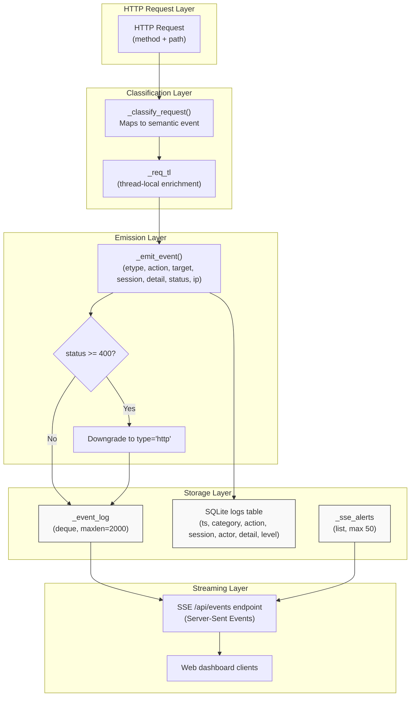
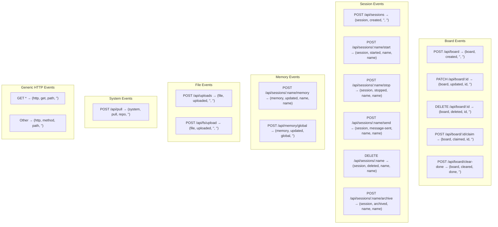
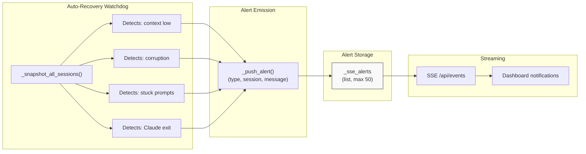
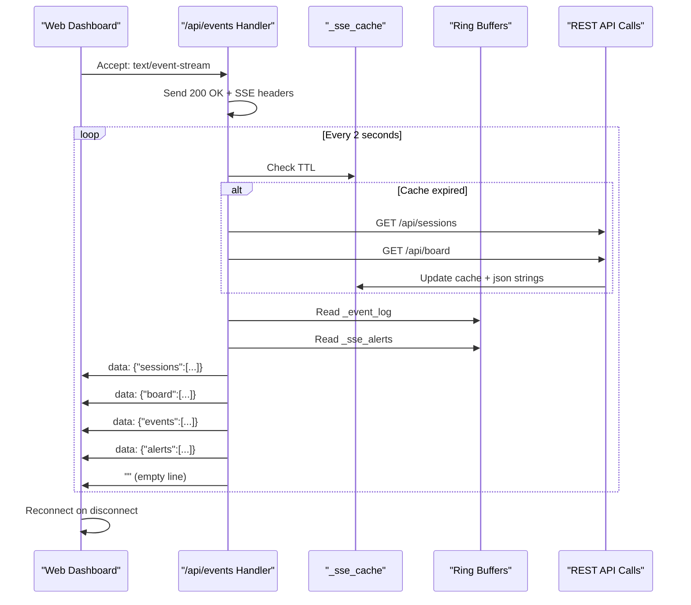
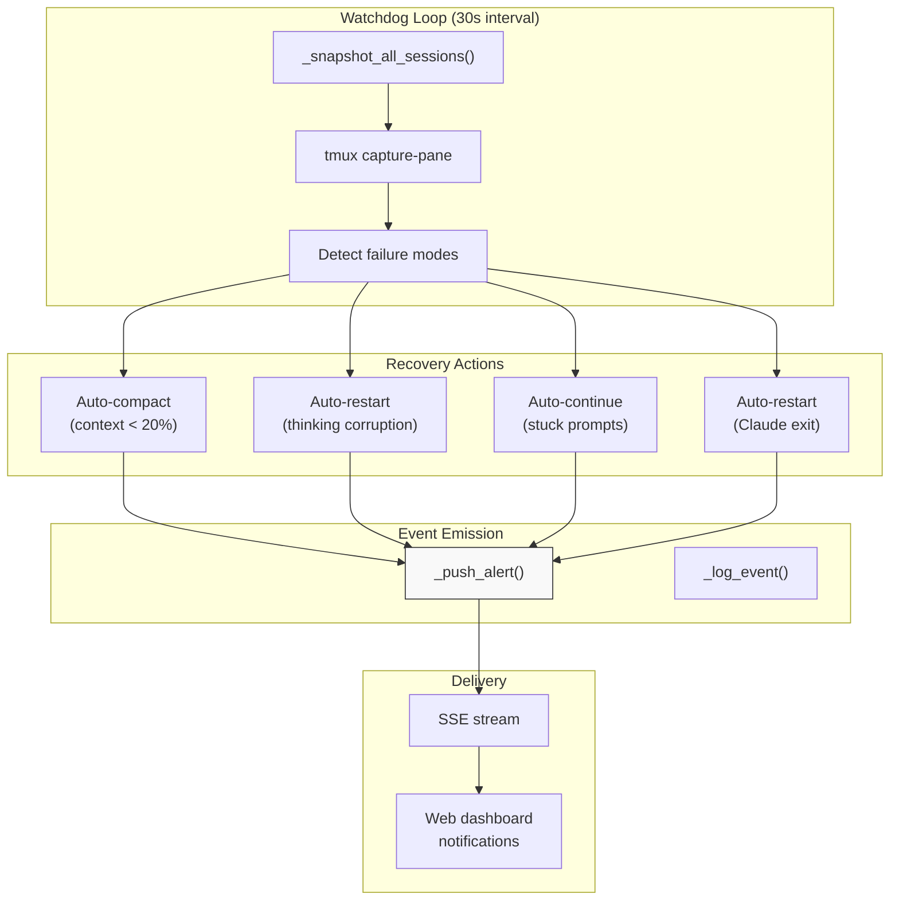

<!-- source: DeepWiki mcp.deepwiki.com · repo mixpeek/amux · page 2.5 Event System & Logging · fetched 2026-10-27 -->

# Event System & Logging

<details>
<summary>Relevant source files</summary>

The following files were used as context for generating this wiki page:

- [amux-server.py](amux-server.py)
- [cloud/gateway/gateway.py](cloud/gateway/gateway.py)
- [test.mjs](test.mjs)

</details>


This document describes amux's event system and structured logging architecture. The event system provides real-time visibility into server activity through in-memory ring buffers, SSE streaming, and persistent SQLite storage.

For HTTP API endpoints that trigger events, see [REST API Reference](#5). For session lifecycle events, see [Session Management](#2.1). For board operation events, see [Board System](#2.2).

---

## Overview

The event system tracks all significant operations in amux through three parallel channels:

1. **In-memory event log** (`_event_log`): 2000-event ring buffer for SSE streaming to web clients
2. **Persistent logs table**: SQLite storage with full event history for auditing
3. **SSE alerts** (`_sse_alerts`): 50-alert ring buffer for user-facing notifications (auto-compact, auto-restart, etc.)

All events are classified by semantic type (session/board/memory/file/system) rather than raw HTTP verbs, enabling rich filtering and monitoring in the web dashboard.

**Sources:** [amux-server.py:104-107](), [amux-server.py:1080-1107](), [amux-server.py:189-192]()

---

## Event Flow Architecture



**Sources:** [amux-server.py:110-127](), [amux-server.py:129-186](), [amux-server.py:1084-1107]()

---

## Event Log Ring Buffer

The `_event_log` deque serves as the primary in-memory event store, optimized for SSE streaming to web clients.

### Ring Buffer Configuration

| Property | Value | Purpose |
|----------|-------|---------|
| Type | `collections.deque` | Thread-safe append/pop operations |
| Max length | 2000 events | Auto-evicts oldest when full |
| Lock | `_event_log_lock` | Serializes concurrent writes |
| Fields per event | `ts`, `type`, `action`, `target`, `session`, `detail`, `status`, `ip` | Rich filtering capability |

### Event Structure

```python
{
    "ts": 1735680000,           # Unix timestamp
    "type": "session",           # Semantic category
    "action": "started",         # Operation performed
    "target": "api-dev",         # Resource identifier
    "session": "api-dev",        # Session context
    "detail": "",                # Extra info
    "status": 200,               # HTTP status
    "ip": "192.168.1.100"        # Client IP
}
```

**Sources:** [amux-server.py:104-107](), [amux-server.py:110-127]()

---

## Event Classification System

The `_classify_request()` function maps raw HTTP requests to semantic event types, enabling natural language filtering ("show me all session starts") instead of technical filtering ("show me POST /api/sessions/*/start").

### Classification Rules



### Event Type Taxonomy

| Type | Actions | Purpose |
|------|---------|---------|
| `session` | created, started, stopped, deleted, archived, message-sent, configured, peeked, woken | Session lifecycle tracking |
| `board` | created, updated, deleted, claimed, cleared, status-added, status-removed, status-renamed | Kanban board operations |
| `memory` | updated | Context management |
| `file` | uploaded | File upload tracking |
| `system` | pull | System maintenance |
| `http` | get, post, patch, delete | Generic HTTP fallback |

**Sources:** [amux-server.py:129-186]()

---

## Event Emission with Error Handling

The `_emit_event()` function normalizes all events and applies error filtering to prevent false positives in the event stream.

### Error Event Downgrade

Failed requests (status >= 400) that would normally emit semantic events (e.g., "session started") are downgraded to generic `http` events:

```python
def _emit_event(etype: str, action: str, target: str = "", session: str = "",
                detail: str = "", status: int = 200, ip: str = "") -> None:
    # Don't emit semantic events (e.g. message-sent, started) for failed requests.
    # Downgrade to a plain http event so they don't spam the event log as false positives.
    if status >= 400 and etype != "http":
        etype = "http"
        action = action  # keep as-is for http type
    with _event_log_lock:
        _event_log.append({
            "ts": time.time(),
            "type": etype,
            "action": action,
            "target": target,
            "session": session,
            "detail": detail,
            "status": status,
            "ip": ip,
        })
```

This prevents failed authentication attempts from appearing as successful "session started" events.

**Sources:** [amux-server.py:110-127]()

---

## SSE Alerts System

The alerts system provides high-priority notifications for auto-recovery events (auto-compact, auto-restart, thinking-block corruption) that users need to see immediately.

### Alert Ring Buffer



### Alert Types

| Type | Trigger | Message Format |
|------|---------|----------------|
| `auto_compact` | Context < 20% | `Auto-compacted 'session' — context was at N%` |
| `thinking_reset` | Thinking-block corruption | `Session 'session' auto-restarted: thinking block corruption — last message replayed` |
| `auto_continue` | Stuck prompt with `CC_AUTO_CONTINUE=1` | `Auto-continued 'session': sent 1 (proceed)` |
| `auto_restart` | Claude exited to shell with `CC_AUTO_CONTINUE=1` | `Claude exited in 'session' — auto-restarting` |

### Push Alert Function

```python
def _push_alert(alert_type: str, session: str, message: str):
    """Enqueue an alert to be streamed to all SSE clients."""
    global _sse_alerts
    with _sse_alert_lock:
        _sse_alerts.append({
            "type": alert_type,
            "session": session,
            "message": message,
            "ts": int(time.time())
        })
        if len(_sse_alerts) > 50:
            _sse_alerts = _sse_alerts[-50:]
```

**Sources:** [amux-server.py:189-192](), [amux-server.py:1071-1078](), [amux-server.py:1179-1324]()

---

## Persistent Logging to SQLite

The `_log_event()` function writes events to the SQLite `logs` table for long-term audit trails, separate from the in-memory ring buffer.

### Logs Table Schema

```sql
CREATE TABLE logs (
    id       INTEGER PRIMARY KEY AUTOINCREMENT,
    ts       INTEGER NOT NULL,
    category TEXT NOT NULL,
    action   TEXT NOT NULL,
    session  TEXT,
    actor    TEXT,
    detail   TEXT,
    level    TEXT NOT NULL DEFAULT 'info'
);
```

### Log Event Function

```python
def _log_event(category: str, action: str, *, session: str = None,
               actor: str = None, detail: str = None, level: str = "info"):
    """Write an event to the logs table and push to SSE clients."""
    ts = int(time.time())
    try:
        db = get_db()
        db.execute(
            "INSERT INTO logs (ts, category, action, session, actor, detail, level) "
            "VALUES (?,?,?,?,?,?,?)",
            (ts, category, action, session, actor, detail, level))
        db.commit()
    except Exception:
        pass
    evt = {"ts": ts, "category": category, "action": action,
           "type": category, "target": detail,  # aliases for _event_log schema compat
           "session": session, "actor": actor, "detail": detail, "level": level}
    with _log_ring_lock:
        _log_ring.append(evt)
        if len(_log_ring) > 100:
            _log_ring[:] = _log_ring[-100:]
    # Also push to the SSE event log ring so the Logs tab receives it live
    with _event_log_lock:
        _event_log.append(evt)
```

### Dual-Ring Architecture

The persistent logger maintains two separate ring buffers:

1. **`_log_ring`** (100 events): Dedicated SSE stream for the Logs tab
2. **`_event_log`** (2000 events): Shared event stream that also receives log events

This dual-push ensures log events appear in both the Logs tab and the general event stream.

**Sources:** [amux-server.py:1080-1107]()

---

## Server File Logging

The `slog()` function provides timestamped text logging to `~/.amux/logs/server.log` for server startup, errors, and infrastructure events.

### Log File Configuration

| Property | Value | Purpose |
|----------|-------|---------|
| Path | `~/.amux/logs/server.log` | Persistent across server restarts |
| Lock | `_server_log_lock` | Thread-safe writes |
| TTY detection | `sys.stderr.isatty()` | Avoids double-logging with launchd |
| Timestamp format | `YYYY-MM-DD HH:MM:SS` | Human-readable |

### Usage Pattern

```python
def slog(*args):
    """Append a timestamped line to ~/.amux/logs/server.log (and stderr if TTY)."""
    import datetime
    msg = " ".join(str(a) for a in args)
    line = f"{datetime.datetime.now().strftime('%Y-%m-%d %H:%M:%S')} {msg}\n"
    # Only write to stderr if it's a real terminal — launchd redirects stderr
    # to server.log, so writing to both would double every line.
    if sys.stderr.isatty():
        sys.stderr.write(line)
    try:
        with _server_log_lock:
            with open(SERVER_LOG, "a") as f:
                f.write(line)
    except Exception:
        pass
```

**Example log entries:**

```
2025-01-01 12:00:00 Server starting on port 8822
2025-01-01 12:00:05 Litestream restore completed
2025-01-01 12:00:10 MCP server gdocs spawned (pid 12345)
2025-01-01 12:05:00 Auto-compacted session 'api-dev' — context was at 15%
```

**Sources:** [amux-server.py:77-95]()

---

## Session Log Persistence

Per-session terminal output is logged to `~/.amux/logs/<session>.log` files via tmux pipe-pane, separate from the server event log.

### Session Log Management

```python
def save_session_log(session: str, content: str):
    """Append content to session log, trimming from the front when > MAX_LOG_BYTES."""
    if not content.strip():
        return
    lp = _log_path(session)
    CC_LOGS.mkdir(parents=True, exist_ok=True)
    try:
        data = content.encode("utf-8", errors="replace")
        # Trim from front if combined size would exceed limit
        existing_size = lp.stat().st_size if lp.exists() else 0
        if existing_size + len(data) > MAX_LOG_BYTES:
            # Read existing, trim oldest bytes, append new
            existing = lp.read_bytes() if lp.exists() else b""
            combined = existing + data
            combined = combined[-MAX_LOG_BYTES:]
            lp.write_bytes(combined)
        else:
            with lp.open("ab") as f:
                f.write(data)
    except Exception:
        pass
```

### Log Size Management

- **Max log size:** 10 MB per session (`MAX_LOG_BYTES`)
- **Trimming strategy:** FIFO eviction from front when size exceeded
- **Write pattern:** Append-only with periodic snapshots

**Sources:** [amux-server.py:77-78](), [amux-server.py:981-1017]()

---

## SSE Event Streaming

The `/api/events` endpoint streams events and alerts to web clients using Server-Sent Events (SSE).

### SSE Endpoint Architecture



### SSE Cache Layer

The `_sse_cache` dict prevents redundant subprocess calls (tmux, database queries) when multiple browser tabs are open:

```python
_sse_cache = {
    "sessions": {"data": None, "json": "", "time": 0},
    "board": {"data": None, "json": "", "time": 0},
}
_SSE_CACHE_TTL = 2  # seconds
```

**Cache invalidation:**
- Time-based: 2-second TTL
- Event-based: Notes version bump (`_notes_version++`)
- Event-based: CRM version bump (`_crm_version++`)

### SSE Message Format

Each SSE message contains JSON-encoded state snapshots:

```javascript
data: {"sessions": [{name: "api-dev", running: true, ...}], ...}

data: {"board": [{id: "TASK-1", title: "...", status: "doing", ...}], ...}

data: {"events": [{ts: 1735680000, type: "session", action: "started", ...}], ...}

data: {"alerts": [{type: "auto_compact", session: "api-dev", ...}], ...}

```

**Sources:** [amux-server.py:97-102](), SSE handler in main request routing

---

## Gateway Logging

The cloud gateway (`gateway.py`) logs to stderr with client IP and request details. Systemd redirects stderr to journald for centralized log aggregation.

### Gateway Log Format

```python
def log_message(self, fmt, *args):
    import sys
    sys.stderr.write(f"[gateway] {self.client_address[0]} {fmt % args}\n")
    sys.stderr.flush()
```

**Example gateway logs:**

```
[gateway] 203.0.113.45 "GET / HTTP/1.1" 200 -
[gateway] 203.0.113.45 "POST /api/sessions HTTP/1.1" 201 -
[gateway] 198.51.100.23 [auth] Bearer verify failed for /api/board: expired token
[gateway] 192.0.2.100 [reaper] stopping idle container for user_abc123
```

**Sources:** [cloud/gateway/gateway.py:460-464]()

---

## Event-Driven Auto-Recovery Integration

The event system integrates with the self-healing watchdog to provide real-time visibility into auto-recovery actions. See [Self-Healing Watchdog](#2.4) for recovery logic details.

### Recovery Event Flow



**Sources:** [amux-server.py:1179-1324](), [amux-server.py:1071-1078]()

---

## Testing Event Streams

The E2E test suite validates event streaming behavior across desktop and mobile viewports.

### Test Coverage

| Test Area | Assertions | Purpose |
|-----------|------------|---------|
| SSE connection | Client connects with `Accept: text/event-stream` | Verify SSE header negotiation |
| Event classification | All CRUD operations emit correct event types | Validate `_classify_request()` logic |
| Alert delivery | Auto-recovery alerts appear in notification stream | Confirm watchdog integration |
| Ring buffer eviction | Old events drop when buffer exceeds 2000 | Verify memory bounds |
| Multi-tab efficiency | Same data cached across tabs for 2s | Confirm `_sse_cache` reduces load |

**Example test flow:**

```javascript
// test.mjs — SSE event stream validation
const evtSource = new EventSource('/api/events');
evtSource.onmessage = (e) => {
  const data = JSON.parse(e.data);
  if (data.events) {
    log('SSE events received', data.events.length > 0);
  }
  if (data.alerts) {
    log('SSE alerts received', data.alerts.length > 0);
  }
};
```

**Sources:** [test.mjs:640-790]()

---

## Best Practices

### For Event Consumers (Web Dashboard)

1. **Reconnect on disconnect:** SSE connections drop after 60s of inactivity in some browsers
2. **Filter by event type:** Use `type` field to show only relevant events (`type === "session"`)
3. **Aggregate alerts:** Display `_sse_alerts` in a persistent notification area
4. **Debounce UI updates:** Don't re-render on every 2s SSE tick; batch updates

### For Event Emitters (API Handlers)

1. **Use semantic types:** Emit `(session, started, ...)` not `(http, post, ...)`
2. **Enrich with context:** Include `session` field even if not in URL path
3. **Don't log sensitive data:** Never emit API keys, passwords, or tokens in `detail`
4. **Fail gracefully:** Event emission failures should not crash request handlers

### For Operators

1. **Monitor `_event_log` size:** Should stay near 2000 in production (ring buffer full)
2. **Check `logs` table growth:** Prune old rows (>30 days) to prevent unbounded growth
3. **Tail `server.log`:** Use `tail -f ~/.amux/logs/server.log` for real-time debugging
4. **Watch SSE connection count:** High connection counts indicate clients not closing properly

**Sources:** [amux-server.py:104-127](), [amux-server.py:1080-1107]()

---

