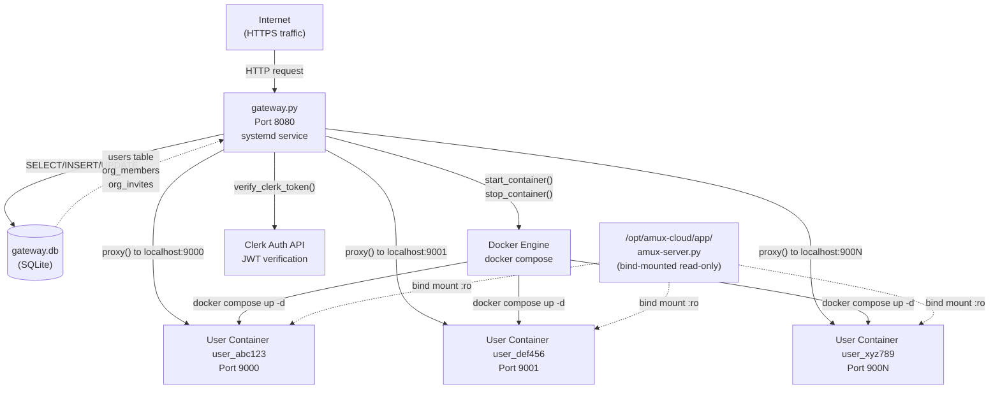
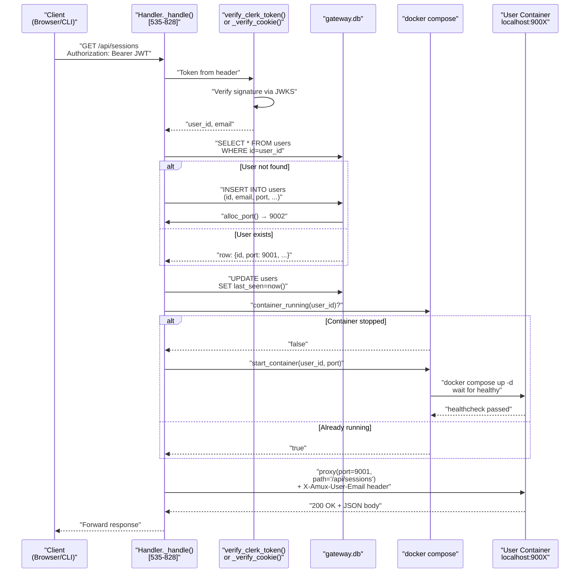
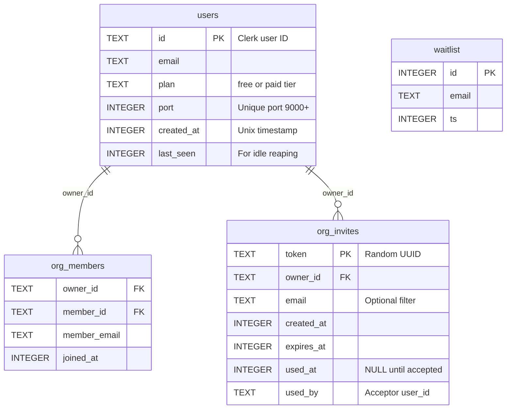
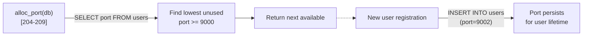
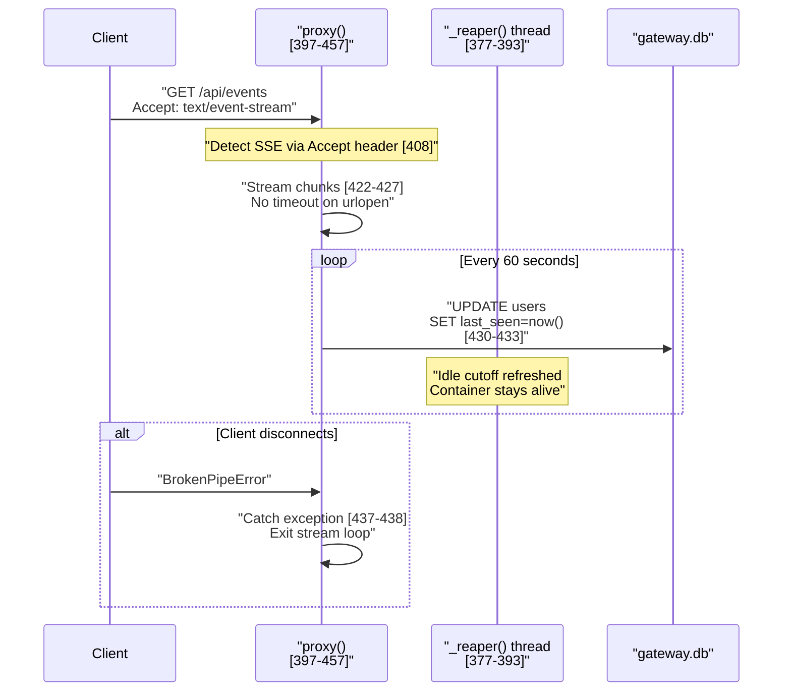

<!-- source: DeepWiki mcp.deepwiki.com · repo mixpeek/amux · page 3 Gateway & Multi-Tenancy · fetched 2026-10-27 -->

# Gateway & Multi-Tenancy

<details>
<summary>Relevant source files</summary>

The following files were used as context for generating this wiki page:

- [.github/workflows/backup-cloud.yml](.github/workflows/backup-cloud.yml)
- [.github/workflows/deploy-cloud.yml](.github/workflows/deploy-cloud.yml)
- [amux-server.py](amux-server.py)
- [cloud/docker/docker-compose.template.yml](cloud/docker/docker-compose.template.yml)
- [cloud/gateway/gateway.py](cloud/gateway/gateway.py)
- [templates/README.md](templates/README.md)
- [templates/content-creator/CLAUDE.md](templates/content-creator/CLAUDE.md)
- [templates/content-creator/template.json](templates/content-creator/template.json)
- [templates/fitness-tracker/CLAUDE.md](templates/fitness-tracker/CLAUDE.md)
- [test.mjs](test.mjs)

</details>


## Purpose & Scope

The gateway system enables multi-tenant cloud deployment of amux, where a single server at `cloud.amux.io` orchestrates isolated Docker containers for each authenticated user. The gateway handles authentication, container lifecycle management, port allocation, and request proxying. This page covers the gateway's architecture and responsibilities at a high level.

For detailed authentication mechanisms, see [Authentication Flow](#3.1). For container lifecycle operations (starting, stopping, health checks, idle reaping), see [Container Lifecycle](#3.2).

**Key distinction**: The core amux server ([amux-server.py:1-2000+]()) runs identically in both local and cloud deployments. The gateway ([cloud/gateway/gateway.py:1-828]()) is a **cloud-only** component that sits in front of user containers, providing authentication and orchestration without modifying the core server code.

Sources: [cloud/gateway/gateway.py:1-10](), [amux-server.py:1-3]()

---

## Architecture Overview

The gateway implements a **gateway + sidecar** pattern where:
- **One gateway process** (`gateway.py`) handles all incoming traffic on port 8080
- **Per-user container stacks** run isolated amux instances with dedicated ports (9000, 9001, 9002...)
- **Shared bind mount** for `amux-server.py` enables zero-downtime updates across all users



**Multi-Tenancy via Isolation**: Each user gets a 3-container Docker Compose stack (amux + litestream + sync) with a dedicated named volume (`amux-data-{user_id}`). Containers never share state, but all bind-mount the same `amux-server.py` file, enabling atomic updates.

Sources: [cloud/gateway/gateway.py:11-29](), [cloud/docker/docker-compose.template.yml:1-70]()

---

## Gateway Components

### Core Modules

The gateway is a single-file Python HTTP server ([cloud/gateway/gateway.py:1-828]()) with the following logical components:

| Component | Functions/Classes | Purpose |
|-----------|------------------|---------|
| **Authentication** | `verify_clerk_token()` [335-347](), `_verify_cookie()` [284-303]() | JWT verification and session cookies |
| **Database** | `get_db()` [165-201](), schema at [169-199]() | User registry and organization membership |
| **Container Ops** | `start_container()` [261-271](), `stop_container()` [273-275]() | Docker Compose orchestration |
| **Port Allocation** | `alloc_port()` [204-209]() | Assign unique ports from 9000+ |
| **Proxying** | `proxy()` [397-457]() | HTTP reverse proxy with SSE support |
| **Request Handler** | `Handler` class [460-828]() | HTTP endpoint routing |
| **Idle Reaper** | `_reaper()` thread [377-393]() | Auto-stop idle containers after 3600s |

Sources: [cloud/gateway/gateway.py:165-828]()

---

## Request Flow

Every incoming request follows this pipeline:



**Key routing logic**: The `Handler._handle()` method ([535-828]()) first attempts Bearer token authentication ([645-650]()), then falls back to session cookies ([652-662]()). Unauthenticated requests to non-API paths serve the Clerk login page ([661-668]()).

Sources: [cloud/gateway/gateway.py:535-828](), [cloud/gateway/gateway.py:397-457]()

---

## User Database Schema

The gateway maintains state in a SQLite database ([cloud/gateway/gateway.py:26]()) with four tables:



**Table purposes**:
- `users`: Core registry mapping Clerk user IDs to allocated ports and metadata
- `org_invites`: Pending workspace invitations (7-day expiry)
- `org_members`: Active organization memberships (member can view owner's workspace)
- `waitlist`: Pre-launch signup collection (no auth required)

**Schema creation**: [cloud/gateway/gateway.py:169-199]()

Sources: [cloud/gateway/gateway.py:165-201]()

---

## Container Management Overview

The gateway treats each user's Docker Compose stack as an opaque unit:

| Operation | Function | Trigger | Location |
|-----------|----------|---------|----------|
| **Start** | `start_container()` | First request after stop | [261-271]() |
| **Stop** | `stop_container()` | Idle > 3600s (free tier) | [273-275]() |
| **Health check** | `container_healthy()` | Before proxying requests | [239-243]() |
| **Status check** | `container_running()` | Determine if start needed | [233-237]() |

**Zero-downtime updates**: All containers bind-mount `/opt/amux-cloud/app/amux-server.py:ro` ([cloud/docker/docker-compose.template.yml:12]()). Deployment workflow uses `rsync --inplace` ([.github/workflows/deploy-cloud.yml:29]()) to overwrite the file atomically, then `touch` triggers auto-restart in running containers.

**Compose file generation**: The template ([cloud/docker/docker-compose.template.yml:1-70]()) is stamped out per-user via string replacement in `_write_compose()` ([217-231]()), substituting `${USER_ID}`, `${USER_PORT}`, credentials, etc.

Sources: [cloud/gateway/gateway.py:211-275](), [cloud/docker/docker-compose.template.yml:1-70](), [.github/workflows/deploy-cloud.yml:26-33]()

---

## Port Allocation

User containers expose `amux-server.py` on unique ports starting at `PORT_BASE = 9000` ([cloud/gateway/gateway.py:28]()):



**Implementation**: `alloc_port()` ([204-209]()) queries all allocated ports, then iterates from 9000 until finding a gap. Ports are assigned once at user creation and never reused (even after deletion).

**Docker mapping**: Each user's `docker-compose.yml` maps their port to container port 8822: `"${USER_PORT}:8822"` ([cloud/docker/docker-compose.template.yml:21]()).

Sources: [cloud/gateway/gateway.py:204-209](), [cloud/gateway/gateway.py:28](), [cloud/docker/docker-compose.template.yml:20-21]()

---

## Request Proxying

The `proxy()` function ([397-457]()) is a lightweight reverse proxy that preserves HTTP semantics while adding multi-tenancy context:

### Standard HTTP Proxying

```python
# Simplified logic from proxy() [397-457]
url = f"http://127.0.0.1:{port}{path}"
body = handler.rfile.read(content_length)
fwd_headers = {k: v for k, v in headers if k not in ["host", "authorization", "cookie"]}
fwd_headers["X-Amux-User-Email"] = user_email

request = urllib.request.Request(url, data=body, headers=fwd_headers)
response = urllib.request.urlopen(request)
# Stream response back to client
```

**Context injection**: The gateway adds `X-Amux-User-Email` header ([407]()) so the amux server can identify the user without re-verifying tokens.

**Security**: Authorization headers are stripped ([404]()) to prevent token leakage to containers.

Sources: [cloud/gateway/gateway.py:397-457]()

### SSE Streaming & Keep-Alive

Server-Sent Events (SSE) connections require special handling to prevent idle reaping:



**Keep-alive mechanism**: During SSE streaming, the proxy updates `users.last_seen` every 60 seconds ([428-436]()) to prevent the idle reaper from stopping the container. This ensures dashboard connections don't trigger timeouts.

**Non-SSE timeout**: Standard HTTP requests use `timeout=60` ([411]()) to prevent hanging on unresponsive containers.

Sources: [cloud/gateway/gateway.py:408-443](), [cloud/gateway/gateway.py:377-393]()

---

## Configuration & Environment

The gateway reads credentials from environment variables, typically loaded via systemd:

```bash
# /etc/amux/gateway.env (example)
CLERK_PUBLISHABLE_KEY=pk_live_...
CLERK_SECRET_KEY=sk_live_...
R2_ACCESS_KEY=...
R2_SECRET_KEY=...
CF_ACCOUNT_ID=...
ANTHROPIC_API_KEY=...
COOKIE_SECRET=random-256-bit-hex
```

**Required variables**: [cloud/gateway/gateway.py:12-20]()

**Defaults**: Gateway port defaults to 8080 ([22]()), idle timeout to 3600s ([27]()), data directory to `/var/amux/users` ([25]()).

**Systemd service**: The gateway runs as a systemd service (not shown in provided files) that sets `WorkingDirectory=/opt/amux-cloud/gateway` and sources the environment file.

Sources: [cloud/gateway/gateway.py:11-29]()

---

## Deployment & Updates

### Gateway Deployment

GitHub Actions workflow [.github/workflows/deploy-cloud.yml:35-40]() handles gateway updates:

1. `rsync --inplace` overwrites `gateway.py` on the server
2. `systemctl restart amux-gateway` restarts the service
3. Active SSE connections are dropped (clients reconnect automatically)

**Downtime**: ~2 seconds during restart. No container state is lost since containers run independently.

### User Container Updates

For `amux-server.py` updates [.github/workflows/deploy-cloud.yml:26-33]():

1. `rsync --inplace` overwrites the bind-mounted file
2. `touch` changes mtime, triggering auto-restart in running containers
3. All user containers reload simultaneously without manual intervention

**Zero-downtime property**: Because the file is bind-mounted read-only ([cloud/docker/docker-compose.template.yml:12]()), the Docker daemon tracks changes by inode. Overwriting in-place preserves the inode while updating content.

Sources: [.github/workflows/deploy-cloud.yml:26-40](), [cloud/docker/docker-compose.template.yml:12]()

---

## Monitoring & Observability

### Logging

Gateway logs go to stderr, captured by systemd journal:

```python
# Example log output from Handler.log_message() [461-464]
# [gateway] 203.0.113.42 "GET /api/sessions HTTP/1.1" 200 -
```

**Access log format**: `[gateway] {client_ip} {method} {path} {status}` ([462-463]())

### Health Checks

Container health is verified via Docker healthcheck before proxying:

```yaml
# docker-compose.template.yml [22-27]
healthcheck:
  test: ["CMD", "curl", "-f", "http://localhost:8822/api/sessions"]
  interval: 5s
  retries: 6
  start_period: 10s
```

**Gateway behavior**: If `container_healthy()` returns false after start, the gateway waits for up to 40 seconds ([268-271]()) before timing out.

Sources: [cloud/gateway/gateway.py:461-464](), [cloud/gateway/gateway.py:239-243](), [cloud/docker/docker-compose.template.yml:22-27]()

---

## Comparison: Gateway vs. Direct Deployment

| Aspect | Local (amux-server.py) | Cloud (gateway.py + containers) |
|--------|------------------------|----------------------------------|
| **Authentication** | None (localhost trusted) | Clerk JWT + session cookies |
| **Isolation** | Single user, no boundaries | Per-user Docker volumes |
| **Port** | Configurable, default 8822 | Gateway: 8080, containers: 9000+ |
| **TLS** | Self-signed cert | Caddy reverse proxy (not shown) |
| **Updates** | Manual restart | Atomic bind-mount refresh |
| **Scaling** | One instance per machine | Hundreds of users per VM |
| **State persistence** | Local filesystem | R2 (litestream) + S3 (sync) |

**Code reuse**: Both modes run the exact same `amux-server.py`. The gateway never modifies the server code; it only adds an orchestration layer.

Sources: [amux-server.py:1-50](), [cloud/gateway/gateway.py:1-10]()

---

