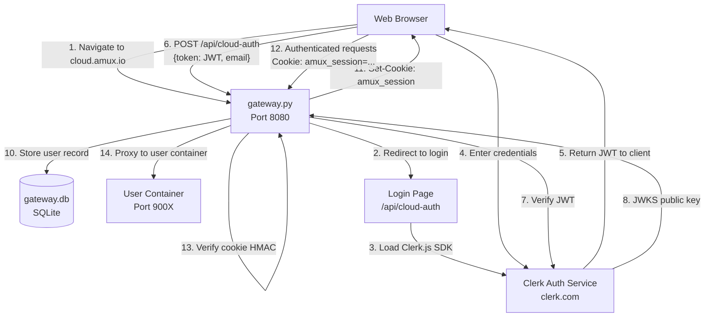
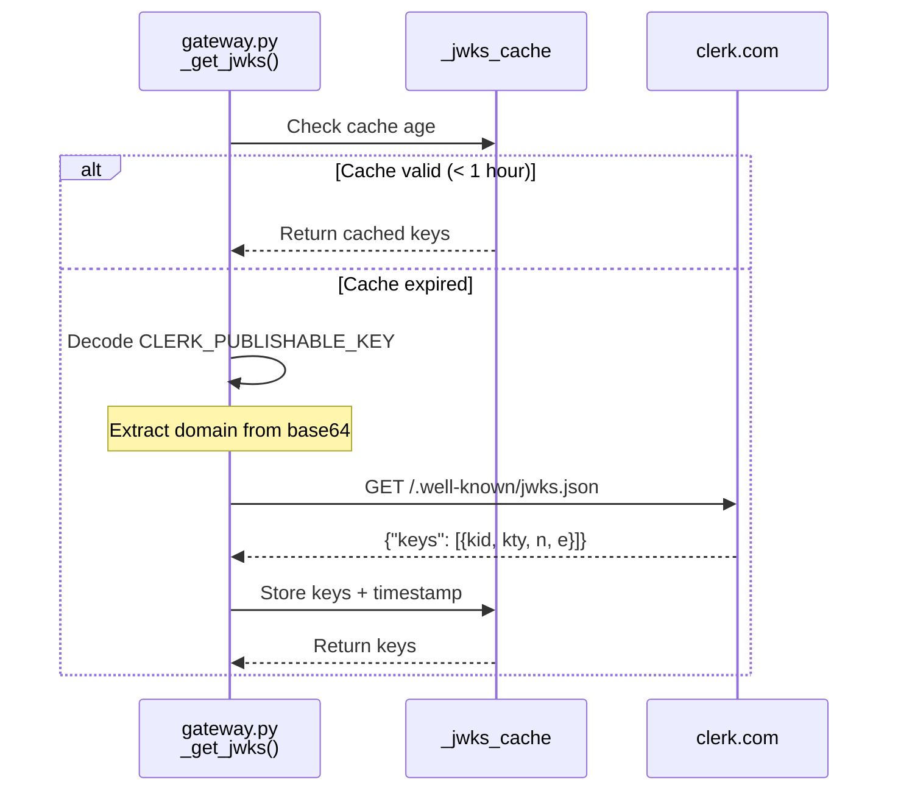
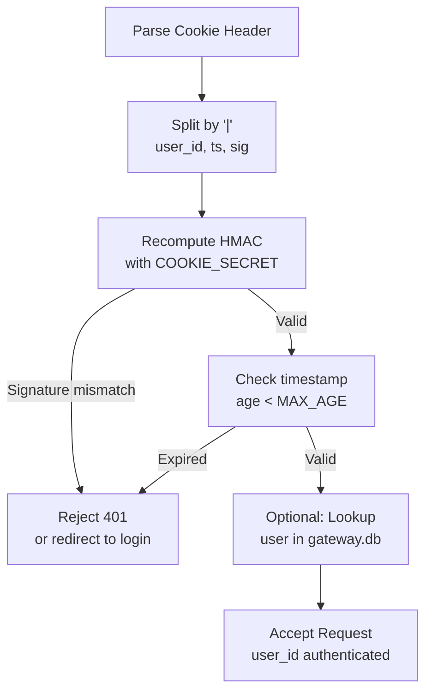
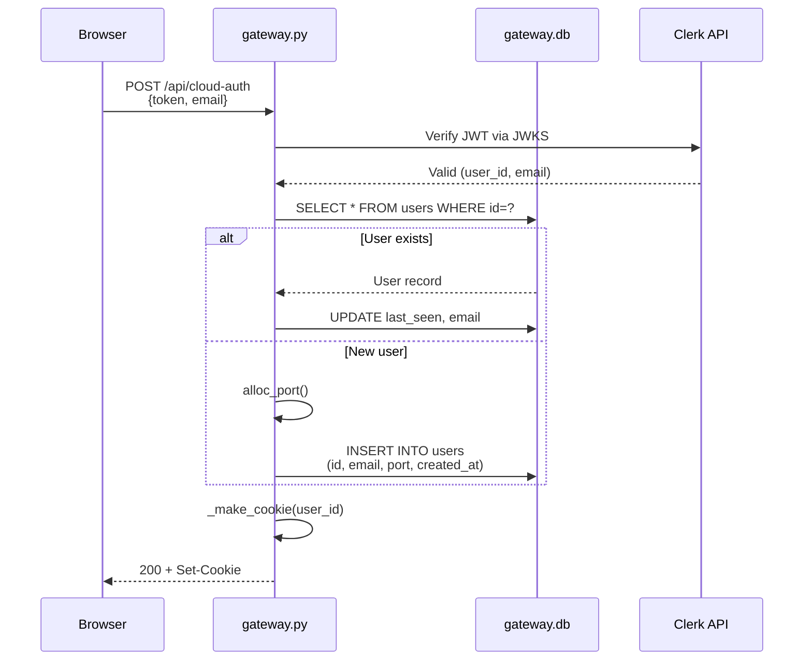
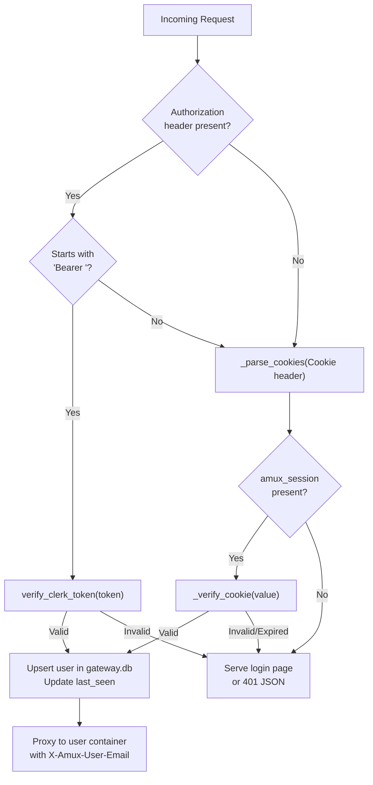
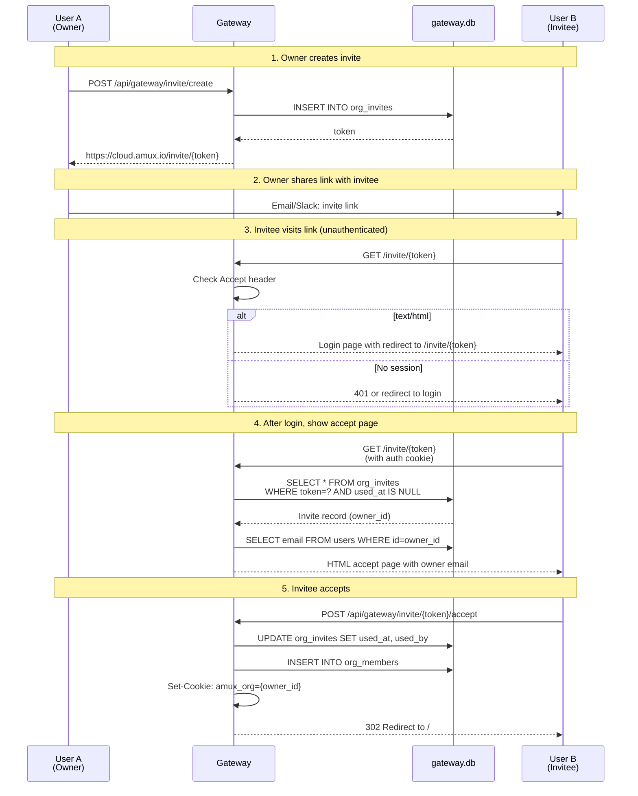

<!-- source: DeepWiki mcp.deepwiki.com · repo mixpeek/amux · page 3.1 Authentication Flow · fetched 2026-10-27 -->

# Authentication Flow

<details>
<summary>Relevant source files</summary>

The following files were used as context for generating this wiki page:

- [amux-server.py](amux-server.py)
- [cloud/docker/Dockerfile](cloud/docker/Dockerfile)
- [cloud/docker/amux-server.py](cloud/docker/amux-server.py)
- [cloud/gateway/gateway.py](cloud/gateway/gateway.py)
- [pw-investigate.js](pw-investigate.js)
- [pw-invitations-ui.js](pw-invitations-ui.js)
- [pw-invitations.js](pw-invitations.js)
- [pw-invite-final.js](pw-invite-final.js)
- [test.mjs](test.mjs)
- [tests/e2e-peek-dir.js](tests/e2e-peek-dir.js)
- [tests/pw-investigate.js](tests/pw-investigate.js)
- [tests/pw-offline-debug.js](tests/pw-offline-debug.js)

</details>


## Purpose and Scope

This document describes the authentication mechanism used by the amux cloud gateway to verify user identity and establish sessions. It covers Clerk JWT verification, session cookie management, and organization membership resolution. For information about container orchestration and request proxying after authentication, see [Container Lifecycle](#3.2). For API endpoint authentication in the main server, see [REST API Reference](#5).

---

## Architecture Overview

The cloud gateway ([cloud/gateway/gateway.py]()) uses **Clerk** as its authentication provider. Users authenticate via Clerk's hosted UI, then the gateway exchanges their JWT for a secure session cookie. All subsequent requests are authenticated using either Bearer tokens (for API clients) or session cookies (for web browsers).



**Sources:** [cloud/gateway/gateway.py:1-630]()

---

## Clerk JWT Verification

### JWKS Public Key Retrieval

The gateway retrieves Clerk's public signing keys from their JWKS endpoint. The Clerk publishable key (format: `pk_test_<base64>`) contains the domain encoded in base64. This domain is decoded to construct the JWKS URL.



**Implementation Details:**

| Function | Location | Purpose |
|----------|----------|---------|
| `_get_jwks()` | [cloud/gateway/gateway.py:320-333]() | Fetches and caches Clerk JWKS |
| `verify_clerk_token()` | [cloud/gateway/gateway.py:335-347]() | Validates JWT signature and extracts claims |

The JWKS cache has a 1-hour TTL to balance security and performance. Keys are stored in `_jwks_cache` dict with `{"keys": [...], "ts": timestamp}` structure.

**Sources:** [cloud/gateway/gateway.py:316-348]()

---

### JWT Verification Process

When a user submits a JWT, the gateway:

1. **Extracts the key ID (`kid`)** from the JWT header without verification
2. **Finds the matching public key** from cached JWKS
3. **Verifies the signature** using RSA-256
4. **Extracts claims**: `sub` (user_id) and `email`

```python
# Simplified verification logic from gateway.py:335-347
def verify_clerk_token(token):
    keys = _get_jwks()
    header = pyjwt.get_unverified_header(token)  # Get kid
    kid = header.get("kid")
    key = next((k for k in keys if k["kid"] == kid), None)
    if not key:
        raise ValueError("unknown kid")
    public_key = pyjwt.algorithms.RSAAlgorithm.from_jwk(json.dumps(key))
    payload = pyjwt.decode(token, public_key, algorithms=["RS256"],
                           options={"verify_aud": False})
    return payload["sub"], payload.get("email", "")
```

**JWT Claims Used:**

| Claim | Type | Purpose |
|-------|------|---------|
| `sub` | string | Clerk user ID (e.g., `user_abc123`) — used as primary key |
| `email` | string | User's primary email address |
| `kid` | string (header) | Identifies which public key to use for verification |

**Sources:** [cloud/gateway/gateway.py:335-347]()

---

## Session Cookie Mechanism

### Cookie Generation

After successful JWT verification, the gateway creates a session cookie with HMAC signature to prevent tampering. The cookie format is:

```
amux_session={user_id}|{timestamp}|{hmac_signature}
```

The HMAC signature is computed using:
```python
# From gateway.py:278-282
payload = f"{user_id}|{ts}"
sig = hmac.new(COOKIE_SECRET.encode(), payload.encode(), hashlib.sha256).hexdigest()
cookie_value = f"{payload}|{sig}"
```

**Cookie Attributes:**

| Attribute | Value | Purpose |
|-----------|-------|---------|
| `HttpOnly` | true | Prevents JavaScript access (XSS protection) |
| `SameSite` | Lax | CSRF protection while allowing top-level navigation |
| `Secure` | true (HTTPS only) | Prevents transmission over unencrypted connections |
| `Max-Age` | 604800 (7 days) | Cookie expiration (defined by `COOKIE_MAX_AGE`) |
| `Path` | `/` | Cookie sent with all requests to the domain |

**Sources:** [cloud/gateway/gateway.py:277-303, 618-627]()

---

### Cookie Verification

On each request, the gateway verifies the session cookie:



The verification function uses constant-time comparison to prevent timing attacks:

```python
# From gateway.py:284-303
def _verify_cookie(val):
    last = val.rfind("|")
    payload, sig = val[:last], val[last+1:]
    expected = hmac.new(COOKIE_SECRET.encode(), payload.encode(), 
                       hashlib.sha256).hexdigest()
    if not hmac.compare_digest(sig, expected):
        raise ValueError("bad signature")
    uid, ts = payload.split("|")
    if int(time.time()) - int(ts) > COOKIE_MAX_AGE:
        raise ValueError("expired")
    return uid
```

**Sources:** [cloud/gateway/gateway.py:284-303]()

---

## Authentication Endpoints

### POST /api/cloud-auth

Exchanges a Clerk JWT for a session cookie. This is the primary login endpoint called by the browser after Clerk authentication completes.

**Request:**
```json
{
  "token": "eyJhbGciOiJSUzI1NiIsInR5cCI6IkpXVCJ9...",
  "email": "user@example.com"
}
```

**Response:**
```json
{
  "ok": true
}
```

**Headers:**
```
Set-Cookie: amux_session={user_id}|{ts}|{sig}; HttpOnly; Secure; SameSite=Lax; Max-Age=604800; Path=/
```

**Flow:**



**Sources:** [cloud/gateway/gateway.py:592-630]()

---

### GET/POST /api/cloud-logout

Clears the session cookie by setting `Max-Age=0`.

**Response:**
```
HTTP/1.1 302 Found
Location: /
Set-Cookie: amux_session=; HttpOnly; Secure; SameSite=Lax; Max-Age=0; Path=/
```

**Sources:** [cloud/gateway/gateway.py:582-590]()

---

## Request Authentication Resolution

Every authenticated request goes through a two-path resolution: Bearer token (for API clients) or session cookie (for browsers).



**Authentication Code Paths:**

| Scenario | Lines | Result |
|----------|-------|--------|
| Valid Bearer token | [cloud/gateway/gateway.py:645-650]() | Extract `user_id` and `email` from JWT |
| Valid session cookie | [cloud/gateway/gateway.py:652-662]() | Extract `user_id` from cookie, fetch email from DB |
| Invalid/missing auth | [cloud/gateway/gateway.py:664-669]() | Return login HTML (if `Accept: text/html`) or 401 JSON |

After resolving the user, the gateway upserts a record in `gateway.db` with updated `last_seen` timestamp. This timestamp is used by the idle reaper to stop inactive containers.

**Sources:** [cloud/gateway/gateway.py:642-696]()

---

## User Database Schema

The gateway maintains user records in SQLite:

```sql
CREATE TABLE users (
    id          TEXT PRIMARY KEY,      -- Clerk user_id (sub claim)
    email       TEXT,                  -- Primary email address
    plan        TEXT NOT NULL DEFAULT 'free',
    port        INTEGER UNIQUE,        -- Allocated container port (9000+)
    created_at  INTEGER NOT NULL,      -- Unix timestamp
    last_seen   INTEGER NOT NULL       -- Unix timestamp (updated on each request)
);
```

**Port Allocation:** When a new user is created, the gateway scans existing ports and assigns the next available port starting from `PORT_BASE=9000`. This port maps to the user's Docker container ([cloud/gateway/gateway.py:203-209]()).

**Sources:** [cloud/gateway/gateway.py:165-201]()

---

## Organization Membership System

The gateway supports organization-based access control where users can join other users' workspaces via invitation tokens.

### Invite Schema

```sql
CREATE TABLE org_invites (
    token       TEXT PRIMARY KEY,      -- Unique invite token (UUID)
    owner_id    TEXT NOT NULL,         -- User who created the invite
    email       TEXT,                  -- Optional: restrict to specific email
    created_at  INTEGER NOT NULL,      -- Unix timestamp
    expires_at  INTEGER NOT NULL,      -- Unix timestamp (typically +7 days)
    used_at     INTEGER,               -- NULL until accepted
    used_by     TEXT                   -- User who accepted the invite
);

CREATE TABLE org_members (
    owner_id    TEXT NOT NULL,         -- Workspace owner
    member_id   TEXT NOT NULL,         -- Member user_id
    member_email TEXT,                 -- Member email
    joined_at   INTEGER NOT NULL,      -- Unix timestamp
    PRIMARY KEY (owner_id, member_id)
);
```

**Sources:** [cloud/gateway/gateway.py:183-198]()

---

### Invite Flow



**Invite URL Format:** `https://cloud.amux.io/invite/{token}`

When a user with `amux_org` cookie makes requests, the gateway proxies to the **owner's container** instead of their own. This allows members to view and interact with the owner's sessions, board, and files.

**Sources:** [cloud/gateway/gateway.py:632-728]()

---

## Security Considerations

### HMAC Secret Management

The `COOKIE_SECRET` environment variable is critical for session security. If compromised, an attacker could forge valid session cookies for any user.

**Best Practices:**
- Generate with: `openssl rand -hex 32`
- Store in environment variables (never in code)
- Rotate periodically (invalidates all existing sessions)

**Sources:** [cloud/gateway/gateway.py:19]()

---

### JWT Verification Security

The gateway performs the following security checks:

1. **Signature Verification**: Uses Clerk's RSA public key to verify the JWT wasn't tampered with
2. **Key ID (kid) Validation**: Ensures the JWT was signed by a known Clerk key
3. **No Audience Check**: Disables `verify_aud` because Clerk JWTs don't include an audience claim ([cloud/gateway/gateway.py:346]())
4. **JWKS Caching**: 1-hour cache prevents DoS via repeated JWKS fetches but ensures key rotation is respected

**Not Implemented:**
- **Expiration (`exp`) check**: PyJWT validates `exp` by default, but the gateway doesn't explicitly check it
- **Issued-at (`iat`) check**: Not validated (assumes Clerk enforces this)
- **Token revocation**: No check against Clerk's revocation list (API limitation)

**Sources:** [cloud/gateway/gateway.py:335-347]()

---

### Cookie Security Properties

| Property | Implementation | Security Benefit |
|----------|----------------|------------------|
| HMAC Signature | SHA-256 with secret key | Prevents cookie tampering |
| Constant-time Comparison | `hmac.compare_digest()` | Prevents timing attacks |
| Timestamp Expiry | 7-day max age | Limits session lifetime |
| HttpOnly Flag | Set on all cookies | Prevents XSS cookie theft |
| Secure Flag | Set when `X-Forwarded-Proto: https` | Prevents MitM on HTTP |
| SameSite=Lax | Prevents most CSRF | Allows top-level navigation |

**Sources:** [cloud/gateway/gateway.py:284-303, 524-526, 618-627]()

---

## Authentication Header Forwarding

After successful authentication, the gateway strips authentication headers and injects a custom header for the user container:

```
X-Amux-User-Email: user@example.com
```

This allows `amux-server.py` to know which user is making the request without implementing separate authentication logic. The email is used for logging and display purposes only (the container is already isolated by Docker).

**Stripped Headers:**
- `Authorization`
- `Cookie`
- `Host`
- `Content-Length` (recalculated during proxy)

**Sources:** [cloud/gateway/gateway.py:396-409]()

---

## Email Resolution Priority

When a user authenticates, their email is resolved in this priority order:

1. **Client-provided email** from Clerk.js (`body.email` in POST /api/cloud-auth)
2. **JWT `email` claim** from decoded token
3. **Clerk API lookup** via GET `/v1/users/{user_id}` with `CLERK_SECRET_KEY`
4. **Database cache** from previous lookups

The email is cached in `_clerk_email_cache` (in-memory dict) and persisted to `gateway.db` on each update to minimize API calls.

**Sources:** [cloud/gateway/gateway.py:349-374, 592-603, 689-695]()

---

## Idle Session Management

The gateway updates `last_seen` timestamp in `gateway.db` on every authenticated request. A background reaper thread stops containers that have been idle for more than `IDLE_SECONDS` (default: 3600 seconds / 1 hour).

**Special Case: SSE Connections**

Server-Sent Events (SSE) connections remain open for extended periods. The proxy refreshes `last_seen` every 60 seconds while streaming SSE data to prevent premature container shutdown:

```python
# From gateway.py:418-436
if is_sse:
    last_touch = time.time()
    while True:
        chunk = resp.read(4096)
        if not chunk:
            break
        handler.wfile.write(chunk)
        handler.wfile.flush()
        if user_id and time.time() - last_touch > 60:
            db.execute("UPDATE users SET last_seen=? WHERE id=?",
                       (int(time.time()), user_id))
            db.commit()
            last_touch = time.time()
```

**Sources:** [cloud/gateway/gateway.py:376-394, 418-436]()

---

## Related Pages

- [Container Lifecycle](#3.2) — How containers are started, stopped, and monitored after authentication
- [Cloud Deployment](#4) — Overall cloud architecture and deployment procedures
- [REST API Reference](#5) — Endpoint authentication in amux-server.py
- [Web Dashboard](#6) — How the browser UI handles authentication and session management

---

