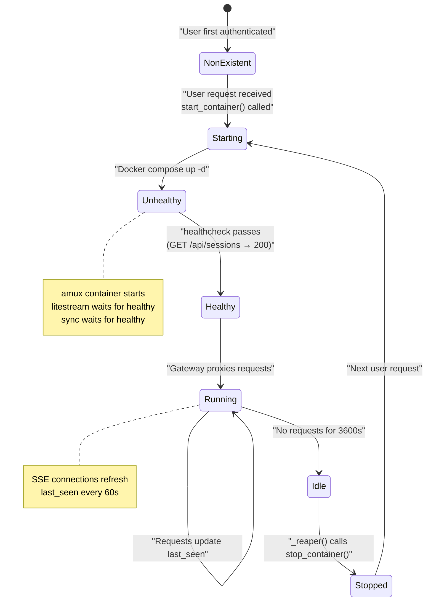
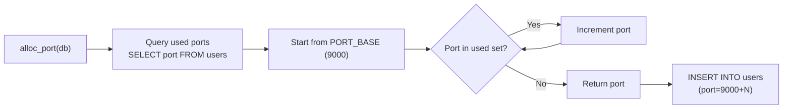
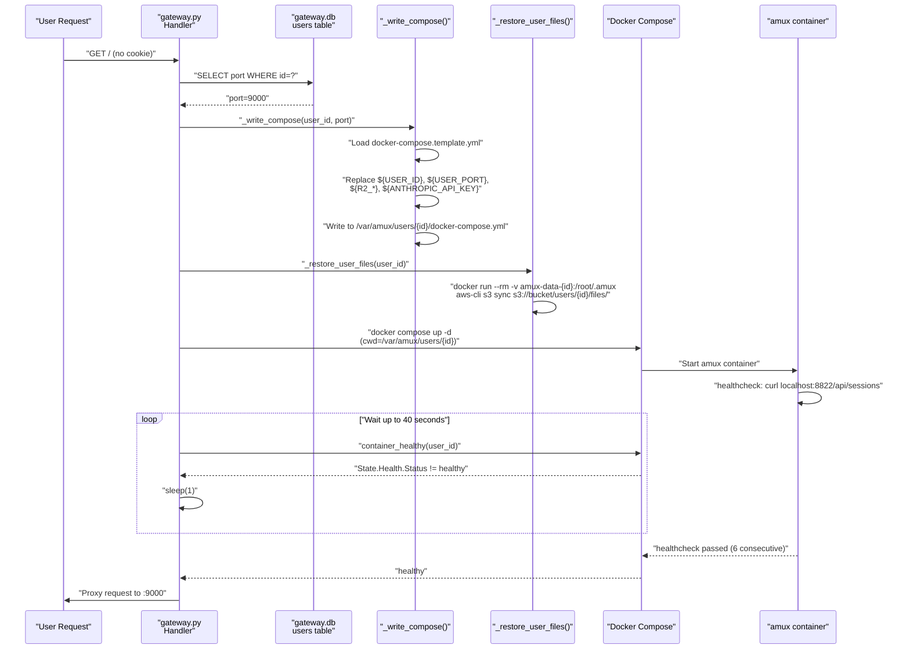
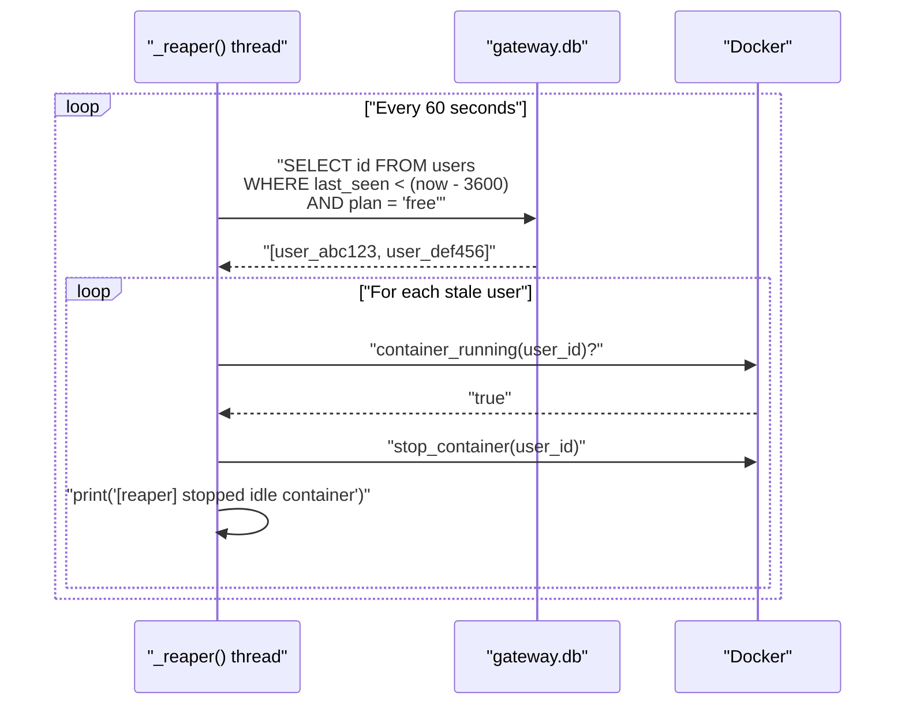
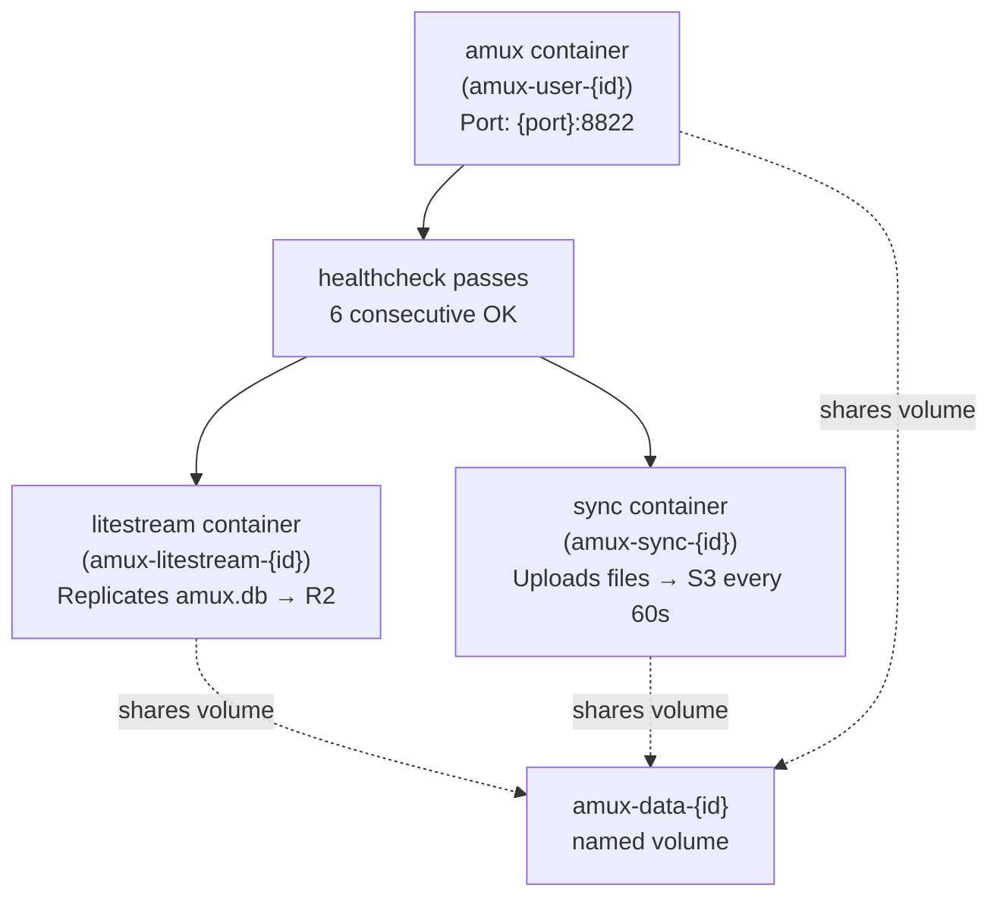
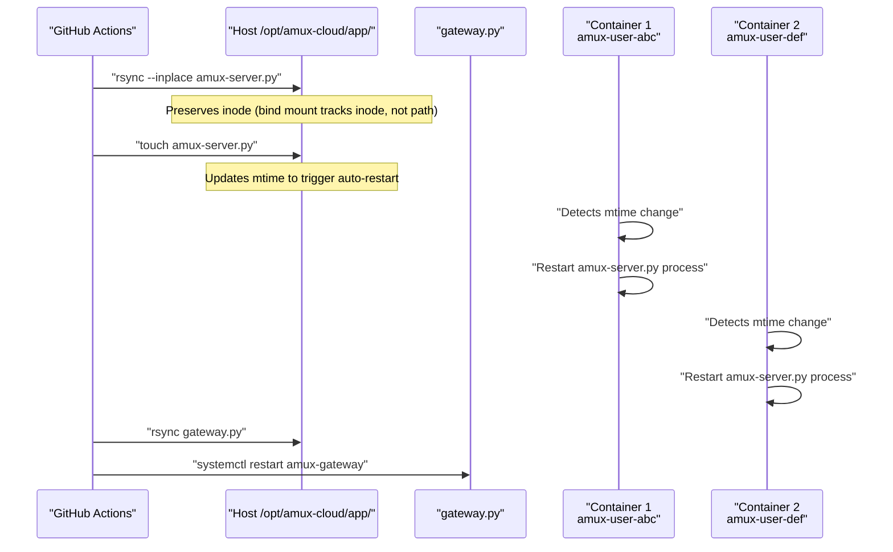

<!-- source: DeepWiki mcp.deepwiki.com · repo mixpeek/amux · page 3.2 Container Lifecycle · fetched 2026-10-27 -->

# Container Lifecycle

<details>
<summary>Relevant source files</summary>

The following files were used as context for generating this wiki page:

- [.github/workflows/backup-cloud.yml](.github/workflows/backup-cloud.yml)
- [.github/workflows/deploy-cloud.yml](.github/workflows/deploy-cloud.yml)
- [amux-server.py](amux-server.py)
- [cloud/docker/docker-compose.template.yml](cloud/docker/docker-compose.template.yml)
- [cloud/gateway/gateway.py](cloud/gateway/gateway.py)
- [templates/README.md](templates/README.md)
- [templates/content-creator/CLAUDE.md](templates/content-creator/CLAUDE.md)
- [templates/content-creator/template.json](templates/content-creator/template.json)
- [templates/fitness-tracker/CLAUDE.md](templates/fitness-tracker/CLAUDE.md)
- [test.mjs](test.mjs)

</details>


## Purpose and Scope

This page documents how `gateway.py` manages the lifecycle of per-user Docker containers in the cloud deployment. It covers container startup, health monitoring, activity tracking, and automatic idle shutdown. For authentication and user session management, see [Authentication Flow](#3.1). For the Docker architecture and multi-container stack details, see [Docker Architecture](#4.1).

Each authenticated user gets an isolated 3-container stack (amux + litestream + sync) orchestrated by the gateway. Containers start on-demand when a user makes their first request, remain running while active, and automatically stop after 3600 seconds (1 hour) of inactivity to conserve resources.

---

## Container State Machine



**Sources**: [cloud/gateway/gateway.py:233-275](), [cloud/gateway/gateway.py:376-393]()

---

## Port Allocation

Each user is assigned a unique port from the `PORT_BASE` (9000) range on first authentication. The gateway maintains port assignments in the SQLite `users` table to ensure containers can be restarted on the same port.



| Field | Type | Description |
|-------|------|-------------|
| `PORT_BASE` | `int` | Base port number (9000) |
| `users.port` | `INTEGER UNIQUE` | Assigned port, persists across restarts |
| Container port | `:8822` | Internal port inside container |
| Gateway proxy | `http://127.0.0.1:{port}` | Proxy target for requests |

**Sources**: [cloud/gateway/gateway.py:203-209](), [cloud/gateway/gateway.py:28]()

---

## Starting Containers

### Workflow



**Sources**: [cloud/gateway/gateway.py:261-271](), [cloud/gateway/gateway.py:217-231](), [cloud/gateway/gateway.py:245-259]()

### Container Compose File Generation

The gateway instantiates a per-user `docker-compose.yml` from the template on every startup, substituting environment-specific values:

| Template Variable | Runtime Value | Source |
|------------------|---------------|--------|
| `${USER_ID}` | Clerk user ID (e.g. `user_2abc...`) | Request auth |
| `${USER_PORT}` | Allocated port (e.g. `9001`) | `gateway.db` |
| `${CF_ACCOUNT_ID}` | Cloudflare R2 account | `os.environ` |
| `${R2_ENDPOINT}` | R2 endpoint URL | Computed from account ID |
| `${R2_ACCESS_KEY}` | R2 credentials | `os.environ["R2_ACCESS_KEY"]` |
| `${R2_SECRET_KEY}` | R2 credentials | `os.environ["R2_SECRET_KEY"]` |
| `${ANTHROPIC_API_KEY}` | Claude API key | `os.environ["ANTHROPIC_API_KEY"]` |

**Sources**: [cloud/gateway/gateway.py:217-231](), [cloud/docker/docker-compose.template.yml:1-70]()

### File Restoration

Before starting containers, `_restore_user_files()` synchronizes `~/.amux/` flat files (sessions, memory, uploads, etc.) from R2 using an ephemeral container:

```python
# Runs: docker run --rm -v amux-data-{user_id}:/root/.amux amazon/aws-cli
#   aws s3 sync s3://amux-cloud-users/users/{user_id}/files/ /root/.amux/
#   --exclude amux.db --exclude amux.db-shm --exclude amux.db-wal
```

This ensures users see their latest session state even if the container was previously stopped. The SQLite database (`amux.db`) is **excluded** from this sync because it's managed by litestream continuous replication.

**Sources**: [cloud/gateway/gateway.py:245-259]()

---

## Health Checks

### Docker Healthcheck Configuration

The amux container defines a healthcheck that polls the `/api/sessions` endpoint every 5 seconds:

```yaml
healthcheck:
  test: ["CMD", "curl", "-f", "http://localhost:8822/api/sessions"]
  interval: 5s
  timeout: 3s
  retries: 6
  start_period: 10s
```

| Parameter | Value | Meaning |
|-----------|-------|---------|
| `test` | `curl -f localhost:8822/api/sessions` | Fails on non-2xx status |
| `interval` | 5s | Check every 5 seconds |
| `timeout` | 3s | Individual check timeout |
| `retries` | 6 | Must pass 6 consecutive times |
| `start_period` | 10s | Grace period before failures count |

The container is marked `healthy` after 6 consecutive successful checks (typically 30 seconds after start). The litestream and sync containers block on `service_healthy` via `depends_on`, ensuring they only start after amux is ready.

**Sources**: [cloud/docker/docker-compose.template.yml:22-27](), [cloud/docker/docker-compose.template.yml:41-43](), [cloud/docker/docker-compose.template.yml:62-64]()

### Gateway Health Polling

The gateway waits up to 40 seconds for the container to become healthy before proxying the first request:

```python
# cloud/gateway/gateway.py:268-271
for _ in range(40):
    time.sleep(1)
    if container_healthy(user_id):
        break
```

`container_healthy()` shells out to `docker inspect` to read the `State.Health.Status` field:

```python
# cloud/gateway/gateway.py:239-243
def container_healthy(user_id):
    r = subprocess.run(
        ["docker", "inspect", "-f", "{{.State.Health.Status}}", f"amux-user-{user_id}"],
        capture_output=True, text=True)
    return r.stdout.strip() == "healthy"
```

**Sources**: [cloud/gateway/gateway.py:239-243](), [cloud/gateway/gateway.py:268-271]()

---

## Stopping Containers

### Manual Stop

Containers can be manually stopped via `stop_container()`, which runs `docker compose stop` in the user's compose directory:

```python
# cloud/gateway/gateway.py:273-275
def stop_container(user_id):
    d = _compose_dir(user_id)
    subprocess.run(["docker", "compose", "stop"], cwd=d, capture_output=True)
```

This sends `SIGTERM` to all containers in the stack, allowing graceful shutdown. Named volumes (`amux-data-{user_id}`) persist, so data is not lost.

**Sources**: [cloud/gateway/gateway.py:273-275]()

### Idle Reaper Thread

The idle reaper runs as a daemon thread, checking every 60 seconds for containers that haven't received requests in `IDLE_SECONDS` (default 3600s = 1 hour):



Only **free-tier users** are subject to idle reaping. Paid plans (if implemented) can configure longer timeouts or disable reaping entirely by modifying the query predicate.

**Sources**: [cloud/gateway/gateway.py:376-393](), [cloud/gateway/gateway.py:27]()

---

## Activity Tracking and Request Proxying

### last_seen Timestamp

Every proxied request updates the `last_seen` timestamp in the `users` table:

```python
# cloud/gateway/gateway.py:684
db.execute("UPDATE users SET last_seen=? WHERE id=?", (now, user_id))
```

This timestamp is used by the idle reaper to determine when to stop containers. The update happens **before** the request is proxied, ensuring that even failed requests reset the idle timer.

**Sources**: [cloud/gateway/gateway.py:672-685]()

### SSE Connection Handling

Server-Sent Events (SSE) connections for live dashboard updates can remain open for minutes or hours. To prevent the reaper from stopping containers with active SSE clients, the gateway refreshes `last_seen` every 60 seconds while streaming:

```python
# cloud/gateway/gateway.py:417-436
if is_sse:
    last_touch = time.time()
    try:
        while True:
            chunk = resp.read(4096)
            if not chunk:
                break
            handler.wfile.write(chunk)
            handler.wfile.flush()
            if user_id and time.time() - last_touch > 60:
                try:
                    db = get_db()
                    db.execute("UPDATE users SET last_seen=? WHERE id=?",
                               (int(time.time()), user_id))
                    db.commit()
                except Exception:
                    pass
                last_touch = time.time()
    except (BrokenPipeError, ConnectionResetError):
        pass
```

This ensures containers serving active dashboard sessions remain running even without traditional HTTP request traffic.

**Sources**: [cloud/gateway/gateway.py:417-437]()

---

## Container Dependencies and Startup Order

The 3-container stack uses Docker Compose `depends_on` with health conditions to ensure correct startup order:



| Container | Depends On | Start Condition | Role |
|-----------|-----------|-----------------|------|
| `amux` | None | Immediate | Main amux-server.py process |
| `litestream` | `amux` | `service_healthy` | Continuous DB replication to R2 |
| `sync` | `amux` | `service_healthy` | Periodic file sync to S3 (every 60s) |

All three containers share the `amux-data-{user_id}` named volume, which is bind-mounted to `/root/.amux` inside each container. This shared volume persists across container stops/starts.

**Sources**: [cloud/docker/docker-compose.template.yml:41-43](), [cloud/docker/docker-compose.template.yml:62-64](), [cloud/docker/docker-compose.template.yml:66-70]()

---

## Deployment and Hot Reload

When `amux-server.py` is updated via GitHub Actions, the gateway enables zero-downtime updates for all running containers:



Each container bind-mounts `/opt/amux-cloud/app/amux-server.py` read-only:

```yaml
volumes:
  - /opt/amux-cloud/app/amux-server.py:/app/amux-server.py:ro
```

This shared file ensures all users run the same version. The auto-restart mechanism (built into amux-server.py) monitors file mtime and restarts the process when changed, achieving updates without recreating containers.

**Sources**: [cloud/docker/docker-compose.template.yml:12](), [.github/workflows/deploy-cloud.yml:26-33]()

---

## Container Naming Convention

All containers follow a strict naming pattern to enable programmatic management:

| Container Type | Name Format | Example |
|---------------|-------------|---------|
| Main amux | `amux-user-{user_id}` | `amux-user-user_2abc123xyz` |
| Litestream | `amux-litestream-{user_id}` | `amux-litestream-user_2abc123xyz` |
| Sync | `amux-sync-{user_id}` | `amux-sync-user_2abc123xyz` |
| Data volume | `amux-data-{user_id}` | `amux-data-user_2abc123xyz` |
| Root volume | `root-home-{user_id}` | `root-home-user_2abc123xyz` |

The `{user_id}` is the Clerk user ID from JWT verification. This naming scheme enables:
- Fast container lookups via `docker inspect amux-user-{id}`
- Bulk operations like `docker volume ls --format '{{.Name}}' | grep '^amux-data-'` for backups
- Deterministic volume mounting across container restarts

**Sources**: [cloud/docker/docker-compose.template.yml:7](), [cloud/docker/docker-compose.template.yml:31](), [cloud/docker/docker-compose.template.yml:47]()

---

## Backup Integration

The daily backup workflow extracts databases from running containers using ephemeral containers with volume mounts:

```bash
# For each amux-data-* volume
docker run --rm \
  -v "$vol:/data:ro" \
  -v "$dest:/backup" \
  alpine sh -c 'cp /data/amux.db /backup/amux.db'
```

This avoids interrupting running containers or the litestream replication stream. Backups are stored in `/var/amux/backups/YYYY-MM-DD/` with 30-day retention.

**Sources**: [.github/workflows/backup-cloud.yml:32-41]()

---

