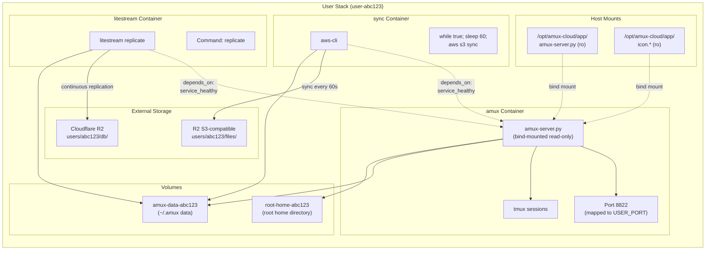
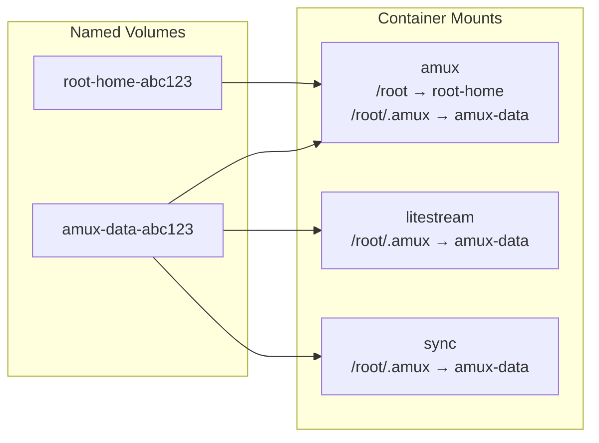
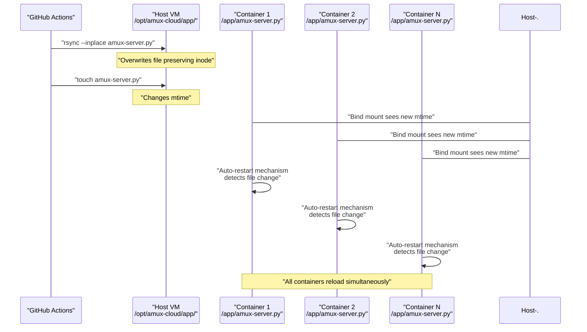
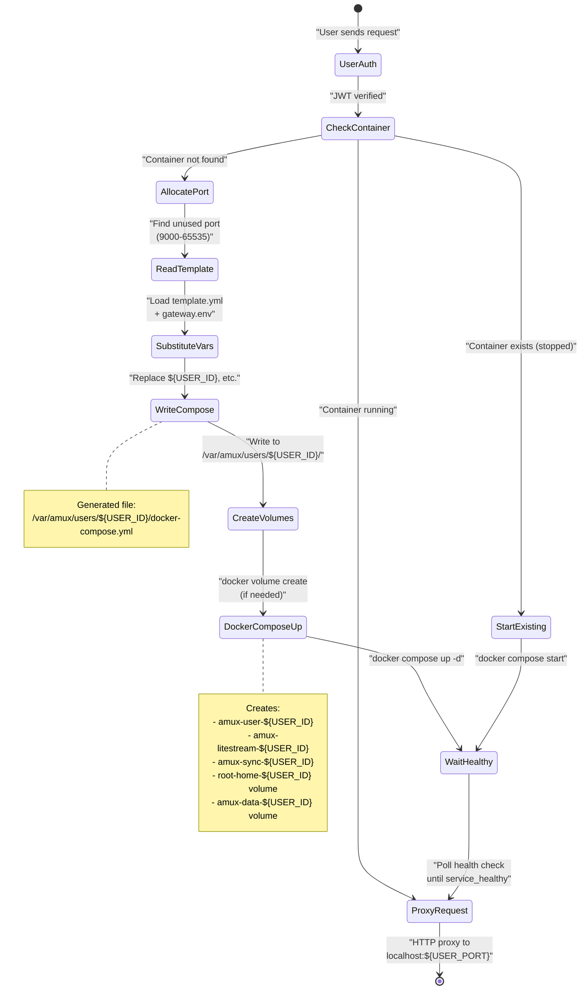
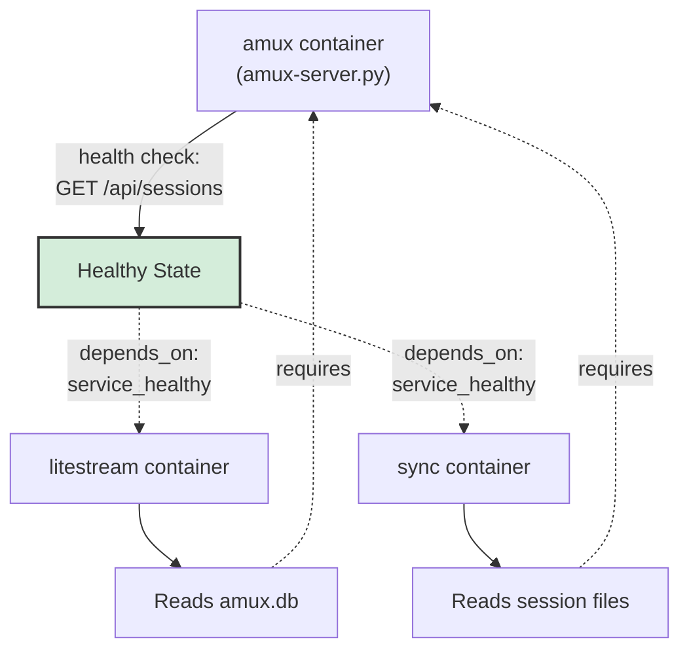
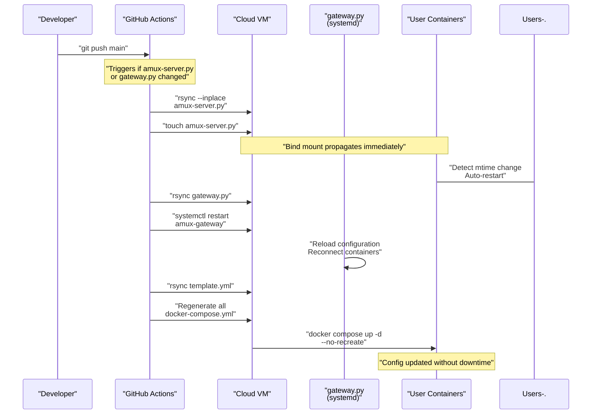

<!-- source: DeepWiki mcp.deepwiki.com · repo mixpeek/amux · page 4.1 Docker Architecture · fetched 2026-10-27 -->

# Docker Architecture

<details>
<summary>Relevant source files</summary>

The following files were used as context for generating this wiki page:

- [.github/workflows/backup-cloud.yml](.github/workflows/backup-cloud.yml)
- [.github/workflows/deploy-cloud.yml](.github/workflows/deploy-cloud.yml)
- [cloud/docker/docker-compose.template.yml](cloud/docker/docker-compose.template.yml)
- [templates/README.md](templates/README.md)
- [templates/content-creator/CLAUDE.md](templates/content-creator/CLAUDE.md)
- [templates/content-creator/template.json](templates/content-creator/template.json)
- [templates/fitness-tracker/CLAUDE.md](templates/fitness-tracker/CLAUDE.md)

</details>


## Purpose and Scope

This document describes the Docker-based multi-tenant architecture used in cloud deployments of amux. It covers the three-container stack (amux, litestream, sync), shared volumes, bind-mounted code, and the templating system that instantiates per-user environments. For gateway orchestration and container lifecycle management, see [Container Lifecycle](#3.2). For backup strategies and data persistence, see [Backup & Persistence](#4.4).

---

## Three-Container Stack

Each user in the cloud deployment receives an isolated Docker Compose stack consisting of three containers sharing two named volumes. This architecture separates concerns: the main application runs in one container, database replication in another, and file synchronization in a third.

### Container Architecture Diagram



**Sources:** [cloud/docker/docker-compose.template.yml:1-71]()

---

## Service Definitions

### amux Service

The primary container runs `amux-server.py` on port 8822. Key characteristics:

| Property | Value | Purpose |
|----------|-------|---------|
| **Image** | `ghcr.io/mixpeek/amux:latest` | Base Python image with tmux and Claude Code |
| **Container Name** | `amux-user-${USER_ID}` | Unique identifier per user |
| **Restart Policy** | `unless-stopped` | Auto-restart except when explicitly stopped |
| **Health Check** | `curl -f http://localhost:8822/api/sessions` | Validates HTTP server is responsive |
| **Health Interval** | 5 seconds | Frequency of health checks |
| **Start Period** | 10 seconds | Grace period before first health check |

The amux container exposes port 8822 internally, mapped to a unique host port (`USER_PORT`) assigned by `gateway.py`. This enables the gateway to route requests to the correct user container.

**Sources:** [cloud/docker/docker-compose.template.yml:5-27]()

### litestream Service

Provides continuous database replication to Cloudflare R2 using the Litestream utility:

```yaml
litestream:
  image: litestream/litestream:latest
  container_name: amux-litestream-${USER_ID}
  command: replicate
  depends_on:
    amux:
      condition: service_healthy
```

The `depends_on` directive with `service_healthy` ensures Litestream only starts after the amux container passes health checks. This prevents replication attempts before the database exists. The service reads configuration from `litestream.yml` (bind-mounted read-only) which specifies the database path and R2 destination.

**Sources:** [cloud/docker/docker-compose.template.yml:29-43]()

### sync Service

Handles periodic file synchronization to S3-compatible storage using the AWS CLI:

```bash
while true; do
  sleep 60
  aws s3 sync /root/.amux/ s3://amux-cloud-users/users/${USER_ID}/files/ \
    --endpoint-url ${R2_ENDPOINT} \
    --exclude 'amux.db' \
    --exclude 'amux.db-shm' \
    --exclude 'amux.db-wal' \
    --exclude 'logs/*' \
    --exclude 'board/*' \
    --quiet
done
```

This service runs in an infinite loop, uploading changed files every 60 seconds. The exclusions prevent syncing database files (handled by Litestream), logs, and board data. The `--quiet` flag suppresses verbose output.

**Sources:** [cloud/docker/docker-compose.template.yml:45-64]()

---

## Volume Architecture

### Named Volumes

Each user stack creates two named volumes with user-specific identifiers:

| Volume | Name Pattern | Purpose | Mounted At |
|--------|--------------|---------|------------|
| `root-home` | `root-home-${USER_ID}` | Root home directory state | `/root` (amux only) |
| `amux-data` | `amux-data-${USER_ID}` | Session data, databases, files | `/root/.amux` (all containers) |

The `amux-data` volume is shared across all three containers, enabling:
- **amux container**: Reads/writes sessions, databases, uploaded files
- **litestream container**: Reads `amux.db` and writes WAL checkpoints
- **sync container**: Reads all files for S3 upload

### Volume Sharing Diagram



**Sources:** [cloud/docker/docker-compose.template.yml:66-70]()

---

## Bind Mount Strategy

### Shared Code Mounts

The most critical architectural decision: all user containers bind-mount `amux-server.py` from a shared host location:

```yaml
volumes:
  - /opt/amux-cloud/app/amux-server.py:/app/amux-server.py:ro
  - /opt/amux-cloud/app/icon.svg:/app/icon.svg:ro
  - /opt/amux-cloud/app/icon.png:/app/icon.png:ro
  - /opt/amux-cloud/app/icon-192.png:/app/icon-192.png:ro
  - /opt/amux-cloud/app/icon-512.png:/app/icon-512.png:ro
```

The `:ro` flag marks these as read-only. This architecture enables **zero-downtime updates**: when `amux-server.py` is updated on the host, all containers see the change immediately. The deployment pipeline uses `rsync --inplace` to preserve the inode, ensuring Docker bind mounts remain valid.

### Update Propagation Diagram



**Sources:** [.github/workflows/deploy-cloud.yml:26-33](), [cloud/docker/docker-compose.template.yml:12-16]()

---

## Template Instantiation

### Variable Substitution

The `docker-compose.template.yml` file contains placeholders replaced by `gateway.py` when creating a new user stack:

| Variable | Example Value | Source | Purpose |
|----------|---------------|--------|---------|
| `${USER_ID}` | `user_abc123` | JWT sub claim | Container names, volume names |
| `${USER_PORT}` | `9000` | Port allocator | Maps container port to host |
| `${CF_ACCOUNT_ID}` | `d4c7...` | `/etc/amux/gateway.env` | R2 endpoint URL |
| `${R2_ACCESS_KEY}` | `a3f2...` | `/etc/amux/gateway.env` | R2 authentication |
| `${R2_SECRET_KEY}` | `s8k9...` | `/etc/amux/gateway.env` | R2 authentication |
| `${R2_ENDPOINT}` | `https://...r2.cloudflarestorage.com` | Derived from account ID | S3-compatible URL |
| `${ANTHROPIC_API_KEY}` | `sk-ant-...` | `/etc/amux/gateway.env` | Claude API access |

The gateway performs substitution using shell `sed` commands:

```bash
sed "s/\${USER_ID}/${user_id}/g;
     s/\${USER_PORT}/${port}/g;
     s/\${CF_ACCOUNT_ID}/${CF_ACCOUNT_ID}/g;
     s|\${R2_ENDPOINT}|${R2_ENDPOINT}|g;
     s/\${R2_ACCESS_KEY}/${R2_ACCESS_KEY}/g;
     s/\${R2_SECRET_KEY}/${R2_SECRET_KEY}/g;
     s/\${ANTHROPIC_API_KEY}/${ANTHROPIC_API_KEY}/g" \
  "$TEMPLATE" > "$compose_file"
```

**Sources:** [.github/workflows/deploy-cloud.yml:47-68](), [cloud/docker/docker-compose.template.yml:2-2]()

### Instantiation Flow



**Sources:** [cloud/docker/docker-compose.template.yml:1-71]()

---

## Health Checks and Dependencies

### Health Check Configuration

The amux container defines a health check that polls the session list endpoint:

```yaml
healthcheck:
  test: ["CMD", "curl", "-f", "http://localhost:8822/api/sessions"]
  interval: 5s
  timeout: 3s
  retries: 6
  start_period: 10s
```

This configuration allows:
- **10 seconds** start period before first health check
- **6 retries** at 5-second intervals (30 seconds total) before marking unhealthy
- **3 second** timeout per request

The health check enables `depends_on: service_healthy` conditions in dependent containers.

### Dependency Chain



This prevents Litestream and sync from starting before the database and session files exist.

**Sources:** [cloud/docker/docker-compose.template.yml:22-27](), [cloud/docker/docker-compose.template.yml:42-43](), [cloud/docker/docker-compose.template.yml:62-64]()

---

## Container Naming Conventions

All containers and volumes follow a consistent naming pattern:

| Resource Type | Pattern | Example |
|---------------|---------|---------|
| **amux container** | `amux-user-${USER_ID}` | `amux-user-abc123` |
| **litestream container** | `amux-litestream-${USER_ID}` | `amux-litestream-abc123` |
| **sync container** | `amux-sync-${USER_ID}` | `amux-sync-abc123` |
| **root-home volume** | `root-home-${USER_ID}` | `root-home-abc123` |
| **amux-data volume** | `amux-data-${USER_ID}` | `amux-data-abc123` |
| **compose file** | `/var/amux/users/${USER_ID}/docker-compose.yml` | `/var/amux/users/abc123/docker-compose.yml` |

This convention enables automated scripts to:
- List all containers for a user: `docker ps -a --filter name=abc123`
- List all volumes for a user: `docker volume ls --filter name=abc123`
- Find the compose file for a user: `/var/amux/users/${USER_ID}/docker-compose.yml`

**Sources:** [cloud/docker/docker-compose.template.yml:7-70]()

---

## Backup via Temporary Containers

The backup workflow extracts databases from named volumes using ephemeral containers. This approach works even when the user's containers are stopped:

```bash
for vol in $(docker volume ls --format '{{.Name}}' | grep '^amux-data-'); do
  user_id="${vol#amux-data-}"
  dest="$BACKUP_DIR/$user_id"
  mkdir -p "$dest"
  
  # Spin up temporary Alpine container with volume mounted read-only
  docker run --rm \
    -v "$vol:/data:ro" \
    -v "$dest:/backup" \
    alpine sh -c 'cp /data/amux.db /backup/amux.db 2>/dev/null || true'
done
```

The temporary Alpine container:
1. Mounts the named volume at `/data` (read-only)
2. Mounts the backup destination at `/backup`
3. Copies the database file
4. Exits and is automatically removed (`--rm`)

This pattern avoids needing to keep containers running for backups.

**Sources:** [.github/workflows/backup-cloud.yml:21-48]()

---

## Environment Variables

### amux Container Environment

| Variable | Example | Purpose |
|----------|---------|---------|
| `AMUX_PORT` | `8822` | HTTP server listen port |
| `ANTHROPIC_API_KEY` | `sk-ant-...` | Claude API authentication |

Additional environment variables may be injected from `~/.amux/server.env` within the container (e.g., for MCP server credentials).

### litestream Container Environment

| Variable | Example | Purpose |
|----------|---------|---------|
| `LITESTREAM_ACCESS_KEY_ID` | `a3f2...` | R2 access key |
| `LITESTREAM_SECRET_ACCESS_KEY` | `s8k9...` | R2 secret key |
| `USER_ID` | `abc123` | Used in R2 path construction |

### sync Container Environment

| Variable | Example | Purpose |
|----------|---------|---------|
| `AWS_ACCESS_KEY_ID` | `a3f2...` | R2 access key (S3-compatible) |
| `AWS_SECRET_ACCESS_KEY` | `s8k9...` | R2 secret key |

The sync container also receives `${R2_ENDPOINT}` as a command-line argument in the sync script.

**Sources:** [cloud/docker/docker-compose.template.yml:17-61]()

---

## Port Allocation Strategy

The gateway allocates unique ports in the range 9000-65535 for each user. Port assignment is tracked in `gateway.db`:

```sql
CREATE TABLE user_ports (
  user_id TEXT PRIMARY KEY,
  port INTEGER NOT NULL
);
```

When a new user authenticates, the gateway:
1. Checks if a port is already assigned
2. If not, finds the next available port (sequentially from 9000)
3. Reserves the port in the database
4. Uses the port in the docker-compose.yml instantiation

The assigned port maps the container's internal port 8822 to the host:

```yaml
ports:
  - "${USER_PORT}:8822"
```

The gateway then proxies requests to `localhost:${USER_PORT}`.

**Sources:** [cloud/docker/docker-compose.template.yml:20-21]()

---

## Deployment Pipeline Integration

### Regenerating Compose Files

When the template is updated, the deployment pipeline regenerates all per-user compose files:

```bash
TEMPLATE=/opt/amux-cloud/docker/docker-compose.template.yml
for user_dir in /var/amux/users/*/; do
  user_id=$(basename "$user_dir")
  compose_file="$user_dir/docker-compose.yml"
  
  # Extract current port from existing compose file
  port=$(grep -A1 "ports:" "$compose_file" 2>/dev/null | grep -oP "[0-9]{4,}(?=:8822)")
  [ -z "$port" ] && continue
  
  # Regenerate from template with substitution
  sed "s/\${USER_ID}/${user_id}/g; ..." "$TEMPLATE" > "$compose_file"
  
  # Apply without recreating containers
  cd "$user_dir" && docker compose up -d --no-recreate
done
```

The `--no-recreate` flag is critical: it updates running containers' configuration (e.g., new environment variables) without stopping them. This works because the code is bind-mounted, so file changes propagate immediately.

**Sources:** [.github/workflows/deploy-cloud.yml:47-68]()

### Deployment Architecture



**Sources:** [.github/workflows/deploy-cloud.yml:1-69]()

---

## Summary

The Docker architecture achieves multi-tenancy through per-user three-container stacks sharing named volumes. Key design decisions:

1. **Shared code bind mounts** enable atomic updates across all users
2. **Health check dependencies** ensure containers start in the correct order
3. **Named volumes** persist user data independently of container lifecycle
4. **Template instantiation** generates per-user compose files from a single source
5. **Separate containers** isolate concerns: application, DB replication, file sync

This architecture balances isolation (per-user containers), efficiency (shared code), and operational simplicity (template-based instantiation).

**Sources:** [cloud/docker/docker-compose.template.yml:1-71](), [.github/workflows/deploy-cloud.yml:1-69](), [.github/workflows/backup-cloud.yml:1-49]()

---

