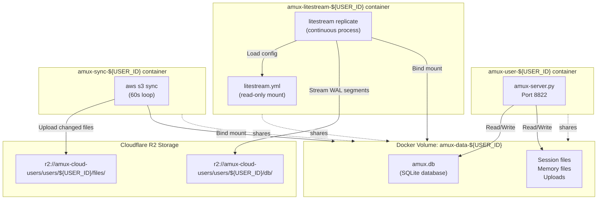
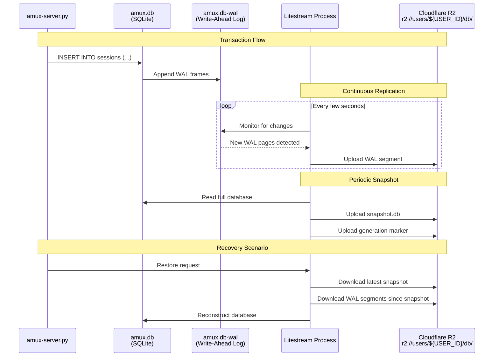
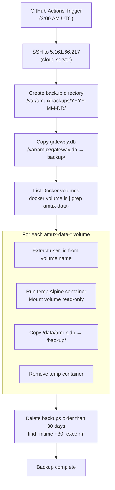
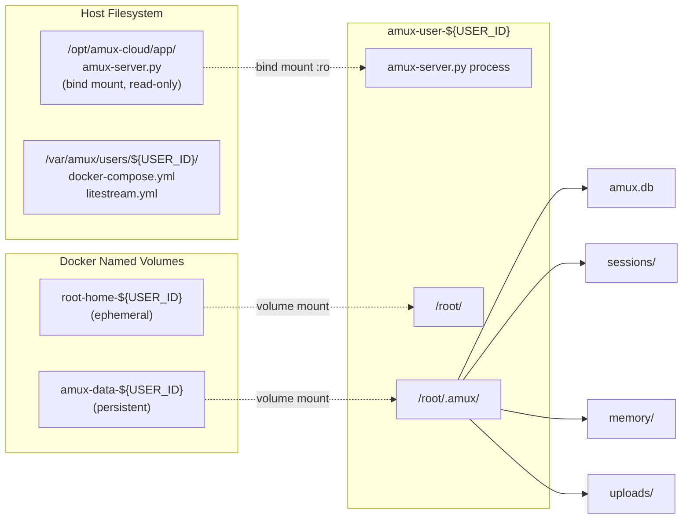

<!-- source: DeepWiki mcp.deepwiki.com · repo mixpeek/amux · page 4.4 Backup & Persistence · fetched 2026-10-27 -->

# Backup & Persistence

<details>
<summary>Relevant source files</summary>

The following files were used as context for generating this wiki page:

- [.github/workflows/backup-cloud.yml](.github/workflows/backup-cloud.yml)
- [.github/workflows/deploy-cloud.yml](.github/workflows/deploy-cloud.yml)
- [cloud/.gitignore](cloud/.gitignore)
- [cloud/deploy.sh](cloud/deploy.sh)
- [cloud/docker/docker-compose.template.yml](cloud/docker/docker-compose.template.yml)
- [cloud/main.tf](cloud/main.tf)
- [cloud/outputs.tf](cloud/outputs.tf)
- [cloud/terraform.tfvars.example](cloud/terraform.tfvars.example)
- [cloud/variables.tf](cloud/variables.tf)
- [templates/README.md](templates/README.md)
- [templates/content-creator/CLAUDE.md](templates/content-creator/CLAUDE.md)
- [templates/content-creator/template.json](templates/content-creator/template.json)
- [templates/fitness-tracker/CLAUDE.md](templates/fitness-tracker/CLAUDE.md)

</details>


This page documents the backup and persistence mechanisms in amux cloud deployment. It covers the dual-layer backup strategy (continuous database replication via Litestream, periodic file synchronization to S3), automated snapshot backups, Docker volume persistence, and recovery procedures.

For information about the overall cloud deployment architecture, see [Cloud Deployment](#4). For details on the Docker container structure, see [Docker Architecture](#4.1). For infrastructure provisioning, see [Infrastructure as Code](#4.3).

---

## Backup Strategy Overview

The amux cloud deployment implements a three-tier backup strategy to ensure data durability:

| Layer | Technology | Target | Frequency | Purpose |
|-------|-----------|--------|-----------|---------|
| **Continuous DB Replication** | Litestream | Cloudflare R2 | Real-time | SQLite database (`amux.db`) continuous replication |
| **Periodic File Sync** | AWS CLI | Cloudflare R2 (S3 API) | Every 60 seconds | User files (sessions, memory, uploads) |
| **Daily Snapshots** | GitHub Actions | Host filesystem | 3:00 AM UTC | Point-in-time backups of all user databases |

This design provides:
- **Near-zero RPO** (Recovery Point Objective): Database changes are replicated in real-time; files sync every minute
- **Multiple recovery options**: Restore from continuous stream, latest sync, or daily snapshot
- **Storage efficiency**: Litestream uses incremental replication; S3 sync only uploads changed files

**Sources:** [cloud/docker/docker-compose.template.yml:1-71](), [.github/workflows/backup-cloud.yml:1-49]()

---

## Three-Container Backup Architecture

### Container Stack Diagram



**Sources:** [cloud/docker/docker-compose.template.yml:5-71]()

### Container Definitions

Each user's Docker Compose stack includes three services sharing the `amux-data-${USER_ID}` volume:

**1. `amux` container** ([cloud/docker/docker-compose.template.yml:5-27]()):
- Runs `amux-server.py` on port 8822
- Writes to `amux.db` (SQLite) and session files
- Volume mount: `/root/.amux` → `amux-data` volume

**2. `litestream` container** ([cloud/docker/docker-compose.template.yml:29-43]()):
- Runs `litestream replicate` command
- Monitors `amux.db` for changes
- Streams write-ahead log (WAL) segments to R2
- Configuration: `/etc/litestream.yml` (read-only mount)
- Environment variables: `LITESTREAM_ACCESS_KEY_ID`, `LITESTREAM_SECRET_ACCESS_KEY`, `USER_ID`
- Depends on: `amux` service health check

**3. `sync` container** ([cloud/docker/docker-compose.template.yml:45-64]()):
- Runs AWS CLI in infinite loop
- Executes `aws s3 sync` every 60 seconds
- Excludes database files (handled by Litestream): `--exclude 'amux.db' --exclude 'amux.db-shm' --exclude 'amux.db-wal'`
- Excludes logs and board cache: `--exclude 'logs/*' --exclude 'board/*'`
- Environment variables: `AWS_ACCESS_KEY_ID`, `AWS_SECRET_ACCESS_KEY`
- Depends on: `amux` service health check

**Sources:** [cloud/docker/docker-compose.template.yml:5-64]()

---

## Litestream Continuous Replication

### How Litestream Works

Litestream provides disaster recovery for SQLite databases through continuous replication. It:

1. **Monitors WAL file**: SQLite's write-ahead log contains all uncommitted changes
2. **Streams segments**: As WAL pages are written, Litestream uploads them to R2
3. **Creates snapshots**: Periodically creates full database snapshots
4. **Enables restoration**: Combines snapshot + WAL segments for point-in-time recovery

### Replication Flow



**Sources:** [cloud/docker/docker-compose.template.yml:29-43]()

### Configuration Details

The Litestream container uses environment variable substitution for credentials ([cloud/docker/docker-compose.template.yml:36-39]()):

```yaml
environment:
  LITESTREAM_ACCESS_KEY_ID: "${R2_ACCESS_KEY}"
  LITESTREAM_SECRET_ACCESS_KEY: "${R2_SECRET_KEY}"
  USER_ID: "${USER_ID}"
```

These variables are populated from `/etc/amux/gateway.env` during container instantiation by `gateway.py`.

The `litestream.yml` configuration file (mounted read-only at `/etc/litestream.yml`) defines:
- Source database path: `/root/.amux/amux.db`
- Replica URL: Uses `${USER_ID}` environment variable for per-user isolation
- Retention policy: Number of snapshots to retain
- Synchronization interval: How often to check for WAL changes

**Sources:** [cloud/docker/docker-compose.template.yml:34-40]()

---

## S3 File Synchronization

### Sync Container Implementation

The sync container runs an infinite loop with 60-second intervals ([cloud/docker/docker-compose.template.yml:54-61]()):

```yaml
entrypoint:
  - /bin/sh
  - -c
  - |
    while true; do
      sleep 60
      aws s3 sync /root/.amux/ s3://amux-cloud-users/users/${USER_ID}/files/ \
        --endpoint-url ${R2_ENDPOINT} \
        --exclude 'amux.db' --exclude 'amux.db-shm' --exclude 'amux.db-wal' \
        --exclude 'logs/*' --exclude 'board/*' --quiet
    done
```

### File Inclusion/Exclusion Strategy

| Path Pattern | Action | Reason |
|-------------|--------|--------|
| `amux.db*` | **Excluded** | Handled by Litestream (avoids conflicts) |
| `logs/*` | **Excluded** | Ephemeral debug logs; high write volume |
| `board/*` | **Excluded** | Cached board data (derived from `amux.db`) |
| `sessions/**` | **Included** | Session configuration and history |
| `memory/**` | **Included** | Global and per-session memory |
| `uploads/**` | **Included** | User-uploaded files |

### Sync Behavior

The `aws s3 sync` command:
- **Incremental**: Only uploads files modified since last sync
- **Checksums**: Uses MD5 to detect changes
- **Quiet mode**: Suppresses output to reduce log volume (`--quiet` flag)
- **Endpoint override**: Uses Cloudflare R2's S3-compatible API via `--endpoint-url`

**Target structure in R2:**
```
s3://amux-cloud-users/
└── users/
    └── ${USER_ID}/
        └── files/
            ├── sessions/
            │   ├── my-session.env
            │   └── my-session.jsonl
            ├── memory/
            │   ├── global.txt
            │   └── my-session.txt
            └── uploads/
                └── document.pdf
```

**Sources:** [cloud/docker/docker-compose.template.yml:45-64]()

---

## Daily Snapshot Backups

### GitHub Actions Workflow

The daily backup workflow runs at 3:00 AM UTC via cron ([.github/workflows/backup-cloud.yml:4-7]()):

```yaml
on:
  schedule:
    - cron: '0 3 * * *'
  workflow_dispatch:
```

The workflow can also be triggered manually via `workflow_dispatch`.

### Backup Process Flow



**Sources:** [.github/workflows/backup-cloud.yml:21-48]()

### Backup Script Details

The backup script ([.github/workflows/backup-cloud.yml:23-48]()):

**1. Create timestamped directory:**
```bash
BACKUP_DIR="/var/amux/backups/$(date +%Y-%m-%d)"
mkdir -p "$BACKUP_DIR"
```

**2. Backup gateway database:**
```bash
cp /var/amux/gateway.db "$BACKUP_DIR/gateway.db"
```

**3. Backup each user's database:**
```bash
for vol in $(docker volume ls --format '{{.Name}}' | grep '^amux-data-'); do
  user_id="${vol#amux-data-}"
  dest="$BACKUP_DIR/$user_id"
  mkdir -p "$dest"
  docker run --rm \
    -v "$vol:/data:ro" \
    -v "$dest:/backup" \
    alpine sh -c 'cp /data/amux.db /backup/amux.db 2>/dev/null || true'
done
```

This uses an ephemeral Alpine container to safely read from named volumes without stopping running containers.

**4. Cleanup old backups:**
```bash
find /var/amux/backups -maxdepth 1 -type d -mtime +30 -exec rm -rf {} +
```

**Resulting structure:**
```
/var/amux/backups/
├── 2025-01-15/
│   ├── gateway.db
│   ├── user-abc123/
│   │   └── amux.db
│   └── user-def456/
│       └── amux.db
├── 2025-01-16/
│   └── ...
└── (backups older than 30 days are deleted)
```

**Sources:** [.github/workflows/backup-cloud.yml:21-48]()

---

## Data Persistence with Docker Volumes

### Volume Architecture



**Sources:** [cloud/docker/docker-compose.template.yml:9-70]()

### Volume Definitions

From [cloud/docker/docker-compose.template.yml:66-70]():

```yaml
volumes:
  root-home:
    name: root-home-${USER_ID}
  amux-data:
    name: amux-data-${USER_ID}
```

**`root-home-${USER_ID}`:**
- Mount point: `/root` in container
- Contents: Shell history, temporary files, Node.js packages (for MCP servers)
- Persistence: Survives container restarts but not volume deletion
- Backup: **Not backed up** (ephemeral data)

**`amux-data-${USER_ID}`:**
- Mount point: `/root/.amux` in container
- Contents: `amux.db`, session configs, memory files, uploads
- Persistence: Survives container restarts and updates
- Backup: **Fully backed up** via Litestream (DB) and S3 sync (files)

### Shared Code via Bind Mount

The `amux-server.py` file is bind-mounted read-only from the host ([cloud/docker/docker-compose.template.yml:12]()):

```yaml
volumes:
  - /opt/amux-cloud/app/amux-server.py:/app/amux-server.py:ro
```

**Benefits:**
- All user containers share the same code (zero-downtime updates)
- Updates via `rsync --inplace` preserve the inode (Docker tracks by inode, not path)
- No need to rebuild images or restart containers for code changes
- Touching the file triggers auto-restart mechanism in `amux-server.py`

**Update flow** ([.github/workflows/deploy-cloud.yml:26-33]()):
```bash
rsync --inplace -e "ssh -i ~/.ssh/amux_cloud" amux-server.py \
  root@5.161.66.217:/opt/amux-cloud/app/amux-server.py
ssh -i ~/.ssh/amux_cloud root@5.161.66.217 \
  'touch /opt/amux-cloud/app/amux-server.py && echo "amux-server.py deployed"'
```

**Sources:** [cloud/docker/docker-compose.template.yml:9-16](), [.github/workflows/deploy-cloud.yml:26-33]()

---

## Recovery Procedures

### Database Recovery from Litestream

**1. Restore to specific point in time:**
```bash
# SSH into cloud server
ssh root@cloud.amux.io

# Enter user's directory
cd /var/amux/users/user-abc123

# Stop containers
docker compose down

# Restore database (Litestream reads config from litestream.yml)
docker run --rm \
  -v amux-data-user-abc123:/data \
  -v $(pwd)/litestream.yml:/etc/litestream.yml:ro \
  -e LITESTREAM_ACCESS_KEY_ID="$R2_ACCESS_KEY" \
  -e LITESTREAM_SECRET_ACCESS_KEY="$R2_SECRET_KEY" \
  -e USER_ID="user-abc123" \
  litestream/litestream:latest \
  restore -o /data/amux.db /data/amux.db

# Restart containers
docker compose up -d
```

**2. Restore to before specific timestamp:**
```bash
litestream restore -timestamp 2025-01-15T14:30:00Z -o /data/amux.db /data/amux.db
```

### File Recovery from S3

**1. Restore specific session:**
```bash
# List available sessions in backup
aws s3 ls s3://amux-cloud-users/users/user-abc123/files/sessions/ \
  --endpoint-url https://${CF_ACCOUNT_ID}.r2.cloudflarestorage.com

# Download session files
aws s3 sync \
  s3://amux-cloud-users/users/user-abc123/files/sessions/my-session.env \
  /tmp/restore/ \
  --endpoint-url https://${CF_ACCOUNT_ID}.r2.cloudflarestorage.com
```

**2. Full file restore:**
```bash
# Stop containers
docker compose down

# Restore all files except database
docker run --rm \
  -v amux-data-user-abc123:/data \
  -e AWS_ACCESS_KEY_ID="$R2_ACCESS_KEY" \
  -e AWS_SECRET_ACCESS_KEY="$R2_SECRET_KEY" \
  amazon/aws-cli:latest \
  s3 sync s3://amux-cloud-users/users/user-abc123/files/ /data/ \
  --endpoint-url https://${CF_ACCOUNT_ID}.r2.cloudflarestorage.com

# Restart containers
docker compose up -d
```

### Recovery from Daily Snapshots

**1. List available snapshots:**
```bash
ls -lh /var/amux/backups/
```

**2. Restore from snapshot:**
```bash
# Copy snapshot to volume
docker run --rm \
  -v /var/amux/backups/2025-01-15/user-abc123:/backup:ro \
  -v amux-data-user-abc123:/data \
  alpine cp /backup/amux.db /data/amux.db
```

**Sources:** [.github/workflows/backup-cloud.yml:32-40]()

---

## Backup Verification

### Health Checks

**Litestream replication status:**
```bash
# Check Litestream container logs
docker logs amux-litestream-user-abc123 --tail 50

# Look for:
# - "restored snapshot" (successful restore from R2)
# - "replicating to" (active replication)
# - Error messages
```

**S3 sync status:**
```bash
# Check sync container logs
docker logs amux-sync-user-abc123 --tail 20

# Verify last sync time in R2
aws s3 ls s3://amux-cloud-users/users/user-abc123/files/ \
  --recursive \
  --endpoint-url https://${CF_ACCOUNT_ID}.r2.cloudflarestorage.com \
  | tail -10
```

**Daily snapshot verification:**
```bash
# Check backup directory
ls -lh /var/amux/backups/$(date +%Y-%m-%d)/

# Verify database size is non-zero
du -sh /var/amux/backups/$(date +%Y-%m-%d)/*/amux.db
```

### Recovery Testing

Recommended quarterly:
1. Create a test user account
2. Generate test data (sessions, board items, memory)
3. Perform a full backup
4. Delete the user's volume
5. Restore from Litestream and S3 sync
6. Verify data integrity

**Sources:** [cloud/docker/docker-compose.template.yml:1-71](), [.github/workflows/backup-cloud.yml:1-49]()

---

## Storage Costs & Retention

### Cost Estimation

Assuming Cloudflare R2 pricing (as of 2024):
- Storage: $0.015/GB/month
- No egress fees (unlike S3)

**Per-user monthly costs:**
| Component | Typical Size | Monthly Cost |
|-----------|-------------|--------------|
| Database (Litestream) | 10 MB | $0.0002 |
| Session files | 50 MB | $0.0008 |
| Uploads | 500 MB | $0.0075 |
| **Total per user** | ~560 MB | **~$0.01/month** |

Daily snapshots on host filesystem (~10 MB × 30 days × N users) are negligible compared to compute costs.

### Retention Policies

| Backup Type | Retention | Rationale |
|------------|-----------|-----------|
| **Litestream** | 7 days of snapshots + all WAL since | Rolling window; real-time recovery |
| **S3 sync** | Latest state only | Mirrors current files; not versioned |
| **Daily snapshots** | 30 days | Point-in-time recovery; manual intervention |

**Sources:** [.github/workflows/backup-cloud.yml:44]()

---

## Security Considerations

### Credential Management

All backup credentials are stored in `/etc/amux/gateway.env` on the cloud server:
- `R2_ACCESS_KEY`: Cloudflare R2 access key
- `R2_SECRET_KEY`: Cloudflare R2 secret key
- `CF_ACCOUNT_ID`: Cloudflare account ID (for endpoint URL construction)

These are injected into containers at runtime ([cloud/docker/docker-compose.template.yml:36-53]()):

```yaml
environment:
  LITESTREAM_ACCESS_KEY_ID: "${R2_ACCESS_KEY}"
  LITESTREAM_SECRET_ACCESS_KEY: "${R2_SECRET_KEY}"
```

**Security measures:**
- Credentials never appear in `docker-compose.yml` (version controlled)
- Environment variables are scoped per-container
- R2 bucket has IAM policies restricting access to specific prefixes

### Encryption

- **In-transit:** All S3 API calls use HTTPS
- **At-rest:** Cloudflare R2 encrypts all data by default (AES-256)
- **Database:** SQLite files are not encrypted (consider using SQLCipher if needed)

**Sources:** [cloud/docker/docker-compose.template.yml:36-53]()

---

## Monitoring & Alerts

### Key Metrics to Track

1. **Litestream lag:** Time between last WAL write and last R2 upload
2. **S3 sync success rate:** Percentage of successful syncs (should be 100%)
3. **Daily snapshot completion:** Verify GitHub Actions workflow succeeds
4. **Storage growth:** Monitor R2 bucket size per user

### Failure Scenarios

| Failure | Detection | Recovery |
|---------|-----------|----------|
| Litestream stopped | Container health check fails | `docker compose restart litestream` |
| S3 sync failure | Container logs show errors | Check credentials; verify R2 endpoint |
| Daily snapshot missed | GitHub Actions workflow fails | Review logs; re-run workflow |
| Volume corruption | Sessions fail to load | Restore from Litestream |
| Network partition | No R2 uploads for >5 min | Automatic retry; queue builds up |

**Sources:** [cloud/docker/docker-compose.template.yml:22-27]()

---

