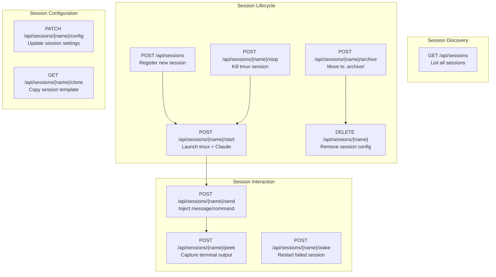
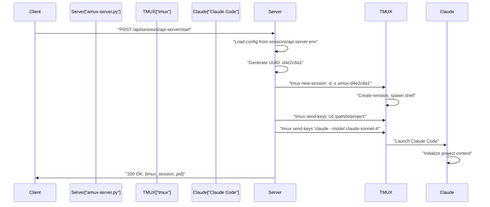
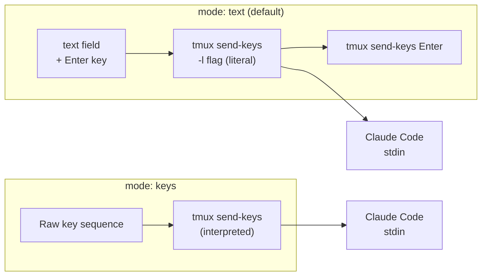
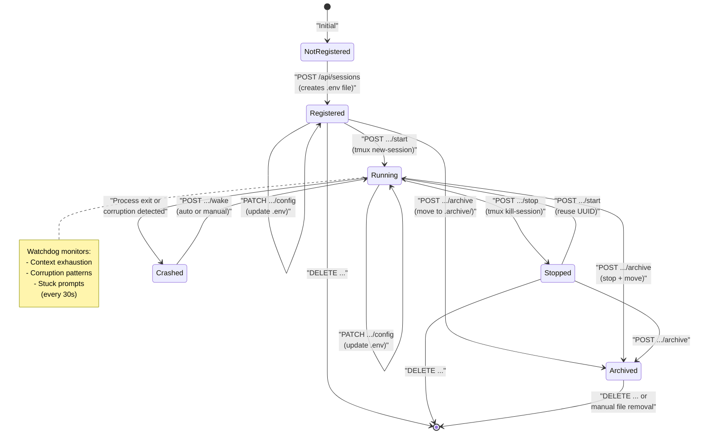

<!-- source: DeepWiki mcp.deepwiki.com · repo mixpeek/amux · page 5.1 Session Endpoints · fetched 2026-10-27 -->

# Session Endpoints

<details>
<summary>Relevant source files</summary>

The following files were used as context for generating this wiki page:

- [amux-server.py](amux-server.py)
- [cloud/gateway/gateway.py](cloud/gateway/gateway.py)
- [skills/amux-board.md](skills/amux-board.md)
- [skills/amux.md](skills/amux.md)
- [skills/playwright-auth.md](skills/playwright-auth.md)
- [skills/pw-test.md](skills/pw-test.md)
- [test.mjs](test.mjs)

</details>


## Purpose and Scope

This page documents all REST API endpoints for managing Claude Code sessions in amux. Sessions are the primary unit of work in amux—each session corresponds to a tmux session running an instance of Claude Code in a specific project directory. This page covers:

- **Session lifecycle operations**: creating, starting, stopping, archiving, and deleting sessions
- **Session interaction**: sending messages and monitoring output
- **Session configuration**: updating settings and cloning configurations

For session memory endpoints (`/api/sessions/{name}/memory`), see [Memory & File Endpoints](#5.3). For board and global memory, see [Board Endpoints](#5.2) and [Memory & File Endpoints](#5.3).

---

## Authentication

All session endpoints require authentication in cloud deployments. The gateway validates Clerk JWTs or session cookies and sets the `X-Amux-User-Email` header before proxying to user containers ([cloud/gateway/gateway.py:397-457]()). Local deployments bypass authentication since localhost access is inherently trusted.

---

## Endpoint Overview



**Sources:** [amux-server.py:152-186]()

---

## Session Discovery & Listing

### `GET /api/sessions`

Returns a list of all registered sessions with their current status, configuration, and runtime statistics.

**Request:**
```http
GET /api/sessions HTTP/1.1
Host: localhost:8822
```

**Response:** `200 OK`
```json
[
  {
    "name": "kittykat",
    "running": true,
    "dir": "/Users/ethan/Dev/kittykat",
    "model": "claude-sonnet-4",
    "tags": ["frontend", "priority"],
    "description": "Main UI development",
    "created_at": 1704067200,
    "auto_compact": true,
    "auto_restart": true,
    "yolo": false,
    "input_tokens": 45230,
    "cache_tokens": 12890,
    "output_tokens": 8765,
    "last_activity": 1704153600
  }
]
```

**Response Fields:**

| Field | Type | Description |
|-------|------|-------------|
| `name` | string | Unique session identifier (URL-safe) |
| `running` | boolean | Whether tmux session is active |
| `dir` | string | Project directory (absolute path) |
| `model` | string | Claude model ID (e.g. `claude-sonnet-4`) |
| `tags` | string[] | User-defined labels for filtering |
| `description` | string | Human-readable session purpose |
| `created_at` | integer | Unix timestamp of session registration |
| `auto_compact` | boolean | Auto-trigger `/compact` when context < 20% |
| `auto_restart` | boolean | Auto-restart on corruption detection |
| `yolo` | boolean | Auto-respond "y" to approval prompts |
| `input_tokens` | integer | Total input tokens consumed (cached + live) |
| `cache_tokens` | integer | Prompt cache read tokens |
| `output_tokens` | integer | Total output tokens generated |
| `last_activity` | integer | Unix timestamp of last Claude API call |

**Implementation:**

The endpoint reads all `*.env` files in `CC_SESSIONS` directory, parses session configuration using `parse_env_file()`, enriches with token counts from `_token_cache`, and merges with tmux status from `list_sessions()` ([amux-server.py:2385-2450]()).

**Sources:** [amux-server.py:2385-2450](), [amux-server.py:788-860]()

---

## Session Lifecycle

### `POST /api/sessions` — Create Session

Registers a new session by creating a `{name}.env` config file in `~/.amux/sessions/`. Does not start the session—use `POST /api/sessions/{name}/start` to launch it.

**Request:**
```http
POST /api/sessions HTTP/1.1
Host: localhost:8822
Content-Type: application/json

{
  "name": "api-server",
  "dir": "/Users/ethan/Dev/backend",
  "model": "claude-sonnet-4",
  "tags": ["backend", "priority"],
  "description": "REST API development"
}
```

**Request Fields:**

| Field | Required | Type | Description |
|-------|----------|------|-------------|
| `name` | yes | string | Session name (alphanumeric, dash, underscore) |
| `dir` | yes | string | Absolute path to project directory |
| `model` | no | string | Claude model ID (default: `claude-sonnet-4`) |
| `tags` | no | string[] | Filterable labels |
| `description` | no | string | Human-readable purpose |
| `auto_compact` | no | boolean | Enable auto-compaction (default: `true`) |
| `auto_restart` | no | boolean | Enable auto-recovery (default: `true`) |
| `yolo` | no | boolean | Auto-approve all prompts (default: `false`) |

**Response:** `201 Created`
```json
{
  "ok": true,
  "name": "api-server",
  "path": "/Users/ethan/.amux/sessions/api-server.env"
}
```

**Error Responses:**

- `400 Bad Request` — Missing `name` or `dir`, or invalid name format
- `409 Conflict` — Session name already exists

**Validation Rules:**

Session names must match `^[a-zA-Z0-9_-]+$` and cannot contain path separators. The directory path is validated for existence before creating the config ([amux-server.py:2480-2537]()).

**Sources:** [amux-server.py:2480-2537]()

---

### `POST /api/sessions/{name}/start` — Start Session

Launches a tmux session and starts Claude Code in the configured project directory. Creates a UUID-based tmux session name prefixed with `amux-` to avoid conflicts.

**Request:**
```http
POST /api/sessions/api-server/start HTTP/1.1
Host: localhost:8822
```

**Response:** `200 OK`
```json
{
  "ok": true,
  "name": "api-server",
  "tmux_session": "amux-d4e2c8a1",
  "pid": 45123
}
```

**Error Responses:**

- `404 Not Found` — Session does not exist
- `409 Conflict` — Session is already running
- `500 Internal Server Error` — tmux launch failed

**Startup Sequence:**



The session UUID is saved in the `{name}.env` file so subsequent operations can locate the tmux session even after server restarts ([amux-server.py:2543-2553]()).

**Sources:** [amux-server.py:2543-2553](), [amux-server.py:1163-1250]()

---

### `POST /api/sessions/{name}/stop` — Stop Session

Terminates the tmux session, killing the Claude Code process and all child processes.

**Request:**
```http
POST /api/sessions/api-server/stop HTTP/1.1
Host: localhost:8822
```

**Response:** `200 OK`
```json
{
  "ok": true,
  "name": "api-server"
}
```

**Error Responses:**

- `404 Not Found` — Session does not exist or is not running

**Behavior:**

Executes `tmux kill-session -t amux-{uuid}`. The session UUID persists in the config file, allowing the session to be restarted later with the same UUID ([amux-server.py:2554-2563]()).

**Sources:** [amux-server.py:2554-2563]()

---

### `DELETE /api/sessions/{name}` — Delete Session

Permanently removes the session configuration file. If the session is running, it is stopped first.

**Request:**
```http
DELETE /api/sessions/api-server HTTP/1.1
Host: localhost:8822
```

**Response:** `200 OK`
```json
{
  "ok": true,
  "deleted": "api-server"
}
```

**Error Responses:**

- `404 Not Found` — Session does not exist

**Behavior:**

Stops the session if running, then deletes `~/.amux/sessions/{name}.env`. This operation is irreversible—use `POST /api/sessions/{name}/archive` for soft deletion ([amux-server.py:2736-2748]()).

**Sources:** [amux-server.py:2736-2748]()

---

### `POST /api/sessions/{name}/archive` — Archive Session

Moves the session configuration to `~/.amux/sessions/.archive/{name}.env` and stops the session if running. Archived sessions can be restored by moving the file back or recreating the session.

**Request:**
```http
POST /api/sessions/api-server/archive HTTP/1.1
Host: localhost:8822
```

**Response:** `200 OK`
```json
{
  "ok": true,
  "archived": "api-server",
  "path": "/Users/ethan/.amux/sessions/.archive/api-server.env"
}
```

**Error Responses:**

- `404 Not Found` — Session does not exist

**Sources:** [amux-server.py:2698-2718]()

---

## Session Interaction

### `POST /api/sessions/{name}/send` — Send Message

Injects a message or command into a running session. Supports both natural language prompts and tool commands (e.g. `/compact`, `/reset`).

**Request:**
```http
POST /api/sessions/api-server/send HTTP/1.1
Host: localhost:8822
Content-Type: application/json

{
  "text": "Add input validation to the /users endpoint"
}
```

**Request Fields:**

| Field | Required | Type | Description |
|-------|----------|------|-------------|
| `text` | yes | string | Message to send (prompt or command) |
| `mode` | no | string | Injection mode: `"text"` or `"keys"` (default: `"text"`) |

**Response:** `200 OK`
```json
{
  "ok": true,
  "sent": "Add input validation to the /users endpoint"
}
```

**Error Responses:**

- `404 Not Found` — Session does not exist or is not running
- `400 Bad Request` — Missing `text` field

**Injection Modes:**



- **`text` mode**: Sends the literal text followed by Enter. Special characters are escaped. Used for natural language prompts.
- **`keys` mode**: Sends raw tmux key sequences (e.g. `C-c`, `Escape`). Used for control flow like interrupting Claude.

**Thread Safety:**

Send operations are serialized per session using a lock in `_send_locks` to prevent message interleaving ([amux-server.py:2564-2602]()).

**Sources:** [amux-server.py:2564-2602](), [amux-server.py:1252-1341]()

---

### `POST /api/sessions/{name}/peek` — Peek Output

Captures recent terminal output from a running session without interrupting it. Used for monitoring agent progress and detecting failure states.

**Request:**
```http
POST /api/sessions/api-server/peek HTTP/1.1
Host: localhost:8822
Content-Type: application/json

{
  "lines": 100
}
```

**Request Fields:**

| Field | Required | Type | Description |
|-------|----------|------|-------------|
| `lines` | no | integer | Number of lines to capture (default: 50) |

**Response:** `200 OK`
```json
{
  "ok": true,
  "output": "[recent terminal output...]",
  "timestamp": 1704153600
}
```

**Error Responses:**

- `404 Not Found` — Session does not exist or is not running

**Implementation:**

Executes `tmux capture-pane -p -S -{lines}` to capture scrollback buffer. The output includes ANSI escape codes for formatting ([amux-server.py:2604-2620]()).

**Sources:** [amux-server.py:2604-2620]()

---

### `POST /api/sessions/{name}/wake` — Wake Session

Restarts a failed or stuck session. Useful for recovery after crashes or when watchdog auto-recovery is disabled.

**Request:**
```http
POST /api/sessions/api-server/wake HTTP/1.1
Host: localhost:8822
```

**Response:** `200 OK`
```json
{
  "ok": true,
  "restarted": "api-server"
}
```

**Error Responses:**

- `404 Not Found` — Session does not exist

**Behavior:**

If the session is running, stops it first. Then starts it with the same configuration. This is effectively a stop-then-start cycle ([amux-server.py:2719-2735]()).

**Sources:** [amux-server.py:2719-2735]()

---

## Session Configuration

### `PATCH /api/sessions/{name}/config` — Update Configuration

Updates session settings without restarting. Changes are persisted to the session's `.env` file.

**Request:**
```http
PATCH /api/sessions/api-server/config HTTP/1.1
Host: localhost:8822
Content-Type: application/json

{
  "model": "claude-opus-4",
  "tags": ["backend", "critical"],
  "yolo": true
}
```

**Updatable Fields:**

| Field | Type | Description |
|-------|------|-------------|
| `model` | string | Claude model ID |
| `tags` | string[] | Session labels |
| `description` | string | Session purpose |
| `auto_compact` | boolean | Enable auto-compaction |
| `auto_restart` | boolean | Enable auto-recovery |
| `yolo` | boolean | Auto-approve prompts |

**Response:** `200 OK`
```json
{
  "ok": true,
  "updated": ["model", "yolo"]
}
```

**Error Responses:**

- `404 Not Found` — Session does not exist

**Immutable Fields:**

The session `name` and `dir` cannot be changed after creation. To change these, create a new session ([amux-server.py:2621-2659]()).

**Sources:** [amux-server.py:2621-2659]()

---

### `GET /api/sessions/{name}/clone` — Clone Configuration

Returns the session's configuration as a template for creating similar sessions.

**Request:**
```http
GET /api/sessions/api-server/clone HTTP/1.1
Host: localhost:8822
```

**Response:** `200 OK`
```json
{
  "dir": "/Users/ethan/Dev/backend",
  "model": "claude-sonnet-4",
  "tags": ["backend"],
  "description": "REST API development",
  "auto_compact": true,
  "auto_restart": true,
  "yolo": false
}
```

**Usage Pattern:**

```bash
# Clone existing session config
curl -sk https://localhost:8822/api/sessions/api-server/clone > /tmp/config.json

# Modify name and directory
jq '.name = "api-v2" | .dir = "/Users/ethan/Dev/backend-v2"' /tmp/config.json > /tmp/new.json

# Create new session with cloned config
curl -sk -X POST -H 'Content-Type: application/json' \
  -d @/tmp/new.json \
  https://localhost:8822/api/sessions
```

**Sources:** [amux-server.py:2660-2697]()

---

## Session State Machine



**Sources:** [amux-server.py:152-186](), [amux-server.py:1643-1914]()

---

## Common Request Patterns

### Agent-to-Agent Delegation

```bash
# Agent 1 sends work to Agent 2
curl -sk -X POST -H 'Content-Type: application/json' \
  -d '{"text":"Build the login UI component using the /auth endpoint"}' \
  https://localhost:8822/api/sessions/frontend/send

# Agent 1 monitors Agent 2's progress
curl -sk -X POST -H 'Content-Type: application/json' \
  -d '{"lines":100}' \
  https://localhost:8822/api/sessions/frontend/peek
```

### Bulk Session Management

```bash
# Stop all running sessions
curl -sk https://localhost:8822/api/sessions | \
  jq -r '.[] | select(.running) | .name' | \
  xargs -I{} curl -sk -X POST https://localhost:8822/api/sessions/{}/stop
```

### Session Health Check

```bash
# Check for sessions with low context
curl -sk https://localhost:8822/api/sessions | \
  jq '.[] | select(.running and (.input_tokens / 200000) > 0.8) | {name, input_tokens}'
```

**Sources:** [skills/amux.md:1-94](), [amux-server.py:2385-2748]()

---

## Error Handling

All endpoints follow consistent error response patterns:

**Error Response Format:**
```json
{
  "error": "descriptive error message"
}
```

**Common Status Codes:**

| Code | Meaning | Common Causes |
|------|---------|---------------|
| `400` | Bad Request | Missing required fields, invalid JSON |
| `404` | Not Found | Session does not exist or is not running |
| `409` | Conflict | Session already exists or is already running |
| `500` | Internal Server Error | tmux failure, disk I/O error, process crash |

**Sources:** [amux-server.py:2480-2748]()

---

