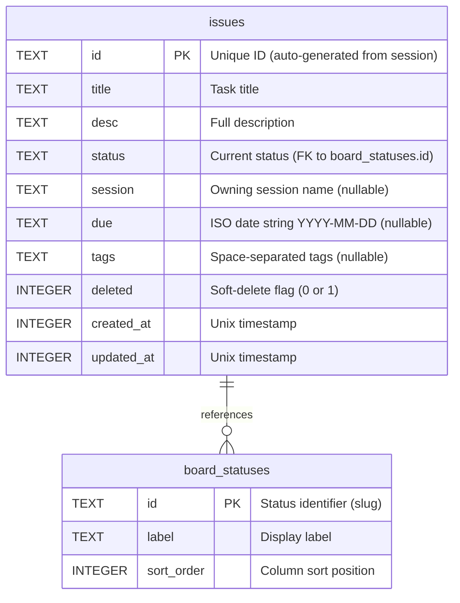
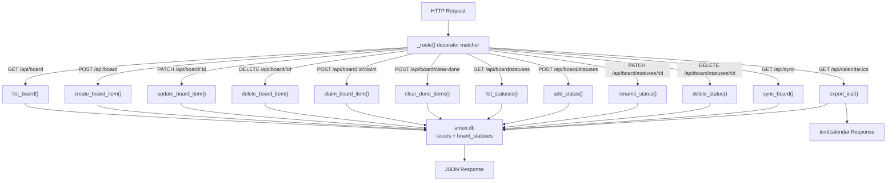
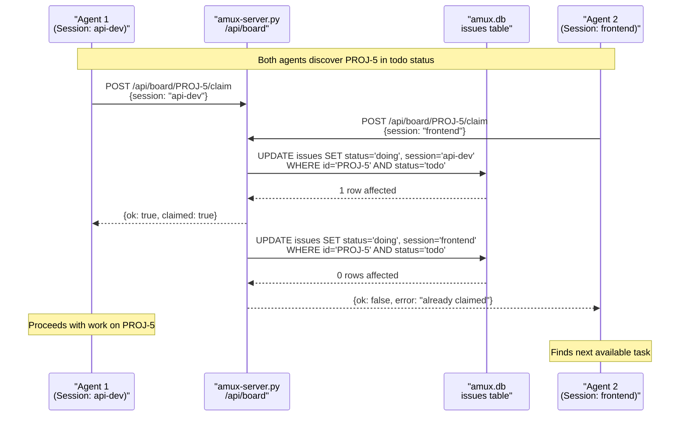
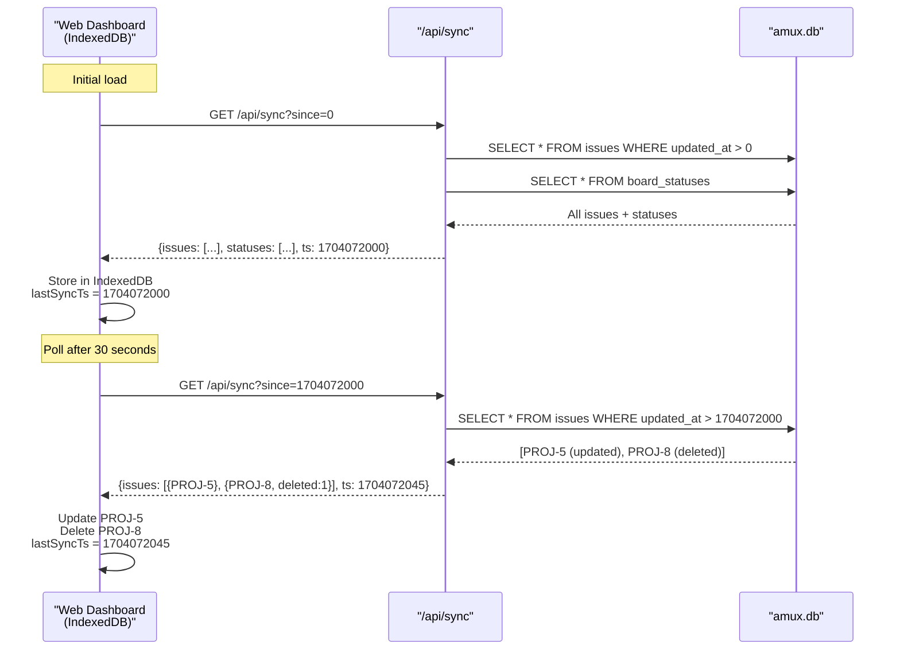
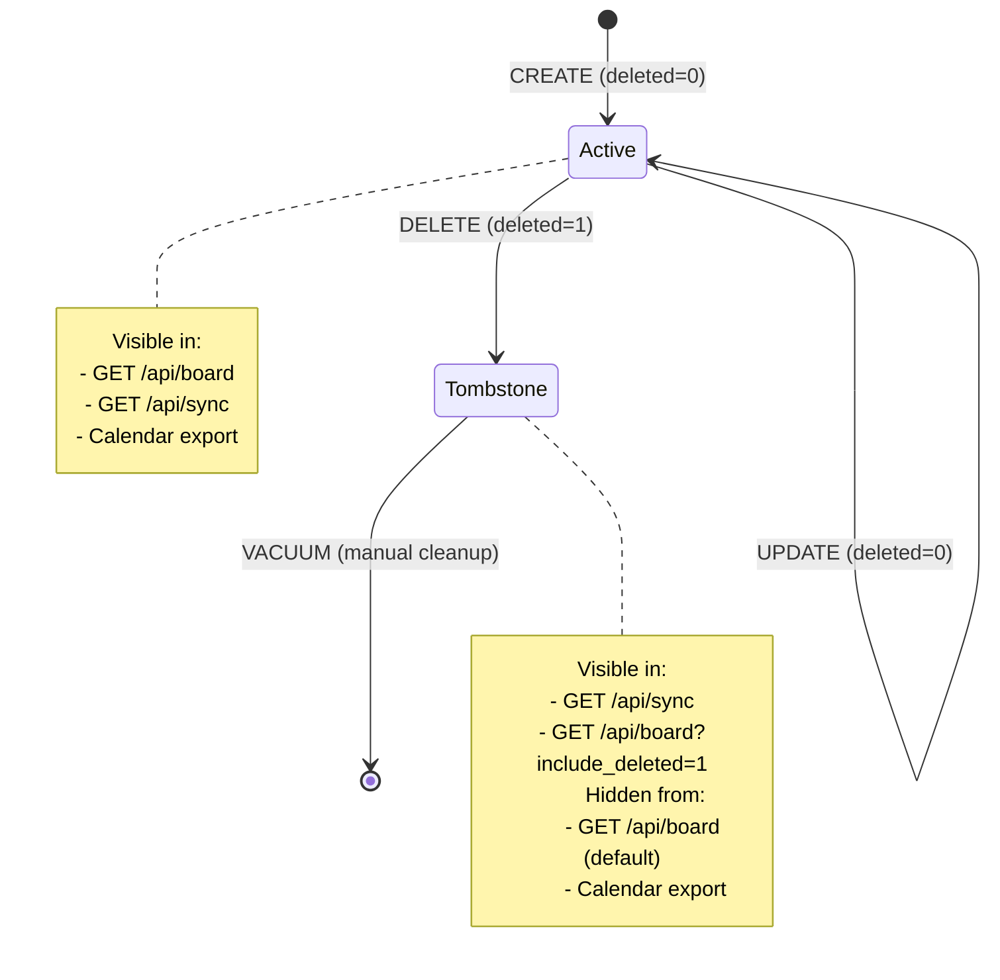

<!-- source: DeepWiki mcp.deepwiki.com · repo mixpeek/amux · page 5.2 Board Endpoints · fetched 2026-10-27 -->

# Board Endpoints

<details>
<summary>Relevant source files</summary>

The following files were used as context for generating this wiki page:

- [amux-server.py](amux-server.py)
- [cloud/gateway/gateway.py](cloud/gateway/gateway.py)
- [skills/amux-board.md](skills/amux-board.md)
- [skills/amux.md](skills/amux.md)
- [skills/playwright-auth.md](skills/playwright-auth.md)
- [skills/pw-test.md](skills/pw-test.md)
- [test.mjs](test.mjs)

</details>


This page documents the REST API endpoints for the amux board system, which provides a SQLite-backed Kanban board with atomic task claiming, soft deletes, and real-time synchronization. The board enables multi-agent coordination by allowing sessions to claim work items atomically and track progress across todo/doing/done statuses.

For information about the board's internal implementation and data structures, see [Board System](#2.2). For UI interactions with the board, see [Board Interface](#6.2). For CLI commands, see [Board Commands](#7.2).

---

## Overview

The board system exposes HTTP endpoints for managing issues (tasks/work items) and custom status columns. All endpoints operate on a SQLite database at `~/.amux/amux.db` with two core tables: `issues` and `board_statuses`. The API supports:

- **CRUD operations** for issues (create, read, update, delete)
- **Atomic claiming** via SQL CAS operations to prevent duplicate work
- **Soft deletes** with tombstone tracking for sync
- **Custom status columns** beyond the default todo/doing/done
- **Incremental sync** via timestamp-based polling
- **iCal export** for calendar integration

All board operations emit structured events to the server's event log, enabling real-time UI updates via Server-Sent Events.

**Sources:** [amux-server.py:132-186](), [amux-server.py:53-54](), [skills/amux.md:15-35]()

---

## Database Schema

The board system uses two SQLite tables defined at server startup:



### Default Statuses

The database is initialized with three default statuses:

| ID | Label | Sort Order |
|---|---|---|
| `todo` | Todo | 0 |
| `doing` | Doing | 1 |
| `done` | Done | 2 |

Additional statuses can be added dynamically via the status management endpoints.

**Sources:** [amux-server.py:53-54](), [skills/amux.md:34]()

---

## Endpoint Reference

### Board Endpoint Routing



**Sources:** [amux-server.py:132-186]()

---

## Issue Management Endpoints

### GET /api/board

List all board issues, excluding soft-deleted items by default.

**Query Parameters:**

| Parameter | Type | Description |
|---|---|---|
| `include_deleted` | boolean | If `1` or `true`, include soft-deleted items |

**Response:**

```json
[
  {
    "id": "PROJ-1",
    "title": "Implement login endpoint",
    "desc": "Add POST /api/auth/login with email/password validation",
    "status": "doing",
    "session": "backend-api",
    "due": "2024-01-15",
    "tags": "api auth",
    "deleted": 0,
    "created_at": 1704067200,
    "updated_at": 1704070800
  }
]
```

**Sources:** [amux-server.py:132-134](), [skills/amux.md:17-20]()

---

### POST /api/board

Create a new board issue. The `id` field is auto-generated from the session name or uses a random UUID if no session is provided.

**Request Body:**

```json
{
  "title": "Fix navigation bug",
  "desc": "Sidebar links don't update active state on route change",
  "status": "todo",
  "session": "frontend",
  "due": "2024-01-20",
  "tags": "bug ui"
}
```

**Fields:**

| Field | Required | Type | Description |
|---|---|---|---|
| `title` | Yes | string | Short task title |
| `desc` | No | string | Detailed description |
| `status` | No | string | Initial status (default: `todo`) |
| `session` | No | string | Owning session name |
| `due` | No | string | Due date in `YYYY-MM-DD` format |
| `tags` | No | string | Space-separated tags |

**Response:**

```json
{
  "id": "FRONTEND-3",
  "status": 201
}
```

**ID Generation Logic:**

1. If `session` is provided and session exists: `{SESSION_PREFIX}-{counter}`
2. Otherwise: Random UUID-based identifier

**Event Emitted:** `type: "board"`, `action: "created"`

**Sources:** [amux-server.py:132-133](), [skills/amux-board.md:13-18](), [skills/amux-board.md:32-37]()

---

### PATCH /api/board/{id}

Update an existing board issue. All fields are optional; only provided fields are updated.

**Request Body:**

```json
{
  "status": "done",
  "title": "Fix navigation bug (completed)",
  "desc": "Updated sidebar to use useLocation hook",
  "session": "frontend",
  "due": "2024-01-20",
  "tags": "bug ui resolved"
}
```

**Response:**

```json
{
  "ok": true
}
```

**Behavior:**

- Updates `updated_at` timestamp automatically
- Non-provided fields retain their current values
- Updating `status` to a non-existent status is allowed (status columns are created on-demand in UI)

**Event Emitted:** `type: "board"`, `action: "updated"`, `target: {id}`

**Sources:** [amux-server.py:137](), [skills/amux.md:26-28]()

---

### DELETE /api/board/{id}

Soft-delete a board issue by setting its `deleted` flag to `1` and `updated_at` to the current timestamp.

**Response:**

```json
{
  "ok": true
}
```

**Behavior:**

- Does not physically remove the row (enables sync protocol tombstone tracking)
- Deleted items excluded from default `GET /api/board` responses
- Deleted items appear in sync responses with `deleted: 1`

**Event Emitted:** `type: "board"`, `action: "deleted"`, `target: {id}`

**Sources:** [amux-server.py:138](), [skills/amux.md:30-31](), [test.mjs:86-91]()

---

## Atomic Operations

### POST /api/board/{id}/claim

Atomically claim a board issue for a session using SQL Compare-And-Swap (CAS). This prevents two agents from claiming the same work item simultaneously.

**Request Body:**

```json
{
  "session": "backend-api"
}
```

**Response (Success):**

```json
{
  "ok": true,
  "claimed": true
}
```

**Response (Already Claimed):**

```json
{
  "ok": false,
  "error": "Issue already claimed by another session"
}
```

**SQL Implementation:**

The claim operation uses a single atomic UPDATE with a WHERE clause that checks the current state:

```sql
UPDATE issues 
SET status = 'doing', session = ?, updated_at = ?
WHERE id = ? AND status = 'todo' AND (session IS NULL OR session = '')
```

If the UPDATE affects 0 rows, the item was already claimed.

### Atomic Claim Sequence Diagram



**Event Emitted:** `type: "board"`, `action: "claimed"`, `target: {id}`

**Sources:** [amux-server.py:139-141](), [Diagram 4 from system architecture]()

---

## Bulk Operations

### POST /api/board/clear-done

Soft-delete all issues with `status = 'done'` in a single operation.

**Request Body:** None

**Response:**

```json
{
  "ok": true,
  "count": 5
}
```

**Behavior:**

- Sets `deleted = 1` and `updated_at = {current timestamp}` for all done items
- Returns count of affected items
- Useful for periodic board cleanup

**Event Emitted:** `type: "board"`, `action: "cleared"`, `target: "done"`

**Sources:** [amux-server.py:142-143]()

---

## Status Management Endpoints

### GET /api/board/statuses

List all board statuses (columns) in sort order.

**Response:**

```json
[
  {"id": "todo", "label": "Todo", "sort_order": 0},
  {"id": "doing", "label": "Doing", "sort_order": 1},
  {"id": "done", "label": "Done", "sort_order": 2},
  {"id": "blocked", "label": "Blocked", "sort_order": 3}
]
```

**Sources:** [test.mjs:87]()

---

### POST /api/board/statuses

Add a new custom status column.

**Request Body:**

```json
{
  "id": "review",
  "label": "In Review",
  "sort_order": 2
}
```

**Fields:**

| Field | Required | Type | Description |
|---|---|---|---|
| `id` | Yes | string | Unique status identifier (slug, lowercase, hyphens) |
| `label` | Yes | string | Display label for UI |
| `sort_order` | No | integer | Column position (default: next available) |

**Response:**

```json
{
  "ok": true
}
```

**Event Emitted:** `type: "board"`, `action: "status-added"`

**Sources:** [amux-server.py:144-145]()

---

### PATCH /api/board/statuses/{id}

Rename a status column's label or change its sort order.

**Request Body:**

```json
{
  "label": "Code Review",
  "sort_order": 2
}
```

**Response:**

```json
{
  "ok": true
}
```

**Event Emitted:** `type: "board"`, `action: "status-renamed"`, `target: {id}`

**Sources:** [amux-server.py:150]()

---

### DELETE /api/board/statuses/{id}

Remove a custom status column. Cannot delete the three default statuses (`todo`, `doing`, `done`).

**Response:**

```json
{
  "ok": true
}
```

**Behavior:**

- Returns error if attempting to delete a default status
- Issues with the deleted status remain unchanged (status field becomes orphaned but valid)

**Event Emitted:** `type: "board"`, `action: "status-removed"`, `target: {id}`

**Sources:** [amux-server.py:149]()

---

## Synchronization

### GET /api/sync

Retrieve incremental board updates since a given timestamp. Returns both issues and statuses that have changed.

**Query Parameters:**

| Parameter | Type | Description |
|---|---|---|
| `since` | integer | Unix timestamp; returns items with `updated_at > since` |

**Response:**

```json
{
  "issues": [
    {
      "id": "PROJ-1",
      "title": "Implement login",
      "desc": "...",
      "status": "done",
      "session": "backend-api",
      "due": null,
      "tags": "api",
      "deleted": 0,
      "created_at": 1704067200,
      "updated_at": 1704070800
    },
    {
      "id": "PROJ-2",
      "title": "Old task",
      "deleted": 1,
      "updated_at": 1704071000
    }
  ],
  "statuses": [
    {"id": "review", "label": "In Review", "sort_order": 2}
  ],
  "ts": 1704072000
}
```

**Behavior:**

- Returns issues with `updated_at > since`, including soft-deleted items (tombstones)
- Returns statuses modified since the given timestamp
- `ts` field in response provides timestamp for next sync call
- Deleted items have `deleted: 1` flag; clients should remove them from local state

### Sync Protocol Flow



**Sources:** [amux-server.py:88-89](), [test.mjs:88-91]()

---

## Calendar Export

### GET /api/calendar.ics

Export board issues with due dates as an iCalendar file for subscription in calendar apps.

**Response Headers:**

```
Content-Type: text/calendar; charset=utf-8
Content-Disposition: attachment; filename="amux.ics"
```

**Response Body:**

```ics
BEGIN:VCALENDAR
VERSION:2.0
PRODID:-//amux//Board//EN
CALSCALE:GREGORIAN
X-WR-CALNAME:amux board
X-WR-TIMEZONE:UTC

BEGIN:VEVENT
UID:PROJ-1@localhost
DTSTART;VALUE=DATE:20240115
SUMMARY:Implement login endpoint
DESCRIPTION:Add POST /api/auth/login with email/password validation
STATUS:CONFIRMED
END:VEVENT

END:VCALENDAR
```

**Behavior:**

- Only includes issues with non-null `due` field
- Excludes soft-deleted items (`deleted = 0`)
- Each issue becomes a `VEVENT` with:
  - `UID`: Issue ID + server hostname
  - `DTSTART`: Due date in `YYYYMMDD` format
  - `SUMMARY`: Issue title
  - `DESCRIPTION`: Issue description
  - `STATUS`: Always `CONFIRMED`

**Sources:** [test.mjs:90](), [amux-server.py:70-76]()

---

## Request/Response Examples

### Creating and Claiming a Task

```bash
# Create a task
curl -sk -X POST https://localhost:8822/api/board \
  -H 'Content-Type: application/json' \
  -d '{
    "title": "Add dark mode toggle",
    "desc": "Implement theme switcher in settings panel",
    "status": "todo",
    "session": "frontend",
    "tags": "ui feature"
  }'

# Response:
# {"id": "FRONTEND-7", "status": 201}

# Claim it atomically from another session
curl -sk -X POST https://localhost:8822/api/board/FRONTEND-7/claim \
  -H 'Content-Type: application/json' \
  -d '{"session": "design-system"}'

# Response:
# {"ok": true, "claimed": true}
```

### Updating Status and Adding Due Date

```bash
curl -sk -X PATCH https://localhost:8822/api/board/FRONTEND-7 \
  -H 'Content-Type: application/json' \
  -d '{
    "status": "doing",
    "due": "2024-01-25"
  }'

# Response:
# {"ok": true}
```

### Syncing Changes

```bash
# First sync (initial load)
curl -sk 'https://localhost:8822/api/sync?since=0' | jq .

# Output:
# {
#   "issues": [...],  // all issues
#   "statuses": [...], // all statuses
#   "ts": 1704072000
# }

# Subsequent sync (only changes)
curl -sk 'https://localhost:8822/api/sync?since=1704072000' | jq .

# Output:
# {
#   "issues": [
#     {"id": "FRONTEND-7", "status": "doing", "due": "2024-01-25", ...}
#   ],
#   "statuses": [],
#   "ts": 1704072045
# }
```

**Sources:** [skills/amux.md:17-31](), [skills/amux-board.md:13-28]()

---

## Tombstone System for Sync

The board uses **soft deletes** (tombstones) to support reliable synchronization across clients and sessions. When an issue is deleted:

1. The `deleted` flag is set to `1`
2. The `updated_at` timestamp is updated to current time
3. The row remains in the database

This ensures:

- Sync clients receive delete notifications via `/api/sync`
- Deleted items appear in sync responses with `deleted: 1`
- Clients can remove items from local state
- No race conditions where a client misses a delete

### Tombstone Lifecycle



**Sources:** [test.mjs:91](), [amux-server.py:138]()

---

## Error Handling

All board endpoints return consistent error responses:

**404 Not Found:**
```json
{
  "error": "Issue not found"
}
```

**400 Bad Request:**
```json
{
  "error": "Missing required field: title"
}
```

**409 Conflict (Claim Failed):**
```json
{
  "ok": false,
  "error": "Issue already claimed by another session"
}
```

**Sources:** [amux-server.py:132-186]()

---

## Authentication in Cloud Deployment

In cloud deployments (via `gateway.py`), board endpoints require authentication:

1. **Clerk JWT** via `Authorization: Bearer {token}` header, or
2. **Session cookie** set by `/api/cloud-auth`

The gateway proxies all `/api/board` requests to the user's container after authentication, injecting the `X-Amux-User-Email` header.

**Sources:** [cloud/gateway/gateway.py:396-458]()

---

## Summary Table

| Endpoint | Method | Purpose | Atomic | Emits Event |
|---|---|---|---|---|
| `/api/board` | GET | List issues | No | No |
| `/api/board` | POST | Create issue | No | Yes |
| `/api/board/{id}` | PATCH | Update issue | No | Yes |
| `/api/board/{id}` | DELETE | Soft-delete issue | No | Yes |
| `/api/board/{id}/claim` | POST | Claim issue (CAS) | **Yes** | Yes |
| `/api/board/clear-done` | POST | Bulk delete done items | No | Yes |
| `/api/board/statuses` | GET | List statuses | No | No |
| `/api/board/statuses` | POST | Add status | No | Yes |
| `/api/board/statuses/{id}` | PATCH | Rename status | No | Yes |
| `/api/board/statuses/{id}` | DELETE | Delete status | No | Yes |
| `/api/sync` | GET | Incremental sync | No | No |
| `/api/calendar.ics` | GET | Export to iCal | No | No |

**Sources:** [amux-server.py:132-186]()

---

