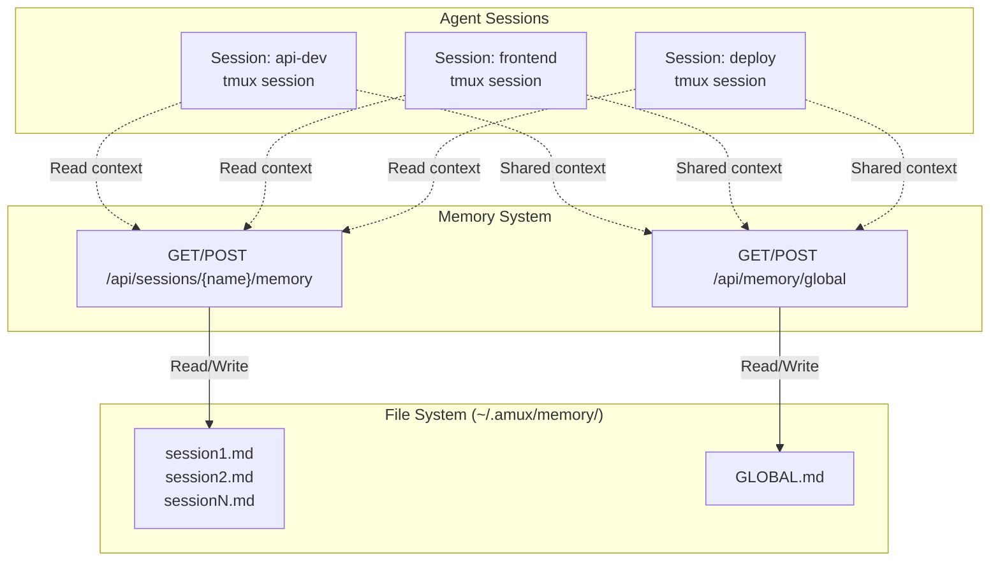
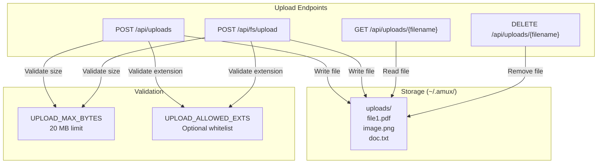
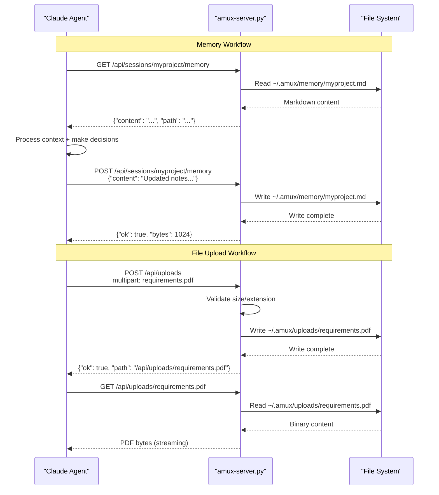

<!-- source: DeepWiki mcp.deepwiki.com · repo mixpeek/amux · page 5.3 Memory & File Endpoints · fetched 2026-10-27 -->

# Memory & File Endpoints

<details>
<summary>Relevant source files</summary>

The following files were used as context for generating this wiki page:

- [amux-server.py](amux-server.py)
- [cloud/gateway/gateway.py](cloud/gateway/gateway.py)
- [skills/amux-board.md](skills/amux-board.md)
- [skills/amux.md](skills/amux.md)
- [skills/playwright-auth.md](skills/playwright-auth.md)
- [skills/pw-test.md](skills/pw-test.md)
- [test.mjs](test.mjs)

</details>


This page documents the REST API endpoints for managing memory (contextual notes) and file uploads in amux. Memory provides persistent, editable context that agents can reference across conversation turns. Files enable uploading documents, images, and other artifacts that agents can access.

For other API endpoint categories, see [Session Endpoints](#5.1) and [Board Endpoints](#5.2).

---

## Memory System Overview

amux provides two types of memory storage:

- **Per-Session Memory**: Each session has its own private `MEMORY.md` file for session-specific context (e.g., project requirements, API keys, design decisions)
- **Global Memory**: A shared `GLOBAL.md` file accessible to all sessions for cross-project context (e.g., organization standards, reusable patterns, environment setup)

Memory files are stored as Markdown in `~/.amux/memory/` and persist across session stop/start cycles. They are designed for natural language consumption by Claude agents rather than structured data storage.

**Sources**: [amux-server.py:49-63](), [amux-server.py:1641-1753]()

---

## Memory Storage Architecture



**Sources**: [amux-server.py:49-63](), [skills/amux.md:50-64]()

---

## Per-Session Memory Endpoints

### `GET /api/sessions/<name>/memory`

Retrieves the memory content for a specific session.

**Request**:
```bash
curl -sk https://localhost:8822/api/sessions/api-dev/memory
```

**Response** (200 OK):
```json
{
  "content": "# API Development Session\n\n## Current Task\nImplementing user authentication...",
  "path": "/Users/username/.amux/memory/api-dev.md"
}
```

**Response Fields**:

| Field | Type | Description |
|-------|------|-------------|
| `content` | string | Full Markdown content of the memory file (empty string if file doesn't exist) |
| `path` | string | Absolute filesystem path to the memory file |

**Error Responses**:
- `404 Not Found`: Session does not exist

**Sources**: [amux-server.py:1641-1677]()

---

### `POST /api/sessions/<name>/memory`

Replaces the entire memory content for a session. This is a full-replace operation, not an append.

**Request**:
```bash
curl -sk -X POST https://localhost:8822/api/sessions/api-dev/memory \
  -H 'Content-Type: application/json' \
  -d '{"content": "# API Development\n\n## Status\nAuth implementation complete."}'
```

**Request Body**:
```json
{
  "content": "Markdown content to save"
}
```

**Response** (200 OK):
```json
{
  "ok": true,
  "path": "/Users/username/.amux/memory/api-dev.md",
  "bytes": 156
}
```

**Response Fields**:

| Field | Type | Description |
|-------|------|-------------|
| `ok` | boolean | Always `true` on success |
| `path` | string | Absolute path where memory was saved |
| `bytes` | integer | Number of bytes written |

**Error Responses**:
- `404 Not Found`: Session does not exist
- `400 Bad Request`: Missing or invalid `content` field

**Sources**: [amux-server.py:1678-1716]()

---

## Global Memory Endpoints

### `GET /api/memory/global`

Retrieves the global memory shared across all sessions.

**Request**:
```bash
curl -sk https://localhost:8822/api/memory/global
```

**Response** (200 OK):
```json
{
  "content": "# Organization Standards\n\n## Code Style\n- Use TypeScript...",
  "path": "/Users/username/.amux/memory/GLOBAL.md"
}
```

Response format is identical to per-session memory.

**Sources**: [amux-server.py:1717-1746]()

---

### `POST /api/memory/global`

Replaces the global memory content.

**Request**:
```bash
curl -sk -X POST https://localhost:8822/api/memory/global \
  -H 'Content-Type: application/json' \
  -d '{"content": "# Global Context\n\nShared knowledge..."}'
```

Request and response formats match the per-session memory POST endpoint.

**Sources**: [amux-server.py:1747-1753]()

---

## File Upload System Architecture



**Sources**: [amux-server.py:54-66](), [amux-server.py:1754-1850]()

---

## File Upload Endpoints

### `POST /api/uploads`

Upload a file via multipart/form-data. Files are stored in `~/.amux/uploads/` and accessible via GET.

**Request** (multipart/form-data):
```bash
curl -sk -X POST https://localhost:8822/api/uploads \
  -F "file=@document.pdf"
```

**Constraints**:

| Constraint | Value | Notes |
|------------|-------|-------|
| Max file size | 20 MB | Defined by `UPLOAD_MAX_BYTES` at [amux-server.py:66]() |
| Allowed extensions | Any | `UPLOAD_ALLOWED_EXTS` is `None` by default (allow all) |
| Field name | `file` | Required multipart field name |

**Response** (200 OK):
```json
{
  "ok": true,
  "name": "document.pdf",
  "path": "/api/uploads/document.pdf",
  "bytes": 245760
}
```

**Response Fields**:

| Field | Type | Description |
|-------|------|-------------|
| `ok` | boolean | Always `true` on success |
| `name` | string | Filename (sanitized, special characters removed) |
| `path` | string | URL path to access the uploaded file |
| `bytes` | integer | File size in bytes |

**Error Responses**:
- `413 Request Entity Too Large`: File exceeds 20 MB limit
- `400 Bad Request`: No file provided, invalid filename, or disallowed extension
- `409 Conflict`: Filename already exists

**Implementation Details**:
- Filenames are sanitized: special characters replaced with underscores
- If a file with the same name exists, the upload is rejected (409)
- Empty files are rejected

**Sources**: [amux-server.py:1754-1830]()

---

### `POST /api/fs/upload`

Alternative upload endpoint with identical behavior to `/api/uploads`. Provided for compatibility with different client conventions.

**Request/Response**: Identical to `POST /api/uploads`

**Sources**: [amux-server.py:1831-1850]()

---

### `GET /api/uploads/<filename>`

Retrieve an uploaded file by filename. Supports range requests for efficient streaming of large files.

**Request**:
```bash
curl -sk https://localhost:8822/api/uploads/document.pdf -o document.pdf
```

**Response** (200 OK):
- Binary file content with appropriate `Content-Type` header
- `Content-Length` header indicates file size
- Supports HTTP `Range` header for partial downloads

**Response Headers**:

| Header | Description |
|--------|-------------|
| `Content-Type` | MIME type inferred from file extension |
| `Content-Length` | File size in bytes |
| `Accept-Ranges` | `bytes` (indicates range support) |
| `Content-Range` | Present if Range request was made |

**Error Responses**:
- `404 Not Found`: File does not exist
- `416 Range Not Satisfiable`: Invalid byte range requested

**Supported MIME Types** (partial list):
- `.pdf` → `application/pdf`
- `.png`, `.jpg`, `.jpeg`, `.gif` → `image/*`
- `.txt`, `.md` → `text/plain`
- `.json` → `application/json`
- `.html` → `text/html`

**Sources**: [amux-server.py:2276-2323]()

---

### `DELETE /api/uploads/<filename>`

Delete an uploaded file permanently.

**Request**:
```bash
curl -sk -X DELETE https://localhost:8822/api/uploads/document.pdf
```

**Response** (200 OK):
```json
{
  "ok": true,
  "deleted": "document.pdf"
}
```

**Error Responses**:
- `404 Not Found`: File does not exist
- `400 Bad Request`: Invalid filename

**Sources**: [amux-server.py:2350-2367]()

---

## File System Access Endpoint

### `GET /fs/<path>`

Serve files from anywhere within `~/.amux/` (excluding sensitive files). Used internally by the dashboard for assets and session files.

**Request**:
```bash
curl -sk https://localhost:8822/fs/logs/session-name.log
```

**Access Restrictions**:
- Path must be relative (no absolute paths)
- Path must not escape `CC_HOME` (`~/.amux/`)
- Sensitive files are blocked:
  - `server.env` (contains API keys)
  - `amux.db*` (SQLite database files)
  - `.git/*` (version control)

**Response**: Binary file content with appropriate MIME type

**Error Responses**:
- `400 Bad Request`: Invalid path or access denied
- `404 Not Found`: File does not exist

**Sources**: [amux-server.py:2324-2349]()

---

## Memory and File API Integration



**Sources**: [amux-server.py:1641-1850](), [skills/amux.md:50-64]()

---

## Usage Patterns

### Agent Memory Access from Code

Claude agents running in tmux sessions use `curl` to interact with memory:

```bash
# Read current session's memory
SESSION_NAME=$(tmux display-message -p '#S' | sed 's/^amux-//')
curl -sk "https://localhost:8822/api/sessions/$SESSION_NAME/memory"

# Update with new context
curl -sk -X POST "https://localhost:8822/api/sessions/$SESSION_NAME/memory" \
  -H 'Content-Type: application/json' \
  -d '{"content": "# Updated Context\n\nNew information..."}'

# Read global shared context
curl -sk https://localhost:8822/api/memory/global
```

**Sources**: [skills/amux.md:50-64]()

---

### Multi-Agent Memory Coordination

Global memory enables agents to share context across sessions:

1. **Session A** (api-dev) documents API endpoints in global memory
2. **Session B** (frontend) reads global memory to understand available APIs
3. **Session C** (docs) reads global memory to generate API documentation

This avoids duplicating context in per-session memory and ensures consistency.

**Sources**: [amux-server.py:1717-1753]()

---

### File Upload for Agent Consumption

Agents can request users to upload files for analysis:

1. User uploads `requirements.pdf` via dashboard or `POST /api/uploads`
2. Agent receives file path: `/api/uploads/requirements.pdf`
3. Agent downloads file via `GET /api/uploads/requirements.pdf`
4. Agent processes content and updates memory with extracted information

**Sources**: [amux-server.py:1754-1830](), [amux-server.py:2276-2323]()

---

## Cloud Deployment Considerations

In cloud deployment via `gateway.py`, memory and uploads are:

- **Isolated per user**: Each user's Docker container has its own `~/.amux/` directory
- **Persistent**: Backed by Docker volumes (`amux-data-{user_id}`)
- **Backed up**: Continuously replicated to Cloudflare R2 via Litestream (database) and S3 sync (flat files)

The gateway proxies all API requests to the user's container without modification, preserving the local API contract.

**Sources**: [cloud/gateway/gateway.py:396-458]()

---

