<!-- source: DeepWiki mcp.deepwiki.com · repo mixpeek/amux · page 6.2 Board Interface · fetched 2026-10-27 -->

# Board Interface

<details>
<summary>Relevant source files</summary>

The following files were used as context for generating this wiki page:

- [README.md](README.md)
- [amux-server.py](amux-server.py)
- [cloud/gateway/gateway.py](cloud/gateway/gateway.py)
- [test.mjs](test.mjs)

</details>


**Purpose:** This page documents the web-based Kanban board UI: its two view modes (session-grouped and status columns), drag-and-drop operations, card detail editing, search functionality, and calendar integration. This covers the frontend interface only.

For information about the underlying SQLite schema, atomic task claiming, and board API endpoints, see [Board System](#2.2). For the board CLI commands, see [Board Commands](#7.2).

---

## Overview

The board interface provides a visual task management system with two complementary view modes. The interface is rendered as inline HTML/CSS/JavaScript within `amux-server.py` and is accessible via the "Board" tab in the web dashboard at `https://localhost:8822`.

**Key Features:**
- Two view modes: session-grouped and status columns (Kanban)
- Drag-and-drop status changes and session reassignment
- Due date badges with overdue detection
- Real-time search filtering
- Inline card creation with context awareness
- iCal feed subscription for calendar apps
- Mobile-optimized layout with touch gestures

**Sources:** [amux-server.py:1-12000](), [test.mjs:1-815]()

---

## View Modes

### Mode Selection

The board supports two visualization modes, toggled via radio buttons in the board toolbar:

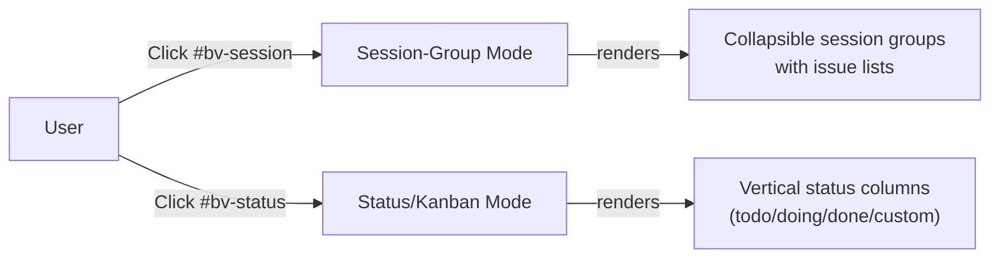

**Sources:** [amux-server.py:7500-7600](), [test.mjs:187-217]()

### Session-Group Mode (Default)

Groups issues by their assigned session. Each session gets a collapsible container (`.board-session-group`) with its issues listed inside. Unassigned issues appear in a separate "Unassigned" group.

**DOM Structure:**
```
#board-columns
  └─ .board-session-group (per session)
      ├─ .board-session-header (session name + chip)
      └─ .board-card (issues assigned to this session)
```

**Behavior:**
- Groups expand/collapse on header click
- Issues can be dragged between groups to reassign sessions
- Empty groups show "No issues" placeholder

**Sources:** [amux-server.py:7400-7500](), [test.mjs:186-202]()

### Status Mode (Kanban)

Traditional Kanban board with vertical columns for each status. Columns flow horizontally with `overflow-x: scroll` on the container.

**DOM Structure:**
```
#board-columns (overflow-x: scroll)
  └─ .board-col (per status)
      ├─ .board-col-header (status name + count)
      ├─ .board-add-btn ("+ Add")
      └─ .board-card (issues with this status)
```

**Built-in Statuses:**
- `todo` — To Do
- `doing` — In Progress
- `done` — Done

Custom statuses can be added via the Settings panel or `POST /api/board/statuses`.

**Sources:** [amux-server.py:7600-7700](), [test.mjs:204-217]()

---

## Board Card Component

Each issue renders as a `.board-card` element with the following visual structure:

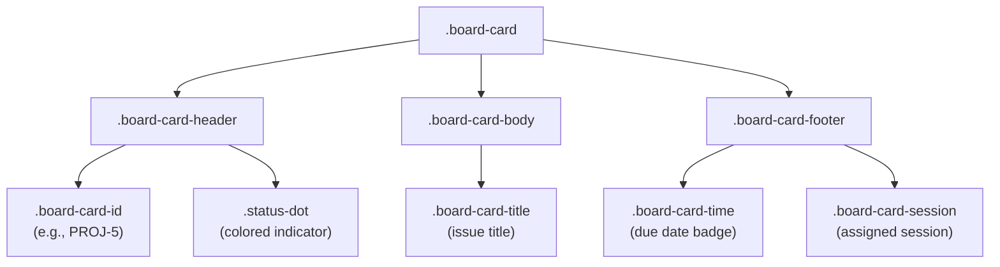

**Card Data Attributes:**
- `data-id`: Issue ID (e.g., `PROJ-5`)
- `data-status`: Current status slug (e.g., `doing`)
- `data-session`: Assigned session name (empty if unassigned)

**Due Date Badge (`board-card-time`):**
- Shows 📅 emoji prefix
- Red background (`.overdue`) if past today
- Accent color background (`.due-soon`) if within 7 days
- Relative time string (e.g., "in 2 days", "3 days ago")

**Sources:** [amux-server.py:7700-7900](), [test.mjs:219-222]()

---

## Board Detail Overlay

Clicking any card opens the `#board-detail-overlay` modal with full issue details and editing controls.

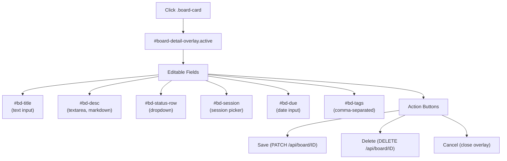

**Field Behaviors:**

| Field | Type | Notes |
|-------|------|-------|
| `#bd-title` | text | Required, issue title |
| `#bd-desc` | textarea | Markdown supported, rendered in preview |
| `#bd-status-row` | dropdown | Populated from `/api/board/statuses` |
| `#bd-session` | dropdown | Populated from `/api/sessions` + "Unassigned" |
| `#bd-due` | date input | HTML5 date picker, ISO 8601 format |
| `#bd-tags` | text | Comma-separated, trimmed on save |

**Keyboard Shortcuts:**
- `Escape` — Close overlay without saving
- `Cmd/Ctrl+Enter` — Save changes (when focused in title/desc)

**Sources:** [amux-server.py:8000-8200](), [test.mjs:224-242]()

---

## Drag-and-Drop Operations

The board supports native HTML5 drag-and-drop for status changes and session reassignment.

### Drag-and-Drop Flow

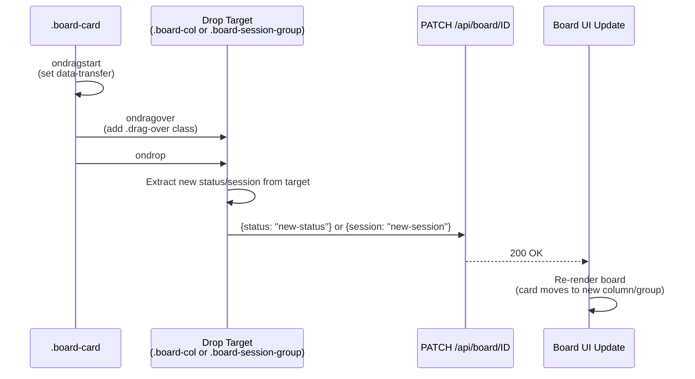

**Status Mode Drag:**
- Dragging a card to a different `.board-col` changes its status
- Drop triggers `PATCH /api/board/<id>` with `{status: "<target-status>"}`
- Card instantly moves to target column (optimistic update)

**Session-Group Mode Drag:**
- Dragging a card to a different `.board-session-group` reassigns session
- Drop triggers `PATCH /api/board/<id>` with `{session: "<target-session>"}`
- Card moves to target session group

**Visual Feedback:**
- Dragged card gets `.dragging` class (opacity: 0.5)
- Drop targets show `.drag-over` class (border highlight)

**Sources:** [amux-server.py:8300-8500]()

---

## Search and Filtering

The `#board-search` input provides client-side filtering of visible cards.

### Search Implementation

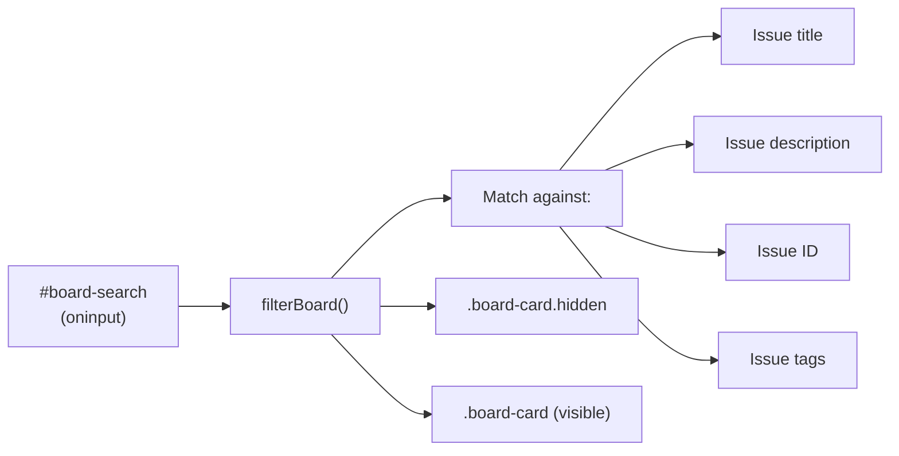

**Matching Logic:**
- Case-insensitive substring match
- Searches across: `title`, `desc`, `id`, `tags` (joined with spaces)
- Empty search shows all cards
- No network request — filters DOM directly

**Performance:**
- Instant feedback on keystroke
- No debouncing (fast enough for thousands of cards)

**Sources:** [amux-server.py:8600-8700](), [test.mjs:244-262]()

---

## Add Card Flow

Users can create new issues via the "+ Add" button in any column (status mode) or session group (session-group mode).

### Add Form Overlay

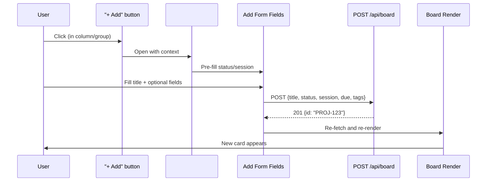

**Context Awareness:**

| Click Location | Pre-filled Field |
|----------------|------------------|
| Column "+ Add" button | `#be-status` = column's status |
| Session group "+ Add" | `#be-session` = group's session |
| Calendar cell click | `#be-due` = clicked date |

**Form Fields (`#board-edit-overlay`):**
- `#be-title` — Issue title (required)
- `#be-desc` — Description (optional, markdown)
- `#be-status` — Status dropdown (pre-filled from context)
- `#be-session` — Session dropdown (pre-filled from context)
- `#be-due` — Due date (pre-filled if from calendar)
- `#be-tags` — Comma-separated tags

**Validation:**
- Title is required (client-side check before POST)
- Server generates issue ID (auto-increment key with prefix)

**Sources:** [amux-server.py:8800-9000](), [test.mjs:264-296]()

---

## Calendar Integration

The board integrates with a calendar view (`#tab-calendar`) and provides iCal feed subscription for external calendar apps.

### Calendar View Structure

The calendar tab switches between two sub-views:
1. **Month view** — Traditional month grid with due date chips
2. **Agenda view** — Chronological list of upcoming issues

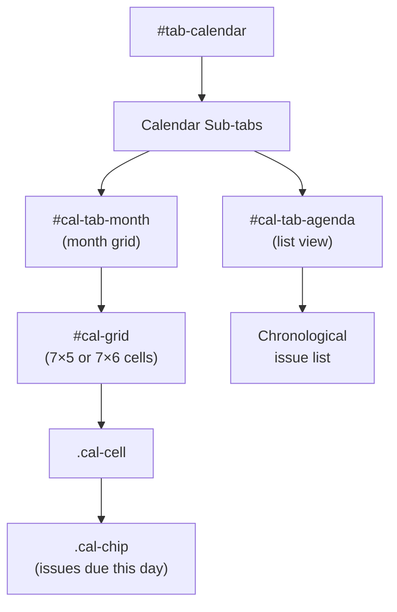

**Month Grid:**
- 7 day-of-week headers (`.cal-day-header`)
- 28-42 cells (`.cal-cell`), 4-6 rows depending on month
- Current day highlighted (`.cal-cell.today`)
- Other-month days grayed out (`.cal-cell.other-month`)

**Calendar Chips (`.cal-chip`):**
- One chip per issue with a due date on that day
- Click chip → opens board detail overlay with date pre-filled
- Color-coded by status (todo: gray, doing: blue, done: green)

**Empty Cell Click:**
- Opens add form (`#board-edit-overlay`)
- Pre-fills `#be-due` with clicked date
- Allows quick issue creation for a specific day

**Sources:** [amux-server.py:9200-9500](), [test.mjs:298-398]()

### iCal Feed Subscription

The board generates an RFC 5545-compliant iCalendar feed at `/api/calendar.ics` for subscription in external calendar apps (Apple Calendar, Google Calendar, Outlook).

**iCal Generation Flow:**

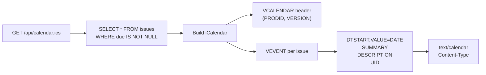

**iCal Structure:**
```
BEGIN:VCALENDAR
VERSION:2.0
PRODID:-//amux//Board//EN
CALNAME:amux Board
BEGIN:VEVENT
UID:PROJ-5@amux
DTSTART;VALUE=DATE:20260601
SUMMARY:Implement login endpoint
DESCRIPTION:Status: doing\nSession: api-dev\n\nFull description text...
END:VEVENT
...
END:VCALENDAR
```

**Subscribe Link:**
- Displayed in calendar view (button with `showIcalInfo()`)
- Copies `https://localhost:8822/api/calendar.ics` to clipboard
- Users paste into calendar app's "Subscribe to URL" dialog

**Update Behavior:**
- Calendar apps poll the URL periodically (15-60 minutes)
- Updates to board due dates propagate on next poll
- Events are all-day (no time component)

**Sources:** [amux-server.py:9600-9800](), [test.mjs:773-787]()

---

## Mobile Optimizations

The board interface adapts to mobile viewports (< 768px width) with touch-friendly interactions and responsive layouts.

### Mobile Layout Changes

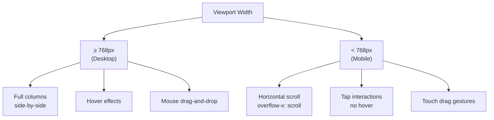

**Mobile-Specific Behaviors:**

| Feature | Desktop | Mobile |
|---------|---------|--------|
| Kanban columns | Side-by-side, fixed width | Horizontal scroll, swipe |
| Card interaction | Hover for preview | Tap to open detail |
| Add button | Hover to show | Always visible |
| Drag-and-drop | Mouse drag | Touch drag with visual feedback |
| Calendar cells | Click | Tap (larger touch targets) |

**CSS Media Queries:**
- `@media (max-width: 767px)` applies mobile styles
- Card padding reduced
- Font sizes adjusted
- Touch target minimum 44×44px

**Touch Gestures:**
- Swipe left/right on `#board-columns` to scroll between columns
- Long-press card to initiate drag (touch drag API)
- Tap outside overlay to close (no click-outside detection needed)

**Sources:** [amux-server.py:10000-10200](), [test.mjs:526-638]()

---

## API Integration Reference

The board UI interacts with these backend endpoints. For full API details, see [Board Endpoints](#5.2).

### Endpoint Summary Table

| Endpoint | Method | Purpose | Request Body | Response |
|----------|--------|---------|--------------|----------|
| `/api/board` | GET | Fetch all issues | — | `[{id, title, status, ...}]` |
| `/api/board` | POST | Create issue | `{title, status?, session?, due?, tags?}` | `201 {id}` |
| `/api/board/<id>` | PATCH | Update issue | `{status?, session?, due?, ...}` | `200 {ok: true}` |
| `/api/board/<id>` | DELETE | Soft-delete issue | — | `200 {ok: true}` |
| `/api/board/statuses` | GET | Fetch status columns | — | `[{id, name, order}]` |
| `/api/sync?since=<ts>` | GET | Delta sync (PWA offline) | — | `{issues, statuses, ts}` |
| `/api/calendar.ics` | GET | iCal feed | — | `text/calendar` |

**Sources:** [amux-server.py:2200-3000](), [test.mjs:640-790]()

### Data Flow Diagram

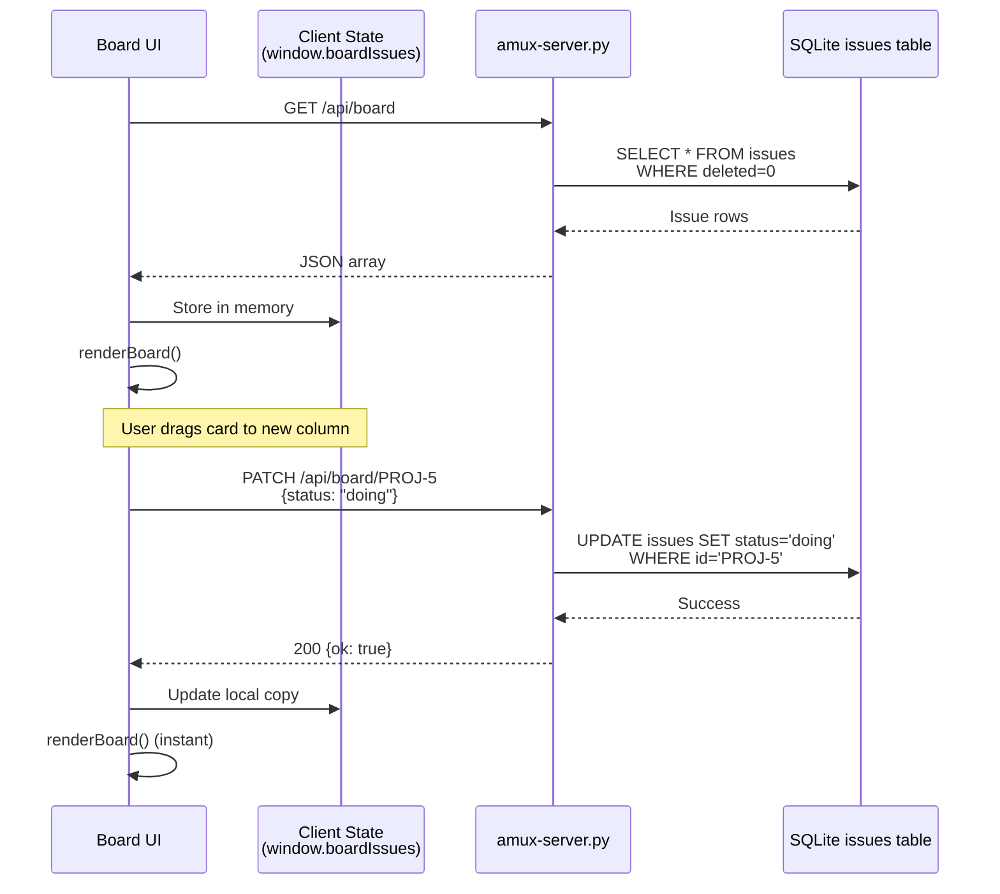

**Sources:** [amux-server.py:2200-2800]()

---

## State Management

The board UI maintains client-side state for optimistic updates and offline PWA support.

### Global State Variables

| Variable | Type | Purpose |
|----------|------|---------|
| `window.boardIssues` | `Array<Issue>` | All board issues (incl. deleted tombstones) |
| `window.boardStatuses` | `Array<Status>` | Status column definitions |
| `window.boardViewMode` | `string` | Current view: `"session"` or `"status"` |
| `window.boardLastSync` | `number` | Timestamp of last `/api/sync` call (for PWA) |

**Issue Object Shape:**
```javascript
{
  id: "PROJ-5",           // auto-generated key
  title: "Login endpoint",
  desc: "Markdown text...",
  status: "doing",
  session: "api-dev",     // or "" if unassigned
  due: "2026-06-01",      // ISO 8601 date or ""
  tags: "auth,security",  // comma-separated
  created: 1704067200,    // unix timestamp
  updated: 1704153600,
  deleted: 0              // unix timestamp if soft-deleted
}
```

**Optimistic Updates:**
- User actions (drag-and-drop, edits) update `window.boardIssues` immediately
- UI re-renders synchronously
- API request sent in background
- On failure, revert state and show error toast

**Sources:** [amux-server.py:7000-7200]()

---

## Event Listeners and Initialization

The board UI initializes on page load via global functions invoked by the `<body onload="init()">` handler.

### Initialization Flow

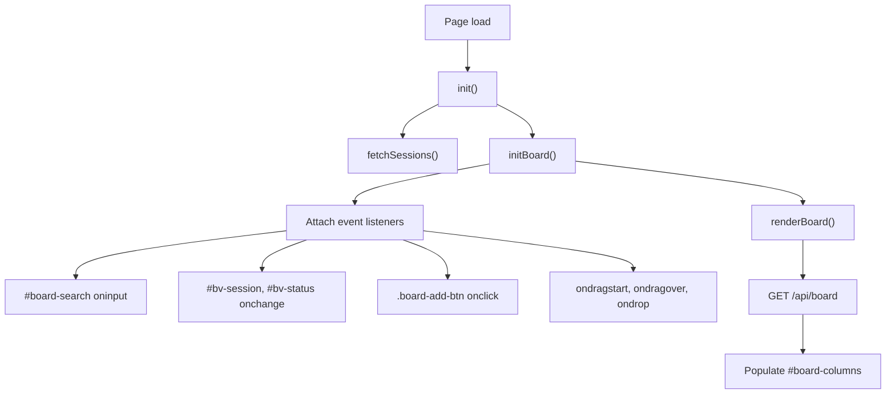

**Key Event Handlers:**

| Event | Selector | Handler | Purpose |
|-------|----------|---------|---------|
| `input` | `#board-search` | `filterBoard()` | Search filtering |
| `change` | `#bv-session`, `#bv-status` | `renderBoard()` | View mode switch |
| `click` | `.board-card` | `openBoardDetail(id)` | Open detail overlay |
| `click` | `.board-add-btn` | `openBoardAdd(status/session)` | Open add form |
| `dragstart` | `.board-card` | Set `dataTransfer` | Begin drag |
| `dragover` | `.board-col`, `.board-session-group` | `preventDefault()` + `.drag-over` | Allow drop |
| `drop` | `.board-col`, `.board-session-group` | `handleBoardDrop(e)` | Update status/session |

**Sources:** [amux-server.py:7200-7400]()

---

## Keyboard Shortcuts

The board interface supports keyboard shortcuts for efficient navigation and editing.

| Shortcut | Context | Action |
|----------|---------|--------|
| `Escape` | Any overlay open | Close overlay, restore scroll |
| `Cmd/Ctrl+K` | Board view | Focus search input |
| `Cmd/Ctrl+Enter` | Detail overlay (title/desc focused) | Save changes |
| `N` | Board view (no input focused) | Open add form |
| `/` | Board view | Focus search input |

**Shortcut Implementation:**
- Global `keydown` listener on `document`
- Checks `e.target.tagName` to avoid firing when typing in inputs
- Uses `e.preventDefault()` to suppress browser defaults

**Sources:** [amux-server.py:10400-10500]()

---

## Accessibility Features

The board UI implements ARIA attributes and semantic HTML for screen reader compatibility.

**Semantic Structure:**
- Board columns use `<section>` with `role="region"` and `aria-label`
- Cards use `<article>` elements
- Status dropdowns use native `<select>` elements
- Date pickers use HTML5 `<input type="date">`

**Keyboard Navigation:**
- All interactive elements are keyboard-accessible (no `onclick` on `<div>` without `tabindex`)
- Focus visible outlines on all buttons and inputs
- Drag-and-drop operations have keyboard alternatives (edit detail → change status)

**Screen Reader Announcements:**
- `aria-live="polite"` on board container announces card moves
- Status change messages (e.g., "Moved PROJ-5 to Doing")

**Sources:** [amux-server.py:10600-10700]()

---

## Performance Considerations

The board UI is optimized for datasets of 1000+ issues with minimal latency.

**Rendering Performance:**
- Virtual scrolling not implemented (DOM updates fast enough for <5000 cards)
- `renderBoard()` uses `innerHTML` assignment (faster than incremental DOM updates)
- Drag-and-drop uses native browser APIs (no external libraries)

**Network Optimization:**
- Single GET `/api/board` on page load fetches all data
- Subsequent updates use PATCH for individual issues
- No polling — updates pushed via Server-Sent Events (see [Event System](#2.5))

**Client-Side Caching:**
- `window.boardIssues` persisted across tab switches
- No re-fetch when returning to board tab (stale data acceptable for <60s)

**Sources:** [amux-server.py:7000-7300]()

---

