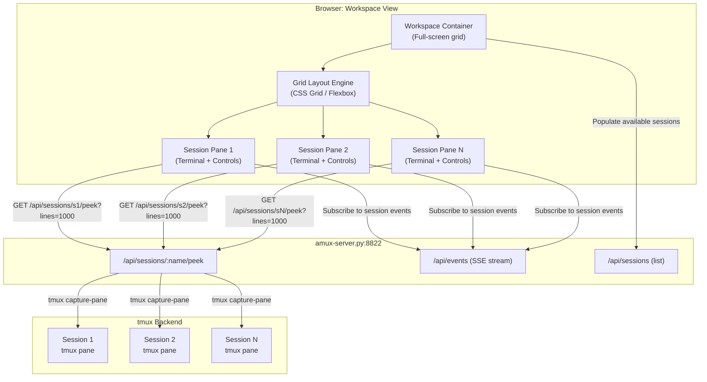
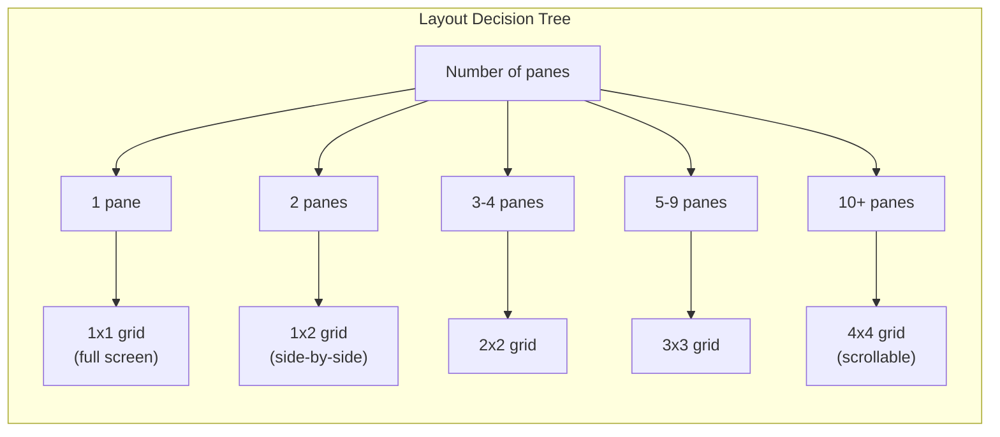
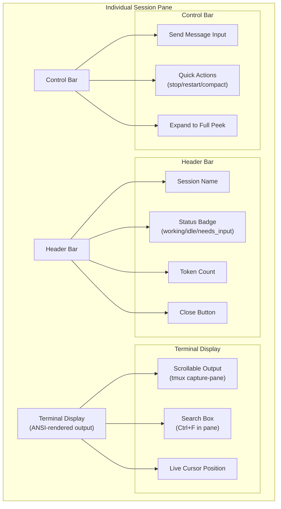
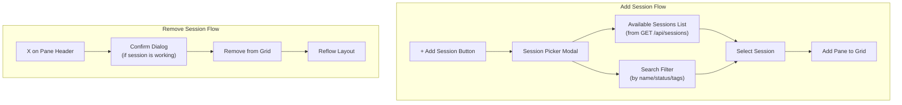
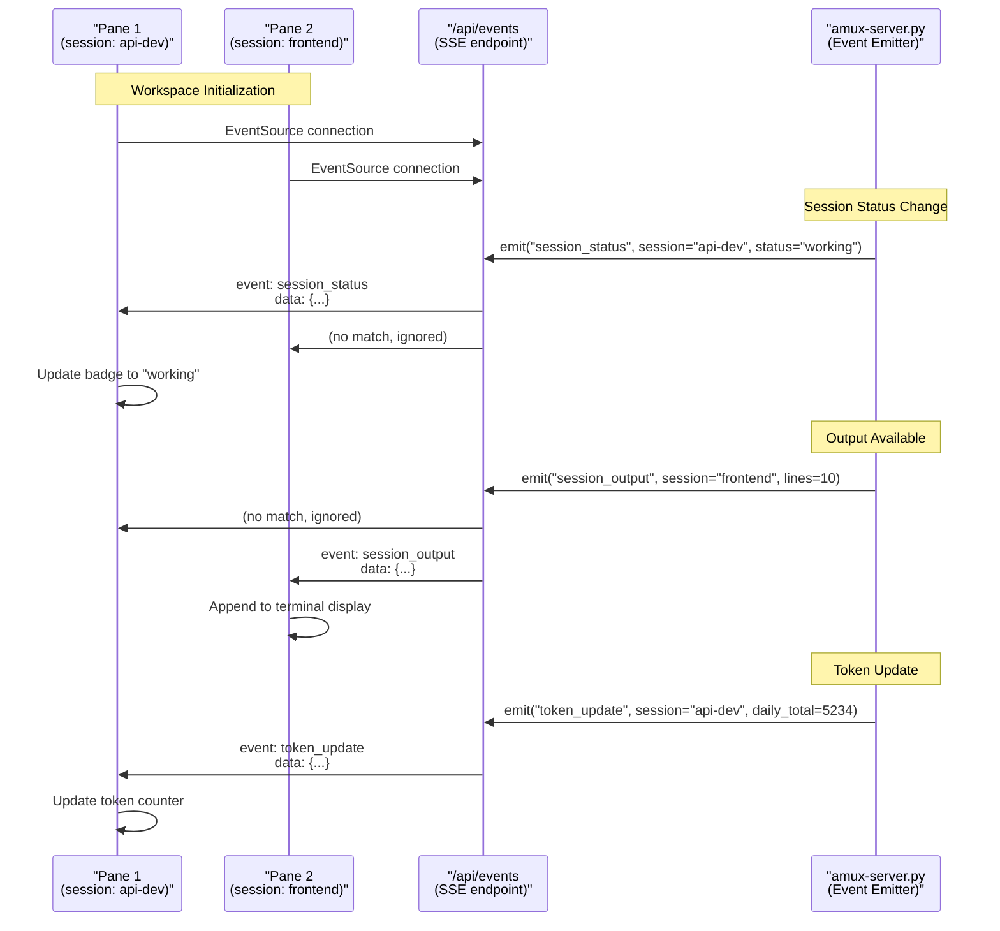
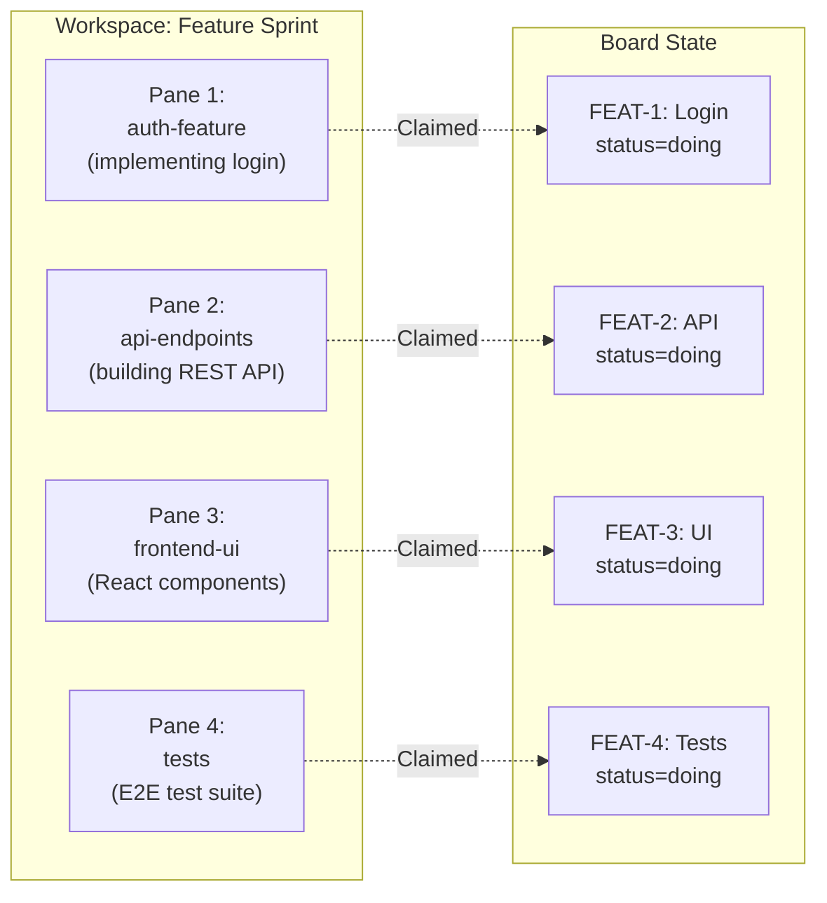
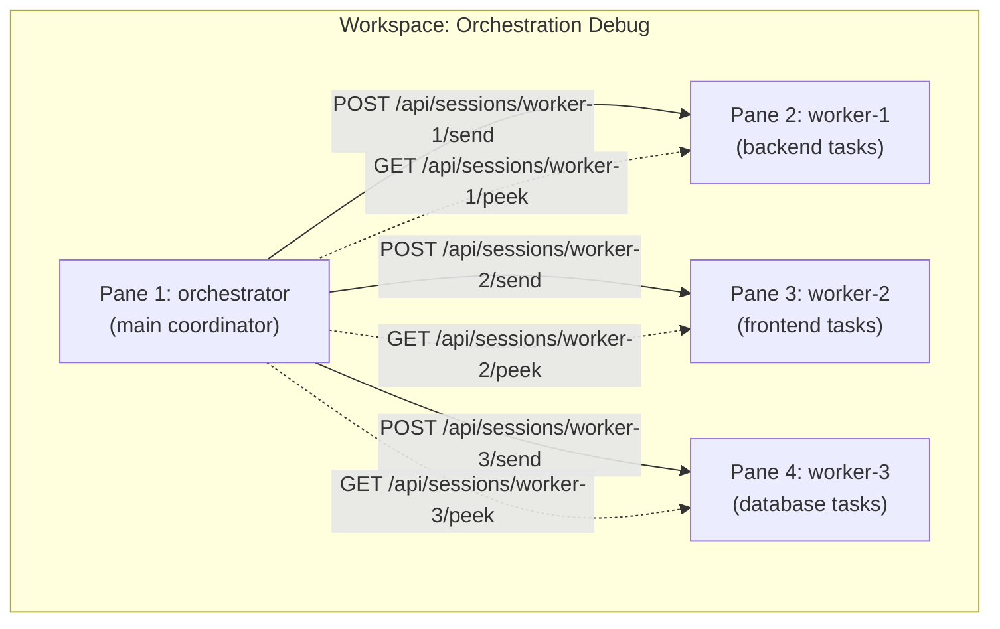
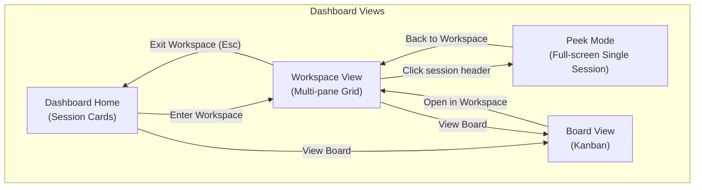

<!-- source: DeepWiki mcp.deepwiki.com · repo mixpeek/amux · page 6.3 Workspace & Tiling · fetched 2026-10-27 -->

# Workspace & Tiling

<details>
<summary>Relevant source files</summary>

The following files were used as context for generating this wiki page:

- [README.md](README.md)

</details>


This page documents the workspace view in the amux web dashboard, which provides a multi-pane tiled layout for monitoring multiple Claude Code sessions simultaneously. The workspace view enables real-time observation of parallel agent execution, allowing users to watch multiple sessions side by side in a single full-screen interface.

For information about monitoring individual sessions, see [Session Monitoring](#6.1). For the board-based task management interface, see [Board Interface](#6.2).

---

## Overview

The workspace view is a full-screen layout that divides the browser window into multiple resizable panes, each displaying live terminal output from a different Claude Code session. This enables users to monitor agent coordination patterns, debug multi-session workflows, and observe parallel development activities without switching between separate views.

### Key Capabilities

| Feature | Description |
|---------|-------------|
| **Multi-pane layout** | Display 2-16 sessions simultaneously in a grid |
| **Live terminal output** | Real-time streaming via peek API and SSE events |
| **Independent scrollback** | Each pane maintains its own scroll position and search |
| **Resizable panes** | Adjust pane dimensions to focus on specific sessions |
| **Quick session switching** | Add/remove sessions without leaving workspace view |
| **Status indicators** | Per-pane status badges (working, idle, needs input) |

**Sources:** [README.md:85]()

---

## Architecture

The workspace view operates as a specialized container within the web dashboard, multiplexing data from multiple session peek endpoints into a single synchronized view.

### Component Structure



### Data Flow

Each session pane operates independently:

1. **Initial load**: GET request to `/api/sessions/:name/peek?lines=1000` retrieves terminal scrollback
2. **Live updates**: SSE connection to `/api/events` streams real-time status changes and output
3. **User input**: POST to `/api/sessions/:name/send` when user types in pane's command bar
4. **Status polling**: Periodic checks to `/api/sessions/:name` for token counts and health

**Sources:** [README.md:84](), [README.md:98](), [README.md:13]()

---

## Grid Layout System

The workspace uses a responsive grid layout that adapts to the number of active panes.

### Layout Algorithms



### Default Grid Configurations

| Pane Count | Grid Layout | Dimensions per Pane |
|------------|-------------|---------------------|
| 1 | 1×1 | 100vw × 100vh |
| 2 | 1×2 (horizontal) | 50vw × 100vh |
| 3-4 | 2×2 | 50vw × 50vh |
| 5-6 | 2×3 | 33vw × 50vh |
| 7-9 | 3×3 | 33vw × 33vh |
| 10-16 | 4×4 | 25vw × 25vh |

Users can override automatic layout by dragging dividers to resize panes. Resize state persists in browser localStorage.

**Sources:** [README.md:85]()

---

## Session Pane Components

Each pane in the workspace view displays a complete session monitoring interface.

### Pane Anatomy



### Status Indicators

Each pane displays a real-time status badge derived from terminal output parsing:

| Status | Badge Color | Detection Pattern | Update Frequency |
|--------|------------|-------------------|------------------|
| `working` | Blue | "Thinking..." or tool use in output | Every 2 seconds via SSE |
| `idle` | Gray | Cursor at prompt, no activity | Every 2 seconds via SSE |
| `needs_input` | Yellow | Approval prompt detected | Immediate via SSE |
| `error` | Red | tmux session not found | Immediate on API failure |
| `stopped` | Gray | Session exists but not running | Every 10 seconds via polling |

**Sources:** [README.md:83-84]()

---

## Adding and Removing Panes

The workspace view provides multiple methods for managing visible sessions.

### Session Selection Interface



### Quick Add Shortcuts

The workspace view monitors board activity and suggests sessions to add:

- **Active sessions**: Sessions currently in `working` state auto-appear in suggestions
- **Claimed tasks**: Sessions that recently claimed board items (from `/api/board`) appear in quick-add
- **Recent activity**: Sessions with output changes in last 60 seconds bubble to top
- **Pinned sessions**: User can pin sessions to always appear in workspace on load

**Sources:** [README.md:85]()

---

## Real-Time Updates

Workspace panes subscribe to server-sent events for live output streaming.

### Event Subscription Model



### Event Filtering

Each pane registers an event filter on connection to receive only relevant events:

```
EventSource(/api/events?sessions=api-dev,frontend,worker-1)
```

This reduces client-side processing by having the server filter events before transmission. Panes automatically update their filter when sessions are added/removed from the workspace.

**Sources:** [README.md:84]()

---

## Workspace Persistence

The workspace view saves user preferences and layout state to browser localStorage.

### Saved State Schema

```json
{
  "workspace": {
    "version": 2,
    "sessions": [
      {
        "name": "api-dev",
        "position": { "row": 0, "col": 0 },
        "size": { "width": "50%", "height": "50%" }
      },
      {
        "name": "frontend",
        "position": { "row": 0, "col": 1 },
        "size": { "width": "50%", "height": "50%" }
      }
    ],
    "layout_mode": "grid",
    "pinned_sessions": ["api-dev"],
    "auto_add_active": true
  }
}
```

### State Restoration

On workspace view load:

1. Check localStorage for `workspace` key
2. Validate session names against current sessions (GET `/api/sessions`)
3. Remove any sessions that no longer exist
4. Restore grid positions and custom sizes
5. Re-establish SSE connections for each pane

**Sources:** [README.md:85]()

---

## Use Cases

The workspace view is designed for specific multi-agent monitoring scenarios.

### Parallel Feature Development

Monitor multiple agents working on independent features:



**Observation Pattern**: User watches for completion signals ("Done!" or status transitions) across all panes, then assigns next tasks by sending messages through each pane's control bar.

### Agent Coordination Debugging

Monitor primary agent and its delegated workers:



**Observation Pattern**: Watch orchestrator pane for delegation commands, then verify corresponding worker panes receive and execute tasks. Identify communication failures or stuck agents.

### Cross-Repository Testing

Monitor agents working in different codebases simultaneously:

| Pane | Session | Directory | Task |
|------|---------|-----------|------|
| 1 | `backend` | `~/Dev/api-server` | Add new endpoint |
| 2 | `frontend` | `~/Dev/web-client` | Consume endpoint |
| 3 | `mobile` | `~/Dev/ios-app` | Mobile client changes |
| 4 | `integration` | `~/Dev/e2e-tests` | Write integration tests |

**Observation Pattern**: Ensure API contract changes propagate correctly by watching backend completion, then verifying frontend/mobile agents adapt their implementations.

**Sources:** [README.md:171-179](), [README.md:85]()

---

## Performance Considerations

The workspace view balances real-time updates with browser performance.

### Resource Management

| Pane Count | Update Frequency | Memory per Pane | CPU Impact |
|------------|------------------|-----------------|------------|
| 1-2 | Full SSE (2s) | ~5 MB | Negligible |
| 3-4 | Full SSE (2s) | ~5 MB | Low |
| 5-8 | Throttled (5s) | ~3 MB (reduced scrollback) | Moderate |
| 9-16 | Polling (10s) | ~2 MB (last 100 lines only) | High |

### Optimization Strategies

1. **Progressive scrollback**: Panes load last 100 lines initially, fetch full history on user scroll
2. **Throttled updates**: When >4 panes visible, reduce SSE event frequency to 5-second intervals
3. **Virtual scrolling**: Large scrollback buffers use virtual scrolling (render only visible lines)
4. **Lazy rendering**: Off-screen panes pause updates until scrolled into view
5. **Connection pooling**: Single SSE connection multiplexed across all panes (vs. one per pane)

### Browser Limits

Modern browsers limit concurrent SSE connections:

- **Chrome/Edge**: 6 connections per domain
- **Firefox**: 6 connections per domain
- **Safari**: 4 connections per domain

The workspace uses a single shared SSE connection with session filtering to stay within limits.

**Sources:** [README.md:85]()

---

## Keyboard Shortcuts

The workspace view provides keyboard navigation for power users.

| Shortcut | Action |
|----------|--------|
| `Ctrl+Space` | Toggle workspace view |
| `Ctrl+1-9` | Focus pane N |
| `Ctrl+Shift+→` | Cycle to next pane |
| `Ctrl+Shift+←` | Cycle to previous pane |
| `Ctrl+W` | Close focused pane |
| `Ctrl+Shift+F` | Search across all panes |
| `Ctrl+Shift+A` | Add session to workspace |
| `Ctrl+Enter` | Send message in focused pane |
| `Esc` | Exit workspace (return to dashboard) |

**Sources:** [README.md:85]()

---

## Integration with Other Dashboard Features

The workspace view interacts with other dashboard components.

### Navigation Flow



### Session Card → Workspace

From the dashboard session cards view (see [Session Monitoring](#6.1)):

1. User clicks "Add to Workspace" chip on session card
2. Workspace view opens with selected session in first pane
3. User can add more sessions via "+" button

### Board → Workspace

From the Kanban board view (see [Board Interface](#6.2)):

1. User selects multiple tasks in `doing` status
2. Clicks "Open in Workspace" action
3. Workspace opens with one pane per session assigned to selected tasks
4. Layout automatically arranged in grid

### Peek Mode → Workspace

From full-screen peek mode:

1. User presses `Ctrl+Shift+W` while in peek mode
2. Current session appears in workspace view
3. User can add additional sessions to monitor simultaneously

**Sources:** [README.md:83-86]()

---

## Mobile Considerations

The workspace view is optimized for desktop/tablet but has limited mobile support.

### Responsive Behavior

| Screen Width | Layout Adjustment |
|-------------|-------------------|
| ≥1920px (Desktop) | Full grid, up to 16 panes |
| 1280-1919px (Laptop) | Full grid, up to 9 panes recommended |
| 768-1279px (Tablet) | 2×2 grid maximum, vertical scrolling enabled |
| <768px (Mobile) | Workspace disabled, redirects to session cards |

On mobile devices, the dashboard automatically redirects workspace URLs to the session cards view with a message: "Workspace requires tablet or larger screen. Use session cards to monitor agents."

### PWA Behavior

In the Progressive Web App (see [PWA & Offline Mode](#6.4)):

- Workspace view is available offline (shows cached scrollback)
- New output appears when connection restored
- Session add/remove persists to IndexedDB and syncs on reconnect

**Sources:** [README.md:85]()

---

## Configuration

The workspace view respects server-side and client-side configuration.

### Server Environment Variables

These environment variables in `~/.amux/server.env` affect workspace behavior:

```bash
# Maximum lines returned by peek API (per pane)
WORKSPACE_MAX_SCROLLBACK=1000

# SSE event broadcast interval (milliseconds)
SSE_BROADCAST_INTERVAL=2000

# Maximum concurrent SSE connections
MAX_SSE_CONNECTIONS=20

# Enable workspace debug logging
WORKSPACE_DEBUG=false
```

### Client localStorage Settings

Stored in browser localStorage under key `amux_workspace_prefs`:

```json
{
  "default_layout": "grid",
  "auto_add_active": true,
  "pane_font_size": 14,
  "show_line_numbers": false,
  "enable_ansi_colors": true,
  "refresh_interval_ms": 2000
}
```

Users can modify these via Settings → Workspace in the dashboard UI.

**Sources:** [README.md:85]()

---

## Limitations

Current workspace implementation has known constraints:

1. **Maximum panes**: Hard limit of 16 panes due to SSE connection pooling
2. **No pane splitting**: Cannot subdivide a single pane (fixed grid only)
3. **No floating panes**: All panes must fit in grid (no overlapping windows)
4. **Single workspace**: Cannot save/load multiple workspace layouts
5. **No pane grouping**: Cannot create logical groups (e.g., "backend" group)
6. **Limited search**: Search within pane only (no cross-pane search highlighting)

Future enhancements may address these limitations.

**Sources:** [README.md:85]()

---

## Related Features

- [Session Monitoring](#6.1) — Individual session status tracking and control
- [Board Interface](#6.2) — Kanban board for task management across agents
- [PWA & Offline Mode](#6.4) — Offline workspace support and sync
- [Session Endpoints](#5.1) — API endpoints used by workspace panes
- [Event System & Logging](#2.5) — SSE event streaming architecture

---

