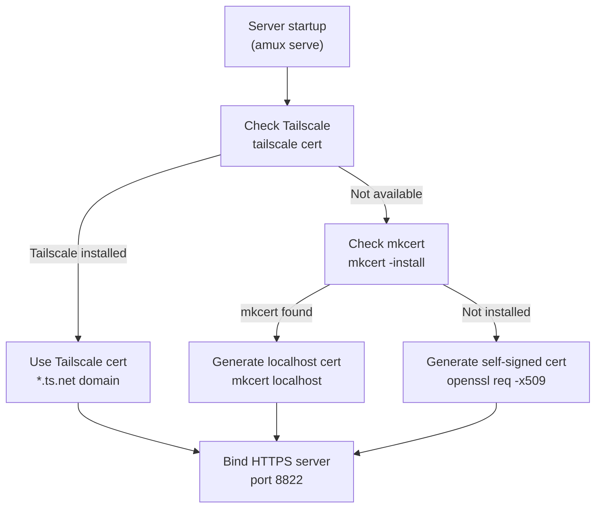
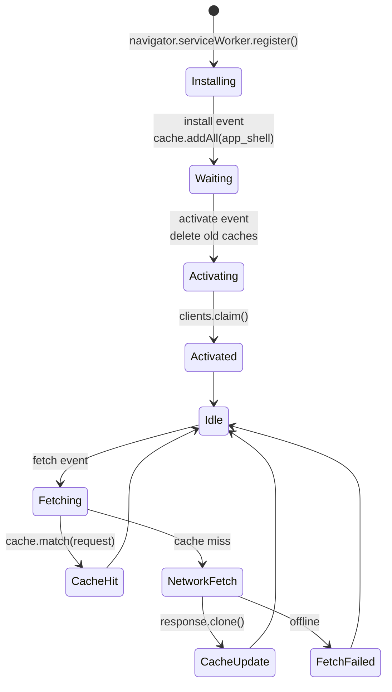
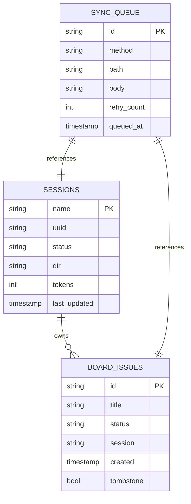
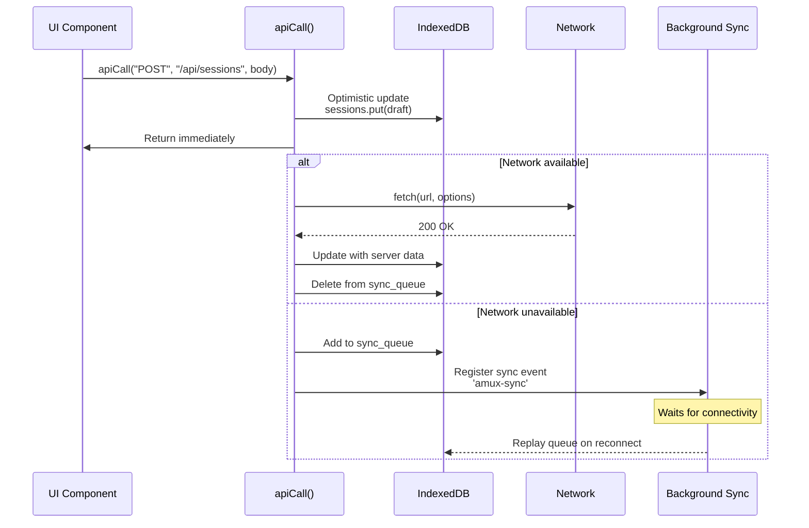
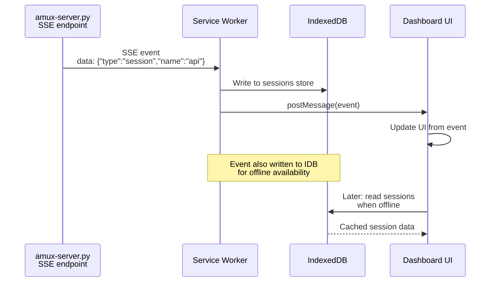
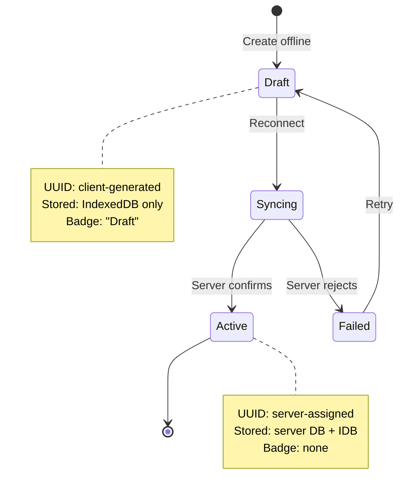

<!-- source: DeepWiki mcp.deepwiki.com · repo mixpeek/amux · page 6.4 PWA & Offline Mode · fetched 2026-10-27 -->

# PWA & Offline Mode

<details>
<summary>Relevant source files</summary>

The following files were used as context for generating this wiki page:

- [cloud/docker/Dockerfile](cloud/docker/Dockerfile)
- [cloud/docker/amux-server.py](cloud/docker/amux-server.py)
- [docs/release-notes/notes.json](docs/release-notes/notes.json)
- [docs/release-notes/videos/crm-people-tab.mp4](docs/release-notes/videos/crm-people-tab.mp4)
- [pw-investigate.js](pw-investigate.js)
- [pw-invitations-ui.js](pw-invitations-ui.js)
- [pw-invitations.js](pw-invitations.js)
- [pw-invite-final.js](pw-invite-final.js)
- [site/index.html](site/index.html)
- [site/style.css](site/style.css)
- [tests/e2e-peek-dir.js](tests/e2e-peek-dir.js)
- [tests/pw-investigate.js](tests/pw-investigate.js)
- [tests/pw-offline-debug.js](tests/pw-offline-debug.js)

</details>


This page documents amux's Progressive Web App (PWA) implementation and offline-first architecture. It covers service worker caching, IndexedDB-backed local storage, offline operation queuing, Background Sync API integration, and HTTPS certificate provisioning.

For information about the web dashboard UI components, see [Web Dashboard](#6). For server-side event streaming, see [Event System & Logging](#2.5). For session state management, see [Session Management](#2.1).

---

## Overview

amux is designed as an **offline-first PWA**, meaning all mutations (session creation, board updates, message sends) are queued locally when the server is unreachable and automatically replayed on reconnection. The architecture uses:

- **Service Worker** for app shell caching and offline detection
- **IndexedDB** for persistent local storage of sessions, board issues, and pending operations
- **Background Sync API** for automatic retry of failed operations
- **Server-Sent Events (SSE)** that write to IndexedDB for local-first updates
- **HTTPS** via self-signed certificates (Tailscale → mkcert → self-signed fallback)

The offline queue is **optimistically applied** — UI updates happen immediately, while the actual API call is queued and retried in the background.

**Sources:** [docs/release-notes/notes.json:145-150](), [site/index.html:629](), [site/index.html:750]()

---

## PWA Installation

### Manifest & Metadata

The dashboard is installable as a standalone app on iOS, Android, and desktop via the Web App Manifest. Key metadata includes:

| Property | Value | Purpose |
|----------|-------|---------|
| `name` | "amux — Agent Multiplexer" | Full app name |
| `short_name` | "amux" | Home screen label |
| `start_url` | "/" | Launch URL |
| `display` | "standalone" | Removes browser chrome |
| `theme_color` | "#ffffff" (light) / "#0a0a0a" (dark) | Status bar color |
| `icons` | 180×180 PNG, SVG | Home screen icons |

The manifest is referenced in the HTML `<head>`:

```html
<link rel="icon" href="icon.svg" type="image/svg+xml">
<link rel="icon" type="image/png" sizes="180x180" href="icon.png">
<meta name="theme-color" content="#ffffff">
```

**Sources:** [site/index.html:6-9]()

### Installability Criteria

Modern browsers display an "Add to Home Screen" prompt when:

1. ✅ Served over **HTTPS** (localhost exempted)
2. ✅ Has a valid **Web App Manifest**
3. ✅ Registers a **Service Worker** with a fetch event handler
4. ✅ Has appropriate **icons** in the manifest

All criteria are met by amux's default configuration. On iOS, users manually install via Safari's Share → "Add to Home Screen".

**Sources:** [site/index.html:1-26]()

---

## HTTPS & TLS Certificate Provisioning

amux automatically provisions TLS certificates using a three-tier fallback:



**TLS Certificate Fallback Strategy**

### 1. Tailscale Certificate (Preferred)

If `tailscale cert` is available, amux requests a certificate for the Tailscale hostname (e.g., `myhost.ts.net`). This provides:

- ✅ Browser-trusted certificates (Let's Encrypt via Tailscale)
- ✅ Automatic renewal
- ✅ Access from any device on the Tailnet

### 2. mkcert Certificate (Development)

If Tailscale is unavailable but `mkcert` is installed, amux generates a locally-trusted certificate for `localhost`. This requires one-time installation of mkcert's root CA:

```bash
brew install mkcert  # macOS
mkcert -install       # Install root CA
```

### 3. Self-Signed Certificate (Fallback)

If neither Tailscale nor mkcert is available, amux generates a self-signed certificate using OpenSSL. Browsers display a security warning on first access, which must be manually bypassed.

**Sources:** [site/index.html:750](), [docs/release-notes/notes.json:145-150]()

---

## Service Worker Architecture

### Registration & Lifecycle

The service worker is registered on page load and handles:

- **Install**: Caches app shell (HTML, CSS, JS, fonts)
- **Activate**: Cleans up old caches
- **Fetch**: Intercepts network requests for offline fallback



### Caching Strategy

amux uses a **Network-First with Cache Fallback** strategy:

1. **App Shell**: Precached during `install` event (HTML, CSS, JS, fonts)
2. **API Responses**: Cached after successful fetch, served from cache when offline
3. **Static Assets**: Served from cache immediately (images, icons)

The service worker does **not** cache mutations (POST/PATCH/DELETE) — these are queued in IndexedDB instead.

**Sources:** [docs/release-notes/notes.json:145-150]()

---

## IndexedDB Schema & Sync Engine

### Database Structure

amux uses IndexedDB for persistent client-side storage with three object stores:



**IndexedDB Object Stores**

| Store | Key Path | Purpose |
|-------|----------|---------|
| `sessions` | `name` | Cached session metadata for offline display |
| `board` | `id` | Board issues (PROJ-1, etc.) with status, session, due dates |
| `sync_queue` | `id` (UUID) | Pending mutations to replay on reconnect |

### Sync Engine Operations

The sync engine provides `get`, `set`, and `delete` operations that write to both IndexedDB and SSE cache:

```javascript
// Pseudocode from service worker
async function idb_set(store, key, value) {
  const db = await openDB('amux', 1);
  const tx = db.transaction(store, 'readwrite');
  await tx.objectStore(store).put(value);
  
  // Also update SSE cache for immediate reads
  sse_cache[store][key] = value;
}
```

All mutations go through the **offline queue** (`apiCall` wrapper) which:

1. Optimistically applies the change to IndexedDB
2. Queues the API request in `sync_queue`
3. Attempts network fetch
4. On failure: retains queue entry for Background Sync
5. On success: removes queue entry, updates IDB with server response

**Sources:** [docs/release-notes/notes.json:145-150](), [tests/pw-offline-debug.js:30-35]()

---

## Offline Queue & Background Sync

### Queue Structure

Each queued operation is stored in the `sync_queue` object store with:

```javascript
{
  id: "uuid-v4",
  method: "POST",
  path: "/api/sessions",
  body: JSON.stringify({ name: "myproject", ... }),
  retry_count: 0,
  queued_at: 1708560000000,
  session: "myproject"  // optional, for session-scoped ops
}
```

### apiCall Wrapper

All mutations use the `apiCall` wrapper function, which queues requests when offline:



### Background Sync API

When online connectivity is restored, the browser fires a `sync` event that triggers queue replay:

```javascript
// Service worker sync handler (pseudocode)
self.addEventListener('sync', async (event) => {
  if (event.tag === 'amux-sync') {
    event.waitUntil(replayQueue());
  }
});

async function replayQueue() {
  const queue = await idb.getAll('sync_queue');
  for (const op of queue) {
    const response = await fetch(op.path, {
      method: op.method,
      body: op.body,
      headers: { 'Content-Type': 'application/json' }
    });
    if (response.ok) {
      await idb.delete('sync_queue', op.id);
    } else {
      op.retry_count++;
      await idb.put('sync_queue', op);
    }
  }
}
```

**Retry Logic:**

- **Max retries**: 3 attempts per operation
- **Backoff**: Exponential (1s, 2s, 4s)
- **Failure handling**: After 3 failures, operation is marked as "failed" in the queue and requires manual retry

**Sources:** [docs/release-notes/notes.json:145-150]()

---

## SSE Integration with Local Storage

### Push Updates to IndexedDB

Server-Sent Events push updates that are written to both **IndexedDB** and an in-memory cache for immediate UI refresh:



### Event Types Written to IndexedDB

| Event Type | Object Store | Update Logic |
|------------|--------------|--------------|
| `session` | `sessions` | Upsert by `name` |
| `board` | `board` | Upsert by `id`, respect tombstones |
| `delete` | `sessions` or `board` | Set `tombstone: true`, don't delete |

Tombstones prevent deleted items from reappearing if an old SSE event arrives after deletion.

**Sources:** [docs/release-notes/notes.json:145-150]()

---

## Offline UI Indicators

### Connection Status Banner

When offline, a banner appears at the top of the dashboard showing:

- ❌ "Offline" indicator
- 📋 Number of queued operations
- 🔄 Auto-dismiss on reconnection

```html
<!-- Offline banner (shown when navigator.onLine === false) -->
<div id="offline-banner" class="offline-banner">
  <span>⚠️ Offline</span>
  <span id="queue-count">3 operations queued</span>
</div>
```

### Queued Operations List

Clicking the banner expands a list of pending operations:

```
Queued Operations (3)
──────────────────────
• Create session "myproject"
• Send message to "api-dev"
• Update board issue PROJ-5
```

Each entry shows:

- **Action**: Human-readable description
- **Target**: Session name or board issue ID
- **Status**: Pending, Retrying (1/3), Failed

**Sources:** [docs/release-notes/notes.json:145-150](), [site/index.html:629]()

---

## Draft Sessions

When offline, creating a session generates a **draft session** stored only in IndexedDB. The draft:

1. Has a client-generated UUID
2. Shows in the UI with a "Draft" badge
3. Persists across page reloads
4. Syncs to server on reconnect, receiving a server-assigned UUID



**Conflict Resolution:** If a session with the same `name` already exists on the server, the draft is rejected and the user is prompted to choose a different name.

**Sources:** [docs/release-notes/notes.json:145-150]()

---

## Testing Offline Features

### Playwright Offline Mode

The test suite includes offline scenarios using Playwright's `setOffline()` API:

```javascript
// Go offline
await context.setOffline(true);

// Perform actions (should queue)
await page.click('#create-session-btn');
await page.fill('#session-name', 'test-offline');
await page.click('#submit-btn');

// Verify queue
const queueCount = await page.textContent('#queue-count');
expect(queueCount).toBe('1 operation queued');

// Go back online
await context.setOffline(false);
await page.waitForTimeout(2000);

// Verify sync
const banner = await page.locator('#offline-banner');
expect(await banner.isVisible()).toBe(false);
```

**Sources:** [tests/pw-offline-debug.js:37-61]()

---

## Implementation Checklist

To add offline support to a new feature:

- [ ] Wrap mutations in `apiCall()` instead of direct `fetch()`
- [ ] Define IndexedDB schema for cached data (if needed)
- [ ] Add SSE handler to write updates to IndexedDB
- [ ] Implement optimistic UI updates (apply before server confirms)
- [ ] Add conflict resolution logic for concurrent edits
- [ ] Test offline → online transition with Playwright

**Sources:** [docs/release-notes/notes.json:145-150](), [tests/pw-offline-debug.js:1-62]()

---

