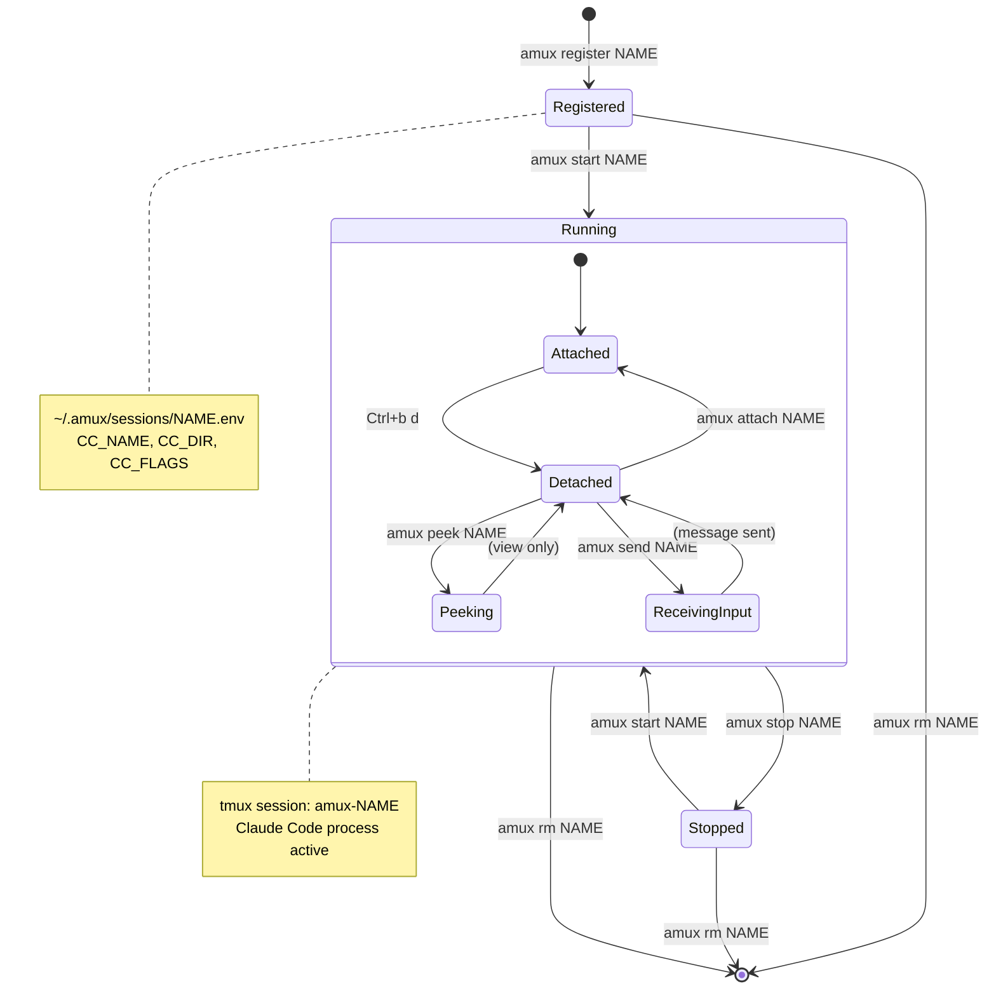
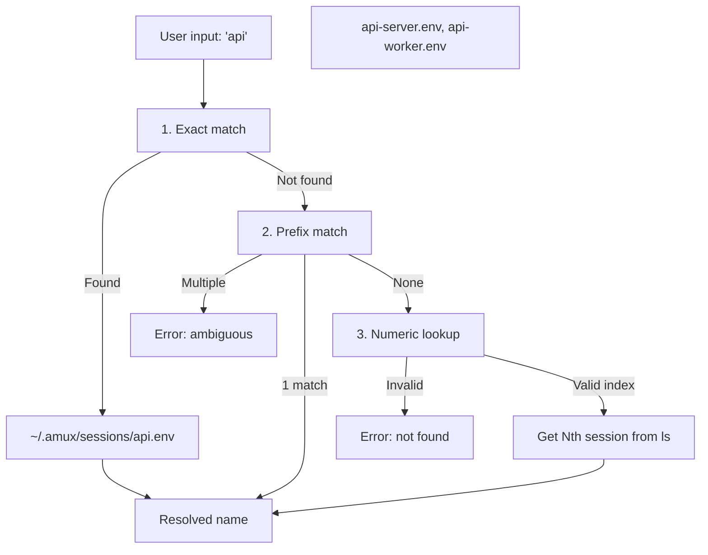

<!-- source: DeepWiki mcp.deepwiki.com · repo mixpeek/amux · page 7.1 Session Commands · fetched 2026-10-27 -->

# Session Commands

<details>
<summary>Relevant source files</summary>

The following files were used as context for generating this wiki page:

- [README.md](README.md)
- [amux](amux)
- [cloud/setup.sh](cloud/setup.sh)

</details>


This page documents the CLI commands for managing amux sessions: creating, starting, stopping, and interacting with Claude Code agents via tmux. These commands are implemented in the `amux` bash script and provide the primary interface for session lifecycle management.

For commands related to board management (task tracking), see [Board Commands](#7.2). For the REST API equivalents of these commands, see [Session Endpoints](#5.1).

---

## Purpose and Scope

Session commands control the lifecycle of individual Claude Code agents running in tmux sessions. Each session has:
- A unique **name** (user-defined identifier)
- A **working directory** (where Claude operates)
- **Claude Code flags** (model, permissions, MCP config, etc.)
- A **persistent UUID** (survives stop/start cycles)
- A **tmux session** (prefixed with `amux-`)

Session state is stored in `~/.amux/sessions/NAME.env` files, while running sessions exist as tmux sessions named `amux-NAME`.

---

## Session Lifecycle

The following diagram shows the complete lifecycle of a session from registration to removal:



**Sources:** [amux:168-256](), [amux:257-266](), [amux:306-319](), [amux:321-332]()

---

## Command-to-Function Mapping

This diagram maps user-facing CLI commands to their implementation functions and the resources they manipulate:

```mermaid
graph TB
    subgraph "User Commands"
        RegCmd["amux register NAME"]
        StartCmd["amux start NAME"]
        ExecCmd["amux exec NAME"]
        StopCmd["amux stop NAME"]
        AttachCmd["amux attach NAME"]
        PeekCmd["amux peek NAME"]
        SendCmd["amux send NAME text"]
        RmCmd["amux rm NAME"]
        LsCmd["amux ls"]
        InfoCmd["amux info NAME"]
    end
    
    subgraph "Bash Functions (amux script)"
        CmdReg["cmd_register()"]
        CmdStart["cmd_start()"]
        CmdExec["cmd_exec()"]
        CmdStop["cmd_stop()"]
        CmdAttach["cmd_attach()"]
        CmdPeek["cmd_peek()"]
        CmdSend["cmd_send()"]
        CmdRm["cmd_rm()"]
        CmdLs["cmd_ls()"]
        CmdInfo["cmd_info()"]
        
        ResolveSession["resolve_session()"]
        LoadSession["load_session()"]
        IsRunning["is_running()"]
        TmuxName["tmux_name()"]
        ParseFlags["parse_claude_flags()"]
    end
    
    subgraph "Filesystem"
        EnvFile["~/.amux/sessions/NAME.env"]
        Defaults["~/.amux/defaults.env"]
    end
    
    subgraph "Tmux"
        TmuxSession["tmux session: amux-NAME"]
    end
    
    RegCmd --> CmdReg
    StartCmd --> CmdStart
    ExecCmd --> CmdExec
    StopCmd --> CmdStop
    AttachCmd --> CmdAttach
    PeekCmd --> CmdPeek
    SendCmd --> CmdSend
    RmCmd --> CmdRm
    LsCmd --> CmdLs
    InfoCmd --> CmdInfo
    
    CmdReg --> ParseFlags
    CmdReg --> EnvFile
    
    CmdStart --> ResolveSession
    CmdStart --> LoadSession
    CmdStart --> IsRunning
    CmdStart --> TmuxName
    CmdStart --> TmuxSession
    CmdStart --> Defaults
    
    CmdExec --> ParseFlags
    CmdExec --> EnvFile
    CmdExec --> CmdStart
    
    CmdStop --> ResolveSession
    CmdStop --> IsRunning
    CmdStop --> TmuxName
    CmdStop --> TmuxSession
    
    CmdAttach --> ResolveSession
    CmdAttach --> IsRunning
    CmdAttach --> TmuxName
    CmdAttach --> TmuxSession
    
    CmdPeek --> ResolveSession
    CmdPeek --> IsRunning
    CmdPeek --> TmuxName
    CmdPeek --> TmuxSession
    
    CmdSend --> ResolveSession
    CmdSend --> IsRunning
    CmdSend --> TmuxName
    CmdSend --> TmuxSession
    
    CmdRm --> ResolveSession
    CmdRm --> CmdStop
    CmdRm --> EnvFile
    
    CmdLs --> LoadSession
    CmdLs --> IsRunning
    CmdLs --> TmuxSession
    
    CmdInfo --> ResolveSession
    CmdInfo --> LoadSession
    CmdInfo --> IsRunning
    
    LoadSession --> EnvFile
    ResolveSession --> EnvFile
```



**Sources:** [amux:168-186](), [amux:188-234](), [amux:236-256](), [amux:258-266](), [amux:268-281](), [amux:283-304](), [amux:306-319](), [amux:321-332](), [amux:334-347](), [amux:349-394](), [amux:47-99]()

---

## Core Session Commands

### `amux register`

Registers a new session with configuration stored in `~/.amux/sessions/NAME.env`. Does not start the session.

**Syntax:**
```bash
amux register <name> [--dir <path>] [--model <model>] [--yolo] [claude-flags...]
```

**Parameters:**
- `name` — Session identifier (alphanumeric, hyphens, underscores)
- `--dir <path>` — Working directory (default: current directory)
- `--model <model>` — Claude model: `opus`, `sonnet`, `haiku`, or full model ID
- `--yolo` — Alias for `--dangerously-skip-permissions`
- All other flags are passed to Claude Code CLI

**Example:**
```bash
amux register api-server --dir ~/Dev/myapp --model opus --yolo
amux register frontend --model sonnet --append-system-prompt "React + Tailwind"
```

**Implementation:**
The command calls `parse_claude_flags()` to extract Claude-specific flags, then writes an env file:

```
CC_NAME="api-server"
CC_DIR="/Users/alice/Dev/myapp"
CC_FLAGS="--model opus --dangerously-skip-permissions"
```

**Sources:** [amux:168-186](), [amux:123-164]()

---

### `amux start`

Starts a registered session by creating a tmux session and launching Claude Code.

**Syntax:**
```bash
amux start <name> [extra-flags...]
```

**Parameters:**
- `name` — Session name (exact match or prefix)
- `extra-flags` — Optional flags to append (override stored flags)

**Behavior:**
1. Resolves session name via `resolve_session()`
2. Loads session config from `~/.amux/sessions/NAME.env`
3. Loads global defaults from `~/.amux/defaults.env`
4. Creates tmux session named `amux-NAME`
5. Launches `claude` with combined flags (defaults + session + inline)
6. Attaches to the tmux session

**Example:**
```bash
amux start api-server
amux start api  # prefix match resolves to api-server
amux start 1    # numeric shortcut from amux ls
```

**Tmux Session Naming:**
The tmux session is named `amux-NAME` to avoid conflicts with user tmux sessions. The `tmux_name()` function at [amux:101]() generates this prefix.

**Auto-attach:**
By default, `amux start` attaches to the tmux session. Detach with `Ctrl+b d`.

**Sources:** [amux:188-234](), [amux:47-99](), [amux:101-102](), [amux:115-119]()

---

### `amux exec`

One-shot command that registers a session (or updates existing registration) and immediately starts it.

**Syntax:**
```bash
amux exec <name> [--dir <path>] [--model <model>] [claude-flags...]
```

**Parameters:**
Same as `amux register`

**Example:**
```bash
amux exec quickfix --dir ~/Dev/myapp --yolo -- "fix the auth bug"
```

This is equivalent to:
```bash
amux register quickfix --dir ~/Dev/myapp --yolo
amux start quickfix -- "fix the auth bug"
```

**Use Case:**
Ideal for ephemeral debugging sessions or scripted automation where you don't want to pre-register the session.

**Sources:** [amux:236-256]()

---

### `amux stop`

Stops a running session by killing its tmux session. The session configuration remains registered.

**Syntax:**
```bash
amux stop <name>
```

**Behavior:**
1. Resolves session name
2. Checks if tmux session `amux-NAME` exists
3. Calls `tmux kill-session -t amux-NAME`
4. Claude Code process is terminated via SIGTERM

**Example:**
```bash
amux stop api-server
```

**Idempotency:**
Safe to call on already-stopped sessions (prints message, exits successfully).

**Sources:** [amux:306-319]()

---

### `amux attach`

Attaches to a running session's tmux session, bringing you into the Claude Code interactive prompt.

**Syntax:**
```bash
amux attach <name>
```

**Detaching:**
Press `Ctrl+b d` to detach without stopping the session (standard tmux detach).

**Example:**
```bash
amux attach api-server
amux attach api  # prefix match
amux attach 1    # numeric shortcut
```

**Error Handling:**
If the session is not running, the command fails with:
```
error: session 'api-server' is not running. Start with: amux start api-server
```

**Sources:** [amux:258-266]()

---

## Interaction Commands

### `amux peek`

Views the last N lines of a running session's terminal output without attaching. Non-interactive, read-only.

**Syntax:**
```bash
amux peek <name> [lines]
```

**Parameters:**
- `name` — Session name
- `lines` — Number of lines to display (default: 30)

**Example:**
```bash
amux peek api-server
amux peek api 100
```

**Output:**
```
── api-server ──
[thinking] Analyzing the authentication flow...
Editing src/auth.ts...
Applied changes to src/auth.ts
Tests passing ✓
── end ──
```

**Implementation:**
Uses `tmux capture-pane -p -S -<lines>` to capture scrollback buffer without attaching.

**Use Case:**
- Monitoring progress from another terminal
- Quick status checks without disrupting the agent
- Mobile dashboard integration

**Sources:** [amux:268-281]()

---

### `amux send`

Sends text or key sequences to a running session.

**Syntax:**
```bash
# Send text + Enter
amux send <name> <text>

# Send raw key sequence (no Enter)
amux send <name> --keys <sequence>
```

**Examples:**
```bash
# Send a message
amux send api-server "implement the logout endpoint"

# Send Ctrl+C (interrupt)
amux send api-server --keys 'C-c'

# Send compound sequence
amux send api-server --keys '/compact' 'Enter'
```

**Key Sequences:**
The `--keys` flag passes arguments directly to `tmux send-keys`, supporting:
- `C-x` — Ctrl+x
- `M-x` — Alt+x
- `Enter`, `Space`, `Tab`, etc.

**Common Use Cases:**

| Task | Command |
|------|---------|
| Send prompt | `amux send NAME "task description"` |
| Interrupt | `amux send NAME --keys 'C-c'` |
| Trigger compact | `amux send NAME "/compact"` |
| Scroll up | `amux send NAME --keys 'C-b' '['` |

**Sources:** [amux:283-304]()

---

## Management Commands

### `amux ls`

Lists all registered sessions with status, configuration, and preview.

**Syntax:**
```bash
amux ls
```

**Output:**
```
 1* api-server        ~/Dev/myapp YOLO sonnet │ Editing src/auth.ts...
 2  frontend          ~/Dev/myapp              │ 
 3* worker-1          ~/Dev/tasks YOLO         │ Tests passing ✓
```

**Columns:**
- **Number** — Numeric shortcut (use with `amux attach 1`)
- **Status** — `*` = running, ` ` = stopped
- **Name** — Session identifier
- **Directory** — Working directory
- **Flags** — `YOLO`, model name if non-default
- **Preview** — Last line of output (if running)

**Color Coding:**
- Running sessions: green `*`
- Stopped sessions: dim ` `
- YOLO flag: yellow
- Model name: cyan

**Sources:** [amux:349-394]()

---

### `amux info`

Displays detailed configuration for a specific session.

**Syntax:**
```bash
amux info <name>
```

**Example:**
```bash
$ amux info api-server
api-server
  dir:   /Users/alice/Dev/myapp
  flags: --model opus --dangerously-skip-permissions --mcp-config mcp.json
  status: running
```

**Sources:** [amux:334-347]()

---

### `amux rm`

Removes a session registration. If the session is running, it is stopped first.

**Syntax:**
```bash
amux rm <name>
```

**Behavior:**
1. Calls `cmd_stop()` if session is running
2. Deletes `~/.amux/sessions/NAME.env`

**Example:**
```bash
amux rm old-experiment
```

**Warning:**
This is destructive — the session configuration is permanently deleted. The tmux session is killed, but any work committed to git is preserved.

**Sources:** [amux:321-332]()

---

## Batch Operations

### `amux start-all`

Starts all registered sessions that are not currently running.

**Syntax:**
```bash
amux start-all
```

**Behavior:**
Iterates through `~/.amux/sessions/*.env` and calls `cmd_start()` for each stopped session.

**Use Case:**
- Resume all agents after reboot
- Parallel workflow initialization

**Sources:** [amux:493-502]()

---

### `amux stop-all`

Stops all running sessions.

**Syntax:**
```bash
amux stop-all
```

**Use Case:**
- Graceful shutdown before maintenance
- Token budget reset

**Sources:** [amux:482-491]()

---

## Global Defaults

The `amux defaults` command manages global flags applied to all sessions unless overridden.

**Syntax:**
```bash
amux defaults show         # Display current defaults
amux defaults edit         # Edit ~/.amux/defaults.env
amux defaults reset        # Clear all defaults
```

**Example `~/.amux/defaults.env`:**
```bash
# Global defaults for all sessions
CC_DEFAULT_FLAGS="--model sonnet --mcp-config /Users/alice/.amux/mcp.json"
```

**Precedence:**
1. Inline flags (highest priority)
2. Session flags from `~/.amux/sessions/NAME.env`
3. Global defaults from `~/.amux/defaults.env`

**Use Case:**
Set organization-wide MCP config or preferred model without repeating flags in every session.

**Sources:** [amux:458-480](), [amux:96-98](), [amux:213-219]()

---

## Session Name Resolution

Session names support fuzzy matching and numeric shortcuts for mobile-friendly interaction.

### Resolution Algorithm

The `resolve_session()` function at [amux:47-84]() implements a three-tier matching strategy:



**Examples:**

| Input | Matches | Result |
|-------|---------|--------|
| `api-server` | Exact | `api-server` |
| `api` | Prefix (unique) | `api-server` |
| `api` | Prefix (ambiguous) | Error: matches `api-server`, `api-worker` |
| `1` | Numeric | First session from `amux ls` |
| `foo` | None | Error: not found |

**Sources:** [amux:47-84]()

---

## Command Reference Table

| Command | Purpose | Syntax | Session State Change |
|---------|---------|--------|---------------------|
| `register` | Create session config | `amux register NAME [flags]` | → Registered |
| `start` | Launch session | `amux start NAME` | Registered → Running |
| `exec` | Register + start | `amux exec NAME [flags]` | → Running |
| `stop` | Terminate session | `amux stop NAME` | Running → Stopped |
| `attach` | Connect to session | `amux attach NAME` | (no change) |
| `peek` | View output | `amux peek NAME [lines]` | (no change) |
| `send` | Send input | `amux send NAME text` | (no change) |
| `rm` | Delete session | `amux rm NAME` | → Deleted |
| `ls` | List all sessions | `amux ls` | (no change) |
| `info` | Show config | `amux info NAME` | (no change) |
| `start-all` | Start all stopped | `amux start-all` | Stopped → Running (bulk) |
| `stop-all` | Stop all running | `amux stop-all` | Running → Stopped (bulk) |
| `defaults` | Manage global flags | `amux defaults [show\|edit\|reset]` | (no change) |

**Sources:** [amux:720-752](), [amux:648-718]()

---

## Session Storage Format

Session configuration is stored in `~/.amux/sessions/NAME.env` as a bash-sourceable env file:

**Example `~/.amux/sessions/api-server.env`:**
```bash
# amux session: api-server
# registered: 2024-01-15T14:23:00-08:00
CC_NAME="api-server"
CC_DIR="/Users/alice/Dev/myapp"
CC_FLAGS="--model opus --dangerously-skip-permissions --mcp-config mcp.json"
```

**Variables:**
- `CC_NAME` — Session identifier
- `CC_DIR` — Absolute working directory path
- `CC_FLAGS` — Space-separated Claude Code CLI flags

**Loading:**
The `load_session()` function at [amux:87-93]() sources this file to populate environment variables.

**Sources:** [amux:174-182](), [amux:87-93]()

---

## Tmux Integration

### Session Naming

Tmux sessions are named `amux-<name>` to avoid conflicts:

```bash
tmux list-sessions
# amux-api-server: 1 windows (created Mon Jan 15 14:23:00 2024)
# amux-frontend: 1 windows (created Mon Jan 15 14:25:30 2024)
```

The `tmux_name()` helper at [amux:101]() generates this prefix.

### Migration from Legacy Names

The `migrate_tmux()` function at [amux:104-113]() auto-renames sessions from old prefixes (`cmux-`, `cc-`) to `amux-` for backward compatibility.

### Window Lock

Sessions set `allow-rename off` and `automatic-rename off` to prevent Claude from overwriting the window name with escape sequences:

**Sources:** [amux:229-230]()

---

## Error Handling

Commands validate inputs and provide helpful error messages:

**Session not found:**
```bash
$ amux attach nonexistent
error: session 'nonexistent' not found
```

**Session not running:**
```bash
$ amux attach api-server
error: session 'api-server' is not running. Start with: amux start api-server
```

**Ambiguous match:**
```bash
$ amux attach api
error: ambiguous: 'api' matches api-server api-worker
```

**Missing directory:**
```bash
$ amux start broken
error: directory not found: /invalid/path
```

**Sources:** [amux:36](), [amux:69](), [amux:83](), [amux:264]()

---

## Environment Variables

| Variable | Purpose | Set By | Example |
|----------|---------|--------|---------|
| `CC_HOME` | amux data directory | User (optional) | `~/.amux` |
| `CC_SESSIONS` | Session storage | Derived | `~/.amux/sessions` |
| `CC_DEFAULTS` | Global defaults file | Derived | `~/.amux/defaults.env` |
| `CC_NAME` | Session name | `register` | `api-server` |
| `CC_DIR` | Working directory | `register` | `/Users/alice/Dev/myapp` |
| `CC_FLAGS` | Claude flags | `register` | `--model opus --yolo` |
| `CC_DEFAULT_FLAGS` | Global flags | User (via `defaults`) | `--mcp-config mcp.json` |

**Sources:** [amux:21-23](), [amux:174-182]()

---

## CLI vs REST API Equivalence

Many CLI commands have equivalent REST API endpoints (see [Session Endpoints](#5.1)):

| CLI Command | REST API Endpoint |
|-------------|------------------|
| `amux start NAME` | `POST /api/sessions/NAME/start` |
| `amux stop NAME` | `POST /api/sessions/NAME/stop` |
| `amux send NAME text` | `POST /api/sessions/NAME/send` |
| `amux peek NAME` | `GET /api/sessions/NAME/peek` |
| `amux ls` | `GET /api/sessions` |
| `amux info NAME` | `GET /api/sessions/NAME` |

The CLI is a wrapper around the same session management primitives exposed via HTTP.

**Sources:** [README.md:62-78]()

---

