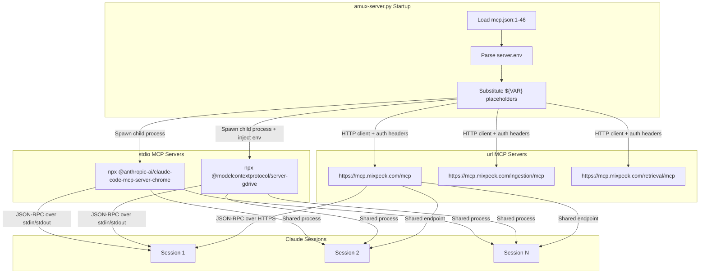
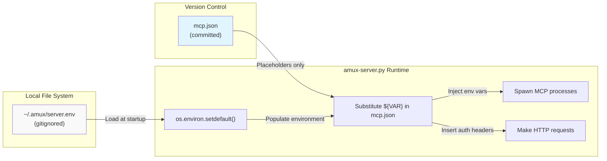
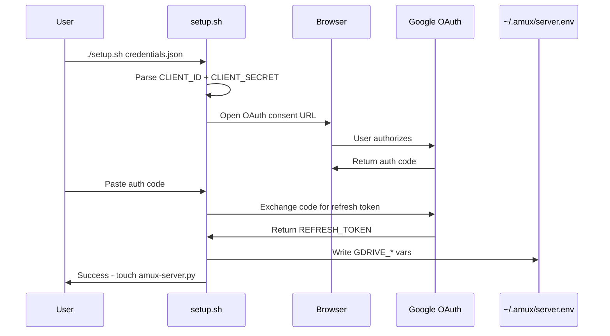
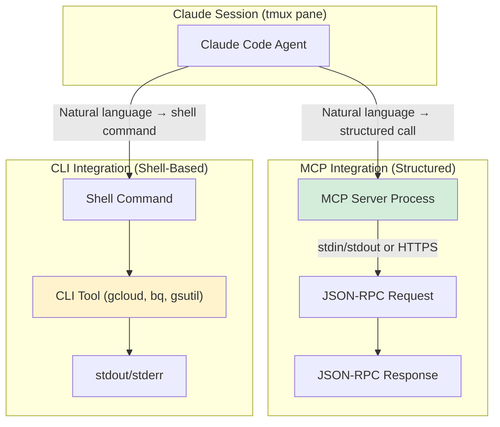
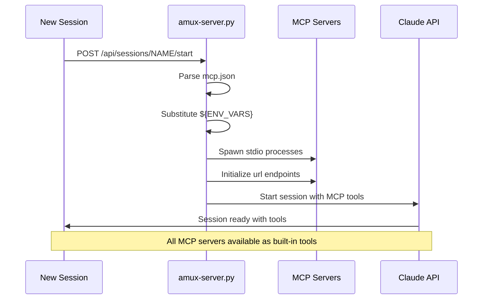

<!-- source: DeepWiki mcp.deepwiki.com · repo mixpeek/amux · page 8 Integrations · fetched 2026-10-27 -->

# Integrations

<details>
<summary>Relevant source files</summary>

The following files were used as context for generating this wiki page:

- [integrations/README.md](integrations/README.md)
- [integrations/cli-tools/README.md](integrations/cli-tools/README.md)
- [integrations/cli-tools/google/README.md](integrations/cli-tools/google/README.md)
- [integrations/google-docs/README.md](integrations/google-docs/README.md)
- [integrations/google-docs/setup.sh](integrations/google-docs/setup.sh)
- [mcp.json](mcp.json)

</details>


This page documents how external services connect to amux sessions via MCP (Model Context Protocol) servers and CLI tools. MCP servers provide structured API access to services like Google Docs and Mixpeek, while CLI tools enable shell-based automation with services like Google Cloud Platform.

For details on specific MCP configuration syntax, see [MCP Server Configuration](#8.1). For browser automation, see [Browser Automation (claude-in-chrome)](#8.3). For Google Docs setup, see [Google Docs Integration](#8.2). For CLI tooling, see [CLI Tools](#8.4).

---

## Integration Architecture

amux supports two integration mechanisms:

| Type | Execution Model | Use Case | Examples |
|------|----------------|----------|----------|
| **MCP Servers** | Process spawned by amux-server.py | Structured read/write access to external APIs | Google Docs, Mixpeek, claude-in-chrome |
| **CLI Tools** | Shell commands in tmux sessions | One-off commands, scripting, admin tasks | `gcloud`, `bq`, `gsutil` |

**MCP servers** are spawned and managed by amux-server.py. They communicate via JSON-RPC and are available to all Claude sessions as built-in tools. **CLI tools** are standard command-line utilities installed on the host system, available directly in tmux panes.

### MCP Server Lifecycle



**Diagram: MCP Server Initialization and Session Sharing**

Sources: [mcp.json:1-46](), [integrations/README.md:1-77]()

---

## MCP Configuration File Structure

The central MCP registry is [mcp.json:1-46](). All MCP servers are configured server-wide and shared across sessions.

### stdio Server Entry

stdio servers spawn local Node.js processes via `npx`:

```json
{
  "mcpServers": {
    "claude-in-chrome": {
      "type": "stdio",
      "command": "npx",
      "args": ["-y", "@anthropic-ai/claude-code-mcp-server-chrome"]
    }
  }
}
```

The `-y` flag auto-accepts package installation prompts. stdio servers communicate via JSON-RPC over stdin/stdout pipes.

### url Server Entry

url servers make HTTP requests to remote endpoints:

```json
{
  "mcpServers": {
    "mixpeek": {
      "url": "https://mcp.mixpeek.com/mcp",
      "headers": {
        "Authorization": "Bearer ${MIXPEEK_API_KEY}"
      }
    }
  }
}
```

The `${MIXPEEK_API_KEY}` placeholder is substituted at runtime from `~/.amux/server.env`. Headers are sent with every JSON-RPC request.

### Environment Variable Injection

stdio servers can receive environment variables:

```json
{
  "mcpServers": {
    "gdocs": {
      "type": "stdio",
      "command": "npx",
      "args": ["-y", "@modelcontextprotocol/server-gdrive"],
      "env": {
        "GDRIVE_CLIENT_ID": "${GDRIVE_CLIENT_ID}",
        "GDRIVE_CLIENT_SECRET": "${GDRIVE_CLIENT_SECRET}",
        "GDRIVE_REFRESH_TOKEN": "${GDRIVE_REFRESH_TOKEN}"
      }
    }
  }
}
```

The `env` object merges with the parent process environment when spawning the child process.

Sources: [mcp.json:1-46](), [integrations/README.md:26-39]()

---

## Credential Management

### Security Model



**Diagram: Credential Flow from server.env to MCP Servers**

Credentials never appear in [mcp.json:1-46](). Instead:

1. **mcp.json** uses `${VAR_NAME}` placeholders
2. **~/.amux/server.env** stores actual credentials (one per line: `KEY=value`)
3. **amux-server.py** loads server.env at startup via `os.environ.setdefault()`
4. **Substitution** occurs when spawning MCP processes or making HTTP requests

Example server.env:

```bash
MIXPEEK_API_KEY=mpk_abc123...
GDRIVE_CLIENT_ID=12345-abc.apps.googleusercontent.com
GDRIVE_CLIENT_SECRET=GOCSPX-xyz...
GDRIVE_REFRESH_TOKEN=1//0abc...
```

### Reload Mechanism

After modifying `~/.amux/server.env`:

```bash
touch amux-server.py  # Update mtime
```

The amux-server.py watchdog detects the file modification and triggers an auto-restart, loading the new environment variables.

Sources: [integrations/README.md:41-47](), [integrations/google-docs/README.md:14-20]()

---

## Available MCP Integrations

### claude-in-chrome

Browser automation via Chrome DevTools Protocol.

**Configuration**: [mcp.json:3-10]()

```json
{
  "claude-in-chrome": {
    "type": "stdio",
    "command": "npx",
    "args": ["-y", "@anthropic-ai/claude-code-mcp-server-chrome"]
  }
}
```

**Capabilities**:
- Navigate to URLs
- Click elements
- Fill forms
- Take screenshots
- Execute JavaScript

**No credentials required** - uses your browser profile. See [Browser Automation (claude-in-chrome)](#8.3) for detailed usage.

---

### Mixpeek

Multi-modal embeddings and retrieval system.

**Configuration**: [mcp.json:11-34]()

Four separate endpoints:

| Server | Endpoint | Purpose |
|--------|----------|---------|
| `mixpeek` | `/mcp` | Main API |
| `mixpeek-ingestion` | `/ingestion/mcp` | Upload and process files |
| `mixpeek-retrieval` | `/retrieval/mcp` | Search and retrieve |
| `mixpeek-admin` | `/admin/mcp` | Admin operations |

**Required credential**:

```bash
echo 'MIXPEEK_API_KEY=mpk_...' >> ~/.amux/server.env
```

All four servers use the same API key via the `Authorization: Bearer ${MIXPEEK_API_KEY}` header.

**Example usage in session**:

```bash
# Index a video
Use the mixpeek-ingestion server to upload video.mp4

# Search for similar content
Use the mixpeek-retrieval server to find videos about "product demos"
```

---

### Google Docs

Read/write access to Google Drive and Docs.

**Configuration**: [mcp.json:35-44]()

```json
{
  "gdocs": {
    "type": "stdio",
    "command": "npx",
    "args": ["-y", "@modelcontextprotocol/server-gdrive"],
    "env": {
      "GDRIVE_CLIENT_ID": "${GDRIVE_CLIENT_ID}",
      "GDRIVE_CLIENT_SECRET": "${GDRIVE_CLIENT_SECRET}",
      "GDRIVE_REFRESH_TOKEN": "${GDRIVE_REFRESH_TOKEN}"
    }
  }
}
```

**Required credentials** (three OAuth tokens):

```bash
GDRIVE_CLIENT_ID=...
GDRIVE_CLIENT_SECRET=...
GDRIVE_REFRESH_TOKEN=...
```

### One-Time Setup

The [integrations/google-docs/setup.sh:1-78]() script automates the OAuth flow:



**Diagram: Google OAuth Setup Flow**

1. Create OAuth 2.0 credentials in [Google Cloud Console](https://console.cloud.google.com/)
2. Download credentials JSON
3. Run `./integrations/google-docs/setup.sh /path/to/credentials.json`
4. Authorize in browser
5. Paste auth code
6. Credentials written to `~/.amux/server.env`

**Scopes requested** ([integrations/google-docs/setup.sh:35]()):
- `https://www.googleapis.com/auth/drive` (full Drive access)
- `https://www.googleapis.com/auth/documents` (read/write Docs)

**Example usage in session**:

```bash
# Read a doc
Read the content of "Product Requirements" from Google Docs

# Create a new doc
Create a new Google Doc titled "Weekly Report" with today's summary

# Search Drive
Find all spreadsheets modified in the last week
```

Sources: [integrations/google-docs/README.md:1-71](), [integrations/google-docs/setup.sh:1-78](), [mcp.json:35-44]()

---

## CLI Tools vs MCP Servers



**Diagram: MCP vs CLI Integration Patterns**

### When to Use MCP

- **Structured read/write operations** (e.g., updating a Google Doc)
- **API-based workflows** (e.g., embedding and retrieval)
- **Persistent state** (e.g., browser sessions)
- Service has an official MCP server implementation

### When to Use CLI Tools

- **One-off commands** (e.g., list GCS buckets)
- **Shell scripting** (e.g., batch operations)
- **Admin tasks** (e.g., SSH into a VM)
- No MCP server exists for the service

Sources: [integrations/cli-tools/README.md:1-46]()

---

## Google Cloud CLI

The `gcloud` CLI provides access to all Google Cloud services from within tmux sessions.

### Installation

```bash
brew install --cask google-cloud-sdk
```

Verify:

```bash
gcloud version
```

### Authentication

#### Interactive Auth (Browser-Based)

```bash
# Authorize gcloud commands
gcloud auth login

# Application Default Credentials (for SDKs)
gcloud auth application-default login
```

Both commands open a browser and persist credentials in `~/.config/gcloud/`. These credentials are inherited by all tmux sessions.

#### Service Account (Non-Interactive)

For automation or cloud deployments:

1. Create service account in [Google Cloud Console](https://console.cloud.google.com/)
2. Download JSON key file
3. Store path in `~/.amux/server.env`:

```bash
echo 'GOOGLE_APPLICATION_CREDENTIALS=/path/to/service-account.json' >> ~/.amux/server.env
touch amux-server.py  # reload
```

The `GOOGLE_APPLICATION_CREDENTIALS` environment variable is the standard mechanism for all Google SDKs.

### Common Usage Patterns

```bash
# Set default project
gcloud config set project YOUR_PROJECT_ID

# List GCS buckets
gcloud storage ls

# Copy file to GCS
gcloud storage cp ./file.txt gs://my-bucket/

# Run BigQuery query
bq query --nouse_legacy_sql 'SELECT * FROM dataset.table LIMIT 10'

# List Cloud Run services
gcloud run services list --region us-central1

# Tail Cloud Logging
gcloud logging tail "resource.type=cloud_run_revision"
```

### vs Google Docs MCP

| Feature | gcloud CLI | Google Docs MCP |
|---------|-----------|-----------------|
| **Scope** | All GCP services (GCS, BigQuery, GKE, etc.) | Google Drive + Docs only |
| **Access Pattern** | Shell commands | Structured API calls |
| **Use Case** | Admin, scripting, one-off commands | Read/write Docs from Claude context |

Sources: [integrations/cli-tools/google/README.md:1-91](), [integrations/cli-tools/README.md:14-37]()

---

## Adding New Integrations

### Process

1. **Create integration directory**:

```bash
mkdir integrations/<service-name>
```

2. **Add MCP entry to mcp.json**:

```json
{
  "mcpServers": {
    "<service-name>": {
      "type": "stdio",
      "command": "npx",
      "args": ["-y", "<mcp-package-name>"],
      "env": {
        "SERVICE_API_KEY": "${SERVICE_API_KEY}"
      }
    }
  }
}
```

3. **Add credentials to server.env**:

```bash
echo 'SERVICE_API_KEY=your-key' >> ~/.amux/server.env
```

4. **Reload server**:

```bash
touch amux-server.py
```

5. **Write README.md**:

Document:
- What the integration does
- Required environment variables (names only, never values)
- Where to obtain credentials
- One-time setup steps
- Example usage

6. **Optional: Create setup.sh**

For OAuth flows or multi-step credential setup, create [integrations/<service-name>/setup.sh]() following the pattern in [integrations/google-docs/setup.sh:1-78]().

### Integration Structure

```
integrations/
├── <service-name>/
│   ├── README.md         # Setup instructions
│   └── setup.sh          # Optional credential flow
├── cli-tools/
│   ├── README.md         # CLI tool overview
│   └── <tool>/
│       └── README.md     # Tool-specific docs
└── README.md             # Integration architecture
```

### Rules

1. **Never commit credentials** - `~/.amux/server.env` is outside the repo
2. **mcp.json uses placeholders only** - `${VAR_NAME}` syntax
3. **One directory per integration** - keep integrations self-contained
4. **Document required env vars** - names only, not values

Sources: [integrations/README.md:18-71]()

---

## MCP Server Discovery

MCP servers are automatically discovered by Claude sessions at startup. The discovery flow:



**Diagram: MCP Server Discovery at Session Start**

Claude sessions automatically see all configured MCP servers as available tools without additional configuration. The tools appear in Claude's context with their capabilities documented.

Sources: [mcp.json:1-46](), [integrations/README.md:1-77]()

---

