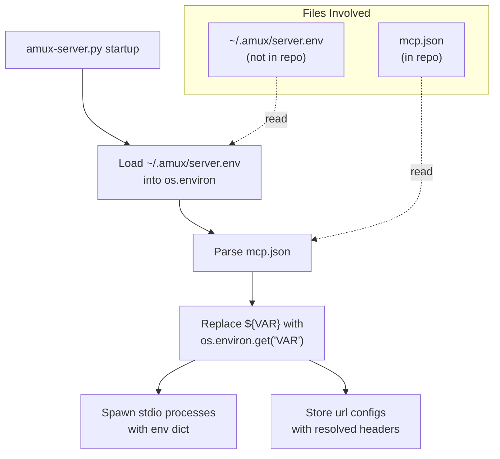
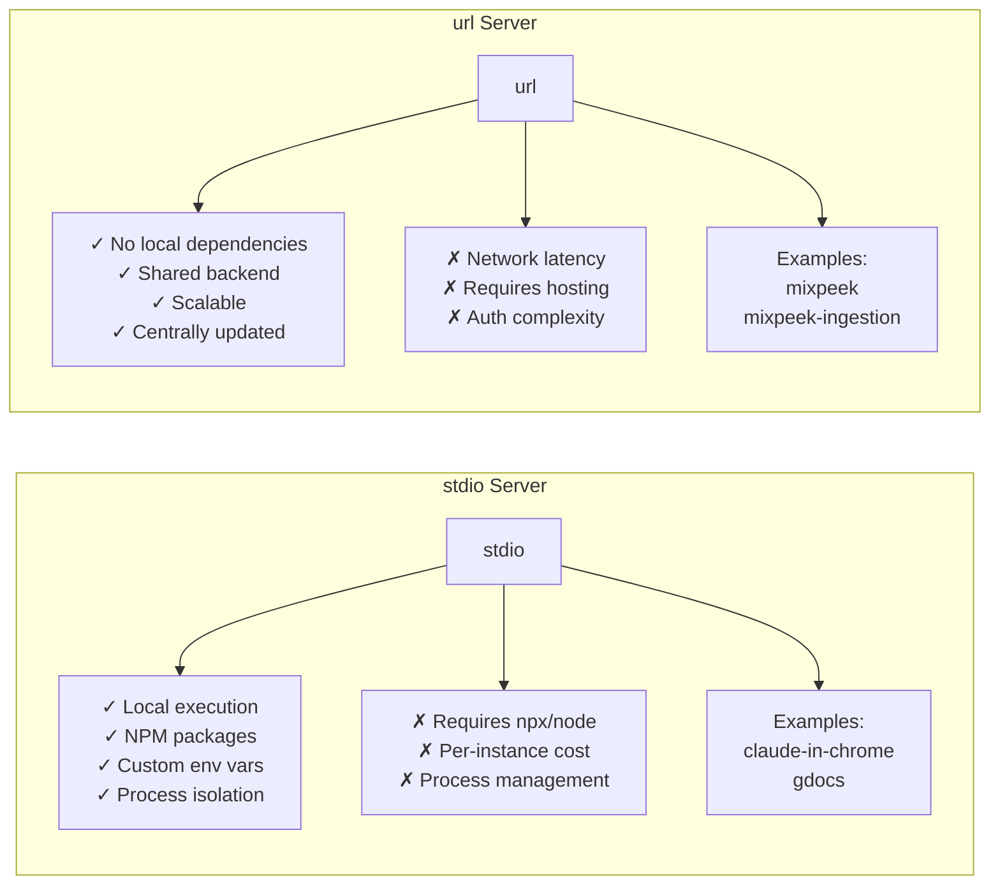
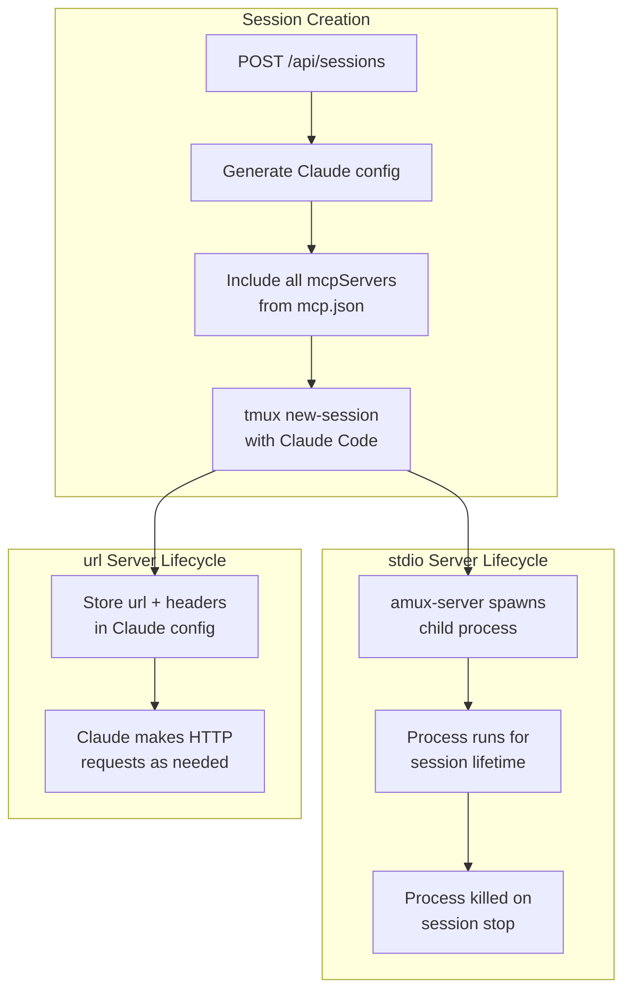

<!-- source: DeepWiki mcp.deepwiki.com · repo mixpeek/amux · page 8.1 MCP Server Configuration · fetched 2026-10-27 -->

# MCP Server Configuration

<details>
<summary>Relevant source files</summary>

The following files were used as context for generating this wiki page:

- [integrations/README.md](integrations/README.md)
- [integrations/google-docs/README.md](integrations/google-docs/README.md)
- [integrations/google-docs/setup.sh](integrations/google-docs/setup.sh)
- [mcp.json](mcp.json)

</details>


This page documents the structure and usage of `mcp.json`, the central configuration file that defines which MCP (Model Context Protocol) servers are available to all amux sessions. It covers the two server types (stdio and url), environment variable substitution, and the process for adding new integrations.

For information about specific integrations like Google Docs and browser automation, see [Google Docs Integration](#8.2) and [Browser Automation](#8.3). For using CLI tools within sessions, see [CLI Tools](#8.4).

---

## Configuration File Location

The MCP configuration resides at [mcp.json:1-47](). This file is loaded once at amux-server startup and applies globally to all sessions. The configuration defines which MCP servers are available and how to connect to them.

**Sources:** [mcp.json:1-47]()

---

## File Structure

The `mcp.json` file contains a single top-level object `mcpServers` which maps server names to their configurations:

```json
{
  "mcpServers": {
    "server-name": {
      "type": "stdio" | "url",
      ...configuration options
    }
  }
}
```

Each server entry requires a unique name (used by Claude to identify the server) and a type specification. The name appears in Claude's tool palette when the session starts.

**Configuration Schema**

| Field | Required | Values | Purpose |
|-------|----------|--------|---------|
| `type` | Yes | `"stdio"` or `"url"` | Determines connection method |
| `command` | stdio only | Executable path | Command to spawn process |
| `args` | stdio only | Array of strings | Command-line arguments |
| `env` | stdio only | Object | Environment variables for process |
| `url` | url only | String | HTTP endpoint for MCP protocol |
| `headers` | url only | Object | HTTP headers (typically auth) |

**Sources:** [mcp.json:1-47](), [integrations/README.md:26-37]()

---

## Server Type: stdio

### Overview

The `stdio` server type spawns a local process and communicates via standard input/output. This is used for Node.js-based MCP servers installed via `npx` or locally available executables.

### Structure

```json
"server-name": {
  "type": "stdio",
  "command": "npx",
  "args": ["-y", "package-name"],
  "env": {
    "VAR_NAME": "${VAR_NAME}"
  }
}
```

### Example: claude-in-chrome

[mcp.json:3-10]() defines the browser automation server:

```json
"claude-in-chrome": {
  "type": "stdio",
  "command": "npx",
  "args": [
    "-y",
    "@anthropic-ai/claude-code-mcp-server-chrome"
  ]
}
```

This spawns `npx -y @anthropic-ai/claude-code-mcp-server-chrome` as a child process. The `-y` flag auto-accepts package installation prompts.

### Example: gdocs with Environment Variables

[mcp.json:35-44]() demonstrates environment variable injection:

```json
"gdocs": {
  "type": "stdio",
  "command": "npx",
  "args": ["-y", "@modelcontextprotocol/server-gdrive"],
  "env": {
    "GDRIVE_CLIENT_ID": "${GDRIVE_CLIENT_ID}",
    "GDRIVE_CLIENT_SECRET": "${GDRIVE_CLIENT_SECRET}",
    "GDRIVE_REFRESH_TOKEN": "${GDRIVE_REFRESH_TOKEN}"
  }
}
```

The `env` object defines environment variables visible only to this MCP server process. All values use `${...}` placeholder syntax (explained below).

**Sources:** [mcp.json:3-10](), [mcp.json:35-44](), [integrations/google-docs/README.md:48-63]()

---

## Server Type: url

### Overview

The `url` server type connects to a remote HTTP endpoint that implements the MCP protocol. This is used for cloud-hosted services that don't require local process execution.

### Structure

```json
"server-name": {
  "url": "https://example.com/mcp",
  "headers": {
    "Authorization": "Bearer ${API_KEY}"
  }
}
```

Note: The `type` field can be omitted for url servers as it's inferred from the presence of the `url` field.

### Example: mixpeek Servers

[mcp.json:11-34]() defines multiple endpoints for the mixpeek service:

```json
"mixpeek": {
  "url": "https://mcp.mixpeek.com/mcp",
  "headers": {
    "Authorization": "Bearer ${MIXPEEK_API_KEY}"
  }
},
"mixpeek-ingestion": {
  "url": "https://mcp.mixpeek.com/ingestion/mcp",
  "headers": {
    "Authorization": "Bearer ${MIXPEEK_API_KEY}"
  }
}
```

Each endpoint receives the same authorization header but exposes different tool sets. The `Authorization` header uses environment variable substitution for the API key.

**Sources:** [mcp.json:11-34]()

---

## Environment Variable Substitution

### Placeholder Syntax

All credential values in `mcp.json` use the `${ENV_VAR}` placeholder syntax. This is **not** standard environment variable expansion—it's a custom substitution mechanism implemented by amux-server.

**Valid placeholder examples:**
- `"${MIXPEEK_API_KEY}"`
- `"${GDRIVE_CLIENT_ID}"`
- `"Bearer ${TOKEN}"`

The placeholder is replaced with the actual environment variable value at runtime.

### Resolution Process

**MCP Configuration Loading Flow**



**Sources:** [integrations/README.md:40-47](), [integrations/google-docs/README.md:14-20]()

### Security Model

This design enforces credential separation:

1. **mcp.json** is version-controlled and contains **only placeholders**
2. **~/.amux/server.env** is gitignored and contains **actual credentials**
3. Substitution happens in-memory at runtime; no credentials touch disk in the repo

This allows safe public commits of `mcp.json` while maintaining private credentials per deployment.

**Example server.env file:**

```bash
# ~/.amux/server.env (never committed)
MIXPEEK_API_KEY=sk_live_abc123...
GDRIVE_CLIENT_ID=123456789-abcdef.apps.googleusercontent.com
GDRIVE_CLIENT_SECRET=GOCSPX-xyz789...
GDRIVE_REFRESH_TOKEN=1//0gABC123...
```

**Sources:** [integrations/README.md:40-47](), [integrations/README.md:67-70]()

---

## Comparison: stdio vs url

**Server Type Decision Matrix**



| Aspect | stdio | url |
|--------|-------|-----|
| **Setup** | Requires Node.js/npx | HTTP endpoint only |
| **Latency** | Low (local IPC) | Network-dependent |
| **Credentials** | Environment variables | HTTP headers |
| **Updates** | `npm update` or package version bump | Transparent (server-side) |
| **Resource Usage** | Per-session process | Shared remote service |
| **Offline Support** | Yes (if package installed) | No |

**Sources:** [mcp.json:1-47]()

---

## Adding a New MCP Server

### Directory Structure

Each integration should have a dedicated directory under `integrations/`:

```
integrations/
└── <service-name>/
    ├── README.md      # Setup instructions, required env vars
    └── setup.sh       # Optional: OAuth/credential helper
```

**Sources:** [integrations/README.md:11-16]()

### Step-by-Step Process

**1. Create Integration Directory**

```bash
mkdir integrations/<service-name>
```

**2. Add Entry to mcp.json**

For a stdio server:
```json
{
  "mcpServers": {
    "my-service": {
      "type": "stdio",
      "command": "npx",
      "args": ["-y", "@scope/mcp-server-package"],
      "env": {
        "SERVICE_API_KEY": "${SERVICE_API_KEY}"
      }
    }
  }
}
```

For a url server:
```json
{
  "mcpServers": {
    "my-service": {
      "url": "https://api.myservice.com/mcp",
      "headers": {
        "Authorization": "Bearer ${SERVICE_API_KEY}"
      }
    }
  }
}
```

**3. Add Credentials to server.env**

```bash
echo 'SERVICE_API_KEY=your-key-here' >> ~/.amux/server.env
```

Never commit this file. It's loaded by the server via `os.environ.setdefault` at startup.

**4. Trigger Reload**

```bash
touch amux-server.py  # Changes mtime, triggers auto-restart
```

In cloud deployments with bind-mounted code, this updates all user containers simultaneously.

**5. Verify Availability**

Start a new session and check that the MCP server tools appear in Claude's tool palette.

**Sources:** [integrations/README.md:18-56](), [integrations/google-docs/README.md:40-46]()

---

## Runtime Behavior

### Server Lifecycle

**MCP Server Runtime Architecture**



**Sources:** [integrations/README.md:1-10]()

### When Changes Take Effect

- **mcp.json changes:** Require server restart (via `touch amux-server.py`)
- **server.env changes:** Require server restart to reload environment
- **Existing sessions:** Continue using old configuration
- **New sessions:** Receive updated configuration immediately after restart

This means you can test new MCP configurations by:
1. Updating `mcp.json`
2. Updating `server.env` (if needed)
3. Triggering reload
4. Starting a new session

Old sessions remain unaffected until explicitly stopped and restarted.

**Sources:** [integrations/README.md:49-55](), [integrations/google-docs/README.md:40-46]()

---

## Integration Examples

### Example 1: No Credentials Required

The claude-in-chrome server requires no API keys:

```json
"claude-in-chrome": {
  "type": "stdio",
  "command": "npx",
  "args": ["-y", "@anthropic-ai/claude-code-mcp-server-chrome"]
}
```

No `env` object needed. The spawned process inherits the session's environment but requires no special configuration.

**Sources:** [mcp.json:3-10]()

### Example 2: OAuth Flow

The Google Docs integration requires OAuth credentials obtained via a one-time setup:

1. Create OAuth credentials in Google Cloud Console
2. Run [integrations/google-docs/setup.sh:1-78]() with credentials file
3. Script performs OAuth dance and writes to `~/.amux/server.env`
4. Credentials appear as `${GDRIVE_*}` variables in [mcp.json:35-44]()

This pattern (setup script → server.env → mcp.json placeholders) is reusable for other OAuth-based integrations.

**Sources:** [integrations/google-docs/setup.sh:1-78](), [integrations/google-docs/README.md:22-39]()

### Example 3: Multi-Endpoint Service

The mixpeek integration exposes four separate endpoints as distinct servers:

- `mixpeek`: Main API
- `mixpeek-ingestion`: Data ingestion
- `mixpeek-retrieval`: Search/retrieval
- `mixpeek-admin`: Administrative operations

All share the same `${MIXPEEK_API_KEY}` but appear as separate tools in Claude, enabling better organization of capabilities.

**Sources:** [mcp.json:11-34]()

---

## Configuration Best Practices

### Security

1. **Never commit credentials** to `mcp.json`—always use `${PLACEHOLDER}` syntax
2. **Use minimal scopes** for OAuth tokens (e.g., readonly when write isn't needed)
3. **Rotate keys regularly**, especially for url-based services
4. **Document required env vars** in integration README files

### Organization

1. **Group related endpoints** under logical names (e.g., `mixpeek-ingestion`, `mixpeek-retrieval`)
2. **Use descriptive server names** that appear in Claude's UI
3. **Keep README.md updated** with setup instructions for each integration
4. **Version-pin npm packages** in args array if stability is critical (e.g., `args: ["@scope/package@1.2.3"]`)

### Testing

1. **Test in new sessions** after configuration changes
2. **Verify tool availability** in Claude's tool palette before committing
3. **Check credential substitution** by intentionally using wrong env var names
4. **Document failure modes** in integration README (e.g., what happens with expired tokens)

**Sources:** [integrations/README.md:66-70]()

---

## Troubleshooting

### Server Not Available

**Symptom:** MCP server doesn't appear in Claude's tool list

**Diagnosis:**
1. Check `mcp.json` syntax with `python3 -m json.tool mcp.json`
2. Verify server name doesn't conflict with existing names
3. For stdio: Confirm `npx` can execute the package manually
4. For url: Test endpoint with `curl` using resolved credentials

### Environment Variable Not Substituted

**Symptom:** Claude error mentioning literal `${VAR_NAME}` string

**Diagnosis:**
1. Confirm variable exists in `~/.amux/server.env`
2. Verify exact spelling (case-sensitive)
3. Check for typos in placeholder syntax (must be `${VAR}`, not `$VAR` or `{VAR}`)
4. Restart amux-server after adding new env vars

### stdio Process Fails to Start

**Symptom:** Session starts but tools don't work

**Diagnosis:**
1. Check Node.js is installed: `node --version`
2. Verify npm package exists: `npx -y <package> --help`
3. Review amux-server logs for process spawn errors
4. Test command manually: `npx -y <package>` (should not exit immediately)

### url Server Authentication Fails

**Symptom:** Tools return 401 Unauthorized

**Diagnosis:**
1. Verify API key is valid (test with curl)
2. Check header format matches service's requirements
3. Confirm credentials are in `server.env` and server restarted
4. Review service documentation for auth changes

**Sources:** [integrations/README.md:1-77]()

---

