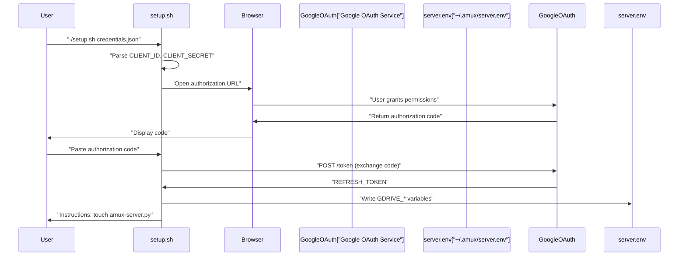
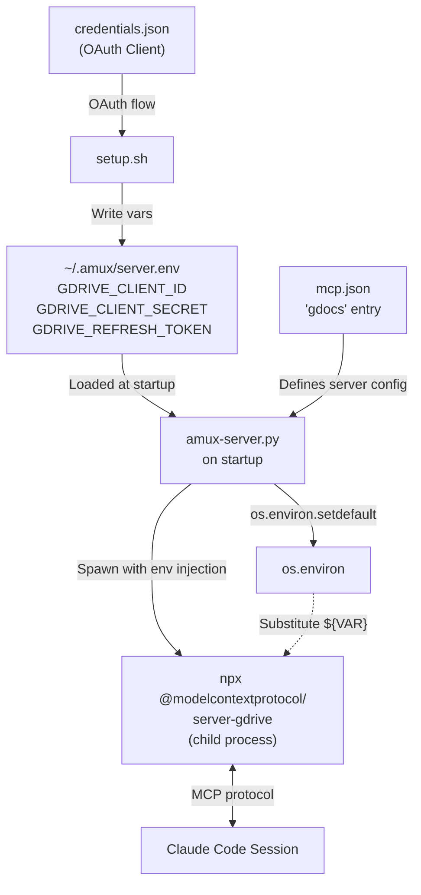

<!-- source: DeepWiki mcp.deepwiki.com · repo mixpeek/amux · page 8.2 Google Docs Integration · fetched 2026-10-27 -->

# Google Docs Integration

<details>
<summary>Relevant source files</summary>

The following files were used as context for generating this wiki page:

- [integrations/README.md](integrations/README.md)
- [integrations/google-docs/README.md](integrations/google-docs/README.md)
- [integrations/google-docs/setup.sh](integrations/google-docs/setup.sh)
- [mcp.json](mcp.json)

</details>


## Purpose and Scope

This document explains how to configure the Google Drive/Docs MCP server integration in amux, enabling Claude Code sessions to read and write Google Docs, Sheets, and other Drive files. It covers the OAuth credential setup, credential flow architecture, and runtime configuration.

For general MCP server configuration patterns, see [MCP Server Configuration](#8.1). For other integration types, see [Browser Automation](#8.3) and [CLI Tools](#8.4).

---

## Overview

The Google Docs integration gives all amux sessions access to Google Drive and Google Docs through the `@modelcontextprotocol/server-gdrive` MCP package. This is a **stdio-type MCP server** that spawns as a child process for each session.

### Capabilities Provided

| Capability | Description |
|------------|-------------|
| Read Documents | Access Google Docs and Sheets content |
| Write Documents | Modify existing documents or create new ones |
| Search Drive | Find files by name or content query |
| Export | Convert Docs to markdown or plain text |

All sessions share the same Google Drive credentials configured at the server level.

**Sources:** [integrations/google-docs/README.md:1-10]()

---

## OAuth Configuration Flow

### One-Time Setup Process



**Sources:** [integrations/google-docs/setup.sh:1-78](), [integrations/google-docs/README.md:23-46]()

### Prerequisites

Before running the setup script:

1. **Create OAuth Credentials**: Go to [Google Cloud Console](https://console.cloud.google.com/)
   - Create or select a project
   - Enable **Google Drive API** and **Google Docs API**
   - Create OAuth 2.0 credentials with type "Desktop App"
   - Download the credentials JSON file

2. **Run Setup Script**:
   ```bash
   ./integrations/google-docs/setup.sh /path/to/credentials.json
   ```

The script performs these operations:

| Step | Code Reference | Action |
|------|----------------|--------|
| Parse JSON | [integrations/google-docs/setup.sh:23-24]() | Extract `client_id` and `client_secret` using Python JSON parser |
| Build Auth URL | [integrations/google-docs/setup.sh:35-37]() | Construct OAuth URL with scopes and redirect URI |
| Exchange Code | [integrations/google-docs/setup.sh:46-51]() | POST to `oauth2.googleapis.com/token` with authorization code |
| Extract Token | [integrations/google-docs/setup.sh:53]() | Parse `refresh_token` from response |
| Write Credentials | [integrations/google-docs/setup.sh:64-72]() | Append `GDRIVE_*` variables to `server.env` |

**Sources:** [integrations/google-docs/setup.sh:1-78](), [integrations/google-docs/README.md:23-38]()

---

## Credential Flow Architecture

### From Setup to Runtime



**Sources:** [mcp.json:35-44](), [integrations/README.md:42-47](), [integrations/google-docs/README.md:48-63]()

### Runtime Environment Variable Substitution

The `mcp.json` configuration uses placeholder syntax:

```json
{
  "gdocs": {
    "type": "stdio",
    "command": "npx",
    "args": ["-y", "@modelcontextprotocol/server-gdrive"],
    "env": {
      "GDRIVE_CLIENT_ID": "${GDRIVE_CLIENT_ID}",
      "GDRIVE_CLIENT_SECRET": "${GDRIVE_CLIENT_SECRET}",
      "GDRIVE_REFRESH_TOKEN": "${GDRIVE_REFRESH_TOKEN}"
    }
  }
}
```

At runtime, `amux-server.py` performs these operations:

1. Loads `~/.amux/server.env` into `os.environ` during initialization
2. Reads `mcp.json` and parses the `gdocs` entry
3. Substitutes `${GDRIVE_CLIENT_ID}` with the actual value from environment
4. Spawns the `npx` process with the substituted environment variables

This ensures credentials never appear in version-controlled files.

**Sources:** [mcp.json:35-44](), [integrations/google-docs/README.md:48-63](), [integrations/README.md:37-47]()

---

## MCP Server Configuration

### Entry in mcp.json

The Google Docs integration is defined in `mcp.json` at the root of the repository:

```json
"gdocs": {
  "type": "stdio",
  "command": "npx",
  "args": ["-y", "@modelcontextprotocol/server-gdrive"],
  "env": {
    "GDRIVE_CLIENT_ID": "${GDRIVE_CLIENT_ID}",
    "GDRIVE_CLIENT_SECRET": "${GDRIVE_CLIENT_SECRET}",
    "GDRIVE_REFRESH_TOKEN": "${GDRIVE_REFRESH_TOKEN}"
  }
}
```

### Configuration Fields

| Field | Value | Purpose |
|-------|-------|---------|
| `type` | `"stdio"` | Spawn as local child process with stdin/stdout communication |
| `command` | `"npx"` | Use npx to run Node.js packages without installation |
| `args` | `["-y", "@modelcontextprotocol/server-gdrive"]` | Auto-confirm npx execution of the Google Drive MCP package |
| `env` | Object with `GDRIVE_*` keys | Environment variables passed to spawned process |

The `-y` flag to npx skips the installation confirmation prompt, enabling non-interactive spawning.

**Sources:** [mcp.json:35-44](), [integrations/google-docs/README.md:48-63]()

---

## Runtime Process Architecture

### Session Startup with MCP Integration

```mermaid
sequenceDiagram
    participant User
    participant amux-server["amux-server.py"]
    participant tmux["tmux Session"]
    participant npx["npx Process"]
    participant mcp_server["@modelcontextprotocol/<br/>server-gdrive"]
    participant GoogleAPI["Google Drive API"]
    participant Claude["Claude Code Agent"]
    
    User->>amux-server: "POST /api/sessions/NAME/start"
    amux-server->>amux-server: "Load mcp.json"
    amux-server->>tmux: "tmux new-session -d"
    amux-server->>npx: "spawn('npx', ['-y', '@modelcontextprotocol/...'])"
    amux-server->>npx: "env = {GDRIVE_CLIENT_ID, ...}"
    npx->>mcp_server: "Download and execute package"
    mcp_server->>mcp_server: "Initialize with credentials"
    tmux->>Claude: "Start Claude Code with MCP config"
    Claude->>mcp_server: "MCP: List available tools"
    mcp_server->>Claude: "drive_search, drive_read, drive_write, ..."
    Claude->>User: "Session ready with Google Docs tools"
    
    Note over Claude,GoogleAPI: During Task Execution
    Claude->>mcp_server: "MCP: drive_read(doc_id)"
    mcp_server->>GoogleAPI: "GET /drive/v3/files/{id}/export"
    GoogleAPI->>mcp_server: "Document content"
    mcp_server->>Claude: "Return content"
```

**Sources:** [mcp.json:35-44](), [integrations/google-docs/README.md:6-10]()

### Process Hierarchy

When a session starts, the following process tree is created:

```
amux-server.py (Python HTTP server)
└── tmux session (terminal multiplexer)
    └── Claude Code agent
        └── MCP client (embedded in Claude)
            └── stdio connection to:
                └── npx -y @modelcontextprotocol/server-gdrive
                    └── Node.js MCP server process
                        └── Makes Google API calls with refresh token
```

All sessions share the same Google Drive credentials but run independent MCP server processes.

**Sources:** [mcp.json:35-44](), [integrations/README.md:9]()

---

## OAuth Scopes and Permissions

### Requested Scopes

The `setup.sh` script requests these OAuth scopes:

| Scope | Access Level | Required For |
|-------|--------------|--------------|
| `https://www.googleapis.com/auth/drive` | Full Drive access | Search, read, write, create files |
| `https://www.googleapis.com/auth/documents` | Documents access | Read and modify Google Docs content |

**Sources:** [integrations/google-docs/setup.sh:35](), [integrations/google-docs/README.md:65-70]()

### Reducing Permissions

To limit access to read-only operations:

1. Modify the `SCOPE` variable in [integrations/google-docs/setup.sh:35]() before running setup:
   ```bash
   SCOPE="https://www.googleapis.com/auth/drive.readonly%20https://www.googleapis.com/auth/documents.readonly"
   ```

2. Re-run the setup script to generate a new refresh token with reduced permissions

Read-only scopes prevent sessions from creating or modifying files but still allow search and export operations.

**Sources:** [integrations/google-docs/README.md:65-70]()

---

## Activating the Integration

### Reload Procedure

After adding credentials to `~/.amux/server.env`:

1. **Trigger server reload**:
   ```bash
   touch amux-server.py
   ```
   
   This changes the file's modification time, triggering the watchdog that monitors for code updates.

2. **Start a new session**:
   ```bash
   ./amux start my-session
   ```

3. **Verify tools are available**: In the Claude Code interface, the agent will have access to Google Docs tools like `drive_search`, `drive_read`, `drive_write`, etc.

**Sources:** [integrations/google-docs/README.md:40-46](), [integrations/README.md:49-55]()

---

## Session Capabilities

### Available MCP Tools

Once configured, Claude Code sessions can use these Google Drive operations:

| Tool Name | Parameters | Action |
|-----------|------------|--------|
| `drive_search` | `query: string` | Search Drive by filename or content |
| `drive_read` | `file_id: string` | Read document content (auto-exports to text) |
| `drive_write` | `file_id: string, content: string` | Update existing document |
| `drive_create` | `name: string, content: string` | Create new document |
| `drive_export` | `file_id: string, mime_type: string` | Export to specific format (markdown, PDF, etc.) |

The exact tool names and parameters are provided by the `@modelcontextprotocol/server-gdrive` package.

### Example Usage

An agent can interact with Google Docs using natural language:

```
User: "Read the document named 'Project Requirements' and create a summary"
Agent: [uses drive_search to find file]
Agent: [uses drive_read to get content]
Agent: [creates summary]
Agent: [optionally uses drive_write to save summary]
```

Agents can also coordinate across multiple documents:

```
User: "Update all docs in the 'Sprints' folder with today's date"
Agent: [uses drive_search with folder filter]
Agent: [iterates files with drive_read and drive_write]
```

**Sources:** [integrations/google-docs/README.md:6-10]()

---

## Security Considerations

### Credential Storage

| Location | Contains | Access Control |
|----------|----------|----------------|
| `~/.amux/server.env` | `GDRIVE_*` environment variables | User-only read/write (chmod 600 recommended) |
| `mcp.json` | Placeholder strings only (`${GDRIVE_*}`) | Version-controlled, public |
| Runtime memory | Actual credential values | Process-isolated, cleared on termination |

The separation between `mcp.json` (public) and `server.env` (private) ensures credentials are never committed to version control.

**Sources:** [integrations/README.md:67-70](), [integrations/google-docs/README.md:12-20]()

### Refresh Token Lifecycle

The `GDRIVE_REFRESH_TOKEN` is a long-lived credential that allows the MCP server to obtain new access tokens without user interaction. It remains valid until:

- User revokes access in Google account settings
- The OAuth client credentials are deleted in Google Cloud Console
- User's password is changed (depending on Google's security settings)

To revoke access:
1. Visit [Google Account Permissions](https://myaccount.google.com/permissions)
2. Find the OAuth app name (from your Google Cloud project)
3. Click "Remove access"

**Sources:** [integrations/google-docs/setup.sh:44-59]()

---

## Troubleshooting

### Common Issues

| Issue | Diagnosis | Solution |
|-------|-----------|----------|
| "Tools not available in session" | MCP server failed to spawn | Check `~/.amux/server.env` exists and has all three `GDRIVE_*` variables |
| "Authorization failed" | Refresh token invalid or expired | Re-run `setup.sh` to generate new token |
| "Package not found" | npm/npx not installed | Install Node.js and npm |
| "Permission denied errors" | Insufficient OAuth scopes | Re-run setup with full scopes (not readonly) |

### Verification Steps

1. **Check environment variables are loaded**:
   ```bash
   grep GDRIVE ~/.amux/server.env
   ```
   Should show three lines with `GDRIVE_CLIENT_ID`, `GDRIVE_CLIENT_SECRET`, and `GDRIVE_REFRESH_TOKEN`.

2. **Verify mcp.json syntax**:
   ```bash
   python3 -m json.tool mcp.json > /dev/null
   ```
   Should exit with no errors.

3. **Test npx package availability**:
   ```bash
   npx -y @modelcontextprotocol/server-gdrive --version
   ```
   Should download and display package version.

4. **Check server logs**: Start the server with verbose logging to see MCP server spawning:
   ```bash
   ./amux serve --debug
   ```

**Sources:** [integrations/google-docs/README.md:1-71](), [integrations/README.md:1-77]()

---

## File References

### Configuration Files

- **MCP server definition**: [mcp.json:35-44]()
- **Environment variables**: `~/.amux/server.env` (not in repo)

### Setup Scripts

- **OAuth flow automation**: [integrations/google-docs/setup.sh:1-78]()

### Documentation

- **Integration-specific README**: [integrations/google-docs/README.md:1-71]()
- **General integration guide**: [integrations/README.md:1-77]()

**Sources:** [mcp.json:35-44](), [integrations/google-docs/README.md:1-71](), [integrations/google-docs/setup.sh:1-78](), [integrations/README.md:1-77]()

---

