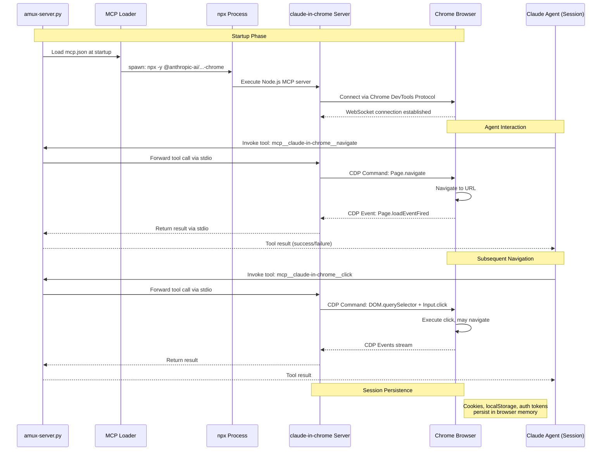
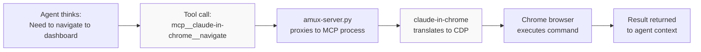
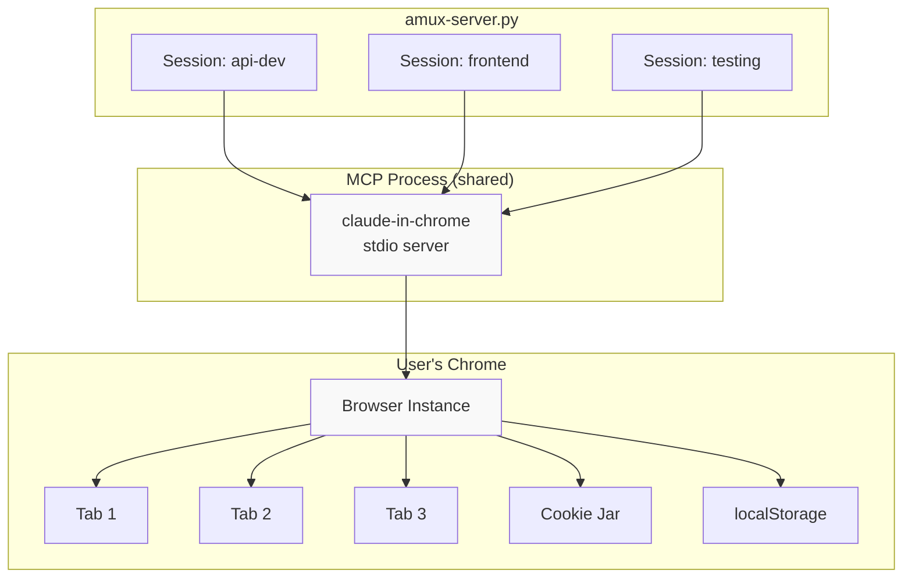
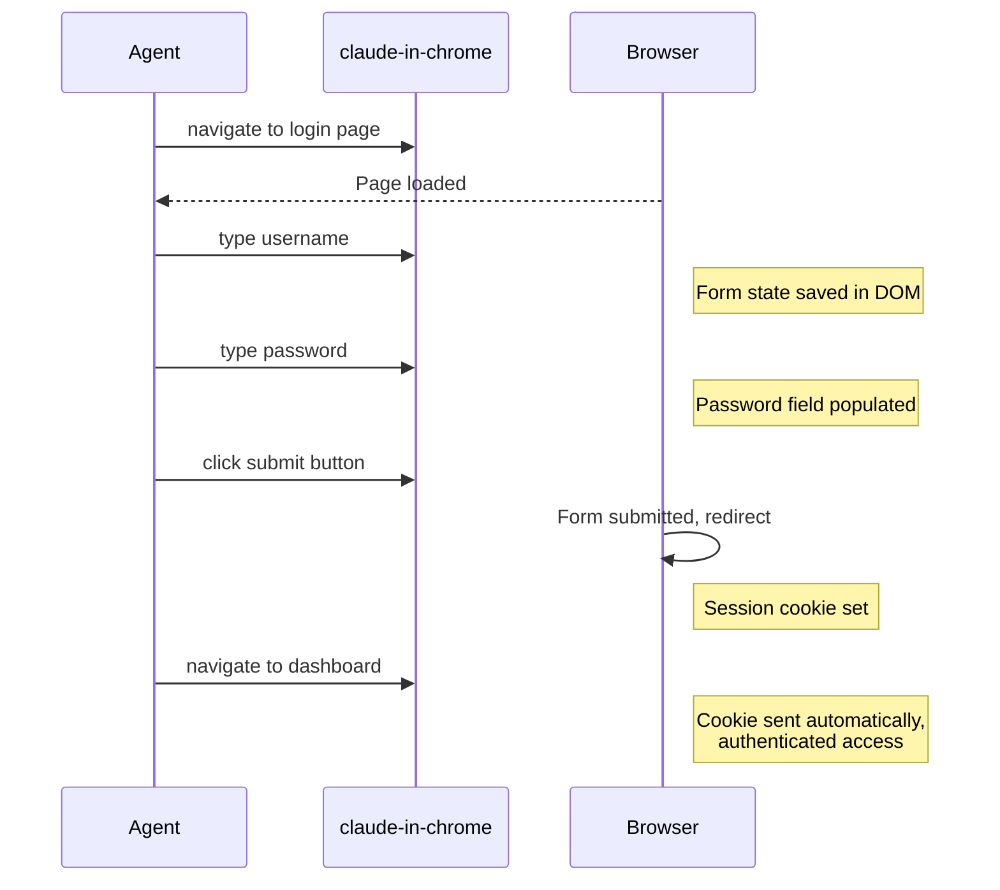
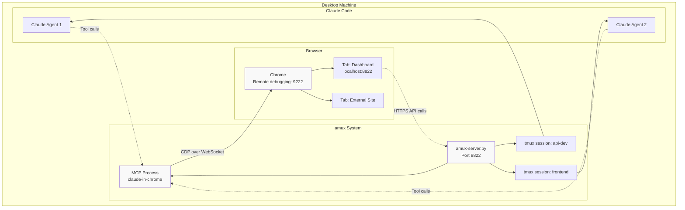

<!-- source: DeepWiki mcp.deepwiki.com · repo mixpeek/amux · page 8.3 Browser Automation (claude-in-chrome) · fetched 2026-10-27 -->

# Browser Automation (claude-in-chrome)

<details>
<summary>Relevant source files</summary>

The following files were used as context for generating this wiki page:

- [CLAUDE.md](CLAUDE.md)
- [integrations/README.md](integrations/README.md)
- [integrations/google-docs/README.md](integrations/google-docs/README.md)
- [integrations/google-docs/setup.sh](integrations/google-docs/setup.sh)
- [mcp.json](mcp.json)

</details>


## Purpose and Scope

This document covers the `claude-in-chrome` MCP server integration, which enables Claude agents running in amux sessions to interact with the user's Chrome browser. This integration provides persistent browser automation capabilities that maintain session state across navigations, cookies, and authentication.

For general MCP server configuration, see [MCP Server Configuration](#8.1). For other external integrations, see [Google Docs Integration](#8.2) and [CLI Tools](#8.4).

---

## Overview

The `claude-in-chrome` MCP server provides direct browser automation capabilities by connecting to a running Chrome instance. Unlike headless browser tools like Playwright, it operates within the user's actual Chrome browser, preserving all session state, authentication cookies, and browser extensions.

### Key Characteristics

| Feature | Description |
|---------|-------------|
| **Connection Type** | Direct IPC to running Chrome via Chrome DevTools Protocol |
| **Session Persistence** | Maintains cookies, localStorage, and authentication across tasks |
| **State Preservation** | Browser state survives between tool invocations |
| **Execution Context** | Same desktop machine as amux server and Claude Code |
| **Tool Prefix** | All tools namespaced as `mcp__claude-in-chrome__*` |

### Design Philosophy

The [CLAUDE.md:58-62]() file mandates `claude-in-chrome` as the default browser automation tool for amux sessions. This choice reflects a preference for real-world browser state over isolated headless environments, enabling agents to:

- Navigate authenticated web applications without re-login
- Interact with sites that detect and block headless browsers
- Access browser extensions and plugins
- Maintain shopping carts, form state, and session cookies

**Sources**: [CLAUDE.md:58-63]()

---

## Configuration

### MCP Server Entry

The `claude-in-chrome` server is configured in [mcp.json:3-10]() as a stdio-based MCP server:

```json
{
  "mcpServers": {
    "claude-in-chrome": {
      "type": "stdio",
      "command": "npx",
      "args": [
        "-y",
        "@anthropic-ai/claude-code-mcp-server-chrome"
      ]
    }
  }
}
```

### Configuration Properties

| Property | Value | Purpose |
|----------|-------|---------|
| `type` | `"stdio"` | Spawns a local Node.js process communicating via stdin/stdout |
| `command` | `"npx"` | Uses Node Package Runner for zero-install execution |
| `args` | `["-y", "@anthropic-ai/claude-code-mcp-server-chrome"]` | Auto-approves npx install and specifies package |
| `env` | (none) | No environment variables required for basic operation |

### No Credentials Required

Unlike other MCP integrations (e.g., Google Docs), `claude-in-chrome` requires no API keys or OAuth tokens. The connection to Chrome is established via the Chrome DevTools Protocol, which is available whenever Chrome is running with remote debugging enabled.

**Sources**: [mcp.json:3-10](), [integrations/README.md:1-71]()

---

## Architecture

### Connection Flow



### Component Roles

| Component | File/Package | Responsibility |
|-----------|--------------|----------------|
| **amux-server.py** | [amux-server.py]() | Loads mcp.json, spawns MCP process, proxies tool calls |
| **MCP Loader** | Inline in amux-server.py | Parses mcp.json, manages child processes |
| **npx Process** | Node.js | Installs and executes MCP package |
| **claude-in-chrome Server** | `@anthropic-ai/claude-code-mcp-server-chrome` | Translates MCP tool calls to CDP commands |
| **Chrome DevTools Protocol** | Chrome built-in | Low-level browser automation API |
| **Chrome Browser** | User's running Chrome instance | Executes automation commands, maintains state |

### Process Lifecycle

The `claude-in-chrome` MCP server process:

1. **Spawns** when amux-server.py starts and loads [mcp.json:3-10]()
2. **Connects** to the first available Chrome debugging port (typically 9222)
3. **Persists** for the lifetime of amux-server.py
4. **Shares** access across all amux sessions (not isolated per-session)
5. **Reconnects** automatically if Chrome restarts

**Sources**: [mcp.json:3-10](), [CLAUDE.md:58-63](), High-Level Diagram 5

---

## Available Tools

All `claude-in-chrome` tools are prefixed with `mcp__claude-in-chrome__` to avoid namespace collisions with other MCP servers. The exact set of tools depends on the MCP package version, but typically includes:

### Navigation Tools

| Tool Name | Purpose | Common Parameters |
|-----------|---------|-------------------|
| `mcp__claude-in-chrome__navigate` | Navigate to URL | `url`: target URL |
| `mcp__claude-in-chrome__go_back` | Browser back button | (none) |
| `mcp__claude-in-chrome__go_forward` | Browser forward button | (none) |
| `mcp__claude-in-chrome__reload` | Refresh current page | (none) |

### Interaction Tools

| Tool Name | Purpose | Common Parameters |
|-----------|---------|-------------------|
| `mcp__claude-in-chrome__click` | Click element by selector | `selector`: CSS selector |
| `mcp__claude-in-chrome__type` | Type text into input | `selector`, `text` |
| `mcp__claude-in-chrome__screenshot` | Capture viewport | `full_page`: boolean |
| `mcp__claude-in-chrome__evaluate` | Run JavaScript | `expression`: JS code |

### Inspection Tools

| Tool Name | Purpose | Common Parameters |
|-----------|---------|-------------------|
| `mcp__claude-in-chrome__get_content` | Extract page HTML/text | `format`: "html" or "text" |
| `mcp__claude-in-chrome__query_selector` | Find elements | `selector`: CSS selector |
| `mcp__claude-in-chrome__get_cookies` | Read cookie jar | `url`: optional filter |

### Tool Invocation Pattern

When a Claude agent in an amux session invokes a browser automation tool:



**Sources**: [CLAUDE.md:58-63]()

---

## Session Persistence

### State Preservation

Unlike headless browser tools that create isolated sessions, `claude-in-chrome` operates on the user's persistent Chrome profile. This means:

| State Type | Behavior |
|------------|----------|
| **Cookies** | Persist across tool invocations and amux sessions |
| **localStorage/sessionStorage** | Maintained for the lifetime of Chrome tabs |
| **Authentication Tokens** | Survive between agent tasks |
| **Browser History** | Accumulates across all automation |
| **Form Autofill** | Chrome's saved passwords/addresses available |

### Cross-Session Sharing

Because the MCP server connects to the user's Chrome browser (not a per-session instance), all amux sessions share the same browser state:



### Implications

**Coordination Required**: If multiple sessions automate the browser simultaneously, they may interfere with each other (e.g., one session navigates away from a page another is interacting with).

**Privacy Note**: All sessions can access the same cookies and session tokens, so sensitive operations should be coordinated via the [Board System](#2.2).

**Sources**: [CLAUDE.md:60-63]()

---

## Usage Patterns

### Navigating to amux Dashboard

The [CLAUDE.md:62-63]() file specifies that agents should use `https://localhost:8822` when navigating to the amux dashboard:

```plaintext
Agent workflow:
1. Invoke: mcp__claude-in-chrome__navigate
   - url: "https://localhost:8822"
2. Wait for page load event
3. Invoke: mcp__claude-in-chrome__screenshot (verify UI)
4. Invoke: mcp__claude-in-chrome__click
   - selector: "[data-session-name='api-dev']"
```

This enables agents to interact with their own management interface, creating a self-referential automation loop.

### Multi-Step Workflows

Agents can chain browser operations across multiple tool calls, with state persisting between invocations:



### Error Handling

Browser automation can fail due to network issues, element not found, or page navigation timing. Agents should:

1. **Check tool results** for success/failure status
2. **Retry navigation** with backoff if network errors occur
3. **Verify page state** before interaction (use `get_content` or `screenshot`)
4. **Handle popups/alerts** that may block interaction

### Debugging Browser State

Agents can inspect the current browser state using:

```plaintext
1. mcp__claude-in-chrome__screenshot → Visual confirmation
2. mcp__claude-in-chrome__get_content → HTML/text extraction
3. mcp__claude-in-chrome__get_cookies → Authentication verification
4. mcp__claude-in-chrome__evaluate → Run arbitrary JS for debugging
```

**Sources**: [CLAUDE.md:58-63]()

---

## Integration with amux Sessions

### Tool Discovery

When an amux session starts, the Claude agent automatically inherits all MCP tools, including `claude-in-chrome`. The agent's system prompt or initialization message should inform it of available browser automation capabilities.

### Global Memory Reference

Agents can discover the amux server URL via global memory (see [Memory System](#2.3)). The [CLAUDE.md:62-63]() file ensures agents know to use `https://localhost:8822` for local dashboard access.

### Cross-Agent Coordination

If multiple agents need to coordinate browser automation:

1. **Claim board tasks** atomically (see [Board System](#2.2))
2. **Use board status** to signal "browser in use"
3. **Peek at peer sessions** to verify they've completed browser work before proceeding

### Architecture Diagram: Browser Automation in Full Stack



**Sources**: [CLAUDE.md:58-63](), [mcp.json:3-10](), High-Level Diagram 1, High-Level Diagram 5

---

## Limitations and Considerations

### Chrome Must Be Running

The `claude-in-chrome` MCP server requires Chrome to be launched with remote debugging enabled. If Chrome is not running or was started without the `--remote-debugging-port` flag, tool calls will fail.

**Typical Chrome launch command**:
```bash
/Applications/Google\ Chrome.app/Contents/MacOS/Google\ Chrome \
  --remote-debugging-port=9222 \
  --user-data-dir=/tmp/chrome-remote
```

### No Isolation Between Sessions

All amux sessions share the same Chrome instance. If isolation is required (e.g., testing with different authentication states), agents must:
- Use private browsing tabs (if supported by the MCP server)
- Manually clear cookies between tasks
- Coordinate via the board to ensure exclusive browser access

### Network-Dependent

Browser automation is subject to network latency, page load times, and rate limiting. Agents should:
- Set reasonable timeouts for navigation
- Handle network failures gracefully
- Avoid aggressive retry loops that may trigger anti-bot measures

### Security Implications

Agents have full access to the browser's session state, including:
- Logged-in accounts across all sites
- Saved passwords (via autofill)
- Cookie jars with authentication tokens

This is intentional for workflow automation but requires trust in the agents' behavior. Sensitive operations should be flagged for human approval (see [Self-Healing Watchdog](#2.4) for YOLO mode controls).

### Comparison with Headless Browsers

| Aspect | claude-in-chrome | Playwright/Puppeteer |
|--------|------------------|----------------------|
| **Session Persistence** | Full (uses real Chrome profile) | None (isolated per run) |
| **Authentication** | Preserved across tasks | Must re-authenticate each run |
| **Bot Detection** | Harder to detect (real browser) | Easier to detect (headless flags) |
| **Isolation** | Shared across sessions | Per-process isolation |
| **Setup Complexity** | Low (if Chrome already running) | Medium (requires installation) |
| **Debugging** | Visual (can see browser) | Headless (need screenshots) |

**Sources**: [CLAUDE.md:58-63]()

---

## Setup Checklist

To enable `claude-in-chrome` for amux sessions:

1. ✓ **Verify mcp.json entry** exists ([mcp.json:3-10]())
2. ✓ **Start Chrome with remote debugging**:
   ```bash
   chrome --remote-debugging-port=9222
   ```
3. ✓ **Reload amux-server.py** if mcp.json was modified:
   ```bash
   touch amux-server.py
   ```
4. ✓ **Start a new session** to inherit the MCP configuration
5. ✓ **Verify tool availability** by asking the agent:
   ```
   "Can you navigate to https://localhost:8822?"
   ```

If tool calls fail, check:
- Chrome is running with `--remote-debugging-port=9222`
- No firewall blocking localhost:9222
- npx can execute (Node.js is installed)
- MCP server process spawned (check amux-server.py logs)

**Sources**: [CLAUDE.md:58-63](), [mcp.json:3-10](), [integrations/README.md:1-71]()

---

