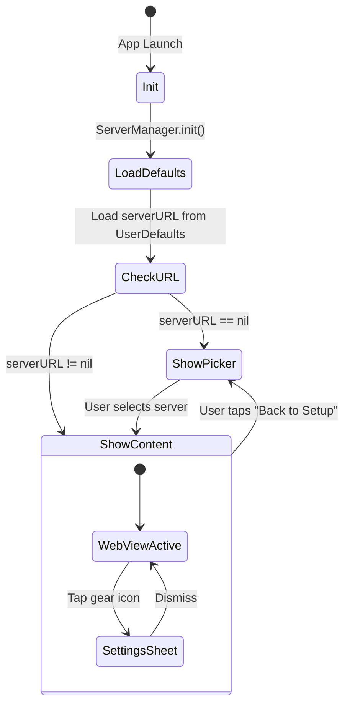
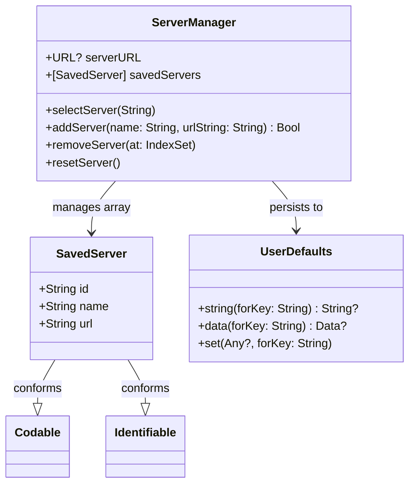
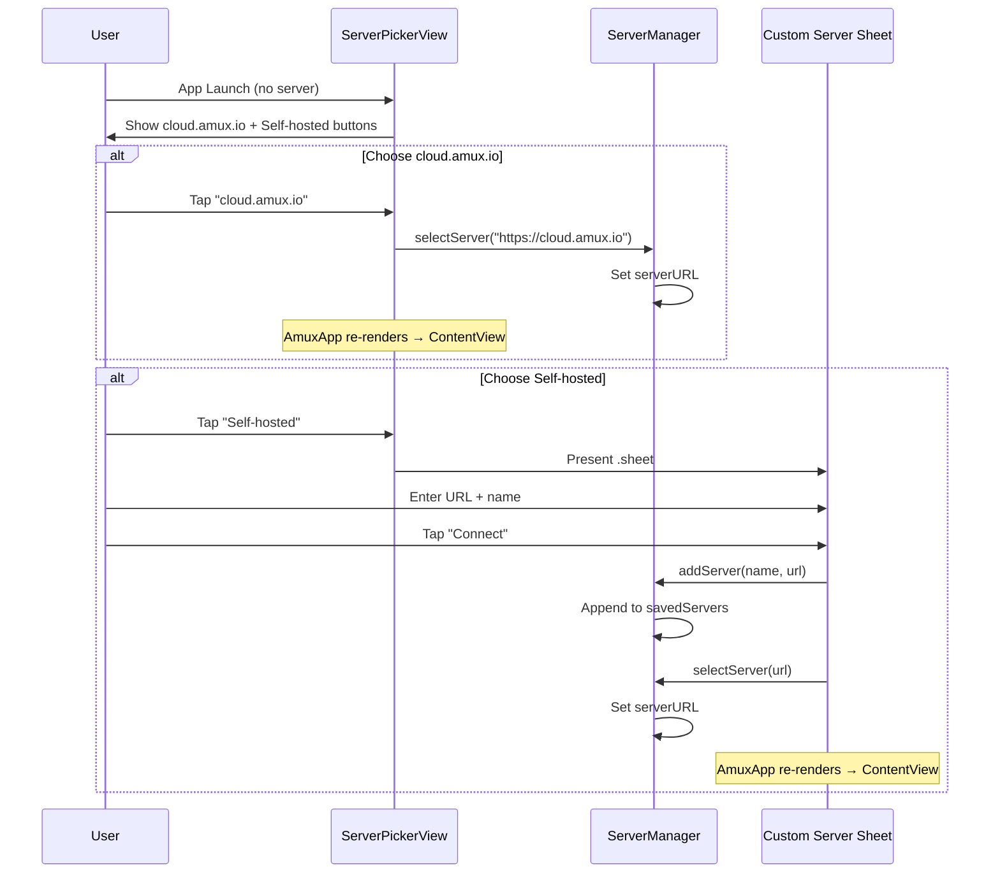
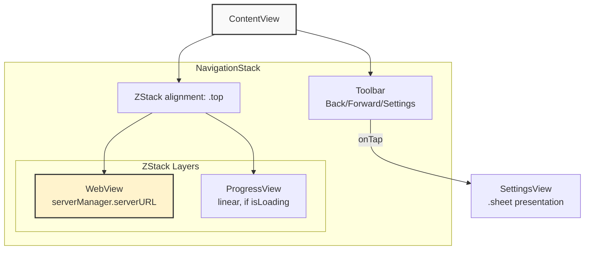
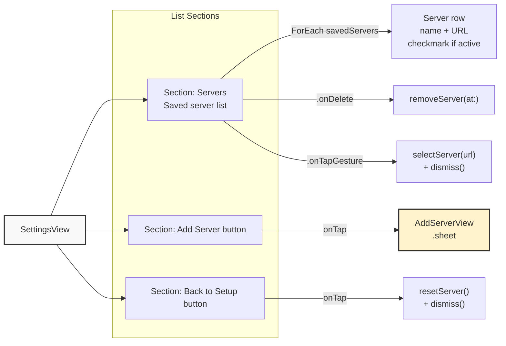
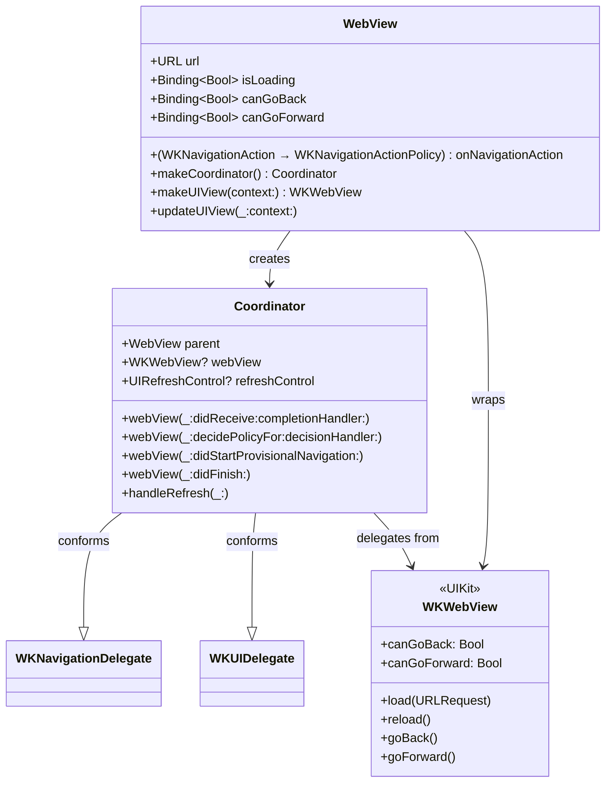
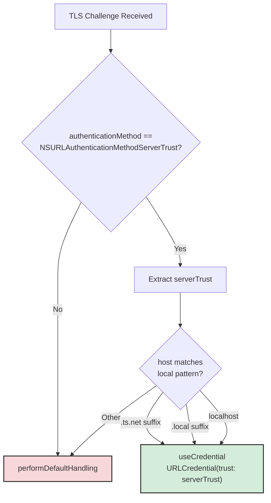
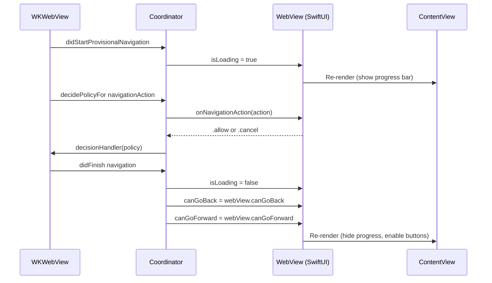

<!-- source: DeepWiki mcp.deepwiki.com · repo mixpeek/amux · page 9.1 App Architecture · fetched 2026-10-27 -->

# App Architecture

<details>
<summary>Relevant source files</summary>

The following files were used as context for generating this wiki page:

- [ios/AmuxApp/AmuxApp.entitlements](ios/AmuxApp/AmuxApp.entitlements)
- [ios/AmuxApp/Assets.xcassets/AppIcon.appiconset/Contents.json](ios/AmuxApp/Assets.xcassets/AppIcon.appiconset/Contents.json)
- [ios/AmuxApp/Assets.xcassets/Contents.json](ios/AmuxApp/Assets.xcassets/Contents.json)
- [ios/AmuxApp/Info.plist](ios/AmuxApp/Info.plist)
- [ios/AmuxApp/Sources/AmuxApp.swift](ios/AmuxApp/Sources/AmuxApp.swift)
- [ios/AmuxApp/Sources/ContentView.swift](ios/AmuxApp/Sources/ContentView.swift)
- [ios/AmuxApp/Sources/ServerManager.swift](ios/AmuxApp/Sources/ServerManager.swift)
- [ios/AmuxApp/Sources/ServerPickerView.swift](ios/AmuxApp/Sources/ServerPickerView.swift)
- [ios/AmuxApp/Sources/WebView.swift](ios/AmuxApp/Sources/WebView.swift)

</details>


This document describes the iOS app's internal structure, including its SwiftUI component hierarchy, state management, navigation flow, and web integration layer. The app is a native wrapper around the amux web dashboard, providing mobile-optimized access with server configuration management.

For information about deploying the iOS app to TestFlight, see [iOS Deployment](#9.3). For server configuration details from the user perspective, see [Server Configuration](#9.2).

---

## Overview

The iOS app follows a minimal architecture philosophy: it is a thin native shell around the web dashboard, leveraging WKWebView to display the full amux UI. The app adds value through:

- **Server management**: Persist multiple server configurations (cloud.amux.io, self-hosted Tailscale endpoints)
- **Native navigation**: Back/forward buttons, pull-to-refresh, settings sheet
- **TLS handling**: Accept self-signed certificates for local/Tailscale deployments
- **External link routing**: Open non-amux links in Safari

The entire codebase consists of ~350 lines of SwiftUI across 5 source files.

**Sources:** [ios/AmuxApp/Sources/AmuxApp.swift:1-18](), [ios/AmuxApp/Sources/ContentView.swift:1-189]()

---

## Application Structure

### Component Hierarchy

```mermaid
graph TB
    App["AmuxApp<br/>@main entry point"]
    SM["ServerManager<br/>@StateObject<br/>server URL persistence"]
    
    App -->|creates| SM
    App -->|conditional render| Picker["ServerPickerView<br/>onboarding flow"]
    App -->|conditional render| Content["ContentView<br/>web dashboard"]
    
    Content -->|embeds| WebV["WebView<br/>UIViewRepresentable"]
    Content -->|presents sheet| Settings["SettingsView<br/>server list management"]
    
    WebV -->|wraps| WKWeb["WKWebView<br/>renders dashboard"]
    
    Settings -->|presents sheet| AddServer["AddServerView<br/>custom URL input"]
    
    Picker -->|presents sheet| Custom["Custom server form"]
    
    SM -->|@EnvironmentObject| Picker
    SM -->|@EnvironmentObject| Content
    SM -->|@EnvironmentObject| Settings
    
    style App fill:#f9f9f9,stroke:#333,stroke-width:2px
    style SM fill:#e8f4f8,stroke:#333,stroke-width:2px
    style WebV fill:#fff3cd,stroke:#333,stroke-width:2px
```

**Diagram: SwiftUI Component Tree**

The app uses SwiftUI's declarative paradigm with `@StateObject` for lifecycle-owned state and `@EnvironmentObject` for dependency injection. `ServerManager` is created at the root (`AmuxApp`) and propagated down the view hierarchy, providing shared access to server configuration.

**Sources:** [ios/AmuxApp/Sources/AmuxApp.swift:3-18](), [ios/AmuxApp/Sources/ServerManager.swift:4-60]()

---

### Entry Point & State Initialization

| Component | Type | Responsibility |
|-----------|------|----------------|
| `AmuxApp` | `App` (SwiftUI) | App lifecycle, root scene creation |
| `ServerManager` | `ObservableObject` | Persist server URLs, manage selection |
| `WindowGroup` | Scene | Provides window for conditional root view |

The app entry point implements conditional navigation based on server configuration state:



**Diagram: App Launch State Machine**

At launch, `ServerManager.init()` [ios/AmuxApp/Sources/ServerManager.swift:23-39]() loads:
1. **Saved servers array** from UserDefaults key `savedServers` (JSON-encoded)
2. **Active server URL** from UserDefaults key `serverURL`
3. **Default server** (`cloud.amux.io`) if no saved servers exist

If no active URL is set, `AmuxApp` renders `ServerPickerView` [ios/AmuxApp/Sources/AmuxApp.swift:9-11](). Otherwise, it renders `ContentView` with the web dashboard.

**Sources:** [ios/AmuxApp/Sources/AmuxApp.swift:3-18](), [ios/AmuxApp/Sources/ServerManager.swift:23-39]()

---

## ServerManager: State & Persistence

### Data Model



**Diagram: ServerManager Class Structure**

`ServerManager` [ios/AmuxApp/Sources/ServerManager.swift:4-60]() is an `ObservableObject` with two `@Published` properties:

| Property | Type | Published | Persistence |
|----------|------|-----------|-------------|
| `serverURL` | `URL?` | Yes | `didSet` saves to `UserDefaults` |
| `savedServers` | `[SavedServer]` | Yes | `didSet` JSON-encodes to `UserDefaults` |

`SavedServer` [ios/AmuxApp/Sources/ServerManager.swift:62-66]() is a simple struct:
- `name`: User-visible label (e.g., "Home Mac")
- `url`: Full URL string (e.g., "https://amux.tail-xxxx.ts.net:8822")
- `id`: Computed property returning `url` for `Identifiable` conformance

**Sources:** [ios/AmuxApp/Sources/ServerManager.swift:4-66]()

---

### Server Management Operations

The class provides four mutation methods:

#### `selectServer(_ urlString: String)`
[ios/AmuxApp/Sources/ServerManager.swift:41-44]()

Sets the active `serverURL`, triggering `didSet` to persist to UserDefaults. Called when user taps a server in the picker or settings list.

#### `addServer(name: String, urlString: String) -> Bool`
[ios/AmuxApp/Sources/ServerManager.swift:46-51]()

Validates URL (must start with `http`), normalizes by removing trailing slash, appends to `savedServers`. Returns `false` on validation failure.

#### `removeServer(at offsets: IndexSet)`
[ios/AmuxApp/Sources/ServerManager.swift:53-55]()

Removes servers at specified indices. Used with SwiftUI's `.onDelete` modifier in settings list.

#### `resetServer()`
[ios/AmuxApp/Sources/ServerManager.swift:57-59]()

Sets `serverURL` to `nil`, returning user to onboarding. Triggered by "Back to Setup" button in settings.

**Sources:** [ios/AmuxApp/Sources/ServerManager.swift:41-59]()

---

## Navigation Flow

### ServerPickerView: Onboarding



**Diagram: Onboarding Sequence**

`ServerPickerView` [ios/AmuxApp/Sources/ServerPickerView.swift:3-135]() renders two options:
1. **Cloud button**: Immediately calls `selectServer("https://cloud.amux.io")` [ios/AmuxApp/Sources/ServerPickerView.swift:36]()
2. **Self-hosted button**: Sets `mode = .custom`, presenting a sheet [ios/AmuxApp/Sources/ServerPickerView.swift:44]()

The custom sheet [ios/AmuxApp/Sources/ServerPickerView.swift:51-99]() collects:
- `customName`: Optional display name
- `customURL`: Full URL (validated with `.hasPrefix("http")`)

On "Connect", it calls `addServer()` then `selectServer()`, which triggers `serverURL` to become non-nil, causing `AmuxApp` to switch from `ServerPickerView` to `ContentView`.

**Sources:** [ios/AmuxApp/Sources/ServerPickerView.swift:3-135](), [ios/AmuxApp/Sources/AmuxApp.swift:9-14]()

---

### ContentView: Main Dashboard

`ContentView` [ios/AmuxApp/Sources/ContentView.swift:4-78]() is the primary container after onboarding:



**Diagram: ContentView Layout Structure**

#### State Variables

| Variable | Type | Purpose |
|----------|------|---------|
| `isLoading` | `Bool` | Show/hide linear progress bar |
| `canGoBack` | `Bool` | Enable/disable back button |
| `canGoForward` | `Bool` | Enable/disable forward button |
| `showSettings` | `Bool` | Control settings sheet presentation |
| `webViewRef` | `WKWebView?` | Reference for back/forward navigation |

**Sources:** [ios/AmuxApp/Sources/ContentView.swift:5-10]()

---

#### Toolbar Configuration

The toolbar [ios/AmuxApp/Sources/ContentView.swift:34-58]() provides:

**Leading (left):**
- Back button: `webViewRef?.goBack()` [ios/AmuxApp/Sources/ContentView.swift:36-39]()
- Forward button: `webViewRef?.goForward()` [ios/AmuxApp/Sources/ContentView.swift:41-44]()

**Principal (center):**
- Server hostname (e.g., "cloud.amux.io") [ios/AmuxApp/Sources/ContentView.swift:47-51]()

**Trailing (right):**
- Settings gear icon [ios/AmuxApp/Sources/ContentView.swift:53-57]()

Buttons are disabled via `.disabled(!canGoBack)` when navigation isn't possible.

**Sources:** [ios/AmuxApp/Sources/ContentView.swift:34-58]()

---

#### External Link Handling

The `handleNavigation()` function [ios/AmuxApp/Sources/ContentView.swift:66-77]() intercepts link taps:

```swift
if action.navigationType == .linkActivated && url.host != serverHost {
    UIApplication.shared.open(url)
    return .cancel
}
```

This ensures that external links (different host than configured server) open in Safari, while same-host navigation stays in the WebView.

**Sources:** [ios/AmuxApp/Sources/ContentView.swift:66-77]()

---

### SettingsView: Server Management



**Diagram: SettingsView Navigation**

`SettingsView` [ios/AmuxApp/Sources/ContentView.swift:82-143]() displays:

1. **Server list**: `ForEach(serverManager.savedServers)` [ios/AmuxApp/Sources/ContentView.swift:94]()
   - Shows name, URL, checkmark if active
   - Tap to switch servers [ios/AmuxApp/Sources/ContentView.swift:106-109]()
   - Swipe-to-delete [ios/AmuxApp/Sources/ContentView.swift:111]()

2. **Add Server button**: Presents `AddServerView` sheet [ios/AmuxApp/Sources/ContentView.swift:115]()

3. **Back to Setup button**: Calls `resetServer()` [ios/AmuxApp/Sources/ContentView.swift:120](), returning to `ServerPickerView`

**Sources:** [ios/AmuxApp/Sources/ContentView.swift:82-143]()

---

## WebView Integration

### UIViewRepresentable Wrapper

`WebView` [ios/AmuxApp/Sources/WebView.swift:4-98]() is a `UIViewRepresentable` that bridges UIKit's `WKWebView` to SwiftUI:



**Diagram: WebView Component Architecture**

**Sources:** [ios/AmuxApp/Sources/WebView.swift:4-104]()

---

### WKWebView Configuration

The `makeUIView()` method [ios/AmuxApp/Sources/WebView.swift:15-34]() configures:

| Configuration | Setting | Purpose |
|---------------|---------|---------|
| `allowsInlineMediaPlayback` | `true` | Enable video playback in-page |
| `dataDetectorTypes` | `[]` | Disable automatic link detection |
| `allowsBackForwardNavigationGestures` | `true` | Enable swipe navigation |
| `contentInsetAdjustmentBehavior` | `.automatic` | Respect safe areas |
| Pull-to-refresh | `UIRefreshControl` | Add refresh gesture [ios/AmuxApp/Sources/WebView.swift:27-30]() |

**Sources:** [ios/AmuxApp/Sources/WebView.swift:15-34]()

---

### TLS Certificate Handling

The Coordinator implements `webView(_:didReceive:completionHandler:)` [ios/AmuxApp/Sources/WebView.swift:55-71]() to accept self-signed certificates for local deployments:



**Diagram: TLS Certificate Validation Flow**

This allows connecting to:
- **Tailscale endpoints**: `*.ts.net`
- **Local network**: `*.local`
- **Localhost**: `localhost`

While still enforcing standard TLS validation for public domains like `cloud.amux.io`.

**Sources:** [ios/AmuxApp/Sources/WebView.swift:55-71]()

---

### Navigation Lifecycle



**Diagram: Navigation Event Sequence**

The Coordinator [ios/AmuxApp/Sources/WebView.swift:45-97]() implements three key delegate methods:

1. **`didStartProvisionalNavigation`** [ios/AmuxApp/Sources/WebView.swift:78-80](): Sets `isLoading = true`
2. **`decidePolicyFor`** [ios/AmuxApp/Sources/WebView.swift:73-76](): Calls parent's `onNavigationAction` closure (for external link handling)
3. **`didFinish`** [ios/AmuxApp/Sources/WebView.swift:82-87](): Updates loading state and back/forward button availability

**Sources:** [ios/AmuxApp/Sources/WebView.swift:45-97]()

---

### Pull-to-Refresh Implementation

Pull-to-refresh is implemented by adding a `UIRefreshControl` to the `WKWebView.scrollView`:

```swift
let refresh = UIRefreshControl()
refresh.addTarget(context.coordinator, action: #selector(Coordinator.handleRefresh(_:)), for: .valueChanged)
webView.scrollView.addSubview(refresh)
```
[ios/AmuxApp/Sources/WebView.swift:27-30]()

The `handleRefresh()` method [ios/AmuxApp/Sources/WebView.swift:94-96]() calls `webView?.reload()`, and the `didFinish` delegate method calls `refreshControl?.endRefreshing()` [ios/AmuxApp/Sources/WebView.swift:86]().

**Sources:** [ios/AmuxApp/Sources/WebView.swift:27-30](), [ios/AmuxApp/Sources/WebView.swift:82-96]()

---

## Configuration Files

### Info.plist

[ios/AmuxApp/Info.plist:1-43]() defines:

| Key | Value | Purpose |
|-----|-------|---------|
| `CFBundleIdentifier` | `$(PRODUCT_BUNDLE_IDENTIFIER)` | Set by Xcode project (io.amux.app) |
| `CFBundleShortVersionString` | `1.0` | User-visible version |
| `CFBundleVersion` | `1` | Build number (auto-incremented by fastlane) |
| `NSFaceIDUsageDescription` | "Used to protect access..." | Privacy prompt for biometric auth (future feature) |
| `ITSAppUsesNonExemptEncryption` | `false` | Simplifies App Store export compliance |
| `UISupportedInterfaceOrientations` | Portrait + Portrait Upside Down | iPhone orientation lock |
| `UISupportedInterfaceOrientations~ipad` | All orientations | iPad flexibility |

**Sources:** [ios/AmuxApp/Info.plist:1-43]()

---

### Entitlements

[ios/AmuxApp/AmuxApp.entitlements:1-8]() currently contains only:

```xml
<key>com.apple.security.application-groups</key>
<array/>
```

This is a placeholder for future app extension support (e.g., Share Sheet, Widgets). Currently unused.

**Sources:** [ios/AmuxApp/AmuxApp.entitlements:1-8]()

---

## Data Flow Summary

```mermaid
graph LR
    UD["UserDefaults<br/>Persistent Storage"]
    
    SM["ServerManager<br/>@StateObject"]
    
    App["AmuxApp<br/>Entry Point"]
    
    Picker["ServerPickerView"]
    Content["ContentView"]
    Settings["SettingsView"]
    
    WV["WebView"]
    WK["WKWebView"]
    
    UD -->|Load on init| SM
    SM -->|didSet save| UD
    
    SM -->|@EnvironmentObject| App
    App -->|Conditional| Picker
    App -->|Conditional| Content
    
    Content -->|sheet| Settings
    Content -->|embeds| WV
    WV -->|wraps| WK
    
    SM -.->|@EnvironmentObject| Picker
    SM -.->|@EnvironmentObject| Content
    SM -.->|@EnvironmentObject| Settings
    
    Picker -->|selectServer()| SM
    Settings -->|selectServer()<br/>addServer()<br/>removeServer()| SM
    
    style SM fill:#e8f4f8,stroke:#333,stroke-width:2px
    style UD fill:#fff3cd,stroke:#333,stroke-width:2px
```

**Diagram: Data Flow & Dependencies**

1. **Persistence layer**: UserDefaults stores `serverURL` (String) and `savedServers` (JSON)
2. **State layer**: `ServerManager` loads on init, publishes changes, saves on mutation
3. **View layer**: SwiftUI views receive `ServerManager` via `@EnvironmentObject`
4. **Web layer**: `WKWebView` loads `serverManager.serverURL`

All state flows unidirectionally: User action → ServerManager mutation → @Published trigger → SwiftUI re-render.

**Sources:** [ios/AmuxApp/Sources/ServerManager.swift:4-66](), [ios/AmuxApp/Sources/AmuxApp.swift:3-18](), [ios/AmuxApp/Sources/ContentView.swift:4-189]()

---

## Key Architectural Decisions

| Decision | Rationale |
|----------|-----------|
| **WKWebView over native UI** | Reuse web dashboard code, minimize iOS-specific logic |
| **UserDefaults for persistence** | Simple key-value storage sufficient for server list |
| **SwiftUI over UIKit** | Declarative UI reduces boilerplate, modern iOS development |
| **Accept self-signed certs for `.ts.net`** | Enable Tailscale self-hosted deployments without cert warnings |
| **No MCP client logic** | Delegate all amux functionality to web dashboard via WebView |
| **Minimal navigation chrome** | Focus on dashboard content, not native wrapper |

The entire app is ~350 lines of Swift because it delegates all business logic to the web dashboard running in WKWebView. The native code only handles: server configuration, TLS trust, and navigation chrome.

**Sources:** [ios/AmuxApp/Sources/WebView.swift:55-71](), [ios/AmuxApp/Sources/ServerManager.swift:4-66](), [ios/AmuxApp/Sources/ContentView.swift:4-189]()

---

