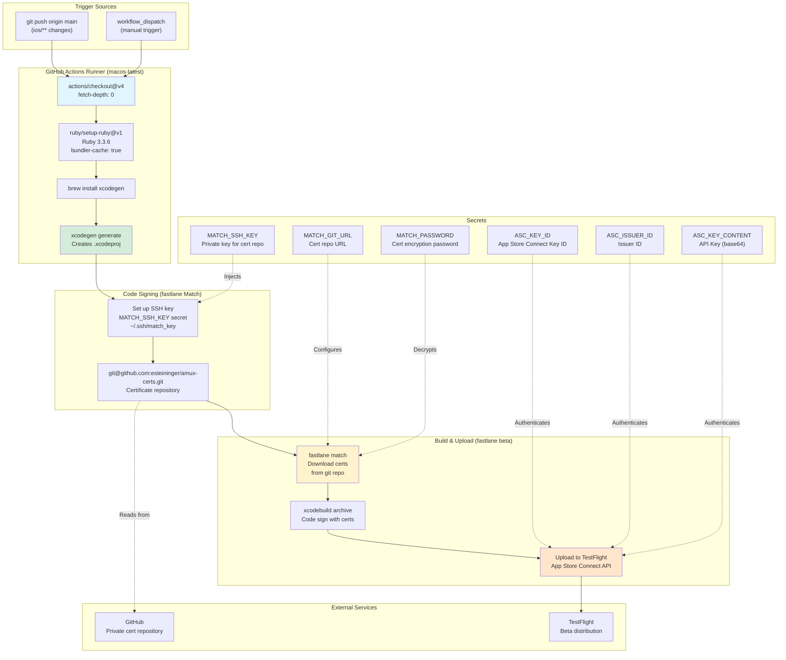
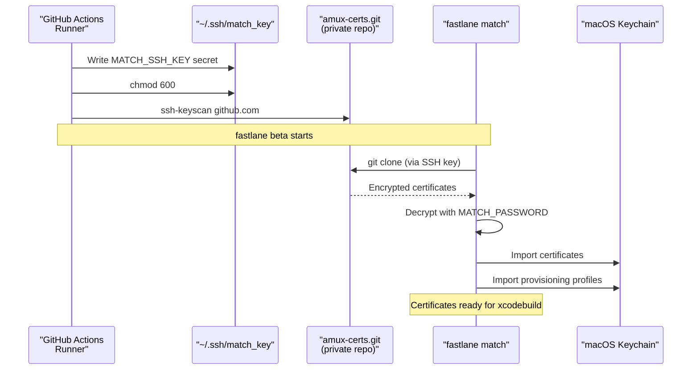
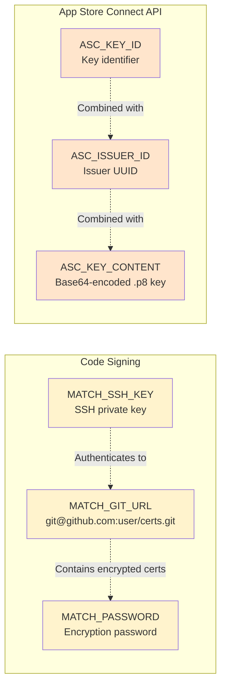
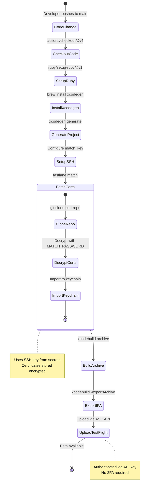

<!-- source: DeepWiki mcp.deepwiki.com · repo mixpeek/amux · page 9.3 iOS Deployment · fetched 2026-10-27 -->

# iOS Deployment

<details>
<summary>Relevant source files</summary>

The following files were used as context for generating this wiki page:

- [.github/workflows/ios.yml](.github/workflows/ios.yml)
- [ios/.ruby-version](ios/.ruby-version)
- [ios/Gemfile.lock](ios/Gemfile.lock)
- [ios/fastlane/Matchfile](ios/fastlane/Matchfile)

</details>


This document describes the automated deployment pipeline for the iOS app, including GitHub Actions workflow configuration, code signing via fastlane Match, and TestFlight distribution. The pipeline builds and uploads the app whenever iOS-related files change on the `main` branch.

For information about the iOS app's internal architecture and SwiftUI components, see [App Architecture](#9.1). For connecting the app to cloud or self-hosted servers, see [Server Configuration](#9.2).

---

## Deployment Architecture

The iOS deployment uses a fully automated GitHub Actions pipeline that triggers on changes to the `ios/` directory. The workflow executes on macOS runners to access Xcode, manages code signing certificates via fastlane Match, and uploads builds to TestFlight.



**Sources:** [.github/workflows/ios.yml:1-52]()

---

## GitHub Actions Workflow

The workflow file defines a single job that runs on `macos-latest` runners, triggered by pushes to `main` that modify files in the `ios/` directory or via manual dispatch.

### Trigger Configuration

```yaml
on:
  push:
    branches: [main]
    paths:
      - 'ios/**'
  workflow_dispatch:
```

The `paths` filter ensures the workflow only runs when iOS app files change, avoiding unnecessary builds for backend or documentation updates. The `workflow_dispatch` trigger enables manual deployment through the GitHub Actions UI.

**Sources:** [.github/workflows/ios.yml:3-8]()

### Working Directory

All workflow steps execute with `working-directory: ios`, simplifying commands and matching the local development environment structure.

**Sources:** [.github/workflows/ios.yml:13-15]()

### Build Steps Sequence

| Step | Action | Purpose |
|------|--------|---------|
| 1 | `actions/checkout@v4` | Clone repository with full history (`fetch-depth: 0`) for build number calculation |
| 2 | `ruby/setup-ruby@v1` | Install Ruby 3.3.6 with automatic Bundler dependency caching |
| 3 | `brew install xcodegen` | Install xcodegen tool for generating `.xcodeproj` from spec |
| 4 | `xcodegen generate` | Generate Xcode project file from `project.yml` configuration |
| 5 | SSH setup | Configure SSH key for accessing private certificate repository |
| 6 | `fastlane beta` | Execute beta lane: fetch certificates, build archive, upload to TestFlight |

**Sources:** [.github/workflows/ios.yml:18-51]()

---

## Code Signing with Match

The deployment uses fastlane Match for centralized code signing certificate management. This approach stores certificates and provisioning profiles in a private Git repository, encrypted with a password.

### Match Configuration

The Matchfile specifies the certificate storage location and app configuration:

```ruby
git_url ENV["MATCH_GIT_URL"] || "git@github.com:esteininger/amux-certs.git"
storage_mode "git"
type "appstore"
app_identifier "io.amux.app"
username ""
```

**Sources:** [ios/fastlane/Matchfile:1-6]()

### SSH Key Setup

The workflow configures SSH authentication to access the private certificate repository:

```yaml
- name: Set up SSH for match
  run: |
    mkdir -p ~/.ssh
    printf '%s\n' "$MATCH_SSH_KEY" > ~/.ssh/match_key
    chmod 600 ~/.ssh/match_key
    ssh-keyscan github.com >> ~/.ssh/known_hosts
    git config --global core.sshCommand "ssh -i ~/.ssh/match_key"
  env:
    MATCH_SSH_KEY: ${{ secrets.MATCH_SSH_KEY }}
```

This creates a dedicated SSH key file at `~/.ssh/match_key` with appropriate permissions (600), adds GitHub's host keys to prevent SSH prompts, and configures Git to use this key globally. The private key content is injected from the `MATCH_SSH_KEY` GitHub secret.

**Sources:** [.github/workflows/ios.yml:34-42]()

### Certificate Workflow



**Sources:** [.github/workflows/ios.yml:34-42](), [ios/fastlane/Matchfile:1-6]()

---

## Fastlane Configuration

The workflow executes the `beta` lane defined in the Fastfile, which orchestrates code signing, building, and TestFlight upload. While the Fastfile itself is not shown in the provided files, the workflow provides all necessary environment variables.

### Environment Variables

```yaml
env:
  MATCH_GIT_URL: ${{ secrets.MATCH_GIT_URL }}
  MATCH_PASSWORD: ${{ secrets.MATCH_PASSWORD }}
  APP_STORE_CONNECT_API_KEY_ID: ${{ secrets.ASC_KEY_ID }}
  APP_STORE_CONNECT_API_ISSUER_ID: ${{ secrets.ASC_ISSUER_ID }}
  APP_STORE_CONNECT_API_KEY_CONTENT: ${{ secrets.ASC_KEY_CONTENT }}
```

These environment variables configure:
- **Match**: Git repository URL and decryption password for certificates
- **App Store Connect API**: Key ID, issuer ID, and key content for authentication

**Sources:** [.github/workflows/ios.yml:46-51]()

### Build Command

The workflow invokes fastlane through Bundler to ensure version consistency:

```bash
bundle exec fastlane beta
```

This command:
1. Uses the Bundler-installed version of fastlane (specified in `Gemfile.lock`)
2. Executes the `beta` lane
3. Runs within the `ios/` working directory

**Sources:** [.github/workflows/ios.yml:45]()

---

## Build Number Generation

The workflow checks out the repository with full Git history (`fetch-depth: 0`) to enable build number calculation based on commit count. This is typically implemented in the Fastfile using:

```ruby
increment_build_number(
  build_number: sh("git rev-list --count HEAD").strip
)
```

This approach provides:
- **Monotonically increasing** build numbers
- **Deterministic** values based on Git history
- **No coordination** required between developers

**Sources:** [.github/workflows/ios.yml:18-20]()

---

## Ruby Dependencies

The project uses Ruby 3.3.6 with fastlane and its dependencies managed via Bundler. The `Gemfile.lock` specifies exact versions, ensuring reproducible builds.

### Key Dependencies

| Gem | Version | Purpose |
|-----|---------|---------|
| `fastlane` | 2.232.2 | Automation tool for iOS deployments |
| `xcodeproj` | 1.27.0 | Xcode project manipulation |
| `xcodegen` | (via brew) | Generate `.xcodeproj` from YAML spec |
| `google-cloud-storage` | 1.58.0 | Cloud storage integration (optional) |
| `aws-sdk-s3` | 1.215.0 | S3 integration (optional) |

**Sources:** [ios/Gemfile.lock:1-338](), [ios/.ruby-version:1]()

### Bundler Caching

The workflow enables Bundler caching to speed up builds:

```yaml
- uses: ruby/setup-ruby@v1
  with:
    ruby-version: '3.3.6'
    bundler-cache: true
    working-directory: ios
```

This caches installed gems between workflow runs, reducing build time from several minutes to under 30 seconds for dependency installation.

**Sources:** [.github/workflows/ios.yml:22-26]()

---

## Prerequisites & Secrets

The deployment pipeline requires seven GitHub secrets to be configured in the repository settings:

### Required Secrets



### Secret Details

**MATCH_SSH_KEY**: Private SSH key with read access to the certificate repository. Generate with:
```bash
ssh-keygen -t ed25519 -C "github-actions-match"
# Add public key to certificate repo deploy keys
```

**MATCH_GIT_URL**: SSH URL of private repository storing encrypted certificates. Example: `git@github.com:esteininger/amux-certs.git`

**MATCH_PASSWORD**: Password used to encrypt/decrypt certificates in the Match repository. Use a strong passphrase generated with:
```bash
openssl rand -base64 32
```

**ASC_KEY_ID**: App Store Connect API Key ID from [App Store Connect → Users and Access → Keys](). Example: `ABCD1234EF`

**ASC_ISSUER_ID**: Issuer ID (UUID) associated with the API key. Example: `12345678-1234-1234-1234-123456789012`

**ASC_KEY_CONTENT**: Base64-encoded content of the `.p8` API key file:
```bash
cat AuthKey_ABCD1234EF.p8 | base64
```

**Sources:** [.github/workflows/ios.yml:34-51](), [ios/fastlane/Matchfile:1-6]()

---

## Manual Deployment

While the workflow runs automatically on push, you can also trigger deployments manually through the GitHub Actions UI.

### Manual Trigger Steps

1. Navigate to **Actions** tab in GitHub repository
2. Select **iOS — Build & TestFlight** workflow
3. Click **Run workflow** button
4. Select `main` branch
5. Click **Run workflow** to start

This is useful for:
- **Redeploying** without code changes
- **Testing** workflow modifications
- **Emergency releases** outside the normal push cycle

**Sources:** [.github/workflows/ios.yml:8]()

### Local Testing

Developers can test the fastlane configuration locally before pushing:

```bash
cd ios
bundle install
xcodegen generate
bundle exec fastlane beta
```

This requires:
- Local Xcode installation
- Access to the certificate repository (via SSH)
- Environment variables set in shell or `.env` file

---

## Xcodegen Integration

The workflow uses xcodegen to generate the Xcode project file from a YAML specification. This keeps the project configuration in a more readable, mergeable format.

### Project Generation

```bash
brew install xcodegen || true
xcodegen generate
```

The `|| true` prevents workflow failure if xcodegen is already installed. The `generate` command reads `project.yml` (not shown in provided files) and creates `amux.xcodeproj`.

**Benefits:**
- **Readable diffs** in version control (YAML vs XML)
- **Automated** project file management
- **Conflict-free** collaboration on project settings

**Sources:** [.github/workflows/ios.yml:28-32]()

---

## Deployment Flow Summary

The complete deployment process follows this sequence:



**Key characteristics:**
- **Fully automated**: No manual intervention required
- **Secured**: Certificates encrypted, API keys in secrets
- **Versioned**: Build numbers tied to Git commit count
- **Cached**: Ruby gems and certificates cached between runs

**Sources:** [.github/workflows/ios.yml:1-52](), [ios/fastlane/Matchfile:1-6](), [ios/.ruby-version:1]()

---

