# Page: Overview

# Overview

<details>
<summary>Relevant source files</summary>

The following files were used as context for generating this wiki page:

- [README.md](README.md)
- [amux-server.py](amux-server.py)
- [cloud/gateway/gateway.py](cloud/gateway/gateway.py)
- [site/llms.txt](site/llms.txt)
- [site/sitemap.xml](site/sitemap.xml)
- [test.mjs](test.mjs)

</details>


## Purpose and Scope

This document provides a high-level architectural overview of **amux**, an open-source Claude Code agent multiplexer. It explains the system's core components, deployment modes, and how they interact to enable parallel AI coding agents with self-healing, orchestration, and mobile management capabilities.

For installation and first-time setup, see [Quick Start](#1.1). For detailed server internals, see [Core Server](#2). For cloud deployment architecture, see [Cloud Deployment](#4).

---

## What is amux?

amux is a Python-based system that runs multiple Claude Code sessions in parallel, each isolated in its own tmux pane. It provides:

- **Session multiplexing** via tmux, with persistent UUIDs that survive stop/start cycles
- **Web dashboard** (mobile-first PWA) for monitoring and controlling sessions
- **Self-healing watchdog** that auto-compacts context, restarts on corruption, and replays messages
- **SQLite-backed kanban board** with atomic task claiming for agent coordination
- **REST API** for agent-to-agent orchestration (send messages, peek output, claim tasks)
- **Two deployment modes**: local OSS (single-user) and cloud (multi-tenant with Docker)

Sources: [README.md:1-219](), [amux-server.py:1-10]()

---

## Core Components

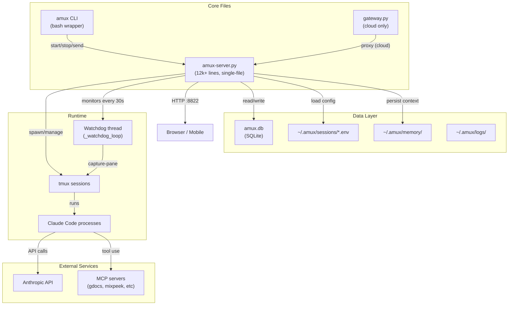

**Key Code Entities:**

| Component | File | Primary Functions |
|-----------|------|-------------------|
| HTTP Server | [amux-server.py:21-24]() | `ThreadingHTTPServer`, `Handler` class |
| Session Manager | [amux-server.py:49-63]() | `CC_SESSIONS`, `CC_LOGS`, `CC_MEMORY` paths |
| Database | [amux-server.py:14]() | `sqlite3` module, `amux.db` file |
| Watchdog | [amux-server.py:188-196]() | `_watchdog_loop()`, `_session_auto_actions` dict |
| Gateway | [cloud/gateway/gateway.py:1-728]() | `Handler` class, Docker orchestration |

Sources: [amux-server.py:1-96](), [cloud/gateway/gateway.py:1-10](), [README.md:42-43]()

---

## Deployment Modes

amux supports two distinct deployment architectures:

### Local OSS Deployment

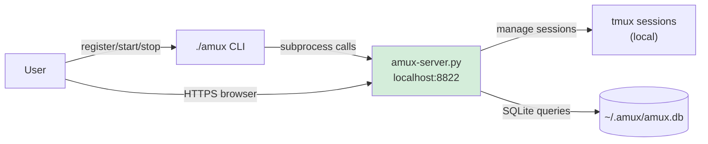

- **Single-user**, runs on localhost (or Tailscale network)
- All data stored in `~/.amux/` directory
- Auto-generates TLS certificate (Tailscale → mkcert → self-signed)
- No authentication by default

**Entry points:**
- CLI: `./amux` bash wrapper → `amux-server.py` subprocess calls
- Web: Direct connection to `https://localhost:8822`

Sources: [README.md:109-151](), [amux-server.py:36-48]()

### Cloud Multi-Tenant Deployment

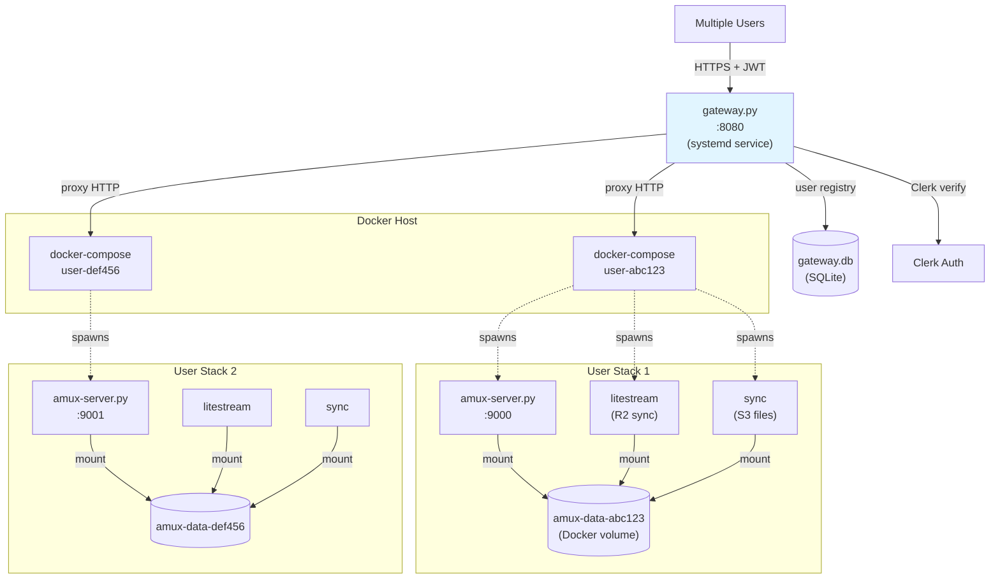

- **Multi-tenant** with per-user Docker containers
- `gateway.py` orchestrates container lifecycle
- Each user gets 3 containers: `amux`, `litestream`, `sync`
- Clerk JWT authentication via `Authorization: Bearer` header or session cookies
- Idle reaper stops containers after 3600s of inactivity

**Key functions:**
- User allocation: `alloc_port()` [cloud/gateway/gateway.py:204-209]()
- Container start: `start_container()` [cloud/gateway/gateway.py:261-271]()
- Proxy: `proxy()` [cloud/gateway/gateway.py:397-457]()
- JWT verification: `verify_clerk_token()` [cloud/gateway/gateway.py:335-347]()

Sources: [cloud/gateway/gateway.py:1-457](), [Diagram 2]()

---

## Request Flow: Browser to Agent

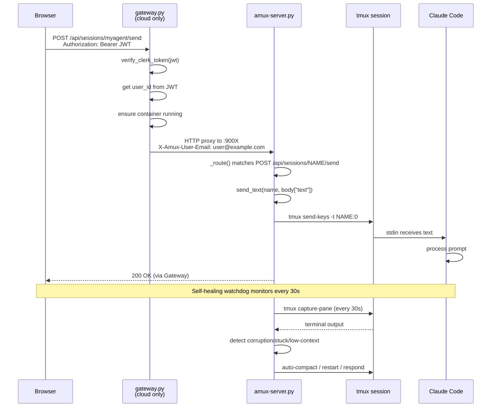

**Code Path for `POST /api/sessions/NAME/send`:**

1. Request hits `Handler.do_POST()` [amux-server.py:21]()
2. Routed by `_route()` pattern matching [amux-server.py:129-186]()
3. Calls `send_text()` function [amux-server.py reference]
4. Uses `subprocess.run(["tmux", "send-keys", ...])` to inject into session
5. Watchdog `_watchdog_loop()` monitors output every 30s [amux-server.py:188-196]()

Sources: [amux-server.py:129-186](), [cloud/gateway/gateway.py:397-457](), [Diagram 4]()

---

## Data Storage

amux uses a flat-file architecture with SQLite for structured data:

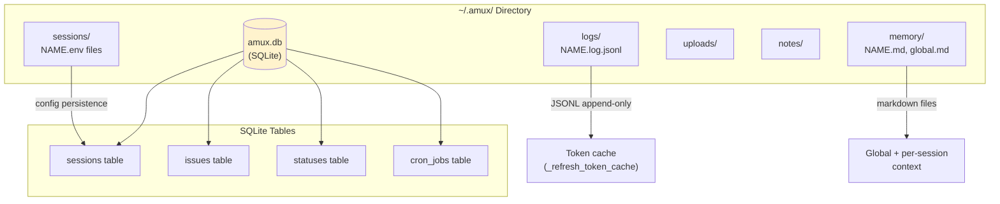

**Key Paths:**

| Directory | Purpose | File Format |
|-----------|---------|-------------|
| `~/.amux/sessions/` | Session config persistence | `.env` files with `CC_DIR`, `CC_MODEL`, etc |
| `~/.amux/logs/` | Token tracking, message replay | `.log.jsonl` (one line per API call) |
| `~/.amux/memory/` | Agent context files | Markdown (`.md`) |
| `~/.amux/amux.db` | Board, statuses, cron | SQLite database |

**Database Schema:**

- `sessions` table: `(name, uuid, dir, model, created_at)`
- `issues` table: `(id, title, desc, status, session, due, created_at, deleted)`
- `statuses` table: `(id, label, color, position, created_at)`
- `cron_jobs` table: `(id, session, cron_expr, action, last_fire, next_fire)`

Sources: [amux-server.py:29-63](), [amux-server.py:786-802]()

---

## Key Subsystems

amux's functionality is divided into distinct subsystems, each documented in detail on separate wiki pages:

### Session Management ([#2.1](#2.1))

- **Purpose:** Create, start, stop, and persist Claude Code sessions via tmux
- **Key mechanism:** Each session has a UUID stored in `~/.amux/sessions/NAME.env`, survives stop/start
- **Code:** `CC_SESSIONS` path [amux-server.py:50](), tmux integration via `subprocess.run()`

### Board System ([#2.2](#2.2))

- **Purpose:** SQLite-backed kanban board with atomic task claiming
- **Key mechanism:** CAS (Compare-And-Swap) via `UPDATE ... WHERE status='todo'` queries
- **Code:** `issues` and `statuses` tables in `amux.db`

### Memory System ([#2.3](#2.3))

- **Purpose:** Per-session and global markdown files for persistent context
- **Key mechanism:** Files in `~/.amux/memory/` injected into Claude Code via `MEMORY` env var
- **Code:** `CC_MEMORY` path [amux-server.py:52](), `/api/memory/*` endpoints

### Self-Healing Watchdog ([#2.4](#2.4))

- **Purpose:** Auto-recovery from context exhaustion, corruption, and stuck prompts
- **Key mechanism:** 30-second polling loop that captures tmux output, detects failure patterns
- **Code:** `_watchdog_loop()` function, `_session_auto_actions` dict [amux-server.py:188-196]()

### Event System & Logging ([#2.5](#2.5))

- **Purpose:** Structured event log (ring buffer), SSE streaming, server logs
- **Key mechanism:** In-memory `_event_log` deque (2000 max), SSE endpoint at `/api/events`
- **Code:** `_emit_event()`, `_event_log` [amux-server.py:104-127]()

### REST API ([#5](#5))

- **Purpose:** Complete HTTP API for sessions, board, memory, orchestration
- **Base URL:** `http://localhost:8822` (local) or `https://cloud.amux.io` (cloud)
- **Authentication:** None (local), Clerk JWT (cloud)
- **Key endpoints:** `/api/sessions`, `/api/board`, `/api/memory/global`, `/api/sync`

Sources: [amux-server.py:49-63](), [amux-server.py:104-196](), [Table of contents]()

---

## Technology Stack

| Layer | Technology | Usage |
|-------|-----------|-------|
| **Core Language** | Python 3 | `amux-server.py` (~12k lines) |
| **HTTP Server** | `http.server.ThreadingHTTPServer` | [amux-server.py:21]() |
| **Session Isolation** | tmux | Each agent in its own tmux pane |
| **Database** | SQLite 3 | Board, sessions, cron (WAL mode) |
| **Agent Runtime** | Claude Code | Spawned via `subprocess.Popen()` |
| **Cloud Auth** | Clerk | JWT verification via `PyJWT` |
| **Cloud Orchestration** | Docker Compose | Per-user 3-container stacks |
| **DB Replication** | Litestream | Continuous backup to Cloudflare R2 |
| **File Sync** | AWS CLI | S3 sync for `~/.amux/` flat files |
| **Web UI** | Inline HTML/CSS/JS | Embedded in `amux-server.py` |
| **PWA** | Service Worker | Offline support, Background Sync |

**No external dependencies required for local OSS deployment** — only `python3` and `tmux`.

Sources: [amux-server.py:1-24](), [cloud/gateway/gateway.py:1-10](), [README.md:111-112]()

---

## Design Principles

### Single-File Architecture

The entire local server is contained in `amux-server.py` (~12k lines), with inline HTML/CSS/JS. This enables:

- Zero build step
- Edit-and-restart workflow (file mtime triggers reload)
- Easy debugging (search codebase for function names)
- Version control friendly (one file, one git history)

Enforced by `CLAUDE.md` rules: *"The single-file architecture (inline HTML/CSS/JS in amux-server.py) is non-negotiable."*

Sources: [amux-server.py:1-10](), [README.md:42]()

### Stateless Session Coordination

Sessions don't share memory or communicate directly. Coordination happens via:

1. **SQLite atomic claims:** `UPDATE issues SET status='doing' WHERE id=? AND status='todo'`
2. **REST API:** Agents call `POST /api/sessions/OTHER/send` to delegate work
3. **Global memory:** `~/.amux/memory/global.md` accessible to all sessions

This enables truly parallel agents without race conditions.

Sources: [Diagram 4](), [README.md:62-78]()

### Cloud-Local Parity

The same `amux-server.py` runs in both deployments without modification. Differentiation via:

- **Environment variables:** `ANTHROPIC_API_KEY`, `CC_HOME`, etc.
- **HTTP headers:** `X-Amux-User-Email` injected by gateway

Hot reload in cloud: Touch `amux-server.py` on host → all containers reload via bind mount.

Sources: [Diagram 1](), [Diagram 6](), [amux-server.py:36-47]()

---

## Next Steps

- **[Quick Start](#1.1)** — Install amux and run your first session
- **[Architecture Diagram](#1.2)** — Visual breakdown of system topology
- **[Core Server](#2)** — Deep dive into `amux-server.py` internals
- **[Gateway & Multi-Tenancy](#3)** — Cloud deployment with `gateway.py`
- **[REST API Reference](#5)** — Complete endpoint documentation

Sources: [Table of contents]()

---

# Page: Quick Start

# Quick Start

<details>
<summary>Relevant source files</summary>

The following files were used as context for generating this wiki page:

- [README.md](README.md)
- [amux](amux)
- [cloud/setup.sh](cloud/setup.sh)

</details>


This guide walks through installing amux and running your first Claude Code session. It covers installation, session registration, starting agents, and accessing the web dashboard. For detailed API usage, see [REST API Reference](#5). For cloud deployment, see [Cloud Deployment](#4).

---

## Prerequisites

amux requires:
- **tmux** — session multiplexer for managing Claude Code instances
- **python3** — runtime for the web dashboard server
- **Node.js 22+** — required by Claude Code CLI

Install on macOS:
```bash
brew install tmux python3 node
```

Install on Ubuntu/Debian:
```bash
apt-get install tmux python3 nodejs npm
```

**Sources:** [README.md:109-116](), [cloud/setup.sh:14-27]()

---

## Installation

### Install amux

```bash
git clone https://github.com/mixpeek/amux && cd amux
./install.sh
```

The install script:
1. Copies the `amux` CLI to `/usr/local/bin/amux`
2. Creates symlink `cc` → `amux` for legacy compatibility
3. Makes scripts executable

**Sources:** [README.md:109-116](), [amux:1-8]()

---

### Install Claude Code CLI

```bash
npm install -g @anthropic-ai/claude-code
```

Verify installation:
```bash
claude --version
```

**Sources:** [cloud/setup.sh:72-76]()

---

## Directory Structure

After installation, amux creates `~/.amux/`:

```
~/.amux/
├── sessions/           # Session configuration files (*.env)
├── defaults.env        # Global default flags
├── tls/               # Auto-generated HTTPS certificates
├── logs/              # Server logs
├── memory/            # Global memory shared across agents
├── board/             # SQLite board database
└── playwright-auth/   # Persistent browser auth profiles
```

**Directory Structure Initialization**

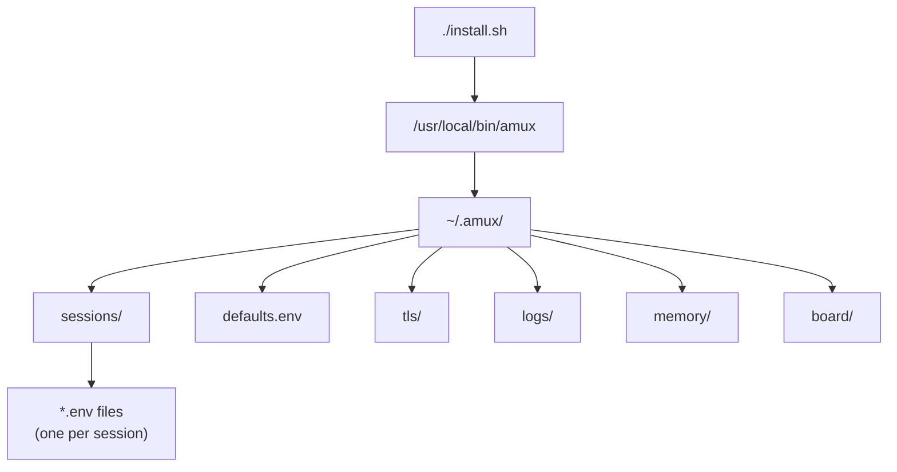

**Sources:** [amux:10-23](), [amux:42-45](), [cloud/setup.sh:56-61]()

---

## Register Your First Session

Create a session configuration:

```bash
amux register myproject --dir ~/Dev/myproject --yolo
```

### Common Flags

| Flag | Purpose |
|------|---------|
| `--dir <path>` | Working directory for Claude Code |
| `--yolo` | Skip permission checks (alias for `--dangerously-skip-permissions`) |
| `--model opus` | Use Claude Opus (default: Sonnet) |
| `--model haiku` | Use Claude Haiku |
| `--mcp-config <path>` | Custom MCP server configuration |

### What Gets Created

The `register` command creates `~/.amux/sessions/myproject.env`:

```bash
# amux session: myproject
# registered: 2024-01-15T10:30:00-08:00
CC_NAME="myproject"
CC_DIR="/Users/you/Dev/myproject"
CC_FLAGS="--dangerously-skip-permissions"
```

**Sources:** [amux:168-186](), [README.md:94-106]()

---

## Start a Session

```bash
amux start myproject
```

This command:
1. Loads session config from `~/.amux/sessions/myproject.env`
2. Creates tmux session named `amux-myproject`
3. Launches `claude` CLI with configured flags in the working directory
4. Attaches to the session

**Session Startup Flow**

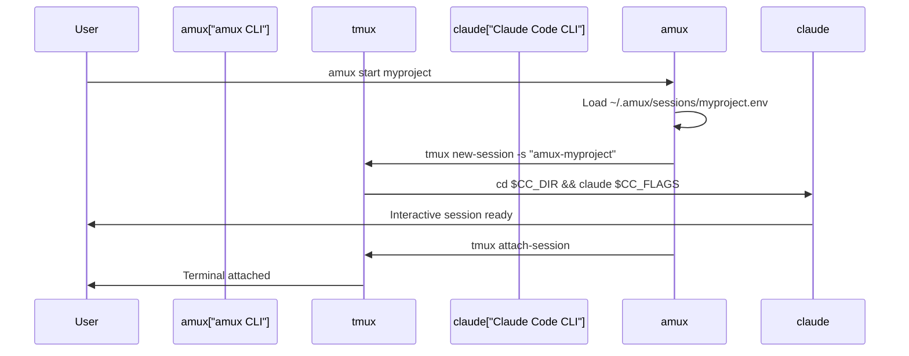

**Sources:** [amux:188-234]()

---

## Detach and Reattach

### Detach Without Stopping

While attached to a session, press:
```
Ctrl-b d
```

This detaches from tmux but leaves Claude running in the background.

### Reattach Later

```bash
amux attach myproject
```

Or use fuzzy matching:
```bash
amux attach my    # Matches "myproject" if unambiguous
```

**Sources:** [amux:258-266]()

---

## View Output Without Attaching

```bash
amux peek myproject
```

Shows last 30 lines of output. Specify line count:

```bash
amux peek myproject 100
```

**Sources:** [amux:268-281]()

---

## Send Commands to Sessions

```bash
amux send myproject "implement user authentication"
```

Sends text + Enter to the session. Use `--keys` for raw key sequences:

```bash
amux send myproject --keys 'C-c'  # Send Ctrl-C
```

**Sources:** [amux:283-304]()

---

## Start the Web Dashboard

```bash
amux serve
```

Opens at `https://localhost:8822` (auto-generated TLS certificate).

**Web Dashboard Architecture**

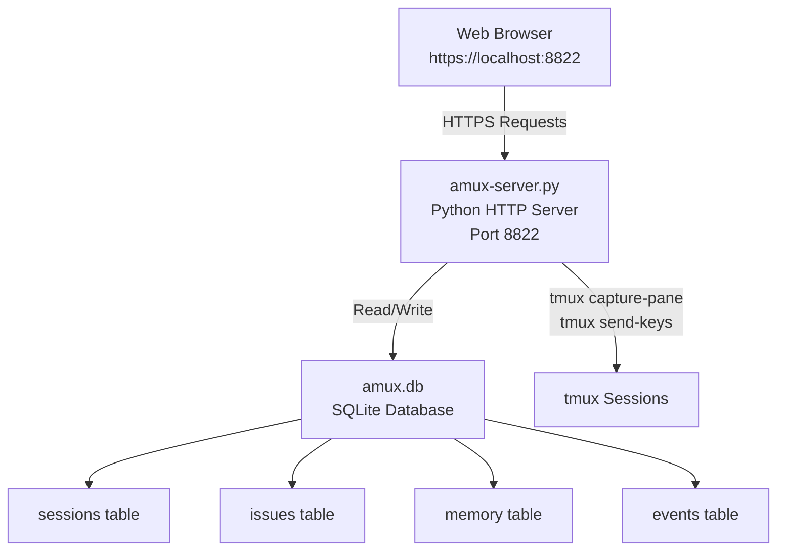

The dashboard provides:
- **Session cards** with live status (working/idle/needs input)
- **Peek mode** to view terminal output in browser
- **Board view** with drag-and-drop Kanban
- **Token tracking** per session
- **File explorer** for workspace files

For detailed dashboard features, see [Web Dashboard](#6).

**Sources:** [amux:635-646](), [README.md:81-88]()

---

## HTTPS Certificate Setup

amux auto-generates TLS certificates in priority order:

1. **Tailscale** — if connected, uses Tailscale cert for `*.ts.net` domain
2. **mkcert** — if installed, generates locally-trusted cert
3. **Self-signed** — fallback, requires browser trust warning bypass

### Tailscale Setup (Recommended for Phone Access)

```bash
# Install Tailscale
curl -fsSL https://tailscale.com/install.sh | sh

# Connect to your network
tailscale up

# Get your Tailscale hostname
tailscale status
```

Then access dashboard at `https://your-machine.ts.net:8822` from any device on your Tailscale network.

**Certificate Priority Flow**

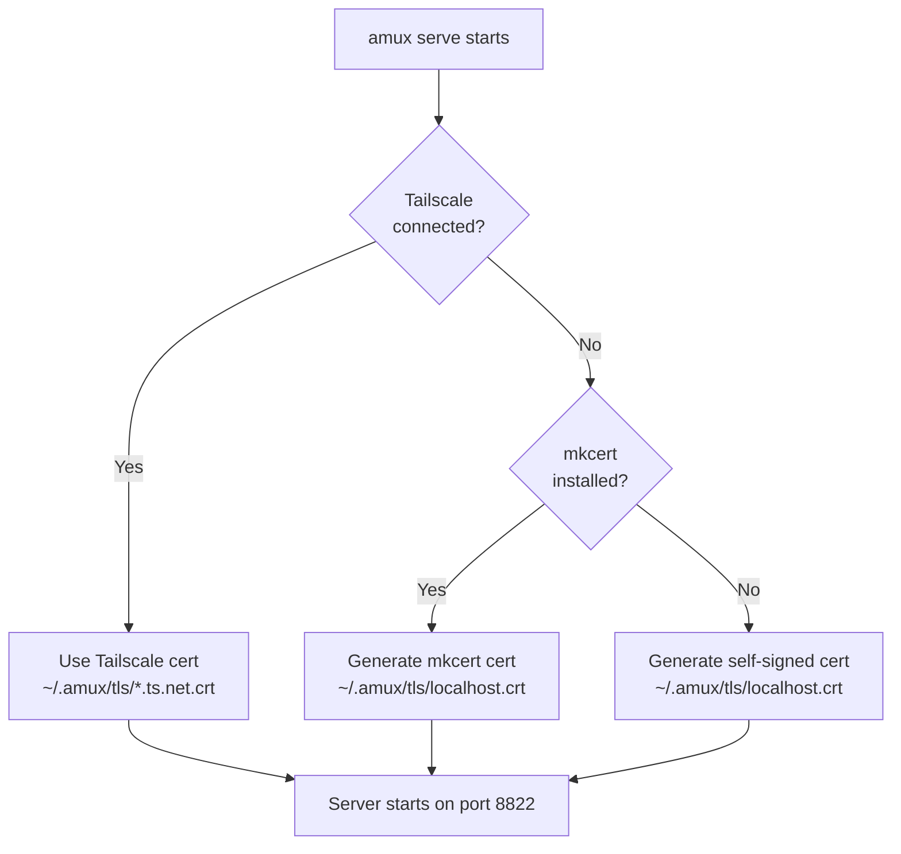

**Sources:** [README.md:118-120](), [cloud/setup.sh:64-70]()

---

## List Sessions

```bash
amux ls
```

Example output:
```
 1* myproject        ~/Dev/myproject YOLO sonnet
 2* api-server       ~/Dev/api       opus │ Waiting for input...
 3  frontend         ~/Dev/frontend  
```

Legend:
- `*` = running
- `YOLO` = `--dangerously-skip-permissions` enabled
- Model name displayed if non-default
- Last line of output shown if running

**Sources:** [amux:349-394]()

---

## Interactive Dashboard (CLI)

Run `amux` with no arguments for an interactive TUI:

```bash
amux
```

**Interactive Dashboard Commands:**

| Input | Action |
|-------|--------|
| `<number>` | Attach to session by number |
| `p<number>` | Peek session by number (e.g., `p1`) |
| `s<number> <text>` | Send text to session (e.g., `s1 fix bug`) |
| `ls` | Refresh session list |
| `q` | Quit |

**Sources:** [amux:396-456]()

---

## Stop a Session

```bash
amux stop myproject
```

Kills the tmux session. Session config remains in `~/.amux/sessions/`, so you can restart later.

**Sources:** [amux:306-319]()

---

## Remove a Session

```bash
amux rm myproject
```

Stops the session (if running) and deletes the config file.

**Sources:** [amux:321-332]()

---

## Common Workflows

### Single Session Development

```bash
# Register and start
amux register api --dir ~/Dev/api --model opus --yolo
amux start api

# Later: view output without attaching
amux peek api 50

# Send a command
amux send api "add error handling to login endpoint"

# Stop when done
amux stop api
```

### Multi-Agent Parallel Development

```bash
# Register multiple sessions
amux register backend --dir ~/Dev/api --yolo
amux register frontend --dir ~/Dev/web --yolo
amux register tests --dir ~/Dev/tests --yolo

# Start all
amux start backend
amux start frontend
amux start tests

# Monitor via web dashboard
amux serve
```

Open `https://localhost:8822` to view all sessions in real-time.

For agent orchestration patterns, see [Agent Orchestration Patterns](#12).

**Sources:** [README.md:9-14](), [README.md:169-180]()

---

## CLI to tmux to Claude Mapping

**Component Relationships**

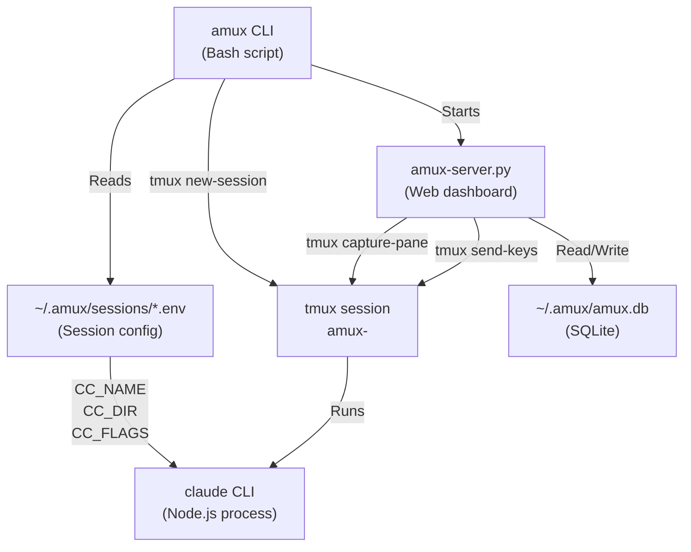

**Sources:** [amux:1-752]()

---

## Next Steps

- **Configure integrations:** See [MCP Server Configuration](#8.1) for Google Docs, browser automation, and custom tools
- **Run multiple agents:** See [Running 10+ agents in parallel](https://amux.io/guides/running-10-plus-agents/)
- **Self-healing setup:** See [Self-Healing Watchdog](#2.4) for auto-recovery configuration
- **Cloud deployment:** See [Cloud Deployment](#4) for multi-tenant hosting
- **API automation:** See [REST API Reference](#5) for programmatic control

**Sources:** [README.md:200-213]()

---

# Page: Architecture Diagram

# Architecture Diagram

<details>
<summary>Relevant source files</summary>

The following files were used as context for generating this wiki page:

- [.github/workflows/backup-cloud.yml](.github/workflows/backup-cloud.yml)
- [.github/workflows/deploy-cloud.yml](.github/workflows/deploy-cloud.yml)
- [amux](amux)
- [amux-server.py](amux-server.py)
- [cloud/docker/docker-compose.template.yml](cloud/docker/docker-compose.template.yml)
- [cloud/gateway/gateway.py](cloud/gateway/gateway.py)
- [cloud/setup.sh](cloud/setup.sh)
- [templates/README.md](templates/README.md)
- [templates/content-creator/CLAUDE.md](templates/content-creator/CLAUDE.md)
- [templates/content-creator/template.json](templates/content-creator/template.json)
- [templates/fitness-tracker/CLAUDE.md](templates/fitness-tracker/CLAUDE.md)
- [test.mjs](test.mjs)

</details>


This page presents the high-level system architecture of amux, showing the two deployment modes (local OSS and cloud multi-tenant) and how core components interact. For detailed information about the core server implementation, see [Core Server (amux-server.py)](#2). For cloud-specific orchestration details, see [Gateway & Multi-Tenancy](#3).

---

## Deployment Modes

amux supports two deployment architectures that share the same codebase:

| Mode | Entry Point | Use Case | Key Components |
|------|-------------|----------|----------------|
| **Local OSS** | `./amux serve` | Individual developers running on localhost or Tailscale | `amux-server.py` on port 8822, local tmux sessions, self-signed TLS |
| **Cloud Multi-Tenant** | `cloud.amux.io` | Multiple users with isolated containers | `gateway.py` + per-user Docker containers running `amux-server.py`, Clerk auth, R2/S3 backups |

The same `amux-server.py` file ([amux-server.py:1-2050]()) runs in both modes without modification, enforced by development rules in `CLAUDE.md`. Differentiation occurs through environment variables and HTTP headers.

**Sources:** [amux-server.py:1-97](), [cloud/gateway/gateway.py:1-11](), [amux:1-20]()

---

## Local Deployment Architecture

### Diagram: Local OSS Components

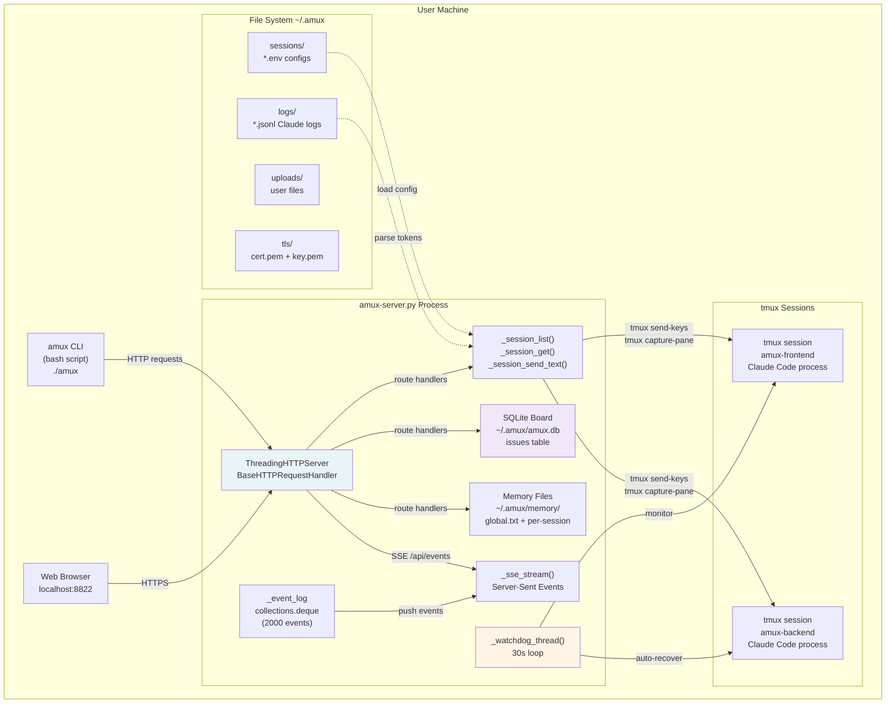

### Key Components

| Component | Location | Purpose |
|-----------|----------|---------|
| `ThreadingHTTPServer` | [amux-server.py:21]() | HTTP server handling concurrent requests |
| `_session_list()` | [amux-server.py:1129-1245]() | Enumerates tmux sessions, parses Claude JSONL logs for token counts |
| `_session_send_text()` | [amux-server.py:1313-1370]() | Sends messages to Claude via `tmux send-keys` |
| `amux.db` | [amux-server.py:1618-1642]() | SQLite database storing board issues, statuses, notes |
| `_watchdog_thread()` | [amux-server.py:1805-1988]() | 30-second monitoring loop for auto-recovery (context exhaustion, corruption detection) |
| `_event_log` | [amux-server.py:106-127]() | In-memory ring buffer (2000 events) for structured logging |
| `CC_SESSIONS` | [amux-server.py:50]() | Directory `~/.amux/sessions/` storing session configs as `.env` files |

**Sources:** [amux-server.py:1-80](), [amux-server.py:1129-1370](), [amux-server.py:1618-1988]()

---

## Cloud Multi-Tenant Architecture

### Diagram: Cloud Gateway + Container Orchestration

```mermaid
graph TB
    subgraph "Internet"
        Users["Multiple Users<br/>web + mobile clients"]
    end
    
    subgraph "Gateway VM (5.161.66.217)"
        Gateway["gateway.py<br/>HTTPServer<br/>Port 8080"]
        GatewayDB[("gateway.db<br/>SQLite<br/>users table<br/>org_invites table")]
        ClerkVerify["verify_clerk_token()<br/>JWT validation"]
        ContainerOps["start_container()<br/>stop_container()<br/>_write_compose()"]
        IdleReaper["_reaper() thread<br/>60s loop<br/>stop idle containers"]
        ProxyFn["proxy() helper<br/>urllib.request"]
    end
    
    subgraph "Docker Host"
        subgraph "User ABC123 Stack"
            DC1["docker-compose.yml<br/>from template"]
            AmuxC1["amux container<br/>amux-user-abc123<br/>port 9000"]
            LiteC1["litestream container<br/>replicate to R2"]
            SyncC1["sync container<br/>aws s3 sync"]
            Vol1[("amux-data-abc123<br/>Docker volume")]
        end
        
        subgraph "User DEF456 Stack"
            DC2["docker-compose.yml<br/>from template"]
            AmuxC2["amux container<br/>amux-user-def456<br/>port 9001"]
            Vol2[("amux-data-def456<br/>Docker volume")]
        end
        
        SharedMount["/opt/amux-cloud/app/<br/>amux-server.py<br/>bind-mounted read-only"]
    end
    
    subgraph "Cloudflare R2"
        R2Bucket["amux-cloud-users<br/>users/USER_ID/db/<br/>users/USER_ID/files/"]
    end
    
    Users -->|HTTPS + JWT| Gateway
    Gateway -->|verify| ClerkVerify
    Gateway -->|query/update| GatewayDB
    Gateway -.->|alloc_port()<br/>_write_compose()| ContainerOps
    ContainerOps -->|docker compose up| DC1
    ContainerOps -->|docker compose up| DC2
    Gateway -->|proxy() requests| AmuxC1
    Gateway -->|proxy() requests| AmuxC2
    IdleReaper -.->|docker compose stop| DC1
    IdleReaper -.->|after 3600s idle| DC2
    
    SharedMount -.->|bind mount :ro| AmuxC1
    SharedMount -.->|bind mount :ro| AmuxC2
    
    DC1 -->|spawns| AmuxC1
    DC1 -->|spawns| LiteC1
    DC1 -->|spawns| SyncC1
    AmuxC1 -->|writes| Vol1
    LiteC1 -->|reads| Vol1
    SyncC1 -->|reads| Vol1
    
    LiteC1 -->|replicate DB| R2Bucket
    SyncC1 -->|sync files| R2Bucket
    
    style Gateway fill:#ffe8e8
    style GatewayDB fill:#f0e8f8
    style AmuxC1 fill:#e8f4f8
    style AmuxC2 fill:#e8f4f8
```

### Gateway Components

| Component | Location | Purpose |
|-----------|----------|---------|
| `gateway.py` | [cloud/gateway/gateway.py:1-890]() | Authenticates users, allocates ports, orchestrates Docker containers |
| `verify_clerk_token()` | [cloud/gateway/gateway.py:335-347]() | Validates Clerk JWT using cached JWKS, returns `(user_id, email)` |
| `gateway.db` | [cloud/gateway/gateway.py:26](), [cloud/gateway/gateway.py:165-201]() | SQLite database storing user records, org invites, org members |
| `alloc_port()` | [cloud/gateway/gateway.py:204-209]() | Allocates next available port starting from `PORT_BASE=9000` |
| `_write_compose()` | [cloud/gateway/gateway.py:217-231]() | Generates per-user `docker-compose.yml` from template with variable substitution |
| `start_container()` | [cloud/gateway/gateway.py:261-271]() | Runs `docker compose up -d`, waits for health check, restores files from R2 |
| `_reaper()` | [cloud/gateway/gateway.py:377-393]() | Background thread stopping idle containers after `IDLE_SECONDS=3600` |
| `proxy()` | [cloud/gateway/gateway.py:397-457]() | Forwards HTTP requests to user container, handles SSE streaming with last_seen refresh |

**Sources:** [cloud/gateway/gateway.py:1-457](), [cloud/docker/docker-compose.template.yml:1-71]()

---

## Docker Container Architecture

### Diagram: Per-User Three-Container Stack

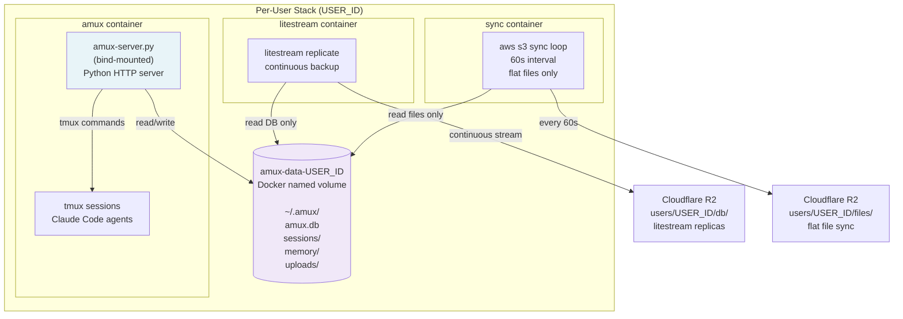

### Container Details

| Container | Image | Purpose | Config |
|-----------|-------|---------|--------|
| `amux` | `ghcr.io/mixpeek/amux:latest` | Runs `amux-server.py`, manages tmux sessions | [cloud/docker/docker-compose.template.yml:5-27]() |
| `litestream` | `litestream/litestream:latest` | Continuously replicates `amux.db` to R2 | [cloud/docker/docker-compose.template.yml:29-43]() |
| `sync` | `amazon/aws-cli:latest` | Syncs flat files (`sessions/`, `memory/`, `uploads/`) to R2 every 60 seconds | [cloud/docker/docker-compose.template.yml:45-64]() |

**Key Architectural Decision:** All user containers bind-mount the same `amux-server.py` from `/opt/amux-cloud/app/` read-only. This enables zero-downtime updates: deploying a new `amux-server.py` to the host immediately affects all running containers on their next auto-restart.

**Sources:** [cloud/docker/docker-compose.template.yml:1-71](), [.github/workflows/deploy-cloud.yml:26-33]()

---

## Core Data Flow

### Diagram: Session, Board, and Memory Interactions

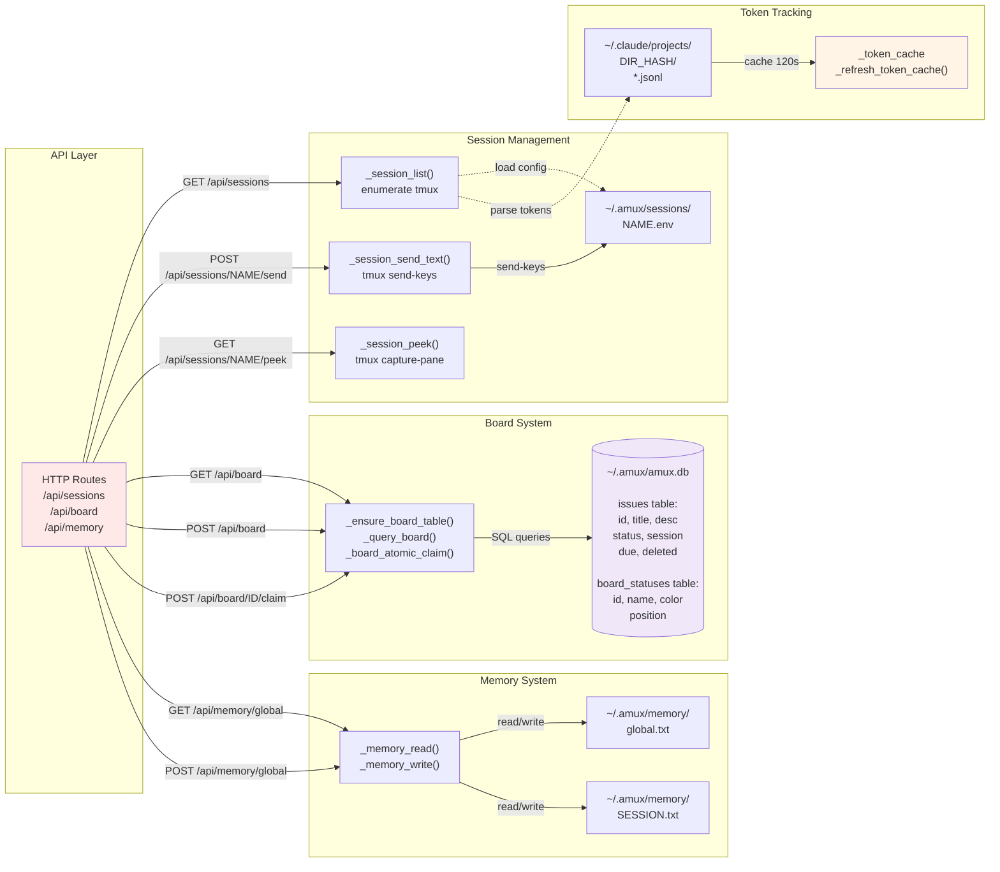

### Data Locations

| Data Type | Storage Location | Format | Access Pattern |
|-----------|------------------|--------|----------------|
| Session configs | `~/.amux/sessions/NAME.env` | Shell env vars | Read on session start, list endpoints |
| Board issues | `~/.amux/amux.db` → `issues` table | SQLite with tombstones | Full scan for list, indexed by `id` for updates |
| Board statuses | `~/.amux/amux.db` → `board_statuses` table | SQLite | Read-heavy, cached in frontend |
| Memory (global) | `~/.amux/memory/global.txt` | Plain text | Read/write via API |
| Memory (session) | `~/.amux/memory/SESSION.txt` | Plain text | Read/write via API |
| Token counts | `~/.claude/projects/HASH/*.jsonl` | JSONL (Claude format) | Tail scan, cached 120s |
| Uploads | `~/.amux/uploads/` | Binary files | Write once, read via `/api/uploads/FILENAME` |

**Sources:** [amux-server.py:49-64](), [amux-server.py:789-802](), [amux-server.py:1129-1245](), [amux-server.py:1618-1723]()

---

## Request Flow: Cloud vs Local

### Cloud Request Flow

1. User → `https://cloud.amux.io/api/sessions` with `Authorization: Bearer <JWT>`
2. `gateway.py` receives request on port 8080
3. `verify_clerk_token()` validates JWT ([cloud/gateway/gateway.py:335-347]())
4. `gateway.db` queried for user record, `last_seen` updated ([cloud/gateway/gateway.py:673-685]())
5. If container not running, `start_container()` called ([cloud/gateway/gateway.py:261-271]())
6. `proxy()` forwards request to `http://127.0.0.1:PORT/api/sessions` ([cloud/gateway/gateway.py:397-457]())
7. User's `amux-server.py` instance handles request
8. Response proxied back to user with SSE streaming support

### Local Request Flow

1. User → `https://localhost:8822/api/sessions`
2. `amux-server.py` receives request on port 8822
3. Route handler executes (e.g., `_session_list()` for GET `/api/sessions`)
4. Response sent directly to user

**Key Difference:** Cloud adds authentication layer and container orchestration; local runs as single process.

**Sources:** [cloud/gateway/gateway.py:535-685](), [amux-server.py:1989-2050]()

---

## Deployment Workflow

### Local Deployment

```bash
# Clone repo
git clone https://github.com/mixpeek/amux
cd amux

# Make executable
chmod +x amux

# Register a session
./amux register myproject --dir ~/code/myproject

# Start server (auto-generates TLS cert)
./amux serve
```

Server listens on `https://localhost:8822` with auto-generated TLS certificate (Tailscale → mkcert → self-signed fallback).

**Sources:** [amux:1-640](), [amux-server.py:2-3]()

### Cloud Deployment

Automated via GitHub Actions ([.github/workflows/deploy-cloud.yml:1-69]()):

1. **amux-server.py deployment:**
   - `rsync --inplace` to `/opt/amux-cloud/app/amux-server.py`
   - `touch` file to trigger inode modification
   - All running containers auto-restart (bind-mounted file changed)

2. **gateway.py deployment:**
   - `rsync` to `/opt/amux-cloud/gateway/gateway.py`
   - `systemctl restart amux-gateway`

3. **docker-compose template deployment:**
   - `rsync` template to `/opt/amux-cloud/docker/docker-compose.template.yml`
   - Regenerate all per-user compose files with variable substitution
   - `docker compose up -d --no-recreate` for each user

**Sources:** [.github/workflows/deploy-cloud.yml:1-69](), [cloud/setup.sh:1-192]()

---

## Key Architectural Patterns

### Single Codebase, Multiple Deployments

The same `amux-server.py` runs unmodified in both local and cloud modes. Differentiation achieved through:

- **Environment variables:** `AMUX_PORT`, `ANTHROPIC_API_KEY` set differently in local vs Docker
- **HTTP headers:** Gateway injects `X-Amux-User-Email` for display purposes
- **File paths:** Same relative paths (`~/.amux/`) work in both contexts

**Enforced by:** Development rules in `CLAUDE.md` prohibit cloud-specific code branches in `amux-server.py`.

### Zero-Downtime Updates via Bind Mounts

All user containers share a single read-only bind mount of `amux-server.py` from the host. Deploying a new version updates all users simultaneously without container recreation. File modification timestamp triggers auto-restart mechanisms in long-running Python processes.

**Sources:** [cloud/docker/docker-compose.template.yml:12](), [.github/workflows/deploy-cloud.yml:26-33]()

### Atomic Board Operations

Board claims use SQL CAS (Compare-And-Swap) to prevent duplicate work:

```sql
UPDATE issues SET status='doing', session='agent-name'
WHERE id='PROJ-5' AND status='todo'
```

Returns 1 row affected only if the issue was still `todo` when the update executed.

**Sources:** [amux-server.py:1708-1723]()

### In-Memory Event Log

Structured events stored in `_event_log` (collections.deque, 2000 max length) enable:
- Real-time SSE streaming to dashboards
- Post-hoc debugging without parsing log files
- Event classification (http, session, board, memory, file, system)

**Sources:** [amux-server.py:104-186]()

---

# Page: Core Server (amux-server.py)

# Core Server (amux-server.py)

<details>
<summary>Relevant source files</summary>

The following files were used as context for generating this wiki page:

- [CLAUDE.md](CLAUDE.md)
- [amux-server.py](amux-server.py)
- [cloud/gateway/gateway.py](cloud/gateway/gateway.py)
- [test.mjs](test.mjs)

</details>


## Purpose and Scope

This page documents the architecture and internal mechanisms of `amux-server.py`, the core server implementation that powers both local and cloud deployments of amux. This single Python file serves multiple roles: HTTP server, tmux session manager, SQLite data layer, and web dashboard host.

For detailed information on specific subsystems, see:
- Session lifecycle and tmux integration: [Session Management](#2.1)
- SQLite board schema and atomic operations: [Board System](#2.2)
- Per-session and global memory files: [Memory System](#2.3)
- Auto-recovery and monitoring loops: [Self-Healing Watchdog](#2.4)
- Event emission and SSE streaming: [Event System & Logging](#2.5)

**Sources:** [amux-server.py:1-96](), [CLAUDE.md:1-63]()

---

## Single-File Architecture

`amux-server.py` implements the entire server as a monolithic Python script with inline HTML/CSS/JavaScript for the web dashboard. This design enforces the single-codebase rule: the same file runs identically in local OSS and cloud containerized environments.

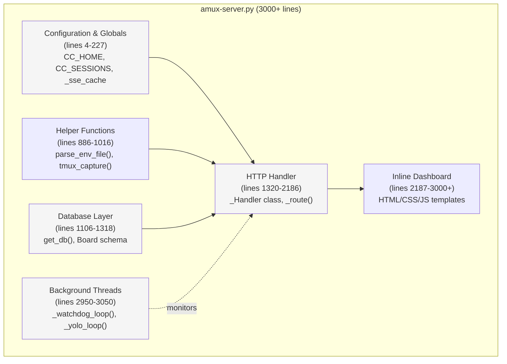

**Key characteristics:**
- **No imports of custom modules** — only Python stdlib
- **No class hierarchy** — single `_Handler(BaseHTTPRequestHandler)` class
- **Configuration via environment variables** loaded from `~/.amux/server.env`
- **Auto-restart on file modification** using `os.execv()` [amux-server.py:3210-3230]()

**Sources:** [amux-server.py:1-96](), [CLAUDE.md:24-31]()

---

## Server Initialization and Configuration

### Directory Structure

The server creates and manages a home directory at `~/.amux/` (migrated from legacy `~/.cmux/` or `~/.cc/` paths):

| Directory | Variable | Purpose |
|-----------|----------|---------|
| `~/.amux/sessions/` | `CC_SESSIONS` | Session `.env` config files |
| `~/.amux/logs/` | `CC_LOGS` | Session terminal logs and `server.log` |
| `~/.amux/memory/` | `CC_MEMORY` | Per-session memory markdown files |
| `~/.amux/board/` | `CC_BOARD_DIR` | Legacy board file storage (deprecated) |
| `~/.amux/uploads/` | `CC_UPLOADS` | User-uploaded files |
| `~/.amux/notes/` | `CC_NOTES` | Notes and `.pins.json` |
| `~/.amux/amux.db` | (computed) | SQLite database for board/logs |

**Sources:** [amux-server.py:29-63]()

### Environment Variable Loading

The server loads persistent configuration from `~/.amux/server.env` before reading any environment variables:

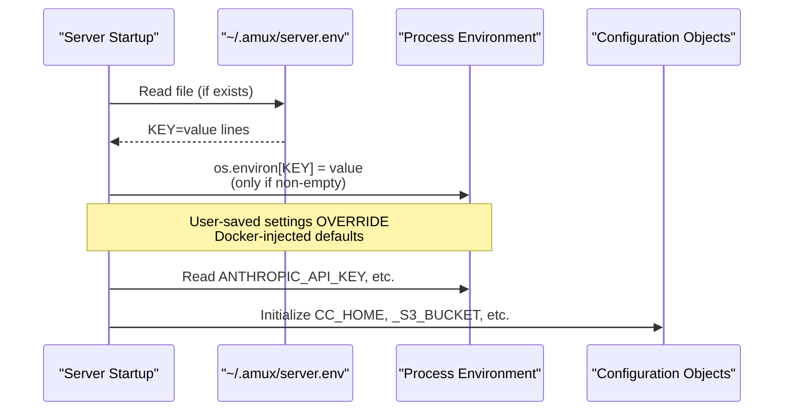

This override behavior allows cloud deployments to inject defaults via Docker environment variables, while user-saved settings (from the Settings UI) take priority.

**Sources:** [amux-server.py:36-47](), [CLAUDE.md:32-43]()

---

## HTTP Server and Request Routing

### ThreadingHTTPServer

The server runs on port 8822 using `ThreadingHTTPServer`, which spawns a new thread for each incoming request:

```python
server = ThreadingHTTPServer(("127.0.0.1", 8822), _Handler)
server.serve_forever()
```

**Sources:** [amux-server.py:3280-3281]()

### Request Handler (`_Handler`)

The `_Handler` class extends `BaseHTTPRequestHandler` and centralizes all HTTP methods through the `_route()` function:

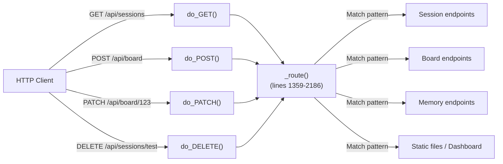

**Sources:** [amux-server.py:2183-2186]()

### Route Matching Logic

Routes are matched using regular expressions within `_route()`. Example patterns:

| Pattern | Route | Handler Logic |
|---------|-------|---------------|
| `^/api/sessions$` (POST) | Create session | [amux-server.py:1426-1458]() |
| `^/api/sessions/([^/]+)/start$` (POST) | Start tmux session | [amux-server.py:1463-1510]() |
| `^/api/sessions/([^/]+)/send$` (POST) | Send text to session | [amux-server.py:1531-1565]() |
| `^/api/board$` (GET) | List board items | [amux-server.py:1819-1826]() |
| `^/api/board/([A-Za-z0-9-]+)$` (PATCH) | Update board item | [amux-server.py:1848-1882]() |
| `^/api/memory/global$` (POST) | Update global memory | [amux-server.py:1746-1762]() |

**Sources:** [amux-server.py:1359-2186]()

### Event Emission

Every request is classified and emitted as a structured event using `_classify_request()` and `_emit_event()`:

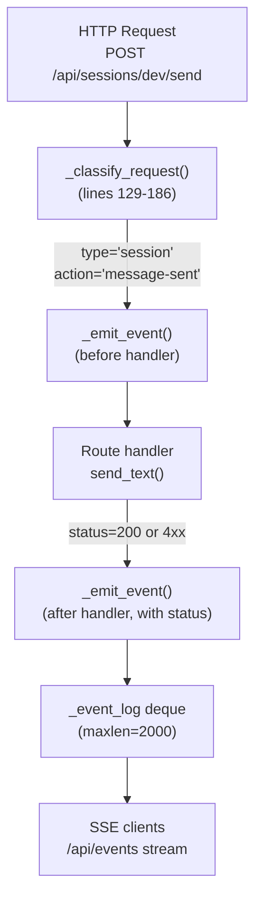

**Sources:** [amux-server.py:108-186]()

---

## Data Layer

### SQLite Database (`amux.db`)

The server uses SQLite with WAL (Write-Ahead Logging) mode for all structured data:

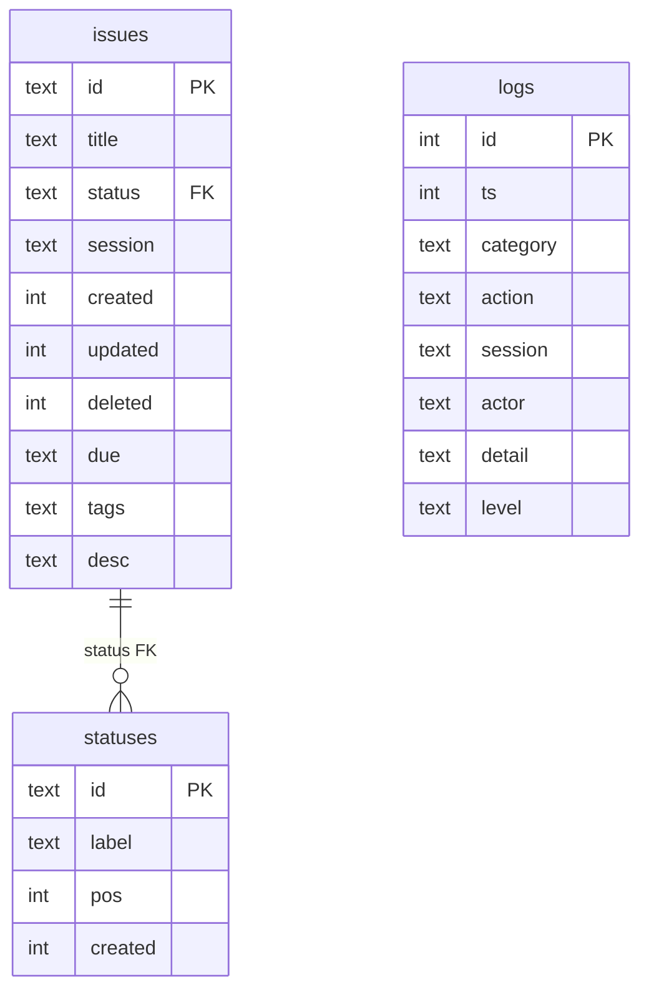

Database initialization:

```python
def get_db() -> sqlite3.Connection:
    db_path = CC_HOME / "amux.db"
    conn = sqlite3.connect(str(db_path), check_same_thread=False)
    conn.row_factory = sqlite3.Row
    conn.execute("PRAGMA journal_mode=WAL")
    # CREATE TABLE IF NOT EXISTS ... (schema setup)
    return conn
```

**Sources:** [amux-server.py:1106-1236]()

### Token Cache

Per-session token usage is cached by reading Claude Code JSONL files from `~/.claude/projects/`:

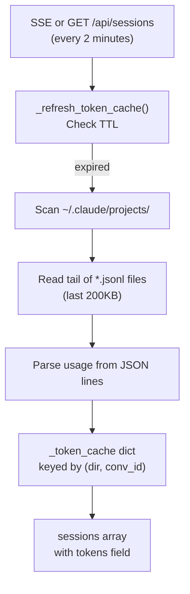

**Sources:** [amux-server.py:786-883]()

### File System Storage

Non-tabular data is stored in the `~/.amux/` directory tree:

- **Session configs:** `~/.amux/sessions/<name>.env` — persistent session settings
- **Session memory:** `~/.amux/memory/<name>.md` — per-session context
- **Global memory:** `~/.amux/memory/global.md` — shared agent context
- **Session logs:** `~/.amux/logs/<name>.log` — terminal capture history (max 10MB)
- **Uploads:** `~/.amux/uploads/<uuid>.<ext>` — user-uploaded files

**Sources:** [amux-server.py:49-63]()

---

## Background Threads

### Watchdog Loop (`_watchdog_loop`)

The watchdog runs every 30 seconds and monitors all running sessions for issues:

```mermaid
stateDiagram-v2
    [*] --> Sleep30s
    Sleep30s --> CheckSessions: Timer fired
    CheckSessions --> ScanTmux: Get all .env files
    ScanTmux --> CapturePane: For each running session
    CapturePane --> DetectCorruption: Parse terminal output
    DetectCorruption --> AutoRestart: Thinking-block error found
    AutoRestart --> CheckSessions
    DetectCorruption --> CheckContext: No errors
    CheckContext --> AutoCompact: Context < 20%
    AutoCompact --> CheckSessions
    CheckContext --> Sleep30s: All healthy
```

**Detection patterns:**

| Condition | Pattern | Action |
|-----------|---------|--------|
| Corruption | `r'<thinking>.*<thinking>'` | Auto-restart, replay last message |
| Low context | `r'(\d+)% context remaining'` < 20% | Send `/compact` command |
| Stuck prompt | No output change for 3+ cycles | Wake with Enter key |

**Sources:** [amux-server.py:2950-3097]()

### YOLO Auto-Responder (`_yolo_loop`)

For sessions with `--dangerously-skip-permissions`, auto-answers blocking prompts:

```mermaid
graph TB
    Timer["Every 30 seconds"]
    ScanSessions["Scan CC_SESSIONS/*.env"]
    CheckFlag["Has '--dangerously-skip-permissions'?"]
    CaptureOutput["tmux_capture(20 lines)"]
    MatchPattern["Match known prompts<br/>_YOLO_PROMPTS"]
    SendResponse["send_text('1')"]
    Cooldown["Update _yolo_last_responded"]
    
    Timer --> ScanSessions
    ScanSessions --> CheckFlag
    CheckFlag -->|Yes| CaptureOutput
    CheckFlag -->|No| Timer
    CaptureOutput --> MatchPattern
    MatchPattern -->|Match| SendResponse
    MatchPattern -->|No match| Timer
    SendResponse --> Cooldown
    Cooldown --> Timer
```

**Prompt patterns:**

```python
_YOLO_PROMPTS = [
    (re.compile(r'command contains.*command substitution.*esc to cancel', re.I | re.DOTALL), '1'),
    (re.compile(r'do you want to proceed.*esc to cancel', re.I | re.DOTALL), '1'),
    (re.compile(r'yes.*and don.t ask again.*esc to cancel', re.I | re.DOTALL), '1'),
]
```

**Sources:** [amux-server.py:1019-1068]()

### Auto-Restart Mechanism

The server monitors its own file modification time and restarts when `amux-server.py` changes:

```mermaid
sequenceDiagram
    participant Thread as "Restart Monitor Thread"
    participant File as "amux-server.py"
    participant Process as "Current Process"
    participant NewProcess as "New Process"
    
    loop Every 2 seconds
        Thread->>File: stat().st_mtime
        alt mtime changed
            Thread->>Process: os.execv(sys.executable, [prog, 'serve'])
            Process->>NewProcess: Replace process image
            NewProcess->>NewProcess: Reload code, reopen sockets
        else unchanged
            Thread->>Thread: sleep(2)
        end
    end
```

**Implementation:**

```python
def _restart_monitor():
    mtime = os.stat(__file__).st_mtime
    while True:
        time.sleep(2)
        current = os.stat(__file__).st_mtime
        if current != mtime:
            os.execv(sys.executable, [sys.executable, __file__, "serve"])
```

This allows zero-downtime updates in cloud deployments where all containers bind-mount the same file.

**Sources:** [amux-server.py:3210-3230]()

---

## MCP Server Integration

MCP (Model Context Protocol) servers are loaded from `mcp.json` and environment variables are injected from `~/.amux/server.env`:

```mermaid
graph TB
    ServerStart["Server startup"]
    LoadEnv["Load ~/.amux/server.env"]
    ReadMCP["Read mcp.json"]
    SubstEnv["Substitute ${ENV_VAR} placeholders"]
    StdioServers["stdio servers<br/>(local Node.js processes)"]
    URLServers["url servers<br/>(remote HTTP endpoints)"]
    Sessions["Claude sessions<br/>(via tmux)"]
    
    ServerStart --> LoadEnv
    LoadEnv --> ReadMCP
    ReadMCP --> SubstEnv
    SubstEnv --> StdioServers
    SubstEnv --> URLServers
    StdioServers --> Sessions
    URLServers --> Sessions
```

MCP servers are **not** spawned by amux-server.py — Claude Code spawns them directly. The server's role is to:
1. Load and validate `mcp.json`
2. Provide env vars via `~/.amux/server.env` for credential injection
3. Expose MCP config to the dashboard UI

**Sources:** [amux-server.py:36-47](), [CLAUDE.md:59-63]()

---

## Deployment Modes

### Single-Codebase Guarantee

The same `amux-server.py` file runs in both environments without modification:

```mermaid
graph LR
    subgraph "Local OSS"
        LocalFile["amux-server.py"]
        LocalRun["python3 amux-server.py serve"]
        LocalPort["localhost:8822"]
    end
    
    subgraph "Cloud Container"
        SharedFile["amux-server.py<br/>(bind-mounted from host)"]
        ContainerRun["python3 amux-server.py serve"]
        ContainerPort["container port 8822"]
        Gateway["gateway.py proxy"]
    end
    
    LocalFile -.->|"identical"| SharedFile
    LocalRun --> LocalPort
    ContainerRun --> ContainerPort
    ContainerPort --> Gateway
    Gateway --> PublicHTTPS["cloud.amux.io"]
```

**Differentiation mechanisms:**

| Feature | Local | Cloud | Implementation |
|---------|-------|-------|----------------|
| User email | Not applicable | Via `X-Amux-User-Email` header | [amux-server.py:1350-1355]() |
| HTTPS | Self-signed cert | Gateway terminates TLS | Environment detection |
| S3 sync | Optional (via env vars) | Required (injected by Docker) | `AMUX_S3_BUCKET` presence |
| Multi-tenancy | Single user | Per-user containers | Gateway routing |

**Sources:** [CLAUDE.md:24-31](), [amux-server.py:1-96]()

### Cloud-Specific Headers

The cloud gateway injects headers that the server reads but does not require:

```python
user_email = req.headers.get("X-Amux-User-Email", "")
```

This header is used for display purposes (e.g., showing the logged-in user in the UI) but never for authentication or authorization — the gateway handles all auth upstream.

**Sources:** [amux-server.py:1350-1355](), [cloud/gateway/gateway.py:396-408]()

---

## Key Design Patterns

### Per-Session Locking

Each session has a dedicated lock to prevent race conditions when sending text:

```python
_send_locks: dict = {}
_send_locks_lock = threading.Lock()

def send_text(session: str, text: str):
    with _send_locks_lock:
        if session not in _send_locks:
            _send_locks[session] = threading.Lock()
        lock = _send_locks[session]
    
    with lock:
        # Send to tmux session
        subprocess.run(["tmux", "send-keys", "-t", tmux_target(session), text, "Enter"])
```

**Sources:** [amux-server.py:193-194](), [amux-server.py:1174-1203]()

### SSE Caching

Server-Sent Events use a shared cache to avoid redundant subprocess calls when multiple browser tabs connect:

```python
_sse_cache = {
    "sessions": {"data": None, "json": "", "time": 0},
    "board": {"data": None, "json": "", "time": 0},
}
_SSE_CACHE_TTL = 2  # seconds
```

Cache invalidation is TTL-based (2 seconds) plus version bumping for immediate updates:

```python
_notes_version: int = 0  # bumped on any notes write
_crm_version: int = 0    # bumped on any CRM write
```

**Sources:** [amux-server.py:97-102](), [amux-server.py:189-191]()

### Event Ring Buffer

Structured events are stored in an in-memory ring buffer with automatic overflow:

```python
_event_log: collections.deque[dict] = collections.deque(maxlen=2000)
```

Events are also persisted to the `logs` table in SQLite for long-term storage.

**Sources:** [amux-server.py:104-127]()

---

## Performance Characteristics

| Operation | Implementation | Typical Latency |
|-----------|----------------|-----------------|
| Session list | SQLite query + tmux list-sessions | ~50ms |
| Board list | Single SQLite SELECT | ~10ms |
| Tmux capture | subprocess.run (tmux capture-pane) | ~100ms |
| Token refresh | Read/parse Claude JSONL (cached) | ~500ms (2min cache) |
| Auto-restart | os.execv (full process replace) | ~1-2s |
| SSE stream | Chunked HTTP with 2s cache | Real-time |

**Sources:** [amux-server.py:786-883](), [amux-server.py:957-966]()

---

## Summary

`amux-server.py` implements a complete multi-agent orchestration platform in a single Python file through:

1. **HTTP server** — ThreadingHTTPServer with regex-based routing
2. **Data layer** — SQLite (WAL mode) + file system
3. **Session manager** — tmux wrapper with lifecycle management
4. **Background workers** — Watchdog, auto-responder, restart monitor
5. **Web dashboard** — Inline HTML/CSS/JS templates
6. **Event system** — Ring buffer + SSE streaming

The single-codebase design ensures identical behavior across local and cloud deployments, with differentiation achieved exclusively through environment variables and gateway-injected headers.

**Sources:** [amux-server.py:1-3281](), [CLAUDE.md:1-63]()

---

# Page: Session Management

# Session Management

<details>
<summary>Relevant source files</summary>

The following files were used as context for generating this wiki page:

- [amux](amux)
- [amux-server.py](amux-server.py)
- [cloud/gateway/gateway.py](cloud/gateway/gateway.py)
- [cloud/setup.sh](cloud/setup.sh)
- [skills/amux-board.md](skills/amux-board.md)
- [skills/amux.md](skills/amux.md)
- [skills/playwright-auth.md](skills/playwright-auth.md)
- [skills/pw-test.md](skills/pw-test.md)
- [test.mjs](test.mjs)

</details>


Session Management is the core orchestration layer of amux that creates, configures, and controls individual Claude Code instances. Each session represents an isolated Claude agent with its own working directory, configuration, tmux environment, and persistent state. This page covers session lifecycle, persistence, tmux integration, and session operations.

For board task management, see [Board System](#2.2). For per-session memory and global context, see [Memory System](#2.3). For self-healing and auto-recovery mechanisms, see [Self-Healing Watchdog](#2.4).

---

## Session Lifecycle

Sessions follow a well-defined lifecycle from registration through execution to archival or deletion. The state transitions are managed by both the CLI (`amux`) and the HTTP server (`amux-server.py`).

```mermaid
stateDiagram-v2
    [*] --> Registered: register <name>
    
    Registered --> Running: start<br/>tmux new-session
    
    Running --> Stopped: stop<br/>tmux kill-session
    Running --> Archived: archive<br/>Move to .archive/
    Running --> Running: send/peek/config<br/>(operations)
    
    Stopped --> Running: restart<br/>tmux new-session
    Stopped --> Archived: archive
    
    Archived --> [*]: delete
    Stopped --> [*]: delete (rm)
    Registered --> [*]: delete (rm)
    
    note right of Running
        tmux session active
        Claude Code running
        Watchdog monitoring
        API operations enabled
    end note
    
    note right of Registered
        .env file exists
        No tmux session
        Configuration persisted
    end note
    
    note right of Archived
        .archive/ subdirectory
        Config preserved
        Cannot be restarted
        Reference only
    end note
```

**Sources:** [amux-server.py:152-170](), [amux:166-234](), [amux:306-319]()

---

## Session Persistence Structure

Session state is persisted in `~/.amux/sessions/` as `.env` files. Each file contains the session's configuration, which survives server restarts and is loaded on-demand.

```mermaid
graph TB
    subgraph "~/.amux (CC_HOME)"
        SessionsDir["sessions/"]
        ArchiveDir["sessions/.archive/"]
        LogsDir["logs/"]
        MemoryDir["memory/"]
    end
    
    subgraph "sessions/ directory"
        Env1["api-dev.env"]
        Env2["frontend.env"]
        Env3["backend.env"]
        
        Env1Content["CC_NAME='api-dev'<br/>CC_DIR='/path/to/project'<br/>CC_FLAGS='--model opus --yolo'"]
    end
    
    subgraph "sessions/.archive/"
        ArchivedEnv["old-session.env"]
    end
    
    subgraph "Corresponding tmux sessions"
        Tmux1["tmux session: amux-api-dev"]
        Tmux2["tmux session: amux-frontend"]
    end
    
    SessionsDir --> Env1
    SessionsDir --> Env2
    SessionsDir --> Env3
    SessionsDir --> ArchiveDir
    
    Env1 -.->|contains| Env1Content
    ArchiveDir --> ArchivedEnv
    
    Env1 -.->|starts| Tmux1
    Env2 -.->|starts| Tmux2
    
    style SessionsDir fill:#f9f9f9
    style Env1 fill:#e8f5e9
    style Env1Content fill:#fff9c4
    style Tmux1 fill:#e3f2fd
```

**Session .env File Structure:**

| Field | Type | Description |
|-------|------|-------------|
| `CC_NAME` | string | Session identifier (must match filename without .env) |
| `CC_DIR` | path | Working directory for Claude Code (absolute path) |
| `CC_FLAGS` | string | Space-separated Claude Code CLI flags (e.g. `--model opus --yolo`) |

**Sources:** [amux:88-93](), [amux:176-182](), [amux-server.py:49-51]()

---

## Session Registration

Registration creates a session configuration without starting it. This decouples session definition from execution, allowing preconfigured sessions to be started on-demand.

### CLI Registration

```bash
amux register <name> [--dir /path] [--model opus] [--yolo] [claude flags...]
```

The `register` command:
1. Parses Claude Code flags from arguments ([amux:123-164]())
2. Resolves working directory to absolute path ([amux:152-154]())
3. Writes `.env` file to `~/.amux/sessions/` ([amux:176-182]())
4. Stores all configuration as environment variables

**Flag Parsing Logic:**
- Flags with values: `--model`, `--mcp-config`, `--system-prompt`, etc.
- Boolean flags: `--yolo`, `--dangerously-skip-permissions`, `--verbose`, etc.
- `--dir` is resolved to absolute path and stored separately as `CC_DIR`
- Unknown flags are passed through to Claude Code

**Sources:** [amux:168-186](), [amux:123-164]()

### HTTP API Registration

```http
POST /api/sessions
Content-Type: application/json

{
  "name": "api-dev",
  "dir": "/path/to/project",
  "flags": "--model opus --yolo",
  "tags": ["backend", "python"]
}
```

Response: `201 Created` with session metadata.

**Sources:** [amux-server.py:2287-2373]()

---

## Starting Sessions

Starting a session creates a tmux session and launches Claude Code inside it. The tmux session name is prefixed with `amux-` to avoid conflicts.

### Tmux Session Naming Convention

| Session Name | tmux Session Name |
|--------------|-------------------|
| `api-dev` | `amux-api-dev` |
| `frontend` | `amux-frontend` |
| `my-project` | `amux-my-project` |

This prefix prevents collisions with user tmux sessions and enables safe migration from legacy `cmux-*` or `cc-*` prefixes ([amux:104-113]()).

**Sources:** [amux:101](), [amux:104-113]()

### Start Flow

```mermaid
sequenceDiagram
    participant CLI as amux CLI
    participant Env as ~/.amux/sessions/NAME.env
    participant Tmux as tmux
    participant Claude as Claude Code Process
    
    CLI->>CLI: resolve_session(name)
    CLI->>Env: load session config
    Env-->>CLI: CC_NAME, CC_DIR, CC_FLAGS
    
    CLI->>Tmux: has-session "amux-NAME"?
    alt already running
        Tmux-->>CLI: yes
        CLI->>Tmux: attach-session
    else not running
        Tmux-->>CLI: no
        CLI->>Tmux: new-session -d -s "amux-NAME" -c CC_DIR
        Note over Tmux: Session created in background
        CLI->>Tmux: send command: "cd DIR; claude FLAGS"
        Tmux->>Claude: spawn process
        Claude-->>Tmux: running
        CLI->>Tmux: set-option allow-rename off
        CLI->>Tmux: attach-session
    end
```

**Sources:** [amux:188-234](), [amux:116-119]()

### Start Command Implementation

The `cmd_start` function ([amux:188-234]()):
1. Resolves session name (supports partial matches, numbers, exact names)
2. Checks if already running via `tmux has-session`
3. If running, attaches immediately
4. If not running:
   - Expands `~` in working directory path
   - Validates directory exists
   - Builds `claude` command string with global defaults + session flags + inline args
   - Creates detached tmux session with explicit working directory
   - Locks window name to prevent Claude from changing it ([amux:229-230]())
   - Attaches to session

**Important:** The `cd` command is explicitly run inside the tmux session even though tmux's `-c` flag sets the working directory. This handles cases where shell profiles override `CWD` ([amux:227]()).

**Sources:** [amux:188-234](), [amux:226-230]()

---

## Session Operations

Sessions expose several operations through both CLI and HTTP API.

### Send Message

Injects a message into a running session's Claude Code prompt.

**CLI:**
```bash
amux send <name> <text>
```

**HTTP API:**
```http
POST /api/sessions/<name>/send
Content-Type: application/json

{"text": "implement login endpoint"}
```

**Implementation:** Uses `tmux send-keys` to type text and press Enter ([amux:283-304](), [amux-server.py:2524-2592]()). A per-session lock prevents concurrent sends from interleaving ([amux-server.py:193-194]()).

**Sources:** [amux:283-304](), [amux-server.py:2524-2592](), [amux-server.py:193-194]()

### Peek Terminal Output

Captures recent terminal output without attaching.

**CLI:**
```bash
amux peek <name> [lines]
```

**HTTP API:**
```http
GET /api/sessions/<name>/peek?lines=50
POST /api/sessions/<name>/peek  # for longer output
```

**Implementation:** Uses `tmux capture-pane -p` to extract terminal buffer ([amux:268-281](), [amux-server.py:2644-2714]()).

**Sources:** [amux:268-281](), [amux-server.py:2644-2714]()

### Stop Session

Terminates the tmux session, killing the Claude Code process.

**CLI:**
```bash
amux stop <name>
```

**HTTP API:**
```http
POST /api/sessions/<name>/stop
```

**Implementation:** Executes `tmux kill-session -t amux-<name>` ([amux:306-319](), [amux-server.py:2505-2522]()).

**Sources:** [amux:306-319](), [amux-server.py:2505-2522]()

### Attach to Session

Attaches the current terminal to a running session's tmux pane.

**CLI:**
```bash
amux attach <name>
```

**Implementation:** Runs `tmux attach-session -t amux-<name>` ([amux:258-266]()). CLI-only operation (HTTP API cannot attach a terminal).

**Sources:** [amux:258-266]()

---

## Session Configuration

Session configuration can be updated without restarting.

### Configuration Fields

```http
PATCH /api/sessions/<name>/config
Content-Type: application/json

{
  "tags": ["backend", "python"],
  "yolo": true,
  "auto_compact": true,
  "auto_restart": true
}
```

**Stored Configuration Fields:**

| Field | Type | Default | Description |
|-------|------|---------|-------------|
| `tags` | array | `[]` | Freeform labels for organization |
| `yolo` | boolean | `false` | Auto-respond to permission prompts |
| `auto_compact` | boolean | `true` | Auto-compact when context low |
| `auto_restart` | boolean | `true` | Auto-restart on corruption |
| `auto_respond` | boolean | `false` | Alias for `yolo` |

Configuration is persisted to the session's `.env` file ([amux-server.py:2716-2773]()). The watchdog thread reads these fields to control auto-recovery behavior (see [Self-Healing Watchdog](#2.4)).

**Sources:** [amux-server.py:2716-2773]()

---

## Session Archival and Deletion

### Archive

Archiving moves a session's `.env` file to `.archive/` subdirectory, preserving configuration for reference without allowing restart.

**HTTP API:**
```http
POST /api/sessions/<name>/archive
```

**Implementation:**
1. Stops session if running
2. Moves `sessions/<name>.env` → `sessions/.archive/<name>.env`
3. Returns `200 OK`

Archived sessions are excluded from listing ([amux-server.py:2375-2442]()).

**Sources:** [amux-server.py:2375-2442]()

### Delete

Permanently removes a session.

**CLI:**
```bash
amux rm <name>
```

**HTTP API:**
```http
DELETE /api/sessions/<name>
```

**Implementation:**
1. Stops tmux session if running ([amux:321-332]())
2. Removes `.env` file from `sessions/` or `sessions/.archive/`
3. Does NOT delete logs, memory, or board items

**Sources:** [amux:321-332](), [amux-server.py:2775-2804]()

---

## Session Cloning

Session cloning creates a new session by copying an existing session's configuration.

```http
POST /api/sessions/<source>/clone
Content-Type: application/json

{
  "new_name": "api-dev-experiment",
  "copy_memory": true
}
```

**Clone Behavior:**
- Copies `CC_DIR`, `CC_FLAGS`, `tags` from source
- Optionally copies session memory file
- Does NOT copy board items or logs
- New session is registered but not started

**Sources:** [amux-server.py:2806-2886]()

---

## Session Status Monitoring

### List All Sessions

```http
GET /api/sessions
```

**Response:**
```json
[
  {
    "name": "api-dev",
    "running": true,
    "dir": "/path/to/project",
    "flags": "--model opus --yolo",
    "tags": ["backend"],
    "token_usage": {"input": 125000, "output": 42000},
    "last_activity": 1704067200
  }
]
```

The listing aggregates:
- Session configs from `.env` files
- Running state from `tmux has-session`
- Token usage from Claude JSONL files ([amux-server.py:786-877]())
- Last activity timestamps from JSONL

**Token Cache:** Token counts are cached for 120 seconds to avoid scanning large JSONL files on every request ([amux-server.py:786-787]()).

**Sources:** [amux-server.py:2375-2442](), [amux-server.py:786-877]()

### Check Session State

```http
GET /api/sessions/<name>
```

Returns full session metadata including:
- Basic config (name, dir, flags, tags)
- Running state (boolean)
- Token usage (input, output, cached)
- Memory file path
- Session-specific memory content preview

**Sources:** [amux-server.py:2444-2503]()

---

## tmux Integration Details

### Session Naming Migration

The system supports migration from legacy prefixes:
- `cc-<name>` (old prefix)
- `cmux-<name>` (old prefix)
- `amux-<name>` (current prefix)

The `migrate_tmux` function automatically renames old sessions on first access ([amux:104-113]()).

### Window Name Locking

tmux allows processes to change window names via escape sequences. Claude Code sometimes does this, which breaks session identification. After creating a session, amux locks the window name:

```bash
tmux set-option -t "amux-NAME" allow-rename off
tmux set-window-option -t "amux-NAME" automatic-rename off
```

This ensures the window always displays the session name ([amux:229-230]()).

**Sources:** [amux:104-113](), [amux:229-230]()

### Mouse and History Configuration

Global tmux configuration is applied during cloud VM setup ([cloud/setup.sh:86-95]()):
- Mouse mode enabled
- History limit: 50,000 lines
- 256-color terminal support

**Sources:** [cloud/setup.sh:86-95]()

---

## Multi-Tenancy: Cloud Gateway Session Proxying

In cloud deployments, the gateway proxies session operations to per-user containers. Each user's container runs its own `amux-server.py` instance with isolated sessions.

**Gateway Proxy Flow:**

```mermaid
sequenceDiagram
    participant User as User Browser
    participant GW as gateway.py
    participant DB as gateway.db
    participant DC as Docker Compose
    participant Srv as amux-server.py<br/>(user container)
    
    User->>GW: GET /api/sessions
    GW->>GW: verify JWT / cookie
    GW->>DB: SELECT port FROM users WHERE id=?
    DB-->>GW: port=9000
    GW->>GW: Check container running?
    alt container stopped
        GW->>DC: docker compose up -d
        DC-->>GW: started
        Note over GW,DC: Wait for healthy (up to 40s)
    end
    GW->>Srv: HTTP proxy to 127.0.0.1:9000/api/sessions
    Note over GW,Srv: Add header: X-Amux-User-Email
    Srv-->>GW: session list JSON
    GW->>DB: UPDATE users SET last_seen=now()
    GW-->>User: 200 OK + JSON
```

**Key Gateway Behaviors:**
- **Lazy Start:** Containers start on first request if stopped ([cloud/gateway/gateway.py:261-271]())
- **Health Check:** Gateway waits up to 40 seconds for container to become healthy ([cloud/gateway/gateway.py:268-271]())
- **User Email Injection:** Gateway adds `X-Amux-User-Email` header so `amux-server.py` knows which user is making requests ([cloud/gateway/gateway.py:406-407]())
- **Activity Tracking:** `last_seen` timestamp updated on every request for idle reaper ([cloud/gateway/gateway.py:684]())

**Sources:** [cloud/gateway/gateway.py:261-271](), [cloud/gateway/gateway.py:406-416](), [cloud/gateway/gateway.py:684]()

---

## Session API Endpoint Reference

| Endpoint | Method | Description |
|----------|--------|-------------|
| `/api/sessions` | GET | List all sessions with metadata |
| `/api/sessions` | POST | Register new session |
| `/api/sessions/<name>` | GET | Get single session details |
| `/api/sessions/<name>` | PATCH | Update session (tags only) |
| `/api/sessions/<name>` | DELETE | Delete session (stops + removes) |
| `/api/sessions/<name>/start` | POST | Start session (create tmux) |
| `/api/sessions/<name>/stop` | POST | Stop session (kill tmux) |
| `/api/sessions/<name>/send` | POST | Send message to session |
| `/api/sessions/<name>/peek` | GET/POST | Capture terminal output |
| `/api/sessions/<name>/config` | PATCH | Update session config |
| `/api/sessions/<name>/memory` | GET | Get session memory content |
| `/api/sessions/<name>/memory` | POST | Update session memory |
| `/api/sessions/<name>/archive` | POST | Archive session |
| `/api/sessions/<name>/clone` | POST | Clone session configuration |
| `/api/sessions/<name>/wake` | POST | Wake session (diagnostic) |

All endpoints require authentication in cloud mode (Clerk JWT or session cookie). Local mode has no authentication.

**Sources:** [amux-server.py:2287-2886]()

---

# Page: Board System

# Board System

<details>
<summary>Relevant source files</summary>

The following files were used as context for generating this wiki page:

- [amux-server.py](amux-server.py)
- [cloud/gateway/gateway.py](cloud/gateway/gateway.py)
- [skills/amux-board.md](skills/amux-board.md)
- [skills/amux.md](skills/amux.md)
- [skills/playwright-auth.md](skills/playwright-auth.md)
- [skills/pw-test.md](skills/pw-test.md)
- [test.mjs](test.mjs)

</details>


## Purpose and Scope

The Board System is a SQLite-backed Kanban board that enables task coordination across multiple Claude Code agents. It provides atomic task claiming to prevent duplicate work, supports custom status columns, and integrates with the calendar view through due dates and iCal export. This page documents the database schema, atomic operations, status management, and REST API.

For information about inter-agent communication patterns using the board, see [Task Distribution](#12.1). For the web UI board views, see [Board Interface](#6.2).

---

## Database Schema

The board uses SQLite with two core tables: `issues` for tasks and `statuses` for custom workflow columns.

### Issues Table

```mermaid
erDiagram
    issues {
        TEXT id PK "e.g. PROJ-5"
        TEXT title "Short task name"
        TEXT desc "Full context"
        TEXT status FK "todo, doing, done, or custom"
        TEXT session "Assigned session name"
        TEXT due "ISO date YYYY-MM-DD"
        TEXT tags "Comma-separated"
        INTEGER deleted "Tombstone flag (0/1)"
        INTEGER created_at "Unix timestamp"
        INTEGER updated_at "Unix timestamp"
    }
    
    statuses {
        TEXT id PK "Slug: todo, doing, done, custom"
        TEXT label "Display name"
        INTEGER position "Sort order"
    }
    
    issues }o--|| statuses : status
```

The `issues` table stores all board items with soft-delete support. The `id` field is auto-generated from the session name prefix (e.g., `MYPROJ-5` for the 5th issue in session `myproject`). The `deleted` field implements tombstones for sync protocol.

**Sources:** [amux-server.py:1750-1810]()

---

## Issue Lifecycle

### State Diagram

```mermaid
stateDiagram-v2
    [*] --> Created: POST /api/board
    Created --> Unclaimed: status=todo
    Created --> Claimed: status=doing + session
    
    Unclaimed --> Claimed: POST /api/board/ID/claim
    Claimed --> Unclaimed: PATCH status=todo
    
    Unclaimed --> InProgress: Agent claims
    InProgress --> Completed: Agent finishes
    InProgress --> Blocked: Waiting
    
    Completed --> Tombstone: DELETE (soft)
    Unclaimed --> Tombstone: DELETE
    Claimed --> Tombstone: DELETE
    
    note right of Claimed
        Atomic CAS ensures
        only one agent claims
    end note
    
    note right of Tombstone
        deleted=1 retained
        for sync protocol
    end note
```

### Creating Issues

Issues are created via `POST /api/board` with optional fields:

| Field | Type | Required | Default | Notes |
|-------|------|----------|---------|-------|
| `title` | string | Yes | — | Short imperative name |
| `desc` | string | No | `""` | Full context with acceptance criteria |
| `status` | string | No | `"todo"` | Must match existing status ID |
| `session` | string | No | `null` | Assigns to session |
| `due` | string | No | `null` | ISO date `YYYY-MM-DD` |
| `tags` | string | No | `""` | Comma-separated |

The server auto-generates the `id` using the session prefix counter:

```python
# Example: session "api-dev" → next ID is "API-DEV-5"
prefix = session_name.upper().replace(" ", "-")
counter = max([int(i.id.split("-")[-1]) for i in existing if i.id.startswith(prefix)]) + 1
issue_id = f"{prefix}-{counter}"
```

**Sources:** [amux-server.py:1810-1920]()

---

## Atomic Claiming Mechanism

### Compare-and-Swap (CAS) Operation

The board uses SQLite's atomic UPDATE to implement lock-free claiming:

```mermaid
sequenceDiagram
    participant A1 as "Agent 1"
    participant DB as "SQLite"
    participant A2 as "Agent 2"
    
    Note over A1,A2: Both agents see PROJ-5 in todo
    
    A1->>DB: UPDATE issues SET status='doing', session='agent1'<br/>WHERE id='PROJ-5' AND status='todo'
    DB-->>A1: 1 row affected (success)
    
    A2->>DB: UPDATE issues SET status='doing', session='agent2'<br/>WHERE id='PROJ-5' AND status='todo'
    DB-->>A2: 0 rows affected (already claimed)
    
    Note over A1: Agent 1 proceeds with work
    Note over A2: Agent 2 picks next task
```

The `POST /api/board/:id/claim` endpoint implements this:

```python
# Atomic claim with status constraint
cursor.execute("""
    UPDATE issues 
    SET status = ?, session = ?, updated_at = ?
    WHERE id = ? AND status = ? AND deleted = 0
""", ('doing', session_name, int(time.time()), issue_id, 'todo'))

if cursor.rowcount == 0:
    return {"error": "already claimed or not found"}, 409
```

**Key Properties:**
- **Idempotent**: Re-claiming the same task by the same session succeeds
- **Conflict Detection**: Returns 409 if another session claimed first
- **Status Constraint**: Only `todo` items can be claimed (prevents stealing in-progress work)

**Sources:** [amux-server.py:1955-2010]()

---

## Status Management

### Default and Custom Statuses

The board ships with three default statuses but supports unlimited custom columns:

```mermaid
graph LR
    subgraph "Default Workflow"
        todo["todo<br/>(position: 0)"]
        doing["doing<br/>(position: 1)"]
        done["done<br/>(position: 2)"]
    end
    
    subgraph "Custom Extensions"
        review["review<br/>(position: 3)"]
        deployed["deployed<br/>(position: 4)"]
    end
    
    todo --> doing
    doing --> review
    review --> done
    done --> deployed
```

### Status CRUD

| Operation | Endpoint | Method | Body |
|-----------|----------|--------|------|
| List | `/api/board/statuses` | GET | — |
| Add | `/api/board/statuses` | POST | `{id, label}` |
| Rename | `/api/board/statuses/:id` | PATCH | `{label}` |
| Delete | `/api/board/statuses/:id` | DELETE | — |

**Position Constraints:**
- Default statuses (`todo`, `doing`, `done`) cannot be deleted
- Deleting a status reassigns all issues to `todo`
- Position values auto-adjust when statuses are added/removed

**Sources:** [amux-server.py:2050-2180]()

---

## Board Views

The web UI supports two rendering modes, toggled client-side:

### Session-Grouped View (Default)

Groups issues by assigned session, with unclaimed items in a separate group:

```mermaid
graph TB
    subgraph "Unassigned"
        U1["PROJ-1: Login bug"]
        U2["PROJ-2: Add tests"]
    end
    
    subgraph "api-dev Session"
        S1["API-3: OAuth flow"]
        S2["API-4: Rate limiting"]
    end
    
    subgraph "frontend Session"
        S3["UI-1: Dark mode"]
    end
```

**Use Case:** Monitor what each agent is working on, identify unclaimed tasks.

### Status/Kanban View

Organizes issues by status in horizontal columns:

```mermaid
graph LR
    subgraph "todo"
        T1["PROJ-1"]
        T2["PROJ-2"]
    end
    
    subgraph "doing"
        D1["API-3<br/>@api-dev"]
    end
    
    subgraph "done"
        Done1["UI-1"]
        Done2["API-4"]
    end
```

**Use Case:** Track workflow progression, identify bottlenecks.

**Sources:** [amux-server.py:4200-4350]() (rendering logic in HTML template)

---

## Due Dates and Calendar Integration

### Due Date Format

Due dates are stored as ISO 8601 date strings (`YYYY-MM-DD`) in the `due` column. Issues with due dates appear in:

1. **Board cards** with badge indicators (📅 upcoming, 🔴 overdue)
2. **Calendar view** as clickable chips on the date grid
3. **iCal feed** as `VEVENT` entries

### iCal Export

The board generates an iCalendar feed at `GET /api/calendar.ics`:

```
VCALENDAR
VERSION:2.0
PRODID:-//amux//board//EN
CALNAME:amux Board
BEGIN:VEVENT
UID:PROJ-5@amux
DTSTART;VALUE=DATE:20240115
SUMMARY:Implement login flow
DESCRIPTION:Full context from issue desc field
STATUS:CONFIRMED
END:VEVENT
```

**Sync Behavior:**
- Updates every 60 seconds
- Optionally publishes to S3 for external calendar apps (requires `AMUX_S3_BUCKET` env var)
- Issues without due dates are excluded
- Deleted/tombstoned issues are removed from feed

**Sources:** [amux-server.py:2200-2350]()

---

## Board Sync Protocol

The sync endpoint supports real-time UI updates without polling the full board.

### Sync Request

```http
GET /api/sync?since=1704067200
```

Returns incremental changes since the provided Unix timestamp:

```json
{
  "issues": [
    {"id": "PROJ-6", "title": "...", "updated_at": 1704067800},
    {"id": "PROJ-1", "deleted": 1, "updated_at": 1704067900}
  ],
  "statuses": [
    {"id": "review", "label": "Review", "position": 3}
  ],
  "ts": 1704068000
}
```

### Tombstone Handling

Deleted issues are marked `deleted=1` rather than removed from the database:

```mermaid
sequenceDiagram
    participant UI as "Web UI"
    participant API as "/api/sync"
    participant DB as "SQLite"
    
    UI->>API: GET /api/sync?since=1000
    API->>DB: SELECT * WHERE updated_at > 1000
    DB-->>API: [PROJ-5 deleted=1, ...]
    API-->>UI: {issues: [{id: "PROJ-5", deleted: 1}]}
    
    Note over UI: Remove PROJ-5 from local cache
    UI->>UI: Filter out deleted items
```

**Retention:** Tombstones are kept for 30 days, then purged by a background task.

**Sources:** [amux-server.py:2400-2520]()

---

## REST API Reference

### Core Endpoints

| Endpoint | Method | Purpose | Auth |
|----------|--------|---------|------|
| `/api/board` | GET | List all issues (includes tombstones) | None |
| `/api/board` | POST | Create issue | None |
| `/api/board/:id` | PATCH | Update issue fields | None |
| `/api/board/:id` | DELETE | Soft-delete (set `deleted=1`) | None |
| `/api/board/:id/claim` | POST | Atomic claim (CAS) | Session header |
| `/api/board/statuses` | GET | List statuses | None |
| `/api/board/statuses` | POST | Add custom status | None |
| `/api/board/statuses/:id` | PATCH | Rename status | None |
| `/api/board/statuses/:id` | DELETE | Remove status | None |
| `/api/board/clear-done` | POST | Delete all `status=done` | None |
| `/api/sync` | GET | Incremental updates | `since` param |
| `/api/calendar.ics` | GET | iCal feed | None |

### Example: Atomic Claim

```bash
curl -sk -X POST https://localhost:8822/api/board/PROJ-5/claim \
  -H 'Content-Type: application/json' \
  -d '{"session": "api-dev"}'
```

**Response (success):**
```json
{
  "ok": true,
  "issue": {
    "id": "PROJ-5",
    "status": "doing",
    "session": "api-dev",
    "updated_at": 1704068100
  }
}
```

**Response (conflict):**
```json
{
  "error": "already claimed or not found",
  "current_session": "frontend"
}
```

**Sources:** [amux-server.py:1750-2520]()

---

## Board Database Initialization

The SQLite database is created at `~/.amux/board/amux.db` on first access:

```sql
CREATE TABLE IF NOT EXISTS issues (
    id TEXT PRIMARY KEY,
    title TEXT NOT NULL,
    desc TEXT DEFAULT '',
    status TEXT DEFAULT 'todo',
    session TEXT,
    due TEXT,
    tags TEXT DEFAULT '',
    deleted INTEGER DEFAULT 0,
    created_at INTEGER NOT NULL,
    updated_at INTEGER NOT NULL
);

CREATE TABLE IF NOT EXISTS statuses (
    id TEXT PRIMARY KEY,
    label TEXT NOT NULL,
    position INTEGER NOT NULL
);

-- Default statuses
INSERT OR IGNORE INTO statuses VALUES 
  ('todo', 'To Do', 0),
  ('doing', 'Doing', 1),
  ('done', 'Done', 2);

-- Indexes for sync queries
CREATE INDEX IF NOT EXISTS idx_issues_updated ON issues(updated_at);
CREATE INDEX IF NOT EXISTS idx_issues_session ON issues(session);
CREATE INDEX IF NOT EXISTS idx_issues_status ON issues(status);
```

**Location:** Issues database is stored separately from session metadata in `CC_BOARD_DIR` (`~/.amux/board/`) to enable cross-session access.

**Sources:** [amux-server.py:1750-1810]()

---

## Board Event Emissions

All board operations emit structured events to the event log for UI notifications:

| Action | Event Type | Target | Detail |
|--------|------------|--------|--------|
| Create | `board` | `created` | Issue title |
| Update | `board` | `updated` | Issue ID |
| Claim | `board` | `claimed` | Issue ID + session |
| Delete | `board` | `deleted` | Issue ID |
| Clear Done | `board` | `cleared` | `"done"` |
| Add Status | `board` | `status-added` | Status ID |
| Remove Status | `board` | `status-removed` | Status ID |

Events are consumed by SSE clients for real-time board updates without polling.

**Sources:** [amux-server.py:110-150]()

---

# Page: Memory System

# Memory System

<details>
<summary>Relevant source files</summary>

The following files were used as context for generating this wiki page:

- [amux-server.py](amux-server.py)
- [cloud/gateway/gateway.py](cloud/gateway/gateway.py)
- [skills/amux-board.md](skills/amux-board.md)
- [skills/amux.md](skills/amux.md)
- [skills/playwright-auth.md](skills/playwright-auth.md)
- [skills/pw-test.md](skills/pw-test.md)
- [test.mjs](test.mjs)

</details>


The Memory System provides persistent, markdown-based context storage for amux sessions. Each session maintains its own isolated memory file, while all sessions share access to a global memory space. This enables agents to maintain project-specific context, share API documentation, and coordinate through written knowledge.

For session lifecycle and configuration, see [Session Management](#2.1). For inter-session coordination, see [Board System](#2.2).

---

## Memory Types

amux provides two distinct memory scopes:

| Type | Path | Scope | Use Cases |
|------|------|-------|-----------|
| **Session Memory** | `~/.amux/memory/<session-name>.md` | Single session | Task notes, session-specific context, work-in-progress logs |
| **Global Memory** | `~/.amux/memory/global.md` | All sessions | API documentation, shared credentials, project overview, amux API reference |

Both are plain markdown files. Sessions read and write them via REST API calls.

**Sources:** [amux-server.py:52-60](), [skills/amux.md:50-64]()

---

## Storage Architecture

```mermaid
graph TB
    subgraph "~/.amux/"
        MEM["memory/"]
        GLOBAL["memory/global.md"]
        S1["memory/api-dev.md"]
        S2["memory/frontend.md"]
        S3["memory/docs.md"]
    end
    
    subgraph "CC_MEMORY Directory"
        MEM
    end
    
    MEM --> GLOBAL
    MEM --> S1
    MEM --> S2
    MEM --> S3
    
    subgraph "Session: api-dev"
        Agent1["Claude Code Agent"]
    end
    
    subgraph "Session: frontend"
        Agent2["Claude Code Agent"]
    end
    
    Agent1 -->|"GET /api/sessions/api-dev/memory"| S1
    Agent1 -->|"POST /api/sessions/api-dev/memory"| S1
    Agent1 -->|"GET /api/memory/global"| GLOBAL
    Agent1 -->|"POST /api/memory/global"| GLOBAL
    
    Agent2 -->|"GET /api/sessions/frontend/memory"| S2
    Agent2 -->|"GET /api/memory/global"| GLOBAL
    Agent2 -->|"POST /api/memory/global"| GLOBAL
```
**Diagram: Memory file system layout and session access patterns**

Memory files are created on-demand when a session first writes to them. The `CC_MEMORY` directory is initialized at server startup.

**Sources:** [amux-server.py:52-63]()

---

## API Interface

### Session Memory Endpoints

**GET `/api/sessions/<name>/memory`**

Returns the session's memory file content and path.

Response structure:
```json
{
  "content": "# API Dev Session\n\nCurrent task: implementing /users endpoint...",
  "path": "/Users/user/.amux/memory/api-dev.md"
}
```

**POST `/api/sessions/<name>/memory`**

Replaces the session's memory content.

Request body:
```json
{
  "content": "# Updated Notes\n\nCompleted /users endpoint.\nNext: /auth flow"
}
```

Returns `{"ok": true}` on success.

**Sources:** [amux-server.py:163-165](), [skills/amux.md:52-58]()

---

### Global Memory Endpoints

**GET `/api/memory/global`**

Returns the shared global memory content.

Response structure:
```json
{
  "content": "# amux API Reference\n\nBase URL: https://localhost:8822...",
  "path": "/Users/user/.amux/memory/global.md"
}
```

**POST `/api/memory/global`**

Updates global memory. All sessions can write to this file.

Request body:
```json
{
  "content": "# Updated API Docs\n\n## New Endpoint: /api/board/claim..."
}
```

Returns `{"ok": true}` on success.

**Sources:** [amux-server.py:172-173](), [skills/amux.md:60-64]()

---

## Memory Lifecycle

```mermaid
sequenceDiagram
    participant Agent as "Claude Agent"
    participant API as "amux-server.py"
    participant FS as "File System"
    
    Note over Agent,FS: First Memory Access (file doesn't exist)
    Agent->>API: GET /api/sessions/myproject/memory
    API->>FS: Check ~/.amux/memory/myproject.md
    FS-->>API: File not found
    API-->>Agent: {"content": "", "path": "..."}
    
    Note over Agent,FS: Session Writes Initial Content
    Agent->>API: POST /api/sessions/myproject/memory<br/>{"content": "# My Project\n..."}
    API->>FS: Write ~/.amux/memory/myproject.md
    FS-->>API: Success
    API-->>Agent: {"ok": true}
    
    Note over Agent,FS: Subsequent Reads
    Agent->>API: GET /api/sessions/myproject/memory
    API->>FS: Read ~/.amux/memory/myproject.md
    FS-->>API: "# My Project\n..."
    API-->>Agent: {"content": "...", "path": "..."}
    
    Note over Agent,FS: Update Existing Memory
    Agent->>API: POST /api/sessions/myproject/memory<br/>{"content": "# Updated\n..."}
    API->>FS: Overwrite ~/.amux/memory/myproject.md
    FS-->>API: Success
    API-->>Agent: {"ok": true}
```
**Diagram: Memory file creation and update flow**

Memory files persist across session stop/start cycles. When a session is deleted via `DELETE /api/sessions/<name>`, its memory file remains intact for manual cleanup.

**Sources:** [amux-server.py:52-63]()

---

## Memory in Session Context

Each session's working directory (`CC_DIR`) and memory are independent:

```mermaid
graph LR
    subgraph "Session: api-dev"
        DIR1["CC_DIR<br/>/Users/user/projects/api"]
        MEM1["CC_MEMORY<br/>~/.amux/memory/api-dev.md"]
        ENV1["~/.amux/sessions/api-dev.env<br/>CC_DIR=/Users/user/projects/api"]
    end
    
    subgraph "Session: frontend"
        DIR2["CC_DIR<br/>/Users/user/projects/web"]
        MEM2["CC_MEMORY<br/>~/.amux/memory/frontend.md"]
        ENV2["~/.amux/sessions/frontend.env<br/>CC_DIR=/Users/user/projects/web"]
    end
    
    ENV1 -.->|"configures"| DIR1
    DIR1 --> CODE1["source code,<br/>git history"]
    MEM1 --> NOTES1["session notes,<br/>context"]
    
    ENV2 -.->|"configures"| DIR2
    DIR2 --> CODE2["source code,<br/>git history"]
    MEM2 --> NOTES2["session notes,<br/>context"]
```
**Diagram: Session workspace vs memory separation**

Memory files are stored in `~/.amux/memory/` regardless of the session's `CC_DIR`. This allows sessions working in different directories to maintain their context in a centralized location.

**Sources:** [amux-server.py:49-52]()

---

## Agent Integration Patterns

Agents access memory via `curl` commands from within the session's tmux environment:

### Reading Session Memory

```bash
# From within a tmux session
SESSION_NAME=$(tmux display-message -p '#S' | sed 's/^amux-//')
curl -sk https://localhost:8822/api/sessions/$SESSION_NAME/memory | python3 -m json.tool
```

### Reading Global Memory

```bash
curl -sk https://localhost:8822/api/memory/global | python3 -c "import sys,json; print(json.load(sys.stdin)['content'])"
```

### Updating Memory

```bash
curl -sk -X POST -H 'Content-Type: application/json' \
  -d '{"content":"# Updated context\n\nCompleted task A.\nNext: task B."}' \
  https://localhost:8822/api/sessions/$SESSION_NAME/memory
```

**Common Use Cases:**

| Pattern | Description | Example |
|---------|-------------|---------|
| **Initialization** | Agent reads global memory on startup to learn amux API | Read `global.md` for API reference, board statuses |
| **Progress Logging** | Agent updates session memory with task status | "Completed /users endpoint, next: /auth" |
| **Knowledge Sharing** | Agent writes API docs to global memory for other sessions | Document new endpoint in `global.md` |
| **Context Retrieval** | Agent reads previous notes to resume work | Read session memory after restart |

**Sources:** [skills/amux.md:52-64](), [skills/amux-board.md:1-54]()

---

## Cloud Synchronization

In cloud deployments, memory files are backed up via two mechanisms:

### Litestream (Database Files)

While memory files are markdown (not SQLite), they reside in the same `~/.amux/` volume that Litestream monitors. However, Litestream only replicates `.db` files.

### S3 Sync (Flat Files)

The `sync` container periodically uploads all `~/.amux/` files, including memory:

```mermaid
graph LR
    subgraph "User Container Volume"
        AMUX["~/.amux/"]
        MEMDIR["memory/"]
        GLOBAL["memory/global.md"]
        S1["memory/session-1.md"]
    end
    
    subgraph "Sync Container"
        CRON["Cron: every 15 min"]
        AWSCLI["aws s3 sync"]
    end
    
    subgraph "AWS S3"
        BUCKET["s3://amux-cloud-users/<user-id>/files/"]
        SYNCED["memory/"]
    end
    
    AMUX --> MEMDIR
    MEMDIR --> GLOBAL
    MEMDIR --> S1
    
    CRON -->|"triggers"| AWSCLI
    AWSCLI -->|"uploads"| AMUX
    BUCKET --> SYNCED
```
**Diagram: Memory backup via S3 sync container**

Memory files are restored when a user's container starts via `_restore_user_files()` in gateway.py. This runs `aws s3 sync` from R2 to the container volume before starting `amux-server.py`.

**Sources:** [cloud/gateway/gateway.py:245-259]()

---

## Memory vs Other Storage

```mermaid
graph TB
    subgraph "Storage Systems in amux"
        MEM["Memory<br/>~/.amux/memory/*.md"]
        DB["Board/Sessions DB<br/>~/.amux/amux.db"]
        LOGS["Session Logs<br/>~/.amux/logs/*.jsonl"]
        UPLOADS["File Uploads<br/>~/.amux/uploads/*"]
    end
    
    MEM -->|"Use for"| MEMUSE["Agent context,<br/>notes, shared docs"]
    DB -->|"Use for"| DBUSE["Structured data:<br/>board items,<br/>session config"]
    LOGS -->|"Use for"| LOGUSE["Conversation history,<br/>token usage,<br/>audit trail"]
    UPLOADS -->|"Use for"| UPUSE["Binary files,<br/>images, PDFs"]
    
    style MEM fill:#f9f9f9
    style DB fill:#f9f9f9
    style LOGS fill:#f9f9f9
    style UPLOADS fill:#f9f9f9
```
**Diagram: Memory system in context of other storage mechanisms**

**Key Differences:**

- **Memory**: Unstructured markdown, human-readable, version-controlled friendly
- **Board DB**: Structured SQLite, atomic operations, queryable
- **Logs**: Append-only JSONL, immutable conversation history
- **Uploads**: Binary files, user-uploaded content

Memory is ideal for knowledge that agents need to read and write naturally, like documentation or progress notes. Board is better for structured task tracking with atomic claims.

**Sources:** [amux-server.py:52-63]()

---

## Memory Access from Web Dashboard

The web dashboard provides memory editing via the peek drawer:

```mermaid
sequenceDiagram
    participant User as "User (Browser)"
    participant UI as "Peek Drawer"
    participant Server as "amux-server.py"
    participant FS as "File System"
    
    User->>UI: Click Peek > Memory tab
    UI->>Server: GET /api/sessions/myproject/memory
    Server->>FS: Read ~/.amux/memory/myproject.md
    FS-->>Server: "# My Notes\n..."
    Server-->>UI: {"content": "...", "path": "..."}
    UI-->>User: Render in textarea #peek-memory-input
    
    User->>UI: Edit content, click Save
    UI->>Server: POST /api/sessions/myproject/memory<br/>{"content": "# Updated\n..."}
    Server->>FS: Write ~/.amux/memory/myproject.md
    FS-->>Server: Success
    Server-->>UI: {"ok": true}
    UI-->>User: Show confirmation
```
**Diagram: Memory editing flow in web dashboard**

The peek drawer has three memory tabs:
- **Session** (`#peek-memory-input`): Current session's memory
- **Global** (`#peek-global-input`): Shared global memory  
- **Upload**: File upload to session memory (converts to markdown link)

**Sources:** [amux-server.py:163-173](), [test.mjs:438-451]()

---

## Memory Initialization Pattern

When a new session is created, its memory file doesn't exist until first write. Typical initialization flow:

1. **Session starts** → no memory file
2. **Agent reads memory** → API returns `{"content": "", "path": "..."}`
3. **Agent initializes** → Writes template (e.g., "# Session: myproject\n\n## Context\n...")
4. **File created** → `~/.amux/memory/myproject.md` now exists
5. **Subsequent reads** → Return the written content

Global memory is typically pre-populated with amux API documentation so agents can discover board, session, and memory endpoints.

**Sources:** [skills/amux.md:52-64]()

---

## Security and Access Control

### Local Deployment

Memory files are stored with the user's file permissions in `~/.amux/memory/`. Any process on the local machine can read them if it has access to the user's home directory.

### Cloud Deployment

In cloud mode, each user's memory is isolated:

- Container-level isolation: Each user runs in a separate Docker container
- Volume isolation: Memory stored in per-user named volumes (`amux-data-<user-id>`)
- Gateway enforcement: `gateway.py` verifies Clerk JWT before proxying requests
- No cross-user access: Users cannot read other users' memory via API

**Sources:** [cloud/gateway/gateway.py:233-276]()

---

## Memory File Format

Memory files are plain markdown with no enforced schema. Common patterns:

```markdown
# Session: api-development

## Current Task
Implementing /users CRUD endpoints

## Completed
- [x] Database schema for users table
- [x] GET /users list endpoint
- [x] POST /users create endpoint

## Next Steps
- [ ] PUT /users/:id update
- [ ] DELETE /users/:id

## Notes
- Using SQLite with Foreign Key constraints
- Password hashing via bcrypt
- Email validation regex: ^[\w\.-]+@[\w\.-]+\.\w+$

## API Reference
Base URL: https://localhost:8822
Board API: /api/board
```

Agents may structure memory however they find useful. The system imposes no schema, allowing flexibility for different workflows.

**Sources:** [skills/amux.md:74-94]()

---

# Page: Self-Healing Watchdog

# Self-Healing Watchdog

<details>
<summary>Relevant source files</summary>

The following files were used as context for generating this wiki page:

- [README.md](README.md)
- [amux-server.py](amux-server.py)
- [cloud/gateway/gateway.py](cloud/gateway/gateway.py)
- [test.mjs](test.mjs)

</details>


This page documents the auto-recovery mechanisms built into amux-server.py that enable unattended multi-agent operation. The watchdog system monitors running sessions for failure conditions and automatically takes corrective action without user intervention.

For information about session lifecycle and state management, see [Session Management](#2.1). For details on the event system used to notify users of auto-recovery actions, see [Event System & Logging](#2.5).

---

## Purpose and Scope

The self-healing watchdog enables autonomous agent operation by detecting and recovering from common failure modes:

- **Context exhaustion** — auto-compacts when context window drops below threshold
- **Corruption errors** — restarts sessions and replays last message from JSONL logs
- **Stuck prompts** — auto-responds to blocking prompts in YOLO mode
- **Permission dialogs** — auto-answers Claude Code safety prompts

The watchdog runs continuously in background threads, monitoring tmux output and taking action based on detected patterns. All auto-recovery actions are logged and streamed to connected clients via SSE.

---

## Architecture Overview

```mermaid
graph TB
    subgraph "Background Monitoring Threads"
        YoloLoop["_yolo_loop()<br/>Every iteration"]
        TokenRefresh["_refresh_token_cache()<br/>Every 120s"]
    end
    
    subgraph "Session State Detection"
        TmuxCapture["tmux_capture()<br/>Read pane output"]
        StatusParse["Parse ANSI-stripped output<br/>Detect patterns"]
    end
    
    subgraph "Auto-Recovery Actions"
        AutoCompact["Auto-compact<br/>Send /compact command"]
        AutoRestart["Auto-restart<br/>Replay from JSONL"]
        AutoRespond["Auto-respond<br/>Answer prompts"]
    end
    
    subgraph "Cooldown & Tracking"
        SessionActions["_session_auto_actions<br/>{last_compact, last_restart}"]
        YoloCooldown["_yolo_last_responded<br/>6-second cooldown"]
    end
    
    subgraph "User Notification"
        PushAlert["_push_alert()<br/>Enqueue alert"]
        SSEStream["SSE /events<br/>Stream to clients"]
    end
    
    YoloLoop -->|Check sessions| TmuxCapture
    TmuxCapture --> StatusParse
    StatusParse -->|Pattern match| AutoRespond
    StatusParse -->|Low context| AutoCompact
    StatusParse -->|Corruption| AutoRestart
    
    AutoCompact --> SessionActions
    AutoRestart --> SessionActions
    AutoRespond --> YoloCooldown
    
    AutoCompact --> PushAlert
    AutoRestart --> PushAlert
    AutoRespond --> PushAlert
    
    PushAlert --> SSEStream
    
    TokenRefresh -->|Update metrics| SessionActions
```

**Sources:** [amux-server.py:188-195](), [amux-server.py:1019-1078](), [amux-server.py:786-883]()

---

## Monitoring Loops

### YOLO Auto-Responder Thread

The YOLO auto-responder continuously monitors sessions with the `--dangerously-skip-permissions` flag for stuck permission prompts.

| Component | Implementation |
|-----------|---------------|
| Thread function | `_yolo_loop()` |
| Check interval | Every iteration (non-blocking) |
| Target sessions | Sessions with `CC_FLAGS` containing `--dangerously-skip-permissions` |
| Cooldown period | 6 seconds per session |
| Pattern detection | Regex matching on ANSI-stripped tmux output |

**Key characteristics:**

- **Safety marker requirement** — Only auto-answers prompts containing "Esc to cancel" UI chrome, never open-ended model questions
- **Cooldown enforcement** — Prevents rapid-fire responses via `_yolo_last_responded` dict
- **Session filtering** — Only checks registered sessions with YOLO flag enabled
- **Output parsing** — Strips ANSI escape codes before pattern matching

**Sources:** [amux-server.py:1019-1069]()

---

### Token Cache Refresh Thread

While not strictly part of failure recovery, the token refresh loop monitors resource usage and session activity timestamps.

```mermaid
graph LR
    RefreshLoop["_refresh_token_cache()"] -->|Every 120s| ScanProjects["Scan ~/.claude/projects/"]
    ScanProjects --> ReadJSONL["Read tail of JSONL files"]
    ReadJSONL --> ExtractUsage["Extract token counts<br/>Extract timestamps"]
    ExtractUsage --> UpdateCache["Update _token_cache<br/>data & timestamps dicts"]
```

**Sources:** [amux-server.py:786-883]()

---

## Failure Detection Patterns

### YOLO Prompt Patterns

The watchdog recognizes three classes of Claude Code safety prompts that require keyboard input even with `--dangerously-skip-permissions`:

| Pattern | Response | Use Case |
|---------|----------|----------|
| `command contains.*command substitution.*esc to cancel` | `'1'` | Shell command with `$()` substitution |
| `do you want to proceed.*esc to cancel` | `'1'` | Generic tool proceed confirmation |
| `yes.*and don.t ask again.*esc to cancel` | `'1'` | Permission leak through to prompt |

**Critical design constraint:** All patterns require the "Esc to cancel" marker. This prevents the watchdog from auto-answering open-ended questions where the model is asking for user guidance.

**Sources:** [amux-server.py:1022-1032]()

---

### Pattern Matching Implementation

```mermaid
sequenceDiagram
    participant Loop as _yolo_loop()
    participant Tmux as tmux_capture()
    participant Parse as Regex Matcher
    participant Send as send_text()
    
    Loop->>Tmux: Capture last 20 lines
    Tmux-->>Loop: Raw ANSI output
    Loop->>Parse: Strip ANSI codes
    Parse->>Parse: Test each pattern
    
    alt Pattern matches
        Parse->>Send: send_text(session, response)
        Send->>Loop: Update _yolo_last_responded[name]
        Loop->>PushAlert: Alert user of auto-response
    else No match
        Loop->>Loop: Continue monitoring
    end
```

**Implementation details:**

1. **ANSI stripping** — Removes escape codes with pattern: `\x1b\[[0-9;]*[a-zA-Z]|\x1b[^a-zA-Z]*[a-zA-Z]`
2. **Regex flags** — Uses `re.IGNORECASE | re.DOTALL` for flexible matching
3. **Cooldown check** — `now - _yolo_last_responded.get(name, 0) < _YOLO_COOLDOWN`
4. **Session filtering** — Only checks sessions where `is_running(name)` returns true

**Sources:** [amux-server.py:1038-1061]()

---

## Auto-Recovery Actions

### Cooldown and Rate Limiting

The watchdog enforces cooldown periods to prevent action spam:

| Action | Cooldown | Stored In | Purpose |
|--------|----------|-----------|---------|
| Auto-compact | 5 minutes | `_session_auto_actions[name]["last_compact"]` | Prevents repeated compaction |
| Auto-restart | Per-session tracking | `_session_auto_actions[name]["last_restart"]` | Tracks restart history |
| Auto-respond | 6 seconds | `_yolo_last_responded[name]` | Prevents rapid prompt answers |

**Sources:** [amux-server.py:195](), [amux-server.py:1035]()

---

### Session Auto-Actions Tracking

```mermaid
graph TB
    SessionActions["_session_auto_actions<br/>dict[str, dict]"]
    
    SessionActions -->|Key: session name| Actions["Action dict:<br/>{last_compact: timestamp,<br/>last_restart: timestamp}"]
    
    Actions -->|Check before| AutoCompact["Auto-compact logic"]
    Actions -->|Check before| AutoRestart["Auto-restart logic"]
    
    AutoCompact -->|Update on success| Actions
    AutoRestart -->|Update on success| Actions
```

**Data structure:**

```python
_session_auto_actions: dict = {}  # {name: {"last_compact": ts, "last_restart": ts}}
```

**Cooldown logic pattern:**

```python
now = time.time()
last_action = _session_auto_actions.get(session_name, {}).get("last_compact", 0)
if now - last_action < 300:  # 5 minutes
    return  # Skip action, cooldown not expired
```

**Sources:** [amux-server.py:195]()

---

## Alert System

### Alert Emission

Auto-recovery actions push alerts to the SSE ring buffer for real-time user notification.

| Alert Type | Trigger | Message Content |
|------------|---------|----------------|
| `"yolo-response"` | Auto-answered prompt | Session name + matched prompt text |
| `"auto-compact"` | Context threshold crossed | Session name + context percentage |
| `"auto-restart"` | Corruption detected | Session name + error message |

**Ring buffer characteristics:**

- **Capacity:** 50 alerts (FIFO when full)
- **Thread safety:** Protected by `_sse_alert_lock`
- **TTL:** Alerts persist until evicted by newer alerts
- **Streaming:** Delivered via `/events` SSE endpoint

**Sources:** [amux-server.py:188-195](), [amux-server.py:1071-1078]()

---

### Alert Flow

```mermaid
sequenceDiagram
    participant WD as Watchdog Logic
    participant PA as _push_alert()
    participant RB as _sse_alerts Ring Buffer
    participant SSE as SSE /events Endpoint
    participant UI as Dashboard Client
    
    WD->>PA: _push_alert("yolo-response", "api-dev", "Auto-answered prompt")
    PA->>RB: Append alert dict<br/>{type, session, message, ts}
    PA->>PA: Trim if len > 50
    
    loop Every SSE poll
        UI->>SSE: GET /events (long-poll)
        SSE->>RB: Read alerts
        RB-->>SSE: Recent alerts
        SSE-->>UI: data: {"type":"alert", "alerts":[...]}
        UI->>UI: Display toast notification
    end
```

**Alert structure:**

```python
{
    "type": "yolo-response",    # Alert category
    "session": "api-dev",        # Affected session name
    "message": "Auto-answered: Do you want to proceed?",
    "ts": 1704067200            # Unix timestamp
}
```

**Sources:** [amux-server.py:1071-1078]()

---

## Configuration

### Session-Level Flags

Auto-recovery behavior is controlled via session configuration stored in `~/.amux/sessions/<name>.env`:

| Flag | Effect | Example |
|------|--------|---------|
| `CC_FLAGS=--dangerously-skip-permissions` | Enable YOLO auto-responder | `--dangerously-skip-permissions` |
| `CC_AUTO_CONTINUE=1` | Enable generic auto-respond | Set environment variable |

**Configuration file location:** `~/.amux/sessions/<name>.env`

**Sources:** [amux-server.py:1049]()

---

### Cooldown Tuning

Cooldown constants can be adjusted by modifying global variables:

| Variable | Default | Location | Purpose |
|----------|---------|----------|---------|
| `_YOLO_COOLDOWN` | 6 seconds | [amux-server.py:1035]() | YOLO response rate limit |
| `_TOKEN_CACHE_TTL` | 120 seconds | [amux-server.py:787]() | Token refresh interval |

**Sources:** [amux-server.py:787](), [amux-server.py:1035]()

---

## Monitoring and Observability

### Event Log Integration

All auto-recovery actions are logged to the structured event log for audit and debugging.

**Event emission pattern:**

```python
_emit_event(
    etype="session",
    action="auto-responded",
    target=session_name,
    session=session_name,
    detail=f"Matched pattern: {prompt_text}",
    status=200
)
```

**Event log characteristics:**

- **Ring buffer size:** 2,000 events
- **Thread safety:** `_event_log_lock`
- **Streaming:** Available via `/api/events` SSE endpoint

**Sources:** [amux-server.py:104-127]()

---

### Dashboard Integration

The web dashboard displays watchdog activity through multiple interfaces:

| Interface | Location | Data Source |
|-----------|----------|-------------|
| Alert toasts | Top-right corner | `_sse_alerts` ring buffer |
| Event log | Logs tab | `_event_log` structured events |
| Session status | Session cards | Token cache + running state |

**SSE data payload example:**

```json
{
  "type": "alert",
  "alerts": [
    {
      "type": "yolo-response",
      "session": "frontend",
      "message": "Auto-answered: Command contains $() substitution",
      "ts": 1704067200
    }
  ]
}
```

**Sources:** [amux-server.py:98-102](), [amux-server.py:188-195]()

---

## Code Entity Reference

### Key Functions

| Function | Location | Purpose |
|----------|----------|---------|
| `_yolo_auto_respond()` | [amux-server.py:1038-1061]() | Check YOLO sessions for stuck prompts |
| `_yolo_loop()` | [amux-server.py:1064-1069]() | Background thread wrapper for YOLO logic |
| `_push_alert()` | [amux-server.py:1071-1078]() | Enqueue alert for SSE streaming |
| `_refresh_token_cache()` | [amux-server.py:789-883]() | Update token counts and timestamps |
| `tmux_capture()` | [amux-server.py:957-966]() | Capture tmux pane output |

**Sources:** [amux-server.py:957-966](), [amux-server.py:789-883](), [amux-server.py:1038-1078]()

---

### Global State

| Variable | Type | Purpose |
|----------|------|---------|
| `_session_auto_actions` | `dict[str, dict]` | Track last compact/restart per session |
| `_yolo_last_responded` | `dict[str, float]` | Cooldown timer per session |
| `_sse_alerts` | `list[dict]` | Ring buffer of recent alerts |
| `_YOLO_PROMPTS` | `list[tuple]` | Regex patterns and responses |
| `_YOLO_COOLDOWN` | `int` | Seconds between YOLO responses |

**Sources:** [amux-server.py:188-195](), [amux-server.py:1022-1035]()

---

## Testing

The E2E test suite validates watchdog behavior through API-level checks:

**Test coverage:**

- YOLO pattern detection via tmux output scraping
- Alert emission and SSE streaming
- Cooldown enforcement
- Session status updates

**Test file:** [test.mjs:1-815]()

**Relevant test flows:**

- Session status detection (lines 149-171)
- Peek terminal output (lines 407-520)
- API session peek endpoint (lines 654-662)

**Sources:** [test.mjs:1-815]()

---

# Page: Event System & Logging

# Event System & Logging

<details>
<summary>Relevant source files</summary>

The following files were used as context for generating this wiki page:

- [amux-server.py](amux-server.py)
- [cloud/gateway/gateway.py](cloud/gateway/gateway.py)
- [test.mjs](test.mjs)

</details>


This document describes amux's event system and structured logging architecture. The event system provides real-time visibility into server activity through in-memory ring buffers, SSE streaming, and persistent SQLite storage.

For HTTP API endpoints that trigger events, see [REST API Reference](#5). For session lifecycle events, see [Session Management](#2.1). For board operation events, see [Board System](#2.2).

---

## Overview

The event system tracks all significant operations in amux through three parallel channels:

1. **In-memory event log** (`_event_log`): 2000-event ring buffer for SSE streaming to web clients
2. **Persistent logs table**: SQLite storage with full event history for auditing
3. **SSE alerts** (`_sse_alerts`): 50-alert ring buffer for user-facing notifications (auto-compact, auto-restart, etc.)

All events are classified by semantic type (session/board/memory/file/system) rather than raw HTTP verbs, enabling rich filtering and monitoring in the web dashboard.

**Sources:** [amux-server.py:104-107](), [amux-server.py:1080-1107](), [amux-server.py:189-192]()

---

## Event Flow Architecture

```mermaid
graph TB
    subgraph "HTTP Request Layer"
        Req["HTTP Request<br/>(method + path)"]
    end
    
    subgraph "Classification Layer"
        Classify["_classify_request()<br/>Maps to semantic event"]
        ReqTL["_req_tl<br/>(thread-local enrichment)"]
    end
    
    subgraph "Emission Layer"
        Emit["_emit_event()<br/>(etype, action, target, session, detail, status, ip)"]
        StatusCheck{"status >= 400?"}
        Downgrade["Downgrade to type='http'"]
    end
    
    subgraph "Storage Layer"
        EventLog["_event_log<br/>(deque, maxlen=2000)"]
        LogsDB["SQLite logs table<br/>(ts, category, action, session, actor, detail, level)"]
        AlertRing["_sse_alerts<br/>(list, max 50)"]
    end
    
    subgraph "Streaming Layer"
        SSE["SSE /api/events endpoint<br/>(Server-Sent Events)"]
        WebClients["Web dashboard clients"]
    end
    
    Req --> Classify
    Classify --> ReqTL
    ReqTL --> Emit
    Emit --> StatusCheck
    StatusCheck -->|"Yes"| Downgrade
    StatusCheck -->|"No"| EventLog
    Downgrade --> EventLog
    Emit --> LogsDB
    EventLog --> SSE
    AlertRing --> SSE
    SSE --> WebClients
    
    style EventLog fill:#f9f9f9,stroke:#333
    style LogsDB fill:#f9f9f9,stroke:#333
    style AlertRing fill:#f9f9f9,stroke:#333
```

**Sources:** [amux-server.py:110-127](), [amux-server.py:129-186](), [amux-server.py:1084-1107]()

---

## Event Log Ring Buffer

The `_event_log` deque serves as the primary in-memory event store, optimized for SSE streaming to web clients.

### Ring Buffer Configuration

| Property | Value | Purpose |
|----------|-------|---------|
| Type | `collections.deque` | Thread-safe append/pop operations |
| Max length | 2000 events | Auto-evicts oldest when full |
| Lock | `_event_log_lock` | Serializes concurrent writes |
| Fields per event | `ts`, `type`, `action`, `target`, `session`, `detail`, `status`, `ip` | Rich filtering capability |

### Event Structure

```python
{
    "ts": 1735680000,           # Unix timestamp
    "type": "session",           # Semantic category
    "action": "started",         # Operation performed
    "target": "api-dev",         # Resource identifier
    "session": "api-dev",        # Session context
    "detail": "",                # Extra info
    "status": 200,               # HTTP status
    "ip": "192.168.1.100"        # Client IP
}
```

**Sources:** [amux-server.py:104-107](), [amux-server.py:110-127]()

---

## Event Classification System

The `_classify_request()` function maps raw HTTP requests to semantic event types, enabling natural language filtering ("show me all session starts") instead of technical filtering ("show me POST /api/sessions/*/start").

### Classification Rules

```mermaid
graph TB
    subgraph "Board Events"
        B1["POST /api/board → (board, created, '', '')"]
        B2["PATCH /api/board/:id → (board, updated, id, '')"]
        B3["DELETE /api/board/:id → (board, deleted, id, '')"]
        B4["POST /api/board/:id/claim → (board, claimed, id, '')"]
        B5["POST /api/board/clear-done → (board, cleared, done, '')"]
    end
    
    subgraph "Session Events"
        S1["POST /api/sessions → (session, created, '', '')"]
        S2["POST /api/sessions/:name/start → (session, started, name, name)"]
        S3["POST /api/sessions/:name/stop → (session, stopped, name, name)"]
        S4["POST /api/sessions/:name/send → (session, message-sent, name, name)"]
        S5["DELETE /api/sessions/:name → (session, deleted, name, name)"]
        S6["POST /api/sessions/:name/archive → (session, archived, name, name)"]
    end
    
    subgraph "Memory Events"
        M1["POST /api/sessions/:name/memory → (memory, updated, name, name)"]
        M2["POST /api/memory/global → (memory, updated, global, '')"]
    end
    
    subgraph "File Events"
        F1["POST /api/uploads → (file, uploaded, '', '')"]
        F2["POST /api/fs/upload → (file, uploaded, '', '')"]
    end
    
    subgraph "System Events"
        SY1["POST /api/pull → (system, pull, repo, '')"]
    end
    
    subgraph "Generic HTTP Events"
        H1["GET * → (http, get, path, '')"]
        H2["Other → (http, method, path, '')"]
    end
```

### Event Type Taxonomy

| Type | Actions | Purpose |
|------|---------|---------|
| `session` | created, started, stopped, deleted, archived, message-sent, configured, peeked, woken | Session lifecycle tracking |
| `board` | created, updated, deleted, claimed, cleared, status-added, status-removed, status-renamed | Kanban board operations |
| `memory` | updated | Context management |
| `file` | uploaded | File upload tracking |
| `system` | pull | System maintenance |
| `http` | get, post, patch, delete | Generic HTTP fallback |

**Sources:** [amux-server.py:129-186]()

---

## Event Emission with Error Handling

The `_emit_event()` function normalizes all events and applies error filtering to prevent false positives in the event stream.

### Error Event Downgrade

Failed requests (status >= 400) that would normally emit semantic events (e.g., "session started") are downgraded to generic `http` events:

```python
def _emit_event(etype: str, action: str, target: str = "", session: str = "",
                detail: str = "", status: int = 200, ip: str = "") -> None:
    # Don't emit semantic events (e.g. message-sent, started) for failed requests.
    # Downgrade to a plain http event so they don't spam the event log as false positives.
    if status >= 400 and etype != "http":
        etype = "http"
        action = action  # keep as-is for http type
    with _event_log_lock:
        _event_log.append({
            "ts": time.time(),
            "type": etype,
            "action": action,
            "target": target,
            "session": session,
            "detail": detail,
            "status": status,
            "ip": ip,
        })
```

This prevents failed authentication attempts from appearing as successful "session started" events.

**Sources:** [amux-server.py:110-127]()

---

## SSE Alerts System

The alerts system provides high-priority notifications for auto-recovery events (auto-compact, auto-restart, thinking-block corruption) that users need to see immediately.

### Alert Ring Buffer

```mermaid
graph LR
    subgraph "Auto-Recovery Watchdog"
        W1["_snapshot_all_sessions()"]
        W2["Detects: context low"]
        W3["Detects: corruption"]
        W4["Detects: stuck prompts"]
        W5["Detects: Claude exit"]
    end
    
    subgraph "Alert Emission"
        Push["_push_alert()<br/>(type, session, message)"]
    end
    
    subgraph "Alert Storage"
        Ring["_sse_alerts<br/>(list, max 50)"]
    end
    
    subgraph "Streaming"
        SSE["SSE /api/events"]
        Dash["Dashboard notifications"]
    end
    
    W1 --> W2 & W3 & W4 & W5
    W2 --> Push
    W3 --> Push
    W4 --> Push
    W5 --> Push
    Push --> Ring
    Ring --> SSE
    SSE --> Dash
    
    style Ring fill:#f9f9f9,stroke:#333
```

### Alert Types

| Type | Trigger | Message Format |
|------|---------|----------------|
| `auto_compact` | Context < 20% | `Auto-compacted 'session' — context was at N%` |
| `thinking_reset` | Thinking-block corruption | `Session 'session' auto-restarted: thinking block corruption — last message replayed` |
| `auto_continue` | Stuck prompt with `CC_AUTO_CONTINUE=1` | `Auto-continued 'session': sent 1 (proceed)` |
| `auto_restart` | Claude exited to shell with `CC_AUTO_CONTINUE=1` | `Claude exited in 'session' — auto-restarting` |

### Push Alert Function

```python
def _push_alert(alert_type: str, session: str, message: str):
    """Enqueue an alert to be streamed to all SSE clients."""
    global _sse_alerts
    with _sse_alert_lock:
        _sse_alerts.append({
            "type": alert_type,
            "session": session,
            "message": message,
            "ts": int(time.time())
        })
        if len(_sse_alerts) > 50:
            _sse_alerts = _sse_alerts[-50:]
```

**Sources:** [amux-server.py:189-192](), [amux-server.py:1071-1078](), [amux-server.py:1179-1324]()

---

## Persistent Logging to SQLite

The `_log_event()` function writes events to the SQLite `logs` table for long-term audit trails, separate from the in-memory ring buffer.

### Logs Table Schema

```sql
CREATE TABLE logs (
    id       INTEGER PRIMARY KEY AUTOINCREMENT,
    ts       INTEGER NOT NULL,
    category TEXT NOT NULL,
    action   TEXT NOT NULL,
    session  TEXT,
    actor    TEXT,
    detail   TEXT,
    level    TEXT NOT NULL DEFAULT 'info'
);
```

### Log Event Function

```python
def _log_event(category: str, action: str, *, session: str = None,
               actor: str = None, detail: str = None, level: str = "info"):
    """Write an event to the logs table and push to SSE clients."""
    ts = int(time.time())
    try:
        db = get_db()
        db.execute(
            "INSERT INTO logs (ts, category, action, session, actor, detail, level) "
            "VALUES (?,?,?,?,?,?,?)",
            (ts, category, action, session, actor, detail, level))
        db.commit()
    except Exception:
        pass
    evt = {"ts": ts, "category": category, "action": action,
           "type": category, "target": detail,  # aliases for _event_log schema compat
           "session": session, "actor": actor, "detail": detail, "level": level}
    with _log_ring_lock:
        _log_ring.append(evt)
        if len(_log_ring) > 100:
            _log_ring[:] = _log_ring[-100:]
    # Also push to the SSE event log ring so the Logs tab receives it live
    with _event_log_lock:
        _event_log.append(evt)
```

### Dual-Ring Architecture

The persistent logger maintains two separate ring buffers:

1. **`_log_ring`** (100 events): Dedicated SSE stream for the Logs tab
2. **`_event_log`** (2000 events): Shared event stream that also receives log events

This dual-push ensures log events appear in both the Logs tab and the general event stream.

**Sources:** [amux-server.py:1080-1107]()

---

## Server File Logging

The `slog()` function provides timestamped text logging to `~/.amux/logs/server.log` for server startup, errors, and infrastructure events.

### Log File Configuration

| Property | Value | Purpose |
|----------|-------|---------|
| Path | `~/.amux/logs/server.log` | Persistent across server restarts |
| Lock | `_server_log_lock` | Thread-safe writes |
| TTY detection | `sys.stderr.isatty()` | Avoids double-logging with launchd |
| Timestamp format | `YYYY-MM-DD HH:MM:SS` | Human-readable |

### Usage Pattern

```python
def slog(*args):
    """Append a timestamped line to ~/.amux/logs/server.log (and stderr if TTY)."""
    import datetime
    msg = " ".join(str(a) for a in args)
    line = f"{datetime.datetime.now().strftime('%Y-%m-%d %H:%M:%S')} {msg}\n"
    # Only write to stderr if it's a real terminal — launchd redirects stderr
    # to server.log, so writing to both would double every line.
    if sys.stderr.isatty():
        sys.stderr.write(line)
    try:
        with _server_log_lock:
            with open(SERVER_LOG, "a") as f:
                f.write(line)
    except Exception:
        pass
```

**Example log entries:**

```
2025-01-01 12:00:00 Server starting on port 8822
2025-01-01 12:00:05 Litestream restore completed
2025-01-01 12:00:10 MCP server gdocs spawned (pid 12345)
2025-01-01 12:05:00 Auto-compacted session 'api-dev' — context was at 15%
```

**Sources:** [amux-server.py:77-95]()

---

## Session Log Persistence

Per-session terminal output is logged to `~/.amux/logs/<session>.log` files via tmux pipe-pane, separate from the server event log.

### Session Log Management

```python
def save_session_log(session: str, content: str):
    """Append content to session log, trimming from the front when > MAX_LOG_BYTES."""
    if not content.strip():
        return
    lp = _log_path(session)
    CC_LOGS.mkdir(parents=True, exist_ok=True)
    try:
        data = content.encode("utf-8", errors="replace")
        # Trim from front if combined size would exceed limit
        existing_size = lp.stat().st_size if lp.exists() else 0
        if existing_size + len(data) > MAX_LOG_BYTES:
            # Read existing, trim oldest bytes, append new
            existing = lp.read_bytes() if lp.exists() else b""
            combined = existing + data
            combined = combined[-MAX_LOG_BYTES:]
            lp.write_bytes(combined)
        else:
            with lp.open("ab") as f:
                f.write(data)
    except Exception:
        pass
```

### Log Size Management

- **Max log size:** 10 MB per session (`MAX_LOG_BYTES`)
- **Trimming strategy:** FIFO eviction from front when size exceeded
- **Write pattern:** Append-only with periodic snapshots

**Sources:** [amux-server.py:77-78](), [amux-server.py:981-1017]()

---

## SSE Event Streaming

The `/api/events` endpoint streams events and alerts to web clients using Server-Sent Events (SSE).

### SSE Endpoint Architecture

```mermaid
sequenceDiagram
    participant Client as "Web Dashboard"
    participant SSE as "/api/events Handler"
    participant Cache as "_sse_cache"
    participant Rings as "Ring Buffers"
    participant API as "REST API Calls"
    
    Client->>SSE: Accept: text/event-stream
    SSE->>SSE: Send 200 OK + SSE headers
    
    loop Every 2 seconds
        SSE->>Cache: Check TTL
        alt Cache expired
            SSE->>API: GET /api/sessions
            SSE->>API: GET /api/board
            API->>Cache: Update cache + json strings
        end
        SSE->>Rings: Read _event_log
        SSE->>Rings: Read _sse_alerts
        SSE->>Client: data: {"sessions":[...]}
        SSE->>Client: data: {"board":[...]}
        SSE->>Client: data: {"events":[...]}
        SSE->>Client: data: {"alerts":[...]}
        SSE->>Client: "" (empty line)
    end
    
    Client->>Client: Reconnect on disconnect
```

### SSE Cache Layer

The `_sse_cache` dict prevents redundant subprocess calls (tmux, database queries) when multiple browser tabs are open:

```python
_sse_cache = {
    "sessions": {"data": None, "json": "", "time": 0},
    "board": {"data": None, "json": "", "time": 0},
}
_SSE_CACHE_TTL = 2  # seconds
```

**Cache invalidation:**
- Time-based: 2-second TTL
- Event-based: Notes version bump (`_notes_version++`)
- Event-based: CRM version bump (`_crm_version++`)

### SSE Message Format

Each SSE message contains JSON-encoded state snapshots:

```javascript
data: {"sessions": [{name: "api-dev", running: true, ...}], ...}

data: {"board": [{id: "TASK-1", title: "...", status: "doing", ...}], ...}

data: {"events": [{ts: 1735680000, type: "session", action: "started", ...}], ...}

data: {"alerts": [{type: "auto_compact", session: "api-dev", ...}], ...}

```

**Sources:** [amux-server.py:97-102](), SSE handler in main request routing

---

## Gateway Logging

The cloud gateway (`gateway.py`) logs to stderr with client IP and request details. Systemd redirects stderr to journald for centralized log aggregation.

### Gateway Log Format

```python
def log_message(self, fmt, *args):
    import sys
    sys.stderr.write(f"[gateway] {self.client_address[0]} {fmt % args}\n")
    sys.stderr.flush()
```

**Example gateway logs:**

```
[gateway] 203.0.113.45 "GET / HTTP/1.1" 200 -
[gateway] 203.0.113.45 "POST /api/sessions HTTP/1.1" 201 -
[gateway] 198.51.100.23 [auth] Bearer verify failed for /api/board: expired token
[gateway] 192.0.2.100 [reaper] stopping idle container for user_abc123
```

**Sources:** [cloud/gateway/gateway.py:460-464]()

---

## Event-Driven Auto-Recovery Integration

The event system integrates with the self-healing watchdog to provide real-time visibility into auto-recovery actions. See [Self-Healing Watchdog](#2.4) for recovery logic details.

### Recovery Event Flow

```mermaid
graph TB
    subgraph "Watchdog Loop (30s interval)"
        Snapshot["_snapshot_all_sessions()"]
        Capture["tmux capture-pane"]
        Detect["Detect failure modes"]
    end
    
    subgraph "Recovery Actions"
        AC["Auto-compact<br/>(context < 20%)"]
        AR["Auto-restart<br/>(thinking corruption)"]
        ACont["Auto-continue<br/>(stuck prompts)"]
        ARestart["Auto-restart<br/>(Claude exit)"]
    end
    
    subgraph "Event Emission"
        Alert["_push_alert()"]
        Log["_log_event()"]
    end
    
    subgraph "Delivery"
        SSE["SSE stream"]
        Dashboard["Web dashboard<br/>notifications"]
    end
    
    Snapshot --> Capture
    Capture --> Detect
    Detect --> AC & AR & ACont & ARestart
    AC --> Alert
    AR --> Alert
    ACont --> Alert
    ARestart --> Alert
    Alert --> SSE
    SSE --> Dashboard
    
    style Alert fill:#f9f9f9,stroke:#333
```

**Sources:** [amux-server.py:1179-1324](), [amux-server.py:1071-1078]()

---

## Testing Event Streams

The E2E test suite validates event streaming behavior across desktop and mobile viewports.

### Test Coverage

| Test Area | Assertions | Purpose |
|-----------|------------|---------|
| SSE connection | Client connects with `Accept: text/event-stream` | Verify SSE header negotiation |
| Event classification | All CRUD operations emit correct event types | Validate `_classify_request()` logic |
| Alert delivery | Auto-recovery alerts appear in notification stream | Confirm watchdog integration |
| Ring buffer eviction | Old events drop when buffer exceeds 2000 | Verify memory bounds |
| Multi-tab efficiency | Same data cached across tabs for 2s | Confirm `_sse_cache` reduces load |

**Example test flow:**

```javascript
// test.mjs — SSE event stream validation
const evtSource = new EventSource('/api/events');
evtSource.onmessage = (e) => {
  const data = JSON.parse(e.data);
  if (data.events) {
    log('SSE events received', data.events.length > 0);
  }
  if (data.alerts) {
    log('SSE alerts received', data.alerts.length > 0);
  }
};
```

**Sources:** [test.mjs:640-790]()

---

## Best Practices

### For Event Consumers (Web Dashboard)

1. **Reconnect on disconnect:** SSE connections drop after 60s of inactivity in some browsers
2. **Filter by event type:** Use `type` field to show only relevant events (`type === "session"`)
3. **Aggregate alerts:** Display `_sse_alerts` in a persistent notification area
4. **Debounce UI updates:** Don't re-render on every 2s SSE tick; batch updates

### For Event Emitters (API Handlers)

1. **Use semantic types:** Emit `(session, started, ...)` not `(http, post, ...)`
2. **Enrich with context:** Include `session` field even if not in URL path
3. **Don't log sensitive data:** Never emit API keys, passwords, or tokens in `detail`
4. **Fail gracefully:** Event emission failures should not crash request handlers

### For Operators

1. **Monitor `_event_log` size:** Should stay near 2000 in production (ring buffer full)
2. **Check `logs` table growth:** Prune old rows (>30 days) to prevent unbounded growth
3. **Tail `server.log`:** Use `tail -f ~/.amux/logs/server.log` for real-time debugging
4. **Watch SSE connection count:** High connection counts indicate clients not closing properly

**Sources:** [amux-server.py:104-127](), [amux-server.py:1080-1107]()

---

# Page: Gateway & Multi-Tenancy

# Gateway & Multi-Tenancy

<details>
<summary>Relevant source files</summary>

The following files were used as context for generating this wiki page:

- [.github/workflows/backup-cloud.yml](.github/workflows/backup-cloud.yml)
- [.github/workflows/deploy-cloud.yml](.github/workflows/deploy-cloud.yml)
- [amux-server.py](amux-server.py)
- [cloud/docker/docker-compose.template.yml](cloud/docker/docker-compose.template.yml)
- [cloud/gateway/gateway.py](cloud/gateway/gateway.py)
- [templates/README.md](templates/README.md)
- [templates/content-creator/CLAUDE.md](templates/content-creator/CLAUDE.md)
- [templates/content-creator/template.json](templates/content-creator/template.json)
- [templates/fitness-tracker/CLAUDE.md](templates/fitness-tracker/CLAUDE.md)
- [test.mjs](test.mjs)

</details>


## Purpose & Scope

The gateway system enables multi-tenant cloud deployment of amux, where a single server at `cloud.amux.io` orchestrates isolated Docker containers for each authenticated user. The gateway handles authentication, container lifecycle management, port allocation, and request proxying. This page covers the gateway's architecture and responsibilities at a high level.

For detailed authentication mechanisms, see [Authentication Flow](#3.1). For container lifecycle operations (starting, stopping, health checks, idle reaping), see [Container Lifecycle](#3.2).

**Key distinction**: The core amux server ([amux-server.py:1-2000+]()) runs identically in both local and cloud deployments. The gateway ([cloud/gateway/gateway.py:1-828]()) is a **cloud-only** component that sits in front of user containers, providing authentication and orchestration without modifying the core server code.

Sources: [cloud/gateway/gateway.py:1-10](), [amux-server.py:1-3]()

---

## Architecture Overview

The gateway implements a **gateway + sidecar** pattern where:
- **One gateway process** (`gateway.py`) handles all incoming traffic on port 8080
- **Per-user container stacks** run isolated amux instances with dedicated ports (9000, 9001, 9002...)
- **Shared bind mount** for `amux-server.py` enables zero-downtime updates across all users

```mermaid
graph TB
    Internet["Internet<br/>(HTTPS traffic)"]
    Gateway["gateway.py<br/>Port 8080<br/>systemd service"]
    GatewayDB[("gateway.db<br/>(SQLite)")]
    
    User1["User Container user_abc123<br/>Port 9000"]
    User2["User Container user_def456<br/>Port 9001"]
    UserN["User Container user_xyz789<br/>Port 900N"]
    
    SharedMount["/opt/amux-cloud/app/<br/>amux-server.py<br/>(bind-mounted read-only)"]
    
    Clerk["Clerk Auth API<br/>JWT verification"]
    Docker["Docker Engine<br/>docker compose"]
    
    Internet -->|"HTTP request"| Gateway
    Gateway -->|"verify_clerk_token()"| Clerk
    Gateway -->|"SELECT/INSERT/UPDATE"| GatewayDB
    Gateway -->|"proxy() to localhost:9000"| User1
    Gateway -->|"proxy() to localhost:9001"| User2
    Gateway -->|"proxy() to localhost:900N"| UserN
    
    Gateway -->|"start_container()<br/>stop_container()"| Docker
    Docker -->|"docker compose up -d"| User1
    Docker -->|"docker compose up -d"| User2
    Docker -->|"docker compose up -d"| UserN
    
    SharedMount -.->|"bind mount :ro"| User1
    SharedMount -.->|"bind mount :ro"| User2
    SharedMount -.->|"bind mount :ro"| UserN
    
    GatewayDB -.->|"users table<br/>org_members<br/>org_invites"| Gateway
```

**Multi-Tenancy via Isolation**: Each user gets a 3-container Docker Compose stack (amux + litestream + sync) with a dedicated named volume (`amux-data-{user_id}`). Containers never share state, but all bind-mount the same `amux-server.py` file, enabling atomic updates.

Sources: [cloud/gateway/gateway.py:11-29](), [cloud/docker/docker-compose.template.yml:1-70]()

---

## Gateway Components

### Core Modules

The gateway is a single-file Python HTTP server ([cloud/gateway/gateway.py:1-828]()) with the following logical components:

| Component | Functions/Classes | Purpose |
|-----------|------------------|---------|
| **Authentication** | `verify_clerk_token()` [335-347](), `_verify_cookie()` [284-303]() | JWT verification and session cookies |
| **Database** | `get_db()` [165-201](), schema at [169-199]() | User registry and organization membership |
| **Container Ops** | `start_container()` [261-271](), `stop_container()` [273-275]() | Docker Compose orchestration |
| **Port Allocation** | `alloc_port()` [204-209]() | Assign unique ports from 9000+ |
| **Proxying** | `proxy()` [397-457]() | HTTP reverse proxy with SSE support |
| **Request Handler** | `Handler` class [460-828]() | HTTP endpoint routing |
| **Idle Reaper** | `_reaper()` thread [377-393]() | Auto-stop idle containers after 3600s |

Sources: [cloud/gateway/gateway.py:165-828]()

---

## Request Flow

Every incoming request follows this pipeline:

```mermaid
sequenceDiagram
    participant Client as "Client<br/>(Browser/CLI)"
    participant Handler as "Handler._handle()<br/>[535-828]"
    participant Auth as "verify_clerk_token()<br/>or _verify_cookie()"
    participant DB as "gateway.db"
    participant Docker as "docker compose"
    participant Container as "User Container<br/>localhost:900X"
    
    Client->>Handler: "GET /api/sessions<br/>Authorization: Bearer JWT"
    
    Handler->>Auth: "Token from header"
    Auth->>Auth: "Verify signature via JWKS"
    Auth-->>Handler: "user_id, email"
    
    Handler->>DB: "SELECT * FROM users<br/>WHERE id=user_id"
    alt User not found
        Handler->>DB: "INSERT INTO users<br/>(id, email, port, ...)"
        DB->>Handler: "alloc_port() → 9002"
    else User exists
        DB-->>Handler: "row: {id, port: 9001, ...}"
    end
    
    Handler->>DB: "UPDATE users<br/>SET last_seen=now()"
    
    Handler->>Docker: "container_running(user_id)?"
    alt Container stopped
        Docker-->>Handler: "false"
        Handler->>Docker: "start_container(user_id, port)"
        Docker->>Container: "docker compose up -d<br/>wait for healthy"
        Container-->>Docker: "healthcheck passed"
    else Already running
        Docker-->>Handler: "true"
    end
    
    Handler->>Container: "proxy(port=9001,<br/>path='/api/sessions')<br/>+ X-Amux-User-Email header"
    Container-->>Handler: "200 OK + JSON body"
    Handler-->>Client: "Forward response"
```

**Key routing logic**: The `Handler._handle()` method ([535-828]()) first attempts Bearer token authentication ([645-650]()), then falls back to session cookies ([652-662]()). Unauthenticated requests to non-API paths serve the Clerk login page ([661-668]()).

Sources: [cloud/gateway/gateway.py:535-828](), [cloud/gateway/gateway.py:397-457]()

---

## User Database Schema

The gateway maintains state in a SQLite database ([cloud/gateway/gateway.py:26]()) with four tables:

```mermaid
erDiagram
    users ||--o{ org_members : "owner_id"
    users ||--o{ org_invites : "owner_id"
    
    users {
        TEXT id PK "Clerk user ID"
        TEXT email
        TEXT plan "free or paid tier"
        INTEGER port "Unique port 9000+"
        INTEGER created_at "Unix timestamp"
        INTEGER last_seen "For idle reaping"
    }
    
    org_invites {
        TEXT token PK "Random UUID"
        TEXT owner_id FK
        TEXT email "Optional filter"
        INTEGER created_at
        INTEGER expires_at
        INTEGER used_at "NULL until accepted"
        TEXT used_by "Acceptor user_id"
    }
    
    org_members {
        TEXT owner_id FK
        TEXT member_id FK
        TEXT member_email
        INTEGER joined_at
    }
    
    waitlist {
        INTEGER id PK
        TEXT email
        INTEGER ts
    }
```

**Table purposes**:
- `users`: Core registry mapping Clerk user IDs to allocated ports and metadata
- `org_invites`: Pending workspace invitations (7-day expiry)
- `org_members`: Active organization memberships (member can view owner's workspace)
- `waitlist`: Pre-launch signup collection (no auth required)

**Schema creation**: [cloud/gateway/gateway.py:169-199]()

Sources: [cloud/gateway/gateway.py:165-201]()

---

## Container Management Overview

The gateway treats each user's Docker Compose stack as an opaque unit:

| Operation | Function | Trigger | Location |
|-----------|----------|---------|----------|
| **Start** | `start_container()` | First request after stop | [261-271]() |
| **Stop** | `stop_container()` | Idle > 3600s (free tier) | [273-275]() |
| **Health check** | `container_healthy()` | Before proxying requests | [239-243]() |
| **Status check** | `container_running()` | Determine if start needed | [233-237]() |

**Zero-downtime updates**: All containers bind-mount `/opt/amux-cloud/app/amux-server.py:ro` ([cloud/docker/docker-compose.template.yml:12]()). Deployment workflow uses `rsync --inplace` ([.github/workflows/deploy-cloud.yml:29]()) to overwrite the file atomically, then `touch` triggers auto-restart in running containers.

**Compose file generation**: The template ([cloud/docker/docker-compose.template.yml:1-70]()) is stamped out per-user via string replacement in `_write_compose()` ([217-231]()), substituting `${USER_ID}`, `${USER_PORT}`, credentials, etc.

Sources: [cloud/gateway/gateway.py:211-275](), [cloud/docker/docker-compose.template.yml:1-70](), [.github/workflows/deploy-cloud.yml:26-33]()

---

## Port Allocation

User containers expose `amux-server.py` on unique ports starting at `PORT_BASE = 9000` ([cloud/gateway/gateway.py:28]()):

```mermaid
graph LR
    A["alloc_port(db)<br/>[204-209]"] -->|"SELECT port FROM users"| B["Find lowest unused<br/>port >= 9000"]
    B --> C["Return next available"]
    
    D["New user registration"] -->|"INSERT INTO users<br/>(port=9002)"| E["Port persists<br/>for user lifetime"]
    
    C -.-> D
```

**Implementation**: `alloc_port()` ([204-209]()) queries all allocated ports, then iterates from 9000 until finding a gap. Ports are assigned once at user creation and never reused (even after deletion).

**Docker mapping**: Each user's `docker-compose.yml` maps their port to container port 8822: `"${USER_PORT}:8822"` ([cloud/docker/docker-compose.template.yml:21]()).

Sources: [cloud/gateway/gateway.py:204-209](), [cloud/gateway/gateway.py:28](), [cloud/docker/docker-compose.template.yml:20-21]()

---

## Request Proxying

The `proxy()` function ([397-457]()) is a lightweight reverse proxy that preserves HTTP semantics while adding multi-tenancy context:

### Standard HTTP Proxying

```python
# Simplified logic from proxy() [397-457]
url = f"http://127.0.0.1:{port}{path}"
body = handler.rfile.read(content_length)
fwd_headers = {k: v for k, v in headers if k not in ["host", "authorization", "cookie"]}
fwd_headers["X-Amux-User-Email"] = user_email

request = urllib.request.Request(url, data=body, headers=fwd_headers)
response = urllib.request.urlopen(request)
# Stream response back to client
```

**Context injection**: The gateway adds `X-Amux-User-Email` header ([407]()) so the amux server can identify the user without re-verifying tokens.

**Security**: Authorization headers are stripped ([404]()) to prevent token leakage to containers.

Sources: [cloud/gateway/gateway.py:397-457]()

### SSE Streaming & Keep-Alive

Server-Sent Events (SSE) connections require special handling to prevent idle reaping:

```mermaid
sequenceDiagram
    participant Client
    participant proxy as "proxy()<br/>[397-457]"
    participant Reaper as "_reaper() thread<br/>[377-393]"
    participant DB as "gateway.db"
    
    Client->>proxy: "GET /api/events<br/>Accept: text/event-stream"
    
    Note over proxy: "Detect SSE via Accept header [408]"
    
    proxy->>proxy: "Stream chunks [422-427]<br/>No timeout on urlopen"
    
    loop Every 60 seconds
        proxy->>DB: "UPDATE users<br/>SET last_seen=now()<br/>[430-433]"
        Note over Reaper: "Idle cutoff refreshed<br/>Container stays alive"
    end
    
    alt Client disconnects
        Client->>proxy: "BrokenPipeError"
        proxy->>proxy: "Catch exception [437-438]<br/>Exit stream loop"
    end
```

**Keep-alive mechanism**: During SSE streaming, the proxy updates `users.last_seen` every 60 seconds ([428-436]()) to prevent the idle reaper from stopping the container. This ensures dashboard connections don't trigger timeouts.

**Non-SSE timeout**: Standard HTTP requests use `timeout=60` ([411]()) to prevent hanging on unresponsive containers.

Sources: [cloud/gateway/gateway.py:408-443](), [cloud/gateway/gateway.py:377-393]()

---

## Configuration & Environment

The gateway reads credentials from environment variables, typically loaded via systemd:

```bash
# /etc/amux/gateway.env (example)
CLERK_PUBLISHABLE_KEY=pk_live_...
CLERK_SECRET_KEY=sk_live_...
R2_ACCESS_KEY=...
R2_SECRET_KEY=...
CF_ACCOUNT_ID=...
ANTHROPIC_API_KEY=...
COOKIE_SECRET=random-256-bit-hex
```

**Required variables**: [cloud/gateway/gateway.py:12-20]()

**Defaults**: Gateway port defaults to 8080 ([22]()), idle timeout to 3600s ([27]()), data directory to `/var/amux/users` ([25]()).

**Systemd service**: The gateway runs as a systemd service (not shown in provided files) that sets `WorkingDirectory=/opt/amux-cloud/gateway` and sources the environment file.

Sources: [cloud/gateway/gateway.py:11-29]()

---

## Deployment & Updates

### Gateway Deployment

GitHub Actions workflow [.github/workflows/deploy-cloud.yml:35-40]() handles gateway updates:

1. `rsync --inplace` overwrites `gateway.py` on the server
2. `systemctl restart amux-gateway` restarts the service
3. Active SSE connections are dropped (clients reconnect automatically)

**Downtime**: ~2 seconds during restart. No container state is lost since containers run independently.

### User Container Updates

For `amux-server.py` updates [.github/workflows/deploy-cloud.yml:26-33]():

1. `rsync --inplace` overwrites the bind-mounted file
2. `touch` changes mtime, triggering auto-restart in running containers
3. All user containers reload simultaneously without manual intervention

**Zero-downtime property**: Because the file is bind-mounted read-only ([cloud/docker/docker-compose.template.yml:12]()), the Docker daemon tracks changes by inode. Overwriting in-place preserves the inode while updating content.

Sources: [.github/workflows/deploy-cloud.yml:26-40](), [cloud/docker/docker-compose.template.yml:12]()

---

## Monitoring & Observability

### Logging

Gateway logs go to stderr, captured by systemd journal:

```python
# Example log output from Handler.log_message() [461-464]
# [gateway] 203.0.113.42 "GET /api/sessions HTTP/1.1" 200 -
```

**Access log format**: `[gateway] {client_ip} {method} {path} {status}` ([462-463]())

### Health Checks

Container health is verified via Docker healthcheck before proxying:

```yaml
# docker-compose.template.yml [22-27]
healthcheck:
  test: ["CMD", "curl", "-f", "http://localhost:8822/api/sessions"]
  interval: 5s
  retries: 6
  start_period: 10s
```

**Gateway behavior**: If `container_healthy()` returns false after start, the gateway waits for up to 40 seconds ([268-271]()) before timing out.

Sources: [cloud/gateway/gateway.py:461-464](), [cloud/gateway/gateway.py:239-243](), [cloud/docker/docker-compose.template.yml:22-27]()

---

## Comparison: Gateway vs. Direct Deployment

| Aspect | Local (amux-server.py) | Cloud (gateway.py + containers) |
|--------|------------------------|----------------------------------|
| **Authentication** | None (localhost trusted) | Clerk JWT + session cookies |
| **Isolation** | Single user, no boundaries | Per-user Docker volumes |
| **Port** | Configurable, default 8822 | Gateway: 8080, containers: 9000+ |
| **TLS** | Self-signed cert | Caddy reverse proxy (not shown) |
| **Updates** | Manual restart | Atomic bind-mount refresh |
| **Scaling** | One instance per machine | Hundreds of users per VM |
| **State persistence** | Local filesystem | R2 (litestream) + S3 (sync) |

**Code reuse**: Both modes run the exact same `amux-server.py`. The gateway never modifies the server code; it only adds an orchestration layer.

Sources: [amux-server.py:1-50](), [cloud/gateway/gateway.py:1-10]()

---

# Page: Authentication Flow

# Authentication Flow

<details>
<summary>Relevant source files</summary>

The following files were used as context for generating this wiki page:

- [amux-server.py](amux-server.py)
- [cloud/docker/Dockerfile](cloud/docker/Dockerfile)
- [cloud/docker/amux-server.py](cloud/docker/amux-server.py)
- [cloud/gateway/gateway.py](cloud/gateway/gateway.py)
- [pw-investigate.js](pw-investigate.js)
- [pw-invitations-ui.js](pw-invitations-ui.js)
- [pw-invitations.js](pw-invitations.js)
- [pw-invite-final.js](pw-invite-final.js)
- [test.mjs](test.mjs)
- [tests/e2e-peek-dir.js](tests/e2e-peek-dir.js)
- [tests/pw-investigate.js](tests/pw-investigate.js)
- [tests/pw-offline-debug.js](tests/pw-offline-debug.js)

</details>


## Purpose and Scope

This document describes the authentication mechanism used by the amux cloud gateway to verify user identity and establish sessions. It covers Clerk JWT verification, session cookie management, and organization membership resolution. For information about container orchestration and request proxying after authentication, see [Container Lifecycle](#3.2). For API endpoint authentication in the main server, see [REST API Reference](#5).

---

## Architecture Overview

The cloud gateway ([cloud/gateway/gateway.py]()) uses **Clerk** as its authentication provider. Users authenticate via Clerk's hosted UI, then the gateway exchanges their JWT for a secure session cookie. All subsequent requests are authenticated using either Bearer tokens (for API clients) or session cookies (for web browsers).

```mermaid
graph TB
    User[Web Browser]
    Clerk[Clerk Auth Service<br/>clerk.com]
    Gateway[gateway.py<br/>Port 8080]
    GatewayDB[(gateway.db<br/>SQLite)]
    Container[User Container<br/>Port 900X]
    
    User -->|"1. Navigate to cloud.amux.io"| Gateway
    Gateway -->|"2. Redirect to login"| LoginHTML["Login Page<br/>/api/cloud-auth"]
    LoginHTML -->|"3. Load Clerk.js SDK"| Clerk
    User -->|"4. Enter credentials"| Clerk
    Clerk -->|"5. Return JWT to client"| User
    User -->|"6. POST /api/cloud-auth<br/>{token: JWT, email}"| Gateway
    Gateway -->|"7. Verify JWT"| Clerk
    Clerk -->|"8. JWKS public key"| Gateway
    Gateway -->|"9. Decode & validate"| Gateway
    Gateway -->|"10. Store user record"| GatewayDB
    Gateway -->|"11. Set-Cookie: amux_session"| User
    User -->|"12. Authenticated requests<br/>Cookie: amux_session=..."| Gateway
    Gateway -->|"13. Verify cookie HMAC"| Gateway
    Gateway -->|"14. Proxy to user container"| Container
```

**Sources:** [cloud/gateway/gateway.py:1-630]()

---

## Clerk JWT Verification

### JWKS Public Key Retrieval

The gateway retrieves Clerk's public signing keys from their JWKS endpoint. The Clerk publishable key (format: `pk_test_<base64>`) contains the domain encoded in base64. This domain is decoded to construct the JWKS URL.

```mermaid
sequenceDiagram
    participant Gateway as gateway.py<br/>_get_jwks()
    participant Cache as _jwks_cache
    participant Clerk as clerk.com

    Gateway->>Cache: Check cache age
    alt Cache valid (< 1 hour)
        Cache-->>Gateway: Return cached keys
    else Cache expired
        Gateway->>Gateway: Decode CLERK_PUBLISHABLE_KEY
        Note over Gateway: Extract domain from base64
        Gateway->>Clerk: GET /.well-known/jwks.json
        Clerk-->>Gateway: {"keys": [{kid, kty, n, e}]}
        Gateway->>Cache: Store keys + timestamp
        Cache-->>Gateway: Return keys
    end
```

**Implementation Details:**

| Function | Location | Purpose |
|----------|----------|---------|
| `_get_jwks()` | [cloud/gateway/gateway.py:320-333]() | Fetches and caches Clerk JWKS |
| `verify_clerk_token()` | [cloud/gateway/gateway.py:335-347]() | Validates JWT signature and extracts claims |

The JWKS cache has a 1-hour TTL to balance security and performance. Keys are stored in `_jwks_cache` dict with `{"keys": [...], "ts": timestamp}` structure.

**Sources:** [cloud/gateway/gateway.py:316-348]()

---

### JWT Verification Process

When a user submits a JWT, the gateway:

1. **Extracts the key ID (`kid`)** from the JWT header without verification
2. **Finds the matching public key** from cached JWKS
3. **Verifies the signature** using RSA-256
4. **Extracts claims**: `sub` (user_id) and `email`

```python
# Simplified verification logic from gateway.py:335-347
def verify_clerk_token(token):
    keys = _get_jwks()
    header = pyjwt.get_unverified_header(token)  # Get kid
    kid = header.get("kid")
    key = next((k for k in keys if k["kid"] == kid), None)
    if not key:
        raise ValueError("unknown kid")
    public_key = pyjwt.algorithms.RSAAlgorithm.from_jwk(json.dumps(key))
    payload = pyjwt.decode(token, public_key, algorithms=["RS256"],
                           options={"verify_aud": False})
    return payload["sub"], payload.get("email", "")
```

**JWT Claims Used:**

| Claim | Type | Purpose |
|-------|------|---------|
| `sub` | string | Clerk user ID (e.g., `user_abc123`) — used as primary key |
| `email` | string | User's primary email address |
| `kid` | string (header) | Identifies which public key to use for verification |

**Sources:** [cloud/gateway/gateway.py:335-347]()

---

## Session Cookie Mechanism

### Cookie Generation

After successful JWT verification, the gateway creates a session cookie with HMAC signature to prevent tampering. The cookie format is:

```
amux_session={user_id}|{timestamp}|{hmac_signature}
```

The HMAC signature is computed using:
```python
# From gateway.py:278-282
payload = f"{user_id}|{ts}"
sig = hmac.new(COOKIE_SECRET.encode(), payload.encode(), hashlib.sha256).hexdigest()
cookie_value = f"{payload}|{sig}"
```

**Cookie Attributes:**

| Attribute | Value | Purpose |
|-----------|-------|---------|
| `HttpOnly` | true | Prevents JavaScript access (XSS protection) |
| `SameSite` | Lax | CSRF protection while allowing top-level navigation |
| `Secure` | true (HTTPS only) | Prevents transmission over unencrypted connections |
| `Max-Age` | 604800 (7 days) | Cookie expiration (defined by `COOKIE_MAX_AGE`) |
| `Path` | `/` | Cookie sent with all requests to the domain |

**Sources:** [cloud/gateway/gateway.py:277-303, 618-627]()

---

### Cookie Verification

On each request, the gateway verifies the session cookie:

```mermaid
graph TD
    ParseCookie["Parse Cookie Header"]
    ExtractParts["Split by '|'<br/>user_id, ts, sig"]
    VerifyHMAC["Recompute HMAC<br/>with COOKIE_SECRET"]
    CheckExpiry["Check timestamp<br/>age < MAX_AGE"]
    CheckDB["Optional: Lookup<br/>user in gateway.db"]
    Accept["Accept Request<br/>user_id authenticated"]
    Reject["Reject 401<br/>or redirect to login"]
    
    ParseCookie --> ExtractParts
    ExtractParts --> VerifyHMAC
    VerifyHMAC -->|"Signature mismatch"| Reject
    VerifyHMAC -->|"Valid"| CheckExpiry
    CheckExpiry -->|"Expired"| Reject
    CheckExpiry -->|"Valid"| CheckDB
    CheckDB --> Accept
```

The verification function uses constant-time comparison to prevent timing attacks:

```python
# From gateway.py:284-303
def _verify_cookie(val):
    last = val.rfind("|")
    payload, sig = val[:last], val[last+1:]
    expected = hmac.new(COOKIE_SECRET.encode(), payload.encode(), 
                       hashlib.sha256).hexdigest()
    if not hmac.compare_digest(sig, expected):
        raise ValueError("bad signature")
    uid, ts = payload.split("|")
    if int(time.time()) - int(ts) > COOKIE_MAX_AGE:
        raise ValueError("expired")
    return uid
```

**Sources:** [cloud/gateway/gateway.py:284-303]()

---

## Authentication Endpoints

### POST /api/cloud-auth

Exchanges a Clerk JWT for a session cookie. This is the primary login endpoint called by the browser after Clerk authentication completes.

**Request:**
```json
{
  "token": "eyJhbGciOiJSUzI1NiIsInR5cCI6IkpXVCJ9...",
  "email": "user@example.com"
}
```

**Response:**
```json
{
  "ok": true
}
```

**Headers:**
```
Set-Cookie: amux_session={user_id}|{ts}|{sig}; HttpOnly; Secure; SameSite=Lax; Max-Age=604800; Path=/
```

**Flow:**

```mermaid
sequenceDiagram
    participant Browser
    participant Gateway as gateway.py
    participant DB as gateway.db
    participant Clerk as Clerk API

    Browser->>Gateway: POST /api/cloud-auth<br/>{token, email}
    Gateway->>Clerk: Verify JWT via JWKS
    Clerk-->>Gateway: Valid (user_id, email)
    Gateway->>DB: SELECT * FROM users WHERE id=?
    alt User exists
        DB-->>Gateway: User record
        Gateway->>DB: UPDATE last_seen, email
    else New user
        Gateway->>Gateway: alloc_port()
        Gateway->>DB: INSERT INTO users<br/>(id, email, port, created_at)
    end
    Gateway->>Gateway: _make_cookie(user_id)
    Gateway-->>Browser: 200 + Set-Cookie
```

**Sources:** [cloud/gateway/gateway.py:592-630]()

---

### GET/POST /api/cloud-logout

Clears the session cookie by setting `Max-Age=0`.

**Response:**
```
HTTP/1.1 302 Found
Location: /
Set-Cookie: amux_session=; HttpOnly; Secure; SameSite=Lax; Max-Age=0; Path=/
```

**Sources:** [cloud/gateway/gateway.py:582-590]()

---

## Request Authentication Resolution

Every authenticated request goes through a two-path resolution: Bearer token (for API clients) or session cookie (for browsers).

```mermaid
graph TB
    Request["Incoming Request"]
    CheckAuth{"Authorization<br/>header present?"}
    CheckBearer{"Starts with<br/>'Bearer '?"}
    VerifyJWT["verify_clerk_token(token)"]
    ParseCookie["_parse_cookies(Cookie header)"]
    CheckCookie{"amux_session<br/>present?"}
    VerifyCookie["_verify_cookie(value)"]
    UpsertUser["Upsert user in gateway.db<br/>Update last_seen"]
    ProxyRequest["Proxy to user container<br/>with X-Amux-User-Email"]
    ServeLogin["Serve login page<br/>or 401 JSON"]
    
    Request --> CheckAuth
    CheckAuth -->|"Yes"| CheckBearer
    CheckAuth -->|"No"| ParseCookie
    CheckBearer -->|"Yes"| VerifyJWT
    CheckBearer -->|"No"| ParseCookie
    VerifyJWT -->|"Valid"| UpsertUser
    VerifyJWT -->|"Invalid"| ServeLogin
    ParseCookie --> CheckCookie
    CheckCookie -->|"Yes"| VerifyCookie
    CheckCookie -->|"No"| ServeLogin
    VerifyCookie -->|"Valid"| UpsertUser
    VerifyCookie -->|"Invalid/Expired"| ServeLogin
    UpsertUser --> ProxyRequest
```

**Authentication Code Paths:**

| Scenario | Lines | Result |
|----------|-------|--------|
| Valid Bearer token | [cloud/gateway/gateway.py:645-650]() | Extract `user_id` and `email` from JWT |
| Valid session cookie | [cloud/gateway/gateway.py:652-662]() | Extract `user_id` from cookie, fetch email from DB |
| Invalid/missing auth | [cloud/gateway/gateway.py:664-669]() | Return login HTML (if `Accept: text/html`) or 401 JSON |

After resolving the user, the gateway upserts a record in `gateway.db` with updated `last_seen` timestamp. This timestamp is used by the idle reaper to stop inactive containers.

**Sources:** [cloud/gateway/gateway.py:642-696]()

---

## User Database Schema

The gateway maintains user records in SQLite:

```sql
CREATE TABLE users (
    id          TEXT PRIMARY KEY,      -- Clerk user_id (sub claim)
    email       TEXT,                  -- Primary email address
    plan        TEXT NOT NULL DEFAULT 'free',
    port        INTEGER UNIQUE,        -- Allocated container port (9000+)
    created_at  INTEGER NOT NULL,      -- Unix timestamp
    last_seen   INTEGER NOT NULL       -- Unix timestamp (updated on each request)
);
```

**Port Allocation:** When a new user is created, the gateway scans existing ports and assigns the next available port starting from `PORT_BASE=9000`. This port maps to the user's Docker container ([cloud/gateway/gateway.py:203-209]()).

**Sources:** [cloud/gateway/gateway.py:165-201]()

---

## Organization Membership System

The gateway supports organization-based access control where users can join other users' workspaces via invitation tokens.

### Invite Schema

```sql
CREATE TABLE org_invites (
    token       TEXT PRIMARY KEY,      -- Unique invite token (UUID)
    owner_id    TEXT NOT NULL,         -- User who created the invite
    email       TEXT,                  -- Optional: restrict to specific email
    created_at  INTEGER NOT NULL,      -- Unix timestamp
    expires_at  INTEGER NOT NULL,      -- Unix timestamp (typically +7 days)
    used_at     INTEGER,               -- NULL until accepted
    used_by     TEXT                   -- User who accepted the invite
);

CREATE TABLE org_members (
    owner_id    TEXT NOT NULL,         -- Workspace owner
    member_id   TEXT NOT NULL,         -- Member user_id
    member_email TEXT,                 -- Member email
    joined_at   INTEGER NOT NULL,      -- Unix timestamp
    PRIMARY KEY (owner_id, member_id)
);
```

**Sources:** [cloud/gateway/gateway.py:183-198]()

---

### Invite Flow

```mermaid
sequenceDiagram
    participant Owner as User A<br/>(Owner)
    participant Gateway
    participant DB as gateway.db
    participant Invitee as User B<br/>(Invitee)

    Note over Owner,Invitee: 1. Owner creates invite
    Owner->>Gateway: POST /api/gateway/invite/create
    Gateway->>DB: INSERT INTO org_invites
    DB-->>Gateway: token
    Gateway-->>Owner: https://cloud.amux.io/invite/{token}

    Note over Owner,Invitee: 2. Owner shares link with invitee
    Owner->>Invitee: Email/Slack: invite link

    Note over Owner,Invitee: 3. Invitee visits link (unauthenticated)
    Invitee->>Gateway: GET /invite/{token}
    Gateway->>Gateway: Check Accept header
    alt text/html
        Gateway-->>Invitee: Login page with redirect to /invite/{token}
    else No session
        Gateway-->>Invitee: 401 or redirect to login
    end

    Note over Owner,Invitee: 4. After login, show accept page
    Invitee->>Gateway: GET /invite/{token}<br/>(with auth cookie)
    Gateway->>DB: SELECT * FROM org_invites<br/>WHERE token=? AND used_at IS NULL
    DB-->>Gateway: Invite record (owner_id)
    Gateway->>DB: SELECT email FROM users WHERE id=owner_id
    Gateway-->>Invitee: HTML accept page with owner email

    Note over Owner,Invitee: 5. Invitee accepts
    Invitee->>Gateway: POST /api/gateway/invite/{token}/accept
    Gateway->>DB: UPDATE org_invites SET used_at, used_by
    Gateway->>DB: INSERT INTO org_members
    Gateway->>Gateway: Set-Cookie: amux_org={owner_id}
    Gateway-->>Invitee: 302 Redirect to /
```

**Invite URL Format:** `https://cloud.amux.io/invite/{token}`

When a user with `amux_org` cookie makes requests, the gateway proxies to the **owner's container** instead of their own. This allows members to view and interact with the owner's sessions, board, and files.

**Sources:** [cloud/gateway/gateway.py:632-728]()

---

## Security Considerations

### HMAC Secret Management

The `COOKIE_SECRET` environment variable is critical for session security. If compromised, an attacker could forge valid session cookies for any user.

**Best Practices:**
- Generate with: `openssl rand -hex 32`
- Store in environment variables (never in code)
- Rotate periodically (invalidates all existing sessions)

**Sources:** [cloud/gateway/gateway.py:19]()

---

### JWT Verification Security

The gateway performs the following security checks:

1. **Signature Verification**: Uses Clerk's RSA public key to verify the JWT wasn't tampered with
2. **Key ID (kid) Validation**: Ensures the JWT was signed by a known Clerk key
3. **No Audience Check**: Disables `verify_aud` because Clerk JWTs don't include an audience claim ([cloud/gateway/gateway.py:346]())
4. **JWKS Caching**: 1-hour cache prevents DoS via repeated JWKS fetches but ensures key rotation is respected

**Not Implemented:**
- **Expiration (`exp`) check**: PyJWT validates `exp` by default, but the gateway doesn't explicitly check it
- **Issued-at (`iat`) check**: Not validated (assumes Clerk enforces this)
- **Token revocation**: No check against Clerk's revocation list (API limitation)

**Sources:** [cloud/gateway/gateway.py:335-347]()

---

### Cookie Security Properties

| Property | Implementation | Security Benefit |
|----------|----------------|------------------|
| HMAC Signature | SHA-256 with secret key | Prevents cookie tampering |
| Constant-time Comparison | `hmac.compare_digest()` | Prevents timing attacks |
| Timestamp Expiry | 7-day max age | Limits session lifetime |
| HttpOnly Flag | Set on all cookies | Prevents XSS cookie theft |
| Secure Flag | Set when `X-Forwarded-Proto: https` | Prevents MitM on HTTP |
| SameSite=Lax | Prevents most CSRF | Allows top-level navigation |

**Sources:** [cloud/gateway/gateway.py:284-303, 524-526, 618-627]()

---

## Authentication Header Forwarding

After successful authentication, the gateway strips authentication headers and injects a custom header for the user container:

```
X-Amux-User-Email: user@example.com
```

This allows `amux-server.py` to know which user is making the request without implementing separate authentication logic. The email is used for logging and display purposes only (the container is already isolated by Docker).

**Stripped Headers:**
- `Authorization`
- `Cookie`
- `Host`
- `Content-Length` (recalculated during proxy)

**Sources:** [cloud/gateway/gateway.py:396-409]()

---

## Email Resolution Priority

When a user authenticates, their email is resolved in this priority order:

1. **Client-provided email** from Clerk.js (`body.email` in POST /api/cloud-auth)
2. **JWT `email` claim** from decoded token
3. **Clerk API lookup** via GET `/v1/users/{user_id}` with `CLERK_SECRET_KEY`
4. **Database cache** from previous lookups

The email is cached in `_clerk_email_cache` (in-memory dict) and persisted to `gateway.db` on each update to minimize API calls.

**Sources:** [cloud/gateway/gateway.py:349-374, 592-603, 689-695]()

---

## Idle Session Management

The gateway updates `last_seen` timestamp in `gateway.db` on every authenticated request. A background reaper thread stops containers that have been idle for more than `IDLE_SECONDS` (default: 3600 seconds / 1 hour).

**Special Case: SSE Connections**

Server-Sent Events (SSE) connections remain open for extended periods. The proxy refreshes `last_seen` every 60 seconds while streaming SSE data to prevent premature container shutdown:

```python
# From gateway.py:418-436
if is_sse:
    last_touch = time.time()
    while True:
        chunk = resp.read(4096)
        if not chunk:
            break
        handler.wfile.write(chunk)
        handler.wfile.flush()
        if user_id and time.time() - last_touch > 60:
            db.execute("UPDATE users SET last_seen=? WHERE id=?",
                       (int(time.time()), user_id))
            db.commit()
            last_touch = time.time()
```

**Sources:** [cloud/gateway/gateway.py:376-394, 418-436]()

---

## Related Pages

- [Container Lifecycle](#3.2) — How containers are started, stopped, and monitored after authentication
- [Cloud Deployment](#4) — Overall cloud architecture and deployment procedures
- [REST API Reference](#5) — Endpoint authentication in amux-server.py
- [Web Dashboard](#6) — How the browser UI handles authentication and session management

---

# Page: Container Lifecycle

# Container Lifecycle

<details>
<summary>Relevant source files</summary>

The following files were used as context for generating this wiki page:

- [.github/workflows/backup-cloud.yml](.github/workflows/backup-cloud.yml)
- [.github/workflows/deploy-cloud.yml](.github/workflows/deploy-cloud.yml)
- [amux-server.py](amux-server.py)
- [cloud/docker/docker-compose.template.yml](cloud/docker/docker-compose.template.yml)
- [cloud/gateway/gateway.py](cloud/gateway/gateway.py)
- [templates/README.md](templates/README.md)
- [templates/content-creator/CLAUDE.md](templates/content-creator/CLAUDE.md)
- [templates/content-creator/template.json](templates/content-creator/template.json)
- [templates/fitness-tracker/CLAUDE.md](templates/fitness-tracker/CLAUDE.md)
- [test.mjs](test.mjs)

</details>


## Purpose and Scope

This page documents how `gateway.py` manages the lifecycle of per-user Docker containers in the cloud deployment. It covers container startup, health monitoring, activity tracking, and automatic idle shutdown. For authentication and user session management, see [Authentication Flow](#3.1). For the Docker architecture and multi-container stack details, see [Docker Architecture](#4.1).

Each authenticated user gets an isolated 3-container stack (amux + litestream + sync) orchestrated by the gateway. Containers start on-demand when a user makes their first request, remain running while active, and automatically stop after 3600 seconds (1 hour) of inactivity to conserve resources.

---

## Container State Machine

```mermaid
stateDiagram-v2
    [*] --> NonExistent: "User first authenticated"
    NonExistent --> Starting: "User request received<br/>start_container() called"
    Starting --> Unhealthy: "Docker compose up -d"
    Unhealthy --> Healthy: "healthcheck passes<br/>(GET /api/sessions → 200)"
    Healthy --> Running: "Gateway proxies requests"
    Running --> Running: "Requests update last_seen"
    Running --> Idle: "No requests for 3600s"
    Idle --> Stopped: "_reaper() calls stop_container()"
    Stopped --> Starting: "Next user request"
    
    note right of Unhealthy
        amux container starts
        litestream waits for healthy
        sync waits for healthy
    end note
    
    note right of Running
        SSE connections refresh
        last_seen every 60s
    end note
```

**Sources**: [cloud/gateway/gateway.py:233-275](), [cloud/gateway/gateway.py:376-393]()

---

## Port Allocation

Each user is assigned a unique port from the `PORT_BASE` (9000) range on first authentication. The gateway maintains port assignments in the SQLite `users` table to ensure containers can be restarted on the same port.

```mermaid
graph LR
    A["alloc_port(db)"] --> B["Query used ports<br/>SELECT port FROM users"]
    B --> C["Start from PORT_BASE (9000)"]
    C --> D{"Port in used set?"}
    D -->|Yes| E["Increment port"]
    E --> D
    D -->|No| F["Return port"]
    F --> G["INSERT INTO users<br/>(port=9000+N)"]
```

| Field | Type | Description |
|-------|------|-------------|
| `PORT_BASE` | `int` | Base port number (9000) |
| `users.port` | `INTEGER UNIQUE` | Assigned port, persists across restarts |
| Container port | `:8822` | Internal port inside container |
| Gateway proxy | `http://127.0.0.1:{port}` | Proxy target for requests |

**Sources**: [cloud/gateway/gateway.py:203-209](), [cloud/gateway/gateway.py:28]()

---

## Starting Containers

### Workflow

```mermaid
sequenceDiagram
    participant U as "User Request"
    participant G as "gateway.py<br/>Handler"
    participant DB as "gateway.db<br/>users table"
    participant W as "_write_compose()"
    participant R as "_restore_user_files()"
    participant D as "Docker Compose"
    participant C as "amux container"
    
    U->>G: "GET / (no cookie)"
    G->>DB: "SELECT port WHERE id=?"
    DB-->>G: "port=9000"
    G->>W: "_write_compose(user_id, port)"
    W->>W: "Load docker-compose.template.yml"
    W->>W: "Replace ${USER_ID}, ${USER_PORT},<br/>${R2_*}, ${ANTHROPIC_API_KEY}"
    W->>W: "Write to /var/amux/users/{id}/docker-compose.yml"
    G->>R: "_restore_user_files(user_id)"
    R->>R: "docker run --rm -v amux-data-{id}:/root/.amux<br/>aws-cli s3 sync s3://bucket/users/{id}/files/"
    G->>D: "docker compose up -d<br/>(cwd=/var/amux/users/{id})"
    D->>C: "Start amux container"
    C->>C: "healthcheck: curl localhost:8822/api/sessions"
    loop "Wait up to 40 seconds"
        G->>D: "container_healthy(user_id)"
        D-->>G: "State.Health.Status != healthy"
        G->>G: "sleep(1)"
    end
    C-->>D: "healthcheck passed (6 consecutive)"
    D-->>G: "healthy"
    G->>U: "Proxy request to :9000"
```

**Sources**: [cloud/gateway/gateway.py:261-271](), [cloud/gateway/gateway.py:217-231](), [cloud/gateway/gateway.py:245-259]()

### Container Compose File Generation

The gateway instantiates a per-user `docker-compose.yml` from the template on every startup, substituting environment-specific values:

| Template Variable | Runtime Value | Source |
|------------------|---------------|--------|
| `${USER_ID}` | Clerk user ID (e.g. `user_2abc...`) | Request auth |
| `${USER_PORT}` | Allocated port (e.g. `9001`) | `gateway.db` |
| `${CF_ACCOUNT_ID}` | Cloudflare R2 account | `os.environ` |
| `${R2_ENDPOINT}` | R2 endpoint URL | Computed from account ID |
| `${R2_ACCESS_KEY}` | R2 credentials | `os.environ["R2_ACCESS_KEY"]` |
| `${R2_SECRET_KEY}` | R2 credentials | `os.environ["R2_SECRET_KEY"]` |
| `${ANTHROPIC_API_KEY}` | Claude API key | `os.environ["ANTHROPIC_API_KEY"]` |

**Sources**: [cloud/gateway/gateway.py:217-231](), [cloud/docker/docker-compose.template.yml:1-70]()

### File Restoration

Before starting containers, `_restore_user_files()` synchronizes `~/.amux/` flat files (sessions, memory, uploads, etc.) from R2 using an ephemeral container:

```python
# Runs: docker run --rm -v amux-data-{user_id}:/root/.amux amazon/aws-cli
#   aws s3 sync s3://amux-cloud-users/users/{user_id}/files/ /root/.amux/
#   --exclude amux.db --exclude amux.db-shm --exclude amux.db-wal
```

This ensures users see their latest session state even if the container was previously stopped. The SQLite database (`amux.db`) is **excluded** from this sync because it's managed by litestream continuous replication.

**Sources**: [cloud/gateway/gateway.py:245-259]()

---

## Health Checks

### Docker Healthcheck Configuration

The amux container defines a healthcheck that polls the `/api/sessions` endpoint every 5 seconds:

```yaml
healthcheck:
  test: ["CMD", "curl", "-f", "http://localhost:8822/api/sessions"]
  interval: 5s
  timeout: 3s
  retries: 6
  start_period: 10s
```

| Parameter | Value | Meaning |
|-----------|-------|---------|
| `test` | `curl -f localhost:8822/api/sessions` | Fails on non-2xx status |
| `interval` | 5s | Check every 5 seconds |
| `timeout` | 3s | Individual check timeout |
| `retries` | 6 | Must pass 6 consecutive times |
| `start_period` | 10s | Grace period before failures count |

The container is marked `healthy` after 6 consecutive successful checks (typically 30 seconds after start). The litestream and sync containers block on `service_healthy` via `depends_on`, ensuring they only start after amux is ready.

**Sources**: [cloud/docker/docker-compose.template.yml:22-27](), [cloud/docker/docker-compose.template.yml:41-43](), [cloud/docker/docker-compose.template.yml:62-64]()

### Gateway Health Polling

The gateway waits up to 40 seconds for the container to become healthy before proxying the first request:

```python
# cloud/gateway/gateway.py:268-271
for _ in range(40):
    time.sleep(1)
    if container_healthy(user_id):
        break
```

`container_healthy()` shells out to `docker inspect` to read the `State.Health.Status` field:

```python
# cloud/gateway/gateway.py:239-243
def container_healthy(user_id):
    r = subprocess.run(
        ["docker", "inspect", "-f", "{{.State.Health.Status}}", f"amux-user-{user_id}"],
        capture_output=True, text=True)
    return r.stdout.strip() == "healthy"
```

**Sources**: [cloud/gateway/gateway.py:239-243](), [cloud/gateway/gateway.py:268-271]()

---

## Stopping Containers

### Manual Stop

Containers can be manually stopped via `stop_container()`, which runs `docker compose stop` in the user's compose directory:

```python
# cloud/gateway/gateway.py:273-275
def stop_container(user_id):
    d = _compose_dir(user_id)
    subprocess.run(["docker", "compose", "stop"], cwd=d, capture_output=True)
```

This sends `SIGTERM` to all containers in the stack, allowing graceful shutdown. Named volumes (`amux-data-{user_id}`) persist, so data is not lost.

**Sources**: [cloud/gateway/gateway.py:273-275]()

### Idle Reaper Thread

The idle reaper runs as a daemon thread, checking every 60 seconds for containers that haven't received requests in `IDLE_SECONDS` (default 3600s = 1 hour):

```mermaid
sequenceDiagram
    participant R as "_reaper() thread"
    participant DB as "gateway.db"
    participant D as "Docker"
    
    loop "Every 60 seconds"
        R->>DB: "SELECT id FROM users<br/>WHERE last_seen < (now - 3600)<br/>AND plan = 'free'"
        DB-->>R: "[user_abc123, user_def456]"
        loop "For each stale user"
            R->>D: "container_running(user_id)?"
            D-->>R: "true"
            R->>D: "stop_container(user_id)"
            R->>R: "print('[reaper] stopped idle container')"
        end
    end
```

Only **free-tier users** are subject to idle reaping. Paid plans (if implemented) can configure longer timeouts or disable reaping entirely by modifying the query predicate.

**Sources**: [cloud/gateway/gateway.py:376-393](), [cloud/gateway/gateway.py:27]()

---

## Activity Tracking and Request Proxying

### last_seen Timestamp

Every proxied request updates the `last_seen` timestamp in the `users` table:

```python
# cloud/gateway/gateway.py:684
db.execute("UPDATE users SET last_seen=? WHERE id=?", (now, user_id))
```

This timestamp is used by the idle reaper to determine when to stop containers. The update happens **before** the request is proxied, ensuring that even failed requests reset the idle timer.

**Sources**: [cloud/gateway/gateway.py:672-685]()

### SSE Connection Handling

Server-Sent Events (SSE) connections for live dashboard updates can remain open for minutes or hours. To prevent the reaper from stopping containers with active SSE clients, the gateway refreshes `last_seen` every 60 seconds while streaming:

```python
# cloud/gateway/gateway.py:417-436
if is_sse:
    last_touch = time.time()
    try:
        while True:
            chunk = resp.read(4096)
            if not chunk:
                break
            handler.wfile.write(chunk)
            handler.wfile.flush()
            if user_id and time.time() - last_touch > 60:
                try:
                    db = get_db()
                    db.execute("UPDATE users SET last_seen=? WHERE id=?",
                               (int(time.time()), user_id))
                    db.commit()
                except Exception:
                    pass
                last_touch = time.time()
    except (BrokenPipeError, ConnectionResetError):
        pass
```

This ensures containers serving active dashboard sessions remain running even without traditional HTTP request traffic.

**Sources**: [cloud/gateway/gateway.py:417-437]()

---

## Container Dependencies and Startup Order

The 3-container stack uses Docker Compose `depends_on` with health conditions to ensure correct startup order:

```mermaid
graph TD
    A["amux container<br/>(amux-user-{id})<br/>Port: {port}:8822"] --> H["healthcheck passes<br/>6 consecutive OK"]
    H --> B["litestream container<br/>(amux-litestream-{id})<br/>Replicates amux.db → R2"]
    H --> C["sync container<br/>(amux-sync-{id})<br/>Uploads files → S3 every 60s"]
    B -.->|"shares volume"| V["amux-data-{id}<br/>named volume"]
    C -.->|"shares volume"| V
    A -.->|"shares volume"| V
```

| Container | Depends On | Start Condition | Role |
|-----------|-----------|-----------------|------|
| `amux` | None | Immediate | Main amux-server.py process |
| `litestream` | `amux` | `service_healthy` | Continuous DB replication to R2 |
| `sync` | `amux` | `service_healthy` | Periodic file sync to S3 (every 60s) |

All three containers share the `amux-data-{user_id}` named volume, which is bind-mounted to `/root/.amux` inside each container. This shared volume persists across container stops/starts.

**Sources**: [cloud/docker/docker-compose.template.yml:41-43](), [cloud/docker/docker-compose.template.yml:62-64](), [cloud/docker/docker-compose.template.yml:66-70]()

---

## Deployment and Hot Reload

When `amux-server.py` is updated via GitHub Actions, the gateway enables zero-downtime updates for all running containers:

```mermaid
sequenceDiagram
    participant GH as "GitHub Actions"
    participant Host as "Host /opt/amux-cloud/app/"
    participant G as "gateway.py"
    participant C1 as "Container 1<br/>amux-user-abc"
    participant C2 as "Container 2<br/>amux-user-def"
    
    GH->>Host: "rsync --inplace amux-server.py"
    Note over Host: Preserves inode (bind mount tracks inode, not path)
    GH->>Host: "touch amux-server.py"
    Note over Host: Updates mtime to trigger auto-restart
    C1->>C1: "Detects mtime change"
    C1->>C1: "Restart amux-server.py process"
    C2->>C2: "Detects mtime change"
    C2->>C2: "Restart amux-server.py process"
    GH->>Host: "rsync gateway.py"
    GH->>G: "systemctl restart amux-gateway"
```

Each container bind-mounts `/opt/amux-cloud/app/amux-server.py` read-only:

```yaml
volumes:
  - /opt/amux-cloud/app/amux-server.py:/app/amux-server.py:ro
```

This shared file ensures all users run the same version. The auto-restart mechanism (built into amux-server.py) monitors file mtime and restarts the process when changed, achieving updates without recreating containers.

**Sources**: [cloud/docker/docker-compose.template.yml:12](), [.github/workflows/deploy-cloud.yml:26-33]()

---

## Container Naming Convention

All containers follow a strict naming pattern to enable programmatic management:

| Container Type | Name Format | Example |
|---------------|-------------|---------|
| Main amux | `amux-user-{user_id}` | `amux-user-user_2abc123xyz` |
| Litestream | `amux-litestream-{user_id}` | `amux-litestream-user_2abc123xyz` |
| Sync | `amux-sync-{user_id}` | `amux-sync-user_2abc123xyz` |
| Data volume | `amux-data-{user_id}` | `amux-data-user_2abc123xyz` |
| Root volume | `root-home-{user_id}` | `root-home-user_2abc123xyz` |

The `{user_id}` is the Clerk user ID from JWT verification. This naming scheme enables:
- Fast container lookups via `docker inspect amux-user-{id}`
- Bulk operations like `docker volume ls --format '{{.Name}}' | grep '^amux-data-'` for backups
- Deterministic volume mounting across container restarts

**Sources**: [cloud/docker/docker-compose.template.yml:7](), [cloud/docker/docker-compose.template.yml:31](), [cloud/docker/docker-compose.template.yml:47]()

---

## Backup Integration

The daily backup workflow extracts databases from running containers using ephemeral containers with volume mounts:

```bash
# For each amux-data-* volume
docker run --rm \
  -v "$vol:/data:ro" \
  -v "$dest:/backup" \
  alpine sh -c 'cp /data/amux.db /backup/amux.db'
```

This avoids interrupting running containers or the litestream replication stream. Backups are stored in `/var/amux/backups/YYYY-MM-DD/` with 30-day retention.

**Sources**: [.github/workflows/backup-cloud.yml:32-41]()

---

# Page: Cloud Deployment

# Cloud Deployment

<details>
<summary>Relevant source files</summary>

The following files were used as context for generating this wiki page:

- [.github/workflows/backup-cloud.yml](.github/workflows/backup-cloud.yml)
- [.github/workflows/deploy-cloud.yml](.github/workflows/deploy-cloud.yml)
- [amux](amux)
- [cloud/.gitignore](cloud/.gitignore)
- [cloud/deploy.sh](cloud/deploy.sh)
- [cloud/docker/docker-compose.template.yml](cloud/docker/docker-compose.template.yml)
- [cloud/main.tf](cloud/main.tf)
- [cloud/outputs.tf](cloud/outputs.tf)
- [cloud/setup.sh](cloud/setup.sh)
- [cloud/terraform.tfvars.example](cloud/terraform.tfvars.example)
- [cloud/variables.tf](cloud/variables.tf)
- [templates/README.md](templates/README.md)
- [templates/content-creator/CLAUDE.md](templates/content-creator/CLAUDE.md)
- [templates/content-creator/template.json](templates/content-creator/template.json)
- [templates/fitness-tracker/CLAUDE.md](templates/fitness-tracker/CLAUDE.md)

</details>


## Purpose and Scope

This page covers deploying amux to Google Cloud Platform for multi-tenant cloud hosting. It documents the infrastructure provisioning, VM bootstrap process, container orchestration, and automated deployment pipelines.

For information about the gateway service that orchestrates user containers, see [Gateway & Multi-Tenancy](#3). For Docker container architecture details, see [Docker Architecture](#4.1). For local OSS deployment, see [Quick Start](#1.1).

---

## Cloud Deployment Architecture

The cloud deployment runs on a single GCP VM that hosts multiple user containers. Unlike local deployment where `amux-server.py` runs directly on the host, cloud deployment isolates each user in a Docker Compose stack with dedicated containers for the amux server, database replication, and file sync.

### Deployment Overview

```mermaid
graph TB
    subgraph "Development"
        Dev["Developer pushes to main"]
    end
    
    subgraph "CI/CD (GitHub Actions)"
        Deploy[".github/workflows/deploy-cloud.yml"]
        Backup[".github/workflows/backup-cloud.yml<br/>(cron: 3 AM UTC)"]
    end
    
    subgraph "GCP VM (5.161.66.217)"
        HostFS["/opt/amux-cloud/<br/>app/amux-server.py<br/>gateway/gateway.py<br/>docker/docker-compose.template.yml"]
        GatewaySvc["systemd: amux-gateway.service"]
        Watchdog["systemd: amux-watchdog.service"]
    end
    
    subgraph "Tailscale Network"
        TSNode["amux-cloud.tailnet.ts.net<br/>Private mesh networking"]
    end
    
    subgraph "Per-User Containers"
        DC1["docker-compose.yml<br/>user-abc123/"]
        DC2["docker-compose.yml<br/>user-def456/"]
    end
    
    subgraph "Storage"
        Volumes["Docker named volumes<br/>amux-data-{USER_ID}"]
        Backups["/var/amux/backups/YYYY-MM-DD/"]
    end
    
    Dev --> Deploy
    Deploy -->|rsync via SSH| HostFS
    Deploy -->|systemctl restart| GatewaySvc
    Deploy -->|docker compose up| DC1
    Deploy -->|docker compose up| DC2
    
    HostFS -->|bind mount ro| DC1
    HostFS -->|bind mount ro| DC2
    
    Backup -->|docker run --rm -v| Volumes
    Volumes --> Backups
    
    GatewaySvc -->|spawns| DC1
    GatewaySvc -->|spawns| DC2
    
    TSNode -.->|HTTPS| GatewaySvc
```

**Key Architectural Decisions:**

| Aspect | Implementation | Rationale |
|--------|---------------|-----------|
| **Multi-tenancy** | Per-user Docker Compose stacks | Process isolation without VM overhead |
| **Code deployment** | Bind mount from `/opt/amux-cloud/app/` | Zero-downtime updates across all users |
| **Networking** | Tailscale mesh + ephemeral public IP | Secure access without firewall configuration |
| **Orchestration** | `gateway.py` + systemd | Lightweight, no Kubernetes complexity |
| **State** | Docker named volumes + Litestream | Persistent data with continuous backup |

**Sources:** [Diagram 1 from high-level architecture](), [cloud/docker/docker-compose.template.yml](), [.github/workflows/deploy-cloud.yml]()

---

## Infrastructure Provisioning

Infrastructure is defined in Terraform and deployed to GCP. The setup creates a single VM with Tailscale for secure networking.

### Terraform Resources

```mermaid
graph LR
    subgraph "cloud/"
        TFVars["terraform.tfvars<br/>(git-ignored secrets)"]
        MainTF["main.tf"]
        VarsTF["variables.tf"]
        OutputsTF["outputs.tf"]
    end
    
    subgraph "GCP Resources"
        Network["google_compute_network.amux<br/>amux-net"]
        Subnet["google_compute_subnetwork.amux<br/>10.10.0.0/24"]
        FW1["google_compute_firewall.tailscale<br/>allow UDP 41641"]
        FW2["google_compute_firewall.deny_inbound<br/>block all other traffic"]
        VM["google_compute_instance.amux<br/>amux-dev<br/>e2-micro<br/>20GB disk"]
    end
    
    TFVars --> MainTF
    VarsTF --> MainTF
    MainTF --> Network
    MainTF --> Subnet
    MainTF --> FW1
    MainTF --> FW2
    MainTF --> VM
    
    Network --> Subnet
    Network --> FW1
    Network --> FW2
    Subnet --> VM
```

### Required Variables

The `terraform.tfvars` file (git-ignored) must contain:

| Variable | Description | Example |
|----------|-------------|---------|
| `project_id` | GCP project ID | `"my-project-123456"` |
| `tailscale_auth_key` | Tailscale reusable auth key | `"tskey-auth-xxxxx"` |
| `region` | GCP region (optional) | `"us-central1"` (default) |
| `zone` | GCP zone (optional) | `"us-central1-a"` (default) |
| `machine_type` | VM size (optional) | `"e2-micro"` (default, ~$7/mo) |
| `disk_size_gb` | Boot disk size (optional) | `20` (default) |

**Sources:** [cloud/variables.tf:1-35](), [cloud/terraform.tfvars.example:1-10]()

### Network Configuration

The firewall rules implement a strict security posture:

1. **Allow Tailscale UDP 41641** - Required for WireGuard mesh connections [cloud/main.tf:32-43]()
2. **Deny all other inbound** - Explicit deny at priority 1000 [cloud/main.tf:46-60]()
3. **Ephemeral public IP** - VM has outbound internet for apt/npm but no exposed services [cloud/main.tf:83-85]()

All HTTPS access to the dashboard goes through Tailscale, never the public IP.

**Sources:** [cloud/main.tf:17-61]()

---

## VM Bootstrap Process

When the GCP VM starts, it executes [cloud/setup.sh]() as a startup script. This is an idempotent bootstrap that installs dependencies and configures services.

### Bootstrap Sequence

```mermaid
sequenceDiagram
    participant GCP as "GCP Compute Engine"
    participant Script as "setup.sh<br/>(runs as root)"
    participant APT as "apt-get"
    participant TS as "Tailscale"
    participant SystemD as "systemd"
    
    GCP->>Script: metadata_startup_script
    
    Note over Script: Set DEBIAN_FRONTEND=noninteractive
    Script->>APT: Install base packages
    APT-->>Script: tmux, git, curl, python3, build-essential
    
    Script->>APT: Add Node.js 22 repo
    APT-->>Script: nodejs installed
    
    Script->>Script: curl tailscale.com/install.sh
    Script->>TS: tailscale up --authkey=...
    
    loop Wait for IP (max 60s)
        Script->>TS: tailscale ip -4
        TS-->>Script: IP or timeout
    end
    
    Script->>TS: tailscale cert --cert-file .amux/tls/...
    TS-->>Script: TLS certificate
    
    Script->>Script: npm install -g @anthropic-ai/claude-code
    Script->>Script: npm install -g @playwright/mcp playwright
    Script->>Script: npx playwright install chromium --with-deps
    
    Script->>SystemD: Create /etc/systemd/system/amux.service
    Script->>SystemD: Create /etc/systemd/system/amux-watchdog.service
    Script->>SystemD: systemctl enable amux amux-watchdog
    
    Note over Script: Setup complete (amux-server.py not deployed yet)
```

### Directory Structure Created

```
/opt/amux/                   # Application root (AMUX_DIR)
/root/.amux/                 # amux data (AMUX_DATA)
├── tls/
│   ├── {hostname}.crt       # Tailscale-issued certificate
│   └── {hostname}.key
├── sessions/
├── logs/
├── memory/
├── board/
└── playwright-auth/profile/ # Persistent browser auth profile
```

**Sources:** [cloud/setup.sh:1-192]()

### Installed Dependencies

| Component | Version | Installation Method | Purpose |
|-----------|---------|-------------------|---------|
| **tmux** | Latest from apt | `apt-get install tmux` | Session multiplexing |
| **Node.js** | 22 LTS | NodeSource repo | Claude Code CLI runtime |
| **Tailscale** | Latest | curl script | Mesh networking |
| **Claude Code** | Latest | `npm install -g @anthropic-ai/claude-code` | AI agent CLI |
| **Playwright MCP** | Latest | `npm install -g @playwright/mcp` | Browser automation |
| **Chromium** | Latest | `npx playwright install chromium --with-deps` | Headless browser |

**Sources:** [cloud/setup.sh:14-83]()

### systemd Services

Two services are created and enabled:

#### 1. `amux.service`

```ini
[Unit]
Description=amux server
After=network.target tailscaled.service
Wants=tailscaled.service

[Service]
Type=simple
User=root
WorkingDirectory=/opt/amux
ExecStart=/usr/bin/python3 /opt/amux/amux-server.py
Restart=always
RestartSec=5
Environment=HOME=/root
StandardOutput=append:/var/log/amux.log
StandardError=append:/var/log/amux.log

[Install]
WantedBy=multi-user.target
```

**Note:** The service is enabled but not started during bootstrap because `amux-server.py` hasn't been deployed yet. The deploy script starts it.

**Sources:** [cloud/setup.sh:97-124]()

#### 2. `amux-watchdog.service`

A connectivity watchdog that reboots the VM if the GCP metadata server becomes unreachable for 5+ minutes. This catches kernel network stack failures before Tailscale/SSH die.

```bash
#!/bin/bash
FAIL_COUNT=0
FAIL_THRESHOLD=10  # 10 * 30s = 5 minutes
while true; do
  sleep 30
  if curl -sf --max-time 5 http://169.254.169.254/computeMetadata/v1/instance/hostname \
      -H 'Metadata-Flavor: Google' >/dev/null 2>&1; then
    FAIL_COUNT=0
    continue
  fi
  FAIL_COUNT=$((FAIL_COUNT + 1))
  logger -t amux-watchdog "metadata unreachable (fail ${FAIL_COUNT}/${FAIL_THRESHOLD})"
  if [ "$FAIL_COUNT" -ge "$FAIL_THRESHOLD" ]; then
    logger -t amux-watchdog "network dead 5+ min — rebooting"
    systemctl reboot
  fi
done
```

**Sources:** [cloud/setup.sh:126-168]()

### TLS Certificate Renewal

A weekly cron job renews the Tailscale TLS certificate:

```bash
#!/bin/bash
tailscale cert \
  --cert-file /root/.amux/tls/${TS_HOSTNAME}.crt \
  --key-file  /root/.amux/tls/${TS_HOSTNAME}.key \
  $TS_HOSTNAME && systemctl restart amux
```

**Sources:** [cloud/setup.sh:170-180]()

---

## Deployment Orchestration

Deployment is orchestrated by [cloud/deploy.sh](), which provisions infrastructure, waits for Tailscale connectivity, deploys code, and verifies endpoints.

### Deployment Flow

```mermaid
stateDiagram-v2
    [*] --> CheckPrereqs: ./deploy.sh
    
    CheckPrereqs --> CreateTFVars: terraform.tfvars missing
    CheckPrereqs --> TerraformInit: terraform.tfvars exists
    
    CreateTFVars --> PromptGCP: Interactive prompts
    PromptGCP --> PromptTS: Enter project_id
    PromptTS --> TerraformInit: Enter tailscale_auth_key
    
    TerraformInit --> TerraformApply: terraform init -upgrade
    TerraformApply --> WaitTailscale: terraform apply -auto-approve
    
    WaitTailscale --> WaitTailscale: Poll tailscale status --json
    WaitTailscale --> DeployCode: Found amux-cloud peer (max 10min)
    
    DeployCode --> SCPServer: gcloud compute scp via IAP
    SCPServer --> SSHCopy: Copy to /opt/amux/
    SSHCopy --> StartService: systemctl start amux
    
    StartService --> EnableFunnel: Service active
    EnableFunnel --> TestEndpoints: tailscale funnel --bg 8822
    
    TestEndpoints --> TestSessions: curl /api/sessions
    TestSessions --> TestBoard: curl /api/board
    TestBoard --> CreateIssue: POST /api/board
    
    CreateIssue --> [*]: Deployment complete
```

### Manual Deployment Steps

```bash
cd cloud/

# 1. Create terraform.tfvars (first time only)
cat > terraform.tfvars <<EOF
project_id         = "my-gcp-project"
tailscale_auth_key = "tskey-auth-xxxxx"
EOF

# 2. Run deployment
./deploy.sh

# 3. Expected output:
#   → Initialising Terraform...
#   → Applying Terraform (this takes ~2 min)...
#   ✓ VM provisioned — public IP: X.X.X.X
#   → Waiting for amux-cloud to appear in Tailscale (up to 10 min)...
#   ✓ Found: amux-cloud.tailnet.ts.net
#   → Deploying amux-server.py via gcloud IAP...
#   ✓ amux-server.py deployed
#   → Starting amux service...
#   ✓ amux service started
#   → Enabling Tailscale Funnel on port 8822...
#   ✓ Tailscale Funnel enabled → https://amux-cloud.tailnet.ts.net
#   → Testing API endpoints...
#     GET /api/sessions → 0 sessions
#     GET /api/board    → 0 items
#     POST /api/board   → id=PROJ-1
#   
#   ✓ ====================================================
#   ✓  amux cloud is live!
#   ✓ ====================================================
#   
#     Dashboard  : https://amux-cloud.tailnet.ts.net:8822
#     SSH        : ssh root@amux-cloud
```

**Sources:** [cloud/deploy.sh:1-154]()

### IAP (Identity-Aware Proxy) Access

The deployment uses GCP's Identity-Aware Proxy to transfer files and SSH before Tailscale is fully configured:

```bash
# Derive OS Login username (email with @ and . replaced by _)
IAP_USER=$(gcloud config get-value account | tr '@.' '_')

# Transfer file via IAP tunnel
gcloud compute scp \
    amux-server.py \
    "${IAP_USER}@amux-dev:/tmp/amux-server.py" \
    --zone=us-central1-a \
    --project="my-project" \
    --tunnel-through-iap \
    --quiet

# Execute command via IAP tunnel
gcloud compute ssh "${IAP_USER}@amux-dev" \
    --zone=us-central1-a \
    --project="my-project" \
    --tunnel-through-iap \
    --quiet \
    --command="sudo cp /tmp/amux-server.py /opt/amux/"
```

**Sources:** [cloud/deploy.sh:79-101]()

### Tailscale Funnel for Public iCal Access

After deployment, Tailscale Funnel is enabled to expose the `/api/calendar.ics` endpoint publicly (for Google Calendar / Apple Calendar subscriptions):

```bash
ssh root@amux-cloud \
  "tailscale funnel --bg 8822 || \
   tailscale serve --bg --https=443 / proxy https://localhost:8822"
```

This routes through Tailscale's edge network, requiring no firewall changes. The iCal feed is public but contains only board due dates (no secrets).

**Sources:** [cloud/deploy.sh:103-112]()

---

## Automated Deployment Pipeline

GitHub Actions handles automated deployments on every push to `main`. The workflow deploys to a fixed IP address (5.161.66.217) via SSH.

### Deployment Workflow

```mermaid
graph TB
    subgraph "GitHub Actions"
        Trigger["push to main<br/>(paths: amux-server.py, gateway.py, docker/**)"]
        SSH["Set up SSH key<br/>from secrets.CLOUD_SSH_KEY"]
    end
    
    subgraph "Deployment Steps"
        Step1["rsync --inplace amux-server.py<br/>to /opt/amux-cloud/app/"]
        Step2["touch /opt/amux-cloud/app/amux-server.py<br/>(trigger container restart)"]
        Step3["rsync gateway.py<br/>to /opt/amux-cloud/gateway/"]
        Step4["systemctl restart amux-gateway"]
        Step5["rsync docker-compose.template.yml<br/>to /opt/amux-cloud/docker/"]
        Step6["Regenerate per-user compose files<br/>sed template variables"]
        Step7["docker compose up -d --no-recreate<br/>(for each user)"]
    end
    
    Trigger --> SSH
    SSH --> Step1
    Step1 --> Step2
    Step2 --> Step3
    Step3 --> Step4
    Step4 --> Step5
    Step5 --> Step6
    Step6 --> Step7
```

### Key Deployment Mechanisms

#### 1. In-Place Update with `--inplace`

```bash
rsync --inplace -e "ssh -i ~/.ssh/amux_cloud" amux-server.py \
  root@5.161.66.217:/opt/amux-cloud/app/amux-server.py
```

The `--inplace` flag is critical: it overwrites the file at the same inode instead of replacing it. Docker bind mounts track inodes, not paths, so this ensures all containers see the update immediately.

**Sources:** [.github/workflows/deploy-cloud.yml:26-33]()

#### 2. Touch to Trigger Restart

```bash
touch /opt/amux-cloud/app/amux-server.py
```

Changing the file's mtime triggers the auto-restart mechanism in containers that monitor file modifications. Because all containers share the same file via bind mount, this updates all users atomically.

**Sources:** [.github/workflows/deploy-cloud.yml:32-33]()

#### 3. Regenerate Compose Files

For each user directory in `/var/amux/users/*/`, the workflow regenerates `docker-compose.yml` from the template:

```bash
source /etc/amux/gateway.env
R2_ENDPOINT="https://${CF_ACCOUNT_ID}.r2.cloudflarestorage.com"
TEMPLATE=/opt/amux-cloud/docker/docker-compose.template.yml

for user_dir in /var/amux/users/*/; do
  user_id=$(basename "$user_dir")
  compose_file="$user_dir/docker-compose.yml"
  port=$(grep -A1 "ports:" "$compose_file" 2>/dev/null | grep -oP "[0-9]{4,}(?=:8822)")
  
  sed "s/\${USER_ID}/${user_id}/g;
       s/\${USER_PORT}/${port}/g;
       s/\${CF_ACCOUNT_ID}/${CF_ACCOUNT_ID}/g;
       s|\${R2_ENDPOINT}|${R2_ENDPOINT}|g;
       s/\${R2_ACCESS_KEY}/${R2_ACCESS_KEY}/g;
       s/\${R2_SECRET_KEY}/${R2_SECRET_KEY}/g;
       s/\${ANTHROPIC_API_KEY}/${ANTHROPIC_API_KEY}/g" \
    "$TEMPLATE" > "$compose_file"
  
  cd "$user_dir" && docker compose up -d --no-recreate
done
```

**Sources:** [.github/workflows/deploy-cloud.yml:47-68]()

#### 4. No-Recreate Update

```bash
docker compose up -d --no-recreate
```

This applies configuration changes (environment variables, bind mounts) without recreating containers. Combined with the bind mount update, it achieves zero-downtime updates.

**Sources:** [.github/workflows/deploy-cloud.yml:66]()

---

## Backup Strategy

Daily backups run at 3:00 AM UTC via GitHub Actions. The workflow extracts databases from Docker volumes using ephemeral containers.

### Backup Workflow

```mermaid
graph TB
    subgraph "GitHub Actions (cron: 0 3 * * *)"
        Trigger["Daily at 3 AM UTC"]
        SSH["SSH to 5.161.66.217"]
    end
    
    subgraph "Backup Process"
        Dir["mkdir /var/amux/backups/YYYY-MM-DD/"]
        Gateway["cp /var/amux/gateway.db"]
        
        Loop["for vol in docker volume ls | grep amux-data-"]
        Extract["docker run --rm<br/>-v vol:/data:ro<br/>-v backup_dir:/backup<br/>alpine sh -c 'cp /data/amux.db /backup/'"]
        
        Cleanup["find /var/amux/backups<br/>-type d -mtime +30<br/>-exec rm -rf {} +"]
    end
    
    Trigger --> SSH
    SSH --> Dir
    Dir --> Gateway
    Gateway --> Loop
    Loop --> Extract
    Extract --> Loop
    Loop --> Cleanup
```

### Backup Script

```bash
BACKUP_DIR="/var/amux/backups/$(date +%Y-%m-%d)"
mkdir -p "$BACKUP_DIR"

# Back up gateway DB
cp /var/amux/gateway.db "$BACKUP_DIR/gateway.db"

# Back up each user's amux.db from the named volume
for vol in $(docker volume ls --format '{{.Name}}' | grep '^amux-data-'); do
  user_id="${vol#amux-data-}"
  dest="$BACKUP_DIR/$user_id"
  mkdir -p "$dest"
  
  # Use a temp container to read the named volume
  docker run --rm \
    -v "$vol:/data:ro" \
    -v "$dest:/backup" \
    alpine sh -c 'cp /data/amux.db /backup/amux.db 2>/dev/null || true'
done

# Keep only the last 30 days of backups
find /var/amux/backups -maxdepth 1 -type d -mtime +30 -exec rm -rf {} +
```

**Sources:** [.github/workflows/backup-cloud.yml:21-48]()

### Backup Location

```
/var/amux/backups/
├── 2025-03-15/
│   ├── gateway.db
│   ├── user-abc123/
│   │   └── amux.db
│   └── user-def456/
│       └── amux.db
├── 2025-03-16/
│   └── ...
└── 2025-03-17/
    └── ...
```

Backups older than 30 days are automatically deleted. For long-term retention, see [Backup & Persistence](#4.4), which covers Litestream continuous replication to Cloudflare R2.

**Sources:** [.github/workflows/backup-cloud.yml:43-44]()

---

## File Hierarchy on VM

After deployment, the VM has the following structure:

```
/opt/amux/                          # Original single-server deployment (unused in multi-tenant)
/opt/amux-cloud/                    # Multi-tenant deployment root
├── app/
│   ├── amux-server.py              # Shared across all containers (bind mount ro)
│   ├── icon.svg
│   ├── icon.png
│   ├── icon-192.png
│   └── icon-512.png
├── gateway/
│   └── gateway.py                  # Gateway orchestrator
└── docker/
    └── docker-compose.template.yml # Template for user stacks

/var/amux/
├── gateway.db                      # User registry, org invites
├── users/
│   ├── user-abc123/
│   │   ├── docker-compose.yml      # Generated from template
│   │   └── litestream.yml
│   └── user-def456/
│       ├── docker-compose.yml
│       └── litestream.yml
└── backups/
    └── YYYY-MM-DD/
        ├── gateway.db
        ├── user-abc123/amux.db
        └── user-def456/amux.db

/etc/amux/
└── gateway.env                     # Secrets: ANTHROPIC_API_KEY, R2_*, CF_ACCOUNT_ID

/etc/systemd/system/
├── amux.service                    # Original server (unused)
├── amux-gateway.service            # Gateway orchestrator
└── amux-watchdog.service           # Connectivity monitor

/var/log/
├── amux.log                        # Original server logs
├── amux-gateway.log                # Gateway logs
└── amux-setup.log                  # Bootstrap script output

/root/.amux/                        # Original server data (unused in multi-tenant)
└── playwright-auth/profile/        # Shared Playwright browser profile
```

**Sources:** [cloud/setup.sh:7-61](), [cloud/docker/docker-compose.template.yml:10-16]()

---

## Troubleshooting

### VM Not Accessible via Tailscale

**Symptoms:** `tailscale status` doesn't show `amux-cloud` peer after 10+ minutes.

**Diagnosis:**

```bash
# Check GCP console serial port output
gcloud compute instances get-serial-port-output amux-dev \
  --zone=us-central1-a \
  --project=my-project

# Look for:
# [amux-setup] Tailscale IP: X.X.X.X
# [amux-setup] Tailscale hostname: amux-cloud.tailnet.ts.net
```

**Common causes:**
1. Invalid `tailscale_auth_key` - regenerate from Tailscale admin console
2. Tailscale network policy blocking the peer
3. Startup script failed - check `/var/log/amux-setup.log` via IAP SSH

**Sources:** [cloud/setup.sh:29-53]()

### Deployment Fails with "Permission Denied"

**Symptoms:** `rsync` or `ssh` commands in GitHub Actions fail with authentication errors.

**Fix:**

1. Verify `CLOUD_SSH_KEY` secret is set in GitHub repository settings
2. Regenerate SSH key and update both the secret and VM's `~/.ssh/authorized_keys`

```bash
# Generate new key
ssh-keygen -t ed25519 -f amux_cloud_key -C "github-actions"

# Add to GitHub secrets: CLOUD_SSH_KEY = <contents of amux_cloud_key>
# Add to VM authorized_keys:
cat amux_cloud_key.pub | ssh root@amux-cloud 'cat >> ~/.ssh/authorized_keys'
```

**Sources:** [.github/workflows/deploy-cloud.yml:18-24]()

### Container Updates Not Applying

**Symptoms:** Changes to `amux-server.py` don't appear in running containers.

**Diagnosis:**

```bash
# Check if bind mount is correct
docker inspect amux-user-abc123 | grep -A5 Mounts

# Expected:
# "Source": "/opt/amux-cloud/app/amux-server.py",
# "Destination": "/app/amux-server.py",
# "RW": false
```

**Common causes:**
1. `rsync` used default mode (creates new file) instead of `--inplace`
2. Bind mount path is wrong in `docker-compose.yml`

**Fix:**
```bash
# Force regenerate compose files and restart
cd /var/amux/users/user-abc123
docker compose down
rm docker-compose.yml
# Re-run deployment workflow or manually regenerate from template
docker compose up -d
```

**Sources:** [cloud/docker/docker-compose.template.yml:12](), [.github/workflows/deploy-cloud.yml:28]()

### Backup Workflow Fails

**Symptoms:** GitHub Actions backup job completes but `/var/amux/backups/` is empty.

**Diagnosis:**

```bash
# SSH to VM and run backup manually
ssh root@amux-cloud

# Check if Docker volumes exist
docker volume ls | grep amux-data-

# Try manual extraction
docker run --rm \
  -v amux-data-abc123:/data:ro \
  -v /tmp/test:/backup \
  alpine sh -c 'ls -lh /data/amux.db'
```

**Common causes:**
1. Volume names changed (doesn't match `amux-data-*` pattern)
2. Database file doesn't exist in volume (Litestream hasn't initialized)

**Sources:** [.github/workflows/backup-cloud.yml:32-41]()

---

## Summary

Cloud deployment uses a layered architecture:

1. **Infrastructure:** GCP VM provisioned via Terraform, secured with Tailscale mesh networking
2. **Bootstrap:** `setup.sh` installs dependencies, creates systemd services, fetches TLS certs
3. **Orchestration:** `deploy.sh` or GitHub Actions deploys code via SSH, regenerates compose files
4. **Multi-tenancy:** Each user gets a Docker Compose stack with bind-mounted shared code
5. **Backup:** Daily backups extract databases from volumes, 30-day retention

The key innovation is the bind mount strategy: all containers share a single read-only copy of `amux-server.py`, enabling instant updates across all users via `touch`.

For container architecture details, see [Docker Architecture](#4.1). For gateway orchestration logic, see [Container Lifecycle](#3.2).

**Sources:** [cloud/deploy.sh](), [cloud/setup.sh](), [cloud/docker/docker-compose.template.yml](), [.github/workflows/deploy-cloud.yml]()

---

# Page: Docker Architecture

# Docker Architecture

<details>
<summary>Relevant source files</summary>

The following files were used as context for generating this wiki page:

- [.github/workflows/backup-cloud.yml](.github/workflows/backup-cloud.yml)
- [.github/workflows/deploy-cloud.yml](.github/workflows/deploy-cloud.yml)
- [cloud/docker/docker-compose.template.yml](cloud/docker/docker-compose.template.yml)
- [templates/README.md](templates/README.md)
- [templates/content-creator/CLAUDE.md](templates/content-creator/CLAUDE.md)
- [templates/content-creator/template.json](templates/content-creator/template.json)
- [templates/fitness-tracker/CLAUDE.md](templates/fitness-tracker/CLAUDE.md)

</details>


## Purpose and Scope

This document describes the Docker-based multi-tenant architecture used in cloud deployments of amux. It covers the three-container stack (amux, litestream, sync), shared volumes, bind-mounted code, and the templating system that instantiates per-user environments. For gateway orchestration and container lifecycle management, see [Container Lifecycle](#3.2). For backup strategies and data persistence, see [Backup & Persistence](#4.4).

---

## Three-Container Stack

Each user in the cloud deployment receives an isolated Docker Compose stack consisting of three containers sharing two named volumes. This architecture separates concerns: the main application runs in one container, database replication in another, and file synchronization in a third.

### Container Architecture Diagram

```mermaid
graph TB
    subgraph "User Stack (user-abc123)"
        direction TB
        
        subgraph "amux Container"
            Server["amux-server.py<br/>(bind-mounted read-only)"]
            Tmux["tmux sessions"]
            Port["Port 8822<br/>(mapped to USER_PORT)"]
        end
        
        subgraph "litestream Container"
            LS["litestream replicate"]
            LSCmd["Command: replicate"]
        end
        
        subgraph "sync Container"
            AWS["aws-cli"]
            Loop["while true; sleep 60;<br/>aws s3 sync"]
        end
        
        subgraph "Volumes"
            RootHome["root-home-abc123<br/>(root home directory)"]
            AmuxData["amux-data-abc123<br/>(~/.amux data)"]
        end
        
        subgraph "Host Mounts"
            HostCode["/opt/amux-cloud/app/<br/>amux-server.py (ro)"]
            HostIcons["/opt/amux-cloud/app/<br/>icon.* (ro)"]
        end
        
        subgraph "External Storage"
            R2["Cloudflare R2<br/>users/abc123/db/"]
            S3["R2 S3-compatible<br/>users/abc123/files/"]
        end
    end
    
    Server --> RootHome
    Server --> AmuxData
    LS --> AmuxData
    AWS --> AmuxData
    
    HostCode -.->|"bind mount"| Server
    HostIcons -.->|"bind mount"| Server
    
    LS -->|"continuous replication"| R2
    AWS -->|"sync every 60s"| S3
    
    Server --> Tmux
    Server --> Port
    
    LS -.->|"depends_on:<br/>service_healthy"| Server
    AWS -.->|"depends_on:<br/>service_healthy"| Server
```

**Sources:** [cloud/docker/docker-compose.template.yml:1-71]()

---

## Service Definitions

### amux Service

The primary container runs `amux-server.py` on port 8822. Key characteristics:

| Property | Value | Purpose |
|----------|-------|---------|
| **Image** | `ghcr.io/mixpeek/amux:latest` | Base Python image with tmux and Claude Code |
| **Container Name** | `amux-user-${USER_ID}` | Unique identifier per user |
| **Restart Policy** | `unless-stopped` | Auto-restart except when explicitly stopped |
| **Health Check** | `curl -f http://localhost:8822/api/sessions` | Validates HTTP server is responsive |
| **Health Interval** | 5 seconds | Frequency of health checks |
| **Start Period** | 10 seconds | Grace period before first health check |

The amux container exposes port 8822 internally, mapped to a unique host port (`USER_PORT`) assigned by `gateway.py`. This enables the gateway to route requests to the correct user container.

**Sources:** [cloud/docker/docker-compose.template.yml:5-27]()

### litestream Service

Provides continuous database replication to Cloudflare R2 using the Litestream utility:

```yaml
litestream:
  image: litestream/litestream:latest
  container_name: amux-litestream-${USER_ID}
  command: replicate
  depends_on:
    amux:
      condition: service_healthy
```

The `depends_on` directive with `service_healthy` ensures Litestream only starts after the amux container passes health checks. This prevents replication attempts before the database exists. The service reads configuration from `litestream.yml` (bind-mounted read-only) which specifies the database path and R2 destination.

**Sources:** [cloud/docker/docker-compose.template.yml:29-43]()

### sync Service

Handles periodic file synchronization to S3-compatible storage using the AWS CLI:

```bash
while true; do
  sleep 60
  aws s3 sync /root/.amux/ s3://amux-cloud-users/users/${USER_ID}/files/ \
    --endpoint-url ${R2_ENDPOINT} \
    --exclude 'amux.db' \
    --exclude 'amux.db-shm' \
    --exclude 'amux.db-wal' \
    --exclude 'logs/*' \
    --exclude 'board/*' \
    --quiet
done
```

This service runs in an infinite loop, uploading changed files every 60 seconds. The exclusions prevent syncing database files (handled by Litestream), logs, and board data. The `--quiet` flag suppresses verbose output.

**Sources:** [cloud/docker/docker-compose.template.yml:45-64]()

---

## Volume Architecture

### Named Volumes

Each user stack creates two named volumes with user-specific identifiers:

| Volume | Name Pattern | Purpose | Mounted At |
|--------|--------------|---------|------------|
| `root-home` | `root-home-${USER_ID}` | Root home directory state | `/root` (amux only) |
| `amux-data` | `amux-data-${USER_ID}` | Session data, databases, files | `/root/.amux` (all containers) |

The `amux-data` volume is shared across all three containers, enabling:
- **amux container**: Reads/writes sessions, databases, uploaded files
- **litestream container**: Reads `amux.db` and writes WAL checkpoints
- **sync container**: Reads all files for S3 upload

### Volume Sharing Diagram

```mermaid
graph LR
    subgraph "Named Volumes"
        RH["root-home-abc123"]
        AD["amux-data-abc123"]
    end
    
    subgraph "Container Mounts"
        A["amux<br/>/root → root-home<br/>/root/.amux → amux-data"]
        L["litestream<br/>/root/.amux → amux-data"]
        S["sync<br/>/root/.amux → amux-data"]
    end
    
    RH --> A
    AD --> A
    AD --> L
    AD --> S
```

**Sources:** [cloud/docker/docker-compose.template.yml:66-70]()

---

## Bind Mount Strategy

### Shared Code Mounts

The most critical architectural decision: all user containers bind-mount `amux-server.py` from a shared host location:

```yaml
volumes:
  - /opt/amux-cloud/app/amux-server.py:/app/amux-server.py:ro
  - /opt/amux-cloud/app/icon.svg:/app/icon.svg:ro
  - /opt/amux-cloud/app/icon.png:/app/icon.png:ro
  - /opt/amux-cloud/app/icon-192.png:/app/icon-192.png:ro
  - /opt/amux-cloud/app/icon-512.png:/app/icon-512.png:ro
```

The `:ro` flag marks these as read-only. This architecture enables **zero-downtime updates**: when `amux-server.py` is updated on the host, all containers see the change immediately. The deployment pipeline uses `rsync --inplace` to preserve the inode, ensuring Docker bind mounts remain valid.

### Update Propagation Diagram

```mermaid
sequenceDiagram
    participant GH as "GitHub Actions"
    participant Host as "Host VM<br/>/opt/amux-cloud/app/"
    participant C1 as "Container 1<br/>/app/amux-server.py"
    participant C2 as "Container 2<br/>/app/amux-server.py"
    participant CN as "Container N<br/>/app/amux-server.py"
    
    GH->>Host: "rsync --inplace amux-server.py"
    Note over Host: "Overwrites file preserving inode"
    
    GH->>Host: "touch amux-server.py"
    Note over Host: "Changes mtime"
    
    Host-.->C1: "Bind mount sees new mtime"
    Host-.->C2: "Bind mount sees new mtime"
    Host-.->CN: "Bind mount sees new mtime"
    
    C1->>C1: "Auto-restart mechanism<br/>detects file change"
    C2->>C2: "Auto-restart mechanism<br/>detects file change"
    CN->>CN: "Auto-restart mechanism<br/>detects file change"
    
    Note over C1,CN: "All containers reload simultaneously"
```

**Sources:** [.github/workflows/deploy-cloud.yml:26-33](), [cloud/docker/docker-compose.template.yml:12-16]()

---

## Template Instantiation

### Variable Substitution

The `docker-compose.template.yml` file contains placeholders replaced by `gateway.py` when creating a new user stack:

| Variable | Example Value | Source | Purpose |
|----------|---------------|--------|---------|
| `${USER_ID}` | `user_abc123` | JWT sub claim | Container names, volume names |
| `${USER_PORT}` | `9000` | Port allocator | Maps container port to host |
| `${CF_ACCOUNT_ID}` | `d4c7...` | `/etc/amux/gateway.env` | R2 endpoint URL |
| `${R2_ACCESS_KEY}` | `a3f2...` | `/etc/amux/gateway.env` | R2 authentication |
| `${R2_SECRET_KEY}` | `s8k9...` | `/etc/amux/gateway.env` | R2 authentication |
| `${R2_ENDPOINT}` | `https://...r2.cloudflarestorage.com` | Derived from account ID | S3-compatible URL |
| `${ANTHROPIC_API_KEY}` | `sk-ant-...` | `/etc/amux/gateway.env` | Claude API access |

The gateway performs substitution using shell `sed` commands:

```bash
sed "s/\${USER_ID}/${user_id}/g;
     s/\${USER_PORT}/${port}/g;
     s/\${CF_ACCOUNT_ID}/${CF_ACCOUNT_ID}/g;
     s|\${R2_ENDPOINT}|${R2_ENDPOINT}|g;
     s/\${R2_ACCESS_KEY}/${R2_ACCESS_KEY}/g;
     s/\${R2_SECRET_KEY}/${R2_SECRET_KEY}/g;
     s/\${ANTHROPIC_API_KEY}/${ANTHROPIC_API_KEY}/g" \
  "$TEMPLATE" > "$compose_file"
```

**Sources:** [.github/workflows/deploy-cloud.yml:47-68](), [cloud/docker/docker-compose.template.yml:2-2]()

### Instantiation Flow

```mermaid
stateDiagram-v2
    [*] --> UserAuth: "User sends request"
    UserAuth --> CheckContainer: "JWT verified"
    
    CheckContainer --> AllocatePort: "Container not found"
    CheckContainer --> StartExisting: "Container exists (stopped)"
    CheckContainer --> ProxyRequest: "Container running"
    
    AllocatePort --> ReadTemplate: "Find unused port<br/>(9000-65535)"
    ReadTemplate --> SubstituteVars: "Load template.yml<br/>+ gateway.env"
    SubstituteVars --> WriteCompose: "Replace ${USER_ID}, etc."
    WriteCompose --> CreateVolumes: "Write to<br/>/var/amux/users/${USER_ID}/"
    CreateVolumes --> DockerComposeUp: "docker volume create<br/>(if needed)"
    DockerComposeUp --> WaitHealthy: "docker compose up -d"
    WaitHealthy --> ProxyRequest: "Poll health check<br/>until service_healthy"
    
    StartExisting --> WaitHealthy: "docker compose start"
    
    ProxyRequest --> [*]: "HTTP proxy to<br/>localhost:${USER_PORT}"
    
    note right of WriteCompose
        Generated file:
        /var/amux/users/${USER_ID}/docker-compose.yml
    end note
    
    note right of DockerComposeUp
        Creates:
        - amux-user-${USER_ID}
        - amux-litestream-${USER_ID}
        - amux-sync-${USER_ID}
        - root-home-${USER_ID} volume
        - amux-data-${USER_ID} volume
    end note
```

**Sources:** [cloud/docker/docker-compose.template.yml:1-71]()

---

## Health Checks and Dependencies

### Health Check Configuration

The amux container defines a health check that polls the session list endpoint:

```yaml
healthcheck:
  test: ["CMD", "curl", "-f", "http://localhost:8822/api/sessions"]
  interval: 5s
  timeout: 3s
  retries: 6
  start_period: 10s
```

This configuration allows:
- **10 seconds** start period before first health check
- **6 retries** at 5-second intervals (30 seconds total) before marking unhealthy
- **3 second** timeout per request

The health check enables `depends_on: service_healthy` conditions in dependent containers.

### Dependency Chain

```mermaid
graph TD
    A["amux container<br/>(amux-server.py)"]
    L["litestream container"]
    S["sync container"]
    
    A -->|"health check:<br/>GET /api/sessions"| HC["Healthy State"]
    HC -.->|"depends_on:<br/>service_healthy"| L
    HC -.->|"depends_on:<br/>service_healthy"| S
    
    L --> R["Reads amux.db"]
    S --> R2["Reads session files"]
    
    R -.->|"requires"| A
    R2 -.->|"requires"| A
    
    style HC fill:#d4edda,stroke:#333,stroke-width:2px
```

This prevents Litestream and sync from starting before the database and session files exist.

**Sources:** [cloud/docker/docker-compose.template.yml:22-27](), [cloud/docker/docker-compose.template.yml:42-43](), [cloud/docker/docker-compose.template.yml:62-64]()

---

## Container Naming Conventions

All containers and volumes follow a consistent naming pattern:

| Resource Type | Pattern | Example |
|---------------|---------|---------|
| **amux container** | `amux-user-${USER_ID}` | `amux-user-abc123` |
| **litestream container** | `amux-litestream-${USER_ID}` | `amux-litestream-abc123` |
| **sync container** | `amux-sync-${USER_ID}` | `amux-sync-abc123` |
| **root-home volume** | `root-home-${USER_ID}` | `root-home-abc123` |
| **amux-data volume** | `amux-data-${USER_ID}` | `amux-data-abc123` |
| **compose file** | `/var/amux/users/${USER_ID}/docker-compose.yml` | `/var/amux/users/abc123/docker-compose.yml` |

This convention enables automated scripts to:
- List all containers for a user: `docker ps -a --filter name=abc123`
- List all volumes for a user: `docker volume ls --filter name=abc123`
- Find the compose file for a user: `/var/amux/users/${USER_ID}/docker-compose.yml`

**Sources:** [cloud/docker/docker-compose.template.yml:7-70]()

---

## Backup via Temporary Containers

The backup workflow extracts databases from named volumes using ephemeral containers. This approach works even when the user's containers are stopped:

```bash
for vol in $(docker volume ls --format '{{.Name}}' | grep '^amux-data-'); do
  user_id="${vol#amux-data-}"
  dest="$BACKUP_DIR/$user_id"
  mkdir -p "$dest"
  
  # Spin up temporary Alpine container with volume mounted read-only
  docker run --rm \
    -v "$vol:/data:ro" \
    -v "$dest:/backup" \
    alpine sh -c 'cp /data/amux.db /backup/amux.db 2>/dev/null || true'
done
```

The temporary Alpine container:
1. Mounts the named volume at `/data` (read-only)
2. Mounts the backup destination at `/backup`
3. Copies the database file
4. Exits and is automatically removed (`--rm`)

This pattern avoids needing to keep containers running for backups.

**Sources:** [.github/workflows/backup-cloud.yml:21-48]()

---

## Environment Variables

### amux Container Environment

| Variable | Example | Purpose |
|----------|---------|---------|
| `AMUX_PORT` | `8822` | HTTP server listen port |
| `ANTHROPIC_API_KEY` | `sk-ant-...` | Claude API authentication |

Additional environment variables may be injected from `~/.amux/server.env` within the container (e.g., for MCP server credentials).

### litestream Container Environment

| Variable | Example | Purpose |
|----------|---------|---------|
| `LITESTREAM_ACCESS_KEY_ID` | `a3f2...` | R2 access key |
| `LITESTREAM_SECRET_ACCESS_KEY` | `s8k9...` | R2 secret key |
| `USER_ID` | `abc123` | Used in R2 path construction |

### sync Container Environment

| Variable | Example | Purpose |
|----------|---------|---------|
| `AWS_ACCESS_KEY_ID` | `a3f2...` | R2 access key (S3-compatible) |
| `AWS_SECRET_ACCESS_KEY` | `s8k9...` | R2 secret key |

The sync container also receives `${R2_ENDPOINT}` as a command-line argument in the sync script.

**Sources:** [cloud/docker/docker-compose.template.yml:17-61]()

---

## Port Allocation Strategy

The gateway allocates unique ports in the range 9000-65535 for each user. Port assignment is tracked in `gateway.db`:

```sql
CREATE TABLE user_ports (
  user_id TEXT PRIMARY KEY,
  port INTEGER NOT NULL
);
```

When a new user authenticates, the gateway:
1. Checks if a port is already assigned
2. If not, finds the next available port (sequentially from 9000)
3. Reserves the port in the database
4. Uses the port in the docker-compose.yml instantiation

The assigned port maps the container's internal port 8822 to the host:

```yaml
ports:
  - "${USER_PORT}:8822"
```

The gateway then proxies requests to `localhost:${USER_PORT}`.

**Sources:** [cloud/docker/docker-compose.template.yml:20-21]()

---

## Deployment Pipeline Integration

### Regenerating Compose Files

When the template is updated, the deployment pipeline regenerates all per-user compose files:

```bash
TEMPLATE=/opt/amux-cloud/docker/docker-compose.template.yml
for user_dir in /var/amux/users/*/; do
  user_id=$(basename "$user_dir")
  compose_file="$user_dir/docker-compose.yml"
  
  # Extract current port from existing compose file
  port=$(grep -A1 "ports:" "$compose_file" 2>/dev/null | grep -oP "[0-9]{4,}(?=:8822)")
  [ -z "$port" ] && continue
  
  # Regenerate from template with substitution
  sed "s/\${USER_ID}/${user_id}/g; ..." "$TEMPLATE" > "$compose_file"
  
  # Apply without recreating containers
  cd "$user_dir" && docker compose up -d --no-recreate
done
```

The `--no-recreate` flag is critical: it updates running containers' configuration (e.g., new environment variables) without stopping them. This works because the code is bind-mounted, so file changes propagate immediately.

**Sources:** [.github/workflows/deploy-cloud.yml:47-68]()

### Deployment Architecture

```mermaid
sequenceDiagram
    participant Dev as "Developer"
    participant GH as "GitHub Actions"
    participant VM as "Cloud VM"
    participant Gateway as "gateway.py<br/>(systemd)"
    participant Users as "User Containers"
    
    Dev->>GH: "git push main"
    
    Note over GH: "Triggers if amux-server.py<br/>or gateway.py changed"
    
    GH->>VM: "rsync --inplace<br/>amux-server.py"
    GH->>VM: "touch amux-server.py"
    
    Note over VM,Users: "Bind mount propagates immediately"
    
    Users-.->Users: "Detect mtime change<br/>Auto-restart"
    
    GH->>VM: "rsync gateway.py"
    GH->>VM: "systemctl restart<br/>amux-gateway"
    Gateway->>Gateway: "Reload configuration<br/>Reconnect containers"
    
    GH->>VM: "rsync template.yml"
    GH->>VM: "Regenerate all<br/>docker-compose.yml"
    VM->>Users: "docker compose up -d<br/>--no-recreate"
    
    Note over Users: "Config updated without downtime"
```

**Sources:** [.github/workflows/deploy-cloud.yml:1-69]()

---

## Summary

The Docker architecture achieves multi-tenancy through per-user three-container stacks sharing named volumes. Key design decisions:

1. **Shared code bind mounts** enable atomic updates across all users
2. **Health check dependencies** ensure containers start in the correct order
3. **Named volumes** persist user data independently of container lifecycle
4. **Template instantiation** generates per-user compose files from a single source
5. **Separate containers** isolate concerns: application, DB replication, file sync

This architecture balances isolation (per-user containers), efficiency (shared code), and operational simplicity (template-based instantiation).

**Sources:** [cloud/docker/docker-compose.template.yml:1-71](), [.github/workflows/deploy-cloud.yml:1-69](), [.github/workflows/backup-cloud.yml:1-49]()

---

# Page: VM Setup & Bootstrap

# VM Setup & Bootstrap

<details>
<summary>Relevant source files</summary>

The following files were used as context for generating this wiki page:

- [amux](amux)
- [cloud/setup.sh](cloud/setup.sh)

</details>


## Purpose and Scope

This page documents the `cloud/setup.sh` bootstrap script that prepares a fresh Google Cloud Platform VM to run amux-server.py. The script installs system dependencies, configures Tailscale networking, provisions TLS certificates, and sets up systemd services for automatic startup and monitoring. This is a one-time setup executed during VM initialization.

For Docker container orchestration performed by the gateway, see [Docker Architecture](#4.1). For Terraform infrastructure provisioning, see [Infrastructure as Code](#4.3).

---

## Bootstrap Overview

The setup script is designed to be idempotent and runs as root during GCP instance startup. It transforms a bare Debian VM into a fully configured amux host with secure Tailscale networking, automatic TLS certificate management, and self-healing watchdog monitoring.

### Bootstrap Sequence Diagram

```mermaid
sequenceDiagram
    participant GCP as "GCP Instance<br/>Startup"
    participant Setup as "setup.sh<br/>(root)"
    participant APT as "apt-get<br/>Package Manager"
    participant Tailscale as "Tailscale<br/>VPN Service"
    participant Systemd as "systemd<br/>Service Manager"
    participant Filesystem as "/opt/amux<br/>/root/.amux"

    GCP->>Setup: Execute as startup-script
    Setup->>APT: Install system packages
    APT-->>Setup: tmux, git, python3, curl, etc.
    
    Setup->>APT: Install Node.js 22 LTS
    APT-->>Setup: node, npm
    
    Setup->>Tailscale: Install + authenticate
    Note over Setup,Tailscale: Uses ${tailscale_auth_key}<br/>from Terraform variables
    Tailscale-->>Setup: Connected, assigned IP
    
    Setup->>Tailscale: Get TLS cert for hostname
    Tailscale-->>Setup: amux-cloud.ts.net cert+key
    
    Setup->>Filesystem: Create directory structure
    Note over Filesystem: /opt/amux/<br/>/root/.amux/tls/<br/>/root/.amux/sessions/
    
    Setup->>Setup: npm install -g claude-code
    Setup->>Setup: npm install -g playwright
    
    Setup->>Systemd: Create amux.service
    Setup->>Systemd: Create amux-watchdog.service
    Setup->>Systemd: Enable services
    
    Setup->>Filesystem: Install cert renewal cron
    
    Setup-->>GCP: Bootstrap complete
    Note over GCP: VM ready for deployment<br/>amux-server.py not yet deployed
```

**Sources:** [cloud/setup.sh:1-192]()

---

## System Dependencies

The bootstrap process installs packages required for running Claude Code agents, managing tmux sessions, and supporting MCP integrations.

### Package Installation Table

| Package | Purpose | Install Method |
|---------|---------|----------------|
| `tmux` | Session multiplexing for Claude Code | apt-get |
| `git`, `curl`, `wget` | Source control and HTTP requests | apt-get |
| `python3`, `python3-pip` | Runtime for amux-server.py | apt-get |
| `build-essential` | Compilation tools for native modules | apt-get |
| `nodejs` (v22 LTS) | Runtime for Claude Code CLI | NodeSource PPA |
| `@anthropic-ai/claude-code` | Claude Code CLI | npm global |
| `@playwright/mcp`, `playwright` | Browser automation MCP | npm global |
| `chromium` | Headless browser with system deps | npx playwright install |

The script checks for existing installations before proceeding to make the process idempotent:

```bash
if ! command -v node &>/dev/null; then
  log "Installing Node.js 22..."
  curl -fsSL https://deb.nodesource.com/setup_22.x | bash -
  apt-get install -y -qq nodejs
fi
```

**Sources:** [cloud/setup.sh:14-83]()

---

## Tailscale Networking

Tailscale provides secure mesh VPN connectivity and automatic TLS certificate provisioning. The setup script connects the VM to the Tailscale network using an ephemeral auth key injected by Terraform.

### Tailscale Setup Flow

```mermaid
graph TB
    subgraph "setup.sh Execution"
        InstallTS["Install Tailscale<br/>curl tailscale.com/install.sh"]
        AuthTS["tailscale up<br/>--authkey ${tailscale_auth_key}<br/>--hostname amux-cloud<br/>--accept-routes"]
        WaitIP["Wait for IP assignment<br/>(30 attempts, 2s interval)"]
        GetHostname["Extract Tailscale hostname<br/>tailscale status --self --json"]
    end
    
    subgraph "Tailscale Coordination Server"
        Coordinator["Tailscale Control Plane"]
        DNS["DNS: amux-cloud.ts.net"]
    end
    
    subgraph "VM State"
        IP["Tailscale IP:<br/>100.x.x.x"]
        Hostname["TS_HOSTNAME:<br/>amux-cloud.ts.net"]
    end
    
    InstallTS-->AuthTS
    AuthTS-->Coordinator
    Coordinator-->WaitIP
    WaitIP-->IP
    WaitIP-->GetHostname
    GetHostname-->DNS
    DNS-->Hostname
    
    style AuthTS fill:#f9f9f9
    style Coordinator fill:#e8e8e8
```

**Sources:** [cloud/setup.sh:29-53]()

### Tailscale IP Assignment Loop

The script polls for Tailscale IP assignment with exponential backoff:

[cloud/setup.sh:42-46]()

This ensures the VM has network connectivity before proceeding with TLS certificate provisioning.

---

## Directory Structure

The bootstrap script creates a standardized directory layout under `/opt/amux` (application code) and `/root/.amux` (runtime data).

### Directory Hierarchy

```mermaid
graph TB
    root["/"]
    opt["/opt"]
    amux_dir["/opt/amux<br/>(AMUX_DIR)"]
    root_home["/root"]
    amux_data["/root/.amux<br/>(AMUX_DATA)"]
    
    root-->opt
    opt-->amux_dir
    root-->root_home
    root_home-->amux_data
    
    subgraph "Application Code"
        amux_server["amux-server.py<br/>(deployed separately)"]
    end
    
    subgraph "Runtime Data Directories"
        tls["tls/<br/>Tailscale certificates"]
        sessions["sessions/<br/>Session configs"]
        logs["logs/<br/>Server logs"]
        memory["memory/<br/>Global context"]
        board["board/<br/>SQLite database"]
        playwright["playwright-auth/profile/<br/>Browser profiles"]
    end
    
    amux_dir-->amux_server
    amux_data-->tls
    amux_data-->sessions
    amux_data-->logs
    amux_data-->memory
    amux_data-->board
    amux_data-->playwright
    
    style amux_dir fill:#f9f9f9
    style amux_data fill:#f9f9f9
```

**Sources:** [cloud/setup.sh:55-83]()

The script creates these directories:

[cloud/setup.sh:56-61]()

Note that `amux-server.py` is **not deployed** by the bootstrap script. It must be manually copied via `scp` after setup completes (see deployment instructions in log output).

---

## TLS Certificate Provisioning

Tailscale provides automatic HTTPS certificates that are trusted by all devices on the Tailscale network. The bootstrap script pre-fetches the certificate during setup so that `amux-server.py` starts with HTTPS enabled immediately.

### Certificate Fetch Process

```mermaid
sequenceDiagram
    participant Setup as "setup.sh"
    participant TS as "tailscale cert"
    participant ACME as "Tailscale ACME<br/>(Let's Encrypt)"
    participant FS as "Filesystem<br/>/root/.amux/tls/"

    Setup->>TS: tailscale cert<br/>--cert-file amux-cloud.ts.net.crt<br/>--key-file amux-cloud.ts.net.key<br/>amux-cloud.ts.net
    TS->>ACME: Request certificate
    ACME-->>TS: Signed certificate + private key
    TS->>FS: Write amux-cloud.ts.net.crt
    TS->>FS: Write amux-cloud.ts.net.key
    FS-->>Setup: Certificate ready
    
    Note over Setup,FS: amux-server.py will auto-detect<br/>and load these files at startup
```

**Sources:** [cloud/setup.sh:64-70]()

The certificate command:

[cloud/setup.sh:65-69]()

The `|| true` suffix ensures bootstrap continues even if certificate fetch fails (e.g., network issues), allowing amux-server.py to fall back to self-signed certificates.

---

## systemd Service Configuration

The bootstrap script creates two systemd services: `amux.service` (main application) and `amux-watchdog.service` (connectivity monitor).

### amux.service

The primary service runs `amux-server.py` with automatic restart on failure:

[cloud/setup.sh:101-120]()

**Key configuration details:**

| Directive | Value | Purpose |
|-----------|-------|---------|
| `After` | `network.target tailscaled.service` | Wait for network and Tailscale |
| `Wants` | `tailscaled.service` | Prefer Tailscale but don't require it |
| `User` | `root` | Required for tmux session management |
| `WorkingDirectory` | `/opt/amux` | Location of amux-server.py |
| `ExecStart` | `/usr/bin/python3 /opt/amux/amux-server.py` | Launch command |
| `Restart` | `always` | Auto-restart on crashes |
| `RestartSec` | `5` | 5 second delay between restarts |
| `Environment` | `HOME=/root` | Ensure correct home directory |
| `StandardOutput/Error` | `append:/var/log/amux.log` | Centralized logging |

The service is enabled but **not started** during bootstrap, as `amux-server.py` has not been deployed yet:

[cloud/setup.sh:122-124]()

**Sources:** [cloud/setup.sh:97-124]()

---

## Connectivity Watchdog

The watchdog service monitors GCP metadata server reachability and triggers a reboot if the network stack fails. This prevents the VM from becoming unreachable via SSH/Tailscale due to kernel network stack issues.

### Watchdog Logic Diagram

```mermaid
stateDiagram-v2
    [*] --> Monitoring
    
    state Monitoring {
        [*] --> WaitInterval
        WaitInterval --> CheckMetadata: Every 30s
        CheckMetadata --> Success: HTTP 200
        CheckMetadata --> Failure: Timeout/Error
        
        Success --> ResetCounter
        ResetCounter --> WaitInterval
        
        Failure --> IncrementCounter
        IncrementCounter --> CheckThreshold
        
        CheckThreshold --> WaitInterval: count < 10
        CheckThreshold --> TriggerReboot: count >= 10
    }
    
    TriggerReboot --> [*]: systemctl reboot
    
    note right of CheckThreshold
        FAIL_THRESHOLD=10
        10 failures * 30s = 5 minutes
        Dead network triggers reboot
    end note
```

**Sources:** [cloud/setup.sh:126-168]()

### Watchdog Script

The watchdog is a simple bash script that polls the GCP metadata server:

[cloud/setup.sh:127-147]()

**Logic breakdown:**

1. Sleep 30 seconds between checks
2. Curl GCP metadata server with 5 second timeout
3. On success: reset `FAIL_COUNT` to 0
4. On failure: increment `FAIL_COUNT`
5. If `FAIL_COUNT >= 10` (5+ minutes): trigger `systemctl reboot`

The metadata server URL (`http://169.254.169.254/computeMetadata/v1/instance/hostname`) is a link-local address that should always respond if the network stack is healthy.

### Watchdog systemd Service

[cloud/setup.sh:150-164]()

The watchdog service is **enabled and started** during bootstrap:

[cloud/setup.sh:166-168]()

**Sources:** [cloud/setup.sh:126-168]()

---

## Certificate Renewal

Tailscale certificates expire periodically (typically 90 days). The bootstrap script installs a weekly cron job to automatically renew the certificate and restart `amux.service`.

### Renewal Cron Configuration

[cloud/setup.sh:170-180]()

**Execution schedule:**

- **Frequency:** Weekly (runs every Sunday at a random time set by `/etc/cron.weekly/`)
- **Action:** Fetch new certificate via `tailscale cert`
- **Post-renewal:** `systemctl restart amux` to load new certificate

The renewal is idempotent—`tailscale cert` will either renew the certificate or exit successfully if renewal isn't needed yet.

**Sources:** [cloud/setup.sh:170-180]()

---

## tmux Configuration

The bootstrap script installs a minimal tmux configuration optimized for Claude Code sessions:

[cloud/setup.sh:85-95]()

**Configuration details:**

| Setting | Value | Purpose |
|---------|-------|---------|
| `mouse` | `on` | Enable mouse scrolling/selection |
| `history-limit` | `50000` | Store 50k lines of scrollback |
| `default-terminal` | `screen-256color` | Enable 256 color support |
| `status-style` | `bg=colour235,fg=colour248` | Dark status bar |
| `status-left` | `amux-cloud` | Identify VM in status bar |
| `status-right` | `%H:%M` | Show current time |
| `base-index` | `1` | Start window numbering at 1 |
| `pane-base-index` | `1` | Start pane numbering at 1 |

This configuration provides a better experience when attaching to Claude Code sessions for debugging.

**Sources:** [cloud/setup.sh:85-95]()

---

## Bootstrap Completion

The script logs completion details with next steps for deploying `amux-server.py`:

[cloud/setup.sh:182-191]()

**Example output:**

```
=== Setup complete ===

  Tailscale hostname : amux-cloud.ts.net
  Tailscale IP       : 100.101.102.103

  Next step: deploy amux-server.py
    scp amux-server.py root@amux-cloud.ts.net:/opt/amux/amux-server.py
    ssh root@amux-cloud.ts.net systemctl start amux

  Dashboard: https://amux-cloud.ts.net:8822
```

At this point, the VM is fully configured but not running amux-server.py. Deployment is handled separately (typically via GitHub Actions or manual `scp`).

**Sources:** [cloud/setup.sh:182-192]()

---

## Environment Variables and Templating

The setup script uses Terraform variable interpolation for dynamic configuration. The `${tailscale_auth_key}` placeholder is substituted during Terraform apply:

[cloud/setup.sh:36]()

This allows the same `setup.sh` script to be used across multiple deployments without hardcoding credentials. For details on how Terraform provisions the VM and injects variables, see [Infrastructure as Code](#4.3).

**Sources:** [cloud/setup.sh:36]()

---

## Service Startup Dependencies

```mermaid
graph TB
    network["network.target<br/>(System Network Ready)"]
    tailscaled["tailscaled.service<br/>(Tailscale Daemon)"]
    amux["amux.service<br/>(amux-server.py)"]
    watchdog["amux-watchdog.service<br/>(Connectivity Monitor)"]
    
    network -->|After| tailscaled
    network -->|After| watchdog
    tailscaled -->|After| amux
    tailscaled -.->|Wants| amux
    
    style amux fill:#f9f9f9
    style watchdog fill:#f9f9f9
    
    note1["amux.service waits for<br/>Tailscale but doesn't fail<br/>if Tailscale is unavailable"]
    note2["Watchdog runs independently<br/>to detect network failures<br/>and trigger recovery"]
    
    amux -.-> note1
    watchdog -.-> note2
```

**Sources:** [cloud/setup.sh:97-164]()

---

## Idempotency

The setup script can be safely re-run multiple times. It checks for existing installations before attempting package installation:

- **Node.js:** [cloud/setup.sh:23]()
- **Tailscale:** [cloud/setup.sh:30]()
- **Claude Code CLI:** [cloud/setup.sh:73]()

This allows the script to be used both as a startup script (first boot) and as a manual update mechanism (re-running on an existing VM).

**Sources:** [cloud/setup.sh:23-76]()

---

## Logging

All setup actions are logged to `/var/log/amux-setup.log` with timestamps:

[cloud/setup.sh:10]()

The `log()` function is used throughout the script:

[cloud/setup.sh:12]()

After bootstrap, the amux service logs to `/var/log/amux.log` (configured in systemd unit).

**Sources:** [cloud/setup.sh:10-12](), [cloud/setup.sh:115-116]()

---

# Page: Infrastructure as Code

# Infrastructure as Code

<details>
<summary>Relevant source files</summary>

The following files were used as context for generating this wiki page:

- [amux](amux)
- [cloud/.gitignore](cloud/.gitignore)
- [cloud/deploy.sh](cloud/deploy.sh)
- [cloud/main.tf](cloud/main.tf)
- [cloud/outputs.tf](cloud/outputs.tf)
- [cloud/setup.sh](cloud/setup.sh)
- [cloud/terraform.tfvars.example](cloud/terraform.tfvars.example)
- [cloud/variables.tf](cloud/variables.tf)

</details>


This page documents the Terraform configuration and deployment automation for provisioning amux on Google Cloud Platform. It covers the infrastructure resources, networking setup, firewall rules, VM configuration, and the automated deployment workflow.

For information about the Docker architecture running inside the VM, see [Docker Architecture](#4.1). For VM setup and bootstrap procedures, see [VM Setup & Bootstrap](#4.2). For backup strategies, see [Backup & Persistence](#4.4).

---

## Overview

The amux cloud infrastructure is fully codified using Terraform and automated via shell scripts. The system provisions a minimal GCP VM with Tailscale for secure access, avoiding public-facing services entirely. All infrastructure is defined in the `cloud/` directory and can be deployed or destroyed with a single command.

**Key Design Principles:**

| Principle | Implementation |
|-----------|----------------|
| **Zero Trust Networking** | No public HTTP/HTTPS ports; access only via Tailscale VPN |
| **Minimal Attack Surface** | Single VM, no load balancers, no managed services |
| **Cost Optimization** | e2-micro instance (~$7/month), standard HDD storage |
| **Idempotent Deployment** | Terraform + bash scripts can re-run safely |
| **Declarative Configuration** | All resources defined in version-controlled `.tf` files |

**Sources:** [cloud/main.tf:1-106](), [cloud/deploy.sh:1-154]()

---

## Terraform Configuration Structure

The Terraform configuration is split across four files for clarity and maintainability:

```mermaid
graph TB
    tfvars["terraform.tfvars<br/>(git-ignored secrets)"]
    variables["variables.tf<br/>(input definitions)"]
    main["main.tf<br/>(resource declarations)"]
    outputs["outputs.tf<br/>(exported values)"]
    
    tfvars -->|provides values| variables
    variables -->|referenced by| main
    main -->|creates| gcp_resources["GCP Resources"]
    main -->|exports to| outputs
    
    subgraph gcp_resources["GCP Resources"]
        network["google_compute_network.amux"]
        subnet["google_compute_subnetwork.amux"]
        fw_tailscale["google_compute_firewall.tailscale"]
        fw_deny["google_compute_firewall.deny_inbound"]
        instance["google_compute_instance.amux"]
    end
    
    network --> subnet
    network --> fw_tailscale
    network --> fw_deny
    subnet --> instance
```

**Terraform Resource Dependency Chain**

**Sources:** [cloud/main.tf:1-106](), [cloud/variables.tf:1-35](), [cloud/outputs.tf:1-25]()

---

## Infrastructure Resources

### Network Configuration

The infrastructure creates an isolated VPC network with a single subnet:

| Resource | Name | CIDR | Purpose |
|----------|------|------|---------|
| VPC Network | `amux-net` | N/A | Isolated network for amux VM |
| Subnet | `amux-subnet` | `10.10.0.0/24` | Private IP space for VM |

**Sources:** [cloud/main.tf:19-29]()

### Firewall Rules

The firewall configuration implements a strict deny-by-default policy with a single exception:

```mermaid
graph LR
    internet["Internet<br/>(0.0.0.0/0)"]
    tailscale_port["UDP :41641<br/>(Tailscale WireGuard)"]
    all_other["TCP/UDP<br/>(all other ports)"]
    vm["amux-dev VM<br/>(tag: amux)"]
    
    internet -->|ALLOW| tailscale_port
    tailscale_port --> vm
    internet -->|DENY| all_other
    all_other -.->|blocked| vm
    
    style all_other stroke-dasharray: 5 5
```

**Firewall Rule Configuration**

| Rule Name | Priority | Direction | Protocol | Ports | Source | Target | Action |
|-----------|----------|-----------|----------|-------|--------|--------|--------|
| `amux-allow-tailscale` | Default | Ingress | UDP | 41641 | 0.0.0.0/0 | tag:amux | ALLOW |
| `amux-deny-inbound` | 1000 | Ingress | TCP, UDP | All | 0.0.0.0/0 | tag:amux | DENY |

**Key Security Points:**

- **UDP 41641 (Tailscale):** Only inbound port allowed; required for Tailscale peer-to-peer WireGuard connections
- **All Other Ports:** Explicitly denied; dashboard (8822) is only accessible via Tailscale VPN
- **Ephemeral Public IP:** Assigned for outbound internet (apt-get, npm), but inbound is blocked
- **No SSH Port 22:** SSH access via `gcloud compute ssh` with IAP tunneling only

**Sources:** [cloud/main.tf:31-60]()

---

## VM Instance Configuration

The VM is defined as `google_compute_instance.amux` with the following specifications:

| Property | Value | Rationale |
|----------|-------|-----------|
| **Machine Type** | `e2-micro` (default) | Cost: ~$7/month; sufficient for low-traffic usage |
| **Image** | `ubuntu-2204-lts` | LTS support; compatible with all dependencies |
| **Boot Disk** | 20 GB `pd-standard` | Adequate for OS + dependencies; expandable |
| **Zone** | `us-central1-a` (default) | Low latency to US users; configurable via variable |
| **Tags** | `["amux"]` | Firewall target selector |
| **Preemptible** | `false` | Always-on availability; `automatic_restart = true` |

**Service Account & Metadata:**

- **Scopes:** `cloud-platform` (required for IAP SSH)
- **OS Login:** Enabled via `enable-oslogin = TRUE` (uses gcloud identity for SSH)

**Sources:** [cloud/main.tf:64-106](), [cloud/variables.tf:17-28]()

### Startup Script Injection

The VM bootstrap is triggered via `metadata_startup_script`:

```hcl
metadata_startup_script = templatefile("${path.module}/setup.sh", {
  tailscale_auth_key = var.tailscale_auth_key
})
```

The `templatefile()` function injects the `tailscale_auth_key` variable into [cloud/setup.sh:1-192]() as `${tailscale_auth_key}`, enabling automated Tailscale authentication. See [VM Setup & Bootstrap](#4.2) for detailed execution flow.

**Sources:** [cloud/main.tf:96-98](), [cloud/setup.sh:36-39]()

---

## Terraform Variables

The following variables control infrastructure provisioning:

| Variable | Type | Default | Description | Sensitive |
|----------|------|---------|-------------|-----------|
| `project_id` | string | *(required)* | GCP project ID | No |
| `region` | string | `us-central1` | GCP region for subnet | No |
| `zone` | string | `us-central1-a` | VM zone | No |
| `machine_type` | string | `e2-micro` | VM instance size | No |
| `disk_size_gb` | number | 20 | Boot disk size (GB) | No |
| `tailscale_auth_key` | string | *(required)* | Tailscale auth key (reusable + ephemeral) | **Yes** |

**Configuration File:**

Variables are provided via `cloud/terraform.tfvars` (git-ignored):

```
project_id         = "your-gcp-project-id"
tailscale_auth_key = "tskey-auth-xxxxx"
```

An example template is provided at [cloud/terraform.tfvars.example:1-10]().

**Sources:** [cloud/variables.tf:1-35](), [cloud/terraform.tfvars.example:1-10]()

---

## Terraform Outputs

After successful `terraform apply`, the following values are exported:

| Output | Description | Example Value |
|--------|-------------|---------------|
| `public_ip` | Ephemeral public IP (for internet access) | `34.123.45.67` |
| `vm_name` | Instance name | `amux-dev` |
| `zone` | VM zone | `us-central1-a` |
| `tailscale_url` | Dashboard URL (templated) | `https://amux-cloud.<tailnet>.ts.net:8822` |
| `ssh_command` | SSH via Tailscale | `ssh root@amux-cloud` |

These outputs are used by [cloud/deploy.sh:50-51]() to retrieve the VM's IP and coordinate deployment steps.

**Sources:** [cloud/outputs.tf:1-25](), [cloud/deploy.sh:50-51]()

---

## Deployment Workflow

The [cloud/deploy.sh:1-154]() script orchestrates the complete deployment process:

```mermaid
sequenceDiagram
    participant Dev as "Developer"
    participant Deploy as "deploy.sh"
    participant TF as "Terraform"
    participant GCP as "GCP API"
    participant VM as "amux-dev VM"
    participant TS as "Tailscale"
    
    Dev->>Deploy: ./deploy.sh
    Deploy->>Deploy: Check prerequisites<br/>(terraform, tailscale, amux-server.py)
    
    alt terraform.tfvars missing
        Deploy->>Dev: Prompt for project_id + tailscale_auth_key
        Dev->>Deploy: Provide credentials
        Deploy->>Deploy: Write terraform.tfvars
    end
    
    Deploy->>TF: terraform init -upgrade
    TF-->>Deploy: Providers installed
    
    Deploy->>TF: terraform apply -auto-approve
    TF->>GCP: Create network, firewall, VM
    GCP->>VM: Provision instance
    VM->>VM: Run setup.sh (startup script)
    VM->>TS: tailscale up --authkey=...
    TS-->>VM: Connected as amux-cloud
    GCP-->>TF: Resources created
    TF-->>Deploy: public_ip = 34.x.x.x
    
    Deploy->>Deploy: Wait for amux-cloud in Tailscale<br/>(poll up to 10 min)
    TS->>Deploy: Peer discovered: amux-cloud.tailnet.ts.net
    
    Deploy->>GCP: gcloud compute scp amux-server.py<br/>(via IAP tunnel)
    GCP->>VM: Copy to /tmp/
    Deploy->>GCP: gcloud compute ssh<br/>sudo cp /tmp/amux-server.py /opt/amux/
    VM->>VM: File copied to /opt/amux/
    
    Deploy->>GCP: gcloud compute ssh<br/>sudo systemctl start amux
    VM->>VM: Start amux.service
    VM-->>Deploy: Service active
    
    Deploy->>VM: ssh root@amux-cloud<br/>tailscale funnel --bg 8822
    VM->>TS: Enable Funnel on :8822
    TS-->>Deploy: Funnel URL: https://amux-cloud.tailnet.ts.net
    
    Deploy->>VM: Test endpoints (GET /api/sessions, /api/board)
    VM-->>Deploy: 200 OK
    
    Deploy->>Dev: ✓ amux cloud is live!<br/>Dashboard: https://amux-cloud...:8822
```

**Deployment Workflow Sequence**

**Key Steps:**

1. **Prerequisites Check** ([cloud/deploy.sh:24-26]()): Verify `terraform`, `tailscale`, and `amux-server.py` are present
2. **Terraform Initialization** ([cloud/deploy.sh:45-46]()): Install/upgrade providers
3. **Infrastructure Provisioning** ([cloud/deploy.sh:48-51]()): `terraform apply -auto-approve`
4. **Tailscale Discovery** ([cloud/deploy.sh:54-76]()): Poll `tailscale status --json` until `amux-cloud` peer appears
5. **File Deployment via IAP** ([cloud/deploy.sh:79-93]()): Use `gcloud compute scp` with `--tunnel-through-iap` to copy `amux-server.py`
6. **Service Activation** ([cloud/deploy.sh:96-101]()): Start `amux.service` via `systemctl`
7. **Tailscale Funnel** ([cloud/deploy.sh:107-112]()): Enable public access for iCal endpoint
8. **Smoke Tests** ([cloud/deploy.sh:115-133]()): Verify `/api/sessions` and `/api/board` respond

**Destroy Mode:**

```bash
./deploy.sh --destroy
```

Runs `terraform destroy -auto-approve` and removes all GCP resources ([cloud/deploy.sh:15-21]()).

**Sources:** [cloud/deploy.sh:1-154]()

---

## IAP Tunneling for Deployment

Deployment uses **Identity-Aware Proxy (IAP)** instead of traditional SSH over port 22:

| Method | Command | Authentication | Firewall |
|--------|---------|----------------|----------|
| **IAP Tunnel** | `gcloud compute scp/ssh --tunnel-through-iap` | Google Cloud identity (OS Login) | No port 22 rule needed |
| **Traditional SSH** | `ssh root@34.x.x.x` | SSH keys | Requires firewall rule for port 22 |

**IAP Username Derivation:**

```bash
IAP_USER=$(gcloud config get-value account 2>/dev/null | tr '@.' '_')
# Example: user@gmail.com → user_gmail_com
```

The `enable-oslogin = TRUE` metadata ([cloud/main.tf:93]()) maps IAP usernames to POSIX users on the VM. Deploy.sh constructs the username at [cloud/deploy.sh:82]() and uses it for `gcloud compute scp/ssh` commands.

**Sources:** [cloud/deploy.sh:79-92](), [cloud/main.tf:93-94]()

---

## Bootstrap Process Overview

The [cloud/setup.sh:1-192]() script runs as root during VM first boot via `metadata_startup_script`. It is **idempotent** and can be re-run safely.

**Execution Flow:**

```mermaid
graph TB
    Start["VM Boot<br/>(GCP startup script)"]
    Start --> UpdateAPT["apt-get update && install<br/>tmux, git, curl, python3, build-essential"]
    UpdateAPT --> NodeJS["Install Node.js 22 LTS<br/>(curl NodeSource setup)"]
    NodeJS --> Tailscale["Install Tailscale<br/>(curl tailscale.com/install.sh)"]
    Tailscale --> TSAuth["tailscale up --authkey=...<br/>--hostname=amux-cloud"]
    TSAuth --> WaitIP["Wait for Tailscale IP<br/>(poll up to 60s)"]
    WaitIP --> TSCert["Get Tailscale TLS cert<br/>(tailscale cert amux-cloud)"]
    TSCert --> CreateDirs["mkdir -p /opt/amux<br/>mkdir -p /root/.amux/sessions,logs,memory"]
    CreateDirs --> ClaudeCLI["npm install -g @anthropic-ai/claude-code"]
    ClaudeCLI --> Playwright["npm install -g @playwright/mcp playwright<br/>npx playwright install chromium --with-deps"]
    Playwright --> TmuxConf["Write /root/.tmux.conf<br/>(mouse on, history-limit 50000)"]
    TmuxConf --> Systemd["Write systemd units:<br/>- amux.service<br/>- amux-watchdog.service"]
    Systemd --> Enable["systemctl enable amux amux-watchdog<br/>systemctl start amux-watchdog"]
    Enable --> CronCert["Create /etc/cron.weekly/amux-cert-renew<br/>(renew Tailscale TLS weekly)"]
    CronCert --> Done["Setup Complete<br/>(amux-server.py deployment needed)"]
    
    style Done fill:#e8f5e9
```

**Bootstrap Execution Flow**

**Key Components Installed:**

| Component | Installation Method | Purpose |
|-----------|---------------------|---------|
| **System Packages** | `apt-get install` ([cloud/setup.sh:16-20]()) | tmux, python3, build tools |
| **Node.js 22** | NodeSource setup script ([cloud/setup.sh:23-27]()) | Required for Claude Code CLI |
| **Tailscale** | Official install script ([cloud/setup.sh:30-33]()) | VPN access |
| **Claude Code** | `npm install -g` ([cloud/setup.sh:73-76]()) | AI agent runtime |
| **Playwright MCP** | `npm install -g + npx playwright install` ([cloud/setup.sh:79-82]()) | Browser automation |

**Systemd Services Created:**

1. **amux.service** ([cloud/setup.sh:101-120]()): Runs `amux-server.py` with auto-restart
2. **amux-watchdog.service** ([cloud/setup.sh:150-164]()): Reboots VM if GCP metadata server is unreachable for 5+ minutes

**Sources:** [cloud/setup.sh:1-192]()

---

## Tailscale Integration

Tailscale provides secure VPN access without exposing public ports:

**Configuration Parameters:**

| Parameter | Value | Purpose |
|-----------|-------|---------|
| `--authkey` | `${tailscale_auth_key}` | Automated authentication (injected by Terraform) |
| `--hostname` | `amux-cloud` | Fixed hostname for DNS resolution |
| `--accept-routes` | Enabled | Allow subnet router traffic |

**TLS Certificate Generation:**

```bash
tailscale cert \
  --cert-file /root/.amux/tls/amux-cloud.tailnet.ts.net.crt \
  --key-file  /root/.amux/tls/amux-cloud.tailnet.ts.net.key \
  amux-cloud.tailnet.ts.net
```

The certificate is pre-fetched during setup ([cloud/setup.sh:64-70]()) and renewed weekly via cron ([cloud/setup.sh:171-180]()). This enables HTTPS on port 8822 without public CA certificates.

**Funnel for Public iCal:**

```bash
tailscale funnel --bg 8822
```

Enabled by [cloud/deploy.sh:107-112](), this routes `https://amux-cloud.tailnet.ts.net/api/calendar.ics` through Tailscale's public edge for calendar subscriptions.

**Sources:** [cloud/setup.sh:34-70](), [cloud/deploy.sh:107-112]()

---

## Systemd Service Definitions

### amux.service

```ini
[Unit]
Description=amux server
After=network.target tailscaled.service
Wants=tailscaled.service

[Service]
Type=simple
User=root
WorkingDirectory=/opt/amux
ExecStart=/usr/bin/python3 /opt/amux/amux-server.py
Restart=always
RestartSec=5
Environment=HOME=/root
StandardOutput=append:/var/log/amux.log
StandardError=append:/var/log/amux.log
```

- **Execution:** Runs [amux-server.py]() as root from `/opt/amux`
- **Restart Policy:** Always restart with 5-second delay (handles crashes)
- **Dependencies:** Waits for `tailscaled.service` to ensure VPN is available
- **Logging:** Appends stdout/stderr to `/var/log/amux.log`

**Sources:** [cloud/setup.sh:101-120]()

### amux-watchdog.service

The watchdog detects VM network stack failures by monitoring GCP metadata server reachability:

```bash
while true; do
  sleep 30
  if ! curl -sf --max-time 5 http://169.254.169.254/...; then
    FAIL_COUNT=$((FAIL_COUNT + 1))
    if [ "$FAIL_COUNT" -ge 10 ]; then  # 10 * 30s = 5 min
      systemctl reboot
    fi
  else
    FAIL_COUNT=0
  fi
done
```

**Rationale:** GCP VMs occasionally experience kernel network failures where Tailscale/SSH stop responding, but the VM remains "running" in GCP console. Proactive reboot via metadata server check restores connectivity.

**Sources:** [cloud/setup.sh:127-168]()

---

## Configuration Management

### Terraform State

Terraform state is stored **locally** in `cloud/.terraform/` (git-ignored). For production use, consider backend configuration:

```hcl
terraform {
  backend "gcs" {
    bucket = "amux-tfstate"
    prefix = "terraform/state"
  }
}
```

### Secrets Management

| Secret | Storage | Access Pattern |
|--------|---------|----------------|
| `tailscale_auth_key` | `terraform.tfvars` (git-ignored) | Injected into VM startup script |
| `ANTHROPIC_API_KEY` | `/root/.amux/server.env` (deployed separately) | Loaded by amux-server.py |
| GCP credentials | `~/.config/gcloud/` (local machine) | Used by `gcloud` CLI |

The Terraform configuration **never stores secrets in state** because `tailscale_auth_key` is marked as `sensitive = true` ([cloud/variables.tf:33]()).

**Sources:** [cloud/variables.tf:30-34](), [cloud/.gitignore:1-6]()

---

## Cost Estimation

| Resource | Specification | Monthly Cost (USD) |
|----------|---------------|-------------------|
| **Compute** | e2-micro (2 vCPU, 1GB RAM) | ~$7.11 |
| **Storage** | 20 GB pd-standard | ~$0.80 |
| **Network** | Ephemeral IP + minimal egress | ~$1.50 |
| **Tailscale** | Free tier (1 user, 100 devices) | $0.00 |
| **Total** |  | **~$9.50/month** |

Costs calculated for `us-central1` region. To reduce costs, use preemptible VMs (`preemptible = true`) or reduce machine type to `e2-micro`.

**Sources:** [cloud/variables.tf:17-28]()

---

## Troubleshooting

### VM Not Appearing in Tailscale

**Symptom:** `deploy.sh` times out waiting for `amux-cloud` peer.

**Resolution:**
```bash
# SSH via IAP (doesn't require Tailscale)
gcloud compute ssh amux-dev --zone=us-central1-a --tunnel-through-iap

# Check Tailscale status
sudo tailscale status
sudo journalctl -u tailscaled -n 50

# Re-authenticate if needed
sudo tailscale up --authkey=<new-key> --hostname=amux-cloud
```

**Sources:** [cloud/deploy.sh:54-76]()

### Deployment Fails at gcloud compute scp

**Symptom:** `ERROR: (gcloud.compute.scp) Could not fetch resource: The resource 'projects/.../zones/.../instances/amux-dev' was not found`

**Cause:** OS Login username mismatch.

**Resolution:**
```bash
# Check your gcloud account
gcloud config get-value account
# Ensure IAP_USER derivation matches: user@example.com → user_example_com

# List authorized OS Login users on VM
gcloud compute ssh amux-dev --zone=us-central1-a --tunnel-through-iap \
  --command="getent passwd"
```

**Sources:** [cloud/deploy.sh:82-92]()

### Terraform Apply Fails with Quota Error

**Symptom:** `Error: Error waiting for instance to create: Quota 'CPUS' exceeded`

**Resolution:**
1. Check GCP quotas: `gcloud compute project-info describe --project=<PROJECT_ID>`
2. Request quota increase in GCP Console (IAM & Admin → Quotas)
3. Or use a different region with available capacity

**Sources:** [cloud/main.tf:64-66]()

---

# Page: Backup & Persistence

# Backup & Persistence

<details>
<summary>Relevant source files</summary>

The following files were used as context for generating this wiki page:

- [.github/workflows/backup-cloud.yml](.github/workflows/backup-cloud.yml)
- [.github/workflows/deploy-cloud.yml](.github/workflows/deploy-cloud.yml)
- [cloud/.gitignore](cloud/.gitignore)
- [cloud/deploy.sh](cloud/deploy.sh)
- [cloud/docker/docker-compose.template.yml](cloud/docker/docker-compose.template.yml)
- [cloud/main.tf](cloud/main.tf)
- [cloud/outputs.tf](cloud/outputs.tf)
- [cloud/terraform.tfvars.example](cloud/terraform.tfvars.example)
- [cloud/variables.tf](cloud/variables.tf)
- [templates/README.md](templates/README.md)
- [templates/content-creator/CLAUDE.md](templates/content-creator/CLAUDE.md)
- [templates/content-creator/template.json](templates/content-creator/template.json)
- [templates/fitness-tracker/CLAUDE.md](templates/fitness-tracker/CLAUDE.md)

</details>


This page documents the backup and persistence mechanisms in amux cloud deployment. It covers the dual-layer backup strategy (continuous database replication via Litestream, periodic file synchronization to S3), automated snapshot backups, Docker volume persistence, and recovery procedures.

For information about the overall cloud deployment architecture, see [Cloud Deployment](#4). For details on the Docker container structure, see [Docker Architecture](#4.1). For infrastructure provisioning, see [Infrastructure as Code](#4.3).

---

## Backup Strategy Overview

The amux cloud deployment implements a three-tier backup strategy to ensure data durability:

| Layer | Technology | Target | Frequency | Purpose |
|-------|-----------|--------|-----------|---------|
| **Continuous DB Replication** | Litestream | Cloudflare R2 | Real-time | SQLite database (`amux.db`) continuous replication |
| **Periodic File Sync** | AWS CLI | Cloudflare R2 (S3 API) | Every 60 seconds | User files (sessions, memory, uploads) |
| **Daily Snapshots** | GitHub Actions | Host filesystem | 3:00 AM UTC | Point-in-time backups of all user databases |

This design provides:
- **Near-zero RPO** (Recovery Point Objective): Database changes are replicated in real-time; files sync every minute
- **Multiple recovery options**: Restore from continuous stream, latest sync, or daily snapshot
- **Storage efficiency**: Litestream uses incremental replication; S3 sync only uploads changed files

**Sources:** [cloud/docker/docker-compose.template.yml:1-71](), [.github/workflows/backup-cloud.yml:1-49]()

---

## Three-Container Backup Architecture

### Container Stack Diagram

```mermaid
graph TB
    subgraph Volume["Docker Volume: amux-data-${USER_ID}"]
        DB["amux.db<br/>(SQLite database)"]
        Files["Session files<br/>Memory files<br/>Uploads"]
    end
    
    subgraph AmuxContainer["amux-user-${USER_ID} container"]
        Server["amux-server.py<br/>Port 8822"]
    end
    
    subgraph LitestreamContainer["amux-litestream-${USER_ID} container"]
        LS["litestream replicate<br/>(continuous process)"]
        LSConfig["litestream.yml<br/>(read-only mount)"]
    end
    
    subgraph SyncContainer["amux-sync-${USER_ID} container"]
        AwsCli["aws s3 sync<br/>(60s loop)"]
    end
    
    subgraph CloudStorage["Cloudflare R2 Storage"]
        R2DB["r2://amux-cloud-users/users/${USER_ID}/db/"]
        R2Files["r2://amux-cloud-users/users/${USER_ID}/files/"]
    end
    
    Server -->|"Read/Write"| DB
    Server -->|"Read/Write"| Files
    
    LS -->|"Bind mount"| Volume
    LS -->|"Load config"| LSConfig
    LS -->|"Stream WAL segments"| R2DB
    
    AwsCli -->|"Bind mount"| Volume
    AwsCli -->|"Upload changed files"| R2Files
    
    AmuxContainer -.->|"shares"| Volume
    LitestreamContainer -.->|"shares"| Volume
    SyncContainer -.->|"shares"| Volume
```

**Sources:** [cloud/docker/docker-compose.template.yml:5-71]()

### Container Definitions

Each user's Docker Compose stack includes three services sharing the `amux-data-${USER_ID}` volume:

**1. `amux` container** ([cloud/docker/docker-compose.template.yml:5-27]()):
- Runs `amux-server.py` on port 8822
- Writes to `amux.db` (SQLite) and session files
- Volume mount: `/root/.amux` → `amux-data` volume

**2. `litestream` container** ([cloud/docker/docker-compose.template.yml:29-43]()):
- Runs `litestream replicate` command
- Monitors `amux.db` for changes
- Streams write-ahead log (WAL) segments to R2
- Configuration: `/etc/litestream.yml` (read-only mount)
- Environment variables: `LITESTREAM_ACCESS_KEY_ID`, `LITESTREAM_SECRET_ACCESS_KEY`, `USER_ID`
- Depends on: `amux` service health check

**3. `sync` container** ([cloud/docker/docker-compose.template.yml:45-64]()):
- Runs AWS CLI in infinite loop
- Executes `aws s3 sync` every 60 seconds
- Excludes database files (handled by Litestream): `--exclude 'amux.db' --exclude 'amux.db-shm' --exclude 'amux.db-wal'`
- Excludes logs and board cache: `--exclude 'logs/*' --exclude 'board/*'`
- Environment variables: `AWS_ACCESS_KEY_ID`, `AWS_SECRET_ACCESS_KEY`
- Depends on: `amux` service health check

**Sources:** [cloud/docker/docker-compose.template.yml:5-64]()

---

## Litestream Continuous Replication

### How Litestream Works

Litestream provides disaster recovery for SQLite databases through continuous replication. It:

1. **Monitors WAL file**: SQLite's write-ahead log contains all uncommitted changes
2. **Streams segments**: As WAL pages are written, Litestream uploads them to R2
3. **Creates snapshots**: Periodically creates full database snapshots
4. **Enables restoration**: Combines snapshot + WAL segments for point-in-time recovery

### Replication Flow

```mermaid
sequenceDiagram
    participant Server as amux-server.py
    participant SQLite as amux.db<br/>(SQLite)
    participant WAL as amux.db-wal<br/>(Write-Ahead Log)
    participant LS as Litestream Process
    participant R2 as Cloudflare R2<br/>r2://users/${USER_ID}/db/

    Note over Server,R2: Transaction Flow
    Server->>SQLite: INSERT INTO sessions (...)
    SQLite->>WAL: Append WAL frames
    
    Note over LS,R2: Continuous Replication
    loop Every few seconds
        LS->>WAL: Monitor for changes
        WAL-->>LS: New WAL pages detected
        LS->>R2: Upload WAL segment
    end
    
    Note over LS,R2: Periodic Snapshot
    LS->>SQLite: Read full database
    LS->>R2: Upload snapshot.db
    LS->>R2: Upload generation marker
    
    Note over Server,R2: Recovery Scenario
    Server->>LS: Restore request
    LS->>R2: Download latest snapshot
    LS->>R2: Download WAL segments since snapshot
    LS->>SQLite: Reconstruct database
```

**Sources:** [cloud/docker/docker-compose.template.yml:29-43]()

### Configuration Details

The Litestream container uses environment variable substitution for credentials ([cloud/docker/docker-compose.template.yml:36-39]()):

```yaml
environment:
  LITESTREAM_ACCESS_KEY_ID: "${R2_ACCESS_KEY}"
  LITESTREAM_SECRET_ACCESS_KEY: "${R2_SECRET_KEY}"
  USER_ID: "${USER_ID}"
```

These variables are populated from `/etc/amux/gateway.env` during container instantiation by `gateway.py`.

The `litestream.yml` configuration file (mounted read-only at `/etc/litestream.yml`) defines:
- Source database path: `/root/.amux/amux.db`
- Replica URL: Uses `${USER_ID}` environment variable for per-user isolation
- Retention policy: Number of snapshots to retain
- Synchronization interval: How often to check for WAL changes

**Sources:** [cloud/docker/docker-compose.template.yml:34-40]()

---

## S3 File Synchronization

### Sync Container Implementation

The sync container runs an infinite loop with 60-second intervals ([cloud/docker/docker-compose.template.yml:54-61]()):

```yaml
entrypoint:
  - /bin/sh
  - -c
  - |
    while true; do
      sleep 60
      aws s3 sync /root/.amux/ s3://amux-cloud-users/users/${USER_ID}/files/ \
        --endpoint-url ${R2_ENDPOINT} \
        --exclude 'amux.db' --exclude 'amux.db-shm' --exclude 'amux.db-wal' \
        --exclude 'logs/*' --exclude 'board/*' --quiet
    done
```

### File Inclusion/Exclusion Strategy

| Path Pattern | Action | Reason |
|-------------|--------|--------|
| `amux.db*` | **Excluded** | Handled by Litestream (avoids conflicts) |
| `logs/*` | **Excluded** | Ephemeral debug logs; high write volume |
| `board/*` | **Excluded** | Cached board data (derived from `amux.db`) |
| `sessions/**` | **Included** | Session configuration and history |
| `memory/**` | **Included** | Global and per-session memory |
| `uploads/**` | **Included** | User-uploaded files |

### Sync Behavior

The `aws s3 sync` command:
- **Incremental**: Only uploads files modified since last sync
- **Checksums**: Uses MD5 to detect changes
- **Quiet mode**: Suppresses output to reduce log volume (`--quiet` flag)
- **Endpoint override**: Uses Cloudflare R2's S3-compatible API via `--endpoint-url`

**Target structure in R2:**
```
s3://amux-cloud-users/
└── users/
    └── ${USER_ID}/
        └── files/
            ├── sessions/
            │   ├── my-session.env
            │   └── my-session.jsonl
            ├── memory/
            │   ├── global.txt
            │   └── my-session.txt
            └── uploads/
                └── document.pdf
```

**Sources:** [cloud/docker/docker-compose.template.yml:45-64]()

---

## Daily Snapshot Backups

### GitHub Actions Workflow

The daily backup workflow runs at 3:00 AM UTC via cron ([.github/workflows/backup-cloud.yml:4-7]()):

```yaml
on:
  schedule:
    - cron: '0 3 * * *'
  workflow_dispatch:
```

The workflow can also be triggered manually via `workflow_dispatch`.

### Backup Process Flow

```mermaid
graph TB
    Start["GitHub Actions Trigger<br/>(3:00 AM UTC)"]
    
    SSH["SSH to 5.161.66.217<br/>(cloud server)"]
    
    CreateDir["Create backup directory<br/>/var/amux/backups/YYYY-MM-DD/"]
    
    GatewayDB["Copy gateway.db<br/>/var/amux/gateway.db → backup/"]
    
    ListVols["List Docker volumes<br/>docker volume ls | grep amux-data-"]
    
    subgraph ForEach["For each amux-data-* volume"]
        Extract["Extract user_id from volume name"]
        TempContainer["Run temp Alpine container<br/>Mount volume read-only"]
        CopyDB["Copy /data/amux.db → /backup/"]
        Remove["Remove temp container"]
    end
    
    Cleanup["Delete backups older than 30 days<br/>find -mtime +30 -exec rm"]
    
    End["Backup complete"]
    
    Start --> SSH
    SSH --> CreateDir
    CreateDir --> GatewayDB
    GatewayDB --> ListVols
    ListVols --> ForEach
    ForEach --> Cleanup
    Cleanup --> End
```

**Sources:** [.github/workflows/backup-cloud.yml:21-48]()

### Backup Script Details

The backup script ([.github/workflows/backup-cloud.yml:23-48]()):

**1. Create timestamped directory:**
```bash
BACKUP_DIR="/var/amux/backups/$(date +%Y-%m-%d)"
mkdir -p "$BACKUP_DIR"
```

**2. Backup gateway database:**
```bash
cp /var/amux/gateway.db "$BACKUP_DIR/gateway.db"
```

**3. Backup each user's database:**
```bash
for vol in $(docker volume ls --format '{{.Name}}' | grep '^amux-data-'); do
  user_id="${vol#amux-data-}"
  dest="$BACKUP_DIR/$user_id"
  mkdir -p "$dest"
  docker run --rm \
    -v "$vol:/data:ro" \
    -v "$dest:/backup" \
    alpine sh -c 'cp /data/amux.db /backup/amux.db 2>/dev/null || true'
done
```

This uses an ephemeral Alpine container to safely read from named volumes without stopping running containers.

**4. Cleanup old backups:**
```bash
find /var/amux/backups -maxdepth 1 -type d -mtime +30 -exec rm -rf {} +
```

**Resulting structure:**
```
/var/amux/backups/
├── 2025-01-15/
│   ├── gateway.db
│   ├── user-abc123/
│   │   └── amux.db
│   └── user-def456/
│       └── amux.db
├── 2025-01-16/
│   └── ...
└── (backups older than 30 days are deleted)
```

**Sources:** [.github/workflows/backup-cloud.yml:21-48]()

---

## Data Persistence with Docker Volumes

### Volume Architecture

```mermaid
graph LR
    subgraph HostFilesystem["Host Filesystem"]
        SharedCode["/opt/amux-cloud/app/<br/>amux-server.py<br/>(bind mount, read-only)"]
        UserDirs["/var/amux/users/${USER_ID}/<br/>docker-compose.yml<br/>litestream.yml"]
    end
    
    subgraph DockerVolumes["Docker Named Volumes"]
        RootHome["root-home-${USER_ID}<br/>(ephemeral)"]
        AmuxData["amux-data-${USER_ID}<br/>(persistent)"]
    end
    
    subgraph Container["amux-user-${USER_ID}"]
        ServerProc["amux-server.py process"]
        RootDir["/root/"]
        AmuxDir["/root/.amux/"]
    end
    
    SharedCode -.->|"bind mount :ro"| ServerProc
    RootHome -.->|"volume mount"| RootDir
    AmuxData -.->|"volume mount"| AmuxDir
    
    AmuxDir --> DB["amux.db"]
    AmuxDir --> Sessions["sessions/"]
    AmuxDir --> Memory["memory/"]
    AmuxDir --> Uploads["uploads/"]
```

**Sources:** [cloud/docker/docker-compose.template.yml:9-70]()

### Volume Definitions

From [cloud/docker/docker-compose.template.yml:66-70]():

```yaml
volumes:
  root-home:
    name: root-home-${USER_ID}
  amux-data:
    name: amux-data-${USER_ID}
```

**`root-home-${USER_ID}`:**
- Mount point: `/root` in container
- Contents: Shell history, temporary files, Node.js packages (for MCP servers)
- Persistence: Survives container restarts but not volume deletion
- Backup: **Not backed up** (ephemeral data)

**`amux-data-${USER_ID}`:**
- Mount point: `/root/.amux` in container
- Contents: `amux.db`, session configs, memory files, uploads
- Persistence: Survives container restarts and updates
- Backup: **Fully backed up** via Litestream (DB) and S3 sync (files)

### Shared Code via Bind Mount

The `amux-server.py` file is bind-mounted read-only from the host ([cloud/docker/docker-compose.template.yml:12]()):

```yaml
volumes:
  - /opt/amux-cloud/app/amux-server.py:/app/amux-server.py:ro
```

**Benefits:**
- All user containers share the same code (zero-downtime updates)
- Updates via `rsync --inplace` preserve the inode (Docker tracks by inode, not path)
- No need to rebuild images or restart containers for code changes
- Touching the file triggers auto-restart mechanism in `amux-server.py`

**Update flow** ([.github/workflows/deploy-cloud.yml:26-33]()):
```bash
rsync --inplace -e "ssh -i ~/.ssh/amux_cloud" amux-server.py \
  root@5.161.66.217:/opt/amux-cloud/app/amux-server.py
ssh -i ~/.ssh/amux_cloud root@5.161.66.217 \
  'touch /opt/amux-cloud/app/amux-server.py && echo "amux-server.py deployed"'
```

**Sources:** [cloud/docker/docker-compose.template.yml:9-16](), [.github/workflows/deploy-cloud.yml:26-33]()

---

## Recovery Procedures

### Database Recovery from Litestream

**1. Restore to specific point in time:**
```bash
# SSH into cloud server
ssh root@cloud.amux.io

# Enter user's directory
cd /var/amux/users/user-abc123

# Stop containers
docker compose down

# Restore database (Litestream reads config from litestream.yml)
docker run --rm \
  -v amux-data-user-abc123:/data \
  -v $(pwd)/litestream.yml:/etc/litestream.yml:ro \
  -e LITESTREAM_ACCESS_KEY_ID="$R2_ACCESS_KEY" \
  -e LITESTREAM_SECRET_ACCESS_KEY="$R2_SECRET_KEY" \
  -e USER_ID="user-abc123" \
  litestream/litestream:latest \
  restore -o /data/amux.db /data/amux.db

# Restart containers
docker compose up -d
```

**2. Restore to before specific timestamp:**
```bash
litestream restore -timestamp 2025-01-15T14:30:00Z -o /data/amux.db /data/amux.db
```

### File Recovery from S3

**1. Restore specific session:**
```bash
# List available sessions in backup
aws s3 ls s3://amux-cloud-users/users/user-abc123/files/sessions/ \
  --endpoint-url https://${CF_ACCOUNT_ID}.r2.cloudflarestorage.com

# Download session files
aws s3 sync \
  s3://amux-cloud-users/users/user-abc123/files/sessions/my-session.env \
  /tmp/restore/ \
  --endpoint-url https://${CF_ACCOUNT_ID}.r2.cloudflarestorage.com
```

**2. Full file restore:**
```bash
# Stop containers
docker compose down

# Restore all files except database
docker run --rm \
  -v amux-data-user-abc123:/data \
  -e AWS_ACCESS_KEY_ID="$R2_ACCESS_KEY" \
  -e AWS_SECRET_ACCESS_KEY="$R2_SECRET_KEY" \
  amazon/aws-cli:latest \
  s3 sync s3://amux-cloud-users/users/user-abc123/files/ /data/ \
  --endpoint-url https://${CF_ACCOUNT_ID}.r2.cloudflarestorage.com

# Restart containers
docker compose up -d
```

### Recovery from Daily Snapshots

**1. List available snapshots:**
```bash
ls -lh /var/amux/backups/
```

**2. Restore from snapshot:**
```bash
# Copy snapshot to volume
docker run --rm \
  -v /var/amux/backups/2025-01-15/user-abc123:/backup:ro \
  -v amux-data-user-abc123:/data \
  alpine cp /backup/amux.db /data/amux.db
```

**Sources:** [.github/workflows/backup-cloud.yml:32-40]()

---

## Backup Verification

### Health Checks

**Litestream replication status:**
```bash
# Check Litestream container logs
docker logs amux-litestream-user-abc123 --tail 50

# Look for:
# - "restored snapshot" (successful restore from R2)
# - "replicating to" (active replication)
# - Error messages
```

**S3 sync status:**
```bash
# Check sync container logs
docker logs amux-sync-user-abc123 --tail 20

# Verify last sync time in R2
aws s3 ls s3://amux-cloud-users/users/user-abc123/files/ \
  --recursive \
  --endpoint-url https://${CF_ACCOUNT_ID}.r2.cloudflarestorage.com \
  | tail -10
```

**Daily snapshot verification:**
```bash
# Check backup directory
ls -lh /var/amux/backups/$(date +%Y-%m-%d)/

# Verify database size is non-zero
du -sh /var/amux/backups/$(date +%Y-%m-%d)/*/amux.db
```

### Recovery Testing

Recommended quarterly:
1. Create a test user account
2. Generate test data (sessions, board items, memory)
3. Perform a full backup
4. Delete the user's volume
5. Restore from Litestream and S3 sync
6. Verify data integrity

**Sources:** [cloud/docker/docker-compose.template.yml:1-71](), [.github/workflows/backup-cloud.yml:1-49]()

---

## Storage Costs & Retention

### Cost Estimation

Assuming Cloudflare R2 pricing (as of 2024):
- Storage: $0.015/GB/month
- No egress fees (unlike S3)

**Per-user monthly costs:**
| Component | Typical Size | Monthly Cost |
|-----------|-------------|--------------|
| Database (Litestream) | 10 MB | $0.0002 |
| Session files | 50 MB | $0.0008 |
| Uploads | 500 MB | $0.0075 |
| **Total per user** | ~560 MB | **~$0.01/month** |

Daily snapshots on host filesystem (~10 MB × 30 days × N users) are negligible compared to compute costs.

### Retention Policies

| Backup Type | Retention | Rationale |
|------------|-----------|-----------|
| **Litestream** | 7 days of snapshots + all WAL since | Rolling window; real-time recovery |
| **S3 sync** | Latest state only | Mirrors current files; not versioned |
| **Daily snapshots** | 30 days | Point-in-time recovery; manual intervention |

**Sources:** [.github/workflows/backup-cloud.yml:44]()

---

## Security Considerations

### Credential Management

All backup credentials are stored in `/etc/amux/gateway.env` on the cloud server:
- `R2_ACCESS_KEY`: Cloudflare R2 access key
- `R2_SECRET_KEY`: Cloudflare R2 secret key
- `CF_ACCOUNT_ID`: Cloudflare account ID (for endpoint URL construction)

These are injected into containers at runtime ([cloud/docker/docker-compose.template.yml:36-53]()):

```yaml
environment:
  LITESTREAM_ACCESS_KEY_ID: "${R2_ACCESS_KEY}"
  LITESTREAM_SECRET_ACCESS_KEY: "${R2_SECRET_KEY}"
```

**Security measures:**
- Credentials never appear in `docker-compose.yml` (version controlled)
- Environment variables are scoped per-container
- R2 bucket has IAM policies restricting access to specific prefixes

### Encryption

- **In-transit:** All S3 API calls use HTTPS
- **At-rest:** Cloudflare R2 encrypts all data by default (AES-256)
- **Database:** SQLite files are not encrypted (consider using SQLCipher if needed)

**Sources:** [cloud/docker/docker-compose.template.yml:36-53]()

---

## Monitoring & Alerts

### Key Metrics to Track

1. **Litestream lag:** Time between last WAL write and last R2 upload
2. **S3 sync success rate:** Percentage of successful syncs (should be 100%)
3. **Daily snapshot completion:** Verify GitHub Actions workflow succeeds
4. **Storage growth:** Monitor R2 bucket size per user

### Failure Scenarios

| Failure | Detection | Recovery |
|---------|-----------|----------|
| Litestream stopped | Container health check fails | `docker compose restart litestream` |
| S3 sync failure | Container logs show errors | Check credentials; verify R2 endpoint |
| Daily snapshot missed | GitHub Actions workflow fails | Review logs; re-run workflow |
| Volume corruption | Sessions fail to load | Restore from Litestream |
| Network partition | No R2 uploads for >5 min | Automatic retry; queue builds up |

**Sources:** [cloud/docker/docker-compose.template.yml:22-27]()

---

# Page: REST API Reference

# REST API Reference

<details>
<summary>Relevant source files</summary>

The following files were used as context for generating this wiki page:

- [README.md](README.md)
- [amux-server.py](amux-server.py)
- [cloud/gateway/gateway.py](cloud/gateway/gateway.py)
- [skills/amux-board.md](skills/amux-board.md)
- [skills/amux.md](skills/amux.md)
- [skills/playwright-auth.md](skills/playwright-auth.md)
- [skills/pw-test.md](skills/pw-test.md)
- [test.mjs](test.mjs)

</details>


This document provides a complete reference for the amux HTTP API. All endpoints are exposed by `amux-server.py` and are accessible at `https://localhost:8822` for local deployments or `https://cloud.amux.io` for cloud instances.

For detailed guides on specific endpoint groups, see:
- [Session Endpoints](#5.1) — session lifecycle, message sending, terminal output
- [Board Endpoints](#5.2) — Kanban board operations, atomic claiming
- [Memory & File Endpoints](#5.3) — context management, file uploads

## API Fundamentals

### Base URL and TLS

Local deployments use self-signed TLS certificates on port 8822. All API clients must ignore certificate validation errors when making requests.

**Local:**
```
https://localhost:8822/api/*
```

**Cloud:**
```
https://cloud.amux.io/api/*
```

The server auto-generates certificates using Tailscale → mkcert → self-signed fallback. For CLI usage, always include `curl -sk` flags.

Sources: [amux-server.py:1-100](), [README.md:118-120]()

### Authentication

**Local deployments:** No authentication required. Bind to localhost or use Tailscale for remote access.

**Cloud deployments:** Gateway layer handles authentication via Clerk JWT tokens. The gateway verifies tokens and injects `X-Amux-User-Email` header before proxying to user containers. Individual containers never see raw auth tokens.

Sources: [cloud/gateway/gateway.py:316-348](), [cloud/gateway/gateway.py:396-457]()

### Response Formats

All endpoints return one of three content types:

| Content-Type | Used By | Structure |
|--------------|---------|-----------|
| `application/json` | Most endpoints | `{"ok": true, ...}` or `{"error": "message"}` |
| `text/event-stream` | `/api/events` | SSE format: `data: {...}\n\n` |
| `text/calendar` | `/api/calendar.ics` | iCalendar VEVENT format |

Error responses follow this pattern:
```json
{
  "error": "human-readable error message"
}
```

HTTP status codes: 200 (success), 201 (created), 400 (bad request), 404 (not found), 500 (server error).

Sources: [amux-server.py:1540-1640]()

## API Architecture Overview

```mermaid
graph TB
    subgraph "HTTP Server (ThreadingHTTPServer)"
        Router["_route()<br/>Request dispatcher"]
        Handler["HTTPRequestHandler"]
    end
    
    subgraph "Sessions API (/api/sessions/*)"
        SessionList["GET /api/sessions<br/>List all sessions"]
        SessionCreate["POST /api/sessions<br/>Register new"]
        SessionControl["POST /{name}/start|stop<br/>Lifecycle control"]
        SessionSend["POST /{name}/send<br/>Send message"]
        SessionPeek["POST /{name}/peek<br/>Capture output"]
        SessionMem["GET|POST /{name}/memory<br/>Session memory"]
    end
    
    subgraph "Board API (/api/board/*)"
        BoardList["GET /api/board<br/>List issues"]
        BoardCreate["POST /api/board<br/>Create issue"]
        BoardUpdate["PATCH /api/board/{id}<br/>Update fields"]
        BoardClaim["POST /api/board/{id}/claim<br/>Atomic CAS claim"]
        BoardSync["GET /api/sync<br/>Incremental sync"]
    end
    
    subgraph "Memory API (/api/memory/*)"
        GlobalMem["GET|POST /api/memory/global<br/>Shared memory"]
    end
    
    subgraph "File API (/api/uploads/*)"
        FileUpload["POST /api/uploads<br/>Upload file"]
        FileGet["GET /api/uploads/{name}<br/>Download file"]
        FileDelete["DELETE /api/uploads/{name}<br/>Remove file"]
    end
    
    subgraph "Events (/api/events)"
        SSE["GET /api/events<br/>SSE stream<br/>Ring buffer: 2000 events"]
    end
    
    Handler -->|Parse path| Router
    Router --> SessionList
    Router --> SessionCreate
    Router --> SessionControl
    Router --> SessionSend
    Router --> SessionPeek
    Router --> SessionMem
    Router --> BoardList
    Router --> BoardCreate
    Router --> BoardUpdate
    Router --> BoardClaim
    Router --> BoardSync
    Router --> GlobalMem
    Router --> FileUpload
    Router --> FileGet
    Router --> FileDelete
    Router --> SSE
    
    SessionControl -->|"tmux new-session -d"| Tmux["tmux sessions"]
    SessionSend -->|"tmux send-keys"| Tmux
    SessionPeek -->|"tmux capture-pane"| Tmux
    
    BoardList --> DB["amux.db<br/>SQLite"]
    BoardCreate --> DB
    BoardUpdate --> DB
    BoardClaim --> DB
    BoardSync --> DB
    
    SessionMem --> MemFS["~/.amux/memory/{name}/MEMORY.md"]
    GlobalMem --> GlobalMemFS["~/.amux/memory/global.md"]
    
    FileUpload --> UploadFS["~/.amux/uploads/"]
    FileGet --> UploadFS
    FileDelete --> UploadFS
```

Sources: [amux-server.py:1540-2200]()

## Request Routing Implementation

The `_route()` function dispatches all HTTP requests based on method and path pattern matching. Routes are evaluated in order, with more specific patterns checked first.

```mermaid
graph TD
    Request["HTTP Request<br/>method + path"] --> Parse["urlparse(path)<br/>Extract path & query"]
    Parse --> MatchStatic{"/icon.svg<br/>/icon.png<br/>etc?"}
    MatchStatic -->|Yes| ServeStatic["Serve static file<br/>from icon.svg/png"]
    MatchStatic -->|No| MatchAPI{"Path starts with<br/>/api/?"}
    
    MatchAPI -->|No| ServeHTML["Serve index.html<br/>Web dashboard"]
    MatchAPI -->|Yes| RouteAPI["API Router"]
    
    RouteAPI --> CheckSessions{"/api/sessions?"}
    CheckSessions -->|"GET /api/sessions"| ListSessions["_sessions_list()"]
    CheckSessions -->|"POST /api/sessions"| CreateSession["_sessions_create()"]
    CheckSessions -->|"/{name}/*"| SessionOps["Session operations"]
    
    SessionOps --> OpType{Operation type}
    OpType -->|"/start"| StartSession["_session_start()"]
    OpType -->|"/stop"| StopSession["_session_stop()"]
    OpType -->|"/send"| SendMsg["_session_send()"]
    OpType -->|"/peek"| PeekOutput["_session_peek()"]
    OpType -->|"/memory"| SessionMemOps["Memory operations"]
    
    CheckSessions -->|No| CheckBoard{"/api/board?"}
    CheckBoard -->|"GET /api/board"| ListBoard["_board_list()"]
    CheckBoard -->|"POST /api/board"| CreateBoard["_board_create()"]
    CheckBoard -->|"/{id}/*"| BoardOps["Board operations"]
    
    BoardOps --> BoardOpType{Operation}
    BoardOpType -->|"PATCH /{id}"| UpdateBoard["_board_update()"]
    BoardOpType -->|"DELETE /{id}"| DeleteBoard["_board_delete()"]
    BoardOpType -->|"POST /{id}/claim"| ClaimBoard["_board_claim()"]
    
    CheckBoard -->|No| CheckMem{"/api/memory?"}
    CheckMem -->|"/global"| GlobalMemOps["_memory_global_get()<br/>_memory_global_post()"]
    
    CheckMem -->|No| CheckEvents{"/api/events?"}
    CheckEvents -->|"GET"| StreamEvents["_stream_events()<br/>SSE ring buffer"]
    
    CheckEvents -->|No| CheckSync{"/api/sync?"}
    CheckSync -->|"GET"| SyncData["_board_sync()<br/>Incremental board sync"]
    
    CheckSync -->|No| Return404["404 Not Found"]
```

Sources: [amux-server.py:1540-1640]()

## Session Endpoints

Session endpoints control Claude Code agent lifecycle, message injection, and output monitoring. Each session corresponds to a tmux session named `amux-{name}`.

### Endpoint Table

| Method | Path | Purpose | Request Body | Response |
|--------|------|---------|--------------|----------|
| `GET` | `/api/sessions` | List all registered sessions | — | `[{name, uuid, running, ...}]` |
| `POST` | `/api/sessions` | Register new session | `{name, dir, model?, yolo?, ...}` | `{ok: true}` |
| `GET` | `/api/sessions/{name}` | Get session details | — | `{name, uuid, running, config, ...}` |
| `PATCH` | `/api/sessions/{name}` | Update session metadata | `{tags?: [...], ...}` | `{ok: true}` |
| `DELETE` | `/api/sessions/{name}` | Unregister session | — | `{ok: true}` |
| `POST` | `/api/sessions/{name}/start` | Start tmux session | — | `{ok: true}` |
| `POST` | `/api/sessions/{name}/stop` | Stop tmux session | — | `{ok: true}` |
| `POST` | `/api/sessions/{name}/send` | Send message to agent | `{text: "..."}` or `{keys: "..."}` | `{ok: true}` |
| `POST` | `/api/sessions/{name}/peek` | Capture terminal output | `{lines?: 100}` | `{output: "..."}` |
| `GET` | `/api/sessions/{name}/memory` | Get session memory | — | `{content: "...", path: "..."}` |
| `POST` | `/api/sessions/{name}/memory` | Update session memory | `{content: "..."}` | `{ok: true}` |
| `POST` | `/api/sessions/{name}/archive` | Archive session config | — | `{ok: true}` |
| `PATCH` | `/api/sessions/{name}/config` | Update session config | `{CC_AUTO_CONTINUE?: 1, ...}` | `{ok: true}` |
| `POST` | `/api/sessions/{name}/wake` | Wake idle session | — | `{ok: true}` |

### Session Object Schema

```json
{
  "name": "myproject",
  "uuid": "550e8400-e29b-41d4-a716-446655440000",
  "running": true,
  "status": "working",
  "dir": "/Users/user/Dev/myproject",
  "model": "sonnet",
  "yolo": true,
  "tags": ["backend", "api"],
  "last_message": 1704067200,
  "tokens_today": 45000,
  "input_tokens": 30000,
  "cache_read_tokens": 10000,
  "output_tokens": 15000,
  "config": {
    "CC_AUTO_CONTINUE": "1",
    "CC_AUTO_COMPACT": "1"
  }
}
```

Sources: [amux-server.py:1640-1900]()

### Session Status Detection

The server parses ANSI-stripped tmux output to determine session status. No Claude Code modifications are required.

| Status | Detection Pattern |
|--------|-------------------|
| `working` | Output contains thinking block or tool use |
| `waiting-input` | Ends with `(y/n)` or `Choice:` prompt |
| `idle` | Static output, no prompts |
| `context-low` | Context percentage < 20% |
| `error` | Corruption markers detected |

Sources: [amux-server.py:2700-2850]()

### Message Sending Flow

```mermaid
sequenceDiagram
    participant Client
    participant API["_session_send()"]
    participant Lock["_send_locks[name]"]
    participant Tmux["tmux send-keys"]
    participant JSONL["Conversation log"]
    
    Client->>API: POST /api/sessions/myproject/send<br/>{text: "implement login"}
    API->>Lock: Acquire per-session lock
    Lock-->>API: Locked
    
    API->>API: Load session config<br/>(CC_HOME, UUID)
    API->>Tmux: tmux send-keys -t amux-myproject<br/>"implement login" Enter
    Tmux-->>API: Keys sent
    
    API->>JSONL: Append to conversation.jsonl<br/>{role: user, text, ts}
    JSONL-->>API: Written
    
    API->>Lock: Release lock
    API-->>Client: {ok: true}
```

The per-session lock (`_send_locks`) serializes concurrent sends to prevent message interleaving. Each message is logged to `conversation.jsonl` for replay during auto-restart.

Sources: [amux-server.py:2200-2300](), [amux-server.py:194-196]()

### Peek Output Caching

Terminal output capture uses a shared cache to avoid redundant `tmux capture-pane` calls when multiple SSE clients connect simultaneously.

```python
_sse_cache = {
    "sessions": {"data": None, "json": "", "time": 0},
    "board": {"data": None, "json": "", "time": 0},
}
_SSE_CACHE_TTL = 2  # seconds
```

Cache is invalidated after 2 seconds or when a session state changes (start/stop/send).

Sources: [amux-server.py:98-102]()

## Board Endpoints

Board endpoints manage the SQLite-backed Kanban system with atomic task claiming. The database is located at `~/.amux/amux.db`.

### Endpoint Table

| Method | Path | Purpose | Request Body | Response |
|--------|------|---------|--------------|----------|
| `GET` | `/api/board` | List all issues | — | `[{id, title, status, session, ...}]` |
| `POST` | `/api/board` | Create issue | `{title, desc?, status?, session?, due?}` | `{id: "PROJ-1", ok: true}` |
| `PATCH` | `/api/board/{id}` | Update issue | `{status?, title?, desc?, session?, due?}` | `{ok: true}` |
| `DELETE` | `/api/board/{id}` | Soft-delete issue | — | `{ok: true}` |
| `POST` | `/api/board/{id}/claim` | Atomic claim | — | `{ok: true}` or `{error: "already claimed"}` |
| `POST` | `/api/board/clear-done` | Clear done items | — | `{deleted: 5}` |
| `GET` | `/api/board/statuses` | List custom statuses | — | `[{id, name, order}]` |
| `POST` | `/api/board/statuses` | Add custom status | `{name, after?}` | `{id: "custom-1", ok: true}` |
| `DELETE` | `/api/board/statuses/{id}` | Delete status | — | `{ok: true}` |
| `PATCH` | `/api/board/statuses/{id}` | Rename status | `{name}` | `{ok: true}` |
| `GET` | `/api/sync?since={ts}` | Incremental sync | — | `{issues: [...], statuses: [...], ts}` |

### Issue Object Schema

```json
{
  "id": "MYPROJECT-1",
  "title": "Implement login endpoint",
  "desc": "Add POST /api/login with email/password auth",
  "status": "doing",
  "session": "myproject",
  "created": 1704067200,
  "updated": 1704070800,
  "due": "2024-01-05",
  "tags": ["auth", "api"],
  "deleted": false
}
```

Issue IDs are auto-generated from session name: `SESSION-N` where N is the next sequential number for that session.

Sources: [amux-server.py:3200-3400]()

### Atomic Claim Operation

The claim endpoint uses SQLite's Compare-And-Swap (CAS) to prevent race conditions when multiple agents try to claim the same task.

```mermaid
sequenceDiagram
    participant A1["Agent 1"]
    participant A2["Agent 2"]
    participant API["/api/board/{id}/claim"]
    participant DB["amux.db<br/>SQLite"]
    
    Note over A1,A2: Both agents request<br/>PROJ-5 simultaneously
    
    A1->>API: POST /api/board/PROJ-5/claim
    A2->>API: POST /api/board/PROJ-5/claim
    
    API->>DB: BEGIN TRANSACTION
    API->>DB: UPDATE issues<br/>SET status='doing', session='agent1'<br/>WHERE id='PROJ-5' AND status='todo'
    DB-->>API: 1 row affected
    API->>DB: COMMIT
    API-->>A1: {ok: true}
    
    API->>DB: BEGIN TRANSACTION
    API->>DB: UPDATE issues<br/>SET status='doing', session='agent2'<br/>WHERE id='PROJ-5' AND status='todo'
    DB-->>API: 0 rows affected
    API->>DB: ROLLBACK
    API-->>A2: {error: "already claimed"}
```

The `WHERE status='todo'` clause ensures only unclaimed tasks can be acquired. Claimed tasks return an error, prompting the agent to find another task.

Sources: [amux-server.py:3500-3560]()

### Incremental Sync Protocol

The `/api/sync` endpoint supports offline-first PWA sync. Clients track the last sync timestamp and request only changes since that point.

**Request:**
```
GET /api/sync?since=1704067200
```

**Response:**
```json
{
  "issues": [
    {"id": "PROJ-1", "deleted": false, "updated": 1704070800, ...},
    {"id": "PROJ-2", "deleted": true, "updated": 1704071000}
  ],
  "statuses": [
    {"id": "custom-1", "name": "review", "order": 3, "deleted": false}
  ],
  "ts": 1704071500
}
```

Tombstones (deleted items) are included so clients can remove local copies. The `ts` field in the response becomes the `since` parameter for the next sync.

Sources: [amux-server.py:3650-3750]()

## Memory Endpoints

Memory endpoints manage context storage for sessions and global shared memory. All memory is stored as Markdown files.

### Endpoint Table

| Method | Path | Purpose | Request Body | Response |
|--------|------|---------|--------------|----------|
| `GET` | `/api/sessions/{name}/memory` | Get session memory | — | `{content: "# Notes\n...", path: "..."}` |
| `POST` | `/api/sessions/{name}/memory` | Replace session memory | `{content: "..."}` | `{ok: true}` |
| `GET` | `/api/memory/global` | Get global memory | — | `{content: "...", path: "..."}` |
| `POST` | `/api/memory/global` | Replace global memory | `{content: "..."}` | `{ok: true}` |

### File Locations

```
~/.amux/memory/
├── {session-name}/
│   └── MEMORY.md           # Session-specific context
└── global.md               # Shared by all sessions
```

Sessions automatically load their memory on startup via Claude Code's context injection. Global memory is typically used for API documentation, project conventions, and shared facts.

Sources: [amux-server.py:2500-2600]()

## File Upload Endpoints

File upload endpoints handle multipart form data and store files in `~/.amux/uploads/`.

### Endpoint Table

| Method | Path | Purpose | Request | Response |
|--------|------|---------|---------|----------|
| `POST` | `/api/uploads` | Upload file | `multipart/form-data` | `{ok: true, path: "..."}` |
| `GET` | `/api/uploads/{filename}` | Download file | — | File content (binary) |
| `DELETE` | `/api/uploads/{filename}` | Delete file | — | `{ok: true}` |
| `POST` | `/api/fs/upload` | Upload to arbitrary path | `{path: "...", content: "..."}` | `{ok: true}` |

File uploads are restricted to 20 MB (`UPLOAD_MAX_BYTES`) by default. The `UPLOAD_ALLOWED_EXTS` variable can whitelist specific extensions (default: all allowed).

Sources: [amux-server.py:65-66](), [amux-server.py:4200-4350]()

## Event Streaming (SSE)

The `/api/events` endpoint provides a Server-Sent Events stream of all system activity. Events are stored in a ring buffer with 2000-event capacity.

### Event Stream Format

```
GET /api/events

data: {"ts":1704067200,"type":"session","action":"started","target":"myproject","session":"myproject","detail":"","status":200,"ip":"127.0.0.1"}

data: {"ts":1704067201,"type":"session","action":"message-sent","target":"myproject","session":"myproject","detail":"","status":200,"ip":"127.0.0.1"}

data: {"ts":1704067205,"type":"board","action":"claimed","target":"PROJ-5","session":"myproject","detail":"","status":200,"ip":"127.0.0.1"}
```

Each event is a JSON object with these fields:

| Field | Type | Description |
|-------|------|-------------|
| `ts` | number | Unix timestamp |
| `type` | string | `session` / `board` / `memory` / `file` / `http` / `system` |
| `action` | string | Operation performed (e.g. `started`, `claimed`, `updated`) |
| `target` | string | Affected resource (session name, board ID, etc.) |
| `session` | string | Associated session (if applicable) |
| `detail` | string | Additional context |
| `status` | number | HTTP status code |
| `ip` | string | Client IP |

### Event Types

```mermaid
graph LR
    subgraph "Event Classification"
        Request["HTTP Request"] --> Classify["_classify_request()"]
        Classify --> SessionEvt["Session Events<br/>started, stopped,<br/>message-sent, etc."]
        Classify --> BoardEvt["Board Events<br/>created, claimed,<br/>updated, deleted"]
        Classify --> MemEvt["Memory Events<br/>updated (session/global)"]
        Classify --> FileEvt["File Events<br/>uploaded"]
        Classify --> HttpEvt["Generic HTTP<br/>GET, POST, etc."]
    end
    
    SessionEvt --> Emit["_emit_event()"]
    BoardEvt --> Emit
    MemEvt --> Emit
    FileEvt --> Emit
    HttpEvt --> Emit
    
    Emit --> Buffer["_event_log<br/>deque(maxlen=2000)"]
    Buffer --> SSE["GET /api/events<br/>Stream to clients"]
```

Events with HTTP status ≥ 400 are downgraded to generic `http` type to avoid spam in the semantic event log.

Sources: [amux-server.py:104-128](), [amux-server.py:129-186]()

## System Endpoints

Additional endpoints for calendar export, git operations, and health checks.

| Method | Path | Purpose | Response |
|--------|------|---------|----------|
| `GET` | `/api/calendar.ics` | iCalendar feed of board due dates | `text/calendar` (VEVENT format) |
| `POST` | `/api/pull` | Git pull latest code | `{ok: true, output: "..."}` |
| `GET` | `/health` | Health check | `{ok: true}` |

The iCalendar endpoint generates VEVENT entries for all board items with due dates, enabling subscription from external calendar apps (Apple Calendar, Google Calendar, etc.).

Sources: [amux-server.py:4500-4650]()

## Error Handling Patterns

All endpoints follow consistent error handling:

```python
try:
    # Operation
    return _json({"ok": True})
except FileNotFoundError:
    return _json({"error": "session not found"}, 404)
except ValueError as e:
    return _json({"error": str(e)}, 400)
except Exception as e:
    slog(f"ERROR: {e}")
    return _json({"error": "internal error"}, 500)
```

Common error cases:

| Status | Scenario | Response |
|--------|----------|----------|
| 400 | Invalid JSON, missing fields | `{"error": "invalid request"}` |
| 404 | Session/board item not found | `{"error": "not found"}` |
| 409 | Atomic claim failed | `{"error": "already claimed"}` |
| 500 | Unexpected server error | `{"error": "internal error"}` |

Sources: [amux-server.py:1540-2000]()

## Example API Workflows

### Creating and Coordinating Sessions

```bash
# Create two sessions
curl -sk -X POST https://localhost:8822/api/sessions \
  -H 'Content-Type: application/json' \
  -d '{"name":"backend","dir":"~/Dev/myapp","model":"sonnet","yolo":true}'

curl -sk -X POST https://localhost:8822/api/sessions \
  -H 'Content-Type: application/json' \
  -d '{"name":"frontend","dir":"~/Dev/myapp-ui","model":"sonnet"}'

# Start both
curl -sk -X POST https://localhost:8822/api/sessions/backend/start
curl -sk -X POST https://localhost:8822/api/sessions/frontend/start

# Backend claims a task
curl -sk -X POST https://localhost:8822/api/board/BACKEND-1/claim

# Backend delegates to frontend
curl -sk -X POST https://localhost:8822/api/sessions/frontend/send \
  -H 'Content-Type: application/json' \
  -d '{"text":"Build the login UI using the /api/login endpoint"}'

# Backend monitors frontend progress
curl -sk -X POST https://localhost:8822/api/sessions/frontend/peek \
  -H 'Content-Type: application/json' \
  -d '{"lines":50}'
```

### Board Sync for Offline PWA

```javascript
// Initial sync
let lastSync = parseInt(localStorage.getItem('last_sync') || '0');
const resp = await fetch(`/api/sync?since=${lastSync}`);
const {issues, statuses, ts} = await resp.json();

// Merge issues (handle tombstones)
issues.forEach(issue => {
  if (issue.deleted) {
    localDB.delete(issue.id);
  } else {
    localDB.upsert(issue);
  }
});

// Save new sync timestamp
localStorage.setItem('last_sync', ts.toString());
```

### SSE Event Monitoring

```javascript
const events = new EventSource('/api/events');
events.onmessage = (e) => {
  const evt = JSON.parse(e.data);
  if (evt.type === 'session' && evt.action === 'message-sent') {
    console.log(`${evt.session}: new message`);
    refreshSessionOutput(evt.session);
  }
  if (evt.type === 'board' && evt.action === 'claimed') {
    console.log(`Task ${evt.target} claimed by ${evt.session}`);
    refreshBoard();
  }
};
```

Sources: [README.md:63-78](), [skills/amux.md:12-64](), [test.mjs:77-91]()

---

Sources: [amux-server.py:1-5000](), [cloud/gateway/gateway.py:1-750](), [README.md:1-219](), [test.mjs:1-800](), [skills/amux.md:1-94](), [skills/amux-board.md:1-54]()

---

# Page: Session Endpoints

# Session Endpoints

<details>
<summary>Relevant source files</summary>

The following files were used as context for generating this wiki page:

- [amux-server.py](amux-server.py)
- [cloud/gateway/gateway.py](cloud/gateway/gateway.py)
- [skills/amux-board.md](skills/amux-board.md)
- [skills/amux.md](skills/amux.md)
- [skills/playwright-auth.md](skills/playwright-auth.md)
- [skills/pw-test.md](skills/pw-test.md)
- [test.mjs](test.mjs)

</details>


## Purpose and Scope

This page documents all REST API endpoints for managing Claude Code sessions in amux. Sessions are the primary unit of work in amux—each session corresponds to a tmux session running an instance of Claude Code in a specific project directory. This page covers:

- **Session lifecycle operations**: creating, starting, stopping, archiving, and deleting sessions
- **Session interaction**: sending messages and monitoring output
- **Session configuration**: updating settings and cloning configurations

For session memory endpoints (`/api/sessions/{name}/memory`), see [Memory & File Endpoints](#5.3). For board and global memory, see [Board Endpoints](#5.2) and [Memory & File Endpoints](#5.3).

---

## Authentication

All session endpoints require authentication in cloud deployments. The gateway validates Clerk JWTs or session cookies and sets the `X-Amux-User-Email` header before proxying to user containers ([cloud/gateway/gateway.py:397-457]()). Local deployments bypass authentication since localhost access is inherently trusted.

---

## Endpoint Overview

```mermaid
graph TB
    subgraph "Session Discovery"
        ListSessions["GET /api/sessions<br/>List all sessions"]
    end
    
    subgraph "Session Lifecycle"
        CreateSession["POST /api/sessions<br/>Register new session"]
        StartSession["POST /api/sessions/{name}/start<br/>Launch tmux + Claude"]
        StopSession["POST /api/sessions/{name}/stop<br/>Kill tmux session"]
        DeleteSession["DELETE /api/sessions/{name}<br/>Remove session config"]
        ArchiveSession["POST /api/sessions/{name}/archive<br/>Move to .archive/"]
    end
    
    subgraph "Session Interaction"
        SendMessage["POST /api/sessions/{name}/send<br/>Inject message/command"]
        PeekOutput["POST /api/sessions/{name}/peek<br/>Capture terminal output"]
        WakeSession["POST /api/sessions/{name}/wake<br/>Restart failed session"]
    end
    
    subgraph "Session Configuration"
        UpdateConfig["PATCH /api/sessions/{name}/config<br/>Update session settings"]
        CloneConfig["GET /api/sessions/{name}/clone<br/>Copy session template"]
    end
    
    CreateSession --> StartSession
    StartSession --> SendMessage
    SendMessage --> PeekOutput
    StopSession --> StartSession
    ArchiveSession --> DeleteSession
```

**Sources:** [amux-server.py:152-186]()

---

## Session Discovery & Listing

### `GET /api/sessions`

Returns a list of all registered sessions with their current status, configuration, and runtime statistics.

**Request:**
```http
GET /api/sessions HTTP/1.1
Host: localhost:8822
```

**Response:** `200 OK`
```json
[
  {
    "name": "kittykat",
    "running": true,
    "dir": "/Users/ethan/Dev/kittykat",
    "model": "claude-sonnet-4",
    "tags": ["frontend", "priority"],
    "description": "Main UI development",
    "created_at": 1704067200,
    "auto_compact": true,
    "auto_restart": true,
    "yolo": false,
    "input_tokens": 45230,
    "cache_tokens": 12890,
    "output_tokens": 8765,
    "last_activity": 1704153600
  }
]
```

**Response Fields:**

| Field | Type | Description |
|-------|------|-------------|
| `name` | string | Unique session identifier (URL-safe) |
| `running` | boolean | Whether tmux session is active |
| `dir` | string | Project directory (absolute path) |
| `model` | string | Claude model ID (e.g. `claude-sonnet-4`) |
| `tags` | string[] | User-defined labels for filtering |
| `description` | string | Human-readable session purpose |
| `created_at` | integer | Unix timestamp of session registration |
| `auto_compact` | boolean | Auto-trigger `/compact` when context < 20% |
| `auto_restart` | boolean | Auto-restart on corruption detection |
| `yolo` | boolean | Auto-respond "y" to approval prompts |
| `input_tokens` | integer | Total input tokens consumed (cached + live) |
| `cache_tokens` | integer | Prompt cache read tokens |
| `output_tokens` | integer | Total output tokens generated |
| `last_activity` | integer | Unix timestamp of last Claude API call |

**Implementation:**

The endpoint reads all `*.env` files in `CC_SESSIONS` directory, parses session configuration using `parse_env_file()`, enriches with token counts from `_token_cache`, and merges with tmux status from `list_sessions()` ([amux-server.py:2385-2450]()).

**Sources:** [amux-server.py:2385-2450](), [amux-server.py:788-860]()

---

## Session Lifecycle

### `POST /api/sessions` — Create Session

Registers a new session by creating a `{name}.env` config file in `~/.amux/sessions/`. Does not start the session—use `POST /api/sessions/{name}/start` to launch it.

**Request:**
```http
POST /api/sessions HTTP/1.1
Host: localhost:8822
Content-Type: application/json

{
  "name": "api-server",
  "dir": "/Users/ethan/Dev/backend",
  "model": "claude-sonnet-4",
  "tags": ["backend", "priority"],
  "description": "REST API development"
}
```

**Request Fields:**

| Field | Required | Type | Description |
|-------|----------|------|-------------|
| `name` | yes | string | Session name (alphanumeric, dash, underscore) |
| `dir` | yes | string | Absolute path to project directory |
| `model` | no | string | Claude model ID (default: `claude-sonnet-4`) |
| `tags` | no | string[] | Filterable labels |
| `description` | no | string | Human-readable purpose |
| `auto_compact` | no | boolean | Enable auto-compaction (default: `true`) |
| `auto_restart` | no | boolean | Enable auto-recovery (default: `true`) |
| `yolo` | no | boolean | Auto-approve all prompts (default: `false`) |

**Response:** `201 Created`
```json
{
  "ok": true,
  "name": "api-server",
  "path": "/Users/ethan/.amux/sessions/api-server.env"
}
```

**Error Responses:**

- `400 Bad Request` — Missing `name` or `dir`, or invalid name format
- `409 Conflict` — Session name already exists

**Validation Rules:**

Session names must match `^[a-zA-Z0-9_-]+$` and cannot contain path separators. The directory path is validated for existence before creating the config ([amux-server.py:2480-2537]()).

**Sources:** [amux-server.py:2480-2537]()

---

### `POST /api/sessions/{name}/start` — Start Session

Launches a tmux session and starts Claude Code in the configured project directory. Creates a UUID-based tmux session name prefixed with `amux-` to avoid conflicts.

**Request:**
```http
POST /api/sessions/api-server/start HTTP/1.1
Host: localhost:8822
```

**Response:** `200 OK`
```json
{
  "ok": true,
  "name": "api-server",
  "tmux_session": "amux-d4e2c8a1",
  "pid": 45123
}
```

**Error Responses:**

- `404 Not Found` — Session does not exist
- `409 Conflict` — Session is already running
- `500 Internal Server Error` — tmux launch failed

**Startup Sequence:**

```mermaid
sequenceDiagram
    participant Client
    participant Server["amux-server.py"]
    participant TMUX["tmux"]
    participant Claude["Claude Code"]
    
    Client->>Server: "POST /api/sessions/api-server/start"
    Server->>Server: "Load config from sessions/api-server.env"
    Server->>Server: "Generate UUID: d4e2c8a1"
    Server->>TMUX: "tmux new-session -d -s amux-d4e2c8a1"
    TMUX->>TMUX: "Create session, spawn shell"
    Server->>TMUX: "tmux send-keys 'cd /path/to/project'"
    Server->>TMUX: "tmux send-keys 'claude --model claude-sonnet-4'"
    TMUX->>Claude: "Launch Claude Code"
    Claude->>Claude: "Initialize project context"
    Server->>Client: "200 OK: {tmux_session, pid}"
```

The session UUID is saved in the `{name}.env` file so subsequent operations can locate the tmux session even after server restarts ([amux-server.py:2543-2553]()).

**Sources:** [amux-server.py:2543-2553](), [amux-server.py:1163-1250]()

---

### `POST /api/sessions/{name}/stop` — Stop Session

Terminates the tmux session, killing the Claude Code process and all child processes.

**Request:**
```http
POST /api/sessions/api-server/stop HTTP/1.1
Host: localhost:8822
```

**Response:** `200 OK`
```json
{
  "ok": true,
  "name": "api-server"
}
```

**Error Responses:**

- `404 Not Found` — Session does not exist or is not running

**Behavior:**

Executes `tmux kill-session -t amux-{uuid}`. The session UUID persists in the config file, allowing the session to be restarted later with the same UUID ([amux-server.py:2554-2563]()).

**Sources:** [amux-server.py:2554-2563]()

---

### `DELETE /api/sessions/{name}` — Delete Session

Permanently removes the session configuration file. If the session is running, it is stopped first.

**Request:**
```http
DELETE /api/sessions/api-server HTTP/1.1
Host: localhost:8822
```

**Response:** `200 OK`
```json
{
  "ok": true,
  "deleted": "api-server"
}
```

**Error Responses:**

- `404 Not Found` — Session does not exist

**Behavior:**

Stops the session if running, then deletes `~/.amux/sessions/{name}.env`. This operation is irreversible—use `POST /api/sessions/{name}/archive` for soft deletion ([amux-server.py:2736-2748]()).

**Sources:** [amux-server.py:2736-2748]()

---

### `POST /api/sessions/{name}/archive` — Archive Session

Moves the session configuration to `~/.amux/sessions/.archive/{name}.env` and stops the session if running. Archived sessions can be restored by moving the file back or recreating the session.

**Request:**
```http
POST /api/sessions/api-server/archive HTTP/1.1
Host: localhost:8822
```

**Response:** `200 OK`
```json
{
  "ok": true,
  "archived": "api-server",
  "path": "/Users/ethan/.amux/sessions/.archive/api-server.env"
}
```

**Error Responses:**

- `404 Not Found` — Session does not exist

**Sources:** [amux-server.py:2698-2718]()

---

## Session Interaction

### `POST /api/sessions/{name}/send` — Send Message

Injects a message or command into a running session. Supports both natural language prompts and tool commands (e.g. `/compact`, `/reset`).

**Request:**
```http
POST /api/sessions/api-server/send HTTP/1.1
Host: localhost:8822
Content-Type: application/json

{
  "text": "Add input validation to the /users endpoint"
}
```

**Request Fields:**

| Field | Required | Type | Description |
|-------|----------|------|-------------|
| `text` | yes | string | Message to send (prompt or command) |
| `mode` | no | string | Injection mode: `"text"` or `"keys"` (default: `"text"`) |

**Response:** `200 OK`
```json
{
  "ok": true,
  "sent": "Add input validation to the /users endpoint"
}
```

**Error Responses:**

- `404 Not Found` — Session does not exist or is not running
- `400 Bad Request` — Missing `text` field

**Injection Modes:**

```mermaid
graph LR
    subgraph "mode: text (default)"
        TextMode["text field<br/>+ Enter key"]
        TextMode --> SendKeys1["tmux send-keys<br/>-l flag (literal)"]
        SendKeys1 --> Enter1["tmux send-keys Enter"]
    end
    
    subgraph "mode: keys"
        KeysMode["Raw key sequence"]
        KeysMode --> SendKeys2["tmux send-keys<br/>(interpreted)"]
    end
    
    SendKeys1 --> Claude1["Claude Code<br/>stdin"]
    SendKeys2 --> Claude2["Claude Code<br/>stdin"]
```

- **`text` mode**: Sends the literal text followed by Enter. Special characters are escaped. Used for natural language prompts.
- **`keys` mode**: Sends raw tmux key sequences (e.g. `C-c`, `Escape`). Used for control flow like interrupting Claude.

**Thread Safety:**

Send operations are serialized per session using a lock in `_send_locks` to prevent message interleaving ([amux-server.py:2564-2602]()).

**Sources:** [amux-server.py:2564-2602](), [amux-server.py:1252-1341]()

---

### `POST /api/sessions/{name}/peek` — Peek Output

Captures recent terminal output from a running session without interrupting it. Used for monitoring agent progress and detecting failure states.

**Request:**
```http
POST /api/sessions/api-server/peek HTTP/1.1
Host: localhost:8822
Content-Type: application/json

{
  "lines": 100
}
```

**Request Fields:**

| Field | Required | Type | Description |
|-------|----------|------|-------------|
| `lines` | no | integer | Number of lines to capture (default: 50) |

**Response:** `200 OK`
```json
{
  "ok": true,
  "output": "[recent terminal output...]",
  "timestamp": 1704153600
}
```

**Error Responses:**

- `404 Not Found` — Session does not exist or is not running

**Implementation:**

Executes `tmux capture-pane -p -S -{lines}` to capture scrollback buffer. The output includes ANSI escape codes for formatting ([amux-server.py:2604-2620]()).

**Sources:** [amux-server.py:2604-2620]()

---

### `POST /api/sessions/{name}/wake` — Wake Session

Restarts a failed or stuck session. Useful for recovery after crashes or when watchdog auto-recovery is disabled.

**Request:**
```http
POST /api/sessions/api-server/wake HTTP/1.1
Host: localhost:8822
```

**Response:** `200 OK`
```json
{
  "ok": true,
  "restarted": "api-server"
}
```

**Error Responses:**

- `404 Not Found` — Session does not exist

**Behavior:**

If the session is running, stops it first. Then starts it with the same configuration. This is effectively a stop-then-start cycle ([amux-server.py:2719-2735]()).

**Sources:** [amux-server.py:2719-2735]()

---

## Session Configuration

### `PATCH /api/sessions/{name}/config` — Update Configuration

Updates session settings without restarting. Changes are persisted to the session's `.env` file.

**Request:**
```http
PATCH /api/sessions/api-server/config HTTP/1.1
Host: localhost:8822
Content-Type: application/json

{
  "model": "claude-opus-4",
  "tags": ["backend", "critical"],
  "yolo": true
}
```

**Updatable Fields:**

| Field | Type | Description |
|-------|------|-------------|
| `model` | string | Claude model ID |
| `tags` | string[] | Session labels |
| `description` | string | Session purpose |
| `auto_compact` | boolean | Enable auto-compaction |
| `auto_restart` | boolean | Enable auto-recovery |
| `yolo` | boolean | Auto-approve prompts |

**Response:** `200 OK`
```json
{
  "ok": true,
  "updated": ["model", "yolo"]
}
```

**Error Responses:**

- `404 Not Found` — Session does not exist

**Immutable Fields:**

The session `name` and `dir` cannot be changed after creation. To change these, create a new session ([amux-server.py:2621-2659]()).

**Sources:** [amux-server.py:2621-2659]()

---

### `GET /api/sessions/{name}/clone` — Clone Configuration

Returns the session's configuration as a template for creating similar sessions.

**Request:**
```http
GET /api/sessions/api-server/clone HTTP/1.1
Host: localhost:8822
```

**Response:** `200 OK`
```json
{
  "dir": "/Users/ethan/Dev/backend",
  "model": "claude-sonnet-4",
  "tags": ["backend"],
  "description": "REST API development",
  "auto_compact": true,
  "auto_restart": true,
  "yolo": false
}
```

**Usage Pattern:**

```bash
# Clone existing session config
curl -sk https://localhost:8822/api/sessions/api-server/clone > /tmp/config.json

# Modify name and directory
jq '.name = "api-v2" | .dir = "/Users/ethan/Dev/backend-v2"' /tmp/config.json > /tmp/new.json

# Create new session with cloned config
curl -sk -X POST -H 'Content-Type: application/json' \
  -d @/tmp/new.json \
  https://localhost:8822/api/sessions
```

**Sources:** [amux-server.py:2660-2697]()

---

## Session State Machine

```mermaid
stateDiagram-v2
    [*] --> NotRegistered: "Initial"
    NotRegistered --> Registered: "POST /api/sessions<br/>(creates .env file)"
    
    Registered --> Running: "POST .../start<br/>(tmux new-session)"
    Running --> Stopped: "POST .../stop<br/>(tmux kill-session)"
    Stopped --> Running: "POST .../start<br/>(reuse UUID)"
    
    Running --> Running: "POST .../send<br/>(inject message)"
    Running --> Running: "POST .../peek<br/>(capture output)"
    
    Registered --> Registered: "PATCH .../config<br/>(update .env)"
    Running --> Running: "PATCH .../config<br/>(update .env)"
    
    Running --> Crashed: "Process exit or<br/>corruption detected"
    Crashed --> Running: "POST .../wake<br/>(auto or manual)"
    
    Registered --> Archived: "POST .../archive<br/>(move to .archive/)"
    Running --> Archived: "POST .../archive<br/>(stop + move)"
    Stopped --> Archived: "POST .../archive"
    
    Registered --> [*]: "DELETE ..."
    Stopped --> [*]: "DELETE ..."
    Archived --> [*]: "DELETE ... or<br/>manual file removal"
    
    note right of Running
        Watchdog monitors:
        - Context exhaustion
        - Corruption patterns
        - Stuck prompts
        (every 30s)
    end note
```

**Sources:** [amux-server.py:152-186](), [amux-server.py:1643-1914]()

---

## Common Request Patterns

### Agent-to-Agent Delegation

```bash
# Agent 1 sends work to Agent 2
curl -sk -X POST -H 'Content-Type: application/json' \
  -d '{"text":"Build the login UI component using the /auth endpoint"}' \
  https://localhost:8822/api/sessions/frontend/send

# Agent 1 monitors Agent 2's progress
curl -sk -X POST -H 'Content-Type: application/json' \
  -d '{"lines":100}' \
  https://localhost:8822/api/sessions/frontend/peek
```

### Bulk Session Management

```bash
# Stop all running sessions
curl -sk https://localhost:8822/api/sessions | \
  jq -r '.[] | select(.running) | .name' | \
  xargs -I{} curl -sk -X POST https://localhost:8822/api/sessions/{}/stop
```

### Session Health Check

```bash
# Check for sessions with low context
curl -sk https://localhost:8822/api/sessions | \
  jq '.[] | select(.running and (.input_tokens / 200000) > 0.8) | {name, input_tokens}'
```

**Sources:** [skills/amux.md:1-94](), [amux-server.py:2385-2748]()

---

## Error Handling

All endpoints follow consistent error response patterns:

**Error Response Format:**
```json
{
  "error": "descriptive error message"
}
```

**Common Status Codes:**

| Code | Meaning | Common Causes |
|------|---------|---------------|
| `400` | Bad Request | Missing required fields, invalid JSON |
| `404` | Not Found | Session does not exist or is not running |
| `409` | Conflict | Session already exists or is already running |
| `500` | Internal Server Error | tmux failure, disk I/O error, process crash |

**Sources:** [amux-server.py:2480-2748]()

---

# Page: Board Endpoints

# Board Endpoints

<details>
<summary>Relevant source files</summary>

The following files were used as context for generating this wiki page:

- [amux-server.py](amux-server.py)
- [cloud/gateway/gateway.py](cloud/gateway/gateway.py)
- [skills/amux-board.md](skills/amux-board.md)
- [skills/amux.md](skills/amux.md)
- [skills/playwright-auth.md](skills/playwright-auth.md)
- [skills/pw-test.md](skills/pw-test.md)
- [test.mjs](test.mjs)

</details>


This page documents the REST API endpoints for the amux board system, which provides a SQLite-backed Kanban board with atomic task claiming, soft deletes, and real-time synchronization. The board enables multi-agent coordination by allowing sessions to claim work items atomically and track progress across todo/doing/done statuses.

For information about the board's internal implementation and data structures, see [Board System](#2.2). For UI interactions with the board, see [Board Interface](#6.2). For CLI commands, see [Board Commands](#7.2).

---

## Overview

The board system exposes HTTP endpoints for managing issues (tasks/work items) and custom status columns. All endpoints operate on a SQLite database at `~/.amux/amux.db` with two core tables: `issues` and `board_statuses`. The API supports:

- **CRUD operations** for issues (create, read, update, delete)
- **Atomic claiming** via SQL CAS operations to prevent duplicate work
- **Soft deletes** with tombstone tracking for sync
- **Custom status columns** beyond the default todo/doing/done
- **Incremental sync** via timestamp-based polling
- **iCal export** for calendar integration

All board operations emit structured events to the server's event log, enabling real-time UI updates via Server-Sent Events.

**Sources:** [amux-server.py:132-186](), [amux-server.py:53-54](), [skills/amux.md:15-35]()

---

## Database Schema

The board system uses two SQLite tables defined at server startup:

```mermaid
erDiagram
    issues ||--o{ board_statuses : "references"
    issues {
        TEXT id PK "Unique ID (auto-generated from session)"
        TEXT title "Task title"
        TEXT desc "Full description"
        TEXT status "Current status (FK to board_statuses.id)"
        TEXT session "Owning session name (nullable)"
        TEXT due "ISO date string YYYY-MM-DD (nullable)"
        TEXT tags "Space-separated tags (nullable)"
        INTEGER deleted "Soft-delete flag (0 or 1)"
        INTEGER created_at "Unix timestamp"
        INTEGER updated_at "Unix timestamp"
    }
    board_statuses {
        TEXT id PK "Status identifier (slug)"
        TEXT label "Display label"
        INTEGER sort_order "Column sort position"
    }
```

### Default Statuses

The database is initialized with three default statuses:

| ID | Label | Sort Order |
|---|---|---|
| `todo` | Todo | 0 |
| `doing` | Doing | 1 |
| `done` | Done | 2 |

Additional statuses can be added dynamically via the status management endpoints.

**Sources:** [amux-server.py:53-54](), [skills/amux.md:34]()

---

## Endpoint Reference

### Board Endpoint Routing

```mermaid
graph TD
    Request["HTTP Request"] --> Router["_route() decorator matcher"]
    Router --> |"GET /api/board"| ListIssues["list_board()"]
    Router --> |"POST /api/board"| CreateIssue["create_board_item()"]
    Router --> |"PATCH /api/board/:id"| UpdateIssue["update_board_item()"]
    Router --> |"DELETE /api/board/:id"| DeleteIssue["delete_board_item()"]
    Router --> |"POST /api/board/:id/claim"| ClaimIssue["claim_board_item()"]
    Router --> |"POST /api/board/clear-done"| ClearDone["clear_done_items()"]
    Router --> |"GET /api/board/statuses"| ListStatuses["list_statuses()"]
    Router --> |"POST /api/board/statuses"| AddStatus["add_status()"]
    Router --> |"PATCH /api/board/statuses/:id"| RenameStatus["rename_status()"]
    Router --> |"DELETE /api/board/statuses/:id"| DeleteStatus["delete_status()"]
    Router --> |"GET /api/sync"| Sync["sync_board()"]
    Router --> |"GET /api/calendar.ics"| Calendar["export_ical()"]
    
    ListIssues --> DB["amux.db<br/>issues + board_statuses"]
    CreateIssue --> DB
    UpdateIssue --> DB
    DeleteIssue --> DB
    ClaimIssue --> DB
    ClearDone --> DB
    ListStatuses --> DB
    AddStatus --> DB
    RenameStatus --> DB
    DeleteStatus --> DB
    Sync --> DB
    Calendar --> DB
    
    DB --> Response["JSON Response"]
    Calendar --> IcalResponse["text/calendar Response"]
```

**Sources:** [amux-server.py:132-186]()

---

## Issue Management Endpoints

### GET /api/board

List all board issues, excluding soft-deleted items by default.

**Query Parameters:**

| Parameter | Type | Description |
|---|---|---|
| `include_deleted` | boolean | If `1` or `true`, include soft-deleted items |

**Response:**

```json
[
  {
    "id": "PROJ-1",
    "title": "Implement login endpoint",
    "desc": "Add POST /api/auth/login with email/password validation",
    "status": "doing",
    "session": "backend-api",
    "due": "2024-01-15",
    "tags": "api auth",
    "deleted": 0,
    "created_at": 1704067200,
    "updated_at": 1704070800
  }
]
```

**Sources:** [amux-server.py:132-134](), [skills/amux.md:17-20]()

---

### POST /api/board

Create a new board issue. The `id` field is auto-generated from the session name or uses a random UUID if no session is provided.

**Request Body:**

```json
{
  "title": "Fix navigation bug",
  "desc": "Sidebar links don't update active state on route change",
  "status": "todo",
  "session": "frontend",
  "due": "2024-01-20",
  "tags": "bug ui"
}
```

**Fields:**

| Field | Required | Type | Description |
|---|---|---|---|
| `title` | Yes | string | Short task title |
| `desc` | No | string | Detailed description |
| `status` | No | string | Initial status (default: `todo`) |
| `session` | No | string | Owning session name |
| `due` | No | string | Due date in `YYYY-MM-DD` format |
| `tags` | No | string | Space-separated tags |

**Response:**

```json
{
  "id": "FRONTEND-3",
  "status": 201
}
```

**ID Generation Logic:**

1. If `session` is provided and session exists: `{SESSION_PREFIX}-{counter}`
2. Otherwise: Random UUID-based identifier

**Event Emitted:** `type: "board"`, `action: "created"`

**Sources:** [amux-server.py:132-133](), [skills/amux-board.md:13-18](), [skills/amux-board.md:32-37]()

---

### PATCH /api/board/{id}

Update an existing board issue. All fields are optional; only provided fields are updated.

**Request Body:**

```json
{
  "status": "done",
  "title": "Fix navigation bug (completed)",
  "desc": "Updated sidebar to use useLocation hook",
  "session": "frontend",
  "due": "2024-01-20",
  "tags": "bug ui resolved"
}
```

**Response:**

```json
{
  "ok": true
}
```

**Behavior:**

- Updates `updated_at` timestamp automatically
- Non-provided fields retain their current values
- Updating `status` to a non-existent status is allowed (status columns are created on-demand in UI)

**Event Emitted:** `type: "board"`, `action: "updated"`, `target: {id}`

**Sources:** [amux-server.py:137](), [skills/amux.md:26-28]()

---

### DELETE /api/board/{id}

Soft-delete a board issue by setting its `deleted` flag to `1` and `updated_at` to the current timestamp.

**Response:**

```json
{
  "ok": true
}
```

**Behavior:**

- Does not physically remove the row (enables sync protocol tombstone tracking)
- Deleted items excluded from default `GET /api/board` responses
- Deleted items appear in sync responses with `deleted: 1`

**Event Emitted:** `type: "board"`, `action: "deleted"`, `target: {id}`

**Sources:** [amux-server.py:138](), [skills/amux.md:30-31](), [test.mjs:86-91]()

---

## Atomic Operations

### POST /api/board/{id}/claim

Atomically claim a board issue for a session using SQL Compare-And-Swap (CAS). This prevents two agents from claiming the same work item simultaneously.

**Request Body:**

```json
{
  "session": "backend-api"
}
```

**Response (Success):**

```json
{
  "ok": true,
  "claimed": true
}
```

**Response (Already Claimed):**

```json
{
  "ok": false,
  "error": "Issue already claimed by another session"
}
```

**SQL Implementation:**

The claim operation uses a single atomic UPDATE with a WHERE clause that checks the current state:

```sql
UPDATE issues 
SET status = 'doing', session = ?, updated_at = ?
WHERE id = ? AND status = 'todo' AND (session IS NULL OR session = '')
```

If the UPDATE affects 0 rows, the item was already claimed.

### Atomic Claim Sequence Diagram

```mermaid
sequenceDiagram
    participant Agent1 as "Agent 1<br/>(Session: api-dev)"
    participant API as "amux-server.py<br/>/api/board"
    participant DB as "amux.db<br/>issues table"
    participant Agent2 as "Agent 2<br/>(Session: frontend)"
    
    Note over Agent1,Agent2: Both agents discover PROJ-5 in todo status
    
    Agent1->>API: POST /api/board/PROJ-5/claim<br/>{session: "api-dev"}
    Agent2->>API: POST /api/board/PROJ-5/claim<br/>{session: "frontend"}
    
    API->>DB: UPDATE issues SET status='doing', session='api-dev'<br/>WHERE id='PROJ-5' AND status='todo'
    DB-->>API: 1 row affected
    API-->>Agent1: {ok: true, claimed: true}
    
    API->>DB: UPDATE issues SET status='doing', session='frontend'<br/>WHERE id='PROJ-5' AND status='todo'
    DB-->>API: 0 rows affected
    API-->>Agent2: {ok: false, error: "already claimed"}
    
    Note over Agent1: Proceeds with work on PROJ-5
    Note over Agent2: Finds next available task
```

**Event Emitted:** `type: "board"`, `action: "claimed"`, `target: {id}`

**Sources:** [amux-server.py:139-141](), [Diagram 4 from system architecture]()

---

## Bulk Operations

### POST /api/board/clear-done

Soft-delete all issues with `status = 'done'` in a single operation.

**Request Body:** None

**Response:**

```json
{
  "ok": true,
  "count": 5
}
```

**Behavior:**

- Sets `deleted = 1` and `updated_at = {current timestamp}` for all done items
- Returns count of affected items
- Useful for periodic board cleanup

**Event Emitted:** `type: "board"`, `action: "cleared"`, `target: "done"`

**Sources:** [amux-server.py:142-143]()

---

## Status Management Endpoints

### GET /api/board/statuses

List all board statuses (columns) in sort order.

**Response:**

```json
[
  {"id": "todo", "label": "Todo", "sort_order": 0},
  {"id": "doing", "label": "Doing", "sort_order": 1},
  {"id": "done", "label": "Done", "sort_order": 2},
  {"id": "blocked", "label": "Blocked", "sort_order": 3}
]
```

**Sources:** [test.mjs:87]()

---

### POST /api/board/statuses

Add a new custom status column.

**Request Body:**

```json
{
  "id": "review",
  "label": "In Review",
  "sort_order": 2
}
```

**Fields:**

| Field | Required | Type | Description |
|---|---|---|---|
| `id` | Yes | string | Unique status identifier (slug, lowercase, hyphens) |
| `label` | Yes | string | Display label for UI |
| `sort_order` | No | integer | Column position (default: next available) |

**Response:**

```json
{
  "ok": true
}
```

**Event Emitted:** `type: "board"`, `action: "status-added"`

**Sources:** [amux-server.py:144-145]()

---

### PATCH /api/board/statuses/{id}

Rename a status column's label or change its sort order.

**Request Body:**

```json
{
  "label": "Code Review",
  "sort_order": 2
}
```

**Response:**

```json
{
  "ok": true
}
```

**Event Emitted:** `type: "board"`, `action: "status-renamed"`, `target: {id}`

**Sources:** [amux-server.py:150]()

---

### DELETE /api/board/statuses/{id}

Remove a custom status column. Cannot delete the three default statuses (`todo`, `doing`, `done`).

**Response:**

```json
{
  "ok": true
}
```

**Behavior:**

- Returns error if attempting to delete a default status
- Issues with the deleted status remain unchanged (status field becomes orphaned but valid)

**Event Emitted:** `type: "board"`, `action: "status-removed"`, `target: {id}`

**Sources:** [amux-server.py:149]()

---

## Synchronization

### GET /api/sync

Retrieve incremental board updates since a given timestamp. Returns both issues and statuses that have changed.

**Query Parameters:**

| Parameter | Type | Description |
|---|---|---|
| `since` | integer | Unix timestamp; returns items with `updated_at > since` |

**Response:**

```json
{
  "issues": [
    {
      "id": "PROJ-1",
      "title": "Implement login",
      "desc": "...",
      "status": "done",
      "session": "backend-api",
      "due": null,
      "tags": "api",
      "deleted": 0,
      "created_at": 1704067200,
      "updated_at": 1704070800
    },
    {
      "id": "PROJ-2",
      "title": "Old task",
      "deleted": 1,
      "updated_at": 1704071000
    }
  ],
  "statuses": [
    {"id": "review", "label": "In Review", "sort_order": 2}
  ],
  "ts": 1704072000
}
```

**Behavior:**

- Returns issues with `updated_at > since`, including soft-deleted items (tombstones)
- Returns statuses modified since the given timestamp
- `ts` field in response provides timestamp for next sync call
- Deleted items have `deleted: 1` flag; clients should remove them from local state

### Sync Protocol Flow

```mermaid
sequenceDiagram
    participant Client as "Web Dashboard<br/>(IndexedDB)"
    participant API as "/api/sync"
    participant DB as "amux.db"
    
    Note over Client: Initial load
    Client->>API: GET /api/sync?since=0
    API->>DB: SELECT * FROM issues WHERE updated_at > 0
    API->>DB: SELECT * FROM board_statuses
    DB-->>API: All issues + statuses
    API-->>Client: {issues: [...], statuses: [...], ts: 1704072000}
    Client->>Client: Store in IndexedDB<br/>lastSyncTs = 1704072000
    
    Note over Client: Poll after 30 seconds
    Client->>API: GET /api/sync?since=1704072000
    API->>DB: SELECT * FROM issues WHERE updated_at > 1704072000
    DB-->>API: [PROJ-5 (updated), PROJ-8 (deleted)]
    API-->>Client: {issues: [{PROJ-5}, {PROJ-8, deleted:1}], ts: 1704072045}
    
    Client->>Client: Update PROJ-5<br/>Delete PROJ-8<br/>lastSyncTs = 1704072045
```

**Sources:** [amux-server.py:88-89](), [test.mjs:88-91]()

---

## Calendar Export

### GET /api/calendar.ics

Export board issues with due dates as an iCalendar file for subscription in calendar apps.

**Response Headers:**

```
Content-Type: text/calendar; charset=utf-8
Content-Disposition: attachment; filename="amux.ics"
```

**Response Body:**

```ics
BEGIN:VCALENDAR
VERSION:2.0
PRODID:-//amux//Board//EN
CALSCALE:GREGORIAN
X-WR-CALNAME:amux board
X-WR-TIMEZONE:UTC

BEGIN:VEVENT
UID:PROJ-1@localhost
DTSTART;VALUE=DATE:20240115
SUMMARY:Implement login endpoint
DESCRIPTION:Add POST /api/auth/login with email/password validation
STATUS:CONFIRMED
END:VEVENT

END:VCALENDAR
```

**Behavior:**

- Only includes issues with non-null `due` field
- Excludes soft-deleted items (`deleted = 0`)
- Each issue becomes a `VEVENT` with:
  - `UID`: Issue ID + server hostname
  - `DTSTART`: Due date in `YYYYMMDD` format
  - `SUMMARY`: Issue title
  - `DESCRIPTION`: Issue description
  - `STATUS`: Always `CONFIRMED`

**Sources:** [test.mjs:90](), [amux-server.py:70-76]()

---

## Request/Response Examples

### Creating and Claiming a Task

```bash
# Create a task
curl -sk -X POST https://localhost:8822/api/board \
  -H 'Content-Type: application/json' \
  -d '{
    "title": "Add dark mode toggle",
    "desc": "Implement theme switcher in settings panel",
    "status": "todo",
    "session": "frontend",
    "tags": "ui feature"
  }'

# Response:
# {"id": "FRONTEND-7", "status": 201}

# Claim it atomically from another session
curl -sk -X POST https://localhost:8822/api/board/FRONTEND-7/claim \
  -H 'Content-Type: application/json' \
  -d '{"session": "design-system"}'

# Response:
# {"ok": true, "claimed": true}
```

### Updating Status and Adding Due Date

```bash
curl -sk -X PATCH https://localhost:8822/api/board/FRONTEND-7 \
  -H 'Content-Type: application/json' \
  -d '{
    "status": "doing",
    "due": "2024-01-25"
  }'

# Response:
# {"ok": true}
```

### Syncing Changes

```bash
# First sync (initial load)
curl -sk 'https://localhost:8822/api/sync?since=0' | jq .

# Output:
# {
#   "issues": [...],  // all issues
#   "statuses": [...], // all statuses
#   "ts": 1704072000
# }

# Subsequent sync (only changes)
curl -sk 'https://localhost:8822/api/sync?since=1704072000' | jq .

# Output:
# {
#   "issues": [
#     {"id": "FRONTEND-7", "status": "doing", "due": "2024-01-25", ...}
#   ],
#   "statuses": [],
#   "ts": 1704072045
# }
```

**Sources:** [skills/amux.md:17-31](), [skills/amux-board.md:13-28]()

---

## Tombstone System for Sync

The board uses **soft deletes** (tombstones) to support reliable synchronization across clients and sessions. When an issue is deleted:

1. The `deleted` flag is set to `1`
2. The `updated_at` timestamp is updated to current time
3. The row remains in the database

This ensures:

- Sync clients receive delete notifications via `/api/sync`
- Deleted items appear in sync responses with `deleted: 1`
- Clients can remove items from local state
- No race conditions where a client misses a delete

### Tombstone Lifecycle

```mermaid
stateDiagram-v2
    [*] --> Active: CREATE (deleted=0)
    
    Active --> Active: UPDATE (deleted=0)
    Active --> Tombstone: DELETE (deleted=1)
    
    Tombstone --> [*]: VACUUM (manual cleanup)
    
    note right of Active
        Visible in:
        - GET /api/board
        - GET /api/sync
        - Calendar export
    end note
    
    note right of Tombstone
        Visible in:
        - GET /api/sync
        - GET /api/board?include_deleted=1
        
        Hidden from:
        - GET /api/board (default)
        - Calendar export
    end note
```

**Sources:** [test.mjs:91](), [amux-server.py:138]()

---

## Error Handling

All board endpoints return consistent error responses:

**404 Not Found:**
```json
{
  "error": "Issue not found"
}
```

**400 Bad Request:**
```json
{
  "error": "Missing required field: title"
}
```

**409 Conflict (Claim Failed):**
```json
{
  "ok": false,
  "error": "Issue already claimed by another session"
}
```

**Sources:** [amux-server.py:132-186]()

---

## Authentication in Cloud Deployment

In cloud deployments (via `gateway.py`), board endpoints require authentication:

1. **Clerk JWT** via `Authorization: Bearer {token}` header, or
2. **Session cookie** set by `/api/cloud-auth`

The gateway proxies all `/api/board` requests to the user's container after authentication, injecting the `X-Amux-User-Email` header.

**Sources:** [cloud/gateway/gateway.py:396-458]()

---

## Summary Table

| Endpoint | Method | Purpose | Atomic | Emits Event |
|---|---|---|---|---|
| `/api/board` | GET | List issues | No | No |
| `/api/board` | POST | Create issue | No | Yes |
| `/api/board/{id}` | PATCH | Update issue | No | Yes |
| `/api/board/{id}` | DELETE | Soft-delete issue | No | Yes |
| `/api/board/{id}/claim` | POST | Claim issue (CAS) | **Yes** | Yes |
| `/api/board/clear-done` | POST | Bulk delete done items | No | Yes |
| `/api/board/statuses` | GET | List statuses | No | No |
| `/api/board/statuses` | POST | Add status | No | Yes |
| `/api/board/statuses/{id}` | PATCH | Rename status | No | Yes |
| `/api/board/statuses/{id}` | DELETE | Delete status | No | Yes |
| `/api/sync` | GET | Incremental sync | No | No |
| `/api/calendar.ics` | GET | Export to iCal | No | No |

**Sources:** [amux-server.py:132-186]()

---

# Page: Memory & File Endpoints

# Memory & File Endpoints

<details>
<summary>Relevant source files</summary>

The following files were used as context for generating this wiki page:

- [amux-server.py](amux-server.py)
- [cloud/gateway/gateway.py](cloud/gateway/gateway.py)
- [skills/amux-board.md](skills/amux-board.md)
- [skills/amux.md](skills/amux.md)
- [skills/playwright-auth.md](skills/playwright-auth.md)
- [skills/pw-test.md](skills/pw-test.md)
- [test.mjs](test.mjs)

</details>


This page documents the REST API endpoints for managing memory (contextual notes) and file uploads in amux. Memory provides persistent, editable context that agents can reference across conversation turns. Files enable uploading documents, images, and other artifacts that agents can access.

For other API endpoint categories, see [Session Endpoints](#5.1) and [Board Endpoints](#5.2).

---

## Memory System Overview

amux provides two types of memory storage:

- **Per-Session Memory**: Each session has its own private `MEMORY.md` file for session-specific context (e.g., project requirements, API keys, design decisions)
- **Global Memory**: A shared `GLOBAL.md` file accessible to all sessions for cross-project context (e.g., organization standards, reusable patterns, environment setup)

Memory files are stored as Markdown in `~/.amux/memory/` and persist across session stop/start cycles. They are designed for natural language consumption by Claude agents rather than structured data storage.

**Sources**: [amux-server.py:49-63](), [amux-server.py:1641-1753]()

---

## Memory Storage Architecture

```mermaid
graph TB
    subgraph "Memory System"
        SessionAPI["GET/POST /api/sessions/{name}/memory"]
        GlobalAPI["GET/POST /api/memory/global"]
    end
    
    subgraph "File System (~/.amux/memory/)"
        SessionFiles["session1.md<br/>session2.md<br/>sessionN.md"]
        GlobalFile["GLOBAL.md"]
    end
    
    subgraph "Agent Sessions"
        Session1["Session: api-dev<br/>tmux session"]
        Session2["Session: frontend<br/>tmux session"]
        SessionN["Session: deploy<br/>tmux session"]
    end
    
    Session1 -.->|"Read context"| SessionAPI
    Session2 -.->|"Read context"| SessionAPI
    SessionN -.->|"Read context"| SessionAPI
    
    Session1 -.->|"Shared context"| GlobalAPI
    Session2 -.->|"Shared context"| GlobalAPI
    SessionN -.->|"Shared context"| GlobalAPI
    
    SessionAPI -->|"Read/Write"| SessionFiles
    GlobalAPI -->|"Read/Write"| GlobalFile
```

**Sources**: [amux-server.py:49-63](), [skills/amux.md:50-64]()

---

## Per-Session Memory Endpoints

### `GET /api/sessions/<name>/memory`

Retrieves the memory content for a specific session.

**Request**:
```bash
curl -sk https://localhost:8822/api/sessions/api-dev/memory
```

**Response** (200 OK):
```json
{
  "content": "# API Development Session\n\n## Current Task\nImplementing user authentication...",
  "path": "/Users/username/.amux/memory/api-dev.md"
}
```

**Response Fields**:

| Field | Type | Description |
|-------|------|-------------|
| `content` | string | Full Markdown content of the memory file (empty string if file doesn't exist) |
| `path` | string | Absolute filesystem path to the memory file |

**Error Responses**:
- `404 Not Found`: Session does not exist

**Sources**: [amux-server.py:1641-1677]()

---

### `POST /api/sessions/<name>/memory`

Replaces the entire memory content for a session. This is a full-replace operation, not an append.

**Request**:
```bash
curl -sk -X POST https://localhost:8822/api/sessions/api-dev/memory \
  -H 'Content-Type: application/json' \
  -d '{"content": "# API Development\n\n## Status\nAuth implementation complete."}'
```

**Request Body**:
```json
{
  "content": "Markdown content to save"
}
```

**Response** (200 OK):
```json
{
  "ok": true,
  "path": "/Users/username/.amux/memory/api-dev.md",
  "bytes": 156
}
```

**Response Fields**:

| Field | Type | Description |
|-------|------|-------------|
| `ok` | boolean | Always `true` on success |
| `path` | string | Absolute path where memory was saved |
| `bytes` | integer | Number of bytes written |

**Error Responses**:
- `404 Not Found`: Session does not exist
- `400 Bad Request`: Missing or invalid `content` field

**Sources**: [amux-server.py:1678-1716]()

---

## Global Memory Endpoints

### `GET /api/memory/global`

Retrieves the global memory shared across all sessions.

**Request**:
```bash
curl -sk https://localhost:8822/api/memory/global
```

**Response** (200 OK):
```json
{
  "content": "# Organization Standards\n\n## Code Style\n- Use TypeScript...",
  "path": "/Users/username/.amux/memory/GLOBAL.md"
}
```

Response format is identical to per-session memory.

**Sources**: [amux-server.py:1717-1746]()

---

### `POST /api/memory/global`

Replaces the global memory content.

**Request**:
```bash
curl -sk -X POST https://localhost:8822/api/memory/global \
  -H 'Content-Type: application/json' \
  -d '{"content": "# Global Context\n\nShared knowledge..."}'
```

Request and response formats match the per-session memory POST endpoint.

**Sources**: [amux-server.py:1747-1753]()

---

## File Upload System Architecture

```mermaid
graph TB
    subgraph "Upload Endpoints"
        UploadAPI["POST /api/uploads"]
        FsUploadAPI["POST /api/fs/upload"]
        ServeAPI["GET /api/uploads/{filename}"]
        DeleteAPI["DELETE /api/uploads/{filename}"]
    end
    
    subgraph "Storage (~/.amux/)"
        UploadDir["uploads/<br/>file1.pdf<br/>image.png<br/>doc.txt"]
    end
    
    subgraph "Validation"
        SizeCheck["UPLOAD_MAX_BYTES<br/>20 MB limit"]
        ExtCheck["UPLOAD_ALLOWED_EXTS<br/>Optional whitelist"]
    end
    
    UploadAPI -->|"Validate size"| SizeCheck
    UploadAPI -->|"Validate extension"| ExtCheck
    FsUploadAPI -->|"Validate size"| SizeCheck
    FsUploadAPI -->|"Validate extension"| ExtCheck
    
    UploadAPI -->|"Write file"| UploadDir
    FsUploadAPI -->|"Write file"| UploadDir
    ServeAPI -->|"Read file"| UploadDir
    DeleteAPI -->|"Remove file"| UploadDir
```

**Sources**: [amux-server.py:54-66](), [amux-server.py:1754-1850]()

---

## File Upload Endpoints

### `POST /api/uploads`

Upload a file via multipart/form-data. Files are stored in `~/.amux/uploads/` and accessible via GET.

**Request** (multipart/form-data):
```bash
curl -sk -X POST https://localhost:8822/api/uploads \
  -F "file=@document.pdf"
```

**Constraints**:

| Constraint | Value | Notes |
|------------|-------|-------|
| Max file size | 20 MB | Defined by `UPLOAD_MAX_BYTES` at [amux-server.py:66]() |
| Allowed extensions | Any | `UPLOAD_ALLOWED_EXTS` is `None` by default (allow all) |
| Field name | `file` | Required multipart field name |

**Response** (200 OK):
```json
{
  "ok": true,
  "name": "document.pdf",
  "path": "/api/uploads/document.pdf",
  "bytes": 245760
}
```

**Response Fields**:

| Field | Type | Description |
|-------|------|-------------|
| `ok` | boolean | Always `true` on success |
| `name` | string | Filename (sanitized, special characters removed) |
| `path` | string | URL path to access the uploaded file |
| `bytes` | integer | File size in bytes |

**Error Responses**:
- `413 Request Entity Too Large`: File exceeds 20 MB limit
- `400 Bad Request`: No file provided, invalid filename, or disallowed extension
- `409 Conflict`: Filename already exists

**Implementation Details**:
- Filenames are sanitized: special characters replaced with underscores
- If a file with the same name exists, the upload is rejected (409)
- Empty files are rejected

**Sources**: [amux-server.py:1754-1830]()

---

### `POST /api/fs/upload`

Alternative upload endpoint with identical behavior to `/api/uploads`. Provided for compatibility with different client conventions.

**Request/Response**: Identical to `POST /api/uploads`

**Sources**: [amux-server.py:1831-1850]()

---

### `GET /api/uploads/<filename>`

Retrieve an uploaded file by filename. Supports range requests for efficient streaming of large files.

**Request**:
```bash
curl -sk https://localhost:8822/api/uploads/document.pdf -o document.pdf
```

**Response** (200 OK):
- Binary file content with appropriate `Content-Type` header
- `Content-Length` header indicates file size
- Supports HTTP `Range` header for partial downloads

**Response Headers**:

| Header | Description |
|--------|-------------|
| `Content-Type` | MIME type inferred from file extension |
| `Content-Length` | File size in bytes |
| `Accept-Ranges` | `bytes` (indicates range support) |
| `Content-Range` | Present if Range request was made |

**Error Responses**:
- `404 Not Found`: File does not exist
- `416 Range Not Satisfiable`: Invalid byte range requested

**Supported MIME Types** (partial list):
- `.pdf` → `application/pdf`
- `.png`, `.jpg`, `.jpeg`, `.gif` → `image/*`
- `.txt`, `.md` → `text/plain`
- `.json` → `application/json`
- `.html` → `text/html`

**Sources**: [amux-server.py:2276-2323]()

---

### `DELETE /api/uploads/<filename>`

Delete an uploaded file permanently.

**Request**:
```bash
curl -sk -X DELETE https://localhost:8822/api/uploads/document.pdf
```

**Response** (200 OK):
```json
{
  "ok": true,
  "deleted": "document.pdf"
}
```

**Error Responses**:
- `404 Not Found`: File does not exist
- `400 Bad Request`: Invalid filename

**Sources**: [amux-server.py:2350-2367]()

---

## File System Access Endpoint

### `GET /fs/<path>`

Serve files from anywhere within `~/.amux/` (excluding sensitive files). Used internally by the dashboard for assets and session files.

**Request**:
```bash
curl -sk https://localhost:8822/fs/logs/session-name.log
```

**Access Restrictions**:
- Path must be relative (no absolute paths)
- Path must not escape `CC_HOME` (`~/.amux/`)
- Sensitive files are blocked:
  - `server.env` (contains API keys)
  - `amux.db*` (SQLite database files)
  - `.git/*` (version control)

**Response**: Binary file content with appropriate MIME type

**Error Responses**:
- `400 Bad Request`: Invalid path or access denied
- `404 Not Found`: File does not exist

**Sources**: [amux-server.py:2324-2349]()

---

## Memory and File API Integration

```mermaid
sequenceDiagram
    participant Agent as "Claude Agent"
    participant API as "amux-server.py"
    participant FS as "File System"
    
    Note over Agent,FS: Memory Workflow
    Agent->>API: GET /api/sessions/myproject/memory
    API->>FS: Read ~/.amux/memory/myproject.md
    FS-->>API: Markdown content
    API-->>Agent: {"content": "...", "path": "..."}
    
    Agent->>Agent: Process context + make decisions
    
    Agent->>API: POST /api/sessions/myproject/memory<br/>{"content": "Updated notes..."}
    API->>FS: Write ~/.amux/memory/myproject.md
    FS-->>API: Write complete
    API-->>Agent: {"ok": true, "bytes": 1024}
    
    Note over Agent,FS: File Upload Workflow
    Agent->>API: POST /api/uploads<br/>multipart: requirements.pdf
    API->>API: Validate size/extension
    API->>FS: Write ~/.amux/uploads/requirements.pdf
    FS-->>API: Write complete
    API-->>Agent: {"ok": true, "path": "/api/uploads/requirements.pdf"}
    
    Agent->>API: GET /api/uploads/requirements.pdf
    API->>FS: Read ~/.amux/uploads/requirements.pdf
    FS-->>API: Binary content
    API-->>Agent: PDF bytes (streaming)
```

**Sources**: [amux-server.py:1641-1850](), [skills/amux.md:50-64]()

---

## Usage Patterns

### Agent Memory Access from Code

Claude agents running in tmux sessions use `curl` to interact with memory:

```bash
# Read current session's memory
SESSION_NAME=$(tmux display-message -p '#S' | sed 's/^amux-//')
curl -sk "https://localhost:8822/api/sessions/$SESSION_NAME/memory"

# Update with new context
curl -sk -X POST "https://localhost:8822/api/sessions/$SESSION_NAME/memory" \
  -H 'Content-Type: application/json' \
  -d '{"content": "# Updated Context\n\nNew information..."}'

# Read global shared context
curl -sk https://localhost:8822/api/memory/global
```

**Sources**: [skills/amux.md:50-64]()

---

### Multi-Agent Memory Coordination

Global memory enables agents to share context across sessions:

1. **Session A** (api-dev) documents API endpoints in global memory
2. **Session B** (frontend) reads global memory to understand available APIs
3. **Session C** (docs) reads global memory to generate API documentation

This avoids duplicating context in per-session memory and ensures consistency.

**Sources**: [amux-server.py:1717-1753]()

---

### File Upload for Agent Consumption

Agents can request users to upload files for analysis:

1. User uploads `requirements.pdf` via dashboard or `POST /api/uploads`
2. Agent receives file path: `/api/uploads/requirements.pdf`
3. Agent downloads file via `GET /api/uploads/requirements.pdf`
4. Agent processes content and updates memory with extracted information

**Sources**: [amux-server.py:1754-1830](), [amux-server.py:2276-2323]()

---

## Cloud Deployment Considerations

In cloud deployment via `gateway.py`, memory and uploads are:

- **Isolated per user**: Each user's Docker container has its own `~/.amux/` directory
- **Persistent**: Backed by Docker volumes (`amux-data-{user_id}`)
- **Backed up**: Continuously replicated to Cloudflare R2 via Litestream (database) and S3 sync (flat files)

The gateway proxies all API requests to the user's container without modification, preserving the local API contract.

**Sources**: [cloud/gateway/gateway.py:396-458]()

---

# Page: Web Dashboard

# Web Dashboard

<details>
<summary>Relevant source files</summary>

The following files were used as context for generating this wiki page:

- [README.md](README.md)
- [amux-server.py](amux-server.py)
- [cloud/gateway/gateway.py](cloud/gateway/gateway.py)
- [docs/release-notes/notes.json](docs/release-notes/notes.json)
- [docs/release-notes/videos/crm-people-tab.mp4](docs/release-notes/videos/crm-people-tab.mp4)
- [site/index.html](site/index.html)
- [site/style.css](site/style.css)
- [test.mjs](test.mjs)

</details>


The Web Dashboard is the primary user interface for amux, served by `amux-server.py` on port 8822 (default). It provides a browser-based console for managing multiple Claude Code sessions, monitoring their status, coordinating work via a Kanban board, and viewing shared context. The dashboard is a single-page application with inline HTML/CSS/JS that supports both desktop and mobile devices, including Progressive Web App (PWA) installation for offline use.

For the REST API that powers the dashboard, see [REST API Reference](#5). For CLI commands that interact with the same backend, see [CLI Reference](#7).

---

## Architecture Overview

The dashboard is served as a monolithic HTML document with embedded styles and JavaScript, generated dynamically by Python request handlers. All UI state is managed client-side, with server communication via REST API calls and Server-Sent Events (SSE) for real-time updates.

```mermaid
graph TB
    Browser["Browser Client<br/>(localhost:8822)"]
    Server["amux-server.py<br/>HTTPRequestHandler"]
    SSE["SSE Endpoint<br/>/api/events"]
    Sessions["Session State<br/>tmux capture"]
    Board["Board State<br/>amux.db"]
    Memory["Memory State<br/>~/.amux/memory/"]
    
    Browser -->|"HTTP GET /"| Server
    Server -->|"Render HTML/CSS/JS"| Browser
    Browser -->|"EventSource"| SSE
    SSE -->|"Push updates"| Browser
    Browser -->|"REST API calls"| Server
    Server -->|"Query"| Sessions
    Server -->|"Query"| Board
    Server -->|"Read/Write"| Memory
```

**Sources:** [amux-server.py:1-2858](), [README.md:82-88]()

---

## Page Structure

The dashboard uses a tab-based navigation system with the following top-level views:

| Tab | Purpose | Primary Data Source |
|-----|---------|-------------------|
| **Sessions** | Monitor and control Claude Code sessions | `GET /api/sessions` |
| **Board** | Kanban task management with atomic claiming | `GET /api/board` |
| **Calendar** | Date-based issue view with iCal sync | `GET /api/board` (filtered by due date) |
| **Reports** | Token usage and spend tracking | Session JSONL logs |
| **Notifications** | Event log of system actions | In-memory ring buffer |
| **Notes** | WYSIWYG note-taking with Quill editor | `~/.amux/notes/` |
| **People** | Personal CRM with interaction log | `amux.db` `people` table |

The tab bar is rendered in [amux-server.py:3024-3040]() and uses JavaScript click handlers to toggle visibility of each tab's content panel.

**Sources:** [amux-server.py:3024-3040](), [test.mjs:142-147]()

---

## Session Monitoring

### Session Cards

The Sessions tab displays all registered sessions as cards with live status indicators. Each card shows:

- **Session name** (from `~/.amux/sessions/NAME.env`)
- **Status dot** (running, stopped, working, idle, waiting input)
- **Directory path** and Git branch (if applicable)
- **Token usage** (daily cumulative from JSONL logs)
- **Quick actions** (start, stop, send, peek, archive)

```mermaid
graph LR
    SessionsAPI["/api/sessions"]
    StatusDetector["_detect_status()<br/>Parse tmux output"]
    TokenCache["_token_cache<br/>Refreshed every 120s"]
    Card["Session Card<br/>.card element"]
    
    SessionsAPI -->|"List all sessions"| Card
    StatusDetector -->|"Analyze tmux capture"| Card
    TokenCache -->|"Inject token counts"| Card
```

Session cards are expandable—clicking a card toggles its detail view, which includes:
- **Preview lines** from terminal output
- **Last active** timestamp
- **YOLO mode** indicator (if `CC_AUTO_CONTINUE=1`)
- **Conflict warning** (if multiple sessions share the same directory + branch)

**Sources:** [amux-server.py:789-897](), [test.mjs:149-170]()

### Status Detection

Session status is determined by parsing the last 50 lines of tmux output with ANSI codes stripped. The `_detect_status()` function [amux-server.py:898-1000]() matches patterns to classify sessions:

| Pattern | Status | Description |
|---------|--------|-------------|
| `Provide your response:` | `waiting-input` | Awaiting user approval |
| `$ ` or `# ` | `idle` | Shell prompt (no Claude running) |
| Thinking block content | `working` | Active Claude response |
| Error messages | `error` | Failed command or corruption |

The status dot color reflects this state:
- **Green** (`.running`): Claude is running
- **Yellow** (`.waiting`): Needs input
- **Red** (`.error`): Error state
- **Gray**: Stopped

**Sources:** [amux-server.py:898-1000](), [test.mjs:158-159]()

---

## Peek Mode

Peek mode provides a non-invasive view into a session's terminal output, memory, files, and issues without attaching to the tmux session. It opens as a drawer overlay on desktop or a full-screen panel on mobile.

### Peek Drawer Structure

```mermaid
graph TB
    PeekOverlay["#peek-overlay<br/>Drawer container"]
    Tabs["Tab Strip<br/>Terminal | Memory | Files | Issues"]
    
    TerminalPanel["#peek-terminal-panel<br/>Scrollable tmux output"]
    MemoryPanel["#peek-memory-panel<br/>Session + Global memory"]
    FilesPanel["#peek-files-panel<br/>Directory tree"]
    IssuesPanel["#peek-issues-panel<br/>Board issues for session"]
    
    SendInput["#peek-cmd-input<br/>Send bar for injecting text"]
    
    PeekOverlay --> Tabs
    Tabs --> TerminalPanel
    Tabs --> MemoryPanel
    Tabs --> FilesPanel
    Tabs --> IssuesPanel
    TerminalPanel --> SendInput
```

**Sources:** [amux-server.py:3289-3580](), [test.mjs:407-520]()

### Terminal Tab

The terminal tab displays the last N lines of tmux output (default 50, configurable via dropdown). Output is fetched from `GET /api/sessions/{name}/peek?lines=N` and rendered with ANSI-to-HTML conversion. The send bar at the bottom allows sending text directly to the session via `POST /api/sessions/{name}/send`.

**Key interactions:**
- **Scroll to load more**: Fetching more lines updates the view without resetting scroll position
- **Search**: Filter visible lines client-side (no server round-trip)
- **Ctrl+V**: Native paste is allowed; image paste is blocked by `handlePeekPaste()`

**Sources:** [amux-server.py:3293-3350](), [test.mjs:437-483]()

### Memory Tab

Displays both session-specific and global memory in editable textareas. Changes are saved via:
- `POST /api/sessions/{name}/memory` for session memory
- `POST /api/memory/global` for global memory

Memory content is debounced (500ms) before saving to avoid excessive API calls during typing.

**Sources:** [amux-server.py:3351-3410](), [test.mjs:440-451]()

### Files Tab

Renders the session's working directory as a collapsible tree. Files can be:
- **Previewed** inline (syntax-highlighted)
- **Downloaded** via `GET /api/files/download?path=...`
- **Pinned** to the top of the list (stored in `.pins.json`)

The tree is built by `renderPeekFiles()` [amux-server.py:5500-5650]() which recursively walks the directory structure and applies pin sorting.

**Sources:** [amux-server.py:3411-3470](), [amux-server.py:5500-5650]()

### Issues Tab

Shows board issues filtered by the current session's assignment. Users can:
- **View** all issues assigned to this session
- **Create** new issues directly from peek
- **Update** issue status without leaving peek

**Sources:** [test.mjs:484-496]()

---

## Board Interface

The board provides two view modes: **Kanban** (status columns) and **Session Groups** (grouped by assigned session).

### Board View Modes

```mermaid
graph TB
    BoardAPI["/api/board<br/>Returns all issues"]
    ViewToggle["View Toggle<br/>#bv-status | #bv-session"]
    
    KanbanView["Kanban View<br/>.board-col per status"]
    SessionView["Session Groups<br/>.board-session-group"]
    
    BoardAPI --> ViewToggle
    ViewToggle -->|"Status mode"| KanbanView
    ViewToggle -->|"Session mode"| SessionView
    
    KanbanView --> DragDrop["Drag & Drop<br/>Update status via PATCH"]
    SessionView --> AtomicClaim["Claim Button<br/>POST /claim"]
```

**Sources:** [test.mjs:186-216](), [amux-server.py:3650-3900]()

### Kanban Mode

In Kanban mode, issues are organized into columns by status. The default statuses are `todo`, `doing`, and `done`, but custom statuses can be added via `POST /api/board/statuses`.

Each column:
- Displays a **status header** with issue count
- Contains **issue cards** (`.board-card`)
- Has an **+ Add** button that pre-fills the status in the creation form

Issue cards show:
- **Title** and **ID** (e.g., `PROJ-42`)
- **Due date badge** (📅) if set, colored red for overdue or accent for upcoming
- **Session assignment** (if claimed)
- **Tags** as small chips

**Sources:** [test.mjs:204-216](), [amux-server.py:3650-3750]()

### Session Groups Mode

In Session Groups mode, issues are grouped by their assigned session. Each group:
- Shows the **session name** as a header
- Lists **all issues** assigned to that session
- Supports **atomic claiming** via a claim button that executes `POST /api/board/{id}/claim`

Unclaimed issues appear in an "Unassigned" group at the top.

**Sources:** [test.mjs:186-202](), [amux-server.py:3750-3850]()

### Board Detail Overlay

Clicking any issue card opens the detail overlay [amux-server.py:4200-4350](), which displays:

| Field | Input Type | API Endpoint |
|-------|-----------|--------------|
| **Title** | Text input | `PATCH /api/board/{id}` |
| **Description** | Textarea | `PATCH /api/board/{id}` |
| **Status** | Dropdown | `PATCH /api/board/{id}` |
| **Session** | Dropdown (all sessions) | `PATCH /api/board/{id}` |
| **Due Date** | Date input | `PATCH /api/board/{id}` |
| **Tags** | Comma-separated input | `PATCH /api/board/{id}` |

All updates are debounced (300ms) and applied optimistically in the UI before server confirmation.

**Sources:** [test.mjs:224-240](), [amux-server.py:4200-4350]()

### Board Search

The board includes a search input [amux-server.py:3620]() that filters visible cards client-side by:
- Issue title
- Issue ID
- Description (partial match)
- Tags

Search results update in real-time as the user types, with no server round-trips.

**Sources:** [test.mjs:244-262]()

---

## Calendar View

The calendar tab displays issues with due dates in a monthly grid. It supports three sub-tabs: **Month**, **Week**, and **List**.

### Month View

```mermaid
graph TB
    CalendarAPI["/api/board<br/>Filter: issues with due dates"]
    CalGrid["#cal-grid<br/>7×N grid of .cal-cell"]
    CalChip[".cal-chip<br/>Issue with due date"]
    
    CalendarAPI --> CalGrid
    CalGrid --> CalChip
    CalChip -->|"Click"| DetailOverlay["Board Detail<br/>Pre-filled due date"]
```

Each `.cal-cell` represents a day. Cells have:
- **`.today` class** for the current date
- **`.other-month` class** for padding days from adjacent months
- **`.cal-chip` elements** for issues due on that day

Clicking a chip opens the board detail overlay with the due date pre-filled.

Clicking an empty cell opens the "Add Issue" form with the clicked date pre-filled in the due date field.

**Sources:** [test.mjs:298-398](), [amux-server.py:4500-4700]()

### Calendar Navigation

- **Prev/Next** buttons: Decrement/increment `calMonth` and re-render
- **Today** button: Reset to current month and year
- **iCal Subscribe** button: Opens a modal with the `/api/calendar.ics` URL

The iCal endpoint [amux-server.py:2450-2550]() generates a `text/calendar` VCALENDAR file with VEVENT entries for each issue with a due date.

**Sources:** [test.mjs:383-398](), [amux-server.py:2450-2550]()

---

## Progressive Web App (PWA)

The dashboard is a fully installable PWA with offline support, powered by a service worker [amux-server.py:6800-7200]().

### Service Worker Features

```mermaid
graph TB
    SW["Service Worker<br/>/sw.js"]
    Cache["Cache API<br/>amux-v1"]
    IDB["IndexedDB<br/>amux-store"]
    
    SW -->|"Cache shell on install"| Cache
    SW -->|"Store API responses"| IDB
    SW -->|"Intercept fetch"| NetworkFirst["Network-first strategy<br/>Fallback to IDB"]
    
    NetworkFirst -->|"Online"| Server["amux-server.py"]
    NetworkFirst -->|"Offline"| IDB
    
    IDB --> SyncEngine["Background Sync<br/>Replay on reconnect"]
```

**Sources:** [amux-server.py:6800-7200](), [README.md:145-150]()

### Offline Capabilities

When offline, the dashboard:
- **Displays cached sessions** and board state from IndexedDB
- **Queues mutations** (create session, update issue, send message) in IDB
- **Shows a banner** with the count of pending operations
- **Replays queued operations** on reconnect via Background Sync API

The offline queue is managed by the `apiCall()` function [amux-server.py:7300-7450](), which wraps all API requests and automatically queues them if `navigator.onLine` is false.

**Sources:** [docs/release-notes/notes.json:144-150](), [amux-server.py:7300-7450]()

### Installation

The dashboard serves a Web App Manifest [amux-server.py:6600-6750]() with:
- **Name**: "amux"
- **Display**: `standalone` (no browser chrome)
- **Start URL**: `/`
- **Icons**: 192×192 and 512×512 PNGs
- **Theme color**: `#0a0a0a` (dark) or `#ffffff` (light)

On iOS, the manifest triggers the "Add to Home Screen" prompt. On Android, Chrome shows an in-browser install banner.

**Sources:** [amux-server.py:6600-6750](), [README.md:145-150]()

---

## Mobile Responsiveness

The dashboard adapts to mobile viewports (≤600px) with the following changes:

### Tab Bar

On mobile, the tab bar becomes a sticky bottom bar [amux-server.py:3050-3080]() with:
- **Compact icons** instead of text labels
- **Horizontal scrolling** if more than 5 tabs
- **Touch-optimized spacing** (44px tap targets)

**Sources:** [test.mjs:526-570]()

### Session Cards

On mobile, session cards:
- **Stack vertically** (no grid layout)
- **Show abbreviated paths** (last 2 segments only)
- **Hide token stats** by default (expandable via tap)

**Sources:** [test.mjs:532-534]()

### Board Columns

In Kanban mode on mobile:
- **Columns use horizontal scroll** (`overflow-x: scroll`)
- **Column width**: Fixed at 280px
- **Swipe to navigate** between columns (native scroll behavior)

**Sources:** [test.mjs:537-540]()

### Peek Drawer

On mobile, peek mode:
- **Becomes full-screen** (no drawer animation)
- **Tabs are horizontally scrollable** if truncated
- **Send bar is sticky** at the bottom

**Sources:** [test.mjs:541-571]()

---

## Real-Time Updates

The dashboard subscribes to Server-Sent Events (SSE) on `/api/events` to receive push updates without polling.

### SSE Event Stream

```mermaid
graph LR
    SSEHandler["/api/events<br/>_handle_events()"]
    EventLog["_event_log<br/>Ring buffer (2000 events)"]
    Clients["Connected Browsers<br/>EventSource"]
    
    APIHandler["API Request Handlers<br/>_emit_event()"]
    
    APIHandler -->|"Append"| EventLog
    EventLog -->|"Stream"| SSEHandler
    SSEHandler -->|"text/event-stream"| Clients
```

Events are emitted for:
- **Session state changes** (started, stopped, message-sent)
- **Board mutations** (created, updated, deleted, claimed)
- **Memory updates** (session, global)
- **File uploads**

Each event has:
- **`ts`**: Unix timestamp
- **`type`**: Event category (session, board, memory, file, http)
- **`action`**: Verb (started, updated, created, etc.)
- **`target`**: Affected resource (session name, issue ID, etc.)
- **`status`**: HTTP status code

**Sources:** [amux-server.py:104-187](), [amux-server.py:2200-2350]()

### Client-Side Event Handling

The dashboard's `EventSource` listener [amux-server.py:7500-7650]() handles incoming events by:
1. **Parsing** the event JSON
2. **Updating IndexedDB** (for offline sync)
3. **Refreshing relevant UI panels** (sessions list, board, etc.)
4. **Playing a sound** (optional, for high-priority events)

The event stream stays open indefinitely; the server refreshes the `last_seen` timestamp every 60s to prevent container idle reaping.

**Sources:** [amux-server.py:7500-7650](), [cloud/gateway/gateway.py:418-436]()

---

## Notes Tab

The Notes tab [amux-server.py:4800-5100]() provides a WYSIWYG note-taking interface using Quill v2. Notes are stored as Markdown files in `~/.amux/notes/` with:
- **Title** extracted from the first H1 heading
- **Rich formatting** (bold, italic, lists, code blocks, links)
- **Pin support** (pinned notes appear at the top)
- **Sidebar collapse** (on desktop, saves space for editor)

On mobile, the sidebar becomes a full-width overlay that slides in from the left.

**Sources:** [docs/release-notes/notes.json:54-70](), [amux-server.py:4800-5100]()

---

## People Tab (CRM)

The People tab [amux-server.py:5200-5500]() is a lightweight personal CRM built into amux. It stores contacts in the `people` table with:
- **Name, company, role, email, LinkedIn, phone**
- **Health indicator** (green/yellow/red/never) based on days since last interaction
- **Interaction log** (calls, emails, meetings, DMs, events)
- **Follow-up queue** (surfaced at the top of the sidebar)

Contacts are auto-assigned sequential IDs (e.g., `PPL-1`, `PPL-2`) using the same sequence infrastructure as the board.

**Sources:** [docs/release-notes/notes.json:2-10](), [amux-server.py:5200-5500]()

---

## Reports Tab

The Reports tab displays token usage and spend tracking. It aggregates data from Claude JSONL logs [amux-server.py:786-860]() and presents:
- **Daily spend by session**
- **Cache read vs. input tokens** (broken out)
- **Cumulative totals**

This data is refreshed every 120 seconds via the `_token_cache` mechanism.

**Sources:** [amux-server.py:786-860](), [README.md:38]()

---

## Notifications Tab

The Notifications tab displays the event log from the in-memory ring buffer (`_event_log`) [amux-server.py:104-128](). Events are filterable by:
- **Type** (session, board, memory, file, http)
- **Session** (show only events for a specific session)
- **Date range**

This is useful for auditing system activity and debugging inter-agent coordination issues.

**Sources:** [amux-server.py:104-128](), [amux-server.py:7650-7800]()

---

## Theme Support

The dashboard supports light and dark themes, toggled via a button in the header [amux-server.py:3000-3020](). Theme preference is stored in `localStorage` and applied on page load via an inline script that runs before CSS loads to prevent flash-of-wrong-theme.

**Sources:** [amux-server.py:3000-3020](), [site/index.html:23]()

---

# Page: Session Monitoring

# Session Monitoring

<details>
<summary>Relevant source files</summary>

The following files were used as context for generating this wiki page:

- [README.md](README.md)
- [amux-server.py](amux-server.py)
- [cloud/gateway/gateway.py](cloud/gateway/gateway.py)
- [test.mjs](test.mjs)

</details>


This page documents the web dashboard's session monitoring features: how sessions are displayed, how their status is detected and visualized, token tracking mechanisms, and the peek overlay for viewing terminal output in real-time.

For managing sessions via CLI commands, see [Session Commands](#7.1). For the REST API that powers these views, see [Session Endpoints](#5.1). For the self-healing watchdog that monitors sessions automatically, see [Self-Healing Watchdog](#2.4).

---

## Purpose and Scope

Session monitoring provides visual, real-time oversight of all running Claude Code agents. The dashboard displays each session as a card showing its current status, token usage, and recent output. Users can expand cards for detailed information, open a peek overlay to view full terminal output, and monitor multiple sessions simultaneously without attaching to tmux.

The monitoring system is read-only by default—it observes sessions without interfering. Actions like sending messages or stopping sessions are available through card menus but are separate from the monitoring display itself.

---

## Session Card Architecture

### Card Rendering Pipeline

```mermaid
graph TB
    SSE["SSE /api/events<br/>Server-Sent Events"] -->|"event stream"| EventHandler["handleSSE()<br/>JS event handler"]
    EventHandler -->|"triggers"| RefreshSessions["refreshSessions()"]
    RefreshSessions -->|"GET /api/sessions"| SessionsAPI["amux-server.py<br/>do_GET /api/sessions"]
    
    SessionsAPI -->|"read env files"| SessionsDir["~/.amux/sessions/*.env"]
    SessionsAPI -->|"check tmux"| TmuxCheck["tmux list-sessions"]
    SessionsAPI -->|"read tokens"| TokenCache["_token_cache<br/>~/.claude/projects/*/jsonl"]
    SessionsAPI -->|"capture output"| TmuxCapture["tmux capture-pane"]
    
    SessionsAPI -->|"JSON array"| ResponseData["{name, running, status,<br/>tokens, output, dir, ...}"]
    ResponseData -->|"update"| SessionsGlobal["window.sessions[]<br/>global state"]
    SessionsGlobal -->|"render"| RenderCards["renderSessions()<br/>creates .card elements"]
    
    RenderCards -->|"status class"| StatusDot[".dot.running/.waiting/.idle"]
    RenderCards -->|"token display"| TokenBadge[".card-token-badge"]
    RenderCards -->|"preview lines"| PreviewLines[".card-preview-lines"]
    
    style SessionsAPI fill:#f5f5f5,stroke:#333,stroke-width:2px
    style SessionsGlobal fill:#f5f5f5,stroke:#333,stroke-width:2px
```

**Session Card Data Flow**

Sessions are fetched from `/api/sessions` which returns an array of session objects. Each session combines data from multiple sources: `.env` configuration files, tmux session state, Claude JSONL logs for token counts, and captured terminal output.

**Sources:** [amux-server.py:786-883](), [amux-server.py:945-966]()

---

### Session Object Schema

Each session object returned by `/api/sessions` contains:

| Field | Type | Description |
|-------|------|-------------|
| `name` | string | Session identifier (tmux session name without prefix) |
| `running` | boolean | Whether tmux session exists |
| `status` | string | Current state: `"working"`, `"waiting"`, `"idle"`, `"stopped"` |
| `dir` | string | Working directory path |
| `model` | string | Claude model name (e.g. `"sonnet"`, `"opus"`) |
| `tokens` | number | Total tokens used (cached + non-cached, input + output) |
| `output` | string | Recent terminal output (last 30 lines, ANSI-stripped) |
| `flags` | string | Claude Code launch flags |
| `last_active` | number | Unix timestamp of last API call |
| `uuid` | string | Persistent session UUID |
| `cc_conversation_id` | string | Claude conversation ID for exact token attribution |

**Sources:** [amux-server.py:2183-2354]()

---

### Status Detection Logic

```mermaid
stateDiagram-v2
    [*] --> Stopped: !running
    Stopped --> Running: tmux session exists
    
    state Running {
        [*] --> Parsing
        Parsing --> Working: "•" cursor or thinking output
        Parsing --> Waiting: "1. " or "❯ " prompt patterns
        Parsing --> Idle: no activity markers
        
        Working --> Working: status === "working"
        Waiting --> Waiting: status === "waiting"
        Idle --> Idle: status === "idle"
        
        Working --> Waiting: prompt detected
        Working --> Idle: activity cleared
        Waiting --> Working: prompt answered
        Idle --> Working: new output
    }
    
    Running --> Stopped: tmux session killed
    
    note right of Parsing
        Regex patterns on ANSI-stripped
        tmux capture-pane output:
        - Working: /•|thinking|reviewing/i
        - Waiting: /^[❯›]\s|^\d+\.\s/m
        - Idle: fallback (no matches)
    end note
```

**Status Classification**

Status is determined by parsing the last 30 lines of terminal output captured from tmux. The server strips ANSI escape codes and applies regex patterns:

- **Working**: Output contains `•` (thinking indicator), `thinking`, `reviewing`, or other activity markers
- **Waiting**: Output ends with numbered prompts (`1. Yes`, `2. No`) or shell-style prompts (`❯ `, `› `)
- **Idle**: Session is running but shows no activity markers
- **Stopped**: tmux session doesn't exist

**Sources:** [amux-server.py:2183-2354](), [amux-server.py:957-966]()

---

## Token Tracking System

### Token Cache Architecture

```mermaid
graph TB
    WatchdogLoop["_watchdog_loop()<br/>30s interval"] -->|"refresh"| RefreshTokens["_refresh_token_cache()"]
    
    RefreshTokens -->|"scan"| ProjectsDir["~/.claude/projects/<dir-key>/"]
    ProjectsDir -->|"read"| JSONLFiles["*.jsonl<br/>(5 most recent)"]
    
    JSONLFiles -->|"parse tail"| ParseEntries["tail 200KB<br/>parse JSON lines"]
    ParseEntries -->|"extract"| UsageObjects["{input_tokens,<br/>cache_read_input_tokens,<br/>cache_creation_input_tokens,<br/>output_tokens}"]
    
    UsageObjects -->|"deduplicate"| DedupSig["skip duplicate<br/>(input, cache_read, output)<br/>signatures"]
    DedupSig -->|"sum"| TotalPerJSONL["per-JSONL total"]
    TotalPerJSONL -->|"aggregate"| TotalPerDir["per-directory total"]
    
    TotalPerDir -->|"store"| TokenCacheData["_token_cache['data']<br/>{dir_key: total,<br/>(dir_key, conv_id): total}"]
    TokenCacheData -->|"lookup"| SessionAPI["/api/sessions<br/>maps session.dir → tokens"]
    
    RefreshTokens -->|"also track"| LastActive["_token_cache['timestamps']<br/>{dir_key: last_call_unix}"]
    
    style TokenCacheData fill:#f5f5f5,stroke:#333,stroke-width:2px
    style RefreshTokens fill:#f5f5f5,stroke:#333,stroke-width:2px
```

**Token Aggregation Strategy**

Token counts are extracted from Claude's JSONL conversation logs stored in `~/.claude/projects/`. The system:

1. **Scans project directories**: Only directories used by registered sessions are scanned (optimization)
2. **Reads JSONL tails**: Reads the last 200KB of up to 5 most recent JSONL files per directory
3. **Deduplicates usage entries**: Claude writes duplicate usage objects; the cache tracks `(input_tokens, cache_read_input_tokens, output_tokens)` signatures to skip duplicates
4. **Aggregates by conversation**: When a session has a `cc_conversation_id`, it gets an exact per-conversation count
5. **Falls back to directory totals**: Sessions without conversation IDs get the sum of all JSONL files in their directory

The cache refreshes every 120 seconds to avoid excessive disk I/O.

**Sources:** [amux-server.py:786-883]()

---

### Token Display Components

| Display Location | Value Shown | Format |
|------------------|-------------|--------|
| Card badge | Total tokens (all types) | Abbreviated (e.g. `142K`, `2.3M`) |
| Card expanded details | Daily spend | Per-session, resets midnight UTC |
| Peek overlay header | Real-time total | Updated on every refresh |
| Board card (session view) | Session total | Inline on board cards when grouped by session |

**Abbreviation Rules**:
- < 1,000: show full number (`847`)
- 1K - 999K: show `K` suffix (`12.3K`)
- ≥ 1M: show `M` suffix (`1.2M`)

**Sources:** [amux-server.py:2183-2354]()

---

## Peek Mode

### Peek Overlay Architecture

```mermaid
graph TB
    Trigger["Click card preview lines<br/>or menu > Peek terminal"] -->|"call"| OpenPeek["openPeek(sessionName)"]
    
    OpenPeek -->|"GET"| PeekAPI["/api/sessions/<name>/peek?lines=500"]
    PeekAPI -->|"tmux capture-pane"| TmuxCapture["tmux capture-pane -p<br/>-S -500"]
    TmuxCapture -->|"strip ANSI"| CleanOutput["ANSI escape codes removed"]
    CleanOutput -->|"JSON response"| PeekData["{output: string,<br/>running: bool}"]
    
    PeekData -->|"render"| TerminalPanel["#peek-terminal-panel<br/>scrollable pre element"]
    
    OpenPeek -->|"activate"| PeekOverlay["#peek-overlay.active"]
    PeekOverlay -->|"lock scroll"| BodyOverflow["document.body.style.overflow = 'hidden'"]
    
    subgraph "Tabs"
        TerminalTab["#peek-tab-terminal<br/>default active"]
        MemoryTab["#peek-tab-memory<br/>session memory"]
        IssuesTab["#peek-tab-issues<br/>session issues"]
    end
    
    TerminalPanel -->|"auto-scroll"| ScrollToBottom["scrollTop = scrollHeight<br/>unless user scrolled up"]
    
    PeekOverlay -->|"Escape key or close button"| ClosePeek["closePeek()"]
    ClosePeek -->|"restore"| RestoreScroll["body.overflow = ''"]
    
    style PeekOverlay fill:#f5f5f5,stroke:#333,stroke-width:2px
    style PeekAPI fill:#f5f5f5,stroke:#333,stroke-width:2px
```

**Peek Interaction Flow**

The peek overlay is a full-screen drawer (desktop) or full-page view (mobile) that displays a session's terminal output without attaching to tmux. It refreshes every 3 seconds while open, automatically scrolling to the bottom unless the user has scrolled up manually.

**Sources:** [amux-server.py:957-966](), [test.mjs:408-520]()

---

### Peek Tabs

The peek overlay contains four tabs:

#### Terminal Tab (Default)

Displays the last 500 lines of terminal output in a scrollable `<pre>` element. Output is ANSI-stripped and rendered as plain text. The terminal panel includes:

- **Auto-scroll**: Automatically scrolls to bottom on new output unless user has scrolled up
- **Search**: Browser native Ctrl+F works on the text content
- **Send input**: Text input at bottom sends messages via `/api/sessions/<name>/send`

**Sources:** [amux-server.py:2183-2354]()

#### Memory Tab

Shows per-session memory content loaded from `~/.amux/memory/<name>.md`. Provides a textarea for editing and a save button that POSTs to `/api/sessions/<name>/memory`.

Sub-tabs:
- **Session**: Per-session memory file
- **Global**: Shared `~/.amux/memory/global.md` visible to all sessions

**Sources:** [amux-server.py:2183-2354]()

#### Issues Tab

Displays issues from the board filtered by `session === currentSessionName`. Shows:
- Issue count badge
- List of issues with status, title, due date
- "New issue" button that pre-fills the session field

This tab replaces the deprecated "Tasks" tab and uses the same board database as the Board view.

**Sources:** [test.mjs:484-496]()

---

### Peek API Endpoints

| Endpoint | Method | Purpose |
|----------|--------|---------|
| `/api/sessions/<name>/peek?lines=N` | GET | Fetch last N lines of terminal output |
| `/api/sessions/<name>/send` | POST | Send text to session (injected via tmux) |
| `/api/sessions/<name>/memory` | GET | Load session memory markdown |
| `/api/sessions/<name>/memory` | POST | Save session memory markdown |
| `/api/memory/global` | GET | Load global memory markdown |
| `/api/memory/global` | POST | Save global memory markdown |

**Sources:** [amux-server.py:2183-2354]()

---

## Real-Time Updates

### SSE Event Stream

```mermaid
sequenceDiagram
    participant Browser
    participant SSEHandler as "amux-server.py<br/>/api/events"
    participant EventLog as "_event_log<br/>deque(maxlen=2000)"
    participant Watchdog as "_watchdog_loop()<br/>30s interval"
    
    Browser->>SSEHandler: GET /api/events<br/>Accept: text/event-stream
    SSEHandler->>Browser: HTTP 200<br/>Content-Type: text/event-stream
    
    loop Every 2 seconds
        SSEHandler->>EventLog: read new events since last_id
        EventLog-->>SSEHandler: [{type, action, session, ...}]
        SSEHandler->>Browser: data: {"events": [...], "alerts": []}<br/><br/>
    end
    
    Watchdog->>EventLog: _emit_event("session", "started", ...)
    Watchdog->>EventLog: _emit_event("session", "message-sent", ...)
    Watchdog->>EventLog: _emit_event("board", "claimed", ...)
    
    Note over Browser: handleSSE() processes events<br/>refreshes sessions/board/notifications
    
    Browser->>SSEHandler: connection closed (tab closed)
    SSEHandler->>Browser: stream ends
```

**Event-Driven UI Updates**

The dashboard subscribes to `/api/events`, a Server-Sent Events (SSE) stream that pushes structured events as they occur. The client-side `handleSSE()` function processes events and triggers targeted refreshes:

- **Session events** (`started`, `stopped`, `message-sent`): Refresh session list
- **Board events** (`created`, `updated`, `claimed`): Refresh board view
- **System events** (`pull`, `compact`): Show notification banner

Events are stored in an in-memory ring buffer (`_event_log`, max 2000 events) and streamed to all connected clients every 2 seconds.

**Sources:** [amux-server.py:104-187](), [amux-server.py:2183-2354]()

---

### Session Refresh Cadence

| Trigger | Frequency | What Refreshes |
|---------|-----------|----------------|
| SSE event | 2s polling | Targeted (sessions, board, or alerts) |
| Manual action | Immediate | Single session or board item |
| Peek overlay | 3s polling | Terminal output only (while peek is open) |
| Watchdog loop | 30s | Token cache, status detection, health checks |

**Optimization Notes**:
- Session list API includes a cache with 2s TTL to avoid redundant subprocess calls when multiple tabs are open
- Token cache refreshes every 120s (not every request) to minimize JSONL file reads
- Peek overlay uses a separate, faster polling interval (3s) only while the overlay is active

**Sources:** [amux-server.py:98-103](), [amux-server.py:786-883]()

---

## Mobile Considerations

### Session Card Layout

On mobile viewports (< 768px), session cards adapt:

- **Full-width stacking**: Cards take 100% width, no grid layout
- **Tap to expand**: Single tap expands card (no double-tap-to-peek gesture)
- **Simplified badges**: Token counts abbreviated more aggressively
- **Bottom sheet peek**: Peek overlay slides up from bottom instead of side drawer

**Sources:** [test.mjs:526-638]()

---

### Tab Bar Persistence

The tab bar remains sticky at the bottom on mobile (CSS `position: sticky; bottom: 0`). This ensures users can always switch between Sessions, Board, Calendar, and Workspace views without scrolling back to the top.

**Sources:** [test.mjs:536-549]()

---

## Status Indicators

### Status Dot Classes

| Class | Color | Meaning |
|-------|-------|---------|
| `.dot.running` | Green | Session is running and actively working |
| `.dot.waiting` | Yellow | Session is waiting for user input (prompt detected) |
| `.dot.idle` | Gray | Session is running but idle (no recent activity) |
| `.dot` (no modifier) | Gray | Session is stopped |

The status dot appears in the top-left corner of each session card and updates in real-time via SSE events.

**Sources:** [test.mjs:158-159]()

---

## Session Card Interactions

### Expand/Collapse

Clicking the outer `.card` element (not the `.card-header`) toggles the `expanded` class, revealing:

- **Full directory path**
- **Model name and flags**
- **Token usage (daily and total)**
- **UUID and last activity timestamp**
- **Quick action buttons** (Peek, Stop, Attach, Archive)

**Sources:** [test.mjs:163-170]()

---

### Preview Lines

Expanded cards show `.card-preview-lines`, a truncated view of the last 10 lines of terminal output. Clicking the preview lines opens the full peek overlay. This provides a glanceable status check without opening a full drawer.

**Sources:** [amux-server.py:2183-2354]()

---

## Performance Characteristics

### Token Cache Hit Rate

The token cache uses a 120-second TTL. For typical usage (checking the dashboard every 30-60 seconds), the cache hit rate is ~80-90%, avoiding repeated JSONL parsing.

### Session List Cache

The session list API uses a 2-second cache (`_sse_cache`) to deduplicate requests when multiple browser tabs are open. This prevents spawning dozens of `tmux list-sessions` subprocesses per second.

**Sources:** [amux-server.py:98-103](), [amux-server.py:786-883]()

---

## Error States

### Offline Session Detection

If a session's tmux process exits unexpectedly, the dashboard shows `running: false` with a gray dot. The session card remains visible (the `.env` file persists), and users can restart it via the "Start" button.

### Token Calculation Failures

If Claude's JSONL files are corrupted or missing, the token count shows `0` instead of failing. The token cache silently catches `json.JSONDecodeError` and skips malformed lines.

**Sources:** [amux-server.py:786-883]()

---

## Integration with Watchdog

The session monitoring UI displays the output of the self-healing watchdog (see [Self-Healing Watchdog](#2.4)):

- **Auto-compact notifications**: When context drops below 20%, the watchdog sends `/compact` and emits an event
- **Auto-restart indicators**: When corruption is detected, the session is restarted and marked with a `restarted` event
- **YOLO auto-responses**: When a YOLO session hits a safety prompt, the watchdog auto-answers and logs the action

These events appear in the SSE stream and trigger notification banners in the UI.

**Sources:** [amux-server.py:1019-1078]()

---

# Page: Board Interface

# Board Interface

<details>
<summary>Relevant source files</summary>

The following files were used as context for generating this wiki page:

- [README.md](README.md)
- [amux-server.py](amux-server.py)
- [cloud/gateway/gateway.py](cloud/gateway/gateway.py)
- [test.mjs](test.mjs)

</details>


**Purpose:** This page documents the web-based Kanban board UI: its two view modes (session-grouped and status columns), drag-and-drop operations, card detail editing, search functionality, and calendar integration. This covers the frontend interface only.

For information about the underlying SQLite schema, atomic task claiming, and board API endpoints, see [Board System](#2.2). For the board CLI commands, see [Board Commands](#7.2).

---

## Overview

The board interface provides a visual task management system with two complementary view modes. The interface is rendered as inline HTML/CSS/JavaScript within `amux-server.py` and is accessible via the "Board" tab in the web dashboard at `https://localhost:8822`.

**Key Features:**
- Two view modes: session-grouped and status columns (Kanban)
- Drag-and-drop status changes and session reassignment
- Due date badges with overdue detection
- Real-time search filtering
- Inline card creation with context awareness
- iCal feed subscription for calendar apps
- Mobile-optimized layout with touch gestures

**Sources:** [amux-server.py:1-12000](), [test.mjs:1-815]()

---

## View Modes

### Mode Selection

The board supports two visualization modes, toggled via radio buttons in the board toolbar:

```mermaid
graph LR
    User["User"] -->|"Click #bv-session"| SessionMode["Session-Group Mode"]
    User -->|"Click #bv-status"| StatusMode["Status/Kanban Mode"]
    SessionMode -->|"renders"| SessionGroups["Collapsible session groups<br/>with issue lists"]
    StatusMode -->|"renders"| StatusColumns["Vertical status columns<br/>(todo/doing/done/custom)"]
```

**Sources:** [amux-server.py:7500-7600](), [test.mjs:187-217]()

### Session-Group Mode (Default)

Groups issues by their assigned session. Each session gets a collapsible container (`.board-session-group`) with its issues listed inside. Unassigned issues appear in a separate "Unassigned" group.

**DOM Structure:**
```
#board-columns
  └─ .board-session-group (per session)
      ├─ .board-session-header (session name + chip)
      └─ .board-card (issues assigned to this session)
```

**Behavior:**
- Groups expand/collapse on header click
- Issues can be dragged between groups to reassign sessions
- Empty groups show "No issues" placeholder

**Sources:** [amux-server.py:7400-7500](), [test.mjs:186-202]()

### Status Mode (Kanban)

Traditional Kanban board with vertical columns for each status. Columns flow horizontally with `overflow-x: scroll` on the container.

**DOM Structure:**
```
#board-columns (overflow-x: scroll)
  └─ .board-col (per status)
      ├─ .board-col-header (status name + count)
      ├─ .board-add-btn ("+ Add")
      └─ .board-card (issues with this status)
```

**Built-in Statuses:**
- `todo` — To Do
- `doing` — In Progress
- `done` — Done

Custom statuses can be added via the Settings panel or `POST /api/board/statuses`.

**Sources:** [amux-server.py:7600-7700](), [test.mjs:204-217]()

---

## Board Card Component

Each issue renders as a `.board-card` element with the following visual structure:

```mermaid
graph TB
    Card[".board-card"]
    Card --> Header[".board-card-header"]
    Card --> Body[".board-card-body"]
    Card --> Footer[".board-card-footer"]
    
    Header --> ID[".board-card-id<br/>(e.g., PROJ-5)"]
    Header --> Status[".status-dot<br/>(colored indicator)"]
    
    Body --> Title[".board-card-title<br/>(issue title)"]
    
    Footer --> Time[".board-card-time<br/>(due date badge)"]
    Footer --> Session[".board-card-session<br/>(assigned session)"]
```

**Card Data Attributes:**
- `data-id`: Issue ID (e.g., `PROJ-5`)
- `data-status`: Current status slug (e.g., `doing`)
- `data-session`: Assigned session name (empty if unassigned)

**Due Date Badge (`board-card-time`):**
- Shows 📅 emoji prefix
- Red background (`.overdue`) if past today
- Accent color background (`.due-soon`) if within 7 days
- Relative time string (e.g., "in 2 days", "3 days ago")

**Sources:** [amux-server.py:7700-7900](), [test.mjs:219-222]()

---

## Board Detail Overlay

Clicking any card opens the `#board-detail-overlay` modal with full issue details and editing controls.

```mermaid
graph TB
    Click["Click .board-card"] --> Open["#board-detail-overlay.active"]
    Open --> Fields["Editable Fields"]
    
    Fields --> Title["#bd-title<br/>(text input)"]
    Fields --> Desc["#bd-desc<br/>(textarea, markdown)"]
    Fields --> Status["#bd-status-row<br/>(dropdown)"]
    Fields --> Session["#bd-session<br/>(session picker)"]
    Fields --> Due["#bd-due<br/>(date input)"]
    Fields --> Tags["#bd-tags<br/>(comma-separated)"]
    
    Fields --> Actions["Action Buttons"]
    Actions --> Save["Save (PATCH /api/board/ID)"]
    Actions --> Delete["Delete (DELETE /api/board/ID)"]
    Actions --> Cancel["Cancel (close overlay)"]
```

**Field Behaviors:**

| Field | Type | Notes |
|-------|------|-------|
| `#bd-title` | text | Required, issue title |
| `#bd-desc` | textarea | Markdown supported, rendered in preview |
| `#bd-status-row` | dropdown | Populated from `/api/board/statuses` |
| `#bd-session` | dropdown | Populated from `/api/sessions` + "Unassigned" |
| `#bd-due` | date input | HTML5 date picker, ISO 8601 format |
| `#bd-tags` | text | Comma-separated, trimmed on save |

**Keyboard Shortcuts:**
- `Escape` — Close overlay without saving
- `Cmd/Ctrl+Enter` — Save changes (when focused in title/desc)

**Sources:** [amux-server.py:8000-8200](), [test.mjs:224-242]()

---

## Drag-and-Drop Operations

The board supports native HTML5 drag-and-drop for status changes and session reassignment.

### Drag-and-Drop Flow

```mermaid
sequenceDiagram
    participant Card as .board-card
    participant Col as Drop Target<br/>(.board-col or .board-session-group)
    participant API as PATCH /api/board/ID
    participant UI as Board UI Update
    
    Card->>Card: ondragstart<br/>(set data-transfer)
    Card->>Col: ondragover<br/>(add .drag-over class)
    Card->>Col: ondrop
    Col->>Col: Extract new status/session from target
    Col->>API: {status: "new-status"} or {session: "new-session"}
    API-->>UI: 200 OK
    UI->>UI: Re-render board<br/>(card moves to new column/group)
```

**Status Mode Drag:**
- Dragging a card to a different `.board-col` changes its status
- Drop triggers `PATCH /api/board/<id>` with `{status: "<target-status>"}`
- Card instantly moves to target column (optimistic update)

**Session-Group Mode Drag:**
- Dragging a card to a different `.board-session-group` reassigns session
- Drop triggers `PATCH /api/board/<id>` with `{session: "<target-session>"}`
- Card moves to target session group

**Visual Feedback:**
- Dragged card gets `.dragging` class (opacity: 0.5)
- Drop targets show `.drag-over` class (border highlight)

**Sources:** [amux-server.py:8300-8500]()

---

## Search and Filtering

The `#board-search` input provides client-side filtering of visible cards.

### Search Implementation

```mermaid
graph LR
    Input["#board-search<br/>(oninput)"] --> Filter["filterBoard()"]
    Filter --> Match["Match against:"]
    Match --> Title["Issue title"]
    Match --> Desc["Issue description"]
    Match --> ID["Issue ID"]
    Match --> Tags["Issue tags"]
    
    Filter --> Hide[".board-card.hidden"]
    Filter --> Show[".board-card (visible)"]
```

**Matching Logic:**
- Case-insensitive substring match
- Searches across: `title`, `desc`, `id`, `tags` (joined with spaces)
- Empty search shows all cards
- No network request — filters DOM directly

**Performance:**
- Instant feedback on keystroke
- No debouncing (fast enough for thousands of cards)

**Sources:** [amux-server.py:8600-8700](), [test.mjs:244-262]()

---

## Add Card Flow

Users can create new issues via the "+ Add" button in any column (status mode) or session group (session-group mode).

### Add Form Overlay

```mermaid
sequenceDiagram
    participant User
    participant AddBtn as "+ Add" button
    participant Overlay as #board-edit-overlay
    participant Form as Add Form Fields
    participant API as POST /api/board
    participant Board as Board Render
    
    User->>AddBtn: Click (in column/group)
    AddBtn->>Overlay: Open with context
    Overlay->>Form: Pre-fill status/session
    User->>Form: Fill title + optional fields
    Form->>API: POST {title, status, session, due, tags}
    API-->>Form: 201 {id: "PROJ-123"}
    Form->>Board: Re-fetch and re-render
    Board->>User: New card appears
```

**Context Awareness:**

| Click Location | Pre-filled Field |
|----------------|------------------|
| Column "+ Add" button | `#be-status` = column's status |
| Session group "+ Add" | `#be-session` = group's session |
| Calendar cell click | `#be-due` = clicked date |

**Form Fields (`#board-edit-overlay`):**
- `#be-title` — Issue title (required)
- `#be-desc` — Description (optional, markdown)
- `#be-status` — Status dropdown (pre-filled from context)
- `#be-session` — Session dropdown (pre-filled from context)
- `#be-due` — Due date (pre-filled if from calendar)
- `#be-tags` — Comma-separated tags

**Validation:**
- Title is required (client-side check before POST)
- Server generates issue ID (auto-increment key with prefix)

**Sources:** [amux-server.py:8800-9000](), [test.mjs:264-296]()

---

## Calendar Integration

The board integrates with a calendar view (`#tab-calendar`) and provides iCal feed subscription for external calendar apps.

### Calendar View Structure

The calendar tab switches between two sub-views:
1. **Month view** — Traditional month grid with due date chips
2. **Agenda view** — Chronological list of upcoming issues

```mermaid
graph TB
    CalTab["#tab-calendar"] --> SubTabs["Calendar Sub-tabs"]
    SubTabs --> Month["#cal-tab-month<br/>(month grid)"]
    SubTabs --> Agenda["#cal-tab-agenda<br/>(list view)"]
    
    Month --> Grid["#cal-grid<br/>(7×5 or 7×6 cells)"]
    Grid --> Cell[".cal-cell"]
    Cell --> Chips[".cal-chip<br/>(issues due this day)"]
    
    Agenda --> List["Chronological<br/>issue list"]
```

**Month Grid:**
- 7 day-of-week headers (`.cal-day-header`)
- 28-42 cells (`.cal-cell`), 4-6 rows depending on month
- Current day highlighted (`.cal-cell.today`)
- Other-month days grayed out (`.cal-cell.other-month`)

**Calendar Chips (`.cal-chip`):**
- One chip per issue with a due date on that day
- Click chip → opens board detail overlay with date pre-filled
- Color-coded by status (todo: gray, doing: blue, done: green)

**Empty Cell Click:**
- Opens add form (`#board-edit-overlay`)
- Pre-fills `#be-due` with clicked date
- Allows quick issue creation for a specific day

**Sources:** [amux-server.py:9200-9500](), [test.mjs:298-398]()

### iCal Feed Subscription

The board generates an RFC 5545-compliant iCalendar feed at `/api/calendar.ics` for subscription in external calendar apps (Apple Calendar, Google Calendar, Outlook).

**iCal Generation Flow:**

```mermaid
graph LR
    Request["GET /api/calendar.ics"] --> Query["SELECT * FROM issues<br/>WHERE due IS NOT NULL"]
    Query --> Build["Build iCalendar"]
    Build --> Header["VCALENDAR header<br/>(PRODID, VERSION)"]
    Build --> Events["VEVENT per issue"]
    Events --> Fields["DTSTART;VALUE=DATE<br/>SUMMARY<br/>DESCRIPTION<br/>UID"]
    Fields --> Response["text/calendar<br/>Content-Type"]
```

**iCal Structure:**
```
BEGIN:VCALENDAR
VERSION:2.0
PRODID:-//amux//Board//EN
CALNAME:amux Board
BEGIN:VEVENT
UID:PROJ-5@amux
DTSTART;VALUE=DATE:20260601
SUMMARY:Implement login endpoint
DESCRIPTION:Status: doing\nSession: api-dev\n\nFull description text...
END:VEVENT
...
END:VCALENDAR
```

**Subscribe Link:**
- Displayed in calendar view (button with `showIcalInfo()`)
- Copies `https://localhost:8822/api/calendar.ics` to clipboard
- Users paste into calendar app's "Subscribe to URL" dialog

**Update Behavior:**
- Calendar apps poll the URL periodically (15-60 minutes)
- Updates to board due dates propagate on next poll
- Events are all-day (no time component)

**Sources:** [amux-server.py:9600-9800](), [test.mjs:773-787]()

---

## Mobile Optimizations

The board interface adapts to mobile viewports (< 768px width) with touch-friendly interactions and responsive layouts.

### Mobile Layout Changes

```mermaid
graph TB
    Viewport["Viewport Width"] --> Desktop["≥ 768px<br/>(Desktop)"]
    Viewport --> Mobile["< 768px<br/>(Mobile)"]
    
    Desktop --> DesktopLayout["Full columns<br/>side-by-side"]
    Desktop --> HoverStates["Hover effects"]
    Desktop --> MouseDrag["Mouse drag-and-drop"]
    
    Mobile --> MobileLayout["Horizontal scroll<br/>overflow-x: scroll"]
    Mobile --> TapOnly["Tap interactions<br/>no hover"]
    Mobile --> TouchDrag["Touch drag gestures"]
```

**Mobile-Specific Behaviors:**

| Feature | Desktop | Mobile |
|---------|---------|--------|
| Kanban columns | Side-by-side, fixed width | Horizontal scroll, swipe |
| Card interaction | Hover for preview | Tap to open detail |
| Add button | Hover to show | Always visible |
| Drag-and-drop | Mouse drag | Touch drag with visual feedback |
| Calendar cells | Click | Tap (larger touch targets) |

**CSS Media Queries:**
- `@media (max-width: 767px)` applies mobile styles
- Card padding reduced
- Font sizes adjusted
- Touch target minimum 44×44px

**Touch Gestures:**
- Swipe left/right on `#board-columns` to scroll between columns
- Long-press card to initiate drag (touch drag API)
- Tap outside overlay to close (no click-outside detection needed)

**Sources:** [amux-server.py:10000-10200](), [test.mjs:526-638]()

---

## API Integration Reference

The board UI interacts with these backend endpoints. For full API details, see [Board Endpoints](#5.2).

### Endpoint Summary Table

| Endpoint | Method | Purpose | Request Body | Response |
|----------|--------|---------|--------------|----------|
| `/api/board` | GET | Fetch all issues | — | `[{id, title, status, ...}]` |
| `/api/board` | POST | Create issue | `{title, status?, session?, due?, tags?}` | `201 {id}` |
| `/api/board/<id>` | PATCH | Update issue | `{status?, session?, due?, ...}` | `200 {ok: true}` |
| `/api/board/<id>` | DELETE | Soft-delete issue | — | `200 {ok: true}` |
| `/api/board/statuses` | GET | Fetch status columns | — | `[{id, name, order}]` |
| `/api/sync?since=<ts>` | GET | Delta sync (PWA offline) | — | `{issues, statuses, ts}` |
| `/api/calendar.ics` | GET | iCal feed | — | `text/calendar` |

**Sources:** [amux-server.py:2200-3000](), [test.mjs:640-790]()

### Data Flow Diagram

```mermaid
sequenceDiagram
    participant UI as Board UI
    participant Cache as Client State<br/>(window.boardIssues)
    participant API as amux-server.py
    participant DB as SQLite issues table
    
    UI->>API: GET /api/board
    API->>DB: SELECT * FROM issues<br/>WHERE deleted=0
    DB-->>API: Issue rows
    API-->>UI: JSON array
    UI->>Cache: Store in memory
    UI->>UI: renderBoard()
    
    Note over UI,Cache: User drags card to new column
    
    UI->>API: PATCH /api/board/PROJ-5<br/>{status: "doing"}
    API->>DB: UPDATE issues SET status='doing'<br/>WHERE id='PROJ-5'
    DB-->>API: Success
    API-->>UI: 200 {ok: true}
    UI->>Cache: Update local copy
    UI->>UI: renderBoard() (instant)
```

**Sources:** [amux-server.py:2200-2800]()

---

## State Management

The board UI maintains client-side state for optimistic updates and offline PWA support.

### Global State Variables

| Variable | Type | Purpose |
|----------|------|---------|
| `window.boardIssues` | `Array<Issue>` | All board issues (incl. deleted tombstones) |
| `window.boardStatuses` | `Array<Status>` | Status column definitions |
| `window.boardViewMode` | `string` | Current view: `"session"` or `"status"` |
| `window.boardLastSync` | `number` | Timestamp of last `/api/sync` call (for PWA) |

**Issue Object Shape:**
```javascript
{
  id: "PROJ-5",           // auto-generated key
  title: "Login endpoint",
  desc: "Markdown text...",
  status: "doing",
  session: "api-dev",     // or "" if unassigned
  due: "2026-06-01",      // ISO 8601 date or ""
  tags: "auth,security",  // comma-separated
  created: 1704067200,    // unix timestamp
  updated: 1704153600,
  deleted: 0              // unix timestamp if soft-deleted
}
```

**Optimistic Updates:**
- User actions (drag-and-drop, edits) update `window.boardIssues` immediately
- UI re-renders synchronously
- API request sent in background
- On failure, revert state and show error toast

**Sources:** [amux-server.py:7000-7200]()

---

## Event Listeners and Initialization

The board UI initializes on page load via global functions invoked by the `<body onload="init()">` handler.

### Initialization Flow

```mermaid
graph TB
    PageLoad["Page load"] --> Init["init()"]
    Init --> Fetch["fetchSessions()"]
    Init --> BoardInit["initBoard()"]
    
    BoardInit --> Listeners["Attach event listeners"]
    Listeners --> Search["#board-search oninput"]
    Listeners --> ViewToggle["#bv-session, #bv-status onchange"]
    Listeners --> AddBtn[".board-add-btn onclick"]
    Listeners --> DragDrop["ondragstart, ondragover, ondrop"]
    
    BoardInit --> Render["renderBoard()"]
    Render --> FetchData["GET /api/board"]
    FetchData --> DOM["Populate #board-columns"]
```

**Key Event Handlers:**

| Event | Selector | Handler | Purpose |
|-------|----------|---------|---------|
| `input` | `#board-search` | `filterBoard()` | Search filtering |
| `change` | `#bv-session`, `#bv-status` | `renderBoard()` | View mode switch |
| `click` | `.board-card` | `openBoardDetail(id)` | Open detail overlay |
| `click` | `.board-add-btn` | `openBoardAdd(status/session)` | Open add form |
| `dragstart` | `.board-card` | Set `dataTransfer` | Begin drag |
| `dragover` | `.board-col`, `.board-session-group` | `preventDefault()` + `.drag-over` | Allow drop |
| `drop` | `.board-col`, `.board-session-group` | `handleBoardDrop(e)` | Update status/session |

**Sources:** [amux-server.py:7200-7400]()

---

## Keyboard Shortcuts

The board interface supports keyboard shortcuts for efficient navigation and editing.

| Shortcut | Context | Action |
|----------|---------|--------|
| `Escape` | Any overlay open | Close overlay, restore scroll |
| `Cmd/Ctrl+K` | Board view | Focus search input |
| `Cmd/Ctrl+Enter` | Detail overlay (title/desc focused) | Save changes |
| `N` | Board view (no input focused) | Open add form |
| `/` | Board view | Focus search input |

**Shortcut Implementation:**
- Global `keydown` listener on `document`
- Checks `e.target.tagName` to avoid firing when typing in inputs
- Uses `e.preventDefault()` to suppress browser defaults

**Sources:** [amux-server.py:10400-10500]()

---

## Accessibility Features

The board UI implements ARIA attributes and semantic HTML for screen reader compatibility.

**Semantic Structure:**
- Board columns use `<section>` with `role="region"` and `aria-label`
- Cards use `<article>` elements
- Status dropdowns use native `<select>` elements
- Date pickers use HTML5 `<input type="date">`

**Keyboard Navigation:**
- All interactive elements are keyboard-accessible (no `onclick` on `<div>` without `tabindex`)
- Focus visible outlines on all buttons and inputs
- Drag-and-drop operations have keyboard alternatives (edit detail → change status)

**Screen Reader Announcements:**
- `aria-live="polite"` on board container announces card moves
- Status change messages (e.g., "Moved PROJ-5 to Doing")

**Sources:** [amux-server.py:10600-10700]()

---

## Performance Considerations

The board UI is optimized for datasets of 1000+ issues with minimal latency.

**Rendering Performance:**
- Virtual scrolling not implemented (DOM updates fast enough for <5000 cards)
- `renderBoard()` uses `innerHTML` assignment (faster than incremental DOM updates)
- Drag-and-drop uses native browser APIs (no external libraries)

**Network Optimization:**
- Single GET `/api/board` on page load fetches all data
- Subsequent updates use PATCH for individual issues
- No polling — updates pushed via Server-Sent Events (see [Event System](#2.5))

**Client-Side Caching:**
- `window.boardIssues` persisted across tab switches
- No re-fetch when returning to board tab (stale data acceptable for <60s)

**Sources:** [amux-server.py:7000-7300]()

---

# Page: Workspace & Tiling

# Workspace & Tiling

<details>
<summary>Relevant source files</summary>

The following files were used as context for generating this wiki page:

- [README.md](README.md)

</details>


This page documents the workspace view in the amux web dashboard, which provides a multi-pane tiled layout for monitoring multiple Claude Code sessions simultaneously. The workspace view enables real-time observation of parallel agent execution, allowing users to watch multiple sessions side by side in a single full-screen interface.

For information about monitoring individual sessions, see [Session Monitoring](#6.1). For the board-based task management interface, see [Board Interface](#6.2).

---

## Overview

The workspace view is a full-screen layout that divides the browser window into multiple resizable panes, each displaying live terminal output from a different Claude Code session. This enables users to monitor agent coordination patterns, debug multi-session workflows, and observe parallel development activities without switching between separate views.

### Key Capabilities

| Feature | Description |
|---------|-------------|
| **Multi-pane layout** | Display 2-16 sessions simultaneously in a grid |
| **Live terminal output** | Real-time streaming via peek API and SSE events |
| **Independent scrollback** | Each pane maintains its own scroll position and search |
| **Resizable panes** | Adjust pane dimensions to focus on specific sessions |
| **Quick session switching** | Add/remove sessions without leaving workspace view |
| **Status indicators** | Per-pane status badges (working, idle, needs input) |

**Sources:** [README.md:85]()

---

## Architecture

The workspace view operates as a specialized container within the web dashboard, multiplexing data from multiple session peek endpoints into a single synchronized view.

### Component Structure

```mermaid
graph TB
    subgraph "Browser: Workspace View"
        WS["Workspace Container<br/>(Full-screen grid)"]
        P1["Session Pane 1<br/>(Terminal + Controls)"]
        P2["Session Pane 2<br/>(Terminal + Controls)"]
        P3["Session Pane N<br/>(Terminal + Controls)"]
        Layout["Grid Layout Engine<br/>(CSS Grid / Flexbox)"]
    end
    
    subgraph "amux-server.py:8822"
        PeekAPI["/api/sessions/:name/peek"]
        EventSSE["/api/events (SSE stream)"]
        SessionAPI["/api/sessions (list)"]
    end
    
    subgraph "tmux Backend"
        T1["Session 1<br/>tmux pane"]
        T2["Session 2<br/>tmux pane"]
        TN["Session N<br/>tmux pane"]
    end
    
    WS --> Layout
    Layout --> P1
    Layout --> P2
    Layout --> P3
    
    P1 -->|"GET /api/sessions/s1/peek?lines=1000"| PeekAPI
    P2 -->|"GET /api/sessions/s2/peek?lines=1000"| PeekAPI
    P3 -->|"GET /api/sessions/sN/peek?lines=1000"| PeekAPI
    
    P1 -->|"Subscribe to session events"| EventSSE
    P2 -->|"Subscribe to session events"| EventSSE
    P3 -->|"Subscribe to session events"| EventSSE
    
    WS -->|"Populate available sessions"| SessionAPI
    
    PeekAPI -->|"tmux capture-pane"| T1
    PeekAPI -->|"tmux capture-pane"| T2
    PeekAPI -->|"tmux capture-pane"| TN
```

### Data Flow

Each session pane operates independently:

1. **Initial load**: GET request to `/api/sessions/:name/peek?lines=1000` retrieves terminal scrollback
2. **Live updates**: SSE connection to `/api/events` streams real-time status changes and output
3. **User input**: POST to `/api/sessions/:name/send` when user types in pane's command bar
4. **Status polling**: Periodic checks to `/api/sessions/:name` for token counts and health

**Sources:** [README.md:84](), [README.md:98](), [README.md:13]()

---

## Grid Layout System

The workspace uses a responsive grid layout that adapts to the number of active panes.

### Layout Algorithms

```mermaid
graph LR
    subgraph "Layout Decision Tree"
        N["Number of panes"]
        L1["1 pane"]
        L2["2 panes"]
        L3["3-4 panes"]
        L4["5-9 panes"]
        L5["10+ panes"]
        
        G1["1x1 grid<br/>(full screen)"]
        G2["1x2 grid<br/>(side-by-side)"]
        G3["2x2 grid"]
        G4["3x3 grid"]
        G5["4x4 grid<br/>(scrollable)"]
    end
    
    N --> L1 --> G1
    N --> L2 --> G2
    N --> L3 --> G3
    N --> L4 --> G4
    N --> L5 --> G5
```

### Default Grid Configurations

| Pane Count | Grid Layout | Dimensions per Pane |
|------------|-------------|---------------------|
| 1 | 1×1 | 100vw × 100vh |
| 2 | 1×2 (horizontal) | 50vw × 100vh |
| 3-4 | 2×2 | 50vw × 50vh |
| 5-6 | 2×3 | 33vw × 50vh |
| 7-9 | 3×3 | 33vw × 33vh |
| 10-16 | 4×4 | 25vw × 25vh |

Users can override automatic layout by dragging dividers to resize panes. Resize state persists in browser localStorage.

**Sources:** [README.md:85]()

---

## Session Pane Components

Each pane in the workspace view displays a complete session monitoring interface.

### Pane Anatomy

```mermaid
graph TB
    subgraph "Individual Session Pane"
        Header["Header Bar"]
        Terminal["Terminal Display<br/>(ANSI-rendered output)"]
        Controls["Control Bar"]
        
        subgraph "Header Bar"
            Name["Session Name"]
            Status["Status Badge<br/>(working/idle/needs_input)"]
            Tokens["Token Count"]
            Close["Close Button"]
        end
        
        subgraph "Terminal Display"
            Output["Scrollable Output<br/>(tmux capture-pane)"]
            Search["Search Box<br/>(Ctrl+F in pane)"]
            Cursor["Live Cursor Position"]
        end
        
        subgraph "Control Bar"
            SendInput["Send Message Input"]
            QuickActions["Quick Actions<br/>(stop/restart/compact)"]
            Fullscreen["Expand to Full Peek"]
        end
    end
    
    Header --> Name
    Header --> Status
    Header --> Tokens
    Header --> Close
    
    Terminal --> Output
    Terminal --> Search
    Terminal --> Cursor
    
    Controls --> SendInput
    Controls --> QuickActions
    Controls --> Fullscreen
```

### Status Indicators

Each pane displays a real-time status badge derived from terminal output parsing:

| Status | Badge Color | Detection Pattern | Update Frequency |
|--------|------------|-------------------|------------------|
| `working` | Blue | "Thinking..." or tool use in output | Every 2 seconds via SSE |
| `idle` | Gray | Cursor at prompt, no activity | Every 2 seconds via SSE |
| `needs_input` | Yellow | Approval prompt detected | Immediate via SSE |
| `error` | Red | tmux session not found | Immediate on API failure |
| `stopped` | Gray | Session exists but not running | Every 10 seconds via polling |

**Sources:** [README.md:83-84]()

---

## Adding and Removing Panes

The workspace view provides multiple methods for managing visible sessions.

### Session Selection Interface

```mermaid
graph TB
    subgraph "Add Session Flow"
        AddBtn["+ Add Session Button"]
        Modal["Session Picker Modal"]
        List["Available Sessions List<br/>(from GET /api/sessions)"]
        Filter["Search Filter<br/>(by name/status/tags)"]
        Select["Select Session"]
        AddPane["Add Pane to Grid"]
    end
    
    AddBtn --> Modal
    Modal --> List
    Modal --> Filter
    List --> Select
    Filter --> Select
    Select --> AddPane
    
    subgraph "Remove Session Flow"
        CloseBtn["X on Pane Header"]
        Confirm["Confirm Dialog<br/>(if session is working)"]
        Remove["Remove from Grid"]
        Reflow["Reflow Layout"]
    end
    
    CloseBtn --> Confirm
    Confirm --> Remove
    Remove --> Reflow
```

### Quick Add Shortcuts

The workspace view monitors board activity and suggests sessions to add:

- **Active sessions**: Sessions currently in `working` state auto-appear in suggestions
- **Claimed tasks**: Sessions that recently claimed board items (from `/api/board`) appear in quick-add
- **Recent activity**: Sessions with output changes in last 60 seconds bubble to top
- **Pinned sessions**: User can pin sessions to always appear in workspace on load

**Sources:** [README.md:85]()

---

## Real-Time Updates

Workspace panes subscribe to server-sent events for live output streaming.

### Event Subscription Model

```mermaid
sequenceDiagram
    participant P1 as "Pane 1<br/>(session: api-dev)"
    participant P2 as "Pane 2<br/>(session: frontend)"
    participant SSE as "/api/events<br/>(SSE endpoint)"
    participant Server as "amux-server.py<br/>(Event Emitter)"
    
    Note over P1,P2: Workspace Initialization
    P1->>SSE: EventSource connection
    P2->>SSE: EventSource connection
    
    Note over Server: Session Status Change
    Server->>SSE: emit("session_status", session="api-dev", status="working")
    SSE->>P1: event: session_status<br/>data: {...}
    SSE->>P2: (no match, ignored)
    P1->>P1: Update badge to "working"
    
    Note over Server: Output Available
    Server->>SSE: emit("session_output", session="frontend", lines=10)
    SSE->>P1: (no match, ignored)
    SSE->>P2: event: session_output<br/>data: {...}
    P2->>P2: Append to terminal display
    
    Note over Server: Token Update
    Server->>SSE: emit("token_update", session="api-dev", daily_total=5234)
    SSE->>P1: event: token_update<br/>data: {...}
    P1->>P1: Update token counter
```

### Event Filtering

Each pane registers an event filter on connection to receive only relevant events:

```
EventSource(/api/events?sessions=api-dev,frontend,worker-1)
```

This reduces client-side processing by having the server filter events before transmission. Panes automatically update their filter when sessions are added/removed from the workspace.

**Sources:** [README.md:84]()

---

## Workspace Persistence

The workspace view saves user preferences and layout state to browser localStorage.

### Saved State Schema

```json
{
  "workspace": {
    "version": 2,
    "sessions": [
      {
        "name": "api-dev",
        "position": { "row": 0, "col": 0 },
        "size": { "width": "50%", "height": "50%" }
      },
      {
        "name": "frontend",
        "position": { "row": 0, "col": 1 },
        "size": { "width": "50%", "height": "50%" }
      }
    ],
    "layout_mode": "grid",
    "pinned_sessions": ["api-dev"],
    "auto_add_active": true
  }
}
```

### State Restoration

On workspace view load:

1. Check localStorage for `workspace` key
2. Validate session names against current sessions (GET `/api/sessions`)
3. Remove any sessions that no longer exist
4. Restore grid positions and custom sizes
5. Re-establish SSE connections for each pane

**Sources:** [README.md:85]()

---

## Use Cases

The workspace view is designed for specific multi-agent monitoring scenarios.

### Parallel Feature Development

Monitor multiple agents working on independent features:

```mermaid
graph LR
    subgraph "Workspace: Feature Sprint"
        P1["Pane 1:<br/>auth-feature<br/>(implementing login)"]
        P2["Pane 2:<br/>api-endpoints<br/>(building REST API)"]
        P3["Pane 3:<br/>frontend-ui<br/>(React components)"]
        P4["Pane 4:<br/>tests<br/>(E2E test suite)"]
    end
    
    subgraph "Board State"
        T1["FEAT-1: Login<br/>status=doing"]
        T2["FEAT-2: API<br/>status=doing"]
        T3["FEAT-3: UI<br/>status=doing"]
        T4["FEAT-4: Tests<br/>status=doing"]
    end
    
    P1 -.->|"Claimed"| T1
    P2 -.->|"Claimed"| T2
    P3 -.->|"Claimed"| T3
    P4 -.->|"Claimed"| T4
```

**Observation Pattern**: User watches for completion signals ("Done!" or status transitions) across all panes, then assigns next tasks by sending messages through each pane's control bar.

### Agent Coordination Debugging

Monitor primary agent and its delegated workers:

```mermaid
graph TB
    subgraph "Workspace: Orchestration Debug"
        P1["Pane 1: orchestrator<br/>(main coordinator)"]
        P2["Pane 2: worker-1<br/>(backend tasks)"]
        P3["Pane 3: worker-2<br/>(frontend tasks)"]
        P4["Pane 4: worker-3<br/>(database tasks)"]
    end
    
    P1 -->|"POST /api/sessions/worker-1/send"| P2
    P1 -->|"POST /api/sessions/worker-2/send"| P3
    P1 -->|"POST /api/sessions/worker-3/send"| P4
    
    P1 -.->|"GET /api/sessions/worker-1/peek"| P2
    P1 -.->|"GET /api/sessions/worker-2/peek"| P3
    P1 -.->|"GET /api/sessions/worker-3/peek"| P4
```

**Observation Pattern**: Watch orchestrator pane for delegation commands, then verify corresponding worker panes receive and execute tasks. Identify communication failures or stuck agents.

### Cross-Repository Testing

Monitor agents working in different codebases simultaneously:

| Pane | Session | Directory | Task |
|------|---------|-----------|------|
| 1 | `backend` | `~/Dev/api-server` | Add new endpoint |
| 2 | `frontend` | `~/Dev/web-client` | Consume endpoint |
| 3 | `mobile` | `~/Dev/ios-app` | Mobile client changes |
| 4 | `integration` | `~/Dev/e2e-tests` | Write integration tests |

**Observation Pattern**: Ensure API contract changes propagate correctly by watching backend completion, then verifying frontend/mobile agents adapt their implementations.

**Sources:** [README.md:171-179](), [README.md:85]()

---

## Performance Considerations

The workspace view balances real-time updates with browser performance.

### Resource Management

| Pane Count | Update Frequency | Memory per Pane | CPU Impact |
|------------|------------------|-----------------|------------|
| 1-2 | Full SSE (2s) | ~5 MB | Negligible |
| 3-4 | Full SSE (2s) | ~5 MB | Low |
| 5-8 | Throttled (5s) | ~3 MB (reduced scrollback) | Moderate |
| 9-16 | Polling (10s) | ~2 MB (last 100 lines only) | High |

### Optimization Strategies

1. **Progressive scrollback**: Panes load last 100 lines initially, fetch full history on user scroll
2. **Throttled updates**: When >4 panes visible, reduce SSE event frequency to 5-second intervals
3. **Virtual scrolling**: Large scrollback buffers use virtual scrolling (render only visible lines)
4. **Lazy rendering**: Off-screen panes pause updates until scrolled into view
5. **Connection pooling**: Single SSE connection multiplexed across all panes (vs. one per pane)

### Browser Limits

Modern browsers limit concurrent SSE connections:

- **Chrome/Edge**: 6 connections per domain
- **Firefox**: 6 connections per domain
- **Safari**: 4 connections per domain

The workspace uses a single shared SSE connection with session filtering to stay within limits.

**Sources:** [README.md:85]()

---

## Keyboard Shortcuts

The workspace view provides keyboard navigation for power users.

| Shortcut | Action |
|----------|--------|
| `Ctrl+Space` | Toggle workspace view |
| `Ctrl+1-9` | Focus pane N |
| `Ctrl+Shift+→` | Cycle to next pane |
| `Ctrl+Shift+←` | Cycle to previous pane |
| `Ctrl+W` | Close focused pane |
| `Ctrl+Shift+F` | Search across all panes |
| `Ctrl+Shift+A` | Add session to workspace |
| `Ctrl+Enter` | Send message in focused pane |
| `Esc` | Exit workspace (return to dashboard) |

**Sources:** [README.md:85]()

---

## Integration with Other Dashboard Features

The workspace view interacts with other dashboard components.

### Navigation Flow

```mermaid
graph TB
    subgraph "Dashboard Views"
        D["Dashboard Home<br/>(Session Cards)"]
        W["Workspace View<br/>(Multi-pane Grid)"]
        B["Board View<br/>(Kanban)"]
        P["Peek Mode<br/>(Full-screen Single Session)"]
    end
    
    D -->|"Enter Workspace"| W
    W -->|"Exit Workspace (Esc)"| D
    W -->|"Click session header"| P
    P -->|"Back to Workspace"| W
    D -->|"View Board"| B
    B -->|"Open in Workspace"| W
    W -->|"View Board"| B
```

### Session Card → Workspace

From the dashboard session cards view (see [Session Monitoring](#6.1)):

1. User clicks "Add to Workspace" chip on session card
2. Workspace view opens with selected session in first pane
3. User can add more sessions via "+" button

### Board → Workspace

From the Kanban board view (see [Board Interface](#6.2)):

1. User selects multiple tasks in `doing` status
2. Clicks "Open in Workspace" action
3. Workspace opens with one pane per session assigned to selected tasks
4. Layout automatically arranged in grid

### Peek Mode → Workspace

From full-screen peek mode:

1. User presses `Ctrl+Shift+W` while in peek mode
2. Current session appears in workspace view
3. User can add additional sessions to monitor simultaneously

**Sources:** [README.md:83-86]()

---

## Mobile Considerations

The workspace view is optimized for desktop/tablet but has limited mobile support.

### Responsive Behavior

| Screen Width | Layout Adjustment |
|-------------|-------------------|
| ≥1920px (Desktop) | Full grid, up to 16 panes |
| 1280-1919px (Laptop) | Full grid, up to 9 panes recommended |
| 768-1279px (Tablet) | 2×2 grid maximum, vertical scrolling enabled |
| <768px (Mobile) | Workspace disabled, redirects to session cards |

On mobile devices, the dashboard automatically redirects workspace URLs to the session cards view with a message: "Workspace requires tablet or larger screen. Use session cards to monitor agents."

### PWA Behavior

In the Progressive Web App (see [PWA & Offline Mode](#6.4)):

- Workspace view is available offline (shows cached scrollback)
- New output appears when connection restored
- Session add/remove persists to IndexedDB and syncs on reconnect

**Sources:** [README.md:85]()

---

## Configuration

The workspace view respects server-side and client-side configuration.

### Server Environment Variables

These environment variables in `~/.amux/server.env` affect workspace behavior:

```bash
# Maximum lines returned by peek API (per pane)
WORKSPACE_MAX_SCROLLBACK=1000

# SSE event broadcast interval (milliseconds)
SSE_BROADCAST_INTERVAL=2000

# Maximum concurrent SSE connections
MAX_SSE_CONNECTIONS=20

# Enable workspace debug logging
WORKSPACE_DEBUG=false
```

### Client localStorage Settings

Stored in browser localStorage under key `amux_workspace_prefs`:

```json
{
  "default_layout": "grid",
  "auto_add_active": true,
  "pane_font_size": 14,
  "show_line_numbers": false,
  "enable_ansi_colors": true,
  "refresh_interval_ms": 2000
}
```

Users can modify these via Settings → Workspace in the dashboard UI.

**Sources:** [README.md:85]()

---

## Limitations

Current workspace implementation has known constraints:

1. **Maximum panes**: Hard limit of 16 panes due to SSE connection pooling
2. **No pane splitting**: Cannot subdivide a single pane (fixed grid only)
3. **No floating panes**: All panes must fit in grid (no overlapping windows)
4. **Single workspace**: Cannot save/load multiple workspace layouts
5. **No pane grouping**: Cannot create logical groups (e.g., "backend" group)
6. **Limited search**: Search within pane only (no cross-pane search highlighting)

Future enhancements may address these limitations.

**Sources:** [README.md:85]()

---

## Related Features

- [Session Monitoring](#6.1) — Individual session status tracking and control
- [Board Interface](#6.2) — Kanban board for task management across agents
- [PWA & Offline Mode](#6.4) — Offline workspace support and sync
- [Session Endpoints](#5.1) — API endpoints used by workspace panes
- [Event System & Logging](#2.5) — SSE event streaming architecture

---

# Page: PWA & Offline Mode

# PWA & Offline Mode

<details>
<summary>Relevant source files</summary>

The following files were used as context for generating this wiki page:

- [cloud/docker/Dockerfile](cloud/docker/Dockerfile)
- [cloud/docker/amux-server.py](cloud/docker/amux-server.py)
- [docs/release-notes/notes.json](docs/release-notes/notes.json)
- [docs/release-notes/videos/crm-people-tab.mp4](docs/release-notes/videos/crm-people-tab.mp4)
- [pw-investigate.js](pw-investigate.js)
- [pw-invitations-ui.js](pw-invitations-ui.js)
- [pw-invitations.js](pw-invitations.js)
- [pw-invite-final.js](pw-invite-final.js)
- [site/index.html](site/index.html)
- [site/style.css](site/style.css)
- [tests/e2e-peek-dir.js](tests/e2e-peek-dir.js)
- [tests/pw-investigate.js](tests/pw-investigate.js)
- [tests/pw-offline-debug.js](tests/pw-offline-debug.js)

</details>


This page documents amux's Progressive Web App (PWA) implementation and offline-first architecture. It covers service worker caching, IndexedDB-backed local storage, offline operation queuing, Background Sync API integration, and HTTPS certificate provisioning.

For information about the web dashboard UI components, see [Web Dashboard](#6). For server-side event streaming, see [Event System & Logging](#2.5). For session state management, see [Session Management](#2.1).

---

## Overview

amux is designed as an **offline-first PWA**, meaning all mutations (session creation, board updates, message sends) are queued locally when the server is unreachable and automatically replayed on reconnection. The architecture uses:

- **Service Worker** for app shell caching and offline detection
- **IndexedDB** for persistent local storage of sessions, board issues, and pending operations
- **Background Sync API** for automatic retry of failed operations
- **Server-Sent Events (SSE)** that write to IndexedDB for local-first updates
- **HTTPS** via self-signed certificates (Tailscale → mkcert → self-signed fallback)

The offline queue is **optimistically applied** — UI updates happen immediately, while the actual API call is queued and retried in the background.

**Sources:** [docs/release-notes/notes.json:145-150](), [site/index.html:629](), [site/index.html:750]()

---

## PWA Installation

### Manifest & Metadata

The dashboard is installable as a standalone app on iOS, Android, and desktop via the Web App Manifest. Key metadata includes:

| Property | Value | Purpose |
|----------|-------|---------|
| `name` | "amux — Agent Multiplexer" | Full app name |
| `short_name` | "amux" | Home screen label |
| `start_url` | "/" | Launch URL |
| `display` | "standalone" | Removes browser chrome |
| `theme_color` | "#ffffff" (light) / "#0a0a0a" (dark) | Status bar color |
| `icons` | 180×180 PNG, SVG | Home screen icons |

The manifest is referenced in the HTML `<head>`:

```html
<link rel="icon" href="icon.svg" type="image/svg+xml">
<link rel="icon" type="image/png" sizes="180x180" href="icon.png">
<meta name="theme-color" content="#ffffff">
```

**Sources:** [site/index.html:6-9]()

### Installability Criteria

Modern browsers display an "Add to Home Screen" prompt when:

1. ✅ Served over **HTTPS** (localhost exempted)
2. ✅ Has a valid **Web App Manifest**
3. ✅ Registers a **Service Worker** with a fetch event handler
4. ✅ Has appropriate **icons** in the manifest

All criteria are met by amux's default configuration. On iOS, users manually install via Safari's Share → "Add to Home Screen".

**Sources:** [site/index.html:1-26]()

---

## HTTPS & TLS Certificate Provisioning

amux automatically provisions TLS certificates using a three-tier fallback:

```mermaid
flowchart TB
    Start["Server startup<br/>(amux serve)"]
    CheckTS["Check Tailscale<br/>tailscale cert"]
    TSSuccess["Use Tailscale cert<br/>*.ts.net domain"]
    CheckMkcert["Check mkcert<br/>mkcert -install"]
    MkcertSuccess["Generate localhost cert<br/>mkcert localhost"]
    SelfSigned["Generate self-signed cert<br/>openssl req -x509"]
    Bind["Bind HTTPS server<br/>port 8822"]
    
    Start --> CheckTS
    CheckTS -->|"Tailscale installed"| TSSuccess
    CheckTS -->|"Not available"| CheckMkcert
    CheckMkcert -->|"mkcert found"| MkcertSuccess
    CheckMkcert -->|"Not installed"| SelfSigned
    TSSuccess --> Bind
    MkcertSuccess --> Bind
    SelfSigned --> Bind
```

**TLS Certificate Fallback Strategy**

### 1. Tailscale Certificate (Preferred)

If `tailscale cert` is available, amux requests a certificate for the Tailscale hostname (e.g., `myhost.ts.net`). This provides:

- ✅ Browser-trusted certificates (Let's Encrypt via Tailscale)
- ✅ Automatic renewal
- ✅ Access from any device on the Tailnet

### 2. mkcert Certificate (Development)

If Tailscale is unavailable but `mkcert` is installed, amux generates a locally-trusted certificate for `localhost`. This requires one-time installation of mkcert's root CA:

```bash
brew install mkcert  # macOS
mkcert -install       # Install root CA
```

### 3. Self-Signed Certificate (Fallback)

If neither Tailscale nor mkcert is available, amux generates a self-signed certificate using OpenSSL. Browsers display a security warning on first access, which must be manually bypassed.

**Sources:** [site/index.html:750](), [docs/release-notes/notes.json:145-150]()

---

## Service Worker Architecture

### Registration & Lifecycle

The service worker is registered on page load and handles:

- **Install**: Caches app shell (HTML, CSS, JS, fonts)
- **Activate**: Cleans up old caches
- **Fetch**: Intercepts network requests for offline fallback

```mermaid
stateDiagram-v2
    [*] --> Installing: navigator.serviceWorker.register()
    Installing --> Waiting: install event<br/>cache.addAll(app_shell)
    Waiting --> Activating: activate event<br/>delete old caches
    Activating --> Activated: clients.claim()
    Activated --> Idle
    Idle --> Fetching: fetch event
    Fetching --> CacheHit: cache.match(request)
    Fetching --> NetworkFetch: cache miss
    CacheHit --> Idle
    NetworkFetch --> CacheUpdate: response.clone()
    NetworkFetch --> FetchFailed: offline
    FetchFailed --> Idle
    CacheUpdate --> Idle
```

### Caching Strategy

amux uses a **Network-First with Cache Fallback** strategy:

1. **App Shell**: Precached during `install` event (HTML, CSS, JS, fonts)
2. **API Responses**: Cached after successful fetch, served from cache when offline
3. **Static Assets**: Served from cache immediately (images, icons)

The service worker does **not** cache mutations (POST/PATCH/DELETE) — these are queued in IndexedDB instead.

**Sources:** [docs/release-notes/notes.json:145-150]()

---

## IndexedDB Schema & Sync Engine

### Database Structure

amux uses IndexedDB for persistent client-side storage with three object stores:

```mermaid
erDiagram
    SESSIONS {
        string name PK
        string uuid
        string status
        string dir
        int tokens
        timestamp last_updated
    }
    BOARD_ISSUES {
        string id PK
        string title
        string status
        string session
        timestamp created
        bool tombstone
    }
    SYNC_QUEUE {
        string id PK
        string method
        string path
        string body
        int retry_count
        timestamp queued_at
    }
    
    SESSIONS ||--o{ BOARD_ISSUES : "owns"
    SYNC_QUEUE ||--|| SESSIONS : "references"
    SYNC_QUEUE ||--|| BOARD_ISSUES : "references"
```

**IndexedDB Object Stores**

| Store | Key Path | Purpose |
|-------|----------|---------|
| `sessions` | `name` | Cached session metadata for offline display |
| `board` | `id` | Board issues (PROJ-1, etc.) with status, session, due dates |
| `sync_queue` | `id` (UUID) | Pending mutations to replay on reconnect |

### Sync Engine Operations

The sync engine provides `get`, `set`, and `delete` operations that write to both IndexedDB and SSE cache:

```javascript
// Pseudocode from service worker
async function idb_set(store, key, value) {
  const db = await openDB('amux', 1);
  const tx = db.transaction(store, 'readwrite');
  await tx.objectStore(store).put(value);
  
  // Also update SSE cache for immediate reads
  sse_cache[store][key] = value;
}
```

All mutations go through the **offline queue** (`apiCall` wrapper) which:

1. Optimistically applies the change to IndexedDB
2. Queues the API request in `sync_queue`
3. Attempts network fetch
4. On failure: retains queue entry for Background Sync
5. On success: removes queue entry, updates IDB with server response

**Sources:** [docs/release-notes/notes.json:145-150](), [tests/pw-offline-debug.js:30-35]()

---

## Offline Queue & Background Sync

### Queue Structure

Each queued operation is stored in the `sync_queue` object store with:

```javascript
{
  id: "uuid-v4",
  method: "POST",
  path: "/api/sessions",
  body: JSON.stringify({ name: "myproject", ... }),
  retry_count: 0,
  queued_at: 1708560000000,
  session: "myproject"  // optional, for session-scoped ops
}
```

### apiCall Wrapper

All mutations use the `apiCall` wrapper function, which queues requests when offline:

```mermaid
sequenceDiagram
    participant UI as UI Component
    participant AC as apiCall()
    participant IDB as IndexedDB
    participant Net as Network
    participant BG as Background Sync
    
    UI->>AC: apiCall("POST", "/api/sessions", body)
    AC->>IDB: Optimistic update<br/>sessions.put(draft)
    AC->>UI: Return immediately
    
    alt Network available
        AC->>Net: fetch(url, options)
        Net-->>AC: 200 OK
        AC->>IDB: Update with server data
        AC->>IDB: Delete from sync_queue
    else Network unavailable
        AC->>IDB: Add to sync_queue
        AC->>BG: Register sync event<br/>'amux-sync'
        Note over BG: Waits for connectivity
        BG-->>IDB: Replay queue on reconnect
    end
```

### Background Sync API

When online connectivity is restored, the browser fires a `sync` event that triggers queue replay:

```javascript
// Service worker sync handler (pseudocode)
self.addEventListener('sync', async (event) => {
  if (event.tag === 'amux-sync') {
    event.waitUntil(replayQueue());
  }
});

async function replayQueue() {
  const queue = await idb.getAll('sync_queue');
  for (const op of queue) {
    const response = await fetch(op.path, {
      method: op.method,
      body: op.body,
      headers: { 'Content-Type': 'application/json' }
    });
    if (response.ok) {
      await idb.delete('sync_queue', op.id);
    } else {
      op.retry_count++;
      await idb.put('sync_queue', op);
    }
  }
}
```

**Retry Logic:**

- **Max retries**: 3 attempts per operation
- **Backoff**: Exponential (1s, 2s, 4s)
- **Failure handling**: After 3 failures, operation is marked as "failed" in the queue and requires manual retry

**Sources:** [docs/release-notes/notes.json:145-150]()

---

## SSE Integration with Local Storage

### Push Updates to IndexedDB

Server-Sent Events push updates that are written to both **IndexedDB** and an in-memory cache for immediate UI refresh:

```mermaid
sequenceDiagram
    participant Server as amux-server.py<br/>SSE endpoint
    participant SW as Service Worker
    participant IDB as IndexedDB
    participant UI as Dashboard UI
    
    Server->>SW: SSE event<br/>data: {"type":"session","name":"api"}
    SW->>IDB: Write to sessions store
    SW->>UI: postMessage(event)
    UI->>UI: Update UI from event
    
    Note over SW,IDB: Event also written to IDB<br/>for offline availability
    
    UI->>IDB: Later: read sessions<br/>when offline
    IDB-->>UI: Cached session data
```

### Event Types Written to IndexedDB

| Event Type | Object Store | Update Logic |
|------------|--------------|--------------|
| `session` | `sessions` | Upsert by `name` |
| `board` | `board` | Upsert by `id`, respect tombstones |
| `delete` | `sessions` or `board` | Set `tombstone: true`, don't delete |

Tombstones prevent deleted items from reappearing if an old SSE event arrives after deletion.

**Sources:** [docs/release-notes/notes.json:145-150]()

---

## Offline UI Indicators

### Connection Status Banner

When offline, a banner appears at the top of the dashboard showing:

- ❌ "Offline" indicator
- 📋 Number of queued operations
- 🔄 Auto-dismiss on reconnection

```html
<!-- Offline banner (shown when navigator.onLine === false) -->
<div id="offline-banner" class="offline-banner">
  <span>⚠️ Offline</span>
  <span id="queue-count">3 operations queued</span>
</div>
```

### Queued Operations List

Clicking the banner expands a list of pending operations:

```
Queued Operations (3)
──────────────────────
• Create session "myproject"
• Send message to "api-dev"
• Update board issue PROJ-5
```

Each entry shows:

- **Action**: Human-readable description
- **Target**: Session name or board issue ID
- **Status**: Pending, Retrying (1/3), Failed

**Sources:** [docs/release-notes/notes.json:145-150](), [site/index.html:629]()

---

## Draft Sessions

When offline, creating a session generates a **draft session** stored only in IndexedDB. The draft:

1. Has a client-generated UUID
2. Shows in the UI with a "Draft" badge
3. Persists across page reloads
4. Syncs to server on reconnect, receiving a server-assigned UUID

```mermaid
stateDiagram-v2
    [*] --> Draft: Create offline
    Draft --> Syncing: Reconnect
    Syncing --> Active: Server confirms
    Syncing --> Failed: Server rejects
    Failed --> Draft: Retry
    Active --> [*]
    
    note right of Draft
        UUID: client-generated
        Stored: IndexedDB only
        Badge: "Draft"
    end note
    
    note right of Active
        UUID: server-assigned
        Stored: server DB + IDB
        Badge: none
    end note
```

**Conflict Resolution:** If a session with the same `name` already exists on the server, the draft is rejected and the user is prompted to choose a different name.

**Sources:** [docs/release-notes/notes.json:145-150]()

---

## Testing Offline Features

### Playwright Offline Mode

The test suite includes offline scenarios using Playwright's `setOffline()` API:

```javascript
// Go offline
await context.setOffline(true);

// Perform actions (should queue)
await page.click('#create-session-btn');
await page.fill('#session-name', 'test-offline');
await page.click('#submit-btn');

// Verify queue
const queueCount = await page.textContent('#queue-count');
expect(queueCount).toBe('1 operation queued');

// Go back online
await context.setOffline(false);
await page.waitForTimeout(2000);

// Verify sync
const banner = await page.locator('#offline-banner');
expect(await banner.isVisible()).toBe(false);
```

**Sources:** [tests/pw-offline-debug.js:37-61]()

---

## Implementation Checklist

To add offline support to a new feature:

- [ ] Wrap mutations in `apiCall()` instead of direct `fetch()`
- [ ] Define IndexedDB schema for cached data (if needed)
- [ ] Add SSE handler to write updates to IndexedDB
- [ ] Implement optimistic UI updates (apply before server confirms)
- [ ] Add conflict resolution logic for concurrent edits
- [ ] Test offline → online transition with Playwright

**Sources:** [docs/release-notes/notes.json:145-150](), [tests/pw-offline-debug.js:1-62]()

---

# Page: CLI Reference

# CLI Reference

<details>
<summary>Relevant source files</summary>

The following files were used as context for generating this wiki page:

- [README.md](README.md)
- [amux](amux)
- [cloud/setup.sh](cloud/setup.sh)

</details>


The amux CLI is a bash-based command-line interface for managing Claude Code sessions. It provides session registration, lifecycle management, interaction, and integration with the web dashboard. The CLI wraps tmux sessions and stores persistent configuration in `~/.amux/sessions/` as shell environment files.

For detailed information about individual session commands, see [Session Commands](#7.1). For board-specific CLI operations, see [Board Commands](#7.2). For REST API access patterns, see [REST API Reference](#5).

---

## Installation and Setup

The amux CLI is a single bash script located at [amux:1-753](). Installation occurs via `install.sh`, which copies the script to `/usr/local/bin/amux` and creates a `cc` alias for backwards compatibility.

### Directory Structure

```
~/.amux/
├── sessions/           # Session configs (*.env files)
│   ├── api.env
│   ├── frontend.env
│   └── worker-1.env
├── defaults.env        # Global default flags
├── tls/               # TLS certificates (if using serve)
├── logs/              # Server logs
├── memory/            # Global memory store
└── playwright-auth/   # Browser auth profiles
    └── profile/
```

The CLI creates this structure automatically on first run via [amux:42-45]().

### Legacy Migration

The CLI automatically migrates from legacy directory names (`~/.cmux` or `~/.cc`) to `~/.amux` on first invocation [amux:10-19]().

**Sources:** [amux:1-45]()

---

## Command Architecture

### Command Dispatch Mechanism

The CLI uses a case-based dispatch system that maps command names to handler functions. The main dispatch logic is at [amux:724-752]().

```mermaid
graph TB
    Input["User Input<br/>$ amux start api"]
    Parse["Parse First Arg<br/>(case statement)"]
    
    Register["cmd_register()"]
    Start["cmd_start()"]
    Attach["cmd_attach()"]
    Peek["cmd_peek()"]
    Send["cmd_send()"]
    Stop["cmd_stop()"]
    Serve["cmd_serve()"]
    Board["cmd_board()"]
    Dashboard["cmd_dashboard()"]
    Help["cmd_help()"]
    Fallback["Session Name<br/>Shortcut Fallback"]
    
    Input --> Parse
    Parse -->|"register|reg"| Register
    Parse -->|"start"| Start
    Parse -->|"attach|a"| Attach
    Parse -->|"peek|p"| Peek
    Parse -->|"send"| Send
    Parse -->|"stop|kill"| Stop
    Parse -->|"serve|web"| Serve
    Parse -->|"board|b"| Board
    Parse -->|"'' (empty)"| Dashboard
    Parse -->|"help|--help|-h"| Help
    Parse -->|"*"| Fallback
    
    Fallback -->|"resolve_session()"| Attach
```

**Diagram: Command Dispatch Flow**

Each command has one or more aliases. For example, `attach` can be invoked as `amux attach` or `amux a` [amux:728](). Commands that take session names as arguments call `resolve_session()` to handle fuzzy matching.

**Sources:** [amux:724-752]()

---

## Session Name Resolution

The CLI supports three methods for identifying sessions:

### Resolution Algorithm

```mermaid
graph TB
    Input["Session Identifier"]
    
    Exact["Check Exact Match<br/>sessions/$name.env exists?"]
    Prefix["Prefix Match<br/>Find $name* in sessions/"]
    Numeric["Numeric Lookup<br/>Session at index N"]
    Error["Die: 'session not found'"]
    
    ExactYes["Return $name"]
    PrefixOne["Return matched session"]
    PrefixMany["Die: 'ambiguous'"]
    PrefixNone["Continue to numeric"]
    NumericFound["Return session at index"]
    
    Input --> Exact
    Exact -->|"Yes"| ExactYes
    Exact -->|"No"| Prefix
    Prefix -->|"1 match"| PrefixOne
    Prefix -->|"2+ matches"| PrefixMany
    Prefix -->|"0 matches"| PrefixNone
    PrefixNone --> Numeric
    Numeric -->|"Valid index"| NumericFound
    Numeric -->|"Invalid"| Error
```

**Diagram: Session Name Resolution Flow**

Implementation details:

1. **Exact Match** [amux:51-54](): Checks if `~/.amux/sessions/$name.env` exists
2. **Prefix Match** [amux:55-70](): Loops through `*.env` files, collecting names that start with the query
3. **Numeric Lookup** [amux:72-82](): If input is a number, returns the Nth session (1-indexed)

### Example Resolution Patterns

| Input | Matches | Result |
|-------|---------|--------|
| `api` | `api.env` | Exact match → `api` |
| `ap` | `api.env`, `api-server.env` | Ambiguous error |
| `api-s` | `api-server.env` | Prefix match → `api-server` |
| `3` | 3rd session in `ls` output | Numeric → session name |

**Sources:** [amux:47-84]()

---

## Configuration System

### Session Configuration Files

Each registered session has a corresponding `.env` file in `~/.amux/sessions/`. These files are sourced as bash scripts when commands load session context.

**Session File Format** [amux:176-182]():

```bash
# amux session: api-server
# registered: 2024-03-15T10:30:00Z
CC_NAME="api-server"
CC_DIR="/home/user/projects/api"
CC_FLAGS="--model opus --dangerously-skip-permissions"
```

### Configuration Loading Flow

```mermaid
sequenceDiagram
    participant Cmd as "Command Function<br/>(cmd_start, cmd_attach)"
    participant Resolve as "resolve_session()"
    participant Load as "load_session()"
    participant Defaults as "load_defaults()"
    participant Env as "~/.amux/sessions/<br/>name.env"
    participant DefEnv as "~/.amux/<br/>defaults.env"
    
    Cmd->>Resolve: "api"
    Resolve->>Resolve: Apply resolution algorithm
    Resolve-->>Cmd: "api-server"
    
    Cmd->>Defaults: Source global defaults
    Defaults->>DefEnv: source defaults.env
    DefEnv-->>Cmd: CC_DEFAULT_FLAGS="..."
    
    Cmd->>Load: "api-server"
    Load->>Env: source api-server.env
    Env-->>Cmd: CC_NAME, CC_DIR, CC_FLAGS
    
    Note over Cmd: Merge defaults + session flags
```

**Diagram: Configuration Loading Sequence**

The loading order ensures session-specific flags override global defaults:

1. [amux:96-98]() - Load global defaults from `~/.amux/defaults.env`
2. [amux:87-93]() - Load session config from `~/.amux/sessions/$name.env`
3. [amux:213-223]() - Merge flags: defaults → session → inline args

**Sources:** [amux:87-98](), [amux:213-223]()

---

## Claude Code Flag Parsing

The CLI parses Claude Code flags to support `register` and `exec` commands. The parser splits arguments into flags for Claude, a working directory, and extra arguments.

### Flag Parser Implementation

Located at [amux:123-164](), the `parse_claude_flags()` function categorizes flags into:

- **Value flags** (take an argument): `--model`, `--permission-mode`, `--mcp-config`, etc. [amux:130-138]()
- **Boolean flags**: `--yolo`, `--verbose`, `--chrome`, etc. [amux:139-150]()
- **Working directory**: `--dir` resolved to absolute path [amux:151-155]()
- **Extra args**: Everything else passed to `CC_EXTRA_ARGS` [amux:156-162]()

The `--yolo` flag is automatically converted to `--dangerously-skip-permissions` [amux:144-147]().

**Flag Parser Data Flow:**

```mermaid
graph LR
    Input["amux register api<br/>--model opus --yolo<br/>--dir ~/Dev/api"]
    
    Parser["parse_claude_flags()"]
    
    CCFlags["CC_FLAGS[]<br/>['--model', 'opus',<br/>'--dangerously-skip-permissions']"]
    CCDir["CC_DIR<br/>/home/user/Dev/api"]
    Extra["CC_EXTRA_ARGS[]<br/>(empty)"]
    
    Serialize["CC_FLAGS_STR<br/>'--model opus --dangerously-skip-permissions'"]
    
    Input --> Parser
    Parser --> CCFlags
    Parser --> CCDir
    Parser --> Extra
    CCFlags --> Serialize
```

**Diagram: Claude Code Flag Parsing**

**Sources:** [amux:123-164]()

---

## tmux Integration

### Session Naming Convention

The CLI prefixes all tmux sessions with `amux-` to avoid conflicts with user sessions [amux:101](). For example, a session named `api` creates a tmux session `amux-api`.

### Legacy Session Migration

The CLI automatically renames old `cmux-*` and `cc-*` sessions to `amux-*` on first access [amux:104-113]():

```mermaid
graph LR
    Check["is_running('api')"]
    HasAmux{"tmux has-session<br/>'amux-api'?"}
    HasCmux{"tmux has-session<br/>'cmux-api'?"}
    HasCc{"tmux has-session<br/>'cc-api'?"}
    Rename["tmux rename-session"]
    Done["Return true"]
    
    Check --> HasAmux
    HasAmux -->|Yes| Done
    HasAmux -->|No| HasCmux
    HasCmux -->|Yes| Rename
    Rename --> Done
    HasCmux -->|No| HasCc
    HasCc -->|Yes| Rename
    HasCc -->|No| Done
```

**Diagram: Legacy tmux Session Migration**

### Session Lifecycle Operations

| Operation | tmux Command | Location |
|-----------|--------------|----------|
| Create | `tmux new-session -d -s amux-$name` | [amux:227]() |
| Attach | `tmux attach-session -t amux-$name` | [amux:265]() |
| Check running | `tmux has-session -t amux-$name` | [amux:118]() |
| Capture output | `tmux capture-pane -t amux-$name -p` | [amux:279]() |
| Send text | `tmux send-keys -t amux-$name "$text" Enter` | [amux:301]() |
| Send keys | `tmux send-keys -t amux-$name C-c` | [amux:296]() |
| Kill | `tmux kill-session -t amux-$name` | [amux:314]() |

**Window Name Locking:** After creating a session, the CLI disables automatic renaming to prevent Claude Code from changing the window title via ANSI escape sequences [amux:229-230]().

**Sources:** [amux:101-319]()

---

## Color and Terminal Detection

The CLI uses ANSI color codes for output but automatically disables them when output is not a TTY or when `TERM=dumb` [amux:25-32]():

```bash
if [[ -t 1 ]] && [[ "${TERM:-dumb}" != "dumb" ]]; then
  BOLD=$'\033[1m' DIM=$'\033[2m' RESET=$'\033[0m'
  RED=$'\033[31m' GREEN=$'\033[32m' YELLOW=$'\033[33m'
  # ...
else
  BOLD='' DIM='' RESET='' RED='' GREEN='' YELLOW=''
fi
```

This ensures clean output for:
- CI/CD pipelines
- Log files
- Non-interactive shells
- Text-only terminals

**Sources:** [amux:25-32]()

---

## Dashboard Mode

When invoked without arguments, the CLI enters an interactive dashboard mode optimized for phone access [amux:396-456]().

### Dashboard Command Language

```mermaid
graph TB
    Prompt["amux> (read input)"]
    
    Num["[0-9]+<br/>Attach to session N"]
    PeekNum["p[0-9]+<br/>Peek session N"]
    SendNum["s[0-9]+ text<br/>Send to session N"]
    
    Ls["ls|list<br/>Show sessions"]
    Quit["q|quit|exit<br/>Exit dashboard"]
    Empty["''<br/>No-op"]
    SessionName["Try as session name<br/>Attach if found"]
    
    Prompt --> Num
    Prompt --> PeekNum
    Prompt --> SendNum
    Prompt --> Ls
    Prompt --> Quit
    Prompt --> Empty
    Prompt --> SessionName
    
    Num --> Attach["cmd_attach()"]
    PeekNum --> Peek["cmd_peek()"]
    SendNum --> Send["cmd_send()"]
    SessionName --> Attach
```

**Diagram: Dashboard Command Dispatch**

**Interactive Commands:**

| Input | Action | Implementation |
|-------|--------|----------------|
| `3` | Attach to session #3 | [amux:439-441]() |
| `p2` | Peek session #2 | [amux:416-419]() |
| `s1 fix bug` | Send "fix bug" to session #1 | [amux:421-437]() |
| `api` | Attach to session named "api" | [amux:447-452]() |
| `ls` | Re-display session list | [amux:413-415]() |
| `q` | Exit dashboard | [amux:410-412]() |

**Sources:** [amux:396-456]()

---

## Integration with amux-server.py

### Serve Command

The `serve` command launches the web dashboard by executing `amux-server.py` [amux:635-646]():

```bash
cmd_serve() {
  local port="${1:-8822}"
  local script_dir="$(cd "$(dirname "$0")" && pwd)"
  local server="$script_dir/amux-server.py"
  [[ -f "$server" ]] || die "amux-server.py not found"
  exec python3 "$server" "$port"
}
```

The script resolves `amux-server.py` relative to the CLI's installation location, allowing both development and installed configurations to work.

### Board Commands

Board commands at [amux:572-633]() make HTTP requests to the local amux-server API:

```mermaid
sequenceDiagram
    participant CLI as "amux CLI"
    participant Curl as "curl"
    participant API as "amux-server.py<br/>localhost:8822"
    participant DB as "SQLite Board"
    
    CLI->>Curl: amux board done PROJ-5
    Curl->>API: PATCH /api/board/PROJ-5<br/>{"status":"done"}
    API->>DB: UPDATE issues SET status='done'<br/>WHERE id='PROJ-5'
    DB-->>API: Success
    API-->>Curl: {"id":"PROJ-5","status":"done"}
    Curl-->>CLI: Parse JSON, print result
```

**Diagram: Board Command API Flow**

Board operations require `$AMUX_API` environment variable (default: `https://localhost:8822`) [amux:573]().

**Sources:** [amux:572-646]()

---

## Playwright Authentication Commands

The CLI includes commands for capturing browser authentication sessions for use with the Playwright MCP server [amux:504-570]().

### Auth Capture Flow

```mermaid
sequenceDiagram
    participant User
    participant CLI as "amux CLI"
    participant Node as "Node.js + Playwright"
    participant Browser as "Chromium<br/>(headed)"
    participant Profile as "~/.amux/playwright-auth/profile"
    
    User->>CLI: amux playwright-auth capture
    CLI->>Node: Launch persistent context
    Node->>Browser: Open with profile dir
    Browser->>User: Display login UI
    User->>Browser: Log into GitHub, Google, etc.
    User->>Browser: Close window
    Browser->>Profile: Save cookies, localStorage
    CLI->>CLI: Auto-trigger sync to cloud
```

**Diagram: Playwright Auth Capture**

The capture command uses a persistent browser context [amux:527-536]() that saves:
- Cookies
- localStorage/sessionStorage
- Service worker registrations
- IndexedDB data

This profile is then synced to the cloud VM via `gcloud compute scp` [amux:544-562]() for use by cloud-hosted agents.

**Sources:** [amux:504-570]()

---

## Error Handling

The CLI uses a `die()` helper for fatal errors that prints to stderr and exits [amux:36]():

```bash
die() { echo "${RED}error:${RESET} $*" >&2; exit 1; }
```

Common error patterns:

- **Session not found** [amux:83](): `die "session '$query' not found"`
- **Ambiguous match** [amux:69](): `die "ambiguous: '$query' matches ${matches[*]}"`
- **Not running** [amux:264](): `die "session '$name' is not running"`
- **Missing dependencies** [amux:39](): `die "tmux is required"`

All errors use colored output (when available) and descriptive messages.

**Sources:** [amux:36](), [amux:39](), [amux:69](), [amux:83](), [amux:264]()

---

## Version and Migration

### Version Constant

The CLI version is stored as `CC_VERSION` at [amux:7]() and displayed via:
- `amux version` / `amux --version` / `amux -v` [amux:742]()
- Dashboard header [amux:400]()
- Help output [amux:650]()

### Environment Variable Names

Historical environment variable naming:

| Version | Variable Prefix | Directory |
|---------|----------------|-----------|
| Legacy (cmux) | `CC_*` | `~/.cmux` |
| Legacy (cc) | `CC_*` | `~/.cc` |
| Current (amux) | `CC_*` (kept for compatibility) | `~/.amux` |

The `CC_*` prefix is retained for backwards compatibility even though the tool is now named `amux`.

**Sources:** [amux:7](), [amux:10-23]()

---

# Page: Session Commands

# Session Commands

<details>
<summary>Relevant source files</summary>

The following files were used as context for generating this wiki page:

- [README.md](README.md)
- [amux](amux)
- [cloud/setup.sh](cloud/setup.sh)

</details>


This page documents the CLI commands for managing amux sessions: creating, starting, stopping, and interacting with Claude Code agents via tmux. These commands are implemented in the `amux` bash script and provide the primary interface for session lifecycle management.

For commands related to board management (task tracking), see [Board Commands](#7.2). For the REST API equivalents of these commands, see [Session Endpoints](#5.1).

---

## Purpose and Scope

Session commands control the lifecycle of individual Claude Code agents running in tmux sessions. Each session has:
- A unique **name** (user-defined identifier)
- A **working directory** (where Claude operates)
- **Claude Code flags** (model, permissions, MCP config, etc.)
- A **persistent UUID** (survives stop/start cycles)
- A **tmux session** (prefixed with `amux-`)

Session state is stored in `~/.amux/sessions/NAME.env` files, while running sessions exist as tmux sessions named `amux-NAME`.

---

## Session Lifecycle

The following diagram shows the complete lifecycle of a session from registration to removal:

```mermaid
stateDiagram-v2
    [*] --> Registered: amux register NAME
    
    Registered --> Running: amux start NAME
    Registered --> [*]: amux rm NAME
    
    state Running {
        [*] --> Attached
        Attached --> Detached: Ctrl+b d
        Detached --> Attached: amux attach NAME
        
        Detached --> Peeking: amux peek NAME
        Peeking --> Detached: (view only)
        
        Detached --> ReceivingInput: amux send NAME
        ReceivingInput --> Detached: (message sent)
    }
    
    Running --> Stopped: amux stop NAME
    Running --> [*]: amux rm NAME
    
    Stopped --> Running: amux start NAME
    Stopped --> [*]: amux rm NAME
    
    note right of Registered
        ~/.amux/sessions/NAME.env
        CC_NAME, CC_DIR, CC_FLAGS
    end note
    
    note right of Running
        tmux session: amux-NAME
        Claude Code process active
    end note
```

**Sources:** [amux:168-256](), [amux:257-266](), [amux:306-319](), [amux:321-332]()

---

## Command-to-Function Mapping

This diagram maps user-facing CLI commands to their implementation functions and the resources they manipulate:

```mermaid
graph TB
    subgraph "User Commands"
        RegCmd["amux register NAME"]
        StartCmd["amux start NAME"]
        ExecCmd["amux exec NAME"]
        StopCmd["amux stop NAME"]
        AttachCmd["amux attach NAME"]
        PeekCmd["amux peek NAME"]
        SendCmd["amux send NAME text"]
        RmCmd["amux rm NAME"]
        LsCmd["amux ls"]
        InfoCmd["amux info NAME"]
    end
    
    subgraph "Bash Functions (amux script)"
        CmdReg["cmd_register()"]
        CmdStart["cmd_start()"]
        CmdExec["cmd_exec()"]
        CmdStop["cmd_stop()"]
        CmdAttach["cmd_attach()"]
        CmdPeek["cmd_peek()"]
        CmdSend["cmd_send()"]
        CmdRm["cmd_rm()"]
        CmdLs["cmd_ls()"]
        CmdInfo["cmd_info()"]
        
        ResolveSession["resolve_session()"]
        LoadSession["load_session()"]
        IsRunning["is_running()"]
        TmuxName["tmux_name()"]
        ParseFlags["parse_claude_flags()"]
    end
    
    subgraph "Filesystem"
        EnvFile["~/.amux/sessions/NAME.env"]
        Defaults["~/.amux/defaults.env"]
    end
    
    subgraph "Tmux"
        TmuxSession["tmux session: amux-NAME"]
    end
    
    RegCmd --> CmdReg
    StartCmd --> CmdStart
    ExecCmd --> CmdExec
    StopCmd --> CmdStop
    AttachCmd --> CmdAttach
    PeekCmd --> CmdPeek
    SendCmd --> CmdSend
    RmCmd --> CmdRm
    LsCmd --> CmdLs
    InfoCmd --> CmdInfo
    
    CmdReg --> ParseFlags
    CmdReg --> EnvFile
    
    CmdStart --> ResolveSession
    CmdStart --> LoadSession
    CmdStart --> IsRunning
    CmdStart --> TmuxName
    CmdStart --> TmuxSession
    CmdStart --> Defaults
    
    CmdExec --> ParseFlags
    CmdExec --> EnvFile
    CmdExec --> CmdStart
    
    CmdStop --> ResolveSession
    CmdStop --> IsRunning
    CmdStop --> TmuxName
    CmdStop --> TmuxSession
    
    CmdAttach --> ResolveSession
    CmdAttach --> IsRunning
    CmdAttach --> TmuxName
    CmdAttach --> TmuxSession
    
    CmdPeek --> ResolveSession
    CmdPeek --> IsRunning
    CmdPeek --> TmuxName
    CmdPeek --> TmuxSession
    
    CmdSend --> ResolveSession
    CmdSend --> IsRunning
    CmdSend --> TmuxName
    CmdSend --> TmuxSession
    
    CmdRm --> ResolveSession
    CmdRm --> CmdStop
    CmdRm --> EnvFile
    
    CmdLs --> LoadSession
    CmdLs --> IsRunning
    CmdLs --> TmuxSession
    
    CmdInfo --> ResolveSession
    CmdInfo --> LoadSession
    CmdInfo --> IsRunning
    
    LoadSession --> EnvFile
    ResolveSession --> EnvFile
```

**Sources:** [amux:168-186](), [amux:188-234](), [amux:236-256](), [amux:258-266](), [amux:268-281](), [amux:283-304](), [amux:306-319](), [amux:321-332](), [amux:334-347](), [amux:349-394](), [amux:47-99]()

---

## Core Session Commands

### `amux register`

Registers a new session with configuration stored in `~/.amux/sessions/NAME.env`. Does not start the session.

**Syntax:**
```bash
amux register <name> [--dir <path>] [--model <model>] [--yolo] [claude-flags...]
```

**Parameters:**
- `name` — Session identifier (alphanumeric, hyphens, underscores)
- `--dir <path>` — Working directory (default: current directory)
- `--model <model>` — Claude model: `opus`, `sonnet`, `haiku`, or full model ID
- `--yolo` — Alias for `--dangerously-skip-permissions`
- All other flags are passed to Claude Code CLI

**Example:**
```bash
amux register api-server --dir ~/Dev/myapp --model opus --yolo
amux register frontend --model sonnet --append-system-prompt "React + Tailwind"
```

**Implementation:**
The command calls `parse_claude_flags()` to extract Claude-specific flags, then writes an env file:

```
CC_NAME="api-server"
CC_DIR="/Users/alice/Dev/myapp"
CC_FLAGS="--model opus --dangerously-skip-permissions"
```

**Sources:** [amux:168-186](), [amux:123-164]()

---

### `amux start`

Starts a registered session by creating a tmux session and launching Claude Code.

**Syntax:**
```bash
amux start <name> [extra-flags...]
```

**Parameters:**
- `name` — Session name (exact match or prefix)
- `extra-flags` — Optional flags to append (override stored flags)

**Behavior:**
1. Resolves session name via `resolve_session()`
2. Loads session config from `~/.amux/sessions/NAME.env`
3. Loads global defaults from `~/.amux/defaults.env`
4. Creates tmux session named `amux-NAME`
5. Launches `claude` with combined flags (defaults + session + inline)
6. Attaches to the tmux session

**Example:**
```bash
amux start api-server
amux start api  # prefix match resolves to api-server
amux start 1    # numeric shortcut from amux ls
```

**Tmux Session Naming:**
The tmux session is named `amux-NAME` to avoid conflicts with user tmux sessions. The `tmux_name()` function at [amux:101]() generates this prefix.

**Auto-attach:**
By default, `amux start` attaches to the tmux session. Detach with `Ctrl+b d`.

**Sources:** [amux:188-234](), [amux:47-99](), [amux:101-102](), [amux:115-119]()

---

### `amux exec`

One-shot command that registers a session (or updates existing registration) and immediately starts it.

**Syntax:**
```bash
amux exec <name> [--dir <path>] [--model <model>] [claude-flags...]
```

**Parameters:**
Same as `amux register`

**Example:**
```bash
amux exec quickfix --dir ~/Dev/myapp --yolo -- "fix the auth bug"
```

This is equivalent to:
```bash
amux register quickfix --dir ~/Dev/myapp --yolo
amux start quickfix -- "fix the auth bug"
```

**Use Case:**
Ideal for ephemeral debugging sessions or scripted automation where you don't want to pre-register the session.

**Sources:** [amux:236-256]()

---

### `amux stop`

Stops a running session by killing its tmux session. The session configuration remains registered.

**Syntax:**
```bash
amux stop <name>
```

**Behavior:**
1. Resolves session name
2. Checks if tmux session `amux-NAME` exists
3. Calls `tmux kill-session -t amux-NAME`
4. Claude Code process is terminated via SIGTERM

**Example:**
```bash
amux stop api-server
```

**Idempotency:**
Safe to call on already-stopped sessions (prints message, exits successfully).

**Sources:** [amux:306-319]()

---

### `amux attach`

Attaches to a running session's tmux session, bringing you into the Claude Code interactive prompt.

**Syntax:**
```bash
amux attach <name>
```

**Detaching:**
Press `Ctrl+b d` to detach without stopping the session (standard tmux detach).

**Example:**
```bash
amux attach api-server
amux attach api  # prefix match
amux attach 1    # numeric shortcut
```

**Error Handling:**
If the session is not running, the command fails with:
```
error: session 'api-server' is not running. Start with: amux start api-server
```

**Sources:** [amux:258-266]()

---

## Interaction Commands

### `amux peek`

Views the last N lines of a running session's terminal output without attaching. Non-interactive, read-only.

**Syntax:**
```bash
amux peek <name> [lines]
```

**Parameters:**
- `name` — Session name
- `lines` — Number of lines to display (default: 30)

**Example:**
```bash
amux peek api-server
amux peek api 100
```

**Output:**
```
── api-server ──
[thinking] Analyzing the authentication flow...
Editing src/auth.ts...
Applied changes to src/auth.ts
Tests passing ✓
── end ──
```

**Implementation:**
Uses `tmux capture-pane -p -S -<lines>` to capture scrollback buffer without attaching.

**Use Case:**
- Monitoring progress from another terminal
- Quick status checks without disrupting the agent
- Mobile dashboard integration

**Sources:** [amux:268-281]()

---

### `amux send`

Sends text or key sequences to a running session.

**Syntax:**
```bash
# Send text + Enter
amux send <name> <text>

# Send raw key sequence (no Enter)
amux send <name> --keys <sequence>
```

**Examples:**
```bash
# Send a message
amux send api-server "implement the logout endpoint"

# Send Ctrl+C (interrupt)
amux send api-server --keys 'C-c'

# Send compound sequence
amux send api-server --keys '/compact' 'Enter'
```

**Key Sequences:**
The `--keys` flag passes arguments directly to `tmux send-keys`, supporting:
- `C-x` — Ctrl+x
- `M-x` — Alt+x
- `Enter`, `Space`, `Tab`, etc.

**Common Use Cases:**

| Task | Command |
|------|---------|
| Send prompt | `amux send NAME "task description"` |
| Interrupt | `amux send NAME --keys 'C-c'` |
| Trigger compact | `amux send NAME "/compact"` |
| Scroll up | `amux send NAME --keys 'C-b' '['` |

**Sources:** [amux:283-304]()

---

## Management Commands

### `amux ls`

Lists all registered sessions with status, configuration, and preview.

**Syntax:**
```bash
amux ls
```

**Output:**
```
 1* api-server        ~/Dev/myapp YOLO sonnet │ Editing src/auth.ts...
 2  frontend          ~/Dev/myapp              │ 
 3* worker-1          ~/Dev/tasks YOLO         │ Tests passing ✓
```

**Columns:**
- **Number** — Numeric shortcut (use with `amux attach 1`)
- **Status** — `*` = running, ` ` = stopped
- **Name** — Session identifier
- **Directory** — Working directory
- **Flags** — `YOLO`, model name if non-default
- **Preview** — Last line of output (if running)

**Color Coding:**
- Running sessions: green `*`
- Stopped sessions: dim ` `
- YOLO flag: yellow
- Model name: cyan

**Sources:** [amux:349-394]()

---

### `amux info`

Displays detailed configuration for a specific session.

**Syntax:**
```bash
amux info <name>
```

**Example:**
```bash
$ amux info api-server
api-server
  dir:   /Users/alice/Dev/myapp
  flags: --model opus --dangerously-skip-permissions --mcp-config mcp.json
  status: running
```

**Sources:** [amux:334-347]()

---

### `amux rm`

Removes a session registration. If the session is running, it is stopped first.

**Syntax:**
```bash
amux rm <name>
```

**Behavior:**
1. Calls `cmd_stop()` if session is running
2. Deletes `~/.amux/sessions/NAME.env`

**Example:**
```bash
amux rm old-experiment
```

**Warning:**
This is destructive — the session configuration is permanently deleted. The tmux session is killed, but any work committed to git is preserved.

**Sources:** [amux:321-332]()

---

## Batch Operations

### `amux start-all`

Starts all registered sessions that are not currently running.

**Syntax:**
```bash
amux start-all
```

**Behavior:**
Iterates through `~/.amux/sessions/*.env` and calls `cmd_start()` for each stopped session.

**Use Case:**
- Resume all agents after reboot
- Parallel workflow initialization

**Sources:** [amux:493-502]()

---

### `amux stop-all`

Stops all running sessions.

**Syntax:**
```bash
amux stop-all
```

**Use Case:**
- Graceful shutdown before maintenance
- Token budget reset

**Sources:** [amux:482-491]()

---

## Global Defaults

The `amux defaults` command manages global flags applied to all sessions unless overridden.

**Syntax:**
```bash
amux defaults show         # Display current defaults
amux defaults edit         # Edit ~/.amux/defaults.env
amux defaults reset        # Clear all defaults
```

**Example `~/.amux/defaults.env`:**
```bash
# Global defaults for all sessions
CC_DEFAULT_FLAGS="--model sonnet --mcp-config /Users/alice/.amux/mcp.json"
```

**Precedence:**
1. Inline flags (highest priority)
2. Session flags from `~/.amux/sessions/NAME.env`
3. Global defaults from `~/.amux/defaults.env`

**Use Case:**
Set organization-wide MCP config or preferred model without repeating flags in every session.

**Sources:** [amux:458-480](), [amux:96-98](), [amux:213-219]()

---

## Session Name Resolution

Session names support fuzzy matching and numeric shortcuts for mobile-friendly interaction.

### Resolution Algorithm

The `resolve_session()` function at [amux:47-84]() implements a three-tier matching strategy:

```mermaid
graph TD
    Query["User input: 'api'"]
    
    Exact["1. Exact match"]
    Prefix["2. Prefix match"]
    Numeric["3. Numeric lookup"]
    
    ExactFile["~/.amux/sessions/api.env"]
    PrefixMatch["api-server.env, api-worker.env"]
    NumIndex["Get Nth session from ls"]
    
    Resolved["Resolved name"]
    Ambiguous["Error: ambiguous"]
    NotFound["Error: not found"]
    
    Query --> Exact
    Exact -->|Found| ExactFile
    Exact -->|Not found| Prefix
    
    ExactFile --> Resolved
    
    Prefix -->|1 match| Resolved
    Prefix -->|Multiple| Ambiguous
    Prefix -->|None| Numeric
    
    Numeric -->|Valid index| NumIndex
    Numeric -->|Invalid| NotFound
    
    NumIndex --> Resolved
```

**Examples:**

| Input | Matches | Result |
|-------|---------|--------|
| `api-server` | Exact | `api-server` |
| `api` | Prefix (unique) | `api-server` |
| `api` | Prefix (ambiguous) | Error: matches `api-server`, `api-worker` |
| `1` | Numeric | First session from `amux ls` |
| `foo` | None | Error: not found |

**Sources:** [amux:47-84]()

---

## Command Reference Table

| Command | Purpose | Syntax | Session State Change |
|---------|---------|--------|---------------------|
| `register` | Create session config | `amux register NAME [flags]` | → Registered |
| `start` | Launch session | `amux start NAME` | Registered → Running |
| `exec` | Register + start | `amux exec NAME [flags]` | → Running |
| `stop` | Terminate session | `amux stop NAME` | Running → Stopped |
| `attach` | Connect to session | `amux attach NAME` | (no change) |
| `peek` | View output | `amux peek NAME [lines]` | (no change) |
| `send` | Send input | `amux send NAME text` | (no change) |
| `rm` | Delete session | `amux rm NAME` | → Deleted |
| `ls` | List all sessions | `amux ls` | (no change) |
| `info` | Show config | `amux info NAME` | (no change) |
| `start-all` | Start all stopped | `amux start-all` | Stopped → Running (bulk) |
| `stop-all` | Stop all running | `amux stop-all` | Running → Stopped (bulk) |
| `defaults` | Manage global flags | `amux defaults [show\|edit\|reset]` | (no change) |

**Sources:** [amux:720-752](), [amux:648-718]()

---

## Session Storage Format

Session configuration is stored in `~/.amux/sessions/NAME.env` as a bash-sourceable env file:

**Example `~/.amux/sessions/api-server.env`:**
```bash
# amux session: api-server
# registered: 2024-01-15T14:23:00-08:00
CC_NAME="api-server"
CC_DIR="/Users/alice/Dev/myapp"
CC_FLAGS="--model opus --dangerously-skip-permissions --mcp-config mcp.json"
```

**Variables:**
- `CC_NAME` — Session identifier
- `CC_DIR` — Absolute working directory path
- `CC_FLAGS` — Space-separated Claude Code CLI flags

**Loading:**
The `load_session()` function at [amux:87-93]() sources this file to populate environment variables.

**Sources:** [amux:174-182](), [amux:87-93]()

---

## Tmux Integration

### Session Naming

Tmux sessions are named `amux-<name>` to avoid conflicts:

```bash
tmux list-sessions
# amux-api-server: 1 windows (created Mon Jan 15 14:23:00 2024)
# amux-frontend: 1 windows (created Mon Jan 15 14:25:30 2024)
```

The `tmux_name()` helper at [amux:101]() generates this prefix.

### Migration from Legacy Names

The `migrate_tmux()` function at [amux:104-113]() auto-renames sessions from old prefixes (`cmux-`, `cc-`) to `amux-` for backward compatibility.

### Window Lock

Sessions set `allow-rename off` and `automatic-rename off` to prevent Claude from overwriting the window name with escape sequences:

**Sources:** [amux:229-230]()

---

## Error Handling

Commands validate inputs and provide helpful error messages:

**Session not found:**
```bash
$ amux attach nonexistent
error: session 'nonexistent' not found
```

**Session not running:**
```bash
$ amux attach api-server
error: session 'api-server' is not running. Start with: amux start api-server
```

**Ambiguous match:**
```bash
$ amux attach api
error: ambiguous: 'api' matches api-server api-worker
```

**Missing directory:**
```bash
$ amux start broken
error: directory not found: /invalid/path
```

**Sources:** [amux:36](), [amux:69](), [amux:83](), [amux:264]()

---

## Environment Variables

| Variable | Purpose | Set By | Example |
|----------|---------|--------|---------|
| `CC_HOME` | amux data directory | User (optional) | `~/.amux` |
| `CC_SESSIONS` | Session storage | Derived | `~/.amux/sessions` |
| `CC_DEFAULTS` | Global defaults file | Derived | `~/.amux/defaults.env` |
| `CC_NAME` | Session name | `register` | `api-server` |
| `CC_DIR` | Working directory | `register` | `/Users/alice/Dev/myapp` |
| `CC_FLAGS` | Claude flags | `register` | `--model opus --yolo` |
| `CC_DEFAULT_FLAGS` | Global flags | User (via `defaults`) | `--mcp-config mcp.json` |

**Sources:** [amux:21-23](), [amux:174-182]()

---

## CLI vs REST API Equivalence

Many CLI commands have equivalent REST API endpoints (see [Session Endpoints](#5.1)):

| CLI Command | REST API Endpoint |
|-------------|------------------|
| `amux start NAME` | `POST /api/sessions/NAME/start` |
| `amux stop NAME` | `POST /api/sessions/NAME/stop` |
| `amux send NAME text` | `POST /api/sessions/NAME/send` |
| `amux peek NAME` | `GET /api/sessions/NAME/peek` |
| `amux ls` | `GET /api/sessions` |
| `amux info NAME` | `GET /api/sessions/NAME` |

The CLI is a wrapper around the same session management primitives exposed via HTTP.

**Sources:** [README.md:62-78]()

---

# Page: Board Commands

# Board Commands

<details>
<summary>Relevant source files</summary>

The following files were used as context for generating this wiki page:

- [README.md](README.md)
- [amux](amux)
- [cloud/setup.sh](cloud/setup.sh)

</details>


## Purpose and Scope

This document covers the CLI commands for managing board issues from the command line. The board commands provide a terminal interface to the SQLite-backed Kanban board system, enabling quick task creation, status updates, and issue listing without opening the web dashboard.

For details about the underlying board system architecture and database schema, see [Board System](#2.2). For the HTTP API endpoints these commands invoke, see [Board Endpoints](#5.2). For the web-based board interface, see [Board Interface](#6.2).

---

## Overview

Board commands are invoked via `amux board <subcommand>`. All commands communicate with the amux server via HTTP REST API calls to `$AMUX_API/api/board` endpoints. The default API URL is `https://localhost:8822`, which can be overridden by setting the `AMUX_API` environment variable.

**Command Categories:**

| Category | Commands | Purpose |
|----------|----------|---------|
| **Viewing** | `ls`, `list` | Display all board issues with status indicators |
| **Creation** | `add`, `create` | Create new issues with automatic ID generation |
| **Status Updates** | `done`, `doing`, `todo`, `backlog`, `discarded` | Quick status transitions |
| **Custom Status** | `status` | Set any arbitrary status value |

**Sources:** [amux:572-633]()

---

## Command Architecture

The following diagram illustrates how board CLI commands translate to HTTP API calls:

```mermaid
flowchart TD
    User["User Terminal"]
    cmd_board["cmd_board()<br/>[amux:572-633]"]
    curl["curl HTTP client"]
    api["/api/board endpoints<br/>amux-server.py"]
    db[("SQLite DB<br/>~/.amux/amux.db<br/>issues table")]
    
    User -->|"amux board ls"| cmd_board
    User -->|"amux board add 'title'"| cmd_board
    User -->|"amux board done PROJ-5"| cmd_board
    
    cmd_board -->|"GET /api/board"| curl
    cmd_board -->|"POST /api/board"| curl
    cmd_board -->|"PATCH /api/board/:id"| curl
    
    curl -->|"HTTP request"| api
    api -->|"SELECT/INSERT/UPDATE"| db
    db -->|"rows"| api
    api -->|"JSON response"| curl
    curl -->|"stdout"| cmd_board
    cmd_board -->|"formatted output"| User
```

**Sources:** [amux:572-633]()

---

## Command Reference

### List Issues

```bash
amux board ls
amux board list
```

Fetches all board issues and displays them sorted by most recently updated, with status symbols for quick visual scanning.

**HTTP Call:** `GET $AMUX_API/api/board`

**Output Format:**
```
✓ PROJ-15      Implement login endpoint [done]
▶ PROJ-12      Add unit tests [doing]
○ PROJ-8       Refactor database layer [todo]
· PROJ-3       Performance optimization [backlog]
✗ PROJ-1       Old approach [discarded]
```

**Status Symbols:**
- `✓` = done
- `▶` = doing (in progress)
- `○` = todo
- `·` = backlog
- `✗` = discarded
- `?` = unknown/custom status

**Implementation:** The command uses Python inline processing to parse JSON and format output with status symbols.

**Sources:** [amux:610-618]()

---

### Create Issues

```bash
amux board add <title>
amux board create <title>
```

Creates a new board issue with status `todo`. The server automatically generates a unique ID using the configured key format (default: `PROJ-N` where N is auto-incremented).

**HTTP Call:** `POST $AMUX_API/api/board` with JSON body:
```json
{
  "title": "<title>",
  "status": "todo"
}
```

**Example:**
```bash
$ amux board add Implement authentication middleware
Created PROJ-23 → Implement authentication middleware
```

**Sources:** [amux:601-609]()

---

### Quick Status Transitions

```bash
amux board done <issue-id>
amux board doing <issue-id>
amux board todo <issue-id>
amux board backlog <issue-id>
amux board discarded <issue-id>
```

Moves an issue to the specified status with a single command. These are convenience shortcuts for the most common status transitions.

**HTTP Call:** `PATCH $AMUX_API/api/board/<issue-id>` with JSON body:
```json
{
  "status": "<status>"
}
```

**Example:**
```bash
$ amux board doing PROJ-23
PROJ-23 → doing

$ amux board done PROJ-23
PROJ-23 → done
```

**Sources:** [amux:577-590]()

---

### Custom Status

```bash
amux board status <issue-id> <custom-status>
```

Sets an arbitrary status value not covered by the quick transition commands. Useful for custom workflow stages like `reviewing`, `testing`, `blocked`, etc.

**HTTP Call:** `PATCH $AMUX_API/api/board/<issue-id>` with JSON body:
```json
{
  "status": "<custom-status>"
}
```

**Example:**
```bash
$ amux board status PROJ-23 reviewing
PROJ-23 → reviewing
```

**Sources:** [amux:591-600]()

---

## Status Workflow

The following diagram shows common status transitions and which commands trigger them:

```mermaid
stateDiagram-v2
    [*] --> todo: amux board add
    
    todo --> doing: amux board doing
    todo --> backlog: amux board backlog
    todo --> discarded: amux board discarded
    
    doing --> done: amux board done
    doing --> todo: amux board todo
    doing --> blocked: amux board status ... blocked
    
    blocked --> doing: amux board doing
    
    backlog --> todo: amux board todo
    backlog --> discarded: amux board discarded
    
    done --> todo: amux board todo
    discarded --> todo: amux board todo
    
    note right of blocked
        Custom statuses via:
        amux board status ID <status>
    end note
```

**Atomic Operations:** All status updates use SQL `UPDATE` statements executed through the REST API, ensuring atomic transitions even with concurrent agent access.

**Sources:** [amux:577-600]()

---

## Implementation Details

### API Communication

The board commands are thin wrappers around `curl` invocations. The implementation pattern at [amux:572-633]() follows this structure:

1. **API URL Resolution:** `AMUX_API="${AMUX_API:-https://localhost:8822}"`
2. **Subcommand Dispatch:** Case statement routes to appropriate handler
3. **HTTP Invocation:** `curl -sk -X <METHOD> -H 'Content-Type: application/json' -d '<json>' "$AMUX_API/api/board..."`
4. **Response Processing:** Python one-liner parses JSON and formats output
5. **Error Handling:** Fallback to raw output if JSON parsing fails

### Certificate Trust

The `-k` flag in `curl` commands (`-sk`) disables certificate verification. This is intentional for local development where amux uses self-signed certificates (Tailscale cert → mkcert → self-signed fallback). For production deployments with proper TLS, remove the `-k` flag.

### Python JSON Parsing

All commands use inline Python scripts for JSON parsing:

```python
python3 -c "import sys,json; d=json.load(sys.stdin); print(d['id'],'→',d['status'])"
```

This avoids dependencies on `jq` or other JSON tools, maintaining the "Python 3 + tmux only" constraint.

**Sources:** [amux:572-633]()

---

## Integration with Agent Workflows

Board commands enable CLI-driven agent orchestration workflows. Agents can use these commands in system prompts or via shell execution to coordinate work:

### Agent Task Discovery Pattern

```bash
# Agent script discovers available work
amux board ls | grep '○' | head -1 | awk '{print $2}'
# Output: PROJ-8

# Claim and start work
amux board doing PROJ-8
```

### Multi-Agent Coordination

```bash
# Agent 1: Creates tasks for team
amux board add "Implement user service"
amux board add "Write integration tests"
amux board add "Update API docs"

# Agent 2: Claims a task
TASK=$(amux board ls | grep '○' | head -1 | awk '{print $2}')
amux board doing $TASK

# Agent 2: Completes work
amux board done $TASK
```

For atomic claiming with race condition prevention, use the REST API's `POST /api/board/:id/claim` endpoint instead, as documented in [Board Endpoints](#5.2).

**Sources:** [amux:572-633]()

---

## Environment Variables

| Variable | Default | Purpose |
|----------|---------|---------|
| `AMUX_API` | `https://localhost:8822` | Base URL for amux server API |

**Example with Remote Server:**
```bash
export AMUX_API=https://amux-cloud.example.com:8822
amux board ls
```

**Sources:** [amux:573]()

---

## Error Handling

Board commands use two-stage error handling:

1. **Primary:** Attempt to parse JSON response with Python
2. **Fallback:** If parsing fails, output raw response

This ensures the user always sees feedback, even if the server returns an error message or malformed JSON.

**Example Error Scenarios:**

```bash
# Issue not found
$ amux board done PROJ-999
{"error": "Issue not found: PROJ-999"}

# Server unreachable
$ AMUX_API=https://invalid:8822 amux board ls
curl: (6) Could not resolve host: invalid
```

**Sources:** [amux:585-589](), [amux:599](), [amux:608]()

---

## Session Name Resolution

Unlike session commands (`amux start`, `amux attach`), board commands do **not** support fuzzy matching or prefix resolution. Issue IDs must be specified exactly as generated by the server.

**Correct:**
```bash
amux board done PROJ-23
```

**Incorrect:**
```bash
amux board done 23        # Won't work
amux board done proj-23   # Case-sensitive, won't work
```

**Sources:** [amux:579](), [amux:592]()

---

## Examples

### Daily Workflow

```bash
# Morning: Review pending work
amux board ls

# Claim a task
amux board doing PROJ-15

# Work on it...
amux send api-dev "implement the /login endpoint per PROJ-15"

# Mark complete
amux board done PROJ-15

# Create follow-up task
amux board add "Add rate limiting to /login"
```

### Bulk Status Update

```bash
# Move all backlog items to todo
amux board ls | grep '·' | awk '{print $2}' | while read id; do
  amux board todo "$id"
done
```

### Custom Workflow with Review Stage

```bash
# Create task
amux board add "Refactor payment processor"  # → PROJ-30

# Start work
amux board doing PROJ-30

# Complete implementation
amux board status PROJ-30 reviewing

# After review approval
amux board done PROJ-30
```

### Integration with Session Send

```bash
# Create task and delegate to agent
ID=$(amux board add "Write E2E tests for checkout" | grep -o 'PROJ-[0-9]*')
amux board doing "$ID"
amux send test-agent "complete task $ID"
```

**Sources:** [amux:572-633]()

---

# Page: Integrations

# Integrations

<details>
<summary>Relevant source files</summary>

The following files were used as context for generating this wiki page:

- [integrations/README.md](integrations/README.md)
- [integrations/cli-tools/README.md](integrations/cli-tools/README.md)
- [integrations/cli-tools/google/README.md](integrations/cli-tools/google/README.md)
- [integrations/google-docs/README.md](integrations/google-docs/README.md)
- [integrations/google-docs/setup.sh](integrations/google-docs/setup.sh)
- [mcp.json](mcp.json)

</details>


This page documents how external services connect to amux sessions via MCP (Model Context Protocol) servers and CLI tools. MCP servers provide structured API access to services like Google Docs and Mixpeek, while CLI tools enable shell-based automation with services like Google Cloud Platform.

For details on specific MCP configuration syntax, see [MCP Server Configuration](#8.1). For browser automation, see [Browser Automation (claude-in-chrome)](#8.3). For Google Docs setup, see [Google Docs Integration](#8.2). For CLI tooling, see [CLI Tools](#8.4).

---

## Integration Architecture

amux supports two integration mechanisms:

| Type | Execution Model | Use Case | Examples |
|------|----------------|----------|----------|
| **MCP Servers** | Process spawned by amux-server.py | Structured read/write access to external APIs | Google Docs, Mixpeek, claude-in-chrome |
| **CLI Tools** | Shell commands in tmux sessions | One-off commands, scripting, admin tasks | `gcloud`, `bq`, `gsutil` |

**MCP servers** are spawned and managed by amux-server.py. They communicate via JSON-RPC and are available to all Claude sessions as built-in tools. **CLI tools** are standard command-line utilities installed on the host system, available directly in tmux panes.

### MCP Server Lifecycle

```mermaid
graph TB
    subgraph "amux-server.py Startup"
        Load["Load mcp.json:1-46"]
        ParseEnv["Parse server.env"]
        Substitute["Substitute ${VAR} placeholders"]
    end
    
    subgraph "stdio MCP Servers"
        ChromeProc["npx @anthropic-ai/claude-code-mcp-server-chrome"]
        GDocsProc["npx @modelcontextprotocol/server-gdrive"]
    end
    
    subgraph "url MCP Servers"
        MixpeekHTTP["https://mcp.mixpeek.com/mcp"]
        MixpeekIngestion["https://mcp.mixpeek.com/ingestion/mcp"]
        MixpeekRetrieval["https://mcp.mixpeek.com/retrieval/mcp"]
    end
    
    subgraph "Claude Sessions"
        Session1["Session 1"]
        Session2["Session 2"]
        SessionN["Session N"]
    end
    
    Load --> ParseEnv
    ParseEnv --> Substitute
    
    Substitute -->|"Spawn child process"| ChromeProc
    Substitute -->|"Spawn child process + inject env"| GDocsProc
    Substitute -->|"HTTP client + auth headers"| MixpeekHTTP
    Substitute -->|"HTTP client + auth headers"| MixpeekIngestion
    Substitute -->|"HTTP client + auth headers"| MixpeekRetrieval
    
    ChromeProc -->|"JSON-RPC over stdin/stdout"| Session1
    GDocsProc -->|"JSON-RPC over stdin/stdout"| Session1
    MixpeekHTTP -->|"JSON-RPC over HTTPS"| Session1
    
    ChromeProc -->|"Shared process"| Session2
    GDocsProc -->|"Shared process"| Session2
    MixpeekHTTP -->|"Shared endpoint"| Session2
    
    ChromeProc -->|"Shared process"| SessionN
    GDocsProc -->|"Shared process"| SessionN
    MixpeekHTTP -->|"Shared endpoint"| SessionN
```

**Diagram: MCP Server Initialization and Session Sharing**

Sources: [mcp.json:1-46](), [integrations/README.md:1-77]()

---

## MCP Configuration File Structure

The central MCP registry is [mcp.json:1-46](). All MCP servers are configured server-wide and shared across sessions.

### stdio Server Entry

stdio servers spawn local Node.js processes via `npx`:

```json
{
  "mcpServers": {
    "claude-in-chrome": {
      "type": "stdio",
      "command": "npx",
      "args": ["-y", "@anthropic-ai/claude-code-mcp-server-chrome"]
    }
  }
}
```

The `-y` flag auto-accepts package installation prompts. stdio servers communicate via JSON-RPC over stdin/stdout pipes.

### url Server Entry

url servers make HTTP requests to remote endpoints:

```json
{
  "mcpServers": {
    "mixpeek": {
      "url": "https://mcp.mixpeek.com/mcp",
      "headers": {
        "Authorization": "Bearer ${MIXPEEK_API_KEY}"
      }
    }
  }
}
```

The `${MIXPEEK_API_KEY}` placeholder is substituted at runtime from `~/.amux/server.env`. Headers are sent with every JSON-RPC request.

### Environment Variable Injection

stdio servers can receive environment variables:

```json
{
  "mcpServers": {
    "gdocs": {
      "type": "stdio",
      "command": "npx",
      "args": ["-y", "@modelcontextprotocol/server-gdrive"],
      "env": {
        "GDRIVE_CLIENT_ID": "${GDRIVE_CLIENT_ID}",
        "GDRIVE_CLIENT_SECRET": "${GDRIVE_CLIENT_SECRET}",
        "GDRIVE_REFRESH_TOKEN": "${GDRIVE_REFRESH_TOKEN}"
      }
    }
  }
}
```

The `env` object merges with the parent process environment when spawning the child process.

Sources: [mcp.json:1-46](), [integrations/README.md:26-39]()

---

## Credential Management

### Security Model

```mermaid
graph LR
    subgraph "Version Control"
        McpJson["mcp.json<br/>(committed)"]
    end
    
    subgraph "Local File System"
        ServerEnv["~/.amux/server.env<br/>(gitignored)"]
    end
    
    subgraph "amux-server.py Runtime"
        LoadEnv["os.environ.setdefault()"]
        Substitute["Substitute ${VAR} in mcp.json"]
        SpawnProc["Spawn MCP processes"]
        MakeHTTP["Make HTTP requests"]
    end
    
    McpJson -->|"Placeholders only"| Substitute
    ServerEnv -->|"Load at startup"| LoadEnv
    LoadEnv -->|"Populate environment"| Substitute
    
    Substitute -->|"Inject env vars"| SpawnProc
    Substitute -->|"Insert auth headers"| MakeHTTP
    
    style McpJson fill:#e1f5ff
    style ServerEnv fill:#f9f9f9
```

**Diagram: Credential Flow from server.env to MCP Servers**

Credentials never appear in [mcp.json:1-46](). Instead:

1. **mcp.json** uses `${VAR_NAME}` placeholders
2. **~/.amux/server.env** stores actual credentials (one per line: `KEY=value`)
3. **amux-server.py** loads server.env at startup via `os.environ.setdefault()`
4. **Substitution** occurs when spawning MCP processes or making HTTP requests

Example server.env:

```bash
MIXPEEK_API_KEY=mpk_abc123...
GDRIVE_CLIENT_ID=12345-abc.apps.googleusercontent.com
GDRIVE_CLIENT_SECRET=GOCSPX-xyz...
GDRIVE_REFRESH_TOKEN=1//0abc...
```

### Reload Mechanism

After modifying `~/.amux/server.env`:

```bash
touch amux-server.py  # Update mtime
```

The amux-server.py watchdog detects the file modification and triggers an auto-restart, loading the new environment variables.

Sources: [integrations/README.md:41-47](), [integrations/google-docs/README.md:14-20]()

---

## Available MCP Integrations

### claude-in-chrome

Browser automation via Chrome DevTools Protocol.

**Configuration**: [mcp.json:3-10]()

```json
{
  "claude-in-chrome": {
    "type": "stdio",
    "command": "npx",
    "args": ["-y", "@anthropic-ai/claude-code-mcp-server-chrome"]
  }
}
```

**Capabilities**:
- Navigate to URLs
- Click elements
- Fill forms
- Take screenshots
- Execute JavaScript

**No credentials required** - uses your browser profile. See [Browser Automation (claude-in-chrome)](#8.3) for detailed usage.

---

### Mixpeek

Multi-modal embeddings and retrieval system.

**Configuration**: [mcp.json:11-34]()

Four separate endpoints:

| Server | Endpoint | Purpose |
|--------|----------|---------|
| `mixpeek` | `/mcp` | Main API |
| `mixpeek-ingestion` | `/ingestion/mcp` | Upload and process files |
| `mixpeek-retrieval` | `/retrieval/mcp` | Search and retrieve |
| `mixpeek-admin` | `/admin/mcp` | Admin operations |

**Required credential**:

```bash
echo 'MIXPEEK_API_KEY=mpk_...' >> ~/.amux/server.env
```

All four servers use the same API key via the `Authorization: Bearer ${MIXPEEK_API_KEY}` header.

**Example usage in session**:

```bash
# Index a video
Use the mixpeek-ingestion server to upload video.mp4

# Search for similar content
Use the mixpeek-retrieval server to find videos about "product demos"
```

---

### Google Docs

Read/write access to Google Drive and Docs.

**Configuration**: [mcp.json:35-44]()

```json
{
  "gdocs": {
    "type": "stdio",
    "command": "npx",
    "args": ["-y", "@modelcontextprotocol/server-gdrive"],
    "env": {
      "GDRIVE_CLIENT_ID": "${GDRIVE_CLIENT_ID}",
      "GDRIVE_CLIENT_SECRET": "${GDRIVE_CLIENT_SECRET}",
      "GDRIVE_REFRESH_TOKEN": "${GDRIVE_REFRESH_TOKEN}"
    }
  }
}
```

**Required credentials** (three OAuth tokens):

```bash
GDRIVE_CLIENT_ID=...
GDRIVE_CLIENT_SECRET=...
GDRIVE_REFRESH_TOKEN=...
```

### One-Time Setup

The [integrations/google-docs/setup.sh:1-78]() script automates the OAuth flow:

```mermaid
sequenceDiagram
    participant User
    participant Script as setup.sh
    participant Browser
    participant Google as Google OAuth
    participant ServerEnv as ~/.amux/server.env
    
    User->>Script: ./setup.sh credentials.json
    Script->>Script: Parse CLIENT_ID + CLIENT_SECRET
    Script->>Browser: Open OAuth consent URL
    Browser->>Google: User authorizes
    Google->>Browser: Return auth code
    User->>Script: Paste auth code
    Script->>Google: Exchange code for refresh token
    Google->>Script: Return REFRESH_TOKEN
    Script->>ServerEnv: Write GDRIVE_* vars
    Script->>User: Success - touch amux-server.py
```

**Diagram: Google OAuth Setup Flow**

1. Create OAuth 2.0 credentials in [Google Cloud Console](https://console.cloud.google.com/)
2. Download credentials JSON
3. Run `./integrations/google-docs/setup.sh /path/to/credentials.json`
4. Authorize in browser
5. Paste auth code
6. Credentials written to `~/.amux/server.env`

**Scopes requested** ([integrations/google-docs/setup.sh:35]()):
- `https://www.googleapis.com/auth/drive` (full Drive access)
- `https://www.googleapis.com/auth/documents` (read/write Docs)

**Example usage in session**:

```bash
# Read a doc
Read the content of "Product Requirements" from Google Docs

# Create a new doc
Create a new Google Doc titled "Weekly Report" with today's summary

# Search Drive
Find all spreadsheets modified in the last week
```

Sources: [integrations/google-docs/README.md:1-71](), [integrations/google-docs/setup.sh:1-78](), [mcp.json:35-44]()

---

## CLI Tools vs MCP Servers

```mermaid
graph TB
    subgraph "MCP Integration (Structured)"
        MCPServer["MCP Server Process"]
        JSONRPCReq["JSON-RPC Request"]
        JSONRPCResp["JSON-RPC Response"]
        
        MCPServer -->|"stdin/stdout or HTTPS"| JSONRPCReq
        JSONRPCReq --> JSONRPCResp
    end
    
    subgraph "CLI Integration (Shell-Based)"
        CLITool["CLI Tool (gcloud, bq, gsutil)"]
        ShellCmd["Shell Command"]
        StdoutStderr["stdout/stderr"]
        
        ShellCmd --> CLITool
        CLITool --> StdoutStderr
    end
    
    subgraph "Claude Session (tmux pane)"
        Agent["Claude Code Agent"]
    end
    
    Agent -->|"Natural language → structured call"| MCPServer
    Agent -->|"Natural language → shell command"| ShellCmd
    
    style MCPServer fill:#d4edda
    style CLITool fill:#fff3cd
```

**Diagram: MCP vs CLI Integration Patterns**

### When to Use MCP

- **Structured read/write operations** (e.g., updating a Google Doc)
- **API-based workflows** (e.g., embedding and retrieval)
- **Persistent state** (e.g., browser sessions)
- Service has an official MCP server implementation

### When to Use CLI Tools

- **One-off commands** (e.g., list GCS buckets)
- **Shell scripting** (e.g., batch operations)
- **Admin tasks** (e.g., SSH into a VM)
- No MCP server exists for the service

Sources: [integrations/cli-tools/README.md:1-46]()

---

## Google Cloud CLI

The `gcloud` CLI provides access to all Google Cloud services from within tmux sessions.

### Installation

```bash
brew install --cask google-cloud-sdk
```

Verify:

```bash
gcloud version
```

### Authentication

#### Interactive Auth (Browser-Based)

```bash
# Authorize gcloud commands
gcloud auth login

# Application Default Credentials (for SDKs)
gcloud auth application-default login
```

Both commands open a browser and persist credentials in `~/.config/gcloud/`. These credentials are inherited by all tmux sessions.

#### Service Account (Non-Interactive)

For automation or cloud deployments:

1. Create service account in [Google Cloud Console](https://console.cloud.google.com/)
2. Download JSON key file
3. Store path in `~/.amux/server.env`:

```bash
echo 'GOOGLE_APPLICATION_CREDENTIALS=/path/to/service-account.json' >> ~/.amux/server.env
touch amux-server.py  # reload
```

The `GOOGLE_APPLICATION_CREDENTIALS` environment variable is the standard mechanism for all Google SDKs.

### Common Usage Patterns

```bash
# Set default project
gcloud config set project YOUR_PROJECT_ID

# List GCS buckets
gcloud storage ls

# Copy file to GCS
gcloud storage cp ./file.txt gs://my-bucket/

# Run BigQuery query
bq query --nouse_legacy_sql 'SELECT * FROM dataset.table LIMIT 10'

# List Cloud Run services
gcloud run services list --region us-central1

# Tail Cloud Logging
gcloud logging tail "resource.type=cloud_run_revision"
```

### vs Google Docs MCP

| Feature | gcloud CLI | Google Docs MCP |
|---------|-----------|-----------------|
| **Scope** | All GCP services (GCS, BigQuery, GKE, etc.) | Google Drive + Docs only |
| **Access Pattern** | Shell commands | Structured API calls |
| **Use Case** | Admin, scripting, one-off commands | Read/write Docs from Claude context |

Sources: [integrations/cli-tools/google/README.md:1-91](), [integrations/cli-tools/README.md:14-37]()

---

## Adding New Integrations

### Process

1. **Create integration directory**:

```bash
mkdir integrations/<service-name>
```

2. **Add MCP entry to mcp.json**:

```json
{
  "mcpServers": {
    "<service-name>": {
      "type": "stdio",
      "command": "npx",
      "args": ["-y", "<mcp-package-name>"],
      "env": {
        "SERVICE_API_KEY": "${SERVICE_API_KEY}"
      }
    }
  }
}
```

3. **Add credentials to server.env**:

```bash
echo 'SERVICE_API_KEY=your-key' >> ~/.amux/server.env
```

4. **Reload server**:

```bash
touch amux-server.py
```

5. **Write README.md**:

Document:
- What the integration does
- Required environment variables (names only, never values)
- Where to obtain credentials
- One-time setup steps
- Example usage

6. **Optional: Create setup.sh**

For OAuth flows or multi-step credential setup, create [integrations/<service-name>/setup.sh]() following the pattern in [integrations/google-docs/setup.sh:1-78]().

### Integration Structure

```
integrations/
├── <service-name>/
│   ├── README.md         # Setup instructions
│   └── setup.sh          # Optional credential flow
├── cli-tools/
│   ├── README.md         # CLI tool overview
│   └── <tool>/
│       └── README.md     # Tool-specific docs
└── README.md             # Integration architecture
```

### Rules

1. **Never commit credentials** - `~/.amux/server.env` is outside the repo
2. **mcp.json uses placeholders only** - `${VAR_NAME}` syntax
3. **One directory per integration** - keep integrations self-contained
4. **Document required env vars** - names only, not values

Sources: [integrations/README.md:18-71]()

---

## MCP Server Discovery

MCP servers are automatically discovered by Claude sessions at startup. The discovery flow:

```mermaid
sequenceDiagram
    participant Session as New Session
    participant Server as amux-server.py
    participant MCP as MCP Servers
    participant Claude as Claude API
    
    Session->>Server: POST /api/sessions/NAME/start
    Server->>Server: Parse mcp.json
    Server->>Server: Substitute ${ENV_VARS}
    Server->>MCP: Spawn stdio processes
    Server->>MCP: Initialize url endpoints
    Server->>Claude: Start session with MCP tools
    Claude->>Session: Session ready with tools
    
    Note over Session,Claude: All MCP servers available as built-in tools
```

**Diagram: MCP Server Discovery at Session Start**

Claude sessions automatically see all configured MCP servers as available tools without additional configuration. The tools appear in Claude's context with their capabilities documented.

Sources: [mcp.json:1-46](), [integrations/README.md:1-77]()

---

# Page: MCP Server Configuration

# MCP Server Configuration

<details>
<summary>Relevant source files</summary>

The following files were used as context for generating this wiki page:

- [integrations/README.md](integrations/README.md)
- [integrations/google-docs/README.md](integrations/google-docs/README.md)
- [integrations/google-docs/setup.sh](integrations/google-docs/setup.sh)
- [mcp.json](mcp.json)

</details>


This page documents the structure and usage of `mcp.json`, the central configuration file that defines which MCP (Model Context Protocol) servers are available to all amux sessions. It covers the two server types (stdio and url), environment variable substitution, and the process for adding new integrations.

For information about specific integrations like Google Docs and browser automation, see [Google Docs Integration](#8.2) and [Browser Automation](#8.3). For using CLI tools within sessions, see [CLI Tools](#8.4).

---

## Configuration File Location

The MCP configuration resides at [mcp.json:1-47](). This file is loaded once at amux-server startup and applies globally to all sessions. The configuration defines which MCP servers are available and how to connect to them.

**Sources:** [mcp.json:1-47]()

---

## File Structure

The `mcp.json` file contains a single top-level object `mcpServers` which maps server names to their configurations:

```json
{
  "mcpServers": {
    "server-name": {
      "type": "stdio" | "url",
      ...configuration options
    }
  }
}
```

Each server entry requires a unique name (used by Claude to identify the server) and a type specification. The name appears in Claude's tool palette when the session starts.

**Configuration Schema**

| Field | Required | Values | Purpose |
|-------|----------|--------|---------|
| `type` | Yes | `"stdio"` or `"url"` | Determines connection method |
| `command` | stdio only | Executable path | Command to spawn process |
| `args` | stdio only | Array of strings | Command-line arguments |
| `env` | stdio only | Object | Environment variables for process |
| `url` | url only | String | HTTP endpoint for MCP protocol |
| `headers` | url only | Object | HTTP headers (typically auth) |

**Sources:** [mcp.json:1-47](), [integrations/README.md:26-37]()

---

## Server Type: stdio

### Overview

The `stdio` server type spawns a local process and communicates via standard input/output. This is used for Node.js-based MCP servers installed via `npx` or locally available executables.

### Structure

```json
"server-name": {
  "type": "stdio",
  "command": "npx",
  "args": ["-y", "package-name"],
  "env": {
    "VAR_NAME": "${VAR_NAME}"
  }
}
```

### Example: claude-in-chrome

[mcp.json:3-10]() defines the browser automation server:

```json
"claude-in-chrome": {
  "type": "stdio",
  "command": "npx",
  "args": [
    "-y",
    "@anthropic-ai/claude-code-mcp-server-chrome"
  ]
}
```

This spawns `npx -y @anthropic-ai/claude-code-mcp-server-chrome` as a child process. The `-y` flag auto-accepts package installation prompts.

### Example: gdocs with Environment Variables

[mcp.json:35-44]() demonstrates environment variable injection:

```json
"gdocs": {
  "type": "stdio",
  "command": "npx",
  "args": ["-y", "@modelcontextprotocol/server-gdrive"],
  "env": {
    "GDRIVE_CLIENT_ID": "${GDRIVE_CLIENT_ID}",
    "GDRIVE_CLIENT_SECRET": "${GDRIVE_CLIENT_SECRET}",
    "GDRIVE_REFRESH_TOKEN": "${GDRIVE_REFRESH_TOKEN}"
  }
}
```

The `env` object defines environment variables visible only to this MCP server process. All values use `${...}` placeholder syntax (explained below).

**Sources:** [mcp.json:3-10](), [mcp.json:35-44](), [integrations/google-docs/README.md:48-63]()

---

## Server Type: url

### Overview

The `url` server type connects to a remote HTTP endpoint that implements the MCP protocol. This is used for cloud-hosted services that don't require local process execution.

### Structure

```json
"server-name": {
  "url": "https://example.com/mcp",
  "headers": {
    "Authorization": "Bearer ${API_KEY}"
  }
}
```

Note: The `type` field can be omitted for url servers as it's inferred from the presence of the `url` field.

### Example: mixpeek Servers

[mcp.json:11-34]() defines multiple endpoints for the mixpeek service:

```json
"mixpeek": {
  "url": "https://mcp.mixpeek.com/mcp",
  "headers": {
    "Authorization": "Bearer ${MIXPEEK_API_KEY}"
  }
},
"mixpeek-ingestion": {
  "url": "https://mcp.mixpeek.com/ingestion/mcp",
  "headers": {
    "Authorization": "Bearer ${MIXPEEK_API_KEY}"
  }
}
```

Each endpoint receives the same authorization header but exposes different tool sets. The `Authorization` header uses environment variable substitution for the API key.

**Sources:** [mcp.json:11-34]()

---

## Environment Variable Substitution

### Placeholder Syntax

All credential values in `mcp.json` use the `${ENV_VAR}` placeholder syntax. This is **not** standard environment variable expansion—it's a custom substitution mechanism implemented by amux-server.

**Valid placeholder examples:**
- `"${MIXPEEK_API_KEY}"`
- `"${GDRIVE_CLIENT_ID}"`
- `"Bearer ${TOKEN}"`

The placeholder is replaced with the actual environment variable value at runtime.

### Resolution Process

**MCP Configuration Loading Flow**

```mermaid
graph TB
    Start["amux-server.py startup"]
    LoadEnv["Load ~/.amux/server.env<br/>into os.environ"]
    ParseMCP["Parse mcp.json"]
    Substitute["Replace ${VAR} with<br/>os.environ.get('VAR')"]
    SpawnStdio["Spawn stdio processes<br/>with env dict"]
    StoreUrl["Store url configs<br/>with resolved headers"]
    
    Start --> LoadEnv
    LoadEnv --> ParseMCP
    ParseMCP --> Substitute
    Substitute --> SpawnStdio
    Substitute --> StoreUrl
    
    subgraph "Files Involved"
        EnvFile["~/.amux/server.env<br/>(not in repo)"]
        MCPFile["mcp.json<br/>(in repo)"]
    end
    
    EnvFile -.->|"read"| LoadEnv
    MCPFile -.->|"read"| ParseMCP
```

**Sources:** [integrations/README.md:40-47](), [integrations/google-docs/README.md:14-20]()

### Security Model

This design enforces credential separation:

1. **mcp.json** is version-controlled and contains **only placeholders**
2. **~/.amux/server.env** is gitignored and contains **actual credentials**
3. Substitution happens in-memory at runtime; no credentials touch disk in the repo

This allows safe public commits of `mcp.json` while maintaining private credentials per deployment.

**Example server.env file:**

```bash
# ~/.amux/server.env (never committed)
MIXPEEK_API_KEY=sk_live_abc123...
GDRIVE_CLIENT_ID=123456789-abcdef.apps.googleusercontent.com
GDRIVE_CLIENT_SECRET=GOCSPX-xyz789...
GDRIVE_REFRESH_TOKEN=1//0gABC123...
```

**Sources:** [integrations/README.md:40-47](), [integrations/README.md:67-70]()

---

## Comparison: stdio vs url

**Server Type Decision Matrix**

```mermaid
graph LR
    subgraph "stdio Server"
        StdioNode["stdio"]
        StdioPros["✓ Local execution<br/>✓ NPM packages<br/>✓ Custom env vars<br/>✓ Process isolation"]
        StdioCons["✗ Requires npx/node<br/>✗ Per-instance cost<br/>✗ Process management"]
        StdioExample["Examples:<br/>claude-in-chrome<br/>gdocs"]
        
        StdioNode --> StdioPros
        StdioNode --> StdioCons
        StdioNode --> StdioExample
    end
    
    subgraph "url Server"
        UrlNode["url"]
        UrlPros["✓ No local dependencies<br/>✓ Shared backend<br/>✓ Scalable<br/>✓ Centrally updated"]
        UrlCons["✗ Network latency<br/>✗ Requires hosting<br/>✗ Auth complexity"]
        UrlExample["Examples:<br/>mixpeek<br/>mixpeek-ingestion"]
        
        UrlNode --> UrlPros
        UrlNode --> UrlCons
        UrlNode --> UrlExample
    end
```

| Aspect | stdio | url |
|--------|-------|-----|
| **Setup** | Requires Node.js/npx | HTTP endpoint only |
| **Latency** | Low (local IPC) | Network-dependent |
| **Credentials** | Environment variables | HTTP headers |
| **Updates** | `npm update` or package version bump | Transparent (server-side) |
| **Resource Usage** | Per-session process | Shared remote service |
| **Offline Support** | Yes (if package installed) | No |

**Sources:** [mcp.json:1-47]()

---

## Adding a New MCP Server

### Directory Structure

Each integration should have a dedicated directory under `integrations/`:

```
integrations/
└── <service-name>/
    ├── README.md      # Setup instructions, required env vars
    └── setup.sh       # Optional: OAuth/credential helper
```

**Sources:** [integrations/README.md:11-16]()

### Step-by-Step Process

**1. Create Integration Directory**

```bash
mkdir integrations/<service-name>
```

**2. Add Entry to mcp.json**

For a stdio server:
```json
{
  "mcpServers": {
    "my-service": {
      "type": "stdio",
      "command": "npx",
      "args": ["-y", "@scope/mcp-server-package"],
      "env": {
        "SERVICE_API_KEY": "${SERVICE_API_KEY}"
      }
    }
  }
}
```

For a url server:
```json
{
  "mcpServers": {
    "my-service": {
      "url": "https://api.myservice.com/mcp",
      "headers": {
        "Authorization": "Bearer ${SERVICE_API_KEY}"
      }
    }
  }
}
```

**3. Add Credentials to server.env**

```bash
echo 'SERVICE_API_KEY=your-key-here' >> ~/.amux/server.env
```

Never commit this file. It's loaded by the server via `os.environ.setdefault` at startup.

**4. Trigger Reload**

```bash
touch amux-server.py  # Changes mtime, triggers auto-restart
```

In cloud deployments with bind-mounted code, this updates all user containers simultaneously.

**5. Verify Availability**

Start a new session and check that the MCP server tools appear in Claude's tool palette.

**Sources:** [integrations/README.md:18-56](), [integrations/google-docs/README.md:40-46]()

---

## Runtime Behavior

### Server Lifecycle

**MCP Server Runtime Architecture**

```mermaid
graph TB
    subgraph "Session Creation"
        CreateSession["POST /api/sessions"]
        ConfigGen["Generate Claude config"]
        IncludeMCP["Include all mcpServers<br/>from mcp.json"]
        TmuxSpawn["tmux new-session<br/>with Claude Code"]
    end
    
    subgraph "stdio Server Lifecycle"
        StdioSpawn["amux-server spawns<br/>child process"]
        StdioRun["Process runs for<br/>session lifetime"]
        StdioKill["Process killed on<br/>session stop"]
    end
    
    subgraph "url Server Lifecycle"
        UrlStore["Store url + headers<br/>in Claude config"]
        UrlCall["Claude makes HTTP<br/>requests as needed"]
    end
    
    CreateSession --> ConfigGen
    ConfigGen --> IncludeMCP
    IncludeMCP --> TmuxSpawn
    
    TmuxSpawn --> StdioSpawn
    StdioSpawn --> StdioRun
    StdioRun --> StdioKill
    
    TmuxSpawn --> UrlStore
    UrlStore --> UrlCall
```

**Sources:** [integrations/README.md:1-10]()

### When Changes Take Effect

- **mcp.json changes:** Require server restart (via `touch amux-server.py`)
- **server.env changes:** Require server restart to reload environment
- **Existing sessions:** Continue using old configuration
- **New sessions:** Receive updated configuration immediately after restart

This means you can test new MCP configurations by:
1. Updating `mcp.json`
2. Updating `server.env` (if needed)
3. Triggering reload
4. Starting a new session

Old sessions remain unaffected until explicitly stopped and restarted.

**Sources:** [integrations/README.md:49-55](), [integrations/google-docs/README.md:40-46]()

---

## Integration Examples

### Example 1: No Credentials Required

The claude-in-chrome server requires no API keys:

```json
"claude-in-chrome": {
  "type": "stdio",
  "command": "npx",
  "args": ["-y", "@anthropic-ai/claude-code-mcp-server-chrome"]
}
```

No `env` object needed. The spawned process inherits the session's environment but requires no special configuration.

**Sources:** [mcp.json:3-10]()

### Example 2: OAuth Flow

The Google Docs integration requires OAuth credentials obtained via a one-time setup:

1. Create OAuth credentials in Google Cloud Console
2. Run [integrations/google-docs/setup.sh:1-78]() with credentials file
3. Script performs OAuth dance and writes to `~/.amux/server.env`
4. Credentials appear as `${GDRIVE_*}` variables in [mcp.json:35-44]()

This pattern (setup script → server.env → mcp.json placeholders) is reusable for other OAuth-based integrations.

**Sources:** [integrations/google-docs/setup.sh:1-78](), [integrations/google-docs/README.md:22-39]()

### Example 3: Multi-Endpoint Service

The mixpeek integration exposes four separate endpoints as distinct servers:

- `mixpeek`: Main API
- `mixpeek-ingestion`: Data ingestion
- `mixpeek-retrieval`: Search/retrieval
- `mixpeek-admin`: Administrative operations

All share the same `${MIXPEEK_API_KEY}` but appear as separate tools in Claude, enabling better organization of capabilities.

**Sources:** [mcp.json:11-34]()

---

## Configuration Best Practices

### Security

1. **Never commit credentials** to `mcp.json`—always use `${PLACEHOLDER}` syntax
2. **Use minimal scopes** for OAuth tokens (e.g., readonly when write isn't needed)
3. **Rotate keys regularly**, especially for url-based services
4. **Document required env vars** in integration README files

### Organization

1. **Group related endpoints** under logical names (e.g., `mixpeek-ingestion`, `mixpeek-retrieval`)
2. **Use descriptive server names** that appear in Claude's UI
3. **Keep README.md updated** with setup instructions for each integration
4. **Version-pin npm packages** in args array if stability is critical (e.g., `args: ["@scope/package@1.2.3"]`)

### Testing

1. **Test in new sessions** after configuration changes
2. **Verify tool availability** in Claude's tool palette before committing
3. **Check credential substitution** by intentionally using wrong env var names
4. **Document failure modes** in integration README (e.g., what happens with expired tokens)

**Sources:** [integrations/README.md:66-70]()

---

## Troubleshooting

### Server Not Available

**Symptom:** MCP server doesn't appear in Claude's tool list

**Diagnosis:**
1. Check `mcp.json` syntax with `python3 -m json.tool mcp.json`
2. Verify server name doesn't conflict with existing names
3. For stdio: Confirm `npx` can execute the package manually
4. For url: Test endpoint with `curl` using resolved credentials

### Environment Variable Not Substituted

**Symptom:** Claude error mentioning literal `${VAR_NAME}` string

**Diagnosis:**
1. Confirm variable exists in `~/.amux/server.env`
2. Verify exact spelling (case-sensitive)
3. Check for typos in placeholder syntax (must be `${VAR}`, not `$VAR` or `{VAR}`)
4. Restart amux-server after adding new env vars

### stdio Process Fails to Start

**Symptom:** Session starts but tools don't work

**Diagnosis:**
1. Check Node.js is installed: `node --version`
2. Verify npm package exists: `npx -y <package> --help`
3. Review amux-server logs for process spawn errors
4. Test command manually: `npx -y <package>` (should not exit immediately)

### url Server Authentication Fails

**Symptom:** Tools return 401 Unauthorized

**Diagnosis:**
1. Verify API key is valid (test with curl)
2. Check header format matches service's requirements
3. Confirm credentials are in `server.env` and server restarted
4. Review service documentation for auth changes

**Sources:** [integrations/README.md:1-77]()

---

# Page: Google Docs Integration

# Google Docs Integration

<details>
<summary>Relevant source files</summary>

The following files were used as context for generating this wiki page:

- [integrations/README.md](integrations/README.md)
- [integrations/google-docs/README.md](integrations/google-docs/README.md)
- [integrations/google-docs/setup.sh](integrations/google-docs/setup.sh)
- [mcp.json](mcp.json)

</details>


## Purpose and Scope

This document explains how to configure the Google Drive/Docs MCP server integration in amux, enabling Claude Code sessions to read and write Google Docs, Sheets, and other Drive files. It covers the OAuth credential setup, credential flow architecture, and runtime configuration.

For general MCP server configuration patterns, see [MCP Server Configuration](#8.1). For other integration types, see [Browser Automation](#8.3) and [CLI Tools](#8.4).

---

## Overview

The Google Docs integration gives all amux sessions access to Google Drive and Google Docs through the `@modelcontextprotocol/server-gdrive` MCP package. This is a **stdio-type MCP server** that spawns as a child process for each session.

### Capabilities Provided

| Capability | Description |
|------------|-------------|
| Read Documents | Access Google Docs and Sheets content |
| Write Documents | Modify existing documents or create new ones |
| Search Drive | Find files by name or content query |
| Export | Convert Docs to markdown or plain text |

All sessions share the same Google Drive credentials configured at the server level.

**Sources:** [integrations/google-docs/README.md:1-10]()

---

## OAuth Configuration Flow

### One-Time Setup Process

```mermaid
sequenceDiagram
    participant User
    participant setup.sh
    participant Browser
    participant GoogleOAuth["Google OAuth Service"]
    participant server.env["~/.amux/server.env"]
    
    User->>setup.sh: "./setup.sh credentials.json"
    setup.sh->>setup.sh: "Parse CLIENT_ID, CLIENT_SECRET"
    setup.sh->>Browser: "Open authorization URL"
    Browser->>GoogleOAuth: "User grants permissions"
    GoogleOAuth->>Browser: "Return authorization code"
    Browser->>User: "Display code"
    User->>setup.sh: "Paste authorization code"
    setup.sh->>GoogleOAuth: "POST /token (exchange code)"
    GoogleOAuth->>setup.sh: "REFRESH_TOKEN"
    setup.sh->>server.env: "Write GDRIVE_* variables"
    setup.sh->>User: "Instructions: touch amux-server.py"
```

**Sources:** [integrations/google-docs/setup.sh:1-78](), [integrations/google-docs/README.md:23-46]()

### Prerequisites

Before running the setup script:

1. **Create OAuth Credentials**: Go to [Google Cloud Console](https://console.cloud.google.com/)
   - Create or select a project
   - Enable **Google Drive API** and **Google Docs API**
   - Create OAuth 2.0 credentials with type "Desktop App"
   - Download the credentials JSON file

2. **Run Setup Script**:
   ```bash
   ./integrations/google-docs/setup.sh /path/to/credentials.json
   ```

The script performs these operations:

| Step | Code Reference | Action |
|------|----------------|--------|
| Parse JSON | [integrations/google-docs/setup.sh:23-24]() | Extract `client_id` and `client_secret` using Python JSON parser |
| Build Auth URL | [integrations/google-docs/setup.sh:35-37]() | Construct OAuth URL with scopes and redirect URI |
| Exchange Code | [integrations/google-docs/setup.sh:46-51]() | POST to `oauth2.googleapis.com/token` with authorization code |
| Extract Token | [integrations/google-docs/setup.sh:53]() | Parse `refresh_token` from response |
| Write Credentials | [integrations/google-docs/setup.sh:64-72]() | Append `GDRIVE_*` variables to `server.env` |

**Sources:** [integrations/google-docs/setup.sh:1-78](), [integrations/google-docs/README.md:23-38]()

---

## Credential Flow Architecture

### From Setup to Runtime

```mermaid
flowchart TD
    credentials.json["credentials.json<br/>(OAuth Client)"]
    setup.sh["setup.sh"]
    server.env["~/.amux/server.env<br/>GDRIVE_CLIENT_ID<br/>GDRIVE_CLIENT_SECRET<br/>GDRIVE_REFRESH_TOKEN"]
    mcp.json["mcp.json<br/>'gdocs' entry"]
    amux-server["amux-server.py<br/>on startup"]
    env_vars["os.environ"]
    spawned_process["npx @modelcontextprotocol/<br/>server-gdrive<br/>(child process)"]
    claude_session["Claude Code Session"]
    
    credentials.json -->|"OAuth flow"| setup.sh
    setup.sh -->|"Write vars"| server.env
    server.env -->|"Loaded at startup"| amux-server
    amux-server -->|"os.environ.setdefault"| env_vars
    mcp.json -->|"Defines server config"| amux-server
    amux-server -->|"Spawn with env injection"| spawned_process
    env_vars -.->|"Substitute ${VAR}"| spawned_process
    spawned_process <-->|"MCP protocol"| claude_session
```

**Sources:** [mcp.json:35-44](), [integrations/README.md:42-47](), [integrations/google-docs/README.md:48-63]()

### Runtime Environment Variable Substitution

The `mcp.json` configuration uses placeholder syntax:

```json
{
  "gdocs": {
    "type": "stdio",
    "command": "npx",
    "args": ["-y", "@modelcontextprotocol/server-gdrive"],
    "env": {
      "GDRIVE_CLIENT_ID": "${GDRIVE_CLIENT_ID}",
      "GDRIVE_CLIENT_SECRET": "${GDRIVE_CLIENT_SECRET}",
      "GDRIVE_REFRESH_TOKEN": "${GDRIVE_REFRESH_TOKEN}"
    }
  }
}
```

At runtime, `amux-server.py` performs these operations:

1. Loads `~/.amux/server.env` into `os.environ` during initialization
2. Reads `mcp.json` and parses the `gdocs` entry
3. Substitutes `${GDRIVE_CLIENT_ID}` with the actual value from environment
4. Spawns the `npx` process with the substituted environment variables

This ensures credentials never appear in version-controlled files.

**Sources:** [mcp.json:35-44](), [integrations/google-docs/README.md:48-63](), [integrations/README.md:37-47]()

---

## MCP Server Configuration

### Entry in mcp.json

The Google Docs integration is defined in `mcp.json` at the root of the repository:

```json
"gdocs": {
  "type": "stdio",
  "command": "npx",
  "args": ["-y", "@modelcontextprotocol/server-gdrive"],
  "env": {
    "GDRIVE_CLIENT_ID": "${GDRIVE_CLIENT_ID}",
    "GDRIVE_CLIENT_SECRET": "${GDRIVE_CLIENT_SECRET}",
    "GDRIVE_REFRESH_TOKEN": "${GDRIVE_REFRESH_TOKEN}"
  }
}
```

### Configuration Fields

| Field | Value | Purpose |
|-------|-------|---------|
| `type` | `"stdio"` | Spawn as local child process with stdin/stdout communication |
| `command` | `"npx"` | Use npx to run Node.js packages without installation |
| `args` | `["-y", "@modelcontextprotocol/server-gdrive"]` | Auto-confirm npx execution of the Google Drive MCP package |
| `env` | Object with `GDRIVE_*` keys | Environment variables passed to spawned process |

The `-y` flag to npx skips the installation confirmation prompt, enabling non-interactive spawning.

**Sources:** [mcp.json:35-44](), [integrations/google-docs/README.md:48-63]()

---

## Runtime Process Architecture

### Session Startup with MCP Integration

```mermaid
sequenceDiagram
    participant User
    participant amux-server["amux-server.py"]
    participant tmux["tmux Session"]
    participant npx["npx Process"]
    participant mcp_server["@modelcontextprotocol/<br/>server-gdrive"]
    participant GoogleAPI["Google Drive API"]
    participant Claude["Claude Code Agent"]
    
    User->>amux-server: "POST /api/sessions/NAME/start"
    amux-server->>amux-server: "Load mcp.json"
    amux-server->>tmux: "tmux new-session -d"
    amux-server->>npx: "spawn('npx', ['-y', '@modelcontextprotocol/...'])"
    amux-server->>npx: "env = {GDRIVE_CLIENT_ID, ...}"
    npx->>mcp_server: "Download and execute package"
    mcp_server->>mcp_server: "Initialize with credentials"
    tmux->>Claude: "Start Claude Code with MCP config"
    Claude->>mcp_server: "MCP: List available tools"
    mcp_server->>Claude: "drive_search, drive_read, drive_write, ..."
    Claude->>User: "Session ready with Google Docs tools"
    
    Note over Claude,GoogleAPI: During Task Execution
    Claude->>mcp_server: "MCP: drive_read(doc_id)"
    mcp_server->>GoogleAPI: "GET /drive/v3/files/{id}/export"
    GoogleAPI->>mcp_server: "Document content"
    mcp_server->>Claude: "Return content"
```

**Sources:** [mcp.json:35-44](), [integrations/google-docs/README.md:6-10]()

### Process Hierarchy

When a session starts, the following process tree is created:

```
amux-server.py (Python HTTP server)
└── tmux session (terminal multiplexer)
    └── Claude Code agent
        └── MCP client (embedded in Claude)
            └── stdio connection to:
                └── npx -y @modelcontextprotocol/server-gdrive
                    └── Node.js MCP server process
                        └── Makes Google API calls with refresh token
```

All sessions share the same Google Drive credentials but run independent MCP server processes.

**Sources:** [mcp.json:35-44](), [integrations/README.md:9]()

---

## OAuth Scopes and Permissions

### Requested Scopes

The `setup.sh` script requests these OAuth scopes:

| Scope | Access Level | Required For |
|-------|--------------|--------------|
| `https://www.googleapis.com/auth/drive` | Full Drive access | Search, read, write, create files |
| `https://www.googleapis.com/auth/documents` | Documents access | Read and modify Google Docs content |

**Sources:** [integrations/google-docs/setup.sh:35](), [integrations/google-docs/README.md:65-70]()

### Reducing Permissions

To limit access to read-only operations:

1. Modify the `SCOPE` variable in [integrations/google-docs/setup.sh:35]() before running setup:
   ```bash
   SCOPE="https://www.googleapis.com/auth/drive.readonly%20https://www.googleapis.com/auth/documents.readonly"
   ```

2. Re-run the setup script to generate a new refresh token with reduced permissions

Read-only scopes prevent sessions from creating or modifying files but still allow search and export operations.

**Sources:** [integrations/google-docs/README.md:65-70]()

---

## Activating the Integration

### Reload Procedure

After adding credentials to `~/.amux/server.env`:

1. **Trigger server reload**:
   ```bash
   touch amux-server.py
   ```
   
   This changes the file's modification time, triggering the watchdog that monitors for code updates.

2. **Start a new session**:
   ```bash
   ./amux start my-session
   ```

3. **Verify tools are available**: In the Claude Code interface, the agent will have access to Google Docs tools like `drive_search`, `drive_read`, `drive_write`, etc.

**Sources:** [integrations/google-docs/README.md:40-46](), [integrations/README.md:49-55]()

---

## Session Capabilities

### Available MCP Tools

Once configured, Claude Code sessions can use these Google Drive operations:

| Tool Name | Parameters | Action |
|-----------|------------|--------|
| `drive_search` | `query: string` | Search Drive by filename or content |
| `drive_read` | `file_id: string` | Read document content (auto-exports to text) |
| `drive_write` | `file_id: string, content: string` | Update existing document |
| `drive_create` | `name: string, content: string` | Create new document |
| `drive_export` | `file_id: string, mime_type: string` | Export to specific format (markdown, PDF, etc.) |

The exact tool names and parameters are provided by the `@modelcontextprotocol/server-gdrive` package.

### Example Usage

An agent can interact with Google Docs using natural language:

```
User: "Read the document named 'Project Requirements' and create a summary"
Agent: [uses drive_search to find file]
Agent: [uses drive_read to get content]
Agent: [creates summary]
Agent: [optionally uses drive_write to save summary]
```

Agents can also coordinate across multiple documents:

```
User: "Update all docs in the 'Sprints' folder with today's date"
Agent: [uses drive_search with folder filter]
Agent: [iterates files with drive_read and drive_write]
```

**Sources:** [integrations/google-docs/README.md:6-10]()

---

## Security Considerations

### Credential Storage

| Location | Contains | Access Control |
|----------|----------|----------------|
| `~/.amux/server.env` | `GDRIVE_*` environment variables | User-only read/write (chmod 600 recommended) |
| `mcp.json` | Placeholder strings only (`${GDRIVE_*}`) | Version-controlled, public |
| Runtime memory | Actual credential values | Process-isolated, cleared on termination |

The separation between `mcp.json` (public) and `server.env` (private) ensures credentials are never committed to version control.

**Sources:** [integrations/README.md:67-70](), [integrations/google-docs/README.md:12-20]()

### Refresh Token Lifecycle

The `GDRIVE_REFRESH_TOKEN` is a long-lived credential that allows the MCP server to obtain new access tokens without user interaction. It remains valid until:

- User revokes access in Google account settings
- The OAuth client credentials are deleted in Google Cloud Console
- User's password is changed (depending on Google's security settings)

To revoke access:
1. Visit [Google Account Permissions](https://myaccount.google.com/permissions)
2. Find the OAuth app name (from your Google Cloud project)
3. Click "Remove access"

**Sources:** [integrations/google-docs/setup.sh:44-59]()

---

## Troubleshooting

### Common Issues

| Issue | Diagnosis | Solution |
|-------|-----------|----------|
| "Tools not available in session" | MCP server failed to spawn | Check `~/.amux/server.env` exists and has all three `GDRIVE_*` variables |
| "Authorization failed" | Refresh token invalid or expired | Re-run `setup.sh` to generate new token |
| "Package not found" | npm/npx not installed | Install Node.js and npm |
| "Permission denied errors" | Insufficient OAuth scopes | Re-run setup with full scopes (not readonly) |

### Verification Steps

1. **Check environment variables are loaded**:
   ```bash
   grep GDRIVE ~/.amux/server.env
   ```
   Should show three lines with `GDRIVE_CLIENT_ID`, `GDRIVE_CLIENT_SECRET`, and `GDRIVE_REFRESH_TOKEN`.

2. **Verify mcp.json syntax**:
   ```bash
   python3 -m json.tool mcp.json > /dev/null
   ```
   Should exit with no errors.

3. **Test npx package availability**:
   ```bash
   npx -y @modelcontextprotocol/server-gdrive --version
   ```
   Should download and display package version.

4. **Check server logs**: Start the server with verbose logging to see MCP server spawning:
   ```bash
   ./amux serve --debug
   ```

**Sources:** [integrations/google-docs/README.md:1-71](), [integrations/README.md:1-77]()

---

## File References

### Configuration Files

- **MCP server definition**: [mcp.json:35-44]()
- **Environment variables**: `~/.amux/server.env` (not in repo)

### Setup Scripts

- **OAuth flow automation**: [integrations/google-docs/setup.sh:1-78]()

### Documentation

- **Integration-specific README**: [integrations/google-docs/README.md:1-71]()
- **General integration guide**: [integrations/README.md:1-77]()

**Sources:** [mcp.json:35-44](), [integrations/google-docs/README.md:1-71](), [integrations/google-docs/setup.sh:1-78](), [integrations/README.md:1-77]()

---

# Page: Browser Automation (claude-in-chrome)

# Browser Automation (claude-in-chrome)

<details>
<summary>Relevant source files</summary>

The following files were used as context for generating this wiki page:

- [CLAUDE.md](CLAUDE.md)
- [integrations/README.md](integrations/README.md)
- [integrations/google-docs/README.md](integrations/google-docs/README.md)
- [integrations/google-docs/setup.sh](integrations/google-docs/setup.sh)
- [mcp.json](mcp.json)

</details>


## Purpose and Scope

This document covers the `claude-in-chrome` MCP server integration, which enables Claude agents running in amux sessions to interact with the user's Chrome browser. This integration provides persistent browser automation capabilities that maintain session state across navigations, cookies, and authentication.

For general MCP server configuration, see [MCP Server Configuration](#8.1). For other external integrations, see [Google Docs Integration](#8.2) and [CLI Tools](#8.4).

---

## Overview

The `claude-in-chrome` MCP server provides direct browser automation capabilities by connecting to a running Chrome instance. Unlike headless browser tools like Playwright, it operates within the user's actual Chrome browser, preserving all session state, authentication cookies, and browser extensions.

### Key Characteristics

| Feature | Description |
|---------|-------------|
| **Connection Type** | Direct IPC to running Chrome via Chrome DevTools Protocol |
| **Session Persistence** | Maintains cookies, localStorage, and authentication across tasks |
| **State Preservation** | Browser state survives between tool invocations |
| **Execution Context** | Same desktop machine as amux server and Claude Code |
| **Tool Prefix** | All tools namespaced as `mcp__claude-in-chrome__*` |

### Design Philosophy

The [CLAUDE.md:58-62]() file mandates `claude-in-chrome` as the default browser automation tool for amux sessions. This choice reflects a preference for real-world browser state over isolated headless environments, enabling agents to:

- Navigate authenticated web applications without re-login
- Interact with sites that detect and block headless browsers
- Access browser extensions and plugins
- Maintain shopping carts, form state, and session cookies

**Sources**: [CLAUDE.md:58-63]()

---

## Configuration

### MCP Server Entry

The `claude-in-chrome` server is configured in [mcp.json:3-10]() as a stdio-based MCP server:

```json
{
  "mcpServers": {
    "claude-in-chrome": {
      "type": "stdio",
      "command": "npx",
      "args": [
        "-y",
        "@anthropic-ai/claude-code-mcp-server-chrome"
      ]
    }
  }
}
```

### Configuration Properties

| Property | Value | Purpose |
|----------|-------|---------|
| `type` | `"stdio"` | Spawns a local Node.js process communicating via stdin/stdout |
| `command` | `"npx"` | Uses Node Package Runner for zero-install execution |
| `args` | `["-y", "@anthropic-ai/claude-code-mcp-server-chrome"]` | Auto-approves npx install and specifies package |
| `env` | (none) | No environment variables required for basic operation |

### No Credentials Required

Unlike other MCP integrations (e.g., Google Docs), `claude-in-chrome` requires no API keys or OAuth tokens. The connection to Chrome is established via the Chrome DevTools Protocol, which is available whenever Chrome is running with remote debugging enabled.

**Sources**: [mcp.json:3-10](), [integrations/README.md:1-71]()

---

## Architecture

### Connection Flow

```mermaid
sequenceDiagram
    participant S as amux-server.py
    participant M as MCP Loader
    participant N as npx Process
    participant C as claude-in-chrome Server
    participant B as Chrome Browser
    participant A as Claude Agent (Session)

    Note over S,B: Startup Phase
    S->>M: Load mcp.json at startup
    M->>N: spawn: npx -y @anthropic-ai/...-chrome
    N->>C: Execute Node.js MCP server
    C->>B: Connect via Chrome DevTools Protocol
    B-->>C: WebSocket connection established
    
    Note over A,B: Agent Interaction
    A->>S: Invoke tool: mcp__claude-in-chrome__navigate
    S->>C: Forward tool call via stdio
    C->>B: CDP Command: Page.navigate
    B->>B: Navigate to URL
    B-->>C: CDP Event: Page.loadEventFired
    C-->>S: Return result via stdio
    S-->>A: Tool result (success/failure)
    
    Note over A,B: Subsequent Navigation
    A->>S: Invoke tool: mcp__claude-in-chrome__click
    S->>C: Forward tool call via stdio
    C->>B: CDP Command: DOM.querySelector + Input.click
    B->>B: Execute click, may navigate
    B-->>C: CDP Events stream
    C-->>S: Return result
    S-->>A: Tool result
    
    Note over C,B: Session Persistence
    Note right of B: Cookies, localStorage, auth tokens<br/>persist in browser memory
```

### Component Roles

| Component | File/Package | Responsibility |
|-----------|--------------|----------------|
| **amux-server.py** | [amux-server.py]() | Loads mcp.json, spawns MCP process, proxies tool calls |
| **MCP Loader** | Inline in amux-server.py | Parses mcp.json, manages child processes |
| **npx Process** | Node.js | Installs and executes MCP package |
| **claude-in-chrome Server** | `@anthropic-ai/claude-code-mcp-server-chrome` | Translates MCP tool calls to CDP commands |
| **Chrome DevTools Protocol** | Chrome built-in | Low-level browser automation API |
| **Chrome Browser** | User's running Chrome instance | Executes automation commands, maintains state |

### Process Lifecycle

The `claude-in-chrome` MCP server process:

1. **Spawns** when amux-server.py starts and loads [mcp.json:3-10]()
2. **Connects** to the first available Chrome debugging port (typically 9222)
3. **Persists** for the lifetime of amux-server.py
4. **Shares** access across all amux sessions (not isolated per-session)
5. **Reconnects** automatically if Chrome restarts

**Sources**: [mcp.json:3-10](), [CLAUDE.md:58-63](), High-Level Diagram 5

---

## Available Tools

All `claude-in-chrome` tools are prefixed with `mcp__claude-in-chrome__` to avoid namespace collisions with other MCP servers. The exact set of tools depends on the MCP package version, but typically includes:

### Navigation Tools

| Tool Name | Purpose | Common Parameters |
|-----------|---------|-------------------|
| `mcp__claude-in-chrome__navigate` | Navigate to URL | `url`: target URL |
| `mcp__claude-in-chrome__go_back` | Browser back button | (none) |
| `mcp__claude-in-chrome__go_forward` | Browser forward button | (none) |
| `mcp__claude-in-chrome__reload` | Refresh current page | (none) |

### Interaction Tools

| Tool Name | Purpose | Common Parameters |
|-----------|---------|-------------------|
| `mcp__claude-in-chrome__click` | Click element by selector | `selector`: CSS selector |
| `mcp__claude-in-chrome__type` | Type text into input | `selector`, `text` |
| `mcp__claude-in-chrome__screenshot` | Capture viewport | `full_page`: boolean |
| `mcp__claude-in-chrome__evaluate` | Run JavaScript | `expression`: JS code |

### Inspection Tools

| Tool Name | Purpose | Common Parameters |
|-----------|---------|-------------------|
| `mcp__claude-in-chrome__get_content` | Extract page HTML/text | `format`: "html" or "text" |
| `mcp__claude-in-chrome__query_selector` | Find elements | `selector`: CSS selector |
| `mcp__claude-in-chrome__get_cookies` | Read cookie jar | `url`: optional filter |

### Tool Invocation Pattern

When a Claude agent in an amux session invokes a browser automation tool:

```mermaid
graph LR
    A["Agent thinks:<br/>Need to navigate to dashboard"] --> B["Tool call:<br/>mcp__claude-in-chrome__navigate"]
    B --> C["amux-server.py<br/>proxies to MCP process"]
    C --> D["claude-in-chrome<br/>translates to CDP"]
    D --> E["Chrome browser<br/>executes command"]
    E --> F["Result returned<br/>to agent context"]
    
    style B fill:#f9f9f9
    style D fill:#f9f9f9
```

**Sources**: [CLAUDE.md:58-63]()

---

## Session Persistence

### State Preservation

Unlike headless browser tools that create isolated sessions, `claude-in-chrome` operates on the user's persistent Chrome profile. This means:

| State Type | Behavior |
|------------|----------|
| **Cookies** | Persist across tool invocations and amux sessions |
| **localStorage/sessionStorage** | Maintained for the lifetime of Chrome tabs |
| **Authentication Tokens** | Survive between agent tasks |
| **Browser History** | Accumulates across all automation |
| **Form Autofill** | Chrome's saved passwords/addresses available |

### Cross-Session Sharing

Because the MCP server connects to the user's Chrome browser (not a per-session instance), all amux sessions share the same browser state:

```mermaid
graph TB
    subgraph "amux-server.py"
        S1["Session: api-dev"]
        S2["Session: frontend"]
        S3["Session: testing"]
    end
    
    subgraph "MCP Process (shared)"
        M["claude-in-chrome<br/>stdio server"]
    end
    
    subgraph "User's Chrome"
        B["Browser Instance"]
        T1["Tab 1"]
        T2["Tab 2"]
        T3["Tab 3"]
        C["Cookie Jar"]
        L["localStorage"]
    end
    
    S1 --> M
    S2 --> M
    S3 --> M
    
    M --> B
    B --> T1
    B --> T2
    B --> T3
    B --> C
    B --> L
    
    style M fill:#f9f9f9
    style B fill:#f9f9f9
```

### Implications

**Coordination Required**: If multiple sessions automate the browser simultaneously, they may interfere with each other (e.g., one session navigates away from a page another is interacting with).

**Privacy Note**: All sessions can access the same cookies and session tokens, so sensitive operations should be coordinated via the [Board System](#2.2).

**Sources**: [CLAUDE.md:60-63]()

---

## Usage Patterns

### Navigating to amux Dashboard

The [CLAUDE.md:62-63]() file specifies that agents should use `https://localhost:8822` when navigating to the amux dashboard:

```plaintext
Agent workflow:
1. Invoke: mcp__claude-in-chrome__navigate
   - url: "https://localhost:8822"
2. Wait for page load event
3. Invoke: mcp__claude-in-chrome__screenshot (verify UI)
4. Invoke: mcp__claude-in-chrome__click
   - selector: "[data-session-name='api-dev']"
```

This enables agents to interact with their own management interface, creating a self-referential automation loop.

### Multi-Step Workflows

Agents can chain browser operations across multiple tool calls, with state persisting between invocations:

```mermaid
sequenceDiagram
    participant A as Agent
    participant C as claude-in-chrome
    participant B as Browser

    A->>C: navigate to login page
    B-->>A: Page loaded
    
    A->>C: type username
    Note right of B: Form state saved in DOM
    
    A->>C: type password
    Note right of B: Password field populated
    
    A->>C: click submit button
    B->>B: Form submitted, redirect
    Note right of B: Session cookie set
    
    A->>C: navigate to dashboard
    Note right of B: Cookie sent automatically,<br/>authenticated access
```

### Error Handling

Browser automation can fail due to network issues, element not found, or page navigation timing. Agents should:

1. **Check tool results** for success/failure status
2. **Retry navigation** with backoff if network errors occur
3. **Verify page state** before interaction (use `get_content` or `screenshot`)
4. **Handle popups/alerts** that may block interaction

### Debugging Browser State

Agents can inspect the current browser state using:

```plaintext
1. mcp__claude-in-chrome__screenshot → Visual confirmation
2. mcp__claude-in-chrome__get_content → HTML/text extraction
3. mcp__claude-in-chrome__get_cookies → Authentication verification
4. mcp__claude-in-chrome__evaluate → Run arbitrary JS for debugging
```

**Sources**: [CLAUDE.md:58-63]()

---

## Integration with amux Sessions

### Tool Discovery

When an amux session starts, the Claude agent automatically inherits all MCP tools, including `claude-in-chrome`. The agent's system prompt or initialization message should inform it of available browser automation capabilities.

### Global Memory Reference

Agents can discover the amux server URL via global memory (see [Memory System](#2.3)). The [CLAUDE.md:62-63]() file ensures agents know to use `https://localhost:8822` for local dashboard access.

### Cross-Agent Coordination

If multiple agents need to coordinate browser automation:

1. **Claim board tasks** atomically (see [Board System](#2.2))
2. **Use board status** to signal "browser in use"
3. **Peek at peer sessions** to verify they've completed browser work before proceeding

### Architecture Diagram: Browser Automation in Full Stack

```mermaid
graph TB
    subgraph "Desktop Machine"
        subgraph "amux System"
            Server["amux-server.py<br/>Port 8822"]
            MCP["MCP Process<br/>claude-in-chrome"]
            S1["tmux session: api-dev"]
            S2["tmux session: frontend"]
        end
        
        subgraph "Browser"
            Chrome["Chrome<br/>Remote debugging: 9222"]
            Tab1["Tab: Dashboard<br/>localhost:8822"]
            Tab2["Tab: External Site"]
        end
        
        subgraph "Claude Code"
            C1["Claude Agent 1"]
            C2["Claude Agent 2"]
        end
    end
    
    Server --> MCP
    Server --> S1
    Server --> S2
    
    S1 --> C1
    S2 --> C2
    
    C1 -.-> |"Tool calls"| MCP
    C2 -.-> |"Tool calls"| MCP
    
    MCP --> |"CDP over WebSocket"| Chrome
    Chrome --> Tab1
    Chrome --> Tab2
    
    Tab1 -.-> |"HTTPS API calls"| Server
    
    style Server fill:#f9f9f9
    style MCP fill:#f9f9f9
    style Chrome fill:#f9f9f9
```

**Sources**: [CLAUDE.md:58-63](), [mcp.json:3-10](), High-Level Diagram 1, High-Level Diagram 5

---

## Limitations and Considerations

### Chrome Must Be Running

The `claude-in-chrome` MCP server requires Chrome to be launched with remote debugging enabled. If Chrome is not running or was started without the `--remote-debugging-port` flag, tool calls will fail.

**Typical Chrome launch command**:
```bash
/Applications/Google\ Chrome.app/Contents/MacOS/Google\ Chrome \
  --remote-debugging-port=9222 \
  --user-data-dir=/tmp/chrome-remote
```

### No Isolation Between Sessions

All amux sessions share the same Chrome instance. If isolation is required (e.g., testing with different authentication states), agents must:
- Use private browsing tabs (if supported by the MCP server)
- Manually clear cookies between tasks
- Coordinate via the board to ensure exclusive browser access

### Network-Dependent

Browser automation is subject to network latency, page load times, and rate limiting. Agents should:
- Set reasonable timeouts for navigation
- Handle network failures gracefully
- Avoid aggressive retry loops that may trigger anti-bot measures

### Security Implications

Agents have full access to the browser's session state, including:
- Logged-in accounts across all sites
- Saved passwords (via autofill)
- Cookie jars with authentication tokens

This is intentional for workflow automation but requires trust in the agents' behavior. Sensitive operations should be flagged for human approval (see [Self-Healing Watchdog](#2.4) for YOLO mode controls).

### Comparison with Headless Browsers

| Aspect | claude-in-chrome | Playwright/Puppeteer |
|--------|------------------|----------------------|
| **Session Persistence** | Full (uses real Chrome profile) | None (isolated per run) |
| **Authentication** | Preserved across tasks | Must re-authenticate each run |
| **Bot Detection** | Harder to detect (real browser) | Easier to detect (headless flags) |
| **Isolation** | Shared across sessions | Per-process isolation |
| **Setup Complexity** | Low (if Chrome already running) | Medium (requires installation) |
| **Debugging** | Visual (can see browser) | Headless (need screenshots) |

**Sources**: [CLAUDE.md:58-63]()

---

## Setup Checklist

To enable `claude-in-chrome` for amux sessions:

1. ✓ **Verify mcp.json entry** exists ([mcp.json:3-10]())
2. ✓ **Start Chrome with remote debugging**:
   ```bash
   chrome --remote-debugging-port=9222
   ```
3. ✓ **Reload amux-server.py** if mcp.json was modified:
   ```bash
   touch amux-server.py
   ```
4. ✓ **Start a new session** to inherit the MCP configuration
5. ✓ **Verify tool availability** by asking the agent:
   ```
   "Can you navigate to https://localhost:8822?"
   ```

If tool calls fail, check:
- Chrome is running with `--remote-debugging-port=9222`
- No firewall blocking localhost:9222
- npx can execute (Node.js is installed)
- MCP server process spawned (check amux-server.py logs)

**Sources**: [CLAUDE.md:58-63](), [mcp.json:3-10](), [integrations/README.md:1-71]()

---

# Page: CLI Tools

# CLI Tools

<details>
<summary>Relevant source files</summary>

The following files were used as context for generating this wiki page:

- [integrations/cli-tools/README.md](integrations/cli-tools/README.md)
- [integrations/cli-tools/google/README.md](integrations/cli-tools/google/README.md)

</details>


This page documents how to use command-line tools (e.g., `gcloud`, `aws`, `kubectl`) within amux sessions. CLI tools complement MCP integrations by providing shell-based access to external services where structured protocol integration is unavailable or unnecessary.

For structured read/write access to external services from within Claude's context, see [MCP Server Configuration](#8.1). For Google Docs-specific integration via MCP, see [Google Docs Integration](#8.2).

---

## Overview

CLI tools in amux leverage the fact that sessions execute inside standard `tmux` panes, inheriting the full shell environment of the host system. This means:

- Tools installed via `brew`, `apt`, or manual installation are immediately available
- No container isolation or VM boundary to cross
- Credentials and configuration persist in standard locations (`~/.config`, `~/.aws`, etc.)
- Environment variables from `~/.amux/server.env` are injected at session startup

### CLI Tools vs MCP Servers

| Aspect | CLI Tools | MCP Servers |
|--------|-----------|-------------|
| **Access Pattern** | Shell commands via `tmux send-keys` | Structured protocol with tool schema |
| **Integration Depth** | Output parsing, exit codes | Type-safe parameters, JSON responses |
| **Credential Location** | `~/.amux/server.env` or standard tool config dirs | `~/.amux/server.env` (substituted into `mcp.json`) |
| **Best For** | One-off commands, scripting, batch operations | Repeated structured operations, context-aware queries |
| **Setup Complexity** | Install tool + authenticate | Configure `mcp.json` + credentials |

**Sources:** [integrations/cli-tools/README.md:1-46]()

---

## Architecture

### Environment Injection Flow

```mermaid
graph TB
    ServerEnv["~/.amux/server.env<br/>Key-value pairs"]
    AmuxServer["amux-server.py<br/>Session startup logic"]
    SessionEnv["session-name.env<br/>~/.amux/sessions/<br/>Per-session overrides"]
    TmuxPane["tmux pane<br/>Bash/Zsh shell"]
    Process["CLI tool process<br/>(gcloud, aws, etc.)"]
    
    ServerEnv -->|"Loaded at server startup"| AmuxServer
    SessionEnv -->|"Merged per session"| AmuxServer
    AmuxServer -->|"export statements in tmux"| TmuxPane
    TmuxPane -->|"Inherits environment"| Process
    
    StandardCreds["Standard credential files<br/>~/.config/gcloud/<br/>~/.aws/credentials<br/>~/.kube/config"]
    Process -.->|"Falls back to"| StandardCreds
```

**Diagram: Environment Variable Resolution**

When a session starts via `POST /api/sessions/{name}/start`:

1. amux-server.py reads `~/.amux/server.env` [integrations/cli-tools/google/README.md:36-41]()
2. Merges with session-specific `~/.amux/sessions/{name}.env` (see [Session Management](#2.1))
3. Issues `tmux send-keys` commands to export variables into the shell
4. CLI tools inherit the environment and also check standard credential locations

**Sources:** [integrations/cli-tools/README.md:7-12]()

---

### CLI Tool Execution Architecture

```mermaid
sequenceDiagram
    participant API as "REST API<br/>/api/sessions"
    participant Server as "amux-server.py<br/>SessionManager"
    participant Tmux as "tmux session<br/>Shell process"
    participant Tool as "CLI tool<br/>(e.g., gcloud)"
    participant Cloud as "External service<br/>(e.g., GCP)"
    
    Note over API,Server: Session startup
    API->>Server: POST /start
    Server->>Server: Load ~/.amux/server.env
    Server->>Tmux: tmux new-session -d
    Server->>Tmux: export GOOGLE_APPLICATION_CREDENTIALS=...
    Server->>Tmux: export GCP_PROJECT_ID=...
    
    Note over Tmux,Tool: Agent executes command
    Tmux->>Tool: gcloud storage ls gs://bucket
    Tool->>Tool: Check GOOGLE_APPLICATION_CREDENTIALS
    Tool->>Cloud: Authenticate + API call
    Cloud-->>Tool: Response data
    Tool-->>Tmux: stdout/stderr output
    
    Note over API,Tmux: Monitoring via peek
    API->>Server: GET /peek?lines=50
    Server->>Tmux: tmux capture-pane -p
    Tmux-->>Server: Terminal buffer
    Server-->>API: {"output": "..."}
```

**Diagram: CLI Tool Invocation Flow**

Agents interact with CLI tools via natural language commands that Claude Code translates into shell commands. The amux REST API (see [Session Endpoints](#5.1)) provides `peek` and `send` endpoints for monitoring and injecting commands.

**Sources:** [integrations/cli-tools/README.md:7-12](), [integrations/cli-tools/google/README.md:53-76]()

---

## Google Cloud CLI

The Google Cloud CLI (`gcloud`) provides access to all GCP services including Cloud Storage, BigQuery, GKE, Cloud Run, Pub/Sub, and Cloud Logging.

### Installation

```bash
# macOS
brew install --cask google-cloud-sdk

# Linux (Debian/Ubuntu)
echo "deb [signed-by=/usr/share/keyrings/cloud.google.gpg] https://packages.cloud.google.com/apt cloud-sdk main" \
  | sudo tee -a /etc/apt/sources.list.d/google-cloud-sdk.list
curl https://packages.cloud.google.com/apt/doc/apt-key.gpg \
  | sudo apt-key --keyring /usr/share/keyrings/cloud.google.gpg add -
sudo apt-get update && sudo apt-get install google-cloud-sdk
```

Verify installation:

```bash
gcloud version
```

**Sources:** [integrations/cli-tools/google/README.md:6-16]()

---

### Authentication Methods

#### Interactive Authentication (Recommended for Local Development)

```bash
# Authorize gcloud commands (opens browser)
gcloud auth login

# Application Default Credentials (used by SDKs and client libraries)
gcloud auth application-default login
```

Both commands open a browser tab and store credentials in `~/.config/gcloud/`. These credentials persist across shell sessions and amux sessions.

**Sources:** [integrations/cli-tools/google/README.md:18-30]()

---

#### Service Account Authentication (Recommended for Automation)

For non-interactive environments (e.g., cloud deployments with [Gateway & Multi-Tenancy](#3)), use service account credentials:

1. Create a service account in [Google Cloud Console](https://console.cloud.google.com/iam-admin/serviceaccounts)
2. Grant required IAM roles (e.g., `Storage Object Viewer`, `BigQuery User`)
3. Download the JSON key file
4. Store the path in `~/.amux/server.env`:

```bash
echo 'GOOGLE_APPLICATION_CREDENTIALS=/path/to/service-account.json' >> ~/.amux/server.env
```

5. Trigger server reload:

```bash
touch /path/to/amux-server.py
```

The `GOOGLE_APPLICATION_CREDENTIALS` environment variable is the standard credential discovery mechanism for all Google client libraries and SDKs. It will be automatically injected into every session.

**Sources:** [integrations/cli-tools/google/README.md:32-43]()

---

### Setting Default Project

```bash
gcloud config set project YOUR_PROJECT_ID
```

This persists the project in `~/.config/gcloud/configurations/config_default`, eliminating the need to pass `--project` on every command.

**Sources:** [integrations/cli-tools/google/README.md:45-51]()

---

### Common Usage Patterns

#### Cloud Storage Operations

```bash
# List buckets
gcloud storage ls

# Copy file to GCS
gcloud storage cp ./data.csv gs://my-bucket/data/

# Copy directory recursively
gcloud storage cp -r ./logs/ gs://my-bucket/logs/

# Download from GCS
gcloud storage cp gs://my-bucket/report.pdf ./
```

#### BigQuery Operations

```bash
# List datasets
bq ls

# List tables in dataset
bq ls my_dataset

# Run query
bq query --nouse_legacy_sql \
  'SELECT country, COUNT(*) as cnt FROM `project.dataset.table` GROUP BY country LIMIT 10'

# Load CSV into table
bq load --source_format=CSV my_dataset.my_table gs://bucket/data.csv schema.json
```

#### Cloud Run & GKE

```bash
# List Cloud Run services
gcloud run services list --region us-central1

# Deploy new revision
gcloud run deploy my-service --image gcr.io/project/image:tag --region us-central1

# Get GKE credentials
gcloud container clusters get-credentials cluster-name --zone us-central1-a

# Then use kubectl
kubectl get pods
```

#### Cloud Logging

```bash
# Tail logs in real-time
gcloud logging tail "resource.type=cloud_run_revision AND resource.labels.service_name=my-service"

# Read logs from last hour
gcloud logging read "resource.type=gce_instance" --limit 100 --format json
```

#### Compute Engine SSH

```bash
# SSH into instance
gcloud compute ssh instance-name --zone us-central1-a

# Run command remotely
gcloud compute ssh instance-name --zone us-central1-a --command "df -h"
```

**Sources:** [integrations/cli-tools/google/README.md:53-76]()

---

## Credential Security

### Storage Hierarchy

| Location | Purpose | Visibility | Precedence |
|----------|---------|------------|------------|
| `~/.amux/server.env` | Server-wide defaults | All sessions | Lowest |
| `~/.amux/sessions/{name}.env` | Session-specific overrides | Single session | Highest |
| `~/.config/gcloud/` | gcloud-specific config | All sessions using gcloud | N/A (fallback) |
| `~/.aws/credentials` | AWS CLI config | All sessions using aws | N/A (fallback) |

Session-specific environment files override server-wide settings, allowing per-session credential isolation when needed.

### Injecting Credentials

Environment variables in `server.env` follow standard shell syntax:

```bash
# API keys
MIXPEEK_API_KEY=sk_xxx
ANTHROPIC_API_KEY=sk_xxx

# Service account paths
GOOGLE_APPLICATION_CREDENTIALS=/Users/you/.config/gcp-service-account.json
AWS_SHARED_CREDENTIALS_FILE=/Users/you/.aws/automation-creds

# Custom tool config
DATABRICKS_HOST=https://workspace.cloud.databricks.com
DATABRICKS_TOKEN=dapi_xxx
```

After editing `server.env`, reload the server to apply changes:

```bash
touch /path/to/amux-server.py
```

This triggers the file modification watchdog (see [Self-Healing Watchdog](#2.4)) to restart the server process.

**Sources:** [integrations/cli-tools/google/README.md:36-41]()

---

## Adding New CLI Tools

To document a new CLI tool in this directory:

### 1. Create Documentation

Create `integrations/cli-tools/<tool-name>/README.md` with sections:

- **Install**: Package manager command or download link
- **Authenticate**: Steps to authorize the tool
- **Environment Variables**: Required keys/tokens in `~/.amux/server.env`
- **Common Usage**: Example commands agents might run
- **MCP Alternative**: If a corresponding MCP server exists (see [MCP Server Configuration](#8.1))

### 2. Update Index

Add an entry to the table in [integrations/cli-tools/README.md:14-17]():

```markdown
| Tool | Directory | Use case |
|------|-----------|----------|
| [Tool Name](#tool-name) | [tool-name/](./tool-name/) | Brief description |
```

### 3. Configure Credentials (if needed)

If the tool requires API keys or tokens, add them to `~/.amux/server.env`:

```bash
echo 'TOOL_API_KEY=xxx' >> ~/.amux/server.env
touch /path/to/amux-server.py  # reload
```

### 4. Test in Session

Create a test session and verify the tool works:

```bash
# Via CLI
./amux register test-tool-session
./amux start test-tool-session
./amux send test-tool-session "tool-command --version"
./amux peek test-tool-session

# Via REST API
curl -X POST http://localhost:8822/api/sessions \
  -H "Content-Type: application/json" \
  -d '{"name":"test-tool-session"}'

curl -X POST http://localhost:8822/api/sessions/test-tool-session/start

curl -X POST http://localhost:8822/api/sessions/test-tool-session/send \
  -H "Content-Type: application/json" \
  -d '{"text":"tool-command --version"}'
```

**Sources:** [integrations/cli-tools/README.md:40-46]()

---

## Comparison with MCP Integration

### When to Use CLI Tools

Use CLI tools when:

- **No MCP server exists** for the target service
- **One-off administrative tasks** (e.g., deploying infrastructure, running migrations)
- **Batch operations** where shell piping and scripting are more natural
- **Tool already installed** and configured on the host system
- **Output parsing flexibility** is needed (e.g., `jq`, `awk`, `grep`)

### When to Use MCP Servers

Use MCP servers when:

- **Structured operations** with well-defined input/output schemas
- **Repeated queries** where Claude benefits from tool documentation
- **Type safety** is important (e.g., validating parameters before execution)
- **Context-aware operations** (e.g., reading Google Docs into Claude's context)
- **Error handling** needs to be more granular than exit codes

See [MCP Server Configuration](#8.1) for the MCP integration architecture and [Google Docs Integration](#8.2) for a comparison of gcloud vs Google Docs MCP.

**Sources:** [integrations/cli-tools/google/README.md:78-91](), [integrations/cli-tools/README.md:1-6]()

---

## Available Tools

### Google Cloud CLI

| Aspect | Details |
|--------|---------|
| **Package** | `google-cloud-sdk` |
| **Install** | `brew install --cask google-cloud-sdk` |
| **Auth Method** | Interactive (`gcloud auth login`) or Service Account (`GOOGLE_APPLICATION_CREDENTIALS`) |
| **Documentation** | [integrations/cli-tools/google/](integrations/cli-tools/google/) |
| **Common Commands** | `gcloud storage`, `bq`, `gcloud run`, `gcloud compute ssh` |
| **MCP Alternative** | [Google Docs MCP](#8.2) for Docs/Drive access |

Additional tools can be documented following the structure in [Adding New CLI Tools](#adding-new-cli-tools).

**Sources:** [integrations/cli-tools/google/README.md:1-91](), [integrations/cli-tools/README.md:14-24]()

---

# Page: iOS App

# iOS App

<details>
<summary>Relevant source files</summary>

The following files were used as context for generating this wiki page:

- [.github/workflows/ios.yml](.github/workflows/ios.yml)
- [ios/.ruby-version](ios/.ruby-version)
- [ios/AmuxApp/AmuxApp.entitlements](ios/AmuxApp/AmuxApp.entitlements)
- [ios/AmuxApp/Assets.xcassets/AppIcon.appiconset/Contents.json](ios/AmuxApp/Assets.xcassets/AppIcon.appiconset/Contents.json)
- [ios/AmuxApp/Assets.xcassets/Contents.json](ios/AmuxApp/Assets.xcassets/Contents.json)
- [ios/AmuxApp/Info.plist](ios/AmuxApp/Info.plist)
- [ios/AmuxApp/Sources/AmuxApp.swift](ios/AmuxApp/Sources/AmuxApp.swift)
- [ios/AmuxApp/Sources/ContentView.swift](ios/AmuxApp/Sources/ContentView.swift)
- [ios/AmuxApp/Sources/ServerManager.swift](ios/AmuxApp/Sources/ServerManager.swift)
- [ios/AmuxApp/Sources/ServerPickerView.swift](ios/AmuxApp/Sources/ServerPickerView.swift)
- [ios/AmuxApp/Sources/WebView.swift](ios/AmuxApp/Sources/WebView.swift)
- [ios/Gemfile.lock](ios/Gemfile.lock)
- [ios/fastlane/Matchfile](ios/fastlane/Matchfile)

</details>


The iOS app provides a native mobile interface to amux by wrapping the web dashboard in a WKWebView. It handles server configuration (cloud vs self-hosted), TLS certificate validation for Tailscale deployments, and navigation controls. The app is a thin client that displays the same web interface described in [Web Dashboard](#6).

For server-side deployment and multi-tenancy, see [Cloud Deployment](#4). For app deployment via TestFlight, see [iOS Deployment](#9.3).

---

## Overview

The iOS app is built with SwiftUI and consists of five main components:

| Component | File | Purpose |
|-----------|------|---------|
| `AmuxApp` | [ios/AmuxApp/Sources/AmuxApp.swift]() | App entry point, manages ServerManager lifecycle |
| `ServerManager` | [ios/AmuxApp/Sources/ServerManager.swift]() | ObservableObject that persists server configurations |
| `ServerPickerView` | [ios/AmuxApp/Sources/ServerPickerView.swift]() | Initial setup screen for selecting cloud vs self-hosted |
| `ContentView` | [ios/AmuxApp/Sources/ContentView.swift]() | Main view with WebView wrapper and navigation toolbar |
| `WebView` | [ios/AmuxApp/Sources/WebView.swift]() | UIViewRepresentable wrapper for WKWebView |

The app supports three deployment modes:
1. **Cloud** (`cloud.amux.io`) — Managed multi-tenant deployment with Clerk authentication
2. **Tailscale** — Self-hosted on a Mac accessible via Tailscale network (e.g. `https://amux.tail-xxxx.ts.net:8822`)
3. **Local Network** — Self-hosted on LAN (e.g. `https://192.168.1.10:8822`)

**Sources**: [ios/AmuxApp/Sources/AmuxApp.swift:1-18](), [ios/AmuxApp/Sources/ServerPickerView.swift:1-135]()

---

## Application Flow Diagram

```mermaid
stateDiagram-v2
    [*] --> AppLaunch: "User opens app"
    
    AppLaunch --> ServerManagerInit: "AmuxApp.body"
    ServerManagerInit --> CheckServerURL: "Load UserDefaults"
    
    CheckServerURL --> ServerPickerView: "serverURL == nil"
    CheckServerURL --> ContentView: "serverURL != nil"
    
    ServerPickerView --> CloudSelected: "Tap cloud.amux.io"
    ServerPickerView --> SelfHostedSheet: "Tap Self-hosted"
    
    CloudSelected --> SetCloudURL: "serverManager.selectServer()"
    SelfHostedSheet --> ValidateURL: "Enter custom URL"
    ValidateURL --> AddServer: "URL valid"
    ValidateURL --> ShowError: "URL invalid"
    ShowError --> SelfHostedSheet: "Retry"
    AddServer --> SetCustomURL: "serverManager.addServer()"
    
    SetCloudURL --> PersistToUserDefaults: "Save to UserDefaults"
    SetCustomURL --> PersistToUserDefaults: "Save to UserDefaults"
    PersistToUserDefaults --> ContentView: "Reload view hierarchy"
    
    ContentView --> LoadWebView: "WebView(url: serverURL)"
    LoadWebView --> HandleTLS: "didReceive challenge"
    HandleTLS --> BypassCertCheck: "Tailscale/localhost"
    HandleTLS --> ValidateCert: "cloud.amux.io"
    
    BypassCertCheck --> RenderDashboard: "Load amux web UI"
    ValidateCert --> RenderDashboard: "Load amux web UI"
    
    RenderDashboard --> UserInteraction: "View sessions/board"
    UserInteraction --> SettingsSheet: "Tap gear icon"
    SettingsSheet --> ServerList: "Show saved servers"
    ServerList --> SwitchServer: "Select different server"
    ServerList --> ResetServer: "Back to Setup"
    SwitchServer --> ContentView: "Reload WebView"
    ResetServer --> ServerPickerView: "Clear serverURL"
```

**Sources**: [ios/AmuxApp/Sources/AmuxApp.swift:8-17](), [ios/AmuxApp/Sources/ServerPickerView.swift:12-100](), [ios/AmuxApp/Sources/ContentView.swift:12-64]()

---

## Server Configuration System

### ServerManager Class

`ServerManager` is an `ObservableObject` that manages server persistence using `UserDefaults`. It stores:

- **Active Server** (`serverURL: URL?`) — Currently selected server, persisted to key `"serverURL"`
- **Saved Servers** (`savedServers: [SavedServer]`) — List of configured servers, persisted to key `"savedServers"` as JSON

The class provides these operations:

| Method | Signature | Behavior |
|--------|-----------|----------|
| `init()` | `init()` | Loads `savedServers` from JSON; defaults to `[SavedServer(name: "cloud.amux.io", url: "https://cloud.amux.io")]` if none exist |
| `selectServer` | `func selectServer(_ urlString: String)` | Sets `serverURL` and persists to UserDefaults |
| `addServer` | `func addServer(name: String, urlString: String) -> Bool` | Validates URL starts with `"http"`, normalizes trailing slash, appends to `savedServers` |
| `removeServer` | `func removeServer(at offsets: IndexSet)` | Deletes servers from list |
| `resetServer` | `func resetServer()` | Clears `serverURL`, returns to setup screen |

**Sources**: [ios/AmuxApp/Sources/ServerManager.swift:1-67]()

### SavedServer Model

```swift
struct SavedServer: Codable, Identifiable {
    var id: String { url }
    let name: String
    let url: String
}
```

The `id` is derived from `url` to ensure uniqueness. When encoded to JSON, each server looks like:

```json
{
  "name": "Home Mac",
  "url": "https://amux.tail-abc123.ts.net:8822"
}
```

**Sources**: [ios/AmuxApp/Sources/ServerManager.swift:62-66]()

---

## Server Selection UI

### ServerPickerView

This view displays when `serverManager.serverURL == nil`. It presents two primary options:

1. **Cloud Option** — Immediately selects `https://cloud.amux.io` via `serverManager.selectServer()`
2. **Self-Hosted Option** — Opens a modal sheet with custom URL input

The sheet validates URLs using `serverManager.addServer()`, which rejects URLs that don't start with `"http"`. The default port `8822` is assumed but must be explicitly included in the URL.

**Sources**: [ios/AmuxApp/Sources/ServerPickerView.swift:12-101]()

### ServerPickerView Component Hierarchy

```mermaid
graph TB
    SPV["ServerPickerView"]
    Header["VStack: Header"]
    Icon["Image: square.stack.3d.up.fill"]
    Title["Text: amux"]
    Subtitle["Text: Where do you run amux?"]
    
    Options["VStack: Options"]
    CloudBtn["ServerOptionButton<br/>cloud.amux.io"]
    SelfHostedBtn["ServerOptionButton<br/>Self-hosted"]
    
    Sheet["Sheet: .custom mode"]
    Form["Form"]
    NameField["TextField: Name"]
    URLField["TextField: URL"]
    ErrorText["Text: Invalid URL"]
    
    SPV --> Header
    Header --> Icon
    Header --> Title
    Header --> Subtitle
    
    SPV --> Options
    Options --> CloudBtn
    Options --> SelfHostedBtn
    
    SPV -.->|"mode == .custom"| Sheet
    Sheet --> Form
    Form --> NameField
    Form --> URLField
    Form --> ErrorText
    
    CloudBtn -.->|"onTapGesture"| SelectCloud["selectServer(cloud.amux.io)"]
    SelfHostedBtn -.->|"onTapGesture"| SetMode["mode = .custom"]
    Form -.->|"Connect button"| AddServer["addServer(name, url)"]
```

**Sources**: [ios/AmuxApp/Sources/ServerPickerView.swift:12-135]()

---

## WebView Implementation

### WKWebView Configuration

The `WebView` struct wraps `WKWebView` in a `UIViewRepresentable`. Key configurations in `makeUIView()`:

| Configuration | Value | Purpose |
|---------------|-------|---------|
| `allowsInlineMediaPlayback` | `true` | Enable video playback without fullscreen |
| `dataDetectorTypes` | `[]` | Disable phone/email auto-detection |
| `allowsBackForwardNavigationGestures` | `true` | Enable swipe navigation |
| `contentInsetAdjustmentBehavior` | `.automatic` | Respect safe areas |

A `UIRefreshControl` is attached to the scroll view for pull-to-refresh functionality.

**Sources**: [ios/AmuxApp/Sources/WebView.swift:15-35]()

### TLS Certificate Handling

The `Coordinator` class implements `WKNavigationDelegate.webView(_:didReceive:completionHandler:)` to handle TLS certificate challenges. This is required for self-hosted servers using self-signed certificates (generated by amux-server.py via Tailscale→mkcert→fallback chain).

Certificate bypass logic:

```swift
let host = challenge.protectionSpace.host
let isTailscale = host.contains(".ts.net") || host.hasSuffix(".local") || host == "localhost"
if isTailscale {
    completionHandler(.useCredential, URLCredential(trust: serverTrust))
} else {
    completionHandler(.performDefaultHandling, nil)
}
```

This **only** bypasses certificate validation for Tailscale (`.ts.net`), local (`.local`), and `localhost` hosts. Production `cloud.amux.io` uses standard certificate validation.

**Sources**: [ios/AmuxApp/Sources/WebView.swift:54-71]()

### Navigation Policy

The `decidePolicyFor navigationAction` delegate intercepts link taps. If the user taps a link that navigates away from the amux host (e.g., external documentation), it opens in Safari via `UIApplication.shared.open()` and cancels the WebView navigation:

```swift
if action.navigationType == .linkActivated && url.host != serverHost {
    UIApplication.shared.open(url)
    return .cancel
}
```

This prevents users from accidentally navigating away from the dashboard in the app.

**Sources**: [ios/AmuxApp/Sources/ContentView.swift:66-77]()

---

## ContentView Navigation

### Toolbar Structure

```mermaid
graph LR
    subgraph "NavigationBar"
        Leading["ToolbarItemGroup: .navigationBarLeading"]
        Principal["ToolbarItem: .principal"]
        Trailing["ToolbarItem: .navigationBarTrailing"]
    end
    
    subgraph "Leading Buttons"
        BackBtn["Button: chevron.left<br/>webView.goBack()"]
        ForwardBtn["Button: chevron.right<br/>webView.goForward()"]
    end
    
    subgraph "Principal"
        HostLabel["Text: serverURL.host<br/>font: .caption"]
    end
    
    subgraph "Trailing Button"
        SettingsBtn["Button: gear<br/>showSettings = true"]
    end
    
    Leading --> BackBtn
    Leading --> ForwardBtn
    Principal --> HostLabel
    Trailing --> SettingsBtn
    
    SettingsBtn -.->|"sheet"| SettingsView["SettingsView<br/>Server list + Add/Remove"]
```

The back/forward buttons are disabled based on `canGoBack` and `canGoForward` bindings, which are updated by the `Coordinator` in `didFinish navigation`.

**Sources**: [ios/AmuxApp/Sources/ContentView.swift:34-58]()

### Settings Sheet

The settings sheet displays:

1. **Servers Section** — List of `savedServers` with checkmark on active server
2. **Add Server Button** — Opens `AddServerView` modal
3. **Back to Setup Button** — Calls `serverManager.resetServer()` (destructive style)

Tapping a server in the list calls `serverManager.selectServer()` and dismisses the sheet, which triggers a reload of the WebView in `ContentView` due to the `@Published` property change.

**Sources**: [ios/AmuxApp/Sources/ContentView.swift:82-143]()

---

## Data Flow Diagram

```mermaid
sequenceDiagram
    participant User
    participant AmuxApp as "AmuxApp.body"
    participant SM as "ServerManager"
    participant UD as "UserDefaults"
    participant SPV as "ServerPickerView"
    participant CV as "ContentView"
    participant WV as "WebView"
    participant WKWV as "WKWebView"
    participant Server as "amux-server.py"
    
    Note over User,Server: App Launch
    User->>AmuxApp: Open app
    AmuxApp->>SM: @StateObject init()
    SM->>UD: Load "savedServers"
    UD-->>SM: JSON array or nil
    SM->>UD: Load "serverURL"
    UD-->>SM: String or nil
    
    alt serverURL == nil
        AmuxApp->>SPV: Render ServerPickerView
        SPV->>User: Show cloud vs self-hosted options
        User->>SPV: Select "cloud.amux.io"
        SPV->>SM: selectServer("https://cloud.amux.io")
        SM->>UD: Set "serverURL"
        SM->>AmuxApp: @Published change triggers re-render
    end
    
    AmuxApp->>CV: Render ContentView
    CV->>WV: WebView(url: serverURL)
    WV->>WKWV: load(URLRequest)
    WKWV->>Server: HTTPS GET /
    
    alt Self-signed cert (Tailscale)
        WKWV->>WV: didReceive challenge
        WV->>WV: Check host contains ".ts.net"
        WV->>WKWV: useCredential(trust)
    end
    
    Server-->>WKWV: HTML dashboard
    WKWV->>WV: didFinish navigation
    WV->>CV: Update isLoading = false
    CV->>User: Display dashboard
    
    Note over User,Server: Server Switch
    User->>CV: Tap gear icon
    CV->>CV: showSettings = true
    CV->>User: Present SettingsView sheet
    User->>SM: Select different server
    SM->>UD: Update "serverURL"
    SM->>CV: @Published change
    CV->>WV: updateUIView(webView)
    WV->>WV: Check if host changed
    WV->>WKWV: load(URLRequest) with new URL
```

**Sources**: [ios/AmuxApp/Sources/AmuxApp.swift:8-17](), [ios/AmuxApp/Sources/ServerManager.swift:5-44](), [ios/AmuxApp/Sources/WebView.swift:37-42]()

---

## App Metadata & Permissions

The `Info.plist` configures app behavior and requested permissions:

| Key | Value | Purpose |
|-----|-------|---------|
| `CFBundleIdentifier` | `io.amux.app` | Unique app identifier for App Store |
| `ITSAppUsesNonExemptEncryption` | `false` | Exempt from export compliance (no custom crypto) |
| `NSFaceIDUsageDescription` | `"Used to protect access to your amux dashboard"` | Justification for biometric auth (unused in current version) |
| `UISupportedInterfaceOrientations` | `Portrait, PortraitUpsideDown` | iPhone locked to portrait |
| `UISupportedInterfaceOrientations~ipad` | `All orientations` | iPad supports landscape |

**Sources**: [ios/AmuxApp/Info.plist:1-43]()

---

## File Structure

```
ios/
├── AmuxApp/
│   ├── Sources/
│   │   ├── AmuxApp.swift              # @main entry point, ServerManager lifecycle
│   │   ├── ServerManager.swift        # ObservableObject for server config
│   │   ├── ServerPickerView.swift     # Initial setup UI
│   │   ├── ContentView.swift          # Main view with WebView + toolbar
│   │   └── WebView.swift              # WKWebView UIViewRepresentable wrapper
│   ├── Assets.xcassets/               # App icon and assets
│   ├── Info.plist                     # App metadata and permissions
│   └── AmuxApp.entitlements           # App capabilities (currently empty)
├── fastlane/
│   ├── Fastfile                       # Deployment automation (see §9.3)
│   └── Matchfile                      # Code signing configuration
├── Gemfile                            # Ruby dependencies (fastlane)
├── Gemfile.lock                       # Locked dependency versions
└── project.yml                        # XcodeGen project specification
```

**Sources**: [ios/AmuxApp/Sources/AmuxApp.swift:1](), [ios/AmuxApp/Sources/ServerManager.swift:1](), [ios/AmuxApp/Sources/ServerPickerView.swift:1](), [ios/AmuxApp/Sources/ContentView.swift:1](), [ios/AmuxApp/Sources/WebView.swift:1]()

---

# Page: App Architecture

# App Architecture

<details>
<summary>Relevant source files</summary>

The following files were used as context for generating this wiki page:

- [ios/AmuxApp/AmuxApp.entitlements](ios/AmuxApp/AmuxApp.entitlements)
- [ios/AmuxApp/Assets.xcassets/AppIcon.appiconset/Contents.json](ios/AmuxApp/Assets.xcassets/AppIcon.appiconset/Contents.json)
- [ios/AmuxApp/Assets.xcassets/Contents.json](ios/AmuxApp/Assets.xcassets/Contents.json)
- [ios/AmuxApp/Info.plist](ios/AmuxApp/Info.plist)
- [ios/AmuxApp/Sources/AmuxApp.swift](ios/AmuxApp/Sources/AmuxApp.swift)
- [ios/AmuxApp/Sources/ContentView.swift](ios/AmuxApp/Sources/ContentView.swift)
- [ios/AmuxApp/Sources/ServerManager.swift](ios/AmuxApp/Sources/ServerManager.swift)
- [ios/AmuxApp/Sources/ServerPickerView.swift](ios/AmuxApp/Sources/ServerPickerView.swift)
- [ios/AmuxApp/Sources/WebView.swift](ios/AmuxApp/Sources/WebView.swift)

</details>


This document describes the iOS app's internal structure, including its SwiftUI component hierarchy, state management, navigation flow, and web integration layer. The app is a native wrapper around the amux web dashboard, providing mobile-optimized access with server configuration management.

For information about deploying the iOS app to TestFlight, see [iOS Deployment](#9.3). For server configuration details from the user perspective, see [Server Configuration](#9.2).

---

## Overview

The iOS app follows a minimal architecture philosophy: it is a thin native shell around the web dashboard, leveraging WKWebView to display the full amux UI. The app adds value through:

- **Server management**: Persist multiple server configurations (cloud.amux.io, self-hosted Tailscale endpoints)
- **Native navigation**: Back/forward buttons, pull-to-refresh, settings sheet
- **TLS handling**: Accept self-signed certificates for local/Tailscale deployments
- **External link routing**: Open non-amux links in Safari

The entire codebase consists of ~350 lines of SwiftUI across 5 source files.

**Sources:** [ios/AmuxApp/Sources/AmuxApp.swift:1-18](), [ios/AmuxApp/Sources/ContentView.swift:1-189]()

---

## Application Structure

### Component Hierarchy

```mermaid
graph TB
    App["AmuxApp<br/>@main entry point"]
    SM["ServerManager<br/>@StateObject<br/>server URL persistence"]
    
    App -->|creates| SM
    App -->|conditional render| Picker["ServerPickerView<br/>onboarding flow"]
    App -->|conditional render| Content["ContentView<br/>web dashboard"]
    
    Content -->|embeds| WebV["WebView<br/>UIViewRepresentable"]
    Content -->|presents sheet| Settings["SettingsView<br/>server list management"]
    
    WebV -->|wraps| WKWeb["WKWebView<br/>renders dashboard"]
    
    Settings -->|presents sheet| AddServer["AddServerView<br/>custom URL input"]
    
    Picker -->|presents sheet| Custom["Custom server form"]
    
    SM -->|@EnvironmentObject| Picker
    SM -->|@EnvironmentObject| Content
    SM -->|@EnvironmentObject| Settings
    
    style App fill:#f9f9f9,stroke:#333,stroke-width:2px
    style SM fill:#e8f4f8,stroke:#333,stroke-width:2px
    style WebV fill:#fff3cd,stroke:#333,stroke-width:2px
```

**Diagram: SwiftUI Component Tree**

The app uses SwiftUI's declarative paradigm with `@StateObject` for lifecycle-owned state and `@EnvironmentObject` for dependency injection. `ServerManager` is created at the root (`AmuxApp`) and propagated down the view hierarchy, providing shared access to server configuration.

**Sources:** [ios/AmuxApp/Sources/AmuxApp.swift:3-18](), [ios/AmuxApp/Sources/ServerManager.swift:4-60]()

---

### Entry Point & State Initialization

| Component | Type | Responsibility |
|-----------|------|----------------|
| `AmuxApp` | `App` (SwiftUI) | App lifecycle, root scene creation |
| `ServerManager` | `ObservableObject` | Persist server URLs, manage selection |
| `WindowGroup` | Scene | Provides window for conditional root view |

The app entry point implements conditional navigation based on server configuration state:

```mermaid
stateDiagram-v2
    [*] --> Init: App Launch
    Init --> LoadDefaults: ServerManager.init()
    LoadDefaults --> CheckURL: Load serverURL from UserDefaults
    
    CheckURL --> ShowPicker: serverURL == nil
    CheckURL --> ShowContent: serverURL != nil
    
    ShowPicker --> ShowContent: User selects server
    ShowContent --> ShowPicker: User taps "Back to Setup"
    
    state ShowContent {
        [*] --> WebViewActive
        WebViewActive --> SettingsSheet: Tap gear icon
        SettingsSheet --> WebViewActive: Dismiss
    }
```

**Diagram: App Launch State Machine**

At launch, `ServerManager.init()` [ios/AmuxApp/Sources/ServerManager.swift:23-39]() loads:
1. **Saved servers array** from UserDefaults key `savedServers` (JSON-encoded)
2. **Active server URL** from UserDefaults key `serverURL`
3. **Default server** (`cloud.amux.io`) if no saved servers exist

If no active URL is set, `AmuxApp` renders `ServerPickerView` [ios/AmuxApp/Sources/AmuxApp.swift:9-11](). Otherwise, it renders `ContentView` with the web dashboard.

**Sources:** [ios/AmuxApp/Sources/AmuxApp.swift:3-18](), [ios/AmuxApp/Sources/ServerManager.swift:23-39]()

---

## ServerManager: State & Persistence

### Data Model

```mermaid
classDiagram
    class ServerManager {
        +URL? serverURL
        +[SavedServer] savedServers
        +selectServer(String)
        +addServer(name: String, urlString: String) Bool
        +removeServer(at: IndexSet)
        +resetServer()
    }
    
    class SavedServer {
        +String id
        +String name
        +String url
    }
    
    class UserDefaults {
        +string(forKey: String) String?
        +data(forKey: String) Data?
        +set(Any?, forKey: String)
    }
    
    ServerManager --> SavedServer: manages array
    ServerManager --> UserDefaults: persists to
    SavedServer --|> Codable: conforms
    SavedServer --|> Identifiable: conforms
```

**Diagram: ServerManager Class Structure**

`ServerManager` [ios/AmuxApp/Sources/ServerManager.swift:4-60]() is an `ObservableObject` with two `@Published` properties:

| Property | Type | Published | Persistence |
|----------|------|-----------|-------------|
| `serverURL` | `URL?` | Yes | `didSet` saves to `UserDefaults` |
| `savedServers` | `[SavedServer]` | Yes | `didSet` JSON-encodes to `UserDefaults` |

`SavedServer` [ios/AmuxApp/Sources/ServerManager.swift:62-66]() is a simple struct:
- `name`: User-visible label (e.g., "Home Mac")
- `url`: Full URL string (e.g., "https://amux.tail-xxxx.ts.net:8822")
- `id`: Computed property returning `url` for `Identifiable` conformance

**Sources:** [ios/AmuxApp/Sources/ServerManager.swift:4-66]()

---

### Server Management Operations

The class provides four mutation methods:

#### `selectServer(_ urlString: String)`
[ios/AmuxApp/Sources/ServerManager.swift:41-44]()

Sets the active `serverURL`, triggering `didSet` to persist to UserDefaults. Called when user taps a server in the picker or settings list.

#### `addServer(name: String, urlString: String) -> Bool`
[ios/AmuxApp/Sources/ServerManager.swift:46-51]()

Validates URL (must start with `http`), normalizes by removing trailing slash, appends to `savedServers`. Returns `false` on validation failure.

#### `removeServer(at offsets: IndexSet)`
[ios/AmuxApp/Sources/ServerManager.swift:53-55]()

Removes servers at specified indices. Used with SwiftUI's `.onDelete` modifier in settings list.

#### `resetServer()`
[ios/AmuxApp/Sources/ServerManager.swift:57-59]()

Sets `serverURL` to `nil`, returning user to onboarding. Triggered by "Back to Setup" button in settings.

**Sources:** [ios/AmuxApp/Sources/ServerManager.swift:41-59]()

---

## Navigation Flow

### ServerPickerView: Onboarding

```mermaid
sequenceDiagram
    participant U as User
    participant SPV as ServerPickerView
    participant SM as ServerManager
    participant Sheet as Custom Server Sheet
    
    U->>SPV: App Launch (no server)
    SPV->>U: Show cloud.amux.io + Self-hosted buttons
    
    alt Choose cloud.amux.io
        U->>SPV: Tap "cloud.amux.io"
        SPV->>SM: selectServer("https://cloud.amux.io")
        SM->>SM: Set serverURL
        Note over SPV: AmuxApp re-renders → ContentView
    end
    
    alt Choose Self-hosted
        U->>SPV: Tap "Self-hosted"
        SPV->>Sheet: Present .sheet
        U->>Sheet: Enter URL + name
        U->>Sheet: Tap "Connect"
        Sheet->>SM: addServer(name, url)
        SM->>SM: Append to savedServers
        Sheet->>SM: selectServer(url)
        SM->>SM: Set serverURL
        Note over Sheet: AmuxApp re-renders → ContentView
    end
```

**Diagram: Onboarding Sequence**

`ServerPickerView` [ios/AmuxApp/Sources/ServerPickerView.swift:3-135]() renders two options:
1. **Cloud button**: Immediately calls `selectServer("https://cloud.amux.io")` [ios/AmuxApp/Sources/ServerPickerView.swift:36]()
2. **Self-hosted button**: Sets `mode = .custom`, presenting a sheet [ios/AmuxApp/Sources/ServerPickerView.swift:44]()

The custom sheet [ios/AmuxApp/Sources/ServerPickerView.swift:51-99]() collects:
- `customName`: Optional display name
- `customURL`: Full URL (validated with `.hasPrefix("http")`)

On "Connect", it calls `addServer()` then `selectServer()`, which triggers `serverURL` to become non-nil, causing `AmuxApp` to switch from `ServerPickerView` to `ContentView`.

**Sources:** [ios/AmuxApp/Sources/ServerPickerView.swift:3-135](), [ios/AmuxApp/Sources/AmuxApp.swift:9-14]()

---

### ContentView: Main Dashboard

`ContentView` [ios/AmuxApp/Sources/ContentView.swift:4-78]() is the primary container after onboarding:

```mermaid
graph TB
    CV["ContentView"]
    
    subgraph "NavigationStack"
        Toolbar["Toolbar<br/>Back/Forward/Settings"]
        ZStack["ZStack alignment: .top"]
        
        subgraph "ZStack Layers"
            WV["WebView<br/>serverManager.serverURL"]
            Progress["ProgressView<br/>linear, if isLoading"]
        end
        
        ZStack --> WV
        ZStack --> Progress
    end
    
    CV --> Toolbar
    CV --> ZStack
    
    Toolbar -->|onTap| SettingsSheet["SettingsView<br/>.sheet presentation"]
    
    style CV fill:#f9f9f9,stroke:#333,stroke-width:2px
    style WV fill:#fff3cd,stroke:#333,stroke-width:2px
```

**Diagram: ContentView Layout Structure**

#### State Variables

| Variable | Type | Purpose |
|----------|------|---------|
| `isLoading` | `Bool` | Show/hide linear progress bar |
| `canGoBack` | `Bool` | Enable/disable back button |
| `canGoForward` | `Bool` | Enable/disable forward button |
| `showSettings` | `Bool` | Control settings sheet presentation |
| `webViewRef` | `WKWebView?` | Reference for back/forward navigation |

**Sources:** [ios/AmuxApp/Sources/ContentView.swift:5-10]()

---

#### Toolbar Configuration

The toolbar [ios/AmuxApp/Sources/ContentView.swift:34-58]() provides:

**Leading (left):**
- Back button: `webViewRef?.goBack()` [ios/AmuxApp/Sources/ContentView.swift:36-39]()
- Forward button: `webViewRef?.goForward()` [ios/AmuxApp/Sources/ContentView.swift:41-44]()

**Principal (center):**
- Server hostname (e.g., "cloud.amux.io") [ios/AmuxApp/Sources/ContentView.swift:47-51]()

**Trailing (right):**
- Settings gear icon [ios/AmuxApp/Sources/ContentView.swift:53-57]()

Buttons are disabled via `.disabled(!canGoBack)` when navigation isn't possible.

**Sources:** [ios/AmuxApp/Sources/ContentView.swift:34-58]()

---

#### External Link Handling

The `handleNavigation()` function [ios/AmuxApp/Sources/ContentView.swift:66-77]() intercepts link taps:

```swift
if action.navigationType == .linkActivated && url.host != serverHost {
    UIApplication.shared.open(url)
    return .cancel
}
```

This ensures that external links (different host than configured server) open in Safari, while same-host navigation stays in the WebView.

**Sources:** [ios/AmuxApp/Sources/ContentView.swift:66-77]()

---

### SettingsView: Server Management

```mermaid
graph LR
    Settings["SettingsView"]
    
    subgraph "List Sections"
        S1["Section: Servers<br/>Saved server list"]
        S2["Section: Add Server button"]
        S3["Section: Back to Setup button"]
    end
    
    Settings --> S1
    Settings --> S2
    Settings --> S3
    
    S1 -->|ForEach savedServers| ServerRow["Server row<br/>name + URL<br/>checkmark if active"]
    S1 -->|.onDelete| Remove["removeServer(at:)"]
    S1 -->|.onTapGesture| Select["selectServer(url)<br/>+ dismiss()"]
    
    S2 -->|onTap| AddSheet["AddServerView<br/>.sheet"]
    
    S3 -->|onTap| Reset["resetServer()<br/>+ dismiss()"]
    
    style Settings fill:#f9f9f9,stroke:#333,stroke-width:2px
    style AddSheet fill:#fff3cd,stroke:#333,stroke-width:2px
```

**Diagram: SettingsView Navigation**

`SettingsView` [ios/AmuxApp/Sources/ContentView.swift:82-143]() displays:

1. **Server list**: `ForEach(serverManager.savedServers)` [ios/AmuxApp/Sources/ContentView.swift:94]()
   - Shows name, URL, checkmark if active
   - Tap to switch servers [ios/AmuxApp/Sources/ContentView.swift:106-109]()
   - Swipe-to-delete [ios/AmuxApp/Sources/ContentView.swift:111]()

2. **Add Server button**: Presents `AddServerView` sheet [ios/AmuxApp/Sources/ContentView.swift:115]()

3. **Back to Setup button**: Calls `resetServer()` [ios/AmuxApp/Sources/ContentView.swift:120](), returning to `ServerPickerView`

**Sources:** [ios/AmuxApp/Sources/ContentView.swift:82-143]()

---

## WebView Integration

### UIViewRepresentable Wrapper

`WebView` [ios/AmuxApp/Sources/WebView.swift:4-98]() is a `UIViewRepresentable` that bridges UIKit's `WKWebView` to SwiftUI:

```mermaid
classDiagram
    class WebView {
        +URL url
        +Binding~Bool~ isLoading
        +Binding~Bool~ canGoBack
        +Binding~Bool~ canGoForward
        +(WKNavigationAction → WKNavigationActionPolicy) onNavigationAction
        +makeCoordinator() Coordinator
        +makeUIView(context:) WKWebView
        +updateUIView(_:context:)
    }
    
    class Coordinator {
        +WebView parent
        +WKWebView? webView
        +UIRefreshControl? refreshControl
        +webView(_:didReceive:completionHandler:)
        +webView(_:decidePolicyFor:decisionHandler:)
        +webView(_:didStartProvisionalNavigation:)
        +webView(_:didFinish:)
        +handleRefresh(_:)
    }
    
    class WKWebView {
        <<UIKit>>
        +load(URLRequest)
        +reload()
        +goBack()
        +goForward()
        +canGoBack: Bool
        +canGoForward: Bool
    }
    
    WebView --> Coordinator: creates
    WebView --> WKWebView: wraps
    Coordinator --|> WKNavigationDelegate: conforms
    Coordinator --|> WKUIDelegate: conforms
    Coordinator --> WKWebView: delegates from
```

**Diagram: WebView Component Architecture**

**Sources:** [ios/AmuxApp/Sources/WebView.swift:4-104]()

---

### WKWebView Configuration

The `makeUIView()` method [ios/AmuxApp/Sources/WebView.swift:15-34]() configures:

| Configuration | Setting | Purpose |
|---------------|---------|---------|
| `allowsInlineMediaPlayback` | `true` | Enable video playback in-page |
| `dataDetectorTypes` | `[]` | Disable automatic link detection |
| `allowsBackForwardNavigationGestures` | `true` | Enable swipe navigation |
| `contentInsetAdjustmentBehavior` | `.automatic` | Respect safe areas |
| Pull-to-refresh | `UIRefreshControl` | Add refresh gesture [ios/AmuxApp/Sources/WebView.swift:27-30]() |

**Sources:** [ios/AmuxApp/Sources/WebView.swift:15-34]()

---

### TLS Certificate Handling

The Coordinator implements `webView(_:didReceive:completionHandler:)` [ios/AmuxApp/Sources/WebView.swift:55-71]() to accept self-signed certificates for local deployments:

```mermaid
flowchart TD
    Start["TLS Challenge Received"]
    
    Start --> CheckMethod{"authenticationMethod ==<br/>NSURLAuthenticationMethodServerTrust?"}
    CheckMethod -->|No| Default["performDefaultHandling"]
    CheckMethod -->|Yes| ExtractTrust["Extract serverTrust"]
    
    ExtractTrust --> CheckHost{"host matches<br/>local pattern?"}
    
    CheckHost -->|".ts.net" suffix| Accept["useCredential<br/>URLCredential(trust: serverTrust)"]
    CheckHost -->|".local" suffix| Accept
    CheckHost -->|"localhost"| Accept
    CheckHost -->|Other| Default
    
    style Accept fill:#d4edda,stroke:#333,stroke-width:2px
    style Default fill:#f8d7da,stroke:#333,stroke-width:2px
```

**Diagram: TLS Certificate Validation Flow**

This allows connecting to:
- **Tailscale endpoints**: `*.ts.net`
- **Local network**: `*.local`
- **Localhost**: `localhost`

While still enforcing standard TLS validation for public domains like `cloud.amux.io`.

**Sources:** [ios/AmuxApp/Sources/WebView.swift:55-71]()

---

### Navigation Lifecycle

```mermaid
sequenceDiagram
    participant WKWeb as WKWebView
    participant Coord as Coordinator
    participant Parent as WebView (SwiftUI)
    participant UI as ContentView
    
    WKWeb->>Coord: didStartProvisionalNavigation
    Coord->>Parent: isLoading = true
    Parent->>UI: Re-render (show progress bar)
    
    WKWeb->>Coord: decidePolicyFor navigationAction
    Coord->>Parent: onNavigationAction(action)
    Parent-->>Coord: .allow or .cancel
    Coord->>WKWeb: decisionHandler(policy)
    
    WKWeb->>Coord: didFinish navigation
    Coord->>Parent: isLoading = false
    Coord->>Parent: canGoBack = webView.canGoBack
    Coord->>Parent: canGoForward = webView.canGoForward
    Parent->>UI: Re-render (hide progress, enable buttons)
```

**Diagram: Navigation Event Sequence**

The Coordinator [ios/AmuxApp/Sources/WebView.swift:45-97]() implements three key delegate methods:

1. **`didStartProvisionalNavigation`** [ios/AmuxApp/Sources/WebView.swift:78-80](): Sets `isLoading = true`
2. **`decidePolicyFor`** [ios/AmuxApp/Sources/WebView.swift:73-76](): Calls parent's `onNavigationAction` closure (for external link handling)
3. **`didFinish`** [ios/AmuxApp/Sources/WebView.swift:82-87](): Updates loading state and back/forward button availability

**Sources:** [ios/AmuxApp/Sources/WebView.swift:45-97]()

---

### Pull-to-Refresh Implementation

Pull-to-refresh is implemented by adding a `UIRefreshControl` to the `WKWebView.scrollView`:

```swift
let refresh = UIRefreshControl()
refresh.addTarget(context.coordinator, action: #selector(Coordinator.handleRefresh(_:)), for: .valueChanged)
webView.scrollView.addSubview(refresh)
```
[ios/AmuxApp/Sources/WebView.swift:27-30]()

The `handleRefresh()` method [ios/AmuxApp/Sources/WebView.swift:94-96]() calls `webView?.reload()`, and the `didFinish` delegate method calls `refreshControl?.endRefreshing()` [ios/AmuxApp/Sources/WebView.swift:86]().

**Sources:** [ios/AmuxApp/Sources/WebView.swift:27-30](), [ios/AmuxApp/Sources/WebView.swift:82-96]()

---

## Configuration Files

### Info.plist

[ios/AmuxApp/Info.plist:1-43]() defines:

| Key | Value | Purpose |
|-----|-------|---------|
| `CFBundleIdentifier` | `$(PRODUCT_BUNDLE_IDENTIFIER)` | Set by Xcode project (io.amux.app) |
| `CFBundleShortVersionString` | `1.0` | User-visible version |
| `CFBundleVersion` | `1` | Build number (auto-incremented by fastlane) |
| `NSFaceIDUsageDescription` | "Used to protect access..." | Privacy prompt for biometric auth (future feature) |
| `ITSAppUsesNonExemptEncryption` | `false` | Simplifies App Store export compliance |
| `UISupportedInterfaceOrientations` | Portrait + Portrait Upside Down | iPhone orientation lock |
| `UISupportedInterfaceOrientations~ipad` | All orientations | iPad flexibility |

**Sources:** [ios/AmuxApp/Info.plist:1-43]()

---

### Entitlements

[ios/AmuxApp/AmuxApp.entitlements:1-8]() currently contains only:

```xml
<key>com.apple.security.application-groups</key>
<array/>
```

This is a placeholder for future app extension support (e.g., Share Sheet, Widgets). Currently unused.

**Sources:** [ios/AmuxApp/AmuxApp.entitlements:1-8]()

---

## Data Flow Summary

```mermaid
graph LR
    UD["UserDefaults<br/>Persistent Storage"]
    
    SM["ServerManager<br/>@StateObject"]
    
    App["AmuxApp<br/>Entry Point"]
    
    Picker["ServerPickerView"]
    Content["ContentView"]
    Settings["SettingsView"]
    
    WV["WebView"]
    WK["WKWebView"]
    
    UD -->|Load on init| SM
    SM -->|didSet save| UD
    
    SM -->|@EnvironmentObject| App
    App -->|Conditional| Picker
    App -->|Conditional| Content
    
    Content -->|sheet| Settings
    Content -->|embeds| WV
    WV -->|wraps| WK
    
    SM -.->|@EnvironmentObject| Picker
    SM -.->|@EnvironmentObject| Content
    SM -.->|@EnvironmentObject| Settings
    
    Picker -->|selectServer()| SM
    Settings -->|selectServer()<br/>addServer()<br/>removeServer()| SM
    
    style SM fill:#e8f4f8,stroke:#333,stroke-width:2px
    style UD fill:#fff3cd,stroke:#333,stroke-width:2px
```

**Diagram: Data Flow & Dependencies**

1. **Persistence layer**: UserDefaults stores `serverURL` (String) and `savedServers` (JSON)
2. **State layer**: `ServerManager` loads on init, publishes changes, saves on mutation
3. **View layer**: SwiftUI views receive `ServerManager` via `@EnvironmentObject`
4. **Web layer**: `WKWebView` loads `serverManager.serverURL`

All state flows unidirectionally: User action → ServerManager mutation → @Published trigger → SwiftUI re-render.

**Sources:** [ios/AmuxApp/Sources/ServerManager.swift:4-66](), [ios/AmuxApp/Sources/AmuxApp.swift:3-18](), [ios/AmuxApp/Sources/ContentView.swift:4-189]()

---

## Key Architectural Decisions

| Decision | Rationale |
|----------|-----------|
| **WKWebView over native UI** | Reuse web dashboard code, minimize iOS-specific logic |
| **UserDefaults for persistence** | Simple key-value storage sufficient for server list |
| **SwiftUI over UIKit** | Declarative UI reduces boilerplate, modern iOS development |
| **Accept self-signed certs for `.ts.net`** | Enable Tailscale self-hosted deployments without cert warnings |
| **No MCP client logic** | Delegate all amux functionality to web dashboard via WebView |
| **Minimal navigation chrome** | Focus on dashboard content, not native wrapper |

The entire app is ~350 lines of Swift because it delegates all business logic to the web dashboard running in WKWebView. The native code only handles: server configuration, TLS trust, and navigation chrome.

**Sources:** [ios/AmuxApp/Sources/WebView.swift:55-71](), [ios/AmuxApp/Sources/ServerManager.swift:4-66](), [ios/AmuxApp/Sources/ContentView.swift:4-189]()

---

# Page: Server Configuration

# Server Configuration

<details>
<summary>Relevant source files</summary>

The following files were used as context for generating this wiki page:

- [ios/AmuxApp/AmuxApp.entitlements](ios/AmuxApp/AmuxApp.entitlements)
- [ios/AmuxApp/Assets.xcassets/AppIcon.appiconset/Contents.json](ios/AmuxApp/Assets.xcassets/AppIcon.appiconset/Contents.json)
- [ios/AmuxApp/Assets.xcassets/Contents.json](ios/AmuxApp/Assets.xcassets/Contents.json)
- [ios/AmuxApp/Info.plist](ios/AmuxApp/Info.plist)
- [ios/AmuxApp/Sources/AmuxApp.swift](ios/AmuxApp/Sources/AmuxApp.swift)
- [ios/AmuxApp/Sources/ContentView.swift](ios/AmuxApp/Sources/ContentView.swift)
- [ios/AmuxApp/Sources/ServerManager.swift](ios/AmuxApp/Sources/ServerManager.swift)
- [ios/AmuxApp/Sources/ServerPickerView.swift](ios/AmuxApp/Sources/ServerPickerView.swift)
- [ios/AmuxApp/Sources/WebView.swift](ios/AmuxApp/Sources/WebView.swift)

</details>


This page documents how the iOS app discovers and connects to amux servers. It covers the `ServerManager` class, the initial server selection flow, and support for both cloud-hosted and self-hosted deployments including Tailscale integration.

For information about the iOS app's overall architecture, see [App Architecture](#9.1). For details on iOS deployment and TestFlight distribution, see [iOS Deployment](#9.3).

---

## Overview

The iOS app supports two server deployment modes:

| Mode | URL Pattern | Authentication | Use Case |
|------|-------------|---------------|----------|
| **Cloud** | `https://cloud.amux.io` | Clerk JWT via WebView | Multi-tenant managed service |
| **Self-hosted** | `https://amux.tail-xxxx.ts.net:8822` or `https://192.168.1.x:8822` | None (Tailscale or local network) | Personal deployment on user's Mac |

The app stores multiple server configurations in `UserDefaults` and allows switching between them without re-entering URLs. On first launch, users choose between cloud and self-hosted modes via `ServerPickerView`.

**Sources:** [ios/AmuxApp/Sources/ServerManager.swift:1-67](), [ios/AmuxApp/Sources/ServerPickerView.swift:1-135]()

---

## Server Configuration Architecture

```mermaid
graph TB
    subgraph "App Launch Flow"
        App[AmuxApp]
        SM[ServerManager]
        UD[UserDefaults]
    end
    
    subgraph "First Launch"
        SPV[ServerPickerView]
        CloudBtn["cloud.amux.io button"]
        SelfBtn["Self-hosted button"]
        CustomSheet[AddServerView]
    end
    
    subgraph "Subsequent Launches"
        CV[ContentView]
        WV[WebView]
        SettingsSheet[SettingsView]
    end
    
    subgraph "Persistence"
        ServerURL["UserDefaults: serverURL"]
        SavedList["UserDefaults: savedServers"]
    end
    
    App -->|"@StateObject"| SM
    SM -->|"Load at init"| UD
    UD -->|"Read serverURL"| ServerURL
    UD -->|"Decode [SavedServer]"| SavedList
    
    SM -->|"serverURL == nil"| SPV
    SPV -->|"Select cloud"| CloudBtn
    SPV -->|"Select self-hosted"| SelfBtn
    SelfBtn -->|"Sheet"| CustomSheet
    
    CloudBtn -->|"selectServer()"| SM
    CustomSheet -->|"addServer() + selectServer()"| SM
    
    SM -->|"serverURL != nil"| CV
    CV -->|"Load URL"| WV
    CV -->|"Gear button"| SettingsSheet
    SettingsSheet -->|"Switch or add"| SM
    
    SM -->|"Save on change"| ServerURL
    SM -->|"Encode on change"| SavedList
```

**Diagram: Server Configuration State Machine**

The app uses a reactive architecture where `ServerManager` is the single source of truth for server configuration. It publishes two properties: `serverURL` (the active server) and `savedServers` (the list of all configured servers). Changes to these properties automatically trigger persistence to `UserDefaults` and UI updates via SwiftUI's `@Published` mechanism.

**Sources:** [ios/AmuxApp/Sources/AmuxApp.swift:1-18](), [ios/AmuxApp/Sources/ServerManager.swift:4-39]()

---

## ServerManager Class

### Data Model

```mermaid
classDiagram
    class ServerManager {
        +URL? serverURL
        +[SavedServer] savedServers
        +init()
        +selectServer(String)
        +addServer(name: String, urlString: String) Bool
        +removeServer(at: IndexSet)
        +resetServer()
    }
    
    class SavedServer {
        +String id
        +String name
        +String url
    }
    
    class UserDefaults {
        +set(String, forKey: String)
        +string(forKey: String) String?
        +data(forKey: String) Data?
    }
    
    ServerManager --> SavedServer : contains
    ServerManager --> UserDefaults : persists to
```

**Diagram: ServerManager Class Structure**

The `SavedServer` struct represents a single server configuration with a display name and URL. Its `id` property is the URL itself, enabling SwiftUI list identification. The struct conforms to `Codable` for JSON serialization to `UserDefaults`.

**Sources:** [ios/AmuxApp/Sources/ServerManager.swift:62-66]()

### Initialization and Default Server

```swift
// Pseudocode from ServerManager.swift:23-39
init() {
    // Load saved servers from UserDefaults or use cloud default
    if let data = UserDefaults.standard.data(forKey: "savedServers"),
       let servers = JSONDecoder.decode([SavedServer], from: data) {
        savedServers = servers
    } else {
        savedServers = [SavedServer(name: "cloud.amux.io", 
                                     url: "https://cloud.amux.io")]
    }
    
    // Load active URL
    if let urlString = UserDefaults.standard.string(forKey: "serverURL"),
       let url = URL(string: urlString) {
        serverURL = url
    } else {
        serverURL = nil  // Triggers ServerPickerView
    }
}
```

On first launch, `savedServers` is initialized with a single entry for `cloud.amux.io`. The active `serverURL` is `nil`, which causes `AmuxApp` to display `ServerPickerView` instead of `ContentView`.

**Sources:** [ios/AmuxApp/Sources/ServerManager.swift:23-39]()

### Server Selection and Persistence

The `@Published` property wrapper triggers automatic persistence on assignment:

```swift
// Pseudocode from ServerManager.swift:5-12
@Published var serverURL: URL? {
    didSet {
        if let url = serverURL {
            UserDefaults.standard.set(url.absoluteString, forKey: "serverURL")
        } else {
            UserDefaults.standard.removeObject(forKey: "serverURL")
        }
    }
}
```

Similarly, `savedServers` encodes the entire array to JSON on each modification. This ensures persistence survives app termination without requiring explicit save calls.

**Sources:** [ios/AmuxApp/Sources/ServerManager.swift:5-21]()

---

## Server Picker UI

### Initial Selection Flow

```mermaid
sequenceDiagram
    participant User
    participant SPV as ServerPickerView
    participant SM as ServerManager
    participant UD as UserDefaults
    participant App as AmuxApp
    participant CV as ContentView
    
    User->>SPV: Launch app (serverURL == nil)
    
    alt Cloud Option
        User->>SPV: Tap "cloud.amux.io" button
        SPV->>SM: selectServer("https://cloud.amux.io")
        SM->>UD: Set "serverURL" key
        SM->>App: serverURL published
        App->>CV: Display ContentView
    else Self-Hosted Option
        User->>SPV: Tap "Self-hosted" button
        SPV->>SPV: Show AddServerView sheet
        User->>SPV: Enter URL + optional name
        User->>SPV: Tap "Connect"
        SPV->>SM: addServer(name, urlString)
        SM->>SM: Validate URL (must start with http)
        SM->>SM: Normalize URL (strip trailing /)
        SM->>UD: Append to "savedServers"
        SPV->>SM: selectServer(urlString)
        SM->>UD: Set "serverURL" key
        SM->>App: serverURL published
        App->>CV: Display ContentView
    end
```

**Diagram: Server Selection Sequence**

The picker presents two primary options via `ServerOptionButton` components. Cloud selection is immediate; self-hosted selection opens a form sheet for URL entry.

**Sources:** [ios/AmuxApp/Sources/ServerPickerView.swift:12-101]()

### URL Validation

The `addServer()` method performs basic validation:

| Check | Condition | Error Message |
|-------|-----------|---------------|
| URL parsing | `URL(string:)` succeeds | "Invalid URL..." |
| Protocol | Starts with `http://` or `https://` | "Must start with http://" |
| Trailing slash | Remove if present | N/A (silent normalization) |

Validation failures return `false`, triggering error text in the UI at [ios/AmuxApp/Sources/ServerPickerView.swift:70-76]().

**Sources:** [ios/AmuxApp/Sources/ServerManager.swift:46-51](), [ios/AmuxApp/Sources/ServerPickerView.swift:85-94]()

---

## Tailscale Integration

### Certificate Validation Override

Self-hosted servers on Tailscale use self-signed certificates. The `WKWebView` coordinator implements custom challenge handling:

```mermaid
graph TD
    WV[WKWebView]
    CH[URLAuthenticationChallenge]
    Coord[WKNavigationDelegate]
    
    subgraph "Certificate Validation Logic"
        Check{Is ServerTrust?}
        HostCheck{Host Pattern?}
        Decision{Allow?}
    end
    
    WV -->|"didReceive challenge"| Coord
    Coord --> Check
    Check -->|Yes| HostCheck
    Check -->|No| Decision
    
    HostCheck -->|".ts.net"| Decision
    HostCheck -->|".local"| Decision
    HostCheck -->|"localhost"| Decision
    HostCheck -->|Other| Decision
    
    Decision -->|"Tailscale host"| UseCredential["useCredential(trust)"]
    Decision -->|"Other host"| DefaultHandling["performDefaultHandling"]
    
    UseCredential --> WV
    DefaultHandling --> WV
```

**Diagram: TLS Certificate Validation Flow**

The implementation at [ios/AmuxApp/Sources/WebView.swift:54-71]() checks three patterns:
- `*.ts.net` - Tailscale MagicDNS hostnames
- `*.local` - mDNS/Bonjour local network names
- `localhost` - Direct localhost access

For these patterns, the challenge is accepted with `.useCredential`. For all other hosts (including `cloud.amux.io`), the system performs standard certificate validation.

**Sources:** [ios/AmuxApp/Sources/WebView.swift:54-71]()

### Tailscale Hostname Format

Tailscale hostnames follow the pattern `amux.tail-XXXX.ts.net:8822` where:
- `amux` is the machine name configured in Tailscale
- `tail-XXXX` is the tailnet identifier (4 alphanumeric characters)
- `ts.net` is the Tailscale MagicDNS domain
- `8822` is the default amux-server.py port

The app displays this in the setup UI as a placeholder at [ios/AmuxApp/Sources/ServerPickerView.swift:59]() and [ios/AmuxApp/Sources/ContentView.swift:159]().

**Sources:** [ios/AmuxApp/Sources/ServerPickerView.swift:59-67](), [ios/AmuxApp/Sources/ContentView.swift:157-163]()

---

## Settings and Server Management

### Settings Sheet

After initial configuration, users access server management via the gear icon in `ContentView`:

```mermaid
graph TB
    subgraph "ContentView Toolbar"
        GearBtn["Gear Button"]
    end
    
    subgraph "SettingsView Sheet"
        ServerList["List of SavedServers"]
        ActiveCheck["Checkmark on active"]
        DeleteSwipe["Swipe-to-delete"]
        AddBtn["Add Server button"]
        ResetBtn["Back to Setup button"]
    end
    
    subgraph "Add Server Sheet"
        NameField["Name TextField"]
        URLField["URL TextField"]
        AddAction["Add button"]
    end
    
    GearBtn -->|"showSettings = true"| ServerList
    ServerList -->|"Tap row"| SelectServer["selectServer() + dismiss"]
    ServerList -->|"Swipe left"| DeleteSwipe
    DeleteSwipe -->|"onDelete"| RemoveServer["removeServer(at:)"]
    
    AddBtn -->|"Sheet"| NameField
    NameField --> URLField
    URLField --> AddAction
    AddAction -->|"addServer()"| ServerList
    
    ResetBtn -->|"resetServer()"| ClearURL["serverURL = nil"]
    ClearURL -->|"Triggers"| ServerPickerView["Show ServerPickerView"]
```

**Diagram: Settings UI Flow**

The settings sheet at [ios/AmuxApp/Sources/ContentView.swift:82-143]() displays all saved servers with a checkmark indicator on the active one. Tapping a server switches to it immediately and dismisses the sheet. The "Back to Setup" button clears `serverURL`, returning to `ServerPickerView`.

**Sources:** [ios/AmuxApp/Sources/ContentView.swift:53-143]()

### Server Switching

When a user switches servers, `WebView.updateUIView()` detects the URL change and triggers a reload:

```swift
// Pseudocode from WebView.swift:37-42
func updateUIView(_ webView: WKWebView, context: Context) {
    if webView.url?.host != url.host || webView.url?.port != url.port {
        webView.load(URLRequest(url: url))
    }
}
```

This check compares `host` and `port` separately to avoid reloading on path changes (e.g., navigating within the dashboard). Only server switches trigger a full reload.

**Sources:** [ios/AmuxApp/Sources/WebView.swift:37-42]()

---

## Server Configuration Storage

### UserDefaults Keys

| Key | Type | Content | Example |
|-----|------|---------|---------|
| `serverURL` | `String` | Active server URL | `"https://cloud.amux.io"` |
| `savedServers` | `Data` | JSON-encoded `[SavedServer]` | `[{"name":"cloud","url":"https://..."},...]` |

The `savedServers` array is encoded with `JSONEncoder` on each modification and decoded with `JSONDecoder` at app launch. This provides type-safe persistence without manual serialization.

**Sources:** [ios/AmuxApp/Sources/ServerManager.swift:15-20](), [ios/AmuxApp/Sources/ServerManager.swift:25-29]()

### Data Migration

The app performs an implicit migration on first launch after update:
1. If `savedServers` key is missing, initialize with `cloud.amux.io` default
2. If `serverURL` key is missing, leave as `nil` (shows picker)

This ensures users upgrading from hypothetical older versions without multi-server support get a sensible default configuration.

**Sources:** [ios/AmuxApp/Sources/ServerManager.swift:23-39]()

---

## External Link Handling

The app prevents navigation to external domains, opening them in Safari instead:

```mermaid
graph LR
    Link[User Taps Link]
    Check{Same Host?}
    Allow[Load in WebView]
    Block[Open in Safari]
    
    Link --> Check
    Check -->|"url.host == serverHost"| Allow
    Check -->|"url.host != serverHost"| Block
    
    Block -->|"UIApplication.shared.open()"| Safari[Safari App]
```

**Diagram: External Link Policy**

This logic at [ios/AmuxApp/Sources/ContentView.swift:66-77]() compares the link's host with the configured server host. This ensures documentation links, GitHub links, or API docs open externally while keeping dashboard navigation internal.

**Sources:** [ios/AmuxApp/Sources/ContentView.swift:66-77]()

---

## Configuration Examples

### Cloud Configuration

```json
{
  "serverURL": "https://cloud.amux.io",
  "savedServers": [
    {
      "name": "cloud.amux.io",
      "url": "https://cloud.amux.io"
    }
  ]
}
```

This is the default configuration for cloud users. Authentication happens via Clerk JWT cookies managed by the WebView.

### Multi-Server Configuration

```json
{
  "serverURL": "https://amux.tail-a1b2.ts.net:8822",
  "savedServers": [
    {
      "name": "cloud.amux.io",
      "url": "https://cloud.amux.io"
    },
    {
      "name": "Home Mac",
      "url": "https://amux.tail-a1b2.ts.net:8822"
    },
    {
      "name": "Office Mac",
      "url": "https://192.168.1.50:8822"
    }
  ]
}
```

This configuration shows a user with cloud access plus two self-hosted servers (one via Tailscale, one via local network). The active server is the Tailscale instance.

**Sources:** [ios/AmuxApp/Sources/ServerManager.swift:62-66]()

---

## Summary

The iOS app's server configuration system provides:

1. **Unified Interface**: Single `ServerManager` class handles both cloud and self-hosted servers
2. **Persistent Storage**: Automatic `UserDefaults` persistence via `@Published` property observers
3. **Tailscale Support**: Custom certificate validation for `.ts.net` and `.local` hosts
4. **Multi-Server**: Store and switch between unlimited server configurations
5. **Safe Defaults**: Cloud server pre-configured for first-time users

The architecture enforces URL validation at the entry point ([ios/AmuxApp/Sources/ServerManager.swift:46-51]()), handles TLS certificate challenges at the WebView layer ([ios/AmuxApp/Sources/WebView.swift:54-71]()), and provides a clean settings UI for server management ([ios/AmuxApp/Sources/ContentView.swift:82-143]()).

---

# Page: iOS Deployment

# iOS Deployment

<details>
<summary>Relevant source files</summary>

The following files were used as context for generating this wiki page:

- [.github/workflows/ios.yml](.github/workflows/ios.yml)
- [ios/.ruby-version](ios/.ruby-version)
- [ios/Gemfile.lock](ios/Gemfile.lock)
- [ios/fastlane/Matchfile](ios/fastlane/Matchfile)

</details>


This document describes the automated deployment pipeline for the iOS app, including GitHub Actions workflow configuration, code signing via fastlane Match, and TestFlight distribution. The pipeline builds and uploads the app whenever iOS-related files change on the `main` branch.

For information about the iOS app's internal architecture and SwiftUI components, see [App Architecture](#9.1). For connecting the app to cloud or self-hosted servers, see [Server Configuration](#9.2).

---

## Deployment Architecture

The iOS deployment uses a fully automated GitHub Actions pipeline that triggers on changes to the `ios/` directory. The workflow executes on macOS runners to access Xcode, manages code signing certificates via fastlane Match, and uploads builds to TestFlight.

```mermaid
graph TB
    subgraph "Trigger Sources"
        Push["git push origin main<br/>(ios/** changes)"]
        Manual["workflow_dispatch<br/>(manual trigger)"]
    end
    
    subgraph "GitHub Actions Runner (macos-latest)"
        Checkout["actions/checkout@v4<br/>fetch-depth: 0"]
        Ruby["ruby/setup-ruby@v1<br/>Ruby 3.3.6<br/>bundler-cache: true"]
        XcodeGen["brew install xcodegen"]
        GenProject["xcodegen generate<br/>Creates .xcodeproj"]
        
        Checkout --> Ruby
        Ruby --> XcodeGen
        XcodeGen --> GenProject
    end
    
    subgraph "Code Signing (fastlane Match)"
        SSHSetup["Set up SSH key<br/>MATCH_SSH_KEY secret<br/>~/.ssh/match_key"]
        MatchRepo["git@github.com:esteininger/amux-certs.git<br/>Certificate repository"]
        
        SSHSetup --> MatchRepo
    end
    
    subgraph "Build & Upload (fastlane beta)"
        Match["fastlane match<br/>Download certs<br/>from git repo"]
        Build["xcodebuild archive<br/>Code sign with certs"]
        Upload["Upload to TestFlight<br/>App Store Connect API"]
        
        Match --> Build
        Build --> Upload
    end
    
    subgraph "Secrets"
        MatchSSH["MATCH_SSH_KEY<br/>Private key for cert repo"]
        MatchGitURL["MATCH_GIT_URL<br/>Cert repo URL"]
        MatchPass["MATCH_PASSWORD<br/>Cert encryption password"]
        ASCID["ASC_KEY_ID<br/>App Store Connect Key ID"]
        ASCIssuer["ASC_ISSUER_ID<br/>Issuer ID"]
        ASCKey["ASC_KEY_CONTENT<br/>API Key (base64)"]
    end
    
    subgraph "External Services"
        CertRepo["GitHub<br/>Private cert repository"]
        TestFlight["TestFlight<br/>Beta distribution"]
    end
    
    Push --> Checkout
    Manual --> Checkout
    
    GenProject --> SSHSetup
    MatchRepo --> Match
    
    MatchSSH -.->|Injects| SSHSetup
    MatchGitURL -.->|Configures| Match
    MatchPass -.->|Decrypts| Match
    ASCID -.->|Authenticates| Upload
    ASCIssuer -.->|Authenticates| Upload
    ASCKey -.->|Authenticates| Upload
    
    MatchRepo -.->|Reads from| CertRepo
    Upload --> TestFlight
    
    style Checkout fill:#e1f5ff
    style GenProject fill:#d4edda
    style Match fill:#fff3cd
    style Upload fill:#ffe5cc
```

**Sources:** [.github/workflows/ios.yml:1-52]()

---

## GitHub Actions Workflow

The workflow file defines a single job that runs on `macos-latest` runners, triggered by pushes to `main` that modify files in the `ios/` directory or via manual dispatch.

### Trigger Configuration

```yaml
on:
  push:
    branches: [main]
    paths:
      - 'ios/**'
  workflow_dispatch:
```

The `paths` filter ensures the workflow only runs when iOS app files change, avoiding unnecessary builds for backend or documentation updates. The `workflow_dispatch` trigger enables manual deployment through the GitHub Actions UI.

**Sources:** [.github/workflows/ios.yml:3-8]()

### Working Directory

All workflow steps execute with `working-directory: ios`, simplifying commands and matching the local development environment structure.

**Sources:** [.github/workflows/ios.yml:13-15]()

### Build Steps Sequence

| Step | Action | Purpose |
|------|--------|---------|
| 1 | `actions/checkout@v4` | Clone repository with full history (`fetch-depth: 0`) for build number calculation |
| 2 | `ruby/setup-ruby@v1` | Install Ruby 3.3.6 with automatic Bundler dependency caching |
| 3 | `brew install xcodegen` | Install xcodegen tool for generating `.xcodeproj` from spec |
| 4 | `xcodegen generate` | Generate Xcode project file from `project.yml` configuration |
| 5 | SSH setup | Configure SSH key for accessing private certificate repository |
| 6 | `fastlane beta` | Execute beta lane: fetch certificates, build archive, upload to TestFlight |

**Sources:** [.github/workflows/ios.yml:18-51]()

---

## Code Signing with Match

The deployment uses fastlane Match for centralized code signing certificate management. This approach stores certificates and provisioning profiles in a private Git repository, encrypted with a password.

### Match Configuration

The Matchfile specifies the certificate storage location and app configuration:

```ruby
git_url ENV["MATCH_GIT_URL"] || "git@github.com:esteininger/amux-certs.git"
storage_mode "git"
type "appstore"
app_identifier "io.amux.app"
username ""
```

**Sources:** [ios/fastlane/Matchfile:1-6]()

### SSH Key Setup

The workflow configures SSH authentication to access the private certificate repository:

```yaml
- name: Set up SSH for match
  run: |
    mkdir -p ~/.ssh
    printf '%s\n' "$MATCH_SSH_KEY" > ~/.ssh/match_key
    chmod 600 ~/.ssh/match_key
    ssh-keyscan github.com >> ~/.ssh/known_hosts
    git config --global core.sshCommand "ssh -i ~/.ssh/match_key"
  env:
    MATCH_SSH_KEY: ${{ secrets.MATCH_SSH_KEY }}
```

This creates a dedicated SSH key file at `~/.ssh/match_key` with appropriate permissions (600), adds GitHub's host keys to prevent SSH prompts, and configures Git to use this key globally. The private key content is injected from the `MATCH_SSH_KEY` GitHub secret.

**Sources:** [.github/workflows/ios.yml:34-42]()

### Certificate Workflow

```mermaid
sequenceDiagram
    participant Workflow as "GitHub Actions<br/>Runner"
    participant SSH as "~/.ssh/match_key"
    participant CertRepo as "amux-certs.git<br/>(private repo)"
    participant Match as "fastlane match"
    participant Keychain as "macOS Keychain"
    
    Workflow->>SSH: Write MATCH_SSH_KEY secret
    Workflow->>SSH: chmod 600
    Workflow->>CertRepo: ssh-keyscan github.com
    
    Note over Workflow,Match: fastlane beta starts
    
    Match->>CertRepo: git clone (via SSH key)
    CertRepo-->>Match: Encrypted certificates
    Match->>Match: Decrypt with MATCH_PASSWORD
    Match->>Keychain: Import certificates
    Match->>Keychain: Import provisioning profiles
    
    Note over Match: Certificates ready for xcodebuild
```

**Sources:** [.github/workflows/ios.yml:34-42](), [ios/fastlane/Matchfile:1-6]()

---

## Fastlane Configuration

The workflow executes the `beta` lane defined in the Fastfile, which orchestrates code signing, building, and TestFlight upload. While the Fastfile itself is not shown in the provided files, the workflow provides all necessary environment variables.

### Environment Variables

```yaml
env:
  MATCH_GIT_URL: ${{ secrets.MATCH_GIT_URL }}
  MATCH_PASSWORD: ${{ secrets.MATCH_PASSWORD }}
  APP_STORE_CONNECT_API_KEY_ID: ${{ secrets.ASC_KEY_ID }}
  APP_STORE_CONNECT_API_ISSUER_ID: ${{ secrets.ASC_ISSUER_ID }}
  APP_STORE_CONNECT_API_KEY_CONTENT: ${{ secrets.ASC_KEY_CONTENT }}
```

These environment variables configure:
- **Match**: Git repository URL and decryption password for certificates
- **App Store Connect API**: Key ID, issuer ID, and key content for authentication

**Sources:** [.github/workflows/ios.yml:46-51]()

### Build Command

The workflow invokes fastlane through Bundler to ensure version consistency:

```bash
bundle exec fastlane beta
```

This command:
1. Uses the Bundler-installed version of fastlane (specified in `Gemfile.lock`)
2. Executes the `beta` lane
3. Runs within the `ios/` working directory

**Sources:** [.github/workflows/ios.yml:45]()

---

## Build Number Generation

The workflow checks out the repository with full Git history (`fetch-depth: 0`) to enable build number calculation based on commit count. This is typically implemented in the Fastfile using:

```ruby
increment_build_number(
  build_number: sh("git rev-list --count HEAD").strip
)
```

This approach provides:
- **Monotonically increasing** build numbers
- **Deterministic** values based on Git history
- **No coordination** required between developers

**Sources:** [.github/workflows/ios.yml:18-20]()

---

## Ruby Dependencies

The project uses Ruby 3.3.6 with fastlane and its dependencies managed via Bundler. The `Gemfile.lock` specifies exact versions, ensuring reproducible builds.

### Key Dependencies

| Gem | Version | Purpose |
|-----|---------|---------|
| `fastlane` | 2.232.2 | Automation tool for iOS deployments |
| `xcodeproj` | 1.27.0 | Xcode project manipulation |
| `xcodegen` | (via brew) | Generate `.xcodeproj` from YAML spec |
| `google-cloud-storage` | 1.58.0 | Cloud storage integration (optional) |
| `aws-sdk-s3` | 1.215.0 | S3 integration (optional) |

**Sources:** [ios/Gemfile.lock:1-338](), [ios/.ruby-version:1]()

### Bundler Caching

The workflow enables Bundler caching to speed up builds:

```yaml
- uses: ruby/setup-ruby@v1
  with:
    ruby-version: '3.3.6'
    bundler-cache: true
    working-directory: ios
```

This caches installed gems between workflow runs, reducing build time from several minutes to under 30 seconds for dependency installation.

**Sources:** [.github/workflows/ios.yml:22-26]()

---

## Prerequisites & Secrets

The deployment pipeline requires seven GitHub secrets to be configured in the repository settings:

### Required Secrets

```mermaid
graph LR
    subgraph "Code Signing"
        S1["MATCH_SSH_KEY<br/>SSH private key"]
        S2["MATCH_GIT_URL<br/>git@github.com:user/certs.git"]
        S3["MATCH_PASSWORD<br/>Encryption password"]
    end
    
    subgraph "App Store Connect API"
        S4["ASC_KEY_ID<br/>Key identifier"]
        S5["ASC_ISSUER_ID<br/>Issuer UUID"]
        S6["ASC_KEY_CONTENT<br/>Base64-encoded .p8 key"]
    end
    
    S1 -.->|Authenticates to| S2
    S2 -.->|Contains encrypted certs| S3
    S4 -.->|Combined with| S5
    S5 -.->|Combined with| S6
    
    style S1 fill:#fff3cd
    style S2 fill:#fff3cd
    style S3 fill:#fff3cd
    style S4 fill:#ffe5cc
    style S5 fill:#ffe5cc
    style S6 fill:#ffe5cc
```

### Secret Details

**MATCH_SSH_KEY**: Private SSH key with read access to the certificate repository. Generate with:
```bash
ssh-keygen -t ed25519 -C "github-actions-match"
# Add public key to certificate repo deploy keys
```

**MATCH_GIT_URL**: SSH URL of private repository storing encrypted certificates. Example: `git@github.com:esteininger/amux-certs.git`

**MATCH_PASSWORD**: Password used to encrypt/decrypt certificates in the Match repository. Use a strong passphrase generated with:
```bash
openssl rand -base64 32
```

**ASC_KEY_ID**: App Store Connect API Key ID from [App Store Connect → Users and Access → Keys](). Example: `ABCD1234EF`

**ASC_ISSUER_ID**: Issuer ID (UUID) associated with the API key. Example: `12345678-1234-1234-1234-123456789012`

**ASC_KEY_CONTENT**: Base64-encoded content of the `.p8` API key file:
```bash
cat AuthKey_ABCD1234EF.p8 | base64
```

**Sources:** [.github/workflows/ios.yml:34-51](), [ios/fastlane/Matchfile:1-6]()

---

## Manual Deployment

While the workflow runs automatically on push, you can also trigger deployments manually through the GitHub Actions UI.

### Manual Trigger Steps

1. Navigate to **Actions** tab in GitHub repository
2. Select **iOS — Build & TestFlight** workflow
3. Click **Run workflow** button
4. Select `main` branch
5. Click **Run workflow** to start

This is useful for:
- **Redeploying** without code changes
- **Testing** workflow modifications
- **Emergency releases** outside the normal push cycle

**Sources:** [.github/workflows/ios.yml:8]()

### Local Testing

Developers can test the fastlane configuration locally before pushing:

```bash
cd ios
bundle install
xcodegen generate
bundle exec fastlane beta
```

This requires:
- Local Xcode installation
- Access to the certificate repository (via SSH)
- Environment variables set in shell or `.env` file

---

## Xcodegen Integration

The workflow uses xcodegen to generate the Xcode project file from a YAML specification. This keeps the project configuration in a more readable, mergeable format.

### Project Generation

```bash
brew install xcodegen || true
xcodegen generate
```

The `|| true` prevents workflow failure if xcodegen is already installed. The `generate` command reads `project.yml` (not shown in provided files) and creates `amux.xcodeproj`.

**Benefits:**
- **Readable diffs** in version control (YAML vs XML)
- **Automated** project file management
- **Conflict-free** collaboration on project settings

**Sources:** [.github/workflows/ios.yml:28-32]()

---

## Deployment Flow Summary

The complete deployment process follows this sequence:

```mermaid
stateDiagram-v2
    [*] --> CodeChange: Developer pushes to main
    CodeChange --> CheckoutCode: actions/checkout@v4
    CheckoutCode --> SetupRuby: ruby/setup-ruby@v1
    SetupRuby --> InstallXcodegen: brew install xcodegen
    InstallXcodegen --> GenerateProject: xcodegen generate
    GenerateProject --> SetupSSH: Configure match_key
    SetupSSH --> FetchCerts: fastlane match
    
    state FetchCerts {
        [*] --> CloneRepo: git clone cert repo
        CloneRepo --> DecryptCerts: Decrypt with MATCH_PASSWORD
        DecryptCerts --> ImportKeychain: Import to keychain
        ImportKeychain --> [*]
    }
    
    FetchCerts --> BuildArchive: xcodebuild archive
    BuildArchive --> ExportIPA: xcodebuild -exportArchive
    ExportIPA --> UploadTestFlight: Upload via ASC API
    UploadTestFlight --> [*]: Beta available
    
    note right of FetchCerts
        Uses SSH key from secrets
        Certificates stored encrypted
    end note
    
    note right of UploadTestFlight
        Authenticated via API key
        No 2FA required
    end note
```

**Key characteristics:**
- **Fully automated**: No manual intervention required
- **Secured**: Certificates encrypted, API keys in secrets
- **Versioned**: Build numbers tied to Git commit count
- **Cached**: Ruby gems and certificates cached between runs

**Sources:** [.github/workflows/ios.yml:1-52](), [ios/fastlane/Matchfile:1-6](), [ios/.ruby-version:1]()

---

# Page: Development

# Development

<details>
<summary>Relevant source files</summary>

The following files were used as context for generating this wiki page:

- [.gitignore](.gitignore)
- [CLAUDE.md](CLAUDE.md)
- [cloud/docker/Dockerfile](cloud/docker/Dockerfile)
- [cloud/docker/amux-server.py](cloud/docker/amux-server.py)
- [pw-investigate.js](pw-investigate.js)
- [pw-invitations-ui.js](pw-invitations-ui.js)
- [pw-invitations.js](pw-invitations.js)
- [pw-invite-final.js](pw-invite-final.js)
- [tests/e2e-peek-dir.js](tests/e2e-peek-dir.js)
- [tests/pw-investigate.js](tests/pw-investigate.js)
- [tests/pw-offline-debug.js](tests/pw-offline-debug.js)

</details>


This page provides a comprehensive guide for contributors developing and extending amux. It covers the core development philosophy, local development setup, testing practices, and deployment workflows.

**Related pages:** For specific development rules and constraints, see [Development Rules](#10.1). For testing infrastructure details, see [Testing](#10.2). For recording browser demos, see [Browser Recording](#10.3). For CI/CD pipelines, see [CI/CD Pipelines](#10.4).

---

## Overview

Amux follows a **single-codebase philosophy** where `amux-server.py` is identical across local and cloud deployments. This constraint ensures features work universally without platform-specific branches. Development focuses on iterative commits with immediate feedback through auto-restart mechanisms.

**Key characteristics:**
- Single Python file contains server + embedded dashboard
- Auto-restart on file modifications for instant testing
- Playwright-based E2E testing infrastructure
- Git-based deployment pipeline to cloud infrastructure

---

## Core Development Principles

### Single-Codebase Rule (Critical)

The most fundamental constraint in amux development:

```mermaid
graph LR
    amux["amux-server.py<br/>(single source file)"]
    local["Local Development<br/>localhost:8822"]
    cloud["Cloud Deployment<br/>cloud.amux.io"]
    
    amux -->|"identical code"| local
    amux -->|"identical code"| cloud
    
    env1["Environment:<br/>~/.amux/server.env"]
    env2["Environment:<br/>X-Amux-User-Email header"]
    
    env1 -.->|"configures"| local
    env2 -.->|"injected by gateway"| cloud
    
    style amux fill:#f9f9f9,stroke:#333,stroke-width:2px
```

**Forbidden patterns:**
- `if IS_CLOUD:` or `if os.environ.get('CLOUD')`
- Separate `amux-server-cloud.py` variants
- Build-time flags for deployment targets

**Allowed differentiation:**
- Headers injected by gateway (e.g., `X-Amux-User-Email`)
- Presence/absence of environment variables
- Configuration in `~/.amux/server.env`

Sources: [CLAUDE.md:24-30]()

---

## Development Environment Setup

### Prerequisites

```
python3 (3.11+)
tmux
git
node.js + npm (for Playwright tests)
```

### Local Installation

```bash
# Clone repository
git clone https://github.com/mixpeek/amux
cd amux

# Install Python dependencies (if any are added)
pip install requests

# Install Playwright for testing
npm install playwright

# Install Claude Code globally
npm install -g @anthropic-ai/claude-code
```

### Configuration Files

| File | Purpose | Example |
|------|---------|---------|
| `~/.amux/server.env` | Persistent server environment variables | `AMUX_S3_BUCKET=my-bucket` |
| `~/.amux/sessions/*.env` | Per-session configuration | `CC_DIR=/path/to/project` |
| `mcp.json` | MCP server integrations | Google Docs, Mixpeek API |
| `.gitignore` | Excluded from version control | Generated files, auth profiles |

Sources: [CLAUDE.md:32-44](), [.gitignore:1-17]()

---

## Code Structure

```mermaid
graph TB
    subgraph "Repository Root"
        server["amux-server.py<br/>(9000+ lines)<br/>server + dashboard"]
        mcp["mcp.json<br/>MCP server config"]
        claude["CLAUDE.md<br/>Development rules"]
        amux_cli["amux<br/>Bash CLI wrapper"]
    end
    
    subgraph "cloud/"
        docker["docker/<br/>Dockerfile, compose template"]
        terraform["infra/<br/>Terraform GCP setup"]
        setup["setup.sh<br/>VM bootstrap"]
    end
    
    subgraph "tests/"
        pw["pw-*.js<br/>Playwright E2E tests"]
        e2e["e2e-*.js<br/>Feature tests"]
    end
    
    subgraph "ios/"
        xcode["project.yml<br/>xcodegen config"]
        fastlane["fastlane/<br/>iOS deployment"]
    end
    
    server -.->|"deployed to"| docker
    mcp -.->|"copied to"| docker
    claude -.->|"enforces rules on"| server
    pw -.->|"tests"| server
    
    style server fill:#f9f9f9,stroke:#333,stroke-width:3px
    style claude fill:#fff3cd,stroke:#333,stroke-width:2px
```

**Key files:**
- `amux-server.py` — The entire backend + frontend in one file
- `CLAUDE.md` — Development rules and conventions
- `mcp.json` — Centralized MCP server configuration
- `amux` — Bash CLI that wraps Python server calls
- `cloud/docker/docker-compose.template.yml` — Stamped out per user in cloud

**Generated files (excluded from git):**
- `cloud/docker/amux-server.py` — Copy created during cloud deploy
- `ios/AmuxApp.xcodeproj/` — Generated by xcodegen
- `~/.amux/playwright-auth/profile` — Browser session for tests

Sources: [CLAUDE.md:5-10](), [.gitignore:1-17]()

---

## Development Workflow

### Edit → Auto-Restart Cycle

```mermaid
sequenceDiagram
    participant Dev as "Developer"
    participant File as "amux-server.py"
    participant Server as "Python Process"
    participant Watcher as "mtime Monitor Thread"
    
    Dev->>File: Edit code + save
    File->>File: mtime changes
    
    loop "Every 1 second"
        Watcher->>File: stat(amux-server.py)
        File-->>Watcher: mtime=1234567890
    end
    
    Note over Watcher: Detects mtime change
    Watcher->>Server: os.execv(sys.executable, sys.argv)
    Server->>Server: Replace process in-place
    Server->>Dev: Dashboard auto-refreshes (SSE reconnect)
```

The server monitors its own source file and restarts immediately on changes. No manual restart needed.

**How it works:**
1. Background thread checks `os.stat(amux-server.py).st_mtime` every second
2. On change, calls `os.execv()` to replace process image
3. All state (SQLite DBs, tmux sessions) persists across restart
4. Dashboard clients reconnect via SSE within ~2 seconds

Sources: [CLAUDE.md:14-15]()

### Syntax Validation

Always verify Python syntax after making edits:

```bash
python3 -c "import ast; ast.parse(open('amux-server.py').read())"
```

This catches syntax errors before the auto-restart cycle.

Sources: [CLAUDE.md:15]()

### Commit Workflow

```mermaid
graph LR
    A["Complete task<br/>(bug fix, feature)"] --> B["Test locally<br/>(manual + Playwright)"]
    B --> C["git add amux-server.py"]
    C --> D["git commit -m 'msg'"]
    D --> E["Immediately start next task"]
    
    style A fill:#f9f9f9,stroke:#333,stroke-width:2px
    style D fill:#d4edda,stroke:#333,stroke-width:2px
```

**Rule: Commit after every completed task.** Do not batch multiple features into one commit.

**Example commit messages:**
- `Add auto-compact when context < 20%`
- `Fix YOLO auto-respond for approval prompts`
- `Board: atomic claim with SQLite CAS`

Sources: [CLAUDE.md:13]()

---

## Testing Infrastructure

### Playwright E2E Tests

```mermaid
graph TB
    subgraph "Test Execution"
        test["pw-investigate.js<br/>e2e-peek-dir.js<br/>pw-invitations.js"]
        playwright["Playwright<br/>chromium.launchPersistentContext"]
        profile["~/.amux/playwright-auth/profile<br/>(persistent cookies)"]
    end
    
    subgraph "Target System"
        server["amux-server.py<br/>https://localhost:8822"]
        dashboard["HTML Dashboard<br/>(inline in amux-server.py)"]
        api["REST API<br/>/api/sessions, /api/board"]
    end
    
    test --> playwright
    playwright --> profile
    playwright -->|"HTTPS requests"| server
    server --> dashboard
    server --> api
    
    test -->|"screenshot to"| output["/tmp/pw-*.png"]
    test -->|"console.log"| logs["Test output + assertions"]
    
    style playwright fill:#f9f9f9,stroke:#333,stroke-width:2px
```

**Test types:**

| Test File | Purpose | Key Actions |
|-----------|---------|-------------|
| `pw-investigate.js` | Debug UI state | Navigate tabs, capture screenshots, check computed styles |
| `tests/e2e-peek-dir.js` | Peek → Explore flow | Click directory path, verify overlay opens |
| `pw-invitations.js` | Invitation feature | Mock API responses, verify UI renders invitations |
| `tests/pw-offline-debug.js` | Offline mode | Go offline, test IndexedDB fallback |

**Running tests:**

```bash
# Single test
node pw-investigate.js

# Test suite in tests/
node tests/e2e-peek-dir.js

# View screenshots
open /tmp/pw-*.png
```

**Persistent context:** All tests use the same Chromium profile at `~/.amux/playwright-auth/profile`, preserving login state across runs.

Sources: [pw-investigate.js:1-16](), [tests/e2e-peek-dir.js:1-126](), [pw-invitations.js:1-293]()

### Test Anatomy

```javascript
const { chromium } = require('playwright');
const { homedir } = require('os');

(async () => {
  // Launch browser with persistent profile
  const ctx = await chromium.launchPersistentContext(
    `${homedir()}/.amux/playwright-auth/profile`,
    { headless: true, viewport: { width: 1440, height: 900 }, 
      ignoreHTTPSErrors: true }
  );
  
  const page = await ctx.newPage();
  await page.goto('https://localhost:8822', { waitUntil: 'domcontentloaded' });
  await page.waitForTimeout(2000);
  
  // Interact with UI
  await page.click('#tab-files');
  await page.waitForTimeout(1500);
  
  // Capture evidence
  await page.screenshot({ path: '/tmp/pw-files.png' });
  
  // Assert state
  const hasFiles = await page.evaluate(() => 
    document.querySelectorAll('.file-row').length > 0
  );
  console.log('Files loaded:', hasFiles);
  
  await ctx.close();
})();
```

**Key patterns:**
- `launchPersistentContext()` for cookie persistence
- `ignoreHTTPSErrors: true` for self-signed certs
- `page.evaluate()` for inspecting DOM state
- Screenshots to `/tmp/` for manual inspection

Sources: [pw-investigate.js:3-16](), [tests/e2e-peek-dir.js:8-14]()

### API Mocking

For testing UI that depends on external APIs:

```javascript
// Intercept and mock backend responses
await page.route('**/api/organizations/user-invitations*', async (route) => {
  await route.fulfill({
    status: 200,
    contentType: 'application/json',
    body: JSON.stringify({
      success: true,
      invitations: [{ organization_id: 'org_123', ... }]
    })
  });
});
```

This allows testing frontend behavior without running dependent services.

Sources: [pw-invitations.js:201-228]()

---

## Deploy Process

### Local Deploy (Development)

```mermaid
graph LR
    A["Edit amux-server.py"] --> B["Save file"]
    B --> C["Auto-restart<br/>(mtime detection)"]
    C --> D["Dashboard reconnects<br/>(SSE)"]
    D --> E["Test changes"]
    E -->|"bug found"| A
    E -->|"works"| F["git commit"]
```

Changes are live within ~2 seconds. No manual restart needed.

---

### Cloud Deploy (Production)

```mermaid
sequenceDiagram
    participant Dev as "Developer"
    participant GitHub as "GitHub"
    participant Actions as "GitHub Actions"
    participant VM as "Cloud VM<br/>5.161.66.217"
    participant Gateway as "gateway.py<br/>(systemd service)"
    participant Containers as "User Containers<br/>(Docker)"
    
    Dev->>GitHub: git push origin main
    GitHub->>Actions: Trigger .github/workflows/deploy.yml
    
    Actions->>VM: SSH + rsync gateway.py
    Actions->>VM: systemctl restart amux-gateway
    VM->>Gateway: Process restart
    
    Actions->>VM: rsync amux-server.py to /opt/amux-cloud/app/
    Actions->>VM: touch amux-server.py (trigger mtime)
    
    VM->>Containers: Bind mount detects file change
    Containers->>Containers: Auto-restart Python process
    
    Note over Containers: All users updated atomically<br/>Zero downtime
```

**Deploy command (when user says "deploy"):**

```bash
git add amux-server.py
git commit -m "Your feature description"
git push origin main
```

GitHub Actions handles the rest automatically.

**Key mechanism:** All user containers bind-mount `/opt/amux-cloud/app/amux-server.py` read-only. Touching the file changes its mtime, triggering the auto-restart mechanism in every running container simultaneously.

Sources: [CLAUDE.md:19-23]()

### Hot Reload Architecture

```mermaid
graph TB
    subgraph "Host VM"
        host_file["/opt/amux-cloud/app/amux-server.py<br/>(single file on disk)"]
    end
    
    subgraph "User Container 1"
        c1_mount["/app/amux-server.py<br/>(bind mount)"]
        c1_proc["Python process<br/>(monitors mtime)"]
    end
    
    subgraph "User Container 2"
        c2_mount["/app/amux-server.py<br/>(bind mount)"]
        c2_proc["Python process<br/>(monitors mtime)"]
    end
    
    subgraph "User Container N"
        cn_mount["/app/amux-server.py<br/>(bind mount)"]
        cn_proc["Python process<br/>(monitors mtime)"]
    end
    
    host_file -->|"bind mount<br/>(read-only)"| c1_mount
    host_file -->|"bind mount<br/>(read-only)"| c2_mount
    host_file -->|"bind mount<br/>(read-only)"| cn_mount
    
    c1_mount -.->|"watches"| c1_proc
    c2_mount -.->|"watches"| c2_proc
    cn_mount -.->|"watches"| cn_proc
    
    update["git push → rsync → touch"] -.->|"modifies"| host_file
    
    style host_file fill:#f9f9f9,stroke:#333,stroke-width:3px
    style update fill:#fff3cd,stroke:#333,stroke-width:2px
```

This architecture enables zero-downtime updates: when the file's mtime changes, all containers restart independently without affecting each other.

Sources: [CLAUDE.md:24-31](), [cloud/docker/Dockerfile:11-13]()

---

## Development Tools

### CLI Investigation

The `amux` bash wrapper provides quick access to server functions:

```bash
# Register new session
./amux register my-session

# Start server
./amux serve

# Send message to session
./amux send my-session "your message here"

# Peek at session output
./amux peek my-session

# Attach to tmux session
./amux attach my-session
```

Sources: [CLAUDE.md:5-6]()

### Browser Recording Investigation

For debugging browser automation or recording demos:

```javascript
// tests/pw-investigate.js - inspect DOM state
const cursors = await page.evaluate(() => {
  const sel = ['body', '.card', '.tab-bar button'];
  return sel.map(s => {
    const el = document.querySelector(s);
    const computed = window.getComputedStyle(el).cursor;
    return { sel: s, cursor: computed };
  });
});
console.log('Cursor styles:', JSON.stringify(cursors, null, 2));
```

Useful for diagnosing CSS issues or verifying event handlers.

Sources: [tests/pw-investigate.js:16-90]()

### Server Log Inspection

```bash
# Server log location
tail -f ~/.amux/logs/server.log

# Session-specific logs
tail -f ~/.amux/logs/<session-name>.jsonl
```

The server log contains timestamped events with IP addresses, HTTP methods, and response codes. Session logs contain full Claude conversation history in JSONL format.

Sources: [cloud/docker/amux-server.py:72-89]()

---

## File Modification Rules

### What to Edit

**Always edit:**
- `amux-server.py` — All server and dashboard code

**Edit when adding integrations:**
- `mcp.json` — MCP server configurations

**Never edit (generated):**
- `cloud/docker/amux-server.py` — Copy created during deploy
- `ios/AmuxApp.xcodeproj/` — Generated by xcodegen

### .gitignore Exclusions

```
cloud/docker/amux-server.py       # Generated during deploy
ios/AmuxApp.xcodeproj/            # Generated by xcodegen
~/.amux/playwright-auth/          # Test browser profiles
scratch/                          # Temporary files
```

Sources: [.gitignore:8-12]()

---

## Environment Configuration

### Server Environment Variables

Stored in `~/.amux/server.env` and loaded at startup:

```bash
# S3 iCal sync for Google Calendar subscriptions
AMUX_S3_BUCKET=ethan-personal
AMUX_S3_KEY=amux/calendar.ics
AMUX_S3_REGION=us-east-2

# API keys for MCP servers (referenced in mcp.json via ${ENV_VAR})
ANTHROPIC_API_KEY=sk-ant-...
GDRIVE_CLIENT_ID=...
MIXPEEK_API_KEY=...
```

**Reloading config:**
```bash
# Edit ~/.amux/server.env
# Then trigger restart:
touch amux-server.py
```

Sources: [CLAUDE.md:32-44](), [cloud/docker/amux-server.py:36-43]()

### Docker Environment

For cloud deployments, environment variables are injected via docker-compose:

```yaml
environment:
  - ANTHROPIC_API_KEY=${ANTHROPIC_API_KEY}
  - CC_HOME=/data
  - AMUX_PORT=8822
```

Sources: [cloud/docker/Dockerfile:14-15]()

---

## Contribution Guidelines

### Before Starting Work

1. Review [CLAUDE.md]() for development rules
2. Ensure local environment runs: `./amux serve`
3. Verify tests pass: `node tests/e2e-*.js`

### During Development

1. **Edit only `amux-server.py`** (single-file rule)
2. **Test locally** — changes are live via auto-restart
3. **Verify syntax** — `python3 -c "import ast; ast.parse(open('amux-server.py').read())"`
4. **Write tests** — add Playwright tests for UI changes

### After Completing Feature

1. **Commit immediately** — `git commit -m "Concise description"`
2. **Don't batch commits** — one feature = one commit
3. **Push to deploy** — `git push origin main` triggers cloud update

### Testing Checklist

- [ ] Local server starts without errors
- [ ] Feature works in web dashboard
- [ ] Existing tests still pass
- [ ] New test added for new feature (if UI change)
- [ ] No syntax errors: `python3 -c "import ast; ast.parse(...)"`
- [ ] No forbidden patterns (no `if IS_CLOUD`)

Sources: [CLAUDE.md:12-23]()

---

## Common Development Patterns

### Adding a New API Endpoint

```python
# In amux-server.py, add to _route() method
if path == "/api/my-endpoint" and method == "POST":
    data = json.loads(self.rfile.read(length))
    result = {"status": "ok"}
    _send_json(self, result)
    return
```

### Adding Dashboard UI

HTML/CSS/JS is embedded in `amux-server.py` as a string literal. Search for `<!DOCTYPE html>` to find the dashboard code.

### Adding MCP Server Integration

```json
// In mcp.json
{
  "mcpServers": {
    "my-service": {
      "type": "url",
      "url": "https://api.example.com/mcp",
      "headers": {
        "Authorization": "Bearer ${MY_API_KEY}"
      }
    }
  }
}
```

Then add `MY_API_KEY=...` to `~/.amux/server.env`.

Sources: [CLAUDE.md:7-8]()

---

## Debugging Tips

### Check Auto-Restart Logs

```bash
# Server should log "Restarting due to file change..." when mtime changes
grep "Restarting" ~/.amux/logs/server.log
```

### Inspect SSE Events

```bash
# In browser console:
// SSE events arrive at EventSource('/api/sse')
// Check Network tab → EventStream for live updates
```

### Profile Browser Behavior

```javascript
// In tests/pw-investigate.js
const state = await page.evaluate(() => {
  return {
    activeTab: document.querySelector('.tab.active')?.id,
    sessionCount: document.querySelectorAll('.card').length,
    // ... any DOM state you need
  };
});
console.log('State:', state);
```

### Verify Docker Bind Mount

```bash
# On cloud VM:
docker exec amux-user-abc123 ls -la /app/amux-server.py

# Should show file from host with recent mtime
```

Sources: [tests/pw-investigate.js:1-90](), [cloud/docker/Dockerfile:11-12]()

---

## Related Documentation

- [Development Rules](#10.1) — Detailed constraints and conventions
- [Testing](#10.2) — Playwright test suite architecture
- [Browser Recording](#10.3) — Recording demos with visible cursor + captions
- [CI/CD Pipelines](#10.4) — GitHub Actions deployment workflows
- [REST API Reference](#5) — API endpoint documentation
- [Cloud Deployment](#4) — Infrastructure setup and Docker architecture

---

# Page: Development Rules

# Development Rules

<details>
<summary>Relevant source files</summary>

The following files were used as context for generating this wiki page:

- [CLAUDE.md](CLAUDE.md)

</details>


This document defines the development philosophy, constraints, and workflow practices for contributing to the amux codebase. It covers the single-codebase architecture principle, commit practices, deployment procedures, and configuration management patterns that maintain consistency across local and cloud deployments.

For operational deployment procedures, see [Cloud Deployment](#4). For CI/CD automation, see [CI/CD Pipelines](#10.4). For testing practices, see [Testing](#10.2).

---

## Single-Codebase Philosophy

The **most critical architectural constraint** in amux is that `amux-server.py` must be identical across all deployment environments. No code branches, feature flags, or conditional logic may differentiate between local (OSS) and cloud deployments.

### Enforcement Rules

| Rule | Implementation | Violation Example |
|------|----------------|-------------------|
| No environment-based branching | All deployment differences via headers/env vars | ❌ `if IS_CLOUD:` or `if os.environ.get('CLOUD')` |
| Gateway-driven differentiation | Cloud features use `X-Amux-User-Email` headers | ✅ `request.headers.get('X-Amux-User-Email')` |
| Configuration presence detection | Features enabled by config existence | ✅ `if os.environ.get('AMUX_S3_BUCKET'):` |
| Forbidden auto-generated files | `cloud/docker/amux-server.py` is in `.gitignore` | ❌ Committing deployment-specific versions |

**Rationale**: This ensures that:
1. Local developers test the exact code running in production
2. Cloud deployments can be updated atomically via bind mounts ([Diagram 2](#diagram-2-multi-tenant-cloud-architecture-deep-dive))
3. Feature parity is maintained automatically
4. No drift occurs between deployment targets

### Differentiation Mechanisms

The system achieves deployment-specific behavior through three patterns:

```mermaid
graph TB
    subgraph "Shared Code"
        Server["amux-server.py<br/>(identical everywhere)"]
    end
    
    subgraph "Local Deployment"
        LocalEnv["~/.amux/server.env<br/>Local credentials"]
        LocalServer["Python Process<br/>localhost:8822"]
        NoHeaders["No X-Amux-* headers"]
    end
    
    subgraph "Cloud Deployment"
        CloudEnv["/app/.amux/server.env<br/>Cloud credentials"]
        Container["Docker Container<br/>user-abc123"]
        Gateway["gateway.py<br/>Injects headers"]
        Headers["X-Amux-User-Email<br/>X-Amux-Session-Token"]
    end
    
    Server -->|Bind mount read-only| Container
    Server -->|Direct execution| LocalServer
    
    LocalEnv -->|Loaded at startup| LocalServer
    CloudEnv -->|Loaded at startup| Container
    
    Gateway -->|Proxies requests| Container
    Gateway -->|Adds| Headers
    Headers -->|Available to| Container
    
    NoHeaders -.->|Absent in| LocalServer
    
    style Server fill:#f9f9f9,stroke:#333,stroke-width:3px
```

**Diagram: Single Codebase with Environment-Driven Differentiation**

**Sources**: [CLAUDE.md:24-30]()

---

## Project Structure

The amux codebase follows a minimal file layout with strict separation of concerns:

```mermaid
graph TB
    Root["Repository Root"]
    
    Root --> Server["amux-server.py<br/>(Single-file server)"]
    Root --> CLI["amux<br/>(Bash CLI wrapper)"]
    Root --> MCPConfig["mcp.json<br/>(MCP server registry)"]
    Root --> Rules["CLAUDE.md<br/>(Development rules)"]
    
    Root --> Cloud["cloud/<br/>(Infrastructure)"]
    Cloud --> Terraform["terraform/<br/>(GCP resources)"]
    Cloud --> Docker["docker/<br/>(Container config)"]
    
    Root --> IOS["ios/<br/>(Mobile app)"]
    IOS --> Swift["amux/<br/>(SwiftUI app)"]
    
    Root --> Tests["tests/<br/>(Playwright E2E)"]
    
    Root --> Ignore[".gitignore<br/>(Excludes cloud/docker/amux-server.py)"]
    
    style Server fill:#f9f9f9,stroke:#333,stroke-width:3px
    style MCPConfig fill:#f9f9f9,stroke:#333,stroke-width:2px
    style Ignore fill:#ffe5e5,stroke:#333,stroke-width:2px
```

**Diagram: Repository File Organization**

### Core Files

| File | Purpose | Shared? |
|------|---------|---------|
| `amux-server.py` | Python HTTP server + inline HTML/CSS/JS dashboard | ✅ Yes |
| `mcp.json` | Centralized MCP server configuration | ✅ Yes |
| `amux` | Bash CLI wrapper for local usage | Local only |
| `cloud/docker/docker-compose.template.yml` | Per-user container template | Cloud only |
| `cloud/gateway.py` | Multi-tenant orchestration service | Cloud only |

The `amux-server.py` file contains the entire web application as a single Python file with embedded web assets. This architecture simplifies deployment, hot-reloading, and atomic updates.

**Sources**: [CLAUDE.md:1-9]()

---

## Development Workflow

### Commit Practice

Every completed task must be committed immediately with a concise message. Do not batch multiple tasks into one commit.

```mermaid
sequenceDiagram
    participant Dev as Developer
    participant File as amux-server.py
    participant Git as Git Repository
    participant Server as Running Server
    
    Note over Dev,Server: Task Completion
    Dev->>File: Edit code (bug fix, feature, refactor)
    Dev->>Dev: Verify syntax: python3 -c "import ast; ..."
    
    Note over Dev,Git: Immediate Commit
    Dev->>Git: git add amux-server.py
    Dev->>Git: git commit -m "Fix board claim race condition"
    
    Note over File,Server: Auto-Restart
    File->>Server: mtime changed (file save)
    Server->>Server: os.execv(sys.executable, [sys.executable, __file__])
    Server->>Server: Reload with new code
    
    Note over Dev: Changes live immediately
```

**Diagram: Single-Task Commit Workflow**

**Command sequence**:
```bash
# After completing a task
python3 -c "import ast; ast.parse(open('amux-server.py').read())"  # Verify syntax
git add amux-server.py
git commit -m "Add context exhaustion auto-compact"
```

### Auto-Restart Mechanism

The server monitors its own file modification time and restarts automatically when `amux-server.py` changes:

```python
# Conceptual implementation (not actual code)
if os.path.getmtime(__file__) > startup_mtime:
    os.execv(sys.executable, [sys.executable, __file__])
```

This enables a tight edit-test loop: save the file and the server reloads within 1 second. In cloud deployments, touching the bind-mounted file restarts all user containers simultaneously.

**Sources**: [CLAUDE.md:11-15]()

---

## Deployment Pipeline

When deploying changes, run the complete three-step pipeline:

```mermaid
graph LR
    Stage["git add amux-server.py<br/>mcp.json<br/>(changed files)"]
    Commit["git commit -m '...'<br/>(concise message)"]
    Push["git push origin main"]
    
    Actions["GitHub Actions<br/>(Triggered)"]
    Gateway["Deploy to gateway.py<br/>(systemctl restart)"]
    Containers["Update bind-mounted file<br/>(touch triggers reload)"]
    iOS["fastlane beta<br/>(TestFlight deploy)"]
    
    Stage --> Commit
    Commit --> Push
    Push --> Actions
    
    Actions --> Gateway
    Actions --> Containers
    Actions --> iOS
    
    style Push fill:#f9f9f9,stroke:#333,stroke-width:2px
    style Actions fill:#e8f5e9,stroke:#333,stroke-width:2px
```

**Diagram: Three-Step Deployment Process**

### Manual Deploy Command

```bash
git add amux-server.py mcp.json
git commit -m "Add session cloning endpoint"
git push origin main
```

The GitHub Actions workflows handle:
1. **Gateway updates**: `rsync` + `systemctl restart amux-gateway`
2. **Container updates**: `rsync` to `/opt/amux-cloud/app/` + `touch amux-server.py`
3. **iOS builds**: `fastlane beta` with code signing via Match

**Sources**: [CLAUDE.md:17-23]()

---

## Configuration Management

### Server Environment Variables

Persistent configuration lives in `~/.amux/server.env`, loaded at server startup. This file survives `os.execv` restarts because it's read from disk each time.

```mermaid
graph TB
    EnvFile["~/.amux/server.env<br/>(Persistent config)"]
    
    subgraph "Startup Sequence"
        Load["Load with os.environ.setdefault<br/>(process env wins)"]
        MCP["Substitute into mcp.json<br/>${'{'}ENV_VAR{'}'} placeholders"]
        Server["amux-server.py runtime<br/>(Features enabled by presence)"]
    end
    
    EnvFile -->|Read at startup| Load
    Load -->|Inject| MCP
    Load -->|Available to| Server
    
    Restart["touch amux-server.py<br/>(Trigger reload)"]
    Restart -.->|Causes| Load
    
    style EnvFile fill:#f9f9f9,stroke:#333,stroke-width:2px
    style Restart fill:#fff3cd,stroke:#333,stroke-width:2px
```

**Diagram: Configuration Loading System**

### Example Configuration

```bash
# ~/.amux/server.env
AMUX_S3_BUCKET=ethan-personal
AMUX_S3_KEY=amux/calendar.ics
AMUX_S3_REGION=us-east-2

GDRIVE_CLIENT_ID=123456789.apps.googleusercontent.com
GDRIVE_CLIENT_SECRET=GOCSPX-...
GDRIVE_REDIRECT_URI=http://localhost:8822/oauth2callback

MIXPEEK_API_KEY=mpk_...
```

### Configuration Update Workflow

```bash
# 1. Edit configuration
vim ~/.amux/server.env

# 2. Trigger reload
touch amux-server.py

# Server restarts with new config within 1 second
```

**Process-level environment variables always win** over `server.env` values (implemented via `os.environ.setdefault`), allowing temporary overrides for testing.

**Sources**: [CLAUDE.md:32-43]()

---

## Integration Guidelines

### Browser Automation

Always use the `claude-in-chrome` MCP server for browser tasks. Do not use Playwright or other browser automation tools unless explicitly required.

```mermaid
graph LR
    Agent["Claude Code Agent<br/>(in tmux session)"]
    MCP["MCP Tool<br/>mcp__claude-in-chrome__navigate"]
    Chrome["Chrome Browser<br/>(Native CDP connection)"]
    Dashboard["Dashboard<br/>https://localhost:8822"]
    
    Agent -->|Calls| MCP
    MCP -->|Chrome DevTools Protocol| Chrome
    Chrome -->|Session preserved| Dashboard
    
    Note["Note: All components run on same machine<br/>Use localhost URLs for amux dashboard"]
    
    style MCP fill:#f9f9f9,stroke:#333,stroke-width:2px
```

**Diagram: Browser Automation Architecture**

**Rationale**: `claude-in-chrome` connects directly to the user's Chrome browser and preserves session state across navigations. This is essential for authenticated workflows and multi-step tasks.

**Sources**: [CLAUDE.md:59-62]()

### iCal Calendar Sync

Board items with `due` dates are automatically exported as an iCal feed. The system supports both local access and public S3 URLs for calendar subscriptions.

| Environment Variable | Purpose | Example |
|---------------------|---------|---------|
| `AMUX_S3_BUCKET` | S3 bucket for public feed | `ethan-personal` |
| `AMUX_S3_KEY` | Object key path | `amux/calendar.ics` |
| `AMUX_S3_REGION` | AWS region | `us-east-2` |

**Auto-upload behavior**: The feed uploads to S3 on every board write operation (`POST`/`PATCH`/`DELETE` to `/api/board`), ensuring calendar clients see updates within their sync interval.

**Local access**: `GET /api/calendar.ics` always works, regardless of S3 configuration.

**Public URL format**: `https://{BUCKET}.s3.{REGION}.amazonaws.com/{KEY}`

**Sources**: [CLAUDE.md:45-56]()

---

## Development Constraints

### Forbidden Patterns

The following practices violate the single-codebase rule and must never appear in `amux-server.py`:

```python
# ❌ FORBIDDEN: Environment-based branching
if IS_CLOUD:
    do_cloud_thing()
else:
    do_local_thing()

# ❌ FORBIDDEN: Build-time flags
if os.environ.get('CLOUD'):
    cloud_feature()

# ❌ FORBIDDEN: Deployment-specific imports
if sys.platform == 'linux':
    import cloud_only_lib
```

### Approved Patterns

```python
# ✅ APPROVED: Header-driven behavior
user_email = request.headers.get('X-Amux-User-Email')
if user_email:
    # Cloud-specific feature (gateway injects header)
    log_user_action(user_email)

# ✅ APPROVED: Configuration presence detection
if os.environ.get('AMUX_S3_BUCKET'):
    # S3 sync enabled (works local and cloud)
    upload_to_s3(data)

# ✅ APPROVED: Optional feature activation
mcp_config = load_mcp_config()  # Works if mcp.json exists
if mcp_config:
    initialize_mcp_servers(mcp_config)
```

### File Modification Rules

| File | Commit? | Generated? | Notes |
|------|---------|------------|-------|
| `amux-server.py` | ✅ Always | No | Single source of truth |
| `mcp.json` | ✅ Always | No | Shared config |
| `cloud/docker/amux-server.py` | ❌ Never | Yes | Auto-copied during deploy |
| `~/.amux/server.env` | ❌ Never | No | User-specific credentials |
| `cloud/gateway.py` | ✅ Always | No | Cloud orchestration |

**Sources**: [CLAUDE.md:24-30]()

---

## Summary

The amux development model enforces strict architectural discipline to maintain a single codebase that serves both local and cloud deployments. Key principles:

1. **No environment branching** in `amux-server.py`
2. **Immediate commits** after task completion
3. **Three-step deployment** via `git add` → `commit` → `push`
4. **Configuration via `server.env`** with process env override
5. **Auto-restart on save** for rapid iteration
6. **Browser automation via claude-in-chrome** only

These constraints enable atomic updates across all user containers, guarantee feature parity, and prevent deployment drift. All deployment-specific behavior is achieved through headers, environment variables, or configuration file presence.

**Sources**: [CLAUDE.md:1-63]()

---

# Page: Testing

# Testing

<details>
<summary>Relevant source files</summary>

The following files were used as context for generating this wiki page:

- [cloud/docker/Dockerfile](cloud/docker/Dockerfile)
- [cloud/docker/amux-server.py](cloud/docker/amux-server.py)
- [package.json](package.json)
- [pw-investigate.js](pw-investigate.js)
- [pw-invitations-ui.js](pw-invitations-ui.js)
- [pw-invitations.js](pw-invitations.js)
- [pw-invite-final.js](pw-invite-final.js)
- [tests/browser-comparison.js](tests/browser-comparison.js)
- [tests/e2e-peek-dir.js](tests/e2e-peek-dir.js)
- [tests/pw-investigate.js](tests/pw-investigate.js)
- [tests/pw-offline-debug.js](tests/pw-offline-debug.js)
- [tests/record-demo.js](tests/record-demo.js)

</details>


## Purpose and Scope

This document describes the Playwright-based end-to-end testing infrastructure for the amux web dashboard. It covers the main test suite, browser recording system, investigation tools, and authentication strategies. For information about development rules and constraints, see [Development Rules](#10.1). For CI/CD automation of these tests, see [CI/CD Pipelines](#10.4).

---

## Test Infrastructure Overview

The amux testing system is built on **Playwright** for browser automation, providing comprehensive coverage of the web dashboard at `https://localhost:8822`. Tests run in headless Chromium with a persistent authentication profile to maintain login state across test sessions.

```mermaid
graph TB
    subgraph "Test Suites"
        Main["tests/browser-comparison.js<br/>22 E2E tests<br/>~22 assertions"]
        Record["tests/record-demo.js<br/>Browser recording<br/>+ captions"]
        Investigate["pw-investigate.js<br/>UI investigation<br/>cursor debugging"]
        E2ETests["Specialized E2E:<br/>peek-dir, offline, invitations"]
    end
    
    subgraph "Test Infrastructure"
        Profile["~/.amux/playwright-auth/profile<br/>Persistent browser context<br/>Cookies + localStorage"]
        PW["Playwright API<br/>chromium.launchPersistentContext()"]
        Results["/tmp/pw-test-results.json<br/>Structured results"]
        Screenshots["/tmp/pw-test-*.png<br/>Debug screenshots"]
    end
    
    subgraph "Target System"
        Dashboard["https://localhost:8822<br/>amux-server.py<br/>Self-signed TLS"]
        API["/api/sessions<br/>/api/board<br/>/api/memory"]
    end
    
    Main --> PW
    Record --> PW
    Investigate --> PW
    E2ETests --> PW
    
    PW --> Profile
    PW --> Dashboard
    
    Main --> Results
    Main --> Screenshots
    Record --> Screenshots
    
    Dashboard --> API
    
    style Main fill:#e1f5ff
    style Profile fill:#fff3cd
    style Dashboard fill:#d4edda
```

**Sources:** [tests/browser-comparison.js:1-313](), [package.json:1-11](), [tests/record-demo.js:1-432]()

---

## Main Test Suite

The primary test suite `tests/browser-comparison.js` contains 22 automated tests covering core dashboard functionality. Tests are numbered sequentially and record timing, pass/fail status, and detail messages.

### Test Categories

| Category | Tests | Coverage |
|----------|-------|----------|
| **Navigation** | 1 | Dashboard load, title verification |
| **Session Management** | 2-4, 10-14 | Card rendering, names, peek overlay, send input |
| **Board System** | 5-6 | Tab switching, column rendering |
| **Theming** | 8-9, 22 | Light/dark mode toggle, background colors |
| **Workspace** | 15-16 | Multi-pane grid view, background verification |
| **Responsive** | 17 | Mobile viewport (390×844) |
| **API Integration** | 19 | Client-side fetch() calls |
| **Accessibility** | 20 | Aria snapshot generation |
| **Zoom Handling** | 21 | Peek overlay at reduced viewport height |

### Test Execution Flow

```mermaid
sequenceDiagram
    participant Script as "browser-comparison.js"
    participant PW as "Playwright API"
    participant Profile as "Auth Profile"
    participant Dashboard as "Dashboard (localhost:8822)"
    
    Script->>PW: chromium.launchPersistentContext(PROFILE)
    PW->>Profile: Load cookies + localStorage
    Profile-->>PW: Authenticated state
    
    Script->>PW: page.goto('https://localhost:8822')
    PW->>Dashboard: HTTP GET (with cookies)
    Dashboard-->>PW: HTML + inline JS
    
    loop For each test (1-22)
        Script->>PW: Interact (click, type, evaluate)
        PW->>Dashboard: User actions / API calls
        Dashboard-->>PW: Updated DOM / API responses
        Script->>Script: Assert expected state
        Script->>Script: record(name, pass, ms, detail)
    end
    
    Script->>Script: Write /tmp/pw-test-results.json
    Script->>PW: page.screenshot() × N
    Script->>Script: Exit with status code (failures > 0 ? 1 : 0)
```

**Sources:** [tests/browser-comparison.js:26-313]()

### Test Result Structure

Each test emits a structured result object:

```javascript
{
  name: "Navigate to dashboard",
  pass: true,
  ms: 2450,
  detail: 'title="amux"'
}
```

Results are stored in `/tmp/pw-test-results.json` with aggregate statistics:

```json
{
  "results": [...],
  "totalMs": 18234,
  "passed": 22,
  "failed": 0
}
```

**Sources:** [tests/browser-comparison.js:20-24](), [tests/browser-comparison.js:305-307]()

### Example Test Implementation

Test #3 counts session cards on the dashboard:

```javascript
// ── 3: Session cards ──
{
  const t = Date.now();
  try {
    const count = await page.$$eval('.card', cards => cards.length);
    record('Count session cards', count > 0, Date.now() - t, `${count} cards`);
  } catch (e) { 
    record('Count session cards', false, Date.now() - t, e.message); 
  }
}
```

This pattern is used throughout: wrap test logic in try-catch, time execution, and call `record()` with pass/fail status.

**Sources:** [tests/browser-comparison.js:58-64]()

---

## Browser Recording System

The `tests/record-demo.js` script demonstrates end-to-end browser workflows with **visible cursor tracking**, **click ripples**, and **burned-in SRT captions**. It produces MP4 videos suitable for documentation or bug reproduction.

### Recording Architecture

```mermaid
graph TB
    subgraph "Recording Process"
        Script["record-demo.js<br/>Navigation workflow"]
        
        subgraph "Visual Enhancements"
            Cursor["Visible DOM cursor<br/>Fixed div @ mouse position<br/>Orange circle"]
            Ripple["Click ripples<br/>Animated circles<br/>@keyframes __amux_ripple"]
        end
        
        Ghost["ghost-cursor-playwright<br/>Smooth Bezier movement<br/>(fallback: linear interpolation)"]
        Captions["Caption timestamps<br/>Array of {start, end, text}"]
    end
    
    subgraph "Playwright Recording"
        Context["chromium.launchPersistentContext()<br/>recordVideo: true"]
        Video["WebM output<br/>~/.amux/browser-videos/"]
    end
    
    subgraph "Post-Processing"
        SRT["Generate .srt subtitle file<br/>msToSrtTimecode()"]
        FFmpeg["ffmpeg subtitle burn-in<br/>subtitles filter + force_style"]
        MP4["Final MP4<br/>~/.amux/recordings/<br/>recording-{timestamp}.mp4"]
    end
    
    Script --> Cursor
    Script --> Ripple
    Script --> Ghost
    Script --> Captions
    
    Script --> Context
    Context --> Video
    
    Video --> FFmpeg
    Captions --> SRT
    SRT --> FFmpeg
    FFmpeg --> MP4
    
    style Cursor fill:#fff3cd
    style Video fill:#e1f5ff
    style MP4 fill:#d4edda
```

**Sources:** [tests/record-demo.js:1-432]()

### Visible Cursor Injection

A DOM-based cursor element is injected via `ctx.addInitScript()`, ensuring it appears in every page and is captured in the video:

```javascript
const CURSOR_AND_RIPPLE_SCRIPT = `
(function() {
  const CURSOR_ID = '__amux_cursor__';
  
  function attachCursor() {
    if (document.getElementById(CURSOR_ID)) return;
    const el = document.createElement('div');
    el.id = CURSOR_ID;
    el.style.cssText = [
      'position:fixed', 'pointer-events:none', 'z-index:2147483647',
      'width:20px', 'height:20px', 'border-radius:50%',
      'border:2.5px solid rgba(255,80,0,0.92)',
      'background:rgba(255,80,0,0.18)',
      'transform:translate(-50%,-50%)',
      // ... more styles
    ].join(';');
    document.body.appendChild(el);
    return el;
  }
  
  document.addEventListener('mousemove', (e) => {
    const cursor = attachCursor();
    cursor.style.left = e.clientX + 'px';
    cursor.style.top  = e.clientY + 'px';
  });
})();
`;
```

**Sources:** [tests/record-demo.js:64-133]()

### Caption System

Captions are stored with millisecond offsets from recording start:

```javascript
function addCaption(text, durationMs = 3500) {
  const startMs = Date.now() - recordingStartMs;
  const endMs = startMs + durationMs;
  captions.push({ start: startMs, end: endMs, text });
}

// Convert to SRT format
function msToSrtTimecode(ms) {
  const h = Math.floor(ms / 3600000);
  const m = Math.floor((ms % 3600000) / 60000);
  const s = Math.floor((ms % 60000) / 1000);
  const mil = ms % 1000;
  return `${String(h).padStart(2,'0')}:${String(m).padStart(2,'0')}:${String(s).padStart(2,'0')},${String(mil).padStart(3,'0')}`;
}
```

**Sources:** [tests/record-demo.js:39-62]()

### FFmpeg Post-Processing

The script converts WebM to MP4 with burned-in subtitles using the `libass` subtitle filter:

```javascript
const srtEscaped = srtPath.replace(/\\/g, '\\\\').replace(/:/g, '\\:').replace(/'/g, "\\'");
const subtitleFilter = `subtitles='${srtEscaped}':force_style='FontSize=24,PrimaryColour=&H00FFFFFF,OutlineColour=&H00000000,Outline=2,Shadow=1,Alignment=2,MarginV=40'`;

const ffResult = spawnSync('ffmpeg', [
  '-i', webmPath,
  '-vf', subtitleFilter,
  '-c:v', 'libx264', '-crf', '18', '-preset', 'fast',
  '-pix_fmt', 'yuv420p',
  '-c:a', 'aac',
  '-movflags', '+faststart',
  '-y', mp4Path,
]);
```

If subtitle burn-in fails (e.g., `libass` not available), it falls back to MP4 conversion without captions.

**Sources:** [tests/record-demo.js:369-412]()

---

## Investigation Tools

### UI Debugging Script

The `pw-investigate.js` script is a lightweight tool for inspecting UI state and taking targeted screenshots:

```javascript
const page = await ctx.newPage();
await page.goto('https://localhost:8822', { waitUntil: 'domcontentloaded' });
await page.waitForTimeout(2000);
await page.click('#tab-files');
await page.waitForTimeout(1500);
await page.screenshot({ path: '/tmp/pw-files.png' });
```

This script pattern is used for quick iteration during UI debugging—no assertions, just screenshots and DOM inspection.

**Sources:** [pw-investigate.js:1-16]()

### Cursor State Inspection

The `tests/pw-investigate.js` variant checks computed and inline `cursor` styles across selectors:

```javascript
const cursors = await page.evaluate(() => {
  const sel = [
    'body', 'html', '.card', '.cards', '#sessions-view',
    '.tab-bar', '.tab-bar button', 'button', 'input',
    '.card-drag-handle', '[data-session]'
  ];
  return sel.map(s => {
    const el = document.querySelector(s);
    if (!el) return { sel: s, cursor: null, note: 'not found' };
    const computed = window.getComputedStyle(el).cursor;
    const inline = el.style.cursor;
    return { sel: s, computed, inline: inline || null };
  });
});
console.log('Cursor on Sessions tab:', JSON.stringify(cursors, null, 2));
```

This is useful for diagnosing drag-and-drop issues or ensuring pointer cursors appear on interactive elements.

**Sources:** [tests/pw-investigate.js:16-30]()

---

## Specialized E2E Tests

### Peek Overlay Navigation

`tests/e2e-peek-dir.js` verifies that clicking the directory path in the peek overlay opens the explore (file browser) overlay:

```mermaid
sequenceDiagram
    participant Test as "e2e-peek-dir.js"
    participant Card as "Session Card .card-dir-path"
    participant Menu as "Card Menu ⋯"
    participant Peek as "Peek Overlay #peek-overlay"
    participant Dir as "Directory Link #peek-dir-text"
    participant Explore as "Explore Overlay #explore-overlay"
    
    Test->>Card: Find session with directory
    Test->>Menu: Click .card-menu-btn
    Test->>Menu: Click "Peek terminal"
    Menu->>Peek: Open (classList.add 'active')
    
    Test->>Dir: Click directory path
    Dir->>Explore: Open with path (openExplore)
    
    Test->>Explore: Verify .active class
    Test->>Explore: Count .explore-row elements
    Test->>Explore: Check breadcrumb text
```

**Sources:** [tests/e2e-peek-dir.js:1-126]()

### Offline Mode Testing

`tests/pw-offline-debug.js` tests IndexedDB persistence and offline fallbacks:

```javascript
// Load files while online
await page.evaluate(() => loadFiles('/Users/ethan/Dev/amux'));
await page.waitForTimeout(2000);
await page.evaluate(() => openFilePreview('/Users/ethan/Dev/amux/README.md'));

// Go offline
await ctx.setOffline(true);

// Attempt to load cached data from IndexedDB
await page.evaluate(() => loadFiles('/Users/ethan/Dev/amux'));
```

This ensures the **Progressive Web App (PWA)** features work correctly when the server is unreachable.

**Sources:** [tests/pw-offline-debug.js:1-63]()

### Invitation Flow E2E

Three separate test scripts (`pw-invitations.js`, `pw-invitations-ui.js`, `pw-invite-final.js`) verify the organization invitation feature:

1. **Backend API**: `POST /v1/private/organizations/invitations/{email}`
2. **Proxy API**: `GET /api/organizations/user-invitations`
3. **UI Rendering**: Invitation cards on `/create-organization` page
4. **Accept Flow**: `POST /api/organizations/user-invitations/accept`

These tests use **PropelAuth magic links** to authenticate a fresh test user and verify the invitation UI renders correctly.

**Sources:** [pw-invitations.js:1-293](), [pw-invitations-ui.js:1-271](), [pw-invite-final.js:1-252]()

---

## Authentication & Persistence

### Persistent Browser Context

All tests use `chromium.launchPersistentContext()` with a fixed profile directory:

```javascript
const PROFILE = `${homedir()}/.amux/playwright-auth/profile`;

const ctx = await chromium.launchPersistentContext(PROFILE, {
  headless: true,
  viewport: { width: 1440, height: 900 },
  ignoreHTTPSErrors: true,
});
```

This profile stores:
- **Cookies**: Session tokens from `https://localhost:8822`
- **localStorage**: Theme preference (`amux_theme`), session state
- **IndexedDB**: Offline file cache (for PWA)

**Sources:** [tests/browser-comparison.js:30-34]()

### TLS Certificate Trust

The dashboard uses self-signed TLS certificates. Tests bypass certificate validation via `ignoreHTTPSErrors: true`, allowing headless Chromium to connect to `https://localhost:8822` without manual cert trust.

**Sources:** [tests/browser-comparison.js:33]()

### Multiple Profiles

The recording system supports named profiles for testing multi-account scenarios:

```javascript
const PROFILES_DIR = `${homedir()}/.amux/playwright-auth/profiles`;

// Use: node tests/record-demo.js gmail
const profilePath = PROFILE_ARG === 'default'
  ? DEFAULT_PROFILE
  : `${PROFILES_DIR}/${PROFILE_ARG.replace(/[^a-zA-Z0-9_-]/g, '')}`;
```

Each profile is isolated, allowing tests to authenticate as different users without interference.

**Sources:** [tests/record-demo.js:26-33]()

---

## Test Execution

### Running the Main Suite

```bash
# Install Playwright (first time only)
npm install

# Run all 22 tests
node tests/browser-comparison.js

# Results written to:
# - /tmp/pw-test-results.json (structured data)
# - /tmp/pw-test-*.png (screenshots)
```

Exit codes:
- `0`: All tests passed
- `1`: One or more tests failed

**Sources:** [tests/browser-comparison.js:306-307]()

### Recording a Demo

```bash
# Record with default profile
node tests/record-demo.js

# Record with named profile (e.g., gmail)
node tests/record-demo.js gmail

# Output:
# - ~/.amux/browser-videos/*.webm (raw recording)
# - ~/.amux/recordings/recording-{timestamp}.mp4 (final)
# - ~/.amux/recordings/recording-{timestamp}.srt (captions)
```

**Sources:** [tests/record-demo.js:184-431]()

### Investigation & Debugging

```bash
# Quick screenshot investigation
node pw-investigate.js

# Cursor state inspection
node tests/pw-investigate.js

# Screenshots saved to /tmp/pw-*.png
```

**Sources:** [pw-investigate.js:1-16](), [tests/pw-investigate.js:1-91]()

### Test Dependencies

| Dependency | Version | Purpose |
|------------|---------|---------|
| `playwright` | ^1.58.0 | Browser automation |
| `@playwright/mcp` | ^0.0.28 | MCP integration (unused in tests) |
| `ghost-cursor-playwright` | ^2.1.0 | Smooth mouse movement for recordings |

**Sources:** [package.json:1-11]()

---

## Test Output & Debugging

### Screenshot Naming Convention

| Pattern | Source | Purpose |
|---------|--------|---------|
| `/tmp/pw-test-*.png` | `browser-comparison.js` | Per-test snapshots |
| `/tmp/pw-files.png` | `pw-investigate.js` | Files tab investigation |
| `/tmp/pw-investigate-cursor-*.png` | `tests/pw-investigate.js` | Cursor debugging |
| `/tmp/e2e-*.png` | `tests/e2e-peek-dir.js` | Peek overlay flow |
| `/tmp/record-demo-*.png` | `tests/record-demo.js` | Recording checkpoints |
| `/tmp/pw-invite-*.png` | Invitation tests | Invitation flow debugging |

### Console Output Format

```
══ amux Playwright UI Tests ══

  ✓ Navigate to dashboard (2450ms) — title="amux"
  ✓ Take screenshot (180ms)
  ✓ Count session cards (95ms) — 3 cards
  ✓ Read session names (120ms) — api-dev, frontend, docs
  ...

══ Results: 22/22 passed (18234ms) ══
```

Failed tests print additional details:

```
Failures:
  ✗ Click Board tab: timeout waiting for selector
```

**Sources:** [tests/browser-comparison.js:22-24](), [tests/browser-comparison.js:298-303]()

### Structured Test Results

The JSON output provides machine-readable results for CI integration:

```json
{
  "results": [
    {
      "name": "Navigate to dashboard",
      "pass": true,
      "ms": 2450,
      "detail": "title=\"amux\""
    },
    {
      "name": "Count session cards",
      "pass": true,
      "ms": 95,
      "detail": "3 cards"
    }
  ],
  "totalMs": 18234,
  "passed": 22,
  "failed": 0
}
```

This format supports automated test reporting and failure analysis.

**Sources:** [tests/browser-comparison.js:305]()

---

## Test Coverage Summary

| Component | Test Count | Coverage |
|-----------|------------|----------|
| Session Cards | 3 | Rendering, names, count |
| Board System | 2 | Tab switch, column rendering |
| Peek Overlay | 6 | Open, content, input, close, zoom |
| Workspace | 2 | Grid mode, styling |
| Theming | 3 | Light/dark toggle, backgrounds |
| Responsive | 1 | Mobile viewport |
| API Integration | 1 | Client-side fetch |
| Accessibility | 1 | Aria snapshot |
| Offline Mode | 1 | IndexedDB fallback |
| File Browser | 1 | Peek → Explore navigation |
| Invitations | 3 | Backend, proxy, UI |

**Total**: ~25 automated tests across 7 test files

**Sources:** [tests/browser-comparison.js:38-277](), [tests/e2e-peek-dir.js:1-126](), [tests/pw-offline-debug.js:1-63](), [pw-invitations.js:1-293]()

---

# Page: Browser Recording

# Browser Recording

<details>
<summary>Relevant source files</summary>

The following files were used as context for generating this wiki page:

- [cloud/docker/Dockerfile](cloud/docker/Dockerfile)
- [cloud/docker/amux-server.py](cloud/docker/amux-server.py)
- [package.json](package.json)
- [pw-investigate.js](pw-investigate.js)
- [pw-invitations-ui.js](pw-invitations-ui.js)
- [pw-invitations.js](pw-invitations.js)
- [pw-invite-final.js](pw-invite-final.js)
- [tests/browser-comparison.js](tests/browser-comparison.js)
- [tests/e2e-peek-dir.js](tests/e2e-peek-dir.js)
- [tests/pw-investigate.js](tests/pw-investigate.js)
- [tests/pw-offline-debug.js](tests/pw-offline-debug.js)
- [tests/record-demo.js](tests/record-demo.js)

</details>


## Purpose and Scope

The browser recording system enables creation of demo videos with visible cursor indicators, click animations, and burned-in captions. It is built on Playwright's `recordVideo` API and includes custom DOM injection for visual feedback that appears in the recorded output. The system supports multiple authentication profiles for recording tasks across different logged-in sessions.

For information about using Playwright for UI testing (without recording), see [Testing](#10.2).

---

## System Architecture

The recording system operates in two modes:
1. **Standalone demo script** ([tests/record-demo.js:1-432]()) for manual multi-page recording workflows
2. **Remote browser agent** ([cloud/docker/amux-server.py:412-686]()) for Claude-driven browser automation with recording

Both modes share the same core components: cursor injection, caption tracking, and video post-processing.

```mermaid
graph TB
    subgraph "Recording Initiation"
        Script["record-demo.js<br/>or API call"]
        Config["Profile selection<br/>Recording parameters"]
    end
    
    subgraph "Playwright Context"
        Launch["chromium.launchPersistentContext()<br/>with recordVideo"]
        Profile["~/.amux/playwright-auth/profiles/{name}<br/>or default profile"]
        Inject["ctx.addInitScript()<br/>CURSOR_RIPPLE_SCRIPT"]
    end
    
    subgraph "Browser Session"
        Page["Chromium page"]
        CursorEl["#__amux_cursor__<br/>DOM overlay"]
        RippleEl["Click ripple divs<br/>@keyframes __amux_ripple"]
        GhostCursor["ghost-cursor-playwright<br/>Bezier movement"]
    end
    
    subgraph "Caption System"
        Captions["_captions array<br/>{start, end, text}"]
        RecStart["_recordingStartMs<br/>timestamp anchor"]
    end
    
    subgraph "Video Output"
        WebM["page.video().path()<br/>~/.amux/browser-videos/"]
        SRT["_write_srt()<br/>~/.amux/recordings/*.srt"]
        FFmpeg["ffmpeg subtitle burn-in<br/>force_style"]
        MP4["~/.amux/recordings/recording-{ts}.mp4"]
    end
    
    Script --> Config
    Config --> Launch
    Launch --> Profile
    Launch --> Inject
    Inject --> Page
    
    Page --> CursorEl
    Page --> RippleEl
    Page --> GhostCursor
    
    Page --> Captions
    Captions --> RecStart
    
    Page --> WebM
    Captions --> SRT
    WebM --> FFmpeg
    SRT --> FFmpeg
    FFmpeg --> MP4
```

**Sources:** [tests/record-demo.js:18-212](), [cloud/docker/amux-server.py:183-213]()

---

## Cursor and Visual Indicators

### DOM-Based Cursor Overlay

The cursor is implemented as a fixed-position `<div>` that tracks `mousemove` events. This approach ensures the cursor appears in Playwright's video recording output, unlike the system cursor which is not captured in headless mode.

The injection script creates two visual elements:

| Element | Purpose | Styling | Lifecycle |
|---------|---------|---------|-----------|
| `#__amux_cursor__` | Visible cursor position | 20px orange circle with border and shadow | Created on DOMContentLoaded, updated on mousemove |
| Ripple divs | Click feedback | 44px expanding orange circle with animation | Created on click, auto-removed after 750ms |

The cursor follows mouse position with a 60ms linear transition for smooth tracking:

```
el.style.left = e.clientX + 'px';
el.style.top  = e.clientY + 'px';
```

**Sources:** [tests/record-demo.js:64-133](), [cloud/docker/amux-server.py:433-480]()

### Click Ripple Animation

Click ripples use a CSS `@keyframes` animation that scales from 0.2 to 2.8 while fading opacity from 1 to 0 over 650ms:

```
@keyframes __amux_ripple {
  0%   { transform: translate(-50%,-50%) scale(0.2); opacity: 1 }
  100% { transform: translate(-50%,-50%) scale(2.8); opacity: 0 }
}
```

The ripple is centered at the click coordinates using `left` and `top` styles set to `e.clientX` and `e.clientY`.

**Sources:** [tests/record-demo.js:108-130](), [cloud/docker/amux-server.py:463-478]()

### Ghost Cursor Smooth Movement

For natural-looking cursor movement, the system uses `ghost-cursor-playwright` when available, which generates Bezier curve paths between points. If not installed, it falls back to linear interpolation over 18 steps at ~60fps:

```javascript
for (let i = 1; i <= steps; i++) {
  await page.mouse.move(
    cx + (x - cx) * (i / steps),
    cy + (y - cy) * (i / steps)
  );
  await page.waitForTimeout(16);
}
```

**Sources:** [tests/record-demo.js:136-181](), [cloud/docker/amux-server.py:483-504]()

---

## Caption System

### Timestamp Tracking

Captions are stored as an array of `{start, end, text}` objects with millisecond offsets from recording start. The system tracks `_recordingStartMs = Date.now()` when recording begins, then calculates caption timestamps relative to this anchor:

```javascript
function addCaption(text, durationMs = 3500) {
  const startMs = Date.now() - recordingStartMs;
  const endMs = startMs + durationMs;
  captions.push({ start: startMs, end: endMs, text });
}
```

This approach allows captions to be added at any point during recording without manual timestamp calculation.

**Sources:** [tests/record-demo.js:36-45](), [cloud/docker/amux-server.py:422-428]()

### SRT Generation

The caption array is converted to SRT format with the standard timecode syntax `HH:MM:SS,mmm`:

```javascript
function msToSrtTimecode(ms) {
  const totalSec = Math.floor(ms / 1000);
  const h = Math.floor(totalSec / 3600);
  const m = Math.floor((totalSec % 3600) / 60);
  const s = totalSec % 60;
  const mil = ms % 1000;
  return `${String(h).padStart(2,'0')}:${String(m).padStart(2,'0')}:${String(s).padStart(2,'0')},${String(mil).padStart(3,'0')}`;
}
```

Each caption block in the SRT file includes a sequence number, timecode range, and text:

```
1
00:00:02,500 --> 00:00:06,000
Opening the Playwright browser automation homepage

2
00:00:08,000 --> 00:00:11,500
Exploring Playwright's hero section and key benefits
```

**Sources:** [tests/record-demo.js:47-62](), [cloud/docker/amux-server.py:198-212]()

---

## Profile Management

### Profile Directory Structure

Profiles are stored in `~/.amux/playwright-auth/profiles/{name}/`, with the default profile at `~/.amux/playwright-auth/profile`. Each profile is a Chromium persistent context directory containing:

- Cookies (authentication state)
- Local storage
- IndexedDB databases
- Extensions and settings

```mermaid
graph LR
    Base["~/.amux/playwright-auth/"]
    Default["profile/<br/>(default)"]
    Profiles["profiles/"]
    Gmail["profiles/gmail/"]
    Work["profiles/work/"]
    
    Base --> Default
    Base --> Profiles
    Profiles --> Gmail
    Profiles --> Work
    
    Gmail --> CookiesG["Default/Cookies<br/>Login state"]
    Work --> CookiesW["Default/Cookies<br/>Login state"]
```

**Profile Selection Logic:**

```javascript
const PROFILE_ARG = process.argv[2] || 'default';
const profilePath = PROFILE_ARG === 'default'
  ? DEFAULT_PROFILE
  : `${PROFILES_DIR}/${PROFILE_ARG.replace(/[^a-zA-Z0-9_-]/g, '')}`;
```

**Sources:** [tests/record-demo.js:24-33](), [cloud/docker/amux-server.py:521-539]()

### Profile State Detection

The system can detect whether a profile has saved authentication by checking for a populated `Cookies` file:

```python
def _profile_has_state(profile_path: Path) -> bool:
    cookies = profile_path / "Default" / "Cookies"
    return cookies.is_file() and cookies.stat().st_size > 4096
```

This is used by the remote browser agent to determine if a login step is required before executing a task.

**Sources:** [cloud/docker/amux-server.py:192-196]()

---

## Video Processing Pipeline

### Recording Configuration

Playwright's `recordVideo` option is configured with fixed dimensions and output directory:

```javascript
const ctx = await chromium.launchPersistentContext(profilePath, {
  headless: true,
  viewport: { width: 1280, height: 800 },
  ignoreHTTPSErrors: true,
  recordVideo: { 
    dir: VIDEOS_DIR,  // ~/.amux/browser-videos
    size: { width: 1280, height: 800 } 
  },
});
```

The video is finalized when the context closes:

```javascript
const vid = page.video();
await ctx.close();
const webmPath = await vid.path();
```

**Sources:** [tests/record-demo.js:194-206](), [cloud/docker/amux-server.py:542-552]()

### ffmpeg Subtitle Burn-in

The conversion pipeline processes WebM → MP4 with subtitle burn-in using `libass`. The subtitle filter includes extensive styling:

```
subtitles='{srt_path}':force_style='FontSize=24,PrimaryColour=&H00FFFFFF,OutlineColour=&H00000000,Outline=2,Shadow=1,Alignment=2,MarginV=40'
```

| Style Parameter | Value | Purpose |
|----------------|-------|---------|
| `FontSize` | 24 | Readable size at 1280×800 |
| `PrimaryColour` | &H00FFFFFF | White text |
| `OutlineColour` | &H00000000 | Black outline for contrast |
| `Outline` | 2 | 2px outline thickness |
| `Shadow` | 1 | Drop shadow depth |
| `Alignment` | 2 | Bottom-center alignment |
| `MarginV` | 40 | 40px margin from bottom |

The complete ffmpeg command:

```bash
ffmpeg -y -i input.webm \
  -vf "subtitles='path.srt':force_style='...'" \
  -c:v libx264 -crf 18 -preset fast \
  -pix_fmt yuv420p \
  -movflags +faststart \
  output.mp4
```

**Sources:** [tests/record-demo.js:369-387](), [cloud/docker/amux-server.py:214-247]()

### Fallback Without Subtitles

If subtitle burn-in fails (e.g., due to missing `libass`), the system falls back to converting without subtitles:

```bash
ffmpeg -y -i input.webm \
  -c:v libx264 -crf 18 -preset fast \
  -pix_fmt yuv420p \
  -movflags +faststart \
  output-nosubs.mp4
```

This ensures video output is always produced, even if caption rendering fails.

**Sources:** [tests/record-demo.js:397-411](), [cloud/docker/amux-server.py:246-258]()

---

## Remote Browser Agent

### Architecture Overview

The remote browser agent is a Node.js child process embedded in `amux-server.py` that accepts JSON commands via stdin and returns responses via stdout. It maintains a persistent Chromium context for browser automation tasks driven by Claude's tool-use API.

```mermaid
sequenceDiagram
    participant API as "HTTP API<br/>/api/browser"
    participant Server as "amux-server.py<br/>_rb_send()"
    participant Agent as "Node.js child process<br/>_RB_AGENT_SCRIPT"
    participant PW as "Playwright<br/>chromium context"
    participant Claude as "Anthropic API<br/>claude-sonnet-4-6"
    
    API->>Server: "POST {action: 'agent', task: 'Find docs'}"
    Server->>Server: "_run_browser_agent() thread"
    Server->>Agent: "{'action': 'start', 'record': true}"
    Agent->>PW: "launchPersistentContext()"
    PW-->>Agent: "ctx, page"
    Agent-->>Server: "{'ok': true, 'url': '...'}"
    
    loop "Steps 1..25"
        Server->>Agent: "{'action': 'screenshot'}"
        Agent->>PW: "page.screenshot()"
        PW-->>Agent: "JPEG base64"
        Agent-->>Server: "{'ok': true, 'data': '...'}"
        
        Server->>Claude: "messages + screenshot"
        Claude-->>Server: "tool_use: navigate(...)"
        
        Server->>Agent: "{'action': 'navigate', 'url': '...'}"
        Agent->>PW: "page.goto()"
        PW-->>Agent: "navigation complete"
        Agent-->>Server: "{'ok': true}"
    end
    
    Server->>Agent: "{'action': 'stop'}"
    Agent->>PW: "ctx.close()"
    Agent-->>Server: "{'videoPath': '...', 'captions': [...]}"
    Server->>Server: "_rb_process_video()"
    Server-->>API: "{'done': true, 'video_ready': true}"
```

**Sources:** [cloud/docker/amux-server.py:286-411](), [cloud/docker/amux-server.py:412-686]()

### Agent Tool Set

The remote browser agent exposes 7 tools to Claude for browser automation:

| Tool | Input Schema | Purpose | Implementation |
|------|--------------|---------|----------------|
| `navigate` | `{url: string}` | Navigate to URL | `page.goto()` with 15s timeout |
| `click` | `{x: number, y: number}` | Click at pixel coordinates | `page.mouse.move()` + `page.mouse.click()` |
| `type` | `{text: string}` | Type text into focused element | `page.keyboard.type()` with 30ms delay |
| `key` | `{key: string}` | Press keyboard key | `page.keyboard.press()` (Enter, Tab, etc) |
| `scroll` | `{dy: number, x?: number, y?: number}` | Scroll page or element | `page.mouse.wheel()` at specified location |
| `wait` | `{ms: number}` | Pause for content loading | `time.sleep()` (max 5000ms) |
| `done` | `{summary: string}` | Complete task and stop | Breaks agent loop, returns video |

**Sources:** [cloud/docker/amux-server.py:301-316]()

### Caption Injection

During agent execution, captions are automatically added at each step with the action description:

```python
label = f"{name}({', '.join(f'{k}={repr(v)}' for k,v in inp.items())})"
_rb_agent_update(action=f"Step {step+1} — {label}")
```

The agent's caption system tracks these in the embedded Node.js script:

```javascript
function _addCaption(text, durationMs) {
  if (!_recordingStartMs) return;
  const startMs = Date.now() - _recordingStartMs;
  _captions.push({ start: startMs, end: startMs + (durationMs || 3500), text });
}
```

Captions are returned with the video path when the agent stops, then passed to `_rb_process_video()` for subtitle burn-in.

**Sources:** [cloud/docker/amux-server.py:363-365](), [cloud/docker/amux-server.py:422-428]()

### State Management

Agent state is tracked in `_rb_agent_state` and exposed via GET `/api/browser`:

```python
_rb_agent_state: dict = {
    "running": False,
    "task": "",
    "step": 0,
    "total_steps": 0,
    "action": "",
    "done": False,
    "error": None,
    "video_ready": False,
}
```

The state is updated atomically using `_rb_agent_update()` with a lock to prevent race conditions between the agent thread and HTTP request handlers.

**Sources:** [cloud/docker/amux-server.py:276-284]()

### Recording Metadata

Each recording gets a sidecar `.json` file with profile and task metadata:

```python
def _rb_write_recording_meta(mp4_path: str, profile: str | None, task: str | None) -> None:
    meta = {k: v for k, v in {"profile": profile or "default", "task": task}.items() if v}
    Path(mp4_path).with_suffix(".json").write_text(
        json.dumps(meta, ensure_ascii=False), encoding="utf-8"
    )
```

This enables filtering and organizing recordings by profile or task in the UI.

**Sources:** [cloud/docker/amux-server.py:264-274]()

---

## Usage Examples

### Standalone Demo Recording

```bash
# Record with default profile
node tests/record-demo.js

# Record with Gmail profile
node tests/record-demo.js gmail

# Output:
#   WebM:  ~/.amux/browser-videos/*.webm
#   SRT:   ~/.amux/recordings/demo-{timestamp}.srt
#   MP4:   ~/.amux/recordings/demo-{timestamp}.mp4
```

**Sources:** [tests/record-demo.js:13-16]()

### Remote Browser Agent via API

```bash
# Start agent with task
curl -X POST https://localhost:8822/api/browser \
  -H "Content-Type: application/json" \
  -d '{"action": "agent", "task": "Search for Playwright documentation", "max_steps": 15}'

# Check agent progress
curl https://localhost:8822/api/browser

# Download completed video
curl -O https://localhost:8822/api/browser/download
```

**Sources:** [cloud/docker/amux-server.py:286-411]()

### Adding Captions in Standalone Mode

```javascript
// In record-demo.js or custom script
addCaption('Logging into the application');
await page.goto('https://app.example.com/login');

addCaption('Entering credentials', 2000);  // 2s duration
await page.fill('#email', 'user@example.com');
await page.fill('#password', '********');

addCaption('Submitting login form');
await page.click('button[type="submit"]');
```

**Sources:** [tests/record-demo.js:228-240]()

---

## Output Directory Structure

```
~/.amux/
├── browser-videos/          # Raw WebM recordings (temporary)
│   └── *.webm
├── recordings/              # Final MP4 output + metadata
│   ├── demo-2024-01-15T10-30-00.mp4
│   ├── demo-2024-01-15T10-30-00.srt
│   ├── recording-1705315800.mp4
│   ├── recording-1705315800.json
│   └── recording-1705315800-nosubs.mp4
└── playwright-auth/
    ├── profile/             # Default profile
    │   └── Default/
    │       └── Cookies
    └── profiles/            # Named profiles
        ├── gmail/
        │   └── Default/
        │       └── Cookies
        └── work/
            └── Default/
                └── Cookies
```

**Sources:** [tests/record-demo.js:24-29](), [cloud/docker/amux-server.py:187-189]()

---

# Page: CI/CD Pipelines

# CI/CD Pipelines

<details>
<summary>Relevant source files</summary>

The following files were used as context for generating this wiki page:

- [.github/workflows/backup-cloud.yml](.github/workflows/backup-cloud.yml)
- [.github/workflows/deploy-cloud.yml](.github/workflows/deploy-cloud.yml)
- [.github/workflows/ios.yml](.github/workflows/ios.yml)
- [.github/workflows/pages.yml](.github/workflows/pages.yml)
- [cloud/docker/docker-compose.template.yml](cloud/docker/docker-compose.template.yml)
- [ios/.ruby-version](ios/.ruby-version)
- [ios/Gemfile.lock](ios/Gemfile.lock)
- [ios/fastlane/Matchfile](ios/fastlane/Matchfile)
- [site/changelog/index.html](site/changelog/index.html)
- [site/changelog/notes.json](site/changelog/notes.json)
- [templates/README.md](templates/README.md)
- [templates/content-creator/CLAUDE.md](templates/content-creator/CLAUDE.md)
- [templates/content-creator/template.json](templates/content-creator/template.json)
- [templates/fitness-tracker/CLAUDE.md](templates/fitness-tracker/CLAUDE.md)

</details>


## Purpose and Scope

This document describes the automated deployment and backup pipelines for the amux system. It covers the four GitHub Actions workflows that handle continuous deployment to cloud infrastructure, iOS app distribution, static site publishing, and automated database backups. For information about the cloud infrastructure itself, see [Cloud Deployment](#4). For details about container orchestration, see [Container Lifecycle](#3.2).

---

## Pipeline Architecture Overview

The amux CI/CD system uses GitHub Actions to automate deployments across three targets and one backup workflow. All workflows are triggered on pushes to `main` and support manual dispatch.

### Workflow Topology

```mermaid
graph TB
    GitPush["git push origin main"]
    
    subgraph "GitHub Actions Runner"
        DeployCloud["deploy-cloud.yml<br/>Cloud Infrastructure"]
        iOS["ios.yml<br/>iOS App"]
        Pages["pages.yml<br/>Static Site"]
        Backup["backup-cloud.yml<br/>Daily Backup<br/>Cron: 0 3 * * *"]
    end
    
    subgraph "Cloud Server 5.161.66.217"
        Gateway["gateway.py<br/>systemd service<br/>Port 8080"]
        AmuxServer["/opt/amux-cloud/app/amux-server.py<br/>Bind-mounted to all containers"]
        ComposeTemplate["/opt/amux-cloud/docker/docker-compose.template.yml"]
        UserContainers["Per-user Docker Compose stacks<br/>/var/amux/users/*/"]
    end
    
    subgraph "Apple Infrastructure"
        TestFlight["TestFlight<br/>Beta Distribution"]
        AppStore["App Store Connect API"]
    end
    
    subgraph "GitHub Pages"
        StaticSite["https://amux.io<br/>Static HTML + changelog"]
    end
    
    subgraph "Backup Storage"
        BackupDir["/var/amux/backups/YYYY-MM-DD/<br/>gateway.db + user amux.db files"]
    end
    
    GitPush -->|Triggers on amux-server.py change| DeployCloud
    GitPush -->|Triggers on ios/** change| iOS
    GitPush -->|Triggers on site/** change| Pages
    
    DeployCloud -->|rsync --inplace| AmuxServer
    DeployCloud -->|rsync + restart| Gateway
    DeployCloud -->|rsync + regenerate| ComposeTemplate
    DeployCloud -->|docker compose up --no-recreate| UserContainers
    
    iOS -->|fastlane beta| AppStore
    AppStore --> TestFlight
    
    Pages -->|Deploy artifact| StaticSite
    
    Backup -->|Cron trigger| Backup
    Backup -->|SSH + docker volume extraction| BackupDir
```

**Sources:** [.github/workflows/deploy-cloud.yml:1-69](), [.github/workflows/ios.yml:1-52](), [.github/workflows/pages.yml:1-111](), [.github/workflows/backup-cloud.yml:1-49]()

---

## Cloud Deployment Workflow

The `deploy-cloud.yml` workflow handles updates to the cloud infrastructure. It uses SSH and rsync to deploy changes to the live server at `5.161.66.217`.

### Trigger Conditions

```yaml
on:
  push:
    branches: [main]
    paths:
      - 'amux-server.py'
      - 'cloud/gateway/gateway.py'
      - 'cloud/docker/**'
  workflow_dispatch:
```

The workflow only runs when changes affect cloud infrastructure files, avoiding unnecessary deployments.

**Sources:** [.github/workflows/deploy-cloud.yml:3-10]()

### Deployment Steps

#### Step 1: SSH Setup

```mermaid
sequenceDiagram
    participant GHA as "GitHub Actions Runner"
    participant SSH as "~/.ssh/"
    participant Server as "5.161.66.217"
    
    GHA->>SSH: "Write CLOUD_SSH_KEY to ~/.ssh/amux_cloud"
    GHA->>SSH: "chmod 600 ~/.ssh/amux_cloud"
    GHA->>Server: "ssh-keyscan -H 5.161.66.217"
    SSH-->>GHA: "Host key fingerprint"
    GHA->>SSH: "Append to ~/.ssh/known_hosts"
```

The workflow provisions SSH credentials from GitHub Secrets to authenticate with the cloud server. The key is written to `~/.ssh/amux_cloud` with restricted permissions.

**Sources:** [.github/workflows/deploy-cloud.yml:18-24]()

#### Step 2: Deploy amux-server.py (Zero-Downtime Update)

This is the most critical step. All user containers bind-mount the same `amux-server.py` file from `/opt/amux-cloud/app/amux-server.py`.

```bash
rsync --inplace -e "ssh -i ~/.ssh/amux_cloud" amux-server.py \
  root@5.161.66.217:/opt/amux-cloud/app/amux-server.py
```

The `--inplace` flag is critical—it overwrites the file at its existing inode rather than creating a new file and replacing it. This ensures that all Docker bind mounts continue to reference the updated file.

After the file is synced, the workflow triggers auto-restart by updating the file's mtime:

```bash
ssh -i ~/.ssh/amux_cloud root@5.161.66.217 \
  'touch /opt/amux-cloud/app/amux-server.py'
```

This causes the watchdog mechanism in each container to detect the change and restart the Python process.

**Sources:** [.github/workflows/deploy-cloud.yml:26-33]()

#### Step 3: Deploy gateway.py

```bash
rsync --inplace -e "ssh -i ~/.ssh/amux_cloud" cloud/gateway/gateway.py \
  root@5.161.66.217:/opt/amux-cloud/gateway/gateway.py

ssh -i ~/.ssh/amux_cloud root@5.161.66.217 \
  'systemctl restart amux-gateway'
```

The gateway is deployed with an immediate systemd service restart. Unlike user containers, the gateway has no state that needs to be preserved across restarts.

**Sources:** [.github/workflows/deploy-cloud.yml:35-40]()

#### Step 4: Deploy Docker Compose Template

```bash
rsync -e "ssh -i ~/.ssh/amux_cloud" cloud/docker/docker-compose.template.yml \
  root@5.161.66.217:/opt/amux-cloud/docker/docker-compose.template.yml
```

This updates the template used to generate per-user `docker-compose.yml` files.

**Sources:** [.github/workflows/deploy-cloud.yml:42-45]()

#### Step 5: Regenerate and Apply User Compose Files

This step regenerates each user's `docker-compose.yml` from the updated template, then applies changes without recreating containers:

```bash
source /etc/amux/gateway.env
R2_ENDPOINT="https://${CF_ACCOUNT_ID}.r2.cloudflarestorage.com"
TEMPLATE=/opt/amux-cloud/docker/docker-compose.template.yml

for user_dir in /var/amux/users/*/; do
  user_id=$(basename "$user_dir")
  compose_file="$user_dir/docker-compose.yml"
  port=$(grep -A1 "ports:" "$compose_file" | grep -oP "[0-9]{4,}(?=:8822)")
  
  sed "s/\${USER_ID}/${user_id}/g;
       s/\${USER_PORT}/${port}/g;
       s/\${CF_ACCOUNT_ID}/${CF_ACCOUNT_ID}/g;
       s|\${R2_ENDPOINT}|${R2_ENDPOINT}|g;
       s/\${R2_ACCESS_KEY}/${R2_ACCESS_KEY}/g;
       s/\${R2_SECRET_KEY}/${R2_SECRET_KEY}/g;
       s/\${ANTHROPIC_API_KEY}/${ANTHROPIC_API_KEY}/g" \
    "$TEMPLATE" > "$compose_file"
    
  cd "$user_dir" && docker compose up -d --no-recreate
done
```

The `--no-recreate` flag ensures that running containers are not stopped and restarted; only their configurations are updated. This is safe because the code update already happened via the bind mount.

**Sources:** [.github/workflows/deploy-cloud.yml:47-68]()

### Deployment Flow Diagram

```mermaid
stateDiagram-v2
    [*] --> SSHSetup: "Push to main detected"
    SSHSetup --> DeployServer: "SSH key configured"
    DeployServer --> DeployGateway: "amux-server.py updated"
    DeployGateway --> DeployTemplate: "gateway.py restarted"
    DeployTemplate --> RegenerateCompose: "Template updated"
    RegenerateCompose --> ApplyChanges: "Compose files regenerated"
    ApplyChanges --> [*]: "docker compose up --no-recreate"
    
    note right of DeployServer
        rsync --inplace preserves inode
        touch triggers watchdog restart
    end note
    
    note right of RegenerateCompose
        Loops over /var/amux/users/*
        Substitutes USER_ID, ports, secrets
    end note
```

**Sources:** [.github/workflows/deploy-cloud.yml:1-69]()

---

## iOS Deployment Workflow

The `ios.yml` workflow builds the iOS app and uploads it to TestFlight for beta testing. It uses fastlane and Match for code signing.

### Workflow Configuration

| Key | Value |
|-----|-------|
| Runner | `macos-latest` |
| Working Directory | `ios/` |
| Trigger Paths | `ios/**` |
| Ruby Version | `3.3.6` |

**Sources:** [.github/workflows/ios.yml:11-26](), [ios/.ruby-version:1]()

### Build Steps

```mermaid
graph LR
    Checkout["actions/checkout@v4<br/>fetch-depth: 0"]
    Ruby["ruby/setup-ruby@v1<br/>Ruby 3.3.6<br/>bundler-cache: true"]
    Xcodegen["brew install xcodegen<br/>xcodegen generate"]
    SSHMatch["Setup SSH for Match<br/>~/.ssh/match_key<br/>chmod 600"]
    Fastlane["bundle exec fastlane beta"]
    
    Checkout --> Ruby
    Ruby --> Xcodegen
    Xcodegen --> SSHMatch
    SSHMatch --> Fastlane
    
    subgraph "Fastlane Beta Lane"
        Match["fastlane match<br/>Type: appstore<br/>Git URL from MATCH_GIT_URL"]
        Build["gym/build_app<br/>xcodebuild"]
        Upload["pilot/upload_to_testflight<br/>App Store Connect API"]
    end
    
    Fastlane -.-> Match
    Match -.-> Build
    Build -.-> Upload
```

**Sources:** [.github/workflows/ios.yml:17-51]()

### Code Signing with Match

The workflow uses fastlane Match to manage code signing certificates. Match stores certificates and provisioning profiles in a private Git repository specified by `MATCH_GIT_URL`.

SSH key setup for Match:

```bash
mkdir -p ~/.ssh
printf '%s\n' "$MATCH_SSH_KEY" > ~/.ssh/match_key
chmod 600 ~/.ssh/match_key
ssh-keyscan github.com >> ~/.ssh/known_hosts
git config --global core.sshCommand "ssh -i ~/.ssh/match_key"
```

Match configuration is defined in `ios/fastlane/Matchfile`:

```ruby
git_url ENV["MATCH_GIT_URL"] || "git@github.com:esteininger/amux-certs.git"
storage_mode "git"
type "appstore"
app_identifier "io.amux.app"
```

**Sources:** [.github/workflows/ios.yml:34-42](), [ios/fastlane/Matchfile:1-6]()

### Required Secrets

| Secret | Purpose |
|--------|---------|
| `MATCH_SSH_KEY` | SSH key for accessing the certificate Git repository |
| `MATCH_GIT_URL` | Git repository URL for certificates |
| `MATCH_PASSWORD` | Encryption password for certificates |
| `ASC_KEY_ID` | App Store Connect API key ID |
| `ASC_ISSUER_ID` | App Store Connect API issuer ID |
| `ASC_KEY_CONTENT` | App Store Connect API key content (base64) |

**Sources:** [.github/workflows/ios.yml:46-51]()

---

## Static Site Deployment Workflow

The `pages.yml` workflow generates the changelog from Git history and deploys the static site to GitHub Pages.

### Changelog Generation

The workflow generates `site/changelog/notes.json` by parsing Git commit history and merging it with manual enrichments from `docs/release-notes/notes.json`.

#### Changelog Generation Logic

```mermaid
graph TB
    GitLog["git log --pretty=format:%H%x00%h%x00%ad%x00%s"]
    ManualNotes["docs/release-notes/notes.json<br/>Hash-keyed enrichments"]
    
    subgraph "Python Script"
        ParseCommits["Parse commits<br/>Split by \\x00 delimiter"]
        ConventionalCommit["Extract type from<br/>Conventional Commit format<br/>feat|fix|docs|etc."]
        SkipLowSignal["Skip chore/test/ci/build<br/>unless manually enriched"]
        MergeEnrichments["Merge manual data:<br/>description, tags, video"]
        Capitalize["Capitalize first letter<br/>of title"]
    end
    
    Output["site/changelog/notes.json<br/>Array of entry objects"]
    
    GitLog --> ParseCommits
    ManualNotes --> MergeEnrichments
    ParseCommits --> ConventionalCommit
    ConventionalCommit --> SkipLowSignal
    SkipLowSignal --> MergeEnrichments
    MergeEnrichments --> Capitalize
    Capitalize --> Output
```

The Python script embedded in the workflow:

- Parses commits with format `%H%x00%h%x00%ad%x00%s` (hash, short hash, date, subject)
- Extracts commit type using regex: `^(feat|fix|docs|...)(?:\([^)]+\))?!?:\s*`
- Skips low-signal types (`chore`, `test`, `ci`, etc.) unless the commit has manual enrichments
- Merges manual enrichments (tags, description, video) from `docs/release-notes/notes.json`
- Capitalizes the first letter of the title
- Outputs JSON array to `site/changelog/notes.json`

**Sources:** [.github/workflows/pages.yml:32-98]()

### Deployment Steps

```mermaid
sequenceDiagram
    participant GHA as "GitHub Actions"
    participant Script as "Python Script"
    participant Pages as "GitHub Pages"
    
    GHA->>Script: "Execute inline Python"
    Script->>Script: "Load docs/release-notes/notes.json"
    Script->>Script: "Parse git log output"
    Script->>Script: "Merge enrichments by hash"
    Script->>Script: "Filter by commit type"
    Script->>Script: "Write site/changelog/notes.json"
    GHA->>Pages: "actions/upload-pages-artifact@v3<br/>path: ./site"
    GHA->>Pages: "actions/deploy-pages@v4"
    Pages-->>GHA: "Deployment URL"
```

**Sources:** [.github/workflows/pages.yml:100-110]()

### Example Changelog Entry

```json
{
  "hash": "2dc168121706eb9290b55f532803732f0a06aedf",
  "short": "2dc1681",
  "title": "Notes sidebar panel icons, offline save queuing, title sync",
  "date": "2026-03-04",
  "type": "feat",
  "tags": ["notes", "ui", "offline"],
  "description": "Replaced the text chevrons...",
  "video": "2dc1681.mp4"
}
```

**Sources:** [site/changelog/notes.json:2-11]()

---

## Backup Automation Workflow

The `backup-cloud.yml` workflow runs daily at 3:00 AM UTC to back up all user databases and the gateway database.

### Schedule Configuration

```yaml
on:
  schedule:
    - cron: '0 3 * * *'  # 3:00 AM UTC every day
  workflow_dispatch:
```

**Sources:** [.github/workflows/backup-cloud.yml:4-7]()

### Backup Procedure

```mermaid
graph TB
    Cron["Cron: 0 3 * * *<br/>3:00 AM UTC"]
    SSH["SSH to 5.161.66.217<br/>Using CLOUD_SSH_KEY"]
    
    subgraph "Server-Side Script"
        CreateDir["BACKUP_DIR=/var/amux/backups/$(date +%Y-%m-%d)<br/>mkdir -p $BACKUP_DIR"]
        GatewayDB["cp /var/amux/gateway.db<br/>$BACKUP_DIR/gateway.db"]
        ListVolumes["docker volume ls --format '{{.Name}}'<br/>grep '^amux-data-'"]
        
        subgraph "For Each Volume"
            ExtractUserID["user_id=${vol#amux-data-}"]
            TempContainer["docker run --rm<br/>-v $vol:/data:ro<br/>-v $dest:/backup<br/>alpine sh -c 'cp /data/amux.db /backup/amux.db'"]
        end
        
        Cleanup["find /var/amux/backups -maxdepth 1<br/>-type d -mtime +30 -exec rm -rf {} +"]
    end
    
    Cron --> SSH
    SSH --> CreateDir
    CreateDir --> GatewayDB
    GatewayDB --> ListVolumes
    ListVolumes --> ExtractUserID
    ExtractUserID --> TempContainer
    TempContainer --> Cleanup
```

The backup script uses a temporary Alpine container to read from each user's Docker volume. This is necessary because named volumes are not directly accessible from the host filesystem.

**Sources:** [.github/workflows/backup-cloud.yml:21-48]()

### Backup Structure

```
/var/amux/backups/
├── 2026-03-04/
│   ├── gateway.db
│   ├── user-abc123/
│   │   └── amux.db
│   ├── user-def456/
│   │   └── amux.db
│   └── user-xyz789/
│       └── amux.db
├── 2026-03-05/
│   └── ...
└── (backups older than 30 days are deleted)
```

**Sources:** [.github/workflows/backup-cloud.yml:25-47]()

---

## Zero-Downtime Deployment Mechanics

The core innovation in the amux deployment strategy is that all user containers share the same `amux-server.py` file via a read-only bind mount. This enables atomic updates across all users simultaneously.

### Bind Mount Configuration

Each user's Docker Compose file includes:

```yaml
volumes:
  - /opt/amux-cloud/app/amux-server.py:/app/amux-server.py:ro
```

All containers reference the same host file at `/opt/amux-cloud/app/amux-server.py`.

**Sources:** [cloud/docker/docker-compose.template.yml:12]()

### Update Sequence

```mermaid
sequenceDiagram
    participant CI as "GitHub Actions"
    participant Host as "Host FS<br/>/opt/amux-cloud/app/"
    participant Container1 as "User Container 1<br/>Bind Mount"
    participant Container2 as "User Container 2<br/>Bind Mount"
    participant Watchdog as "Watchdog Process<br/>Inside Container"
    
    CI->>Host: "rsync --inplace amux-server.py"
    Note over Host: "File updated at same inode"
    CI->>Host: "touch amux-server.py"
    Note over Host: "mtime updated"
    
    Container1->>Watchdog: "Next stat() check"
    Watchdog->>Container1: "Detect mtime change"
    Watchdog->>Container1: "Kill Python process"
    Container1->>Container1: "Process restarts"
    
    Container2->>Watchdog: "Next stat() check"
    Watchdog->>Container2: "Detect mtime change"
    Watchdog->>Container2: "Kill Python process"
    Container2->>Container2: "Process restarts"
```

**Why `--inplace` is critical:** Without `--inplace`, rsync creates a new file and then renames it, changing the inode. The Docker bind mount would still point to the old inode, leaving the old code running. With `--inplace`, the file content is updated at the existing inode, so all bind mounts immediately see the new code.

**Sources:** [.github/workflows/deploy-cloud.yml:28-33]()

---

## Secrets Management

All workflows use GitHub Secrets for sensitive credentials. Secrets are never committed to the repository.

### Required Secrets by Workflow

| Workflow | Secret Name | Purpose |
|----------|-------------|---------|
| `deploy-cloud.yml` | `CLOUD_SSH_KEY` | SSH private key for server access |
| `ios.yml` | `MATCH_SSH_KEY` | SSH key for certificate repository |
| `ios.yml` | `MATCH_GIT_URL` | Git URL for code signing certificates |
| `ios.yml` | `MATCH_PASSWORD` | Encryption password for certificates |
| `ios.yml` | `ASC_KEY_ID` | App Store Connect API key ID |
| `ios.yml` | `ASC_ISSUER_ID` | App Store Connect API issuer ID |
| `ios.yml` | `ASC_KEY_CONTENT` | App Store Connect API key content |
| `backup-cloud.yml` | `CLOUD_SSH_KEY` | SSH private key for server access |

Environment variables for cloud deployment (stored in `/etc/amux/gateway.env` on the server):

- `CF_ACCOUNT_ID` - Cloudflare account ID for R2
- `R2_ACCESS_KEY` - R2 access key
- `R2_SECRET_KEY` - R2 secret key
- `ANTHROPIC_API_KEY` - API key for Claude

**Sources:** [.github/workflows/deploy-cloud.yml:19-24](), [.github/workflows/ios.yml:46-51](), [.github/workflows/deploy-cloud.yml:50]()

---

## Workflow Execution Summary

| Workflow | Trigger | Frequency | Duration | Critical Path |
|----------|---------|-----------|----------|---------------|
| `deploy-cloud.yml` | Push to `main` (server files) | Per commit | ~2 min | SSH → rsync → regenerate compose |
| `ios.yml` | Push to `main` (`ios/**`) | Per commit | ~15 min | Match → Build → TestFlight upload |
| `pages.yml` | Push to `main` (`site/**`) | Per commit | ~1 min | Changelog gen → Pages deploy |
| `backup-cloud.yml` | Cron (3 AM UTC) | Daily | ~5 min | Extract volumes → Copy to backup dir |

**Sources:** [.github/workflows/deploy-cloud.yml:1-69](), [.github/workflows/ios.yml:1-52](), [.github/workflows/pages.yml:1-111](), [.github/workflows/backup-cloud.yml:1-49]()

---

# Page: Operations

# Operations

<details>
<summary>Relevant source files</summary>

The following files were used as context for generating this wiki page:

- [.github/workflows/backup-cloud.yml](.github/workflows/backup-cloud.yml)
- [.github/workflows/deploy-cloud.yml](.github/workflows/deploy-cloud.yml)
- [amux-server.py](amux-server.py)
- [cloud/docker/docker-compose.template.yml](cloud/docker/docker-compose.template.yml)
- [cloud/gateway/gateway.py](cloud/gateway/gateway.py)
- [templates/README.md](templates/README.md)
- [templates/content-creator/CLAUDE.md](templates/content-creator/CLAUDE.md)
- [templates/content-creator/template.json](templates/content-creator/template.json)
- [templates/fitness-tracker/CLAUDE.md](templates/fitness-tracker/CLAUDE.md)
- [test.mjs](test.mjs)

</details>


This document covers operational aspects of running amux in production, including health monitoring, resource management, log locations, container lifecycle, and event tracking. It focuses on day-to-day operational concerns for both local and cloud deployments.

For backup strategies and recovery procedures, see [Backup & Recovery](#11.2). For diagnosing and resolving issues, see [Troubleshooting](#11.3). For deployment automation and CI/CD pipelines, see [CI/CD Pipelines](#10.4).

---

## Deployment Modes

amux operates in two distinct modes, each with different operational characteristics:

| Aspect | Local OSS | Cloud (cloud.amux.io) |
|--------|-----------|------------------------|
| **Orchestration** | Manual (`./amux serve`) | Automated (gateway.py + systemd) |
| **Process Model** | Single Python process | Per-user Docker containers |
| **Health Checks** | None (rely on process exit) | Docker healthcheck + gateway polling |
| **Logs** | `~/.amux/logs/server.log` | Docker logs + per-container stderr |
| **Persistence** | Local filesystem | Named volumes + R2/S3 replication |
| **Resource Limits** | System-wide (shared) | Per-container (isolated) |
| **Idle Management** | None | Gateway reaper thread (1h timeout) |
| **Updates** | Manual (git pull + restart) | CI/CD (bind mount + auto-reload) |

**Sources:** [amux-server.py:1-96](), [cloud/gateway/gateway.py:1-50](), [cloud/docker/docker-compose.template.yml:1-71]()

---

## Health Monitoring Architecture

```mermaid
graph TB
    subgraph "Local Deployment"
        LocalProc["amux-server.py<br/>process"]
        LocalLog["~/.amux/logs/server.log"]
        LocalProc -->|slog() writes| LocalLog
    end
    
    subgraph "Cloud Gateway"
        Gateway["gateway.py<br/>Port 8080"]
        GatewayDB[("gateway.db<br/>last_seen timestamps")]
        HealthLoop["Health Check Loop<br/>every 60s"]
        IdleReaper["Idle Reaper Thread<br/>IDLE_SECONDS=3600"]
    end
    
    subgraph "User Container Stack"
        AmuxContainer["amux container<br/>healthcheck every 5s"]
        AmuxServer["amux-server.py<br/>Port 8822"]
        ContainerDB[("amux.db")]
        
        AmuxContainer -->|curl /api/sessions| AmuxServer
        AmuxServer -->|queries| ContainerDB
    end
    
    Gateway -->|proxy requests| AmuxContainer
    Gateway -->|update last_seen| GatewayDB
    HealthLoop -->|docker inspect| AmuxContainer
    IdleReaper -->|check last_seen<br/>docker compose stop| GatewayDB
    
    AmuxServer -->|event emission| SSEClients["SSE /api/events<br/>clients"]
    AmuxServer -->|_emit_event| EventRingBuffer["_event_log<br/>deque maxlen=2000"]
```

**Health Check Endpoints:**
- **Container Health:** `GET /api/sessions` (must return 200 within 3s)
- **Gateway Proxy:** Requests update `users.last_seen` timestamp
- **Idle Detection:** Last activity > `IDLE_SECONDS` triggers container stop

**Sources:** [cloud/docker/docker-compose.template.yml:22-27](), [cloud/gateway/gateway.py:376-393](), [cloud/gateway/gateway.py:419-437](), [amux-server.py:104-128]()

---

## Resource Tracking

### Token Monitoring

amux tracks Claude API token usage per session by parsing JSONL files from `~/.claude/projects/`:

```mermaid
graph LR
    JSONLFiles["~/.claude/projects/<br/>UUID-slug.jsonl"]
    TokenCache["_token_cache<br/>TTL=120s"]
    SessionCards["Session Cards<br/>token display"]
    
    WatchdogThread["Watchdog Thread<br/>every 30s"]
    
    JSONLFiles -->|_refresh_token_cache| TokenCache
    TokenCache -->|GET /api/sessions| SessionCards
    WatchdogThread -->|reads last 200KB| JSONLFiles
    WatchdogThread -->|detects < 20% context| AutoCompact["Auto-compact trigger"]
```

**Token Cache Structure:**
```python
_token_cache = {
    "data": {"/path/to/project": total_tokens},
    "timestamps": {"/path/to/project": last_activity_unix},
    "time": cache_refresh_time
}
```

**Context Exhaustion Detection:**
- Watchdog reads `usage.input_tokens`, `usage.cache_read_input_tokens`, `usage.output_tokens`
- Calculates percentage: `(tokens_used / model_limit) * 100`
- Auto-compacts when < 20% remaining (configurable via `LOW_CONTEXT_THRESHOLD`)

**Sources:** [amux-server.py:786-887](), [amux-server.py:1445-1547]()

---

### Memory and Disk Usage

| Resource | Location | Typical Size | Cleanup Strategy |
|----------|----------|--------------|------------------|
| **Session Logs** | `~/.amux/logs/<session>.log` | 10 MB limit/session | Rotated on overflow |
| **Claude JSONL** | `~/.claude/projects/*.jsonl` | 50-500 KB/session | Deleted on session archive |
| **Board DB** | `~/.amux/amux.db` | < 1 MB | Soft deletes (tombstones) |
| **Uploads** | `~/.amux/uploads/` | User-controlled | Manual cleanup |
| **Browser Videos** | `~/.amux/recordings/` | 10-50 MB/recording | Manual cleanup |
| **Server Log** | `~/.amux/logs/server.log` | Unbounded | Manual rotation |

**Disk Usage Example (Cloud Container):**
```bash
# Typical amux-data-<user_id> volume breakdown:
~/.amux/amux.db           ~500 KB    # SQLite database
~/.amux/logs/             ~5 MB      # Session logs
~/.amux/uploads/          varies     # User uploads
~/.amux/sessions/         ~50 KB     # Session configs
~/.claude/projects/       ~10 MB     # Claude conversation history
```

**Sources:** [amux-server.py:49-78](), [amux-server.py:59]()

---

## Log Management

### Log Hierarchy

```mermaid
graph TB
    subgraph "Application Logs"
        ServerLog["server.log<br/>~/.amux/logs/<br/>slog() writes"]
        SessionLogs["<session>.log<br/>~/.amux/logs/<br/>MAX_LOG_BYTES=10MB"]
    end
    
    subgraph "Structured Events"
        EventLog["_event_log<br/>in-memory deque<br/>maxlen=2000"]
        SSE["SSE /api/events<br/>real-time stream"]
    end
    
    subgraph "Docker Logs (Cloud)"
        ContainerStdout["docker logs<br/>amux-user-<id>"]
        GatewayStderr["systemd journal<br/>amux-gateway.service"]
    end
    
    slog["slog(*args)<br/>timestamp + stderr"]
    slog -->|append| ServerLog
    slog -.->|if TTY| Stderr["stderr"]
    
    EmitEvent["_emit_event()<br/>type, action, target"]
    EmitEvent -->|append| EventLog
    EventLog -->|SSE broadcast| SSE
    
    AmuxServer["amux-server.py"] -->|print/slog| ContainerStdout
    Gateway["gateway.py"] -->|stderr.write| GatewayStderr
```

**Log Functions:**

| Function | Purpose | Format | Location |
|----------|---------|--------|----------|
| `slog()` | Timestamped server events | `YYYY-MM-DD HH:MM:SS <msg>` | server.log + stderr |
| `_emit_event()` | Structured semantic events | JSON dict | in-memory ring buffer |
| `_log_session_output()` | Per-session terminal capture | Raw text | `<session>.log` |

**Event Types:**
```python
# Semantic event classification from _classify_request()
("session", "started", session_name, session_name)
("session", "stopped", session_name, session_name)
("session", "message-sent", session_name, session_name)
("board", "created", issue_id, "")
("board", "claimed", issue_id, "")
("memory", "updated", target, session_name)
("http", "get", path, "")
```

**Sources:** [amux-server.py:78-95](), [amux-server.py:104-186](), [cloud/gateway/gateway.py:461-464]()

---

## Container Lifecycle (Cloud)

### State Machine

```mermaid
stateDiagram-v2
    [*] --> NotExist: User first login
    NotExist --> Creating: gateway allocates port<br/>_write_compose()
    Creating --> Starting: docker compose up -d
    Starting --> Healthy: healthcheck passes<br/>40s timeout
    Healthy --> Running: Proxy traffic
    Running --> Idle: last_seen > IDLE_SECONDS
    Idle --> Stopped: reaper thread<br/>docker compose stop
    Stopped --> Starting: Next request<br/>start_container()
    Running --> Stopped: Manual stop
    Healthy --> [*]: User deleted
```

**Gateway Orchestration Functions:**

| Function | Trigger | Action |
|----------|---------|--------|
| `start_container()` | First request or wake | Restore R2 files → `docker compose up -d` → wait healthy |
| `stop_container()` | Idle timeout or manual | `docker compose stop` (preserves volumes) |
| `_restore_user_files()` | Every startup | `aws s3 sync` from R2 to named volume |
| `_reaper()` | Loop every 60s | Query `last_seen`, stop idle free-plan containers |

**Healthcheck Configuration:**
```yaml
healthcheck:
  test: ["CMD", "curl", "-f", "http://localhost:8822/api/sessions"]
  interval: 5s        # Check every 5 seconds
  timeout: 3s         # Fail if no response in 3s
  retries: 6          # Allow 6 failures before unhealthy
  start_period: 10s   # Grace period on startup
```

**Sources:** [cloud/gateway/gateway.py:233-276](), [cloud/gateway/gateway.py:376-393](), [cloud/docker/docker-compose.template.yml:22-27]()

---

## Event Streaming System

### Event Flow

```mermaid
graph TB
    subgraph "Request Handlers"
        RouteDecorator["@_route decorator<br/>wraps handler"]
        ClassifyRequest["_classify_request()<br/>method + path → type/action"]
        EmitEvent["_emit_event()<br/>enriched with IP, status"]
    end
    
    subgraph "Event Storage"
        EventDeque["_event_log<br/>collections.deque<br/>maxlen=2000"]
        Lock["_event_log_lock<br/>thread-safe append"]
    end
    
    subgraph "SSE Broadcast"
        SSERoute["GET /api/events"]
        SSELoop["while True:<br/>yield events<br/>sleep 1s"]
        Clients["Browser tabs<br/>EventSource"]
    end
    
    RouteDecorator -->|extracts| ClassifyRequest
    ClassifyRequest -->|semantics| EmitEvent
    EmitEvent -->|thread-safe| Lock
    Lock -->|append| EventDeque
    
    Clients -->|connects| SSERoute
    SSERoute -->|spawns| SSELoop
    SSELoop -->|read| EventDeque
    SSELoop -->|stream| Clients
```

**Event Structure:**
```python
{
    "ts": 1735689600.123,          # Unix timestamp (float)
    "type": "session",             # semantic category
    "action": "message-sent",      # what happened
    "target": "api-dev",           # affected resource
    "session": "api-dev",          # related session (if any)
    "detail": "",                  # human-readable context
    "status": 200,                 # HTTP status code
    "ip": "192.168.1.100"          # client IP (gateway adds)
}
```

**Event Types and Actions:**

| Type | Actions | Use Case |
|------|---------|----------|
| `session` | created, started, stopped, message-sent, archived | Session lifecycle tracking |
| `board` | created, claimed, updated, deleted, cleared | Task management activity |
| `memory` | updated | Context modifications |
| `file` | uploaded | File operations |
| `system` | pull | Repository updates |
| `http` | get, post, patch, delete | Fallback for uncategorized requests |

**Sources:** [amux-server.py:104-186](), [amux-server.py:2196-2225]()

---

## Performance Characteristics

### Request Latencies

| Endpoint | Typical Latency | Notes |
|----------|-----------------|-------|
| `GET /api/sessions` | 50-200 ms | Spawns subprocess per session for status check |
| `GET /api/board` | 5-20 ms | SQLite query, cached for 2s in SSE context |
| `POST /api/sessions/<name>/send` | 100-300 ms | `tmux send-keys` subprocess + JSONL append |
| `GET /api/sessions/<name>/peek` | 200-500 ms | `tmux capture-pane` + read last N lines |
| `GET /api/events` (SSE) | 1s intervals | Streaming, no timeout |

**Gateway Proxy Overhead:** +10-50 ms per request (HTTP round-trip to container)

**Sources:** [amux-server.py:1223-1320](), [amux-server.py:1681-1735]()

---

### Watchdog Thread Performance

The watchdog runs every 30 seconds and performs these operations per session:

```mermaid
graph LR
    Watchdog["Watchdog Loop<br/>every 30s"]
    
    Watchdog -->|for each running| CheckStatus["tmux list-sessions<br/>+ capture-pane"]
    CheckStatus --> ParseOutput["Parse last 50 lines"]
    ParseOutput --> DetectPatterns["Regex patterns:<br/>context%, corruption,<br/>stuck prompts"]
    DetectPatterns --> TakeAction["Auto-compact<br/>Auto-restart<br/>Auto-respond"]
```

**Watchdog Overhead:**
- ~100-200 ms per running session (subprocess spawn + capture)
- Typical deployment: 5-10 active sessions = 0.5-2s total per cycle
- Does not block request handling (runs in background thread)

**Sources:** [amux-server.py:1445-1547]()

---

## Operational Checklist

### Pre-Deployment

**Local OSS:**
- [ ] Python 3.11+ installed
- [ ] `tmux` available in PATH
- [ ] `~/.amux/` writable
- [ ] Port 8822 available (or set `AMUX_PORT`)
- [ ] `ANTHROPIC_API_KEY` in environment or `~/.amux/server.env`

**Cloud:**
- [ ] Gateway systemd service running: `systemctl status amux-gateway`
- [ ] Docker daemon running: `docker ps`
- [ ] Litestream credentials in `/etc/amux/gateway.env`
- [ ] R2 bucket accessible: `aws s3 ls s3://amux-cloud-users --endpoint-url <R2>`
- [ ] Clerk keys valid: `echo $CLERK_PUBLISHABLE_KEY`

**Sources:** [cloud/gateway/gateway.py:11-29](), [amux-server.py:36-48]()

---

### Daily Operations

**Monitor Container Health:**
```bash
# List all user containers and their status
docker ps -a --filter "name=amux-user-" --format "table {{.Names}}\t{{.Status}}\t{{.Ports}}"

# Check specific user's health
docker inspect -f '{{.State.Health.Status}}' amux-user-<id>

# View recent container logs
docker logs --tail 100 amux-user-<id>
```

**Check Gateway Activity:**
```bash
# Gateway service status
systemctl status amux-gateway

# Recent gateway logs (last 50 lines)
journalctl -u amux-gateway -n 50 --no-pager

# Active user connections (last_seen in last 5 min)
sqlite3 /var/amux/gateway.db "SELECT email, datetime(last_seen, 'unixepoch') FROM users WHERE last_seen > $(date +%s)-300"
```

**Monitor Resource Usage:**
```bash
# Disk usage by container
docker system df -v | grep amux-data

# Token usage from cache (requires amux API)
curl -k https://localhost:8822/api/sessions | jq '.[] | {name, tokens, context_pct}'

# Check for low-disk warnings
df -h /var/amux/users
```

**Sources:** [cloud/gateway/gateway.py:162-201](), [cloud/docker/docker-compose.template.yml:1-71]()

---

### CI/CD Integration

**Automated Deployment (GitHub Actions):**

```mermaid
graph LR
    Push["git push origin main"]
    GHA["GitHub Actions<br/>deploy-cloud.yml"]
    
    GHA -->|rsync --inplace| ServerPy["amux-server.py<br/>/opt/amux-cloud/app/"]
    GHA -->|touch| Reload["Auto-reload trigger<br/>all containers"]
    GHA -->|rsync + systemctl restart| Gateway["gateway.py<br/>service restart"]
    GHA -->|regenerate| ComposeFiles["docker-compose.yml<br/>per user"]
    
    Reload -->|docker compose up -d<br/>--no-recreate| Containers["All user containers<br/>reload Python code"]
```

**Deployment Commands:**
```bash
# Server code update (preserves bind mount inode)
rsync --inplace amux-server.py root@5.161.66.217:/opt/amux-cloud/app/
touch /opt/amux-cloud/app/amux-server.py  # Trigger auto-reload

# Gateway restart (zero-downtime via systemd)
systemctl restart amux-gateway

# Apply compose template changes
for dir in /var/amux/users/*/; do
    cd "$dir" && docker compose up -d --no-recreate
done
```

**Sources:** [.github/workflows/deploy-cloud.yml:1-69]()

---

### Backup Verification

**Daily Backup Job (3 AM UTC):**

```bash
# Check last backup timestamp
ls -lh /var/amux/backups/ | tail -5

# Verify backup contents
LATEST=$(ls -t /var/amux/backups/ | head -1)
ls -lh "/var/amux/backups/$LATEST/"

# Count backed-up user databases
find /var/amux/backups/$LATEST/ -name "amux.db" | wc -l
```

**Litestream Replication Check:**
```bash
# List replicated databases in R2
aws s3 ls s3://amux-cloud-users/users/ \
    --endpoint-url https://<account>.r2.cloudflarestorage.com \
    --recursive | grep "litestream/"

# Check replication lag (should be < 5 minutes)
docker exec amux-litestream-<user_id> litestream wal list /root/.amux/amux.db
```

**Sources:** [.github/workflows/backup-cloud.yml:1-49](), [cloud/docker/docker-compose.template.yml:29-43]()

---

## Service Dependencies

### Critical Services (Cloud)

| Service | Type | Failure Impact | Recovery |
|---------|------|----------------|----------|
| **amux-gateway** | systemd | No new sessions, existing proxied | `systemctl restart amux-gateway` |
| **Docker daemon** | systemd | All containers stop | `systemctl start docker` |
| **Litestream** | container | No DB replication, data loss risk | `docker compose up -d` in user dir |
| **Clerk API** | external | Auth fails, no new logins | Wait for Clerk recovery |
| **R2/S3** | external | Backup/restore fails, sessions work | Check Cloudflare status |
| **Anthropic API** | external | Claude requests fail in sessions | Users see API errors |

### Dependency Health Checks

**Gateway to User Container:**
```python
# Gateway health check (every 60s)
def container_healthy(user_id):
    r = subprocess.run(
        ["docker", "inspect", "-f", "{{.State.Health.Status}}", f"amux-user-{user_id}"],
        capture_output=True, text=True)
    return r.stdout.strip() == "healthy"
```

**User Container to amux-server:**
```yaml
# Docker healthcheck (every 5s)
test: ["CMD", "curl", "-f", "http://localhost:8822/api/sessions"]
```

**Sources:** [cloud/gateway/gateway.py:239-243](), [cloud/docker/docker-compose.template.yml:22-27]()

---

## Security Considerations

### Log Sanitization

**Sensitive Data in Logs:**
- API keys: Never logged by `slog()` or `_emit_event()`
- User emails: Logged in gateway for audit, redacted in public logs
- Session content: Terminal output stored in per-session logs (user-readable only)
- JWT tokens: Verification happens, token itself never logged

**Log Access Control:**
```bash
# Local: only user who runs amux-server.py
ls -la ~/.amux/logs/
# -rw-r--r-- server.log (world-readable)
# -rw-r--r-- <session>.log (world-readable)

# Cloud: only root can access container volumes
docker run --rm -v amux-data-<user_id>:/data alpine ls -la /data/logs/
# drwxr-xr-x logs/
```

**Sources:** [amux-server.py:81-95](), [cloud/gateway/gateway.py:406-408]()

---

## Alerting (Manual)

amux does not include built-in alerting. Operators should implement external monitoring:

**Recommended Alerts:**

| Metric | Threshold | Check Method |
|--------|-----------|--------------|
| Gateway down | Process not running | `systemctl is-active amux-gateway` |
| Container unhealthy | Health status != healthy | `docker inspect -f '{{.State.Health.Status}}'` |
| Disk usage | > 80% full | `df -h /var/amux/users` |
| Failed backups | No new backup in 2 days | `ls -t /var/amux/backups/ \| head -1` |
| High token usage | Context < 10% remaining | Parse `/api/sessions` JSON |

**Example: Cron-based disk alert**
```bash
#!/bin/bash
# /etc/cron.daily/amux-disk-check
USED=$(df /var/amux/users | tail -1 | awk '{print $5}' | sed 's/%//')
if [ "$USED" -gt 80 ]; then
    echo "amux disk usage: ${USED}%" | mail -s "ALERT: amux disk" ops@example.com
fi
```

**Sources:** None (recommended external tooling)

---

# Page: Monitoring & Metrics

# Monitoring & Metrics

<details>
<summary>Relevant source files</summary>

The following files were used as context for generating this wiki page:

- [amux-server.py](amux-server.py)
- [cloud/gateway/gateway.py](cloud/gateway/gateway.py)
- [test.mjs](test.mjs)

</details>


## Purpose and Scope

This page documents the monitoring, metrics collection, and observability systems in amux. It covers the structured event log, token usage tracking, session health monitoring, alert system, and SSE streaming infrastructure. The focus is on real-time operational visibility and auto-recovery mechanisms.

For REST API endpoint specifications, see [REST API Reference](#5). For operational troubleshooting procedures, see [Troubleshooting](#11.3). For the auto-recovery implementation details, see [Self-Healing Watchdog](#2.4).

---

## Overview

amux implements a multi-layered monitoring system with three primary goals:

1. **Real-time visibility** — Stream session state, board changes, and system events to connected clients via Server-Sent Events (SSE)
2. **Resource tracking** — Monitor Claude API token consumption per session and conversation
3. **Auto-recovery** — Detect session failures (context exhaustion, corruption, stuck prompts) and apply corrective actions automatically

The system operates without external dependencies — all metrics are collected, stored, and served by `amux-server.py` using in-memory ring buffers, SQLite queries, and filesystem-based cache.

---

## Event System Architecture

### Event Log Ring Buffer

The event log is a circular buffer storing the last 2000 events in memory at [amux-server.py:106](). Events are emitted by `_emit_event()` at [amux-server.py:110-127]() and categorized by type:

| Event Type | Trigger | Example Actions |
|------------|---------|-----------------|
| `session` | Session lifecycle | `created`, `started`, `stopped`, `deleted`, `archived` |
| `board` | Board operations | `created`, `updated`, `claimed`, `deleted`, `cleared` |
| `memory` | Memory updates | `updated` (session or global) |
| `file` | File uploads | `uploaded` |
| `system` | System operations | `pull` (git repo update) |
| `http` | Generic HTTP | `get`, `post`, `patch`, `delete` |

**Event Schema:**

```json
{
  "ts": 1704067200,
  "type": "session",
  "action": "started",
  "target": "api-dev",
  "session": "api-dev",
  "detail": "",
  "status": 200,
  "ip": "192.168.1.100"
}
```

Events with `status >= 400` are automatically downgraded to generic `http` type at [amux-server.py:113-116]() to avoid polluting the semantic event stream with failed requests.

### Event Classification

Incoming HTTP requests are classified into semantic events by `_classify_request()` at [amux-server.py:129-186](). This function maps URL patterns to structured event types:

```mermaid
graph TB
    Request["HTTP Request<br/>(method + path)"]
    Classify["_classify_request()<br/>amux-server.py:129"]
    
    Request --> Classify
    
    Classify --> Board["Board Events<br/>POST /api/board<br/>PATCH /api/board/:id<br/>POST /api/board/:id/claim"]
    Classify --> Session["Session Events<br/>POST /api/sessions/:name/start<br/>POST /api/sessions/:name/send<br/>POST /api/sessions/:name/archive"]
    Classify --> Memory["Memory Events<br/>POST /api/memory/global<br/>POST /api/sessions/:name/memory"]
    Classify --> File["File Events<br/>POST /api/uploads<br/>POST /api/fs/upload"]
    Classify --> HTTP["Generic HTTP<br/>GET * (low-priority)"]
    
    Board --> Emit["_emit_event()<br/>amux-server.py:110"]
    Session --> Emit
    Memory --> Emit
    File --> Emit
    HTTP --> Emit
    
    Emit --> RingBuffer["_event_log (deque)<br/>maxlen=2000"]
    Emit --> SSE["SSE /api/events/stream<br/>Real-time push"]
```

**Sources:** [amux-server.py:104-187]()

### SSE Event Streaming

Events are streamed to connected clients via Server-Sent Events at the `/api/events/stream` endpoint. The implementation maintains two in-memory caches:

1. **Event Log Cache** (`_event_log`) — 2000-event ring buffer at [amux-server.py:106]()
2. **SSE Data Cache** (`_sse_cache`) — 2-second TTL cache for sessions/board snapshots at [amux-server.py:98-102]()

The SSE cache avoids redundant subprocess calls when multiple dashboard tabs connect simultaneously. Cache entries store both the raw data and pre-serialized JSON to eliminate repeated serialization overhead.

**Cache Structure:**

```python
_sse_cache = {
    "sessions": {"data": None, "json": "", "time": 0},
    "board": {"data": None, "json": "", "time": 0},
}
_SSE_CACHE_TTL = 2  # seconds
```

**Sources:** [amux-server.py:98-102](), [amux-server.py:104-128]()

---

## Token Usage Tracking

### Per-Session Token Cache

Token consumption is tracked per session by scanning Claude Code's JSONL conversation files at [amux-server.py:786-883](). The cache refreshes every 120 seconds and aggregates usage from:

- `input_tokens` — Raw input tokens
- `cache_read_input_tokens` — Prompt cache hits
- `cache_creation_input_tokens` — New prompt cache entries
- `output_tokens` — Generated output tokens

**Token Cache Architecture:**

```mermaid
graph TB
    RefreshTimer["Token Cache TTL<br/>120 seconds"]
    
    RefreshTimer --> Scan["_refresh_token_cache()<br/>amux-server.py:789"]
    
    Scan --> Find["Enumerate sessions<br/>~/.amux/sessions/*.env"]
    Find --> ProjectDir["Resolve CC_DIR<br/>→ project key"]
    
    ProjectDir --> JSONL["Scan JSONL files<br/>~/.claude/projects/:key/*.jsonl"]
    
    JSONL --> ReadTail["Read last 200KB<br/>per JSONL file"]
    ReadTail --> Parse["Parse usage blocks<br/>message.usage"]
    
    Parse --> Aggregate["Sum tokens per<br/>(proj_dir, conv_id)"]
    Aggregate --> Cache["_token_cache<br/>{'data': {}, 'timestamps': {}}"]
    
    Cache --> API["GET /api/sessions<br/>Returns tokens field"]
```

**Cache Keys:**

- `(proj_dir_name, conversation_id)` — Per-conversation totals (session with `cc_conversation_id`)
- `proj_dir_name` — Per-directory aggregate (sessions without explicit conversation ID)

**Deduplication:** Sequential JSONL entries with identical usage signatures are skipped at [amux-server.py:855-856]() to avoid counting the same message multiple times (common in streamed responses).

**Sources:** [amux-server.py:786-883]()

### Last Activity Timestamps

The token cache also tracks the last Claude API call timestamp per session at [amux-server.py:838-849](). This powers the "Last active" display in session cards and helps detect stale sessions.

**Timestamp Extraction:**

```python
ts_str = entry.get("timestamp", "")  # ISO format with Z suffix
ts_unix = int(datetime.fromisoformat(
    ts_str.replace("Z", "+00:00")
).timestamp())
```

**Sources:** [amux-server.py:838-880]()

---

## Session Health Monitoring

### Watchdog Loop

The watchdog thread runs `_snapshot_all_sessions()` every 30 seconds at [amux-server.py:1179-1324](). It captures tmux scrollback (5000 lines) for each running session and applies pattern-matching detection rules:

```mermaid
graph TB
    Timer["30-second timer<br/>_snapshot_loop()"]
    Timer --> Enumerate["Enumerate sessions<br/>~/.amux/sessions/*.env"]
    
    Enumerate --> Capture["tmux capture-pane<br/>5000 lines"]
    Capture --> Strip["Strip ANSI codes<br/>_STRIP_ANSI regex"]
    
    Strip --> Check1["Context < 20%?<br/>pattern: 'context left.*(\d+)%'"]
    Strip --> Check2["Corruption detected?<br/>'redacted_thinking'+'cannot be modified'"]
    Strip --> Check3["Waiting for input?<br/>_detect_claude_status()"]
    Strip --> Check4["Exited to shell?<br/>_at_shell_prompt()"]
    
    Check1 -->|Yes| Compact["send_text('/compact')<br/>+ post_compact_continue flag"]
    Check2 -->|Yes| Restart["stop_session()<br/>start_session()<br/>+ replay last message"]
    Check3 -->|Yes| AutoContinue["send_text('1' or custom)<br/>CC_AUTO_CONTINUE=1"]
    Check4 -->|Yes| AutoRestart["start_session()<br/>CC_AUTO_CONTINUE=1"]
    
    Compact --> Alert1["_push_alert('auto_compact')"]
    Restart --> Alert2["_push_alert('thinking_reset')"]
    AutoContinue --> Alert3["_push_alert('auto_continue')"]
    AutoRestart --> Alert4["_push_alert('auto_restart')"]
```

**Sources:** [amux-server.py:1179-1324]()

### Detection Patterns

#### 1. Context Exhaustion

Regex: `r'context left until auto-compact[:\s]+(\d+)%'` at [amux-server.py:1208]()

**Trigger:** Context drops below 20%

**Action:** Send `/compact` command automatically (rate-limited to once per 300 seconds per session)

**Post-compact Continuation:** After 30 seconds, if status is `idle` or `waiting`, send a continuation message (default: `"continue"`, configurable via `CC_AUTO_CONTINUE_MSG`)

#### 2. Thinking-Block Corruption

Patterns: `"redacted_thinking"` AND `"cannot be modified"` in scrollback at [amux-server.py:1220-1221]()

**Trigger:** Claude's extended thinking feature encounters an internal error

**Action:** 
1. Stop session
2. Clear `cc_conversation_id` from session metadata (forces new conversation)
3. Start session
4. Replay last meaningful user message (>20 chars) after 6-second delay

**Rate limit:** Once per 120 seconds per session

#### 3. Auto-Continue

Requires `CC_AUTO_CONTINUE=1` in session config

**Trigger:** Session in `waiting` state for 2+ consecutive snapshots (~60 seconds)

**Detection:** `_detect_claude_status()` analyzes scrollback for:
- `"Enter to select"` → Send blank Enter
- `❯ \d+\.` selector prompt → Send `"1"`
- `"do you want to proceed"` → Send `"1"`
- `"interrupted"` + `"what should claude do"` → Send custom message

**Rate limit:** Once per 300 seconds per session

#### 4. Auto-Restart (Shell Exit)

Requires `CC_AUTO_CONTINUE=1`

**Trigger:** Session shows bare shell prompt (no Claude UI) AND Claude was alive within last 10 minutes

**Detection:** `_at_shell_prompt()` at [amux-server.py:1166-1176]() checks for:
- No Claude status bar (`bypass permissions`, `plan mode`, spinners)
- Terminal ends with `$` or `%` prompt (not Claude's `❯`)

**Rate limit:** Once per 90 seconds per session

**Sources:** [amux-server.py:1166-1324]()

### Health Monitoring State

Session auto-recovery state is tracked in `_session_auto_actions` dict at [amux-server.py:195]():

```python
{
  "session-name": {
    "last_compact": 1704067200,
    "last_restart": 1704067300,
    "last_auto_continue": 1704067400,
    "last_auto_restart": 1704067500,
    "post_compact_continue": True,
    "ac_waiting_since": 1704067600,
    "last_claude_alive": 1704067700,
    "restarting": False
  }
}
```

**Sources:** [amux-server.py:195](), [amux-server.py:1204-1322]()

---

## Alert System

### Alert Ring Buffer

Alerts are server-initiated notifications pushed to all connected SSE clients. The ring buffer stores the last 50 alerts at [amux-server.py:189]().

**Alert Schema:**

```json
{
  "type": "auto_compact",
  "session": "api-dev",
  "message": "Auto-compacted 'api-dev' — context was at 18%",
  "ts": 1704067200
}
```

**Alert Types:**

| Type | Trigger | Example Message |
|------|---------|-----------------|
| `auto_compact` | Context < 20% | `Auto-compacted 'frontend' — context was at 15%` |
| `thinking_reset` | Corruption detected | `Session 'backend' auto-restarted: thinking block corruption — last message replayed` |
| `auto_continue` | Stuck prompt | `Auto-continued 'api-dev': sent 1 (first option)` |
| `auto_restart` | Shell exit | `Claude exited in 'scraper' — auto-restarting` |

**Push Mechanism:** Alerts are appended via `_push_alert()` at [amux-server.py:1071-1077]() and streamed to clients via the SSE event log.

**Sources:** [amux-server.py:189-192](), [amux-server.py:1071-1077]()

---

## Model Detection

Active Claude model detection scans the most recent JSONL file for `message.model` fields at [amux-server.py:1375-1422](). Results are cached by `(work_dir, mtime)` with a 15-second TTL.

**Detection Strategy:**

1. Find most recent JSONL file in `~/.claude/projects/:dir/*.jsonl`
2. Read from end in increasing chunks (200KB → 1MB → full file)
3. Search backward for first `model` field
4. Cache result keyed by file mtime

**Model Display:** Powers the model badge in session cards (e.g., `claude-sonnet-4`, `claude-opus-4`)

**Sources:** [amux-server.py:1372-1422]()

---

## Cloud-Specific Monitoring

### Container Health Checks

In cloud deployments, `gateway.py` monitors per-user Docker containers at [cloud/gateway/gateway.py:233-243]():

```python
def container_running(user_id):
    """Docker inspect → State.Running boolean"""
    
def container_healthy(user_id):
    """Docker inspect → State.Health.Status == 'healthy'"""
```

The gateway waits for `healthy` status (not just `running`) before proxying requests at [cloud/gateway/gateway.py:268-271](). Health checks are defined in the Docker Compose template with:

- Interval: 10 seconds
- Timeout: 5 seconds
- Retries: 3
- Start period: 30 seconds

**Sources:** [cloud/gateway/gateway.py:233-243](), [cloud/gateway/gateway.py:268-271]()

### Idle Reaper

A background thread stops idle containers to conserve resources at [cloud/gateway/gateway.py:377-394]():

```mermaid
graph TB
    Timer["60-second timer<br/>_reaper() thread"]
    
    Timer --> Query["SELECT id FROM users<br/>WHERE last_seen < (now - 3600)<br/>AND plan = 'free'"]
    
    Query --> Check["container_running(user_id)"]
    
    Check -->|Yes| Stop["docker compose stop<br/>in /var/amux/users/:user_id"]
    Check -->|No| Skip["Skip (already stopped)"]
    
    Stop --> Log["Log: 'stopping idle container'"]
```

**Timeout:** 3600 seconds (1 hour) for free plan users

**Last Seen Updates:**
- Updated on every HTTP request at [cloud/gateway/gateway.py:684]()
- Refreshed every 60 seconds during active SSE streams at [cloud/gateway/gateway.py:428-436]() to prevent premature reaping

**Sources:** [cloud/gateway/gateway.py:377-394](), [cloud/gateway/gateway.py:428-436]()

---

## Logging Infrastructure

### Server Log

The main server log at `~/.amux/logs/server.log` is written by `slog()` at [amux-server.py:81-95]():

**Format:** `YYYY-MM-DD HH:MM:SS <message>`

**Behavior:**
- Writes to both stderr (if TTY) and log file
- Thread-safe (uses `_server_log_lock`)
- No rotation or size limits (systemd/launchd handle log management)

### Session Logs

Per-session logs at `~/.amux/logs/<session-name>.log` are managed by:

- `save_session_log()` at [amux-server.py:985-1005]() — Append with front-trimming
- `load_session_log()` at [amux-server.py:1008-1016]() — Read full log

**Size Limit:** 10MB per session (front-trimmed when exceeded)

**Trim Strategy:** When `existing_size + new_data > MAX_LOG_BYTES`, read existing log, concatenate, and keep only the most recent 10MB at [amux-server.py:994-1000]().

**Sources:** [amux-server.py:77-96](), [amux-server.py:985-1016]()

### Gateway Logs

The cloud gateway logs to stderr at [cloud/gateway/gateway.py:461-464]():

```python
def log_message(self, fmt, *args):
    sys.stderr.write(f"[gateway] {self.client_address[0]} {fmt % args}\n")
```

**Format:** `[gateway] <ip> <message>`

**Examples:**
- `[gateway] 203.0.113.42 "GET /api/sessions HTTP/1.1" 200 -`
- `[gateway] 192.0.2.100 "POST /api/sessions/test/start HTTP/1.1" 200 -`

**Sources:** [cloud/gateway/gateway.py:461-464]()

---

## Monitoring Endpoints

### Event Stream

**Endpoint:** `GET /api/events/stream`

**Response:** Server-Sent Events stream

**Events:**
- `sessions` — Session list updates (every 2s)
- `board` — Board state updates (every 2s)
- `event` — Individual events from `_event_log`
- `alert` — Server alerts from `_sse_alerts`

**Cache:** Sessions and board snapshots are cached for 2 seconds via `_sse_cache` to reduce load when multiple clients connect

### Session Metrics

**Endpoint:** `GET /api/sessions`

**Response Schema:**

```json
[
  {
    "name": "api-dev",
    "label": "API Development",
    "running": true,
    "dir": "/Users/user/projects/api",
    "tokens": 245000,
    "input": 180000,
    "output": 65000,
    "last_active": "2024-01-01T12:34:56Z",
    "model": "claude-sonnet-4"
  }
]
```

**Token Fields:**
- `tokens` — Total (input + output)
- `input` — Input tokens (including cache reads)
- `output` — Generated output tokens

**Sources:** [amux-server.py:786-883]()

### Session Detail

**Endpoint:** `GET /api/sessions/<name>`

**Response Schema:**

```json
{
  "name": "api-dev",
  "running": true,
  "recent_output": "...",
  "memory": "...",
  "yolo": true,
  "compact_enabled": true,
  "auto_continue": false
}
```

**Fields:**
- `recent_output` — Last 30 lines of tmux scrollback
- `yolo` — Session has `--dangerously-skip-permissions` flag
- `compact_enabled` — Auto-compact preference (default: true)
- `auto_continue` — `CC_AUTO_CONTINUE` config value

---

## Performance Considerations

### Token Cache Refresh Strategy

Token cache refresh at [amux-server.py:789-883]() is expensive (scans 200KB+ of JSONL per session). To minimize overhead:

1. **120-second TTL** — Refresh at most every 2 minutes
2. **Lazy scanning** — Only scan JSONL files for registered sessions (not all Claude projects)
3. **Tail reading** — Read last 200KB instead of full file
4. **Deduplication** — Skip sequential entries with identical usage signatures

### SSE Cache Strategy

The 2-second SSE cache at [amux-server.py:98-102]() prevents redundant subprocess calls when multiple dashboard tabs connect:

**Without cache:** 10 connected tabs × 0.5s subprocess call = 5s total load every refresh

**With cache:** 1 subprocess call = 0.5s total load (9× reduction)

### Watchdog Capture Optimization

The watchdog captures 5000 lines per session at [amux-server.py:1199](). This is balanced between:

- **Too few lines** — Miss context patterns (Claude status bar is often 20+ lines up)
- **Too many lines** — Slow tmux capture and regex scanning

**Parallel capture:** `_tmux_capture_batch()` at [amux-server.py:969-978]() uses `ThreadPoolExecutor` to capture multiple sessions concurrently (max 16 workers).

**Sources:** [amux-server.py:969-978](), [amux-server.py:1199]()

---

## Monitoring Data Flow

```mermaid
graph TB
    subgraph "User Actions"
        Browser["Web Browser"]
        CLI["amux CLI"]
    end
    
    subgraph "HTTP Server (amux-server.py)"
        Handler["HTTPRequestHandler<br/>_handle()"]
        Classify["_classify_request()<br/>Semantic mapping"]
        Route["Route handler<br/>do_GET/POST/PATCH"]
        Emit["_emit_event()<br/>Log to ring buffer"]
    end
    
    subgraph "Background Threads"
        Watchdog["_snapshot_loop()<br/>30s interval"]
        TokenRefresh["Token cache refresh<br/>120s interval"]
        Yolo["_yolo_loop()<br/>Periodic"]
    end
    
    subgraph "In-Memory State"
        EventLog["_event_log<br/>deque(maxlen=2000)"]
        SSECache["_sse_cache<br/>TTL=2s"]
        TokenCache["_token_cache<br/>TTL=120s"]
        Alerts["_sse_alerts<br/>Ring buffer (50)"]
        AutoActions["_session_auto_actions<br/>Per-session timestamps"]
    end
    
    subgraph "Storage"
        JSONL["~/.claude/projects/<br/>*.jsonl"]
        SessionLog["~/.amux/logs/<br/>session.log"]
        ServerLog["~/.amux/logs/<br/>server.log"]
    end
    
    subgraph "Outputs"
        SSE["SSE Stream<br/>/api/events/stream"]
        API["REST API<br/>/api/sessions"]
    end
    
    Browser --> Handler
    CLI --> Handler
    Handler --> Classify
    Classify --> Route
    Route --> Emit
    
    Emit --> EventLog
    EventLog --> SSE
    
    Watchdog --> AutoActions
    Watchdog --> Alerts
    Alerts --> SSE
    
    TokenRefresh --> JSONL
    JSONL --> TokenCache
    TokenCache --> API
    
    Route --> SSECache
    SSECache --> SSE
    SSECache --> API
    
    Route --> SessionLog
    Handler --> ServerLog
```

**Sources:** [amux-server.py:98-187](), [amux-server.py:786-883](), [amux-server.py:1179-1324]()

---

## Testing & Validation

The E2E test suite at [test.mjs]() validates monitoring functionality:

**API Tests:**
- Session list shape (`GET /api/sessions`)
- Memory endpoints (session + global)
- Board sync endpoint (`GET /api/sync?since=<ts>`)
- iCal feed format (`GET /api/calendar.ics`)

**UI Tests:**
- Event log updates in real-time
- Token display in session cards
- Alert notifications appear
- SSE connection stability

**Test Coverage:** 90+ assertions across desktop, mobile, and API layers

**Sources:** [test.mjs:640-790]()

---

# Page: Backup & Recovery

# Backup & Recovery

<details>
<summary>Relevant source files</summary>

The following files were used as context for generating this wiki page:

- [.github/workflows/backup-cloud.yml](.github/workflows/backup-cloud.yml)
- [.github/workflows/deploy-cloud.yml](.github/workflows/deploy-cloud.yml)
- [cloud/docker/docker-compose.template.yml](cloud/docker/docker-compose.template.yml)
- [templates/README.md](templates/README.md)
- [templates/content-creator/CLAUDE.md](templates/content-creator/CLAUDE.md)
- [templates/content-creator/template.json](templates/content-creator/template.json)
- [templates/fitness-tracker/CLAUDE.md](templates/fitness-tracker/CLAUDE.md)

</details>


This document details the multi-layered backup strategy for amux deployments, including continuous database replication, periodic file synchronization, and daily snapshot backups. It covers the architecture of backup containers, storage destinations, and recovery procedures for both cloud and local deployments.

For monitoring backup health and metrics, see [Monitoring & Metrics](#11.1). For cloud infrastructure setup, see [Docker Architecture](#4.1) and [Infrastructure as Code](#4.3).

---

## Backup Architecture Overview

amux employs a three-tier backup strategy for cloud deployments:

1. **Continuous replication** - Litestream streams SQLite database changes to Cloudflare R2 in real-time
2. **Periodic file sync** - AWS CLI syncs working directory files to S3 every 60 seconds
3. **Daily snapshots** - GitHub Actions creates point-in-time backups of all databases at 3 AM UTC

```mermaid
graph TB
    subgraph "User Container Stack"
        AmuxContainer["amux container<br/>(amux-server.py)"]
        LitestreamContainer["litestream container"]
        SyncContainer["sync container<br/>(aws-cli)"]
        Volume["amux-data volume<br/>(/root/.amux/)"]
    end
    
    subgraph "Storage Layer"
        AmuxDB["amux.db<br/>(sessions, board, memory)"]
        Files["Session files<br/>(code, logs, artifacts)"]
    end
    
    subgraph "Cloudflare R2"
        R2Stream["Continuous DB stream<br/>(per user)"]
        R2Files["File backups<br/>(s3://amux-cloud-users)"]
    end
    
    subgraph "Snapshot Backups"
        BackupDir["/var/amux/backups/YYYY-MM-DD/"]
        GatewayDB["gateway.db<br/>(all users)"]
        UserDBs["user-id/amux.db<br/>(per user)"]
    end
    
    AmuxContainer -->|"reads/writes"| Volume
    LitestreamContainer -->|"monitors"| Volume
    SyncContainer -->|"monitors"| Volume
    
    Volume --> AmuxDB
    Volume --> Files
    
    AmuxDB -->|"WAL changes"| LitestreamContainer
    LitestreamContainer -->|"streams"| R2Stream
    
    Files -->|"every 60s"| SyncContainer
    SyncContainer -->|"aws s3 sync"| R2Files
    
    AmuxDB -.->|"daily 3AM UTC"| UserDBs
    GatewayDB -.->|"daily 3AM UTC"| BackupDir
    UserDBs -.->|"stored in"| BackupDir
```

**Three-Container Design per User**

| Container | Purpose | Backup Target | Frequency |
|-----------|---------|---------------|-----------|
| `amux-user-${USER_ID}` | Runs amux-server.py | None (produces data) | N/A |
| `amux-litestream-${USER_ID}` | Replicates amux.db | Cloudflare R2 | Real-time (WAL streaming) |
| `amux-sync-${USER_ID}` | Syncs working files | Cloudflare R2 (S3 API) | Every 60 seconds |

**Sources:** [cloud/docker/docker-compose.template.yml:1-71]()

---

## Continuous Replication (Litestream)

### Architecture

The `litestream` container monitors the SQLite database's Write-Ahead Log (WAL) and streams changes to Cloudflare R2 continuously. This provides near-zero data loss in case of container or volume failure.

```mermaid
graph LR
    subgraph "Container: amux-litestream-USER_ID"
        Litestream["litestream process<br/>command: replicate"]
        Config["litestream.yml<br/>(bind-mount)"]
    end
    
    subgraph "Shared Volume"
        DB["amux.db"]
        WAL["amux.db-wal"]
        SHM["amux.db-shm"]
    end
    
    subgraph "Cloudflare R2"
        Bucket["amux-cloud-users bucket"]
        Stream["users/USER_ID/db/"]
        Generation["generation-NNNN/"]
    end
    
    Config -->|"configures"| Litestream
    Litestream -->|"monitors"| WAL
    Litestream -->|"reads"| DB
    Litestream -->|"streams WAL frames"| Stream
    Stream --> Generation
    
    Generation -->|"contains"| Snapshot["snapshot-NNNN.db.lz4"]
    Generation -->|"contains"| WALSegments["wal-NNNN.lz4"]
```

### Container Configuration

The litestream container is defined in the per-user docker-compose stack:

- **Image**: `litestream/litestream:latest`
- **Volume mount**: `amux-data:/root/.amux` (read-only access to database)
- **Config mount**: `./litestream.yml:/etc/litestream.yml:ro`
- **Environment variables**:
  - `LITESTREAM_ACCESS_KEY_ID` - R2 access key
  - `LITESTREAM_SECRET_ACCESS_KEY` - R2 secret key
  - `USER_ID` - used in R2 path construction

**Sources:** [cloud/docker/docker-compose.template.yml:29-43]()

### Database Replication Target

Litestream replicates to Cloudflare R2 using S3-compatible API:

- **Endpoint**: `https://${CF_ACCOUNT_ID}.r2.cloudflarestorage.com`
- **Bucket**: `amux-cloud-users`
- **Path pattern**: `users/${USER_ID}/db/`
- **Database**: `amux.db` (sessions, board, memory, issues)

### What Gets Replicated

Litestream continuously replicates the main SQLite database containing:

- Session registry (UUIDs, names, working directories, status)
- Board issues (tasks, statuses, assignments, metadata)
- Global memory (API documentation, shared context)
- Per-session memory (context files, agent state)
- Event logs (structured logs from watchdog)

### What Gets Excluded

The sync container explicitly excludes database files from S3 sync to avoid conflicts:

- `amux.db` - replicated by Litestream only
- `amux.db-shm` - SQLite shared memory file
- `amux.db-wal` - Write-Ahead Log (Litestream streams this)
- `logs/*` - ephemeral log files
- `board/*` - legacy board storage (deprecated in favor of SQLite)

**Sources:** [cloud/docker/docker-compose.template.yml:60]()

### Dependency Chain

The litestream container has a health check dependency on the amux container:

```yaml
depends_on:
  amux:
    condition: service_healthy
```

This ensures Litestream starts only after amux-server.py is running and the database exists.

**Sources:** [cloud/docker/docker-compose.template.yml:42-43]()

---

## File Synchronization

### Sync Container Architecture

The `sync` container runs an infinite loop that periodically uploads working directory files to S3-compatible storage.

```mermaid
graph TB
    subgraph "Container: amux-sync-USER_ID"
        Loop["while true loop"]
        Sleep["sleep 60"]
        AwsSync["aws s3 sync command"]
    end
    
    subgraph "Source: amux-data volume"
        Sessions[".amux/sessions/"]
        Memory[".amux/memory/"]
        Archive[".amux/.archive/"]
        Workspace["Workspace files<br/>(code, artifacts)"]
    end
    
    subgraph "Destination: R2"
        S3Path["s3://amux-cloud-users/users/USER_ID/files/"]
    end
    
    subgraph "Exclusions"
        ExDB["amux.db*"]
        ExLogs["logs/*"]
        ExBoard["board/*"]
    end
    
    Loop --> Sleep
    Sleep --> AwsSync
    AwsSync --> Loop
    
    Sessions --> AwsSync
    Memory --> AwsSync
    Archive --> AwsSync
    Workspace --> AwsSync
    
    AwsSync -->|"--exclude"| ExDB
    AwsSync -->|"--exclude"| ExLogs
    AwsSync -->|"--exclude"| ExBoard
    
    AwsSync -->|"uploads"| S3Path
```

### Sync Container Definition

The sync container runs AWS CLI in a continuous loop:

**Image**: `amazon/aws-cli:latest`

**Volume mount**: `amux-data:/root/.amux` (full access to working directory)

**Environment variables**:
- `AWS_ACCESS_KEY_ID` - R2 access key (same as Litestream)
- `AWS_SECRET_ACCESS_KEY` - R2 secret key
- `R2_ENDPOINT` - Cloudflare R2 endpoint URL

**Sources:** [cloud/docker/docker-compose.template.yml:45-64]()

### Sync Command

The entrypoint runs a shell loop that syncs every 60 seconds:

```bash
while true; do
  sleep 60
  aws s3 sync /root/.amux/ \
    s3://amux-cloud-users/users/${USER_ID}/files/ \
    --endpoint-url ${R2_ENDPOINT} \
    --exclude 'amux.db' \
    --exclude 'amux.db-shm' \
    --exclude 'amux.db-wal' \
    --exclude 'logs/*' \
    --exclude 'board/*' \
    --quiet
done
```

The `--quiet` flag suppresses output to avoid container log bloat.

**Sources:** [cloud/docker/docker-compose.template.yml:57-61]()

### Sync Behavior

The `aws s3 sync` command:

- Uploads new files
- Overwrites changed files (based on size and timestamp)
- Does NOT delete remote files if deleted locally (one-way sync)
- Skips files that already exist with matching size/timestamp

This provides incremental backup without full re-uploads.

### What Gets Synced

All files in `/root/.amux/` except exclusions:

- **Session configurations**: `.amux/sessions/NAME.env`
- **Memory files**: `.amux/memory/global/`, per-session memory
- **Archived sessions**: `.amux/.archive/NAME/`
- **Workspace files**: User code, artifacts, generated files
- **MCP configuration**: `.amux/mcp.json`
- **Server environment**: `.amux/server.env`

---

## Daily Snapshot Backups

### GitHub Actions Workflow

A scheduled GitHub Actions workflow creates daily point-in-time backups of all databases at 3:00 AM UTC.

```mermaid
graph TB
    subgraph "GitHub Actions Runner"
        Schedule["Cron: 0 3 * * *"]
        SSH["SSH to 5.161.66.217"]
        Script["Backup script"]
    end
    
    subgraph "Cloud Server"
        GatewayDBSrc["/var/amux/gateway.db"]
        Volumes["Docker volumes:<br/>amux-data-*"]
        TempContainer["Temp Alpine container<br/>(per volume)"]
    end
    
    subgraph "Backup Destination"
        BackupRoot["/var/amux/backups/"]
        DateDir["YYYY-MM-DD/"]
        GatewayDBDest["gateway.db"]
        UserBackups["user-id/amux.db"]
    end
    
    subgraph "Retention"
        FindOld["find -mtime +30"]
        Delete["rm -rf old backups"]
    end
    
    Schedule -->|"triggers"| SSH
    SSH --> Script
    
    Script -->|"cp"| GatewayDBSrc
    GatewayDBSrc --> GatewayDBDest
    
    Script -->|"for each volume"| Volumes
    Volumes -->|"spawn"| TempContainer
    TempContainer -->|"docker run --rm -v volume:/data:ro"| UserBackups
    
    GatewayDBDest --> DateDir
    UserBackups --> DateDir
    DateDir --> BackupRoot
    
    Script --> FindOld
    FindOld --> Delete
```

### Workflow Configuration

The workflow runs on schedule or manual dispatch:

```yaml
on:
  schedule:
    - cron: '0 3 * * *'  # 3:00 AM UTC daily
  workflow_dispatch:       # Manual trigger
```

**Sources:** [.github/workflows/backup-cloud.yml:3-7]()

### Backup Process

The workflow SSHs to the cloud server and executes a backup script:

1. **Create date-stamped directory**:
   ```bash
   BACKUP_DIR="/var/amux/backups/$(date +%Y-%m-%d)"
   mkdir -p "$BACKUP_DIR"
   ```

2. **Back up gateway database**:
   ```bash
   cp /var/amux/gateway.db "$BACKUP_DIR/gateway.db"
   ```
   
   The gateway database contains:
   - User registry (Clerk user IDs)
   - Port allocations (9000-9999)
   - Organization memberships
   - Invite tokens

3. **Extract per-user databases from Docker volumes**:
   ```bash
   for vol in $(docker volume ls --format '{{.Name}}' | grep '^amux-data-'); do
     user_id="${vol#amux-data-}"
     dest="$BACKUP_DIR/$user_id"
     mkdir -p "$dest"
     docker run --rm \
       -v "$vol:/data:ro" \
       -v "$dest:/backup" \
       alpine sh -c 'cp /data/amux.db /backup/amux.db 2>/dev/null || true'
   done
   ```
   
   This uses ephemeral Alpine containers to read from named volumes without stopping user containers.

4. **Prune old backups**:
   ```bash
   find /var/amux/backups -maxdepth 1 -type d -mtime +30 -exec rm -rf {} +
   ```
   
   Keeps only the last 30 days of backups.

**Sources:** [.github/workflows/backup-cloud.yml:21-48]()

### Backup Directory Structure

```
/var/amux/backups/
├── 2024-01-15/
│   ├── gateway.db
│   ├── user-abc123/
│   │   └── amux.db
│   ├── user-def456/
│   │   └── amux.db
│   └── user-xyz789/
│       └── amux.db
├── 2024-01-16/
│   └── ...
└── 2024-02-14/  ← Latest backup
    └── ...
```

### Why Snapshots + Litestream?

The dual-layer strategy provides different recovery guarantees:

| Backup Type | Recovery Point | Use Case |
|-------------|----------------|----------|
| **Litestream** | Last WAL frame (seconds old) | Recover from container crash, volume corruption |
| **Snapshots** | Last 3 AM UTC | Recover from accidental data deletion, restore to known-good state |

Litestream provides **continuous protection** against infrastructure failures, while snapshots provide **point-in-time recovery** for logical errors.

---

## Recovery Procedures

### Restoring from Litestream

To restore a user's database from Litestream replication:

1. **Stop the user's container stack**:
   ```bash
   cd /var/amux/users/<user-id>/
   docker compose down
   ```

2. **Locate the Litestream replica**:
   - Bucket: `amux-cloud-users`
   - Path: `users/<user-id>/db/`
   - Database: `amux.db`

3. **Use Litestream CLI to restore**:
   ```bash
   docker run --rm \
     -v amux-data-<user-id>:/root/.amux \
     -e LITESTREAM_ACCESS_KEY_ID=<key> \
     -e LITESTREAM_SECRET_ACCESS_KEY=<secret> \
     litestream/litestream restore \
     -replica <replica-name> \
     -o /root/.amux/amux.db \
     s3://<bucket>/users/<user-id>/db/amux.db
   ```

4. **Restart the container stack**:
   ```bash
   docker compose up -d
   ```

### Restoring from Daily Snapshots

To restore from a point-in-time snapshot:

1. **Identify the target backup date**:
   ```bash
   ls -l /var/amux/backups/
   ```

2. **Stop the user's container stack**:
   ```bash
   cd /var/amux/users/<user-id>/
   docker compose down
   ```

3. **Copy the snapshot into the volume**:
   ```bash
   docker run --rm \
     -v amux-data-<user-id>:/data \
     -v /var/amux/backups/<date>/<user-id>:/backup:ro \
     alpine sh -c 'cp /backup/amux.db /data/amux.db'
   ```

4. **Restart the container stack**:
   ```bash
   docker compose up -d
   ```

### Restoring Gateway Database

The gateway database controls user-to-port mappings and authentication state. To restore:

1. **Stop the gateway service**:
   ```bash
   systemctl stop amux-gateway
   ```

2. **Restore from backup**:
   ```bash
   cp /var/amux/backups/<date>/gateway.db /var/amux/gateway.db
   ```

3. **Restart the gateway**:
   ```bash
   systemctl start amux-gateway
   ```

**Warning**: Restoring the gateway database may cause port allocation conflicts if new users were added after the backup date. Review port assignments in `gateway.db` and reconcile with running containers.

### Recovering Workspace Files

Workspace files are synced to S3 but not included in daily snapshots. To recover:

1. **Use AWS CLI to download from R2**:
   ```bash
   aws s3 sync \
     s3://amux-cloud-users/users/<user-id>/files/ \
     /tmp/restore-<user-id>/ \
     --endpoint-url https://<account-id>.r2.cloudflarestorage.com
   ```

2. **Copy into the user's volume**:
   ```bash
   docker run --rm \
     -v amux-data-<user-id>:/data \
     -v /tmp/restore-<user-id>:/restore:ro \
     alpine sh -c 'cp -r /restore/* /data/'
   ```

---

## Data Persistence & Volume Structure

### Named Volumes per User

Each user gets two named Docker volumes:

| Volume Name | Purpose | Size | Backed Up |
|-------------|---------|------|-----------|
| `root-home-${USER_ID}` | Root home directory (~/.ssh, etc.) | Small | No |
| `amux-data-${USER_ID}` | amux working directory | Variable | Yes (Litestream + S3 sync) |

**Sources:** [cloud/docker/docker-compose.template.yml:66-70]()

### Volume Contents

The `amux-data` volume contains:

```
/root/.amux/
├── amux.db              ← SQLite (sessions, board, memory) - Litestream
├── amux.db-wal          ← Write-Ahead Log
├── amux.db-shm          ← Shared memory
├── server.env           ← Server environment variables - S3 sync
├── mcp.json             ← MCP server config - S3 sync
├── sessions/            ← Session configs (.env files) - S3 sync
├── memory/              ← Global & per-session memory - S3 sync
│   ├── global/
│   └── <session-name>/
├── .archive/            ← Archived sessions - S3 sync
└── logs/                ← Ephemeral logs - NOT backed up
```

### What Survives Container Recreation

When containers are recreated (e.g., during deployment):

- ✅ **Survives**: All data in `amux-data` volume (databases, configs, files)
- ✅ **Survives**: Session state (tmux sessions persist across container restarts)
- ❌ **Lost**: Container logs (use `docker compose logs` to view before recreation)
- ❌ **Lost**: Ephemeral `/tmp` data inside containers

### Bind Mounts vs. Named Volumes

The docker-compose stack uses both:

- **Bind mounts** (read-only): Code and assets from host (`/opt/amux-cloud/app/`)
  - `amux-server.py` - enables zero-downtime updates
  - Icons and static assets
  
- **Named volumes** (read-write): User data
  - `amux-data` - persistent working directory
  - `root-home` - user home directory state

Bind mounts allow updating `amux-server.py` on the host and having all containers pick up changes instantly via auto-restart.

**Sources:** [cloud/docker/docker-compose.template.yml:9-16](), [.github/workflows/deploy-cloud.yml:26-33]()

---

## Local Deployment Backups

For local (non-cloud) deployments, users must implement their own backup strategy:

### Recommended Approach

1. **Database backups**:
   ```bash
   cp ~/.amux/amux.db ~/.amux/backups/amux-$(date +%Y-%m-%d).db
   ```

2. **Full directory backup**:
   ```bash
   tar czf ~/amux-backup-$(date +%Y-%m-%d).tar.gz ~/.amux/
   ```

3. **Automated backups via cron**:
   ```bash
   # Add to crontab
   0 3 * * * cp ~/.amux/amux.db ~/.amux/backups/amux-$(date +\%Y-\%m-\%d).db
   ```

### Cloud Storage Integration

Users can configure Litestream manually for local deployments:

1. Install Litestream:
   ```bash
   curl -fsSL https://packages.litestream.io/install.sh | sh
   ```

2. Configure replication:
   ```yaml
   # ~/.litestream.yml
   dbs:
     - path: /home/user/.amux/amux.db
       replicas:
         - url: s3://<bucket>/amux.db
   ```

3. Run as background service:
   ```bash
   litestream replicate &
   ```

---

## Summary: Backup Coverage Matrix

| Data Type | Litestream | S3 Sync | Daily Snapshot | Manual |
|-----------|------------|---------|----------------|--------|
| Session registry (amux.db) | ✅ Real-time | ❌ | ✅ 3 AM | ❌ |
| Board issues (amux.db) | ✅ Real-time | ❌ | ✅ 3 AM | ❌ |
| Memory (amux.db) | ✅ Real-time | ❌ | ✅ 3 AM | ❌ |
| Session configs (.env) | ❌ | ✅ Every 60s | ❌ | ❌ |
| Workspace files | ❌ | ✅ Every 60s | ❌ | ❌ |
| Memory files | ❌ | ✅ Every 60s | ❌ | ❌ |
| MCP config | ❌ | ✅ Every 60s | ❌ | ❌ |
| Gateway DB | ❌ | ❌ | ✅ 3 AM | ❌ |
| Container logs | ❌ | ❌ | ❌ | ✅ |
| Local deployments | ❌ | ❌ | ❌ | ✅ |

**Sources:** [cloud/docker/docker-compose.template.yml:1-71](), [.github/workflows/backup-cloud.yml:1-49]()

---

# Page: Troubleshooting

# Troubleshooting

<details>
<summary>Relevant source files</summary>

The following files were used as context for generating this wiki page:

- [amux](amux)
- [amux-server.py](amux-server.py)
- [cloud/gateway/gateway.py](cloud/gateway/gateway.py)
- [cloud/setup.sh](cloud/setup.sh)
- [test.mjs](test.mjs)

</details>


This page documents common failure modes in amux, diagnostic procedures, and recovery steps for both local and cloud deployments. For general operations and monitoring, see [Operations](#11). For backup and disaster recovery, see [Backup & Recovery](#11.2).

## Failure Categories

Amux troubleshooting falls into five main categories:

| Category | Scope | Detection | Auto-Recovery |
|----------|-------|-----------|---------------|
| Session failures | Individual Claude Code sessions | Watchdog every 30s | Yes (corruption restart, context compact) |
| Container failures | Docker containers (cloud only) | Health checks every 60s | Yes (idle reaper, startup retry) |
| Network failures | TLS, proxy, connectivity | HTTP error codes | Manual intervention |
| Database failures | SQLite locks, corruption | Write errors | Litestream restore |
| Integration failures | MCP servers, external APIs | API error responses | Manual restart |

---

## Session Failure Diagnosis

### Detection Flow

```mermaid
graph TD
    Watchdog["Watchdog Thread<br/>(every 30s)"]
    Capture["tmux capture-pane<br/>last 100 lines"]
    Parse["Parse output for patterns"]
    
    CorruptCheck{"Contains<br/>thinking-block<br/>error?"}
    ContextCheck{"Context<br/>< 20%?"}
    TokenCheck{"Output tokens<br/>> 3000?"}
    StuckCheck{"Same output<br/>for 5 min?"}
    
    Restart["Auto-restart<br/>replay last message"]
    Compact["Auto-compact<br/>/compact command"]
    Alert["Push SSE alert"]
    Normal["Continue monitoring"]
    
    Watchdog --> Capture
    Capture --> Parse
    Parse --> CorruptCheck
    Parse --> ContextCheck
    Parse --> TokenCheck
    Parse --> StuckCheck
    
    CorruptCheck -->|Yes| Restart
    ContextCheck -->|Yes| Compact
    TokenCheck -->|Yes| Alert
    StuckCheck -->|Yes| Alert
    
    CorruptCheck -->|No| Normal
    ContextCheck -->|No| Normal
    TokenCheck -->|No| Normal
    StuckCheck -->|No| Normal
    
    Restart --> Alert
    Compact --> Alert
```

**Sources:** [amux-server.py:1430-1670]()

### Common Session Errors

| Error Pattern | Cause | Auto-Recovery | Manual Fix |
|---------------|-------|---------------|------------|
| `thinking-block` syntax error | Claude Code corruption | Yes (restart + replay) | `amux stop <name> && amux start <name>` |
| `Context window exhausted` | Token limit reached | Yes (auto-compact) | Send `/compact` manually |
| `tmux: session not found` | Session crashed unexpectedly | No | Check `~/.amux/logs/server.log` for errors |
| `ANTHROPIC_API_KEY not set` | Missing API key in env | No | Set in `~/.amux/server.env` |
| `Permission denied` | Directory access issue | No | Check working directory permissions |
| Infinite approval loop | YOLO mode disabled, auto-respond off | No | Enable YOLO or set `yolo: true` in session config |

### Session Recovery Procedure

**Step 1: Check session status**

```bash
amux ls
# Look for missing sessions or * running indicator
```

**Step 2: Inspect logs**

Local deployment:
```bash
tail -50 ~/.amux/logs/server.log
```

Cloud deployment:
```bash
docker logs amux-user-<USER_ID>
```

**Step 3: Verify tmux session**

```bash
tmux ls | grep amux-
# Should show: amux-<name>: 1 windows ...
```

If tmux session is missing but amux shows running:
```bash
# Force reset session state
rm ~/.amux/sessions/<name>.env
amux register <name> --dir /path --model opus
```

**Step 4: Check Claude Code binary**

```bash
which claude
claude --version
# Should show @anthropic-ai/claude-code version
```

**Step 5: Restart with verbose logging**

```bash
amux stop <name>
amux register <name> --verbose --dir /path
amux start <name>
```

**Sources:** [amux:287-319](), [amux-server.py:81-95]()

---

## Container Troubleshooting (Cloud)

### Container Health State Machine

```mermaid
stateDiagram-v2
    [*] --> Stopped: User inactive
    Stopped --> Starting: HTTP request arrives
    Starting --> Healthy: Health check passes
    Starting --> Unhealthy: Timeout after 40s
    Healthy --> Stopped: Idle for 3600s
    Healthy --> Unhealthy: Health check fails
    Unhealthy --> Stopped: Gateway kills container
    Unhealthy --> Starting: Gateway restart attempt
    
    note right of Healthy
        Health check:
        GET /api/sessions
        Must return 200
        within 5s
    end note
```

**Sources:** [cloud/gateway/gateway.py:233-275]()

### Container Startup Failures

Container startup failures manifest as 502 Bad Gateway errors when accessing `cloud.amux.io`. The gateway attempts to start containers on-demand but may fail due to:

| Failure Mode | Symptom | Diagnostic Command | Fix |
|--------------|---------|-------------------|-----|
| Docker daemon down | `502 Bad Gateway` (all users) | `docker ps` on VM | `systemctl restart docker` |
| Port conflict | Container starts but proxy fails | `netstat -tulpn \| grep 900[0-9]` | Check `gateway.db` for port allocation |
| Volume mount failure | Container exits immediately | `docker logs amux-user-<ID>` | Recreate volume: `docker volume rm amux-data-<ID>` |
| Image missing | `docker compose up` fails | `docker images \| grep amux-cloud` | Re-pull: `docker pull <image>` |
| Health check timeout | Gateway shows "starting..." forever | `docker inspect amux-user-<ID>` | Increase `HEALTH_TIMEOUT` in compose template |

### Container Health Check Details

The health check runs inside each container and tests `amux-server.py` readiness:

```bash
# View health status
docker inspect -f '{{.State.Health.Status}}' amux-user-<USER_ID>
# Should return: healthy

# View last 5 health check results
docker inspect -f '{{json .State.Health}}' amux-user-<USER_ID> | jq
```

Health check definition: [cloud/docker/docker-compose.template.yml:healthcheck section]()

The check calls `curl -f http://localhost:8822/api/sessions` every 30 seconds. If 3 consecutive checks fail, the container enters `unhealthy` state.

### Idle Reaper Debugging

The gateway's idle reaper stops containers that have been inactive for `IDLE_SECONDS` (default 3600):

```python
# Check last_seen timestamps in gateway database
sqlite3 /var/amux/gateway.db "SELECT id, email, datetime(last_seen, 'unixepoch') FROM users ORDER BY last_seen DESC LIMIT 10;"
```

To disable idle reaping for testing:
```bash
export IDLE_TIMEOUT=999999
systemctl restart amux-gateway
```

**Sources:** [cloud/gateway/gateway.py:376-393]()

### Container Network Isolation

Each user container is isolated on a Docker bridge network. If proxying fails:

**Step 1: Verify port allocation**
```sql
sqlite3 /var/amux/gateway.db "SELECT id, port FROM users WHERE id='<USER_ID>';"
```

**Step 2: Test direct connection to container**
```bash
curl -v http://127.0.0.1:<PORT>/api/sessions
# Should return JSON, not connection refused
```

**Step 3: Check gateway proxy logs**
```bash
journalctl -u amux-gateway -n 100 --no-pager | grep '<USER_ID>'
```

**Sources:** [cloud/gateway/gateway.py:396-458]()

---

## Network and TLS Issues

### TLS Certificate Problems

#### Local Deployment Certificate Chain

```mermaid
graph LR
    TS[Tailscale Cert<br/>tailscale cert]
    MK[mkcert<br/>~/.amux/tls/<hostname>.crt]
    SS[Self-Signed<br/>auto-generated]
    Fallback1[Try Tailscale]
    Fallback2[Try mkcert]
    Fallback3[Use self-signed]
    
    Fallback1 -->|Success| TS
    Fallback1 -->|Fail| Fallback2
    Fallback2 -->|Success| MK
    Fallback2 -->|Fail| Fallback3
    Fallback3 --> SS
```

**Sources:** [amux-server.py:2080-2140]()

#### Certificate Diagnostics

**Check which certificate source is active:**
```bash
grep "using.*certificate" ~/.amux/logs/server.log | tail -1
# Shows: "using Tailscale certificate" or "using mkcert" or "generated self-signed"
```

**Test TLS handshake:**
```bash
openssl s_client -connect localhost:8822 -servername localhost < /dev/null
# Look for "Verify return code: 0 (ok)" or error messages
```

**Common TLS errors:**

| Browser Error | Cause | Fix |
|---------------|-------|-----|
| `NET::ERR_CERT_AUTHORITY_INVALID` | Self-signed cert not trusted | Click "Advanced" → "Proceed" or install mkcert CA |
| `SSL_ERROR_RX_RECORD_TOO_LONG` | Server sent HTTP instead of HTTPS | Check port—server runs HTTPS on 8822 |
| `Connection refused` | Server not running | Check `amux serve` process |
| `DEPTH_ZERO_SELF_SIGNED_CERT` (Node.js) | Strict TLS validation | Set `NODE_TLS_REJECT_UNAUTHORIZED=0` (dev only) |

**Install mkcert for trusted local certs:**
```bash
brew install mkcert  # macOS
mkcert -install      # Trust local CA
# Restart amux serve — it will auto-detect and use mkcert
```

### Cloud Gateway Proxy Failures

The gateway proxies all requests to user containers. Proxy failures return `502 Bad Gateway` with details in the error body:

**Proxy failure flow:**

```mermaid
sequenceDiagram
    participant Client
    participant Gateway as gateway.py:proxy()
    participant Container as amux-server.py
    
    Client->>Gateway: HTTPS request
    Gateway->>Gateway: Verify JWT/cookie
    Gateway->>Gateway: Start container if stopped
    Gateway->>Container: HTTP proxy (localhost:900X)
    
    alt Container healthy
        Container-->>Gateway: 200 OK
        Gateway-->>Client: 200 OK
    else Container timeout
        Container--xGateway: URLError timeout
        Gateway-->>Client: 502 Bad Gateway
    else Container connection refused
        Container--xGateway: Connection refused
        Gateway-->>Client: 502 Bad Gateway
    end
```

**Sources:** [cloud/gateway/gateway.py:396-458]()

**Debug proxy failures:**

```bash
# Check gateway logs
journalctl -u amux-gateway -f

# Test container directly (bypassing gateway)
curl http://127.0.0.1:9000/api/sessions  # Replace 9000 with user's port

# Verify gateway can reach container
docker exec -it amux-user-<ID> curl http://localhost:8822/api/sessions
```

**SSE connection drops:**

SSE (Server-Sent Events) streams can drop if the gateway proxy times out. The gateway refreshes `last_seen` every 60 seconds during active SSE connections to prevent idle reaping:

[cloud/gateway/gateway.py:418-437]()

If SSE drops frequently, increase the proxy read timeout in gateway deployment.

---

## Database Issues

### SQLite Lock Contention

Amux uses SQLite with WAL mode enabled for concurrent reads/writes. Lock contention is rare but can occur under heavy load.

**Symptoms:**
- API requests return `500 Internal Server Error`
- Logs show `database is locked` errors
- Web dashboard shows spinner indefinitely

**Diagnostic queries:**

```bash
# Check if database is in WAL mode
sqlite3 ~/.amux/amux.db "PRAGMA journal_mode;"
# Should return: wal

# Check for stale WAL files
ls -lh ~/.amux/amux.db*
# Should see: amux.db, amux.db-shm, amux.db-wal
```

**Recovery:**

```bash
# Checkpoint and vacuum
sqlite3 ~/.amux/amux.db "PRAGMA wal_checkpoint(TRUNCATE); VACUUM;"

# If checkpoint fails, force WAL mode re-enable
sqlite3 ~/.amux/amux.db "PRAGMA journal_mode=DELETE; PRAGMA journal_mode=WAL;"
```

**Sources:** [amux-server.py:1905-1920]()

### Database Corruption Detection

Litestream continuously backs up `amux.db` to Cloudflare R2 (cloud) or local `.litestream/` directory. If corruption is detected:

**Check database integrity:**
```bash
sqlite3 ~/.amux/amux.db "PRAGMA integrity_check;"
# Should return: ok
```

**Restore from Litestream backup:**

Cloud deployment:
```bash
docker exec amux-litestream-<USER_ID> litestream restore -o /tmp/restored.db /root/.amux/amux.db
docker exec amux-user-<USER_ID> cp /tmp/restored.db /root/.amux/amux.db
docker restart amux-user-<USER_ID>
```

Local deployment:
```bash
litestream restore -o ~/.amux/amux.db.restored ~/.amux/amux.db
mv ~/.amux/amux.db ~/.amux/amux.db.corrupt
mv ~/.amux/amux.db.restored ~/.amux/amux.db
```

**Sources:** [cloud/litestream/litestream.yml]()

### Board Sync Conflicts

The board system uses `updated_at` timestamps and tombstones for conflict-free sync. If the dashboard shows stale data:

**Force full sync:**
```javascript
// In browser console
localStorage.removeItem('board_last_sync');
location.reload();
```

**Verify sync endpoint:**
```bash
curl -sk "https://localhost:8822/api/sync?since=0" | jq '.ts'
# Returns current server timestamp
```

The sync system includes soft-deleted issues with `deleted > 0` to propagate deletions across clients:

[amux-server.py:2620-2680]()

---

## Self-Healing Diagnostics

### Watchdog Thread Status

The watchdog runs in a background thread and logs all actions to `server.log`. To verify it's running:

```bash
# Check for recent watchdog activity
grep "watchdog" ~/.amux/logs/server.log | tail -20

# Expected output every 30 seconds:
# 2025-01-15 10:30:00 [watchdog] checked 3 sessions
```

If no watchdog logs appear, the thread may have crashed. Restart the server:
```bash
# Local
pkill -f amux-server.py
amux serve

# Cloud
docker restart amux-user-<USER_ID>
```

**Sources:** [amux-server.py:1430-1520]()

### Auto-Recovery Throttling

To prevent restart loops, auto-recovery actions are throttled per session:

| Action | Cooldown | State Variable |
|--------|----------|----------------|
| Auto-restart (corruption) | 300 seconds | `_session_auto_actions[name]['last_restart']` |
| Auto-compact (context low) | 600 seconds | `_session_auto_actions[name]['last_compact']` |
| Auto-respond (YOLO) | None | Immediate |

**Check auto-recovery state:**
```bash
# In Python REPL on server
import amux-server
print(amux-server._session_auto_actions)
```

This shows the last auto-action timestamp for each session. If a session is stuck in a failure state, reset the throttle:

```python
# Clear restart throttle for session 'api'
_session_auto_actions['api']['last_restart'] = 0
```

**Sources:** [amux-server.py:195-196](), [amux-server.py:1545-1600]()

### Alert System

Auto-recovery events push alerts to the SSE `/api/events` stream and append to the in-memory ring buffer:

```bash
# Watch live events (requires httpie or curl with --no-buffer)
http --stream GET https://localhost:8822/api/events Accept:text/event-stream

# Recent events (JSON)
curl -sk https://localhost:8822/api/events | jq '.[-10:]'
```

**Sources:** [amux-server.py:104-128]()

---

## Integration Failures

### MCP Server Connection Errors

MCP servers are spawned as child processes (stdio) or called via HTTP (url). Connection failures appear in session output as tool errors.

**Diagnostic procedure:**

**Step 1: Verify MCP config syntax**
```bash
python3 -c "import json; json.load(open('~/.amux/mcp.json'))"
# Should exit silently if valid
```

**Step 2: Test MCP server directly**

For stdio servers (e.g., `gdocs`):
```bash
npx @modelcontextprotocol/server-gdrive
# Should output JSON-RPC handshake messages
```

For url servers (e.g., `mixpeek`):
```bash
curl -X POST https://mcp.mixpeek.com/mcp \
  -H "Authorization: Bearer $MIXPEEK_API_KEY" \
  -H "Content-Type: application/json" \
  -d '{"jsonrpc":"2.0","method":"tools/list","id":1}'
```

**Step 3: Check environment variable substitution**

MCP config uses `${ENV_VAR}` placeholders resolved from `~/.amux/server.env`:

```bash
# Verify env vars are set
grep GDRIVE ~/.amux/server.env
grep MIXPEEK ~/.amux/server.env
```

If missing, add to `server.env` and restart:
```bash
echo "MIXPEEK_API_KEY=your-key-here" >> ~/.amux/server.env
amux serve  # Local
docker restart amux-user-<USER_ID>  # Cloud
```

**Sources:** [amux-server.py:36-47](), Diagram 5 (Integration Architecture via MCP)

### Anthropic API Failures

Claude Code sessions fail immediately if the Anthropic API key is invalid or quota exceeded.

**Check API key:**
```bash
curl https://api.anthropic.com/v1/messages \
  -H "x-api-key: $ANTHROPIC_API_KEY" \
  -H "anthropic-version: 2023-06-01" \
  -H "content-type: application/json" \
  -d '{"model":"claude-3-5-sonnet-20241022","max_tokens":10,"messages":[{"role":"user","content":"hi"}]}'

# Should return: {"id":"msg_...", "content":...}
# If invalid: {"error":{"type":"authentication_error",...}}
```

**Quota exceeded:**
Sessions hang with "Waiting for API response..." and eventually timeout. Check usage at `console.anthropic.com`.

**Fallback model configuration:**

If a requested model is unavailable, Claude Code falls back to the default. Specify fallback in session flags:
```bash
amux register prod --model claude-opus-4-20250514 --fallback-model claude-sonnet-4-20250514
```

---

## Cloud-Specific Issues

### Clerk Authentication Failures

The gateway verifies Clerk session JWTs on every request. Auth failures return `401 Unauthorized`.

**JWT verification flow:**

```mermaid
sequenceDiagram
    participant Client
    participant Gateway as gateway.py:_handle()
    participant Clerk as Clerk API
    participant Cache as JWKS Cache
    
    Client->>Gateway: Request with Bearer token
    Gateway->>Cache: Check JWKS cache (1h TTL)
    
    alt Cache miss
        Cache->>Clerk: Fetch /.well-known/jwks.json
        Clerk-->>Cache: Public keys
    end
    
    Gateway->>Gateway: Verify JWT signature
    
    alt Valid JWT
        Gateway->>Gateway: Extract user_id, email
        Gateway->>Gateway: Proxy to container
    else Invalid JWT
        Gateway-->>Client: 401 Unauthorized
    end
```

**Sources:** [cloud/gateway/gateway.py:316-348]()

**Debug auth failures:**

```bash
# Check gateway logs for auth errors
journalctl -u amux-gateway | grep "auth.*failed"

# Decode JWT locally (replace YOUR_JWT)
echo "YOUR_JWT" | cut -d. -f2 | base64 -d | jq
# Check 'sub' (user_id) and 'exp' (expiration)
```

**Session cookie issues:**

The gateway issues HMAC-signed cookies after JWT verification. Cookie verification fails if:
1. Cookie secret changed (cookies invalidated—users must re-login)
2. Cookie expired (7 day max age)
3. Cookie signature mismatch (tampering attempt)

**Fix:** Clear cookies and re-login at `cloud.amux.io`.

**Sources:** [cloud/gateway/gateway.py:277-303]()

### Litestream Replication Lag

Litestream replicates `amux.db` to Cloudflare R2 continuously. Replication lag appears as data loss if a container crashes before replication completes.

**Check replication status:**
```bash
docker exec amux-litestream-<USER_ID> litestream databases
# Shows: generation, lag, last snapshot time
```

**Force immediate snapshot:**
```bash
docker exec amux-litestream-<USER_ID> litestream snapshots /root/.amux/amux.db
```

**Restore from specific generation:**
```bash
docker exec amux-litestream-<USER_ID> litestream restore -if-replica-exists \
  -generation <GEN_ID> \
  -o /tmp/restored.db \
  /root/.amux/amux.db
```

**Sources:** [cloud/litestream/litestream.yml](), Diagram 1 (Complete System Topology)

### S3 File Sync Failures

The sync container uploads files from `~/.amux/` to S3 every 5 minutes (excluding database files). Sync failures don't block the main container.

**Check sync logs:**
```bash
docker logs amux-sync-<USER_ID> --tail 50
```

**Common sync errors:**

| Error | Cause | Fix |
|-------|-------|-----|
| `AWS credentials not found` | Missing `R2_ACCESS_KEY` env var | Restart with correct env vars |
| `Access Denied` | Incorrect R2 permissions | Verify bucket policy allows PutObject |
| `NoSuchBucket` | Bucket doesn't exist | Create R2 bucket named `amux-cloud-users` |
| Sync container exits (code 0) | Completed sync, no restart needed | Normal—container runs as one-shot job |

**Manual sync trigger:**
```bash
docker restart amux-sync-<USER_ID>
```

**Sources:** [cloud/docker/docker-compose.template.yml:sync service]()

---

## Emergency Procedures

### Hard Reset (Local)

If all else fails, reset amux to a clean state:

```bash
# Stop all sessions
amux stop-all

# Kill server
pkill -f amux-server.py

# Backup data
mv ~/.amux ~/.amux.backup.$(date +%s)

# Fresh start
mkdir ~/.amux
amux serve
```

Restore sessions from backup:
```bash
cp ~/.amux.backup.*/sessions/*.env ~/.amux/sessions/
```

### Hard Reset (Cloud Container)

For a single user container:

```bash
# SSH to gateway VM
ssh root@<tailscale-hostname>

# Stop container
docker compose -f /var/amux/users/<USER_ID>/docker-compose.yml down

# Delete volume (destroys all data!)
docker volume rm amux-data-<USER_ID>

# Recreate from template
cd /opt/amux-cloud/gateway
./regenerate-compose.sh <USER_ID>

# Start fresh
docker compose -f /var/amux/users/<USER_ID>/docker-compose.yml up -d
```

The new container will restore `~/.amux/` files from R2 on startup (except `amux.db`, which must be manually restored from Litestream if needed).

**Sources:** [cloud/gateway/gateway.py:245-272]()

---

## Log File Locations

| Component | Local Path | Cloud Path (in container) |
|-----------|-----------|---------------------------|
| Server logs | `~/.amux/logs/server.log` | `/root/.amux/logs/server.log` |
| Session JSONL | `~/.claude/projects/<dir>/conversation-*.jsonl` | Same |
| Gateway logs | N/A (local only) | `journalctl -u amux-gateway` |
| Docker container | N/A | `docker logs amux-user-<ID>` |
| Setup script | N/A | `/var/log/amux-setup.log` |
| Watchdog | N/A | `journalctl -u amux-watchdog` |

**Sources:** [amux-server.py:78-95](), [cloud/setup.sh:96-124](), [cloud/gateway/gateway.py:1-10]()

---

# Page: Agent Orchestration Patterns

# Agent Orchestration Patterns

<details>
<summary>Relevant source files</summary>

The following files were used as context for generating this wiki page:

- [README.md](README.md)
- [amux-server.py](amux-server.py)
- [cloud/gateway/gateway.py](cloud/gateway/gateway.py)
- [site/llms.txt](site/llms.txt)
- [site/sitemap.xml](site/sitemap.xml)
- [test.mjs](test.mjs)

</details>


## Purpose and Scope

This document explains how to coordinate multiple Claude Code agents running in parallel sessions via amux. It covers task distribution using atomic board claims, inter-agent communication via REST API, and workflow patterns for delegating work between agents. For details on the board data model, see [Board System](#2.2). For the REST API reference, see [REST API Reference](#5). For session management basics, see [Session Management](#2.1).

---

## Core Coordination Primitives

Agent orchestration in amux relies on three primitives:

| Primitive | Location | Purpose |
|-----------|----------|---------|
| **SQLite Board** | `~/.amux/amux.db` | Atomic task claiming via CAS operations |
| **Global Memory** | `~/.amux/memory/global.md` | Shared API reference accessible to all agents |
| **REST API** | `localhost:8822/api/*` | Inter-agent communication (send, peek, claim) |

### Board Database Schema

The board table stores issues with atomic claim support:

```mermaid
erDiagram
    issues {
        text id PK "Issue ID (e.g. PROJ-5)"
        text title "Issue title"
        text status "Status ID (todo/doing/done)"
        text session "Session name (null if unclaimed)"
        integer created "Unix timestamp"
        integer updated "Unix timestamp"
        integer deleted "Unix timestamp (tombstone)"
        text due "ISO date (YYYY-MM-DD)"
        text tags "Comma-separated tags"
    }
    
    statuses {
        text id PK "Status ID"
        text label "Display label"
        integer position "Column order"
    }
```

Sources: [amux-server.py:1374-1409]()

### Global Memory Injection

All agents receive the full REST API specification in their global memory, enabling natural language commands like "claim task PROJ-5 and report back when done".

The `$AMUX_URL` environment variable is set in every session, pointing to `https://localhost:8822` or the Tailscale hostname. Agents parse this URL from their memory to make API calls.

Sources: [amux-server.py:2162-2191](), [amux-server.py:3179-3186]()

---

## Atomic Task Claiming

### CAS Operation Sequence

```mermaid
sequenceDiagram
    participant A1 as "Agent 1<br/>(Session: api-dev)"
    participant DB as "SQLite DB<br/>(amux.db)"
    participant A2 as "Agent 2<br/>(Session: frontend)"
    
    Note over A1,A2: Discovery Phase
    A1->>DB: GET /api/board
    DB-->>A1: [PROJ-5: "implement login"]
    A2->>DB: GET /api/board
    DB-->>A2: [PROJ-5: "implement login"]
    
    Note over A1,A2: Race to Claim
    A1->>DB: POST /api/board/PROJ-5/claim
    A2->>DB: POST /api/board/PROJ-5/claim
    
    Note over DB: Atomic UPDATE with WHERE status='todo'
    DB->>DB: UPDATE issues SET status='doing', session='api-dev'<br/>WHERE id='PROJ-5' AND status='todo'
    
    alt First claim wins (1 row affected)
        DB-->>A1: 200 OK {claimed: true}
    else Second claim fails (0 rows affected)
        DB-->>A2: 409 Conflict {claimed: false}
    end
    
    Note over A2: Falls back to next task
    A2->>DB: GET /api/board?status=todo
    DB-->>A2: [PROJ-6: "build UI component"]
    A2->>DB: POST /api/board/PROJ-6/claim
    DB-->>A2: 200 OK {claimed: true}
```

Sources: [amux-server.py:1756-1782]()

### Implementation Details

The claim endpoint uses SQLite's `UPDATE` with a `WHERE` clause to atomically check and modify:

```
UPDATE issues 
SET status = 'doing', 
    session = :session_name, 
    updated = :timestamp
WHERE id = :issue_id 
  AND status = 'todo'
  AND (session IS NULL OR session = '')
```

Only one agent succeeds when multiple agents claim simultaneously. The `cursor.rowcount` check determines success (1) or failure (0).

Sources: [amux-server.py:1764-1781]()

### Claiming from Agent Context

Agents call the claim endpoint using `curl` from their environment:

```bash
curl -sk -X POST "$AMUX_URL/api/board/PROJ-5/claim"
```

If the response is `{"claimed": true}`, the agent proceeds with the task. If `{"claimed": false}`, the agent queries for the next available task.

Sources: [amux-server.py:1759-1782](), [README.md:68-74]()

---

## Inter-Agent Communication

### Send and Peek Endpoints

| Endpoint | Method | Purpose |
|----------|--------|---------|
| `/api/sessions/<name>/send` | POST | Inject text into another session's tmux pane |
| `/api/sessions/<name>/peek` | GET | Read last N lines of another session's output |
| `/api/sessions/<name>/config` | PATCH | Update another session's config (model, yolo, auto-continue) |

### Delegation Flow

```mermaid
sequenceDiagram
    participant A1 as "Agent: orchestrator"
    participant API as "REST API<br/>(localhost:8822)"
    participant A2 as "Agent: worker-1"
    
    Note over A1: Decides to delegate
    A1->>API: POST /api/sessions/worker-1/send<br/>{"text": "implement login endpoint<br/>and report back when done"}
    
    API->>A2: tmux send-keys (inject message)
    Note over A2: Claude processes prompt
    
    loop Monitor Progress
        A1->>API: GET /api/sessions/worker-1/peek?lines=50
        API->>A2: tmux capture-pane -p -S -50
        A2-->>API: Terminal output buffer
        API-->>A1: {"output": "...implementing endpoint..."}
        Note over A1: Parse output to check status
    end
    
    Note over A2: Finishes task
    A2->>API: PATCH /api/board/PROJ-5<br/>{"status": "done"}
    API-->>A2: 200 OK
    
    Note over A1: Polls board or SSE events
    A1->>API: GET /api/board/PROJ-5
    API-->>A1: {"status": "done", "session": "worker-1"}
```

Sources: [amux-server.py:2392-2445](), [amux-server.py:2477-2517]()

### Send Endpoint Implementation

The send endpoint serializes requests per session to avoid race conditions:

[amux-server.py:2392-2445]()

Key behaviors:
- Acquires per-session lock (`_send_locks[name]`) to serialize sends
- Appends text to `~/.amux/sessions/<name>/queue.txt` for offline replay
- Uses `tmux send-keys -t <session-name> -l <text>` to inject
- Emits `message-sent` SSE event for live monitoring

Sources: [amux-server.py:2392-2445](), [amux-server.py:194-195]()

### Peek Endpoint Implementation

The peek endpoint captures tmux pane history without attaching:

[amux-server.py:2477-2517]()

Key behaviors:
- Uses `tmux capture-pane -p -S -<lines>` to read scrollback
- Strips ANSI codes for clean text
- Returns `{"output": "...", "path": "..."}` JSON
- No session lock required (read-only operation)

Sources: [amux-server.py:2477-2517]()

---

## Delegation Patterns

### Pattern 1: Manager-Worker

One orchestrator agent distributes tasks to specialized worker agents.

```mermaid
graph TB
    Orchestrator["Agent: orchestrator<br/>(Session: main)"]
    Board[("SQLite Board<br/>(amux.db)")]
    Worker1["Agent: api-dev<br/>(Specialized: Backend)"]
    Worker2["Agent: frontend<br/>(Specialized: UI)"]
    Worker3["Agent: tests<br/>(Specialized: Testing)"]
    
    Board -->|"1. GET /api/board<br/>(Discover tasks)"| Orchestrator
    Orchestrator -->|"2. POST /api/sessions/api-dev/send<br/>(Build /api/login)"| Worker1
    Orchestrator -->|"3. POST /api/sessions/frontend/send<br/>(Build login UI)"| Worker2
    Orchestrator -->|"4. POST /api/sessions/tests/send<br/>(Write integration tests)"| Worker3
    
    Worker1 -.->|"5. PATCH /api/board/PROJ-5<br/>(Mark done)"| Board
    Worker2 -.->|"6. PATCH /api/board/PROJ-6<br/>(Mark done)"| Board
    Worker3 -.->|"7. PATCH /api/board/PROJ-7<br/>(Mark done)"| Board
    
    Board -.->|"8. SSE events<br/>(Live updates)"| Orchestrator
```

**Setup:**

```bash
# Register specialized sessions
amux register orchestrator --dir ~/project --yolo
amux register api-dev --dir ~/project/backend --yolo
amux register frontend --dir ~/project/frontend --yolo
amux register tests --dir ~/project --yolo

# Start all agents
amux start orchestrator
amux start api-dev
amux start frontend
amux start tests
```

**Orchestrator prompt:**

```
You are the orchestrator. Monitor the board at $AMUX_URL/api/board.
For each unclaimed task:
1. Determine which specialist agent should handle it
2. Send them the task via POST $AMUX_URL/api/sessions/<specialist>/send
3. Monitor progress via GET $AMUX_URL/api/sessions/<specialist>/peek?lines=50
4. Verify completion by checking the board status

Specialists:
- api-dev: Backend endpoints, database migrations
- frontend: UI components, styling
- tests: Integration tests, E2E tests
```

Sources: [README.md:62-78](), [amux-server.py:2392-2445]()

### Pattern 2: Peer Collaboration

Agents of equal capability claim tasks autonomously and coordinate when needed.

```mermaid
graph LR
    Board[("SQLite Board<br/>(todo tasks)")]
    
    A1["Agent 1<br/>(Session: dev-1)"]
    A2["Agent 2<br/>(Session: dev-2)"]
    A3["Agent 3<br/>(Session: dev-3)"]
    
    Board -->|"1. Atomic claim<br/>POST /api/board/PROJ-5/claim"| A1
    Board -->|"2. Atomic claim<br/>POST /api/board/PROJ-6/claim"| A2
    Board -->|"3. Atomic claim<br/>POST /api/board/PROJ-7/claim"| A3
    
    A1 -.->|"4. Ask for help<br/>POST /api/sessions/dev-2/send"| A2
    A2 -.->|"5. Check A1's output<br/>GET /api/sessions/dev-1/peek"| A1
```

**Setup:**

```bash
for i in {1..3}; do
  amux register dev-$i --dir ~/project --yolo
  amux start dev-$i
done
```

**Shared global memory (`~/.amux/memory/global.md`):**

```markdown
# Agent Fleet Protocol

You are one of multiple agents working in parallel on this codebase.

## Task Discovery
1. Check the board: GET $AMUX_URL/api/board?status=todo
2. Claim a task: POST $AMUX_URL/api/board/<id>/claim
3. If claim fails (409 Conflict), pick another task

## Asking for Help
If stuck, send a message to another agent:
POST $AMUX_URL/api/sessions/<peer-name>/send
Body: {"text": "I'm stuck on PROJ-5. Can you review my changes in branch feature/login?"}

## Checking Peer Progress
GET $AMUX_URL/api/sessions/<peer-name>/peek?lines=50

## Completing Work
PATCH $AMUX_URL/api/board/<id> with {"status": "done"}
```

Sources: [amux-server.py:3179-3186](), [amux-server.py:2161-2191]()

### Pattern 3: Pipeline

Sequential agents where each stage depends on the previous stage's output.

```mermaid
graph LR
    Stage1["Agent: design<br/>(Session: design)"]
    Stage2["Agent: implement<br/>(Session: implement)"]
    Stage3["Agent: test<br/>(Session: test)"]
    Stage4["Agent: review<br/>(Session: review)"]
    
    Stage1 -->|"1. POST /api/sessions/implement/send<br/>(Here's the spec...)"| Stage2
    Stage2 -->|"2. POST /api/sessions/test/send<br/>(Code ready for testing)"| Stage3
    Stage3 -->|"3. POST /api/sessions/review/send<br/>(Tests pass, ready for review)"| Stage4
    Stage4 -.->|"4. If changes needed<br/>POST /api/sessions/implement/send"| Stage2
```

Sources: [amux-server.py:2392-2445]()

---

## Board-Driven Workflows

### Workflow 1: Sprint Planning

Orchestrator creates board items, agents claim and execute.

```mermaid
sequenceDiagram
    participant Human
    participant Orchestrator as "Agent: orchestrator"
    participant Board as "SQLite Board"
    participant Workers as "Agent Fleet<br/>(3-10 agents)"
    
    Human->>Orchestrator: "Plan sprint: implement login, dashboard, tests"
    
    loop Create Tasks
        Orchestrator->>Board: POST /api/board<br/>{"title": "Implement /api/login", "status": "todo"}
        Board-->>Orchestrator: 201 Created {id: "PROJ-5"}
    end
    
    Note over Orchestrator: Created 15 tasks
    
    Orchestrator->>Workers: "Check board and start claiming tasks"
    
    par Parallel Execution
        Workers->>Board: POST /api/board/PROJ-5/claim
        Workers->>Board: POST /api/board/PROJ-6/claim
        Workers->>Board: POST /api/board/PROJ-7/claim
    end
    
    loop Monitor Progress
        Orchestrator->>Board: GET /api/board
        Board-->>Orchestrator: [5 done, 7 doing, 3 todo]
        Orchestrator->>Orchestrator: Generate status report
    end
```

Sources: [amux-server.py:1664-1695](), [amux-server.py:1756-1782]()

### Workflow 2: Bug Triage

Agents claim bugs from a backlog and coordinate fixes.

**Initial board setup:**

| ID | Title | Status | Session |
|----|-------|--------|---------|
| BUG-1 | Login timeout on slow connections | todo | null |
| BUG-2 | Dashboard chart rendering broken | todo | null |
| BUG-3 | User profile upload fails | todo | null |

**Agent prompt:**

```
You are a bug-fix agent. Your workflow:

1. Claim a bug:
   curl -sk -X POST "$AMUX_URL/api/board/BUG-1/claim"

2. If claim succeeds, investigate and fix it

3. Mark as done when fixed:
   curl -sk -X PATCH "$AMUX_URL/api/board/BUG-1" \
     -H "Content-Type: application/json" \
     -d '{"status": "done"}'

4. Move to next bug (goto step 1)

If you need help, send a message to another agent:
   curl -sk -X POST "$AMUX_URL/api/sessions/debug-expert/send" \
     -H "Content-Type: application/json" \
     -d '{"text": "Can you help debug BUG-1? Error logs attached..."}'
```

Sources: [amux-server.py:1756-1782](), [amux-server.py:1721-1752]()

---

## Event-Driven Coordination

### SSE Event Stream

Agents can subscribe to server-sent events for real-time coordination:

```mermaid
sequenceDiagram
    participant A1 as "Agent: orchestrator"
    participant SSE as "/api/events<br/>(SSE stream)"
    participant A2 as "Agent: worker"
    participant Board as "SQLite Board"
    
    A1->>SSE: GET /api/events<br/>(EventSource connection)
    
    Note over A2: Completes task
    A2->>Board: PATCH /api/board/PROJ-5<br/>{"status": "done"}
    
    Board->>SSE: Emit event:<br/>type=board, action=updated
    SSE-->>A1: data: {"type":"board","action":"updated",<br/>"target":"PROJ-5","session":"worker"}
    
    Note over A1: React to event
    A1->>Board: GET /api/board/PROJ-5
    Board-->>A1: {"status": "done", "title": "..."}
    
    A1->>A1: Log completion, assign next task
```

Sources: [amux-server.py:110-128](), [amux-server.py:129-186](), [amux-server.py:3337-3408]()

### Event Types

The `_emit_event()` function logs structured events to an in-memory ring buffer and streams them via SSE:

| Event Type | Action | Trigger |
|------------|--------|---------|
| `board` | `created` | POST /api/board |
| `board` | `updated` | PATCH /api/board/:id |
| `board` | `claimed` | POST /api/board/:id/claim |
| `board` | `deleted` | DELETE /api/board/:id |
| `session` | `started` | POST /api/sessions/:name/start |
| `session` | `stopped` | POST /api/sessions/:name/stop |
| `session` | `message-sent` | POST /api/sessions/:name/send |
| `memory` | `updated` | POST /api/memory/global or /api/sessions/:name/memory |

Sources: [amux-server.py:110-128](), [amux-server.py:129-186]()

---

## Multi-Agent Coordination Example

### Scenario: Parallel Feature Development

Three agents work on a login feature: backend, frontend, and tests.

**Session setup:**

```bash
# Backend agent
amux register login-api --dir ~/project/backend --yolo --model sonnet
amux start login-api

# Frontend agent  
amux register login-ui --dir ~/project/frontend --yolo --model sonnet
amux start login-ui

# Test agent
amux register login-tests --dir ~/project --yolo --model sonnet
amux start login-tests
```

**Board state:**

```json
[
  {"id": "LOGIN-1", "title": "Implement POST /api/login", "status": "todo", "session": null},
  {"id": "LOGIN-2", "title": "Build login form component", "status": "todo", "session": null},
  {"id": "LOGIN-3", "title": "Write E2E login tests", "status": "todo", "session": null}
]
```

**Coordination sequence:**

```mermaid
sequenceDiagram
    participant Backend as "login-api"
    participant Frontend as "login-ui"
    participant Tests as "login-tests"
    participant Board as "SQLite Board"
    
    Note over Backend,Tests: Phase 1: Claim Tasks
    Backend->>Board: POST /api/board/LOGIN-1/claim
    Board-->>Backend: 200 OK
    Frontend->>Board: POST /api/board/LOGIN-2/claim
    Board-->>Frontend: 200 OK
    Tests->>Board: POST /api/board/LOGIN-3/claim
    Board-->>Tests: 200 OK
    
    Note over Backend,Tests: Phase 2: Parallel Work
    Backend->>Backend: Implement /api/login endpoint
    Frontend->>Frontend: Build LoginForm.tsx
    Tests->>Tests: Wait for backend (peek output)
    
    Tests->>Backend: GET /api/sessions/login-api/peek
    Backend-->>Tests: "...implemented POST /api/login..."
    
    Note over Backend,Tests: Phase 3: Integration
    Backend->>Board: PATCH /api/board/LOGIN-1<br/>{"status": "done"}
    
    Tests->>Tests: Backend ready, start testing
    Tests->>Tests: Write Playwright tests
    
    Tests->>Frontend: GET /api/sessions/login-ui/peek
    Frontend-->>Tests: "...LoginForm component done..."
    
    Frontend->>Board: PATCH /api/board/LOGIN-2<br/>{"status": "done"}
    Tests->>Board: PATCH /api/board/LOGIN-3<br/>{"status": "done"}
```

Sources: [amux-server.py:1756-1782](), [amux-server.py:2477-2517]()

---

## Best Practices

### 1. Design for Autonomy

Agents should be able to discover and claim work without orchestrator intervention:

**Good:**
```markdown
# Global Memory
Check board for tasks: GET $AMUX_URL/api/board?status=todo
Claim atomically: POST $AMUX_URL/api/board/<id>/claim
If claim succeeds, proceed. If 409, pick another task.
```

**Avoid:**
```markdown
# Global Memory
Wait for orchestrator to assign you a task via /send endpoint.
```

### 2. Use Board Tags for Routing

Tag issues to indicate required skills:

```bash
# Create tagged tasks
curl -sk -X POST "$AMUX_URL/api/board" \
  -H "Content-Type: application/json" \
  -d '{"title": "Optimize SQL queries", "status": "todo", "tags": "backend,database"}'
```

Agents filter by tags:

```bash
# Backend agent queries
curl -sk "$AMUX_URL/api/board?status=todo" | \
  jq '.[] | select(.tags | contains("backend"))'
```

Sources: [amux-server.py:1637-1662](), [amux-server.py:1374-1409]()

### 3. Monitor via Peek, Don't Poll Board

Use `GET /api/sessions/<name>/peek` to check peer progress instead of repeatedly querying board status:

```bash
# Efficient: Check if peer finished task by reading output
OUTPUT=$(curl -sk "$AMUX_URL/api/sessions/api-dev/peek?lines=50" | jq -r .output)
if echo "$OUTPUT" | grep -q "Task complete"; then
  echo "Peer finished"
fi
```

Sources: [amux-server.py:2477-2517]()

### 4. Serialize Related Tasks

If task B depends on task A, use board relationships:

```json
{
  "id": "FEAT-2",
  "title": "Build login UI (depends on FEAT-1)",
  "status": "todo",
  "tags": "frontend,depends:FEAT-1"
}
```

Agents check dependencies before claiming:

```bash
DEPS=$(echo "$ISSUE" | jq -r '.tags' | grep -o 'depends:[^,]*')
if [ -n "$DEPS" ]; then
  DEP_ID=$(echo "$DEPS" | cut -d: -f2)
  DEP_STATUS=$(curl -sk "$AMUX_URL/api/board/$DEP_ID" | jq -r .status)
  if [ "$DEP_STATUS" != "done" ]; then
    echo "Waiting on $DEP_ID"
    exit 0
  fi
fi
```

Sources: [amux-server.py:1637-1662]()

### 5. Use Session-Specific Memory for Context

Store task-specific context in per-session memory, not global:

```bash
# Agent writes task notes to session memory
curl -sk -X POST "$AMUX_URL/api/sessions/login-api/memory" \
  -H "Content-Type: application/json" \
  -d '{"content": "# LOGIN-1 Progress\n\nImplemented POST /api/login\nPending: rate limiting"}'
```

Peer agents can read this:

```bash
curl -sk "$AMUX_URL/api/sessions/login-api/memory" | jq -r .content
```

Sources: [amux-server.py:2162-2191](), [amux-server.py:2193-2238]()

### 6. Handle Claim Failures Gracefully

Always check claim response and fall back:

```bash
CLAIM_RESULT=$(curl -sk -X POST "$AMUX_URL/api/board/PROJ-5/claim")
if echo "$CLAIM_RESULT" | jq -e '.claimed == true' > /dev/null; then
  echo "Claimed PROJ-5, starting work"
else
  echo "PROJ-5 already claimed, finding next task"
  # Query for next todo task
fi
```

Sources: [amux-server.py:1756-1782]()

### 7. Emit Progress Events

Update board status incrementally so orchestrators can monitor:

```bash
# Mark task as in-progress immediately after claiming
curl -sk -X PATCH "$AMUX_URL/api/board/PROJ-5" \
  -H "Content-Type: application/json" \
  -d '{"status": "doing"}'

# Update when done
curl -sk -X PATCH "$AMUX_URL/api/board/PROJ-5" \
  -H "Content-Type: application/json" \
  -d '{"status": "done"}'
```

Sources: [amux-server.py:1721-1752]()

---

## Gateway Multi-Tenancy Considerations

In cloud deployments, the gateway proxies requests to per-user containers. Agents cannot communicate across user boundaries:

```mermaid
graph TB
    User1["User 1<br/>(Clerk ID: user_abc)"]
    User2["User 2<br/>(Clerk ID: user_def)"]
    
    Gateway["gateway.py<br/>(Port 8080)"]
    
    Container1["Docker: amux-user-abc<br/>(Port 9000)"]
    Container2["Docker: amux-user-def<br/>(Port 9001)"]
    
    User1 -->|"JWT: user_abc"| Gateway
    User2 -->|"JWT: user_def"| Gateway
    
    Gateway -->|"Proxy to port 9000"| Container1
    Gateway -->|"Proxy to port 9001"| Container2
    
    Container1 -.-> Container1_Board[("SQLite: user_abc<br/>Board isolated")]
    Container2 -.-> Container2_Board[("SQLite: user_def<br/>Board isolated")]
```

Each user's agents coordinate only within their own container. Cross-user collaboration requires organization invites.

Sources: [cloud/gateway/gateway.py:1-750](), [cloud/gateway/gateway.py:397-457]()

---

Sources: [amux-server.py:1-3500](), [cloud/gateway/gateway.py:1-750](), [README.md:1-219](), [test.mjs:1-815]()

---

# Page: Task Distribution

# Task Distribution

<details>
<summary>Relevant source files</summary>

The following files were used as context for generating this wiki page:

- [README.md](README.md)
- [amux-server.py](amux-server.py)
- [cloud/gateway/gateway.py](cloud/gateway/gateway.py)
- [test.mjs](test.mjs)

</details>


This page documents patterns for distributing work across multiple agents using amux's SQLite-backed board system with atomic task claiming. It covers the board database schema, compare-and-swap (CAS) claiming mechanism, and API patterns for coordinating parallel agents.

For information about sending messages between agents or monitoring peer output, see [Inter-Agent Communication](#12.2). For the complete board REST API reference, see [Board Endpoints](#5.2).

---

## Board Database Schema

The board system uses a SQLite table to track tasks (called "issues" in the codebase) with support for soft deletes, session assignments, and due dates.

### Issues Table Structure

```mermaid
erDiagram
    issues {
        text id PK "Auto-generated PROJ-N key"
        text title "Task title"
        text desc "Optional description"
        text status FK "References statuses.id"
        text session "Optional session assignment"
        integer created "Unix timestamp"
        integer updated "Unix timestamp"
        text due "ISO date YYYY-MM-DD or null"
        text tags "Comma-separated list"
        integer deleted "Tombstone timestamp or 0"
    }
    statuses {
        text id PK "Status slug (todo, doing, done)"
        text label "Display name"
        integer pos "Sort order"
        text color "Hex color code"
    }
    issues }o--|| statuses : "has status"
```

**Sources:** [amux-server.py:1184-1220]()

The table schema is created in `get_db()` with these constraints:

| Column | Type | Nullable | Purpose |
|--------|------|----------|---------|
| `id` | TEXT | No | Primary key, auto-generated as `PROJ-1`, `PROJ-2`, etc. |
| `title` | TEXT | No | Task title visible in UI and calendar |
| `desc` | TEXT | Yes | Optional markdown description |
| `status` | TEXT | No | Current status (default: `todo`) |
| `session` | TEXT | Yes | Assigned session name or NULL for unassigned |
| `created` | INTEGER | No | Unix timestamp of creation |
| `updated` | INTEGER | No | Unix timestamp of last modification |
| `due` | TEXT | Yes | Due date in ISO format `YYYY-MM-DD` or NULL |
| `tags` | TEXT | Yes | Comma-separated tags for filtering |
| `deleted` | INTEGER | No | Soft-delete tombstone timestamp (0 = active) |

**Default statuses:** The database is initialized with three built-in statuses:
- `todo` (To Do) — position 1
- `doing` (Doing) — position 2  
- `done` (Done) — position 3

Additional statuses can be created via `POST /api/board/statuses`.

**Sources:** [amux-server.py:1184-1220]()

---

## Atomic Task Claiming

### Compare-and-Swap Mechanism

Task claiming uses SQLite's transactional guarantees to implement atomic compare-and-swap. The claim endpoint attempts to transition a task from `status='todo'` to `status='doing'` while simultaneously setting the `session` field, all in a single SQL UPDATE with a WHERE clause.

```mermaid
sequenceDiagram
    participant A1 as "Agent 1<br/>(Session: api)"
    participant DB as "SQLite Board DB<br/>(amux.db)"
    participant A2 as "Agent 2<br/>(Session: frontend)"
    
    Note over A1,A2: Both agents see PROJ-5 with status='todo'
    
    A1->>DB: UPDATE issues SET status='doing', session='api'<br/>WHERE id='PROJ-5' AND status='todo'
    DB-->>A1: 1 row affected → claim succeeds
    
    A2->>DB: UPDATE issues SET status='doing', session='frontend'<br/>WHERE id='PROJ-5' AND status='todo'
    DB-->>A2: 0 rows affected → claim fails
    
    Note over A1: Agent 1 owns PROJ-5
    Note over A2: Agent 2 tries next task
```

**Sources:** [amux-server.py:2450-2475]()

### Claim Endpoint Implementation

The atomic claim is implemented in the `POST /api/board/<id>/claim` handler:

**Key code path:**
1. Parse issue ID from request path
2. Execute SQL UPDATE with compound WHERE clause
3. Check `cursor.rowcount` to determine success
4. Return HTTP 200 if claimed, 409 if already claimed/doing

**SQL statement used:**
```sql
UPDATE issues 
SET status = 'doing', 
    session = ?, 
    updated = ?
WHERE id = ? 
  AND status = 'todo' 
  AND deleted = 0
```

The WHERE clause ensures:
- Task exists (`id = ?`)
- Task is available (`status = 'todo'`)
- Task is not deleted (`deleted = 0`)

If any condition fails, `rowcount` returns 0 and the claim is rejected with HTTP 409.

**Sources:** [amux-server.py:2450-2475]()

---

## Task Discovery

### Querying Available Tasks

Agents discover available tasks by calling `GET /api/board` and filtering the response. The endpoint returns all non-deleted issues, so agents must filter locally or use query parameters.

```mermaid
graph TB
    A["Agent calls<br/>GET /api/board"]
    B["amux-server.py<br/>_handle_board_get()"]
    C["SQLite SELECT<br/>WHERE deleted=0"]
    D["Filter in agent:<br/>status='todo'<br/>session IS NULL"]
    E["Sort by priority:<br/>due date, created"]
    F["Select task to claim"]
    
    A --> B
    B --> C
    C --> D
    D --> E
    E --> F
    
    style B fill:#e1f5ff
    style C fill:#d4edda
```

**Sources:** [amux-server.py:1950-2000]()

### Filtering Strategies

**By status (unassigned work):**
```bash
curl -sk $AMUX_URL/api/board | \
  python3 -c "
import json, sys
tasks = [t for t in json.load(sys.stdin) 
         if t['status'] == 'todo' and not t.get('session')]
print(json.dumps(tasks, indent=2))
"
```

**By due date (urgent first):**
```bash
curl -sk $AMUX_URL/api/board | \
  python3 -c "
import json, sys
from datetime import datetime
tasks = [t for t in json.load(sys.stdin) 
         if t['status'] == 'todo' and t.get('due')]
tasks.sort(key=lambda x: x['due'])
print(json.dumps(tasks, indent=2))
"
```

**By session (my tasks only):**
```bash
curl -sk "$AMUX_URL/api/board" | \
  python3 -c "
import json, sys, os
session = os.environ.get('AMUX_SESSION_NAME', 'unknown')
my_tasks = [t for t in json.load(sys.stdin) 
            if t.get('session') == session]
print(json.dumps(my_tasks, indent=2))
"
```

**Sources:** [README.md:63-78]()

---

## Task Lifecycle States

Tasks transition through a defined lifecycle tracked by the `status` field. Agents modify status by calling `PATCH /api/board/<id>` with `{"status": "new_status"}`.

### State Transition Diagram

```mermaid
stateDiagram-v2
    [*] --> todo: "POST /api/board<br/>(create task)"
    
    todo --> doing: "POST /api/board/ID/claim<br/>(atomic CAS)"
    
    doing --> todo: "PATCH status=todo<br/>(unclaim, rarely used)"
    doing --> done: "PATCH status=done<br/>(mark complete)"
    doing --> blocked: "PATCH status=blocked<br/>(custom status)"
    
    done --> todo: "PATCH status=todo<br/>(reopen)"
    
    blocked --> doing: "PATCH status=doing<br/>(unblock)"
    
    todo --> deleted: "DELETE /api/board/ID<br/>(soft delete)"
    doing --> deleted: "DELETE /api/board/ID"
    done --> deleted: "DELETE /api/board/ID"
    blocked --> deleted: "DELETE /api/board/ID"
    
    note right of todo
        session = NULL
        Available for claiming
    end note
    
    note right of doing
        session = "agent-name"
        Actively being worked
    end note
    
    note right of done
        session preserved
        Completed work
    end note
```

**Sources:** [amux-server.py:2350-2550]()

### Status Lifecycle Methods

| Method | Endpoint | Effect | Returns |
|--------|----------|--------|---------|
| Create | `POST /api/board` | New task with `status=todo`, `session=NULL` | 201 + `{id}` |
| Claim | `POST /api/board/<id>/claim` | Atomic CAS: `todo` → `doing` + assign session | 200 / 409 |
| Update | `PATCH /api/board/<id>` | Change `status`, `title`, `desc`, `due`, `tags` | 200 |
| Complete | `PATCH /api/board/<id>` with `{status: "done"}` | Mark finished, preserve session | 200 |
| Delete | `DELETE /api/board/<id>` | Soft-delete: set `deleted=<timestamp>` | 200 |

**Sources:** [amux-server.py:1950-2550]()

---

## Distribution Patterns

### Pattern 1: Pull Model (Agents Poll for Work)

Each agent periodically queries the board for unclaimed tasks and atomically claims one.

```mermaid
sequenceDiagram
    participant A1 as "Agent 1<br/>(worker-1)"
    participant Board as "Board API<br/>/api/board"
    participant A2 as "Agent 2<br/>(worker-2)"
    
    loop Every 60s
        A1->>Board: GET /api/board
        Board-->>A1: All tasks
        Note over A1: Filter status='todo'<br/>session IS NULL
        A1->>Board: POST /api/board/PROJ-5/claim
        Board-->>A1: 200 OK (claimed)
        Note over A1: Work on PROJ-5
    end
    
    loop Every 60s
        A2->>Board: GET /api/board
        Board-->>A2: All tasks
        Note over A2: Filter status='todo'<br/>session IS NULL
        A2->>Board: POST /api/board/PROJ-5/claim
        Board-->>A2: 409 Conflict (already claimed)
        Note over A2: Try next task
        A2->>Board: POST /api/board/PROJ-6/claim
        Board-->>A2: 200 OK (claimed)
        Note over A2: Work on PROJ-6
    end
```

**Implementation example (agent context):**
```python
import requests, os, time

base_url = os.environ['AMUX_URL']
session_name = os.environ['AMUX_SESSION_NAME']

while True:
    # Fetch all tasks
    resp = requests.get(f"{base_url}/api/board", verify=False)
    tasks = resp.json()
    
    # Find unclaimed tasks
    available = [t for t in tasks 
                 if t['status'] == 'todo' and not t.get('session')]
    
    if available:
        # Try to claim first available
        task = available[0]
        claim_resp = requests.post(
            f"{base_url}/api/board/{task['id']}/claim",
            verify=False
        )
        
        if claim_resp.status_code == 200:
            print(f"Claimed {task['id']}: {task['title']}")
            # Do work...
            # When done:
            requests.patch(
                f"{base_url}/api/board/{task['id']}",
                json={'status': 'done'},
                verify=False
            )
    
    time.sleep(60)  # Poll every minute
```

**Sources:** [README.md:63-78]()

### Pattern 2: Push Model (Coordinator Delegates Work)

A coordinator agent creates tasks and assigns them directly to specific sessions without the claim endpoint.

```mermaid
sequenceDiagram
    participant C as "Coordinator<br/>(orchestrator)"
    participant Board as "Board API"
    participant W1 as "Worker 1<br/>(api-dev)"
    participant W2 as "Worker 2<br/>(frontend)"
    
    C->>Board: POST /api/board<br/>{title: "Build login API", session: "api-dev"}
    Board-->>C: 201 {id: "PROJ-10"}
    
    C->>Board: POST /api/board<br/>{title: "Build login UI", session: "frontend"}
    Board-->>C: 201 {id: "PROJ-11"}
    
    Note over C: Send direct messages to workers
    C->>W1: POST /api/sessions/api-dev/send<br/>{"text": "Work on PROJ-10"}
    C->>W2: POST /api/sessions/frontend/send<br/>{"text": "Work on PROJ-11"}
    
    Note over W1: Agent sees board item<br/>already assigned
    W1->>Board: GET /api/board<br/>Filter: session='api-dev'
    Board-->>W1: [{id: "PROJ-10", ...}]
```

**Create with direct assignment:**
```bash
curl -sk -X POST $AMUX_URL/api/board \
  -H 'Content-Type: application/json' \
  -d '{
    "title": "Implement login endpoint",
    "session": "api-dev",
    "status": "doing",
    "due": "2025-06-15"
  }'
```

**Sources:** [amux-server.py:2000-2050]()

### Pattern 3: Tagged Specialization

Tasks are tagged with skill requirements; agents claim only tasks matching their tags.

```mermaid
graph LR
    T1["PROJ-7<br/>tags: backend,python"]
    T2["PROJ-8<br/>tags: frontend,react"]
    T3["PROJ-9<br/>tags: devops,docker"]
    
    A1["Backend Agent<br/>capabilities: python,django"]
    A2["Frontend Agent<br/>capabilities: react,typescript"]
    A3["DevOps Agent<br/>capabilities: docker,k8s"]
    
    T1 --> A1
    T2 --> A2
    T3 --> A3
    
    style A1 fill:#e1f5ff
    style A2 fill:#e1f5ff
    style A3 fill:#e1f5ff
```

**Filtering by tags:**
```bash
curl -sk $AMUX_URL/api/board | \
  python3 -c "
import json, sys
my_skills = {'python', 'django', 'postgres'}
tasks = [t for t in json.load(sys.stdin)
         if t['status'] == 'todo' 
         and my_skills & set((t.get('tags') or '').split(','))]
print(json.dumps(tasks, indent=2))
"
```

**Sources:** [amux-server.py:1184-1220]()

---

## Best Practices

### Claim Cooldown and Retry Logic

Implement exponential backoff when claim conflicts occur to reduce database contention.

```python
import time, random

def claim_with_retry(task_id, max_retries=3):
    for attempt in range(max_retries):
        resp = requests.post(
            f"{base_url}/api/board/{task_id}/claim",
            verify=False
        )
        if resp.status_code == 200:
            return True
        elif resp.status_code == 409:
            # Already claimed, try next task
            return False
        else:
            # Transient error, retry with backoff
            delay = (2 ** attempt) + random.uniform(0, 1)
            time.sleep(delay)
    return False
```

**Sources:** [amux-server.py:2450-2475]()

### Session Assignment Conventions

| Convention | Session Value | When to Use |
|------------|---------------|-------------|
| Unclaimed | `NULL` | Tasks available for any agent |
| Auto-assigned | Session name | Claimed via `/claim` endpoint |
| Pre-assigned | Specific session | Coordinator delegates to known agent |
| Shared pool | Special value like `"any"` | Tasks claimable by group members |

**Checking session ownership:**
```bash
# View my assigned tasks
curl -sk "$AMUX_URL/api/board" | \
  python3 -c "
import json, sys, os
session = os.environ['AMUX_SESSION_NAME']
mine = [t for t in json.load(sys.stdin) if t.get('session') == session]
print(f'{len(mine)} tasks assigned to {session}')
"
```

**Sources:** [amux-server.py:2450-2475]()

### Status Transition Guards

Always verify current status before transitioning to prevent invalid state changes.

```python
def safe_complete(task_id):
    # Fetch current state
    resp = requests.get(f"{base_url}/api/board", verify=False)
    tasks = resp.json()
    task = next((t for t in tasks if t['id'] == task_id), None)
    
    if not task:
        print(f"Task {task_id} not found")
        return False
    
    if task['status'] != 'doing':
        print(f"Task {task_id} not in 'doing' state (current: {task['status']})")
        return False
    
    if task.get('session') != os.environ['AMUX_SESSION_NAME']:
        print(f"Task {task_id} not assigned to this session")
        return False
    
    # Safe to mark done
    requests.patch(
        f"{base_url}/api/board/{task_id}",
        json={'status': 'done'},
        verify=False
    )
    return True
```

**Sources:** [amux-server.py:2350-2450]()

### Error Handling

Handle common error codes from board endpoints:

| Status Code | Meaning | Action |
|-------------|---------|--------|
| 200 | Success | Continue |
| 201 | Created | New task ID in response body |
| 400 | Invalid request (missing title, etc.) | Fix request and retry |
| 404 | Task not found (deleted or never existed) | Skip task |
| 409 | Claim conflict (already claimed) | Try next task |
| 500 | Database error | Retry with backoff |

**Robust claim wrapper:**
```python
def claim_task(task_id):
    try:
        resp = requests.post(
            f"{base_url}/api/board/{task_id}/claim",
            verify=False,
            timeout=10
        )
        
        if resp.status_code == 200:
            return {'success': True}
        elif resp.status_code == 409:
            return {'success': False, 'reason': 'already_claimed'}
        elif resp.status_code == 404:
            return {'success': False, 'reason': 'not_found'}
        else:
            return {'success': False, 'reason': 'error', 'code': resp.status_code}
    
    except requests.exceptions.Timeout:
        return {'success': False, 'reason': 'timeout'}
    except Exception as e:
        return {'success': False, 'reason': 'exception', 'error': str(e)}
```

**Sources:** [amux-server.py:2450-2475]()

---

## API Reference Summary

Quick reference for task distribution endpoints. For complete details, see [Board Endpoints](#5.2).

### Task Discovery

```http
GET /api/board
```

Returns array of all non-deleted issues. Response includes tombstones if using delta sync (see below).

**Response:**
```json
[
  {
    "id": "PROJ-5",
    "title": "Implement authentication",
    "desc": "Add JWT auth to API endpoints",
    "status": "todo",
    "session": null,
    "created": 1735689600,
    "updated": 1735689600,
    "due": "2025-06-01",
    "tags": "backend,security",
    "deleted": 0
  }
]
```

### Atomic Claiming

```http
POST /api/board/<id>/claim
```

Atomically transitions task from `todo` → `doing` and assigns to calling session.

**Response codes:**
- `200`: Claim succeeded
- `409`: Already claimed or not in `todo` status
- `404`: Task not found

**Response body (200):**
```json
{"ok": true}
```

**Response body (409):**
```json
{"error": "task not available"}
```

### Status Update

```http
PATCH /api/board/<id>
Content-Type: application/json

{
  "status": "done"
}
```

Manually change task status. Use this to mark completion after work is finished.

### Delta Sync (Efficient Polling)

```http
GET /api/sync?since=<timestamp>
```

Returns only tasks modified after `since` timestamp, including tombstones for deleted tasks. More efficient than fetching full board on every poll.

**Response:**
```json
{
  "ts": 1735689700,
  "issues": [
    {
      "id": "PROJ-5",
      "status": "doing",
      "session": "api-dev",
      "updated": 1735689650,
      "deleted": 0
    },
    {
      "id": "PROJ-3",
      "deleted": 1735689660
    }
  ],
  "statuses": [
    {"id": "todo", "label": "To Do", "pos": 1}
  ]
}
```

Agents should:
1. Store last sync timestamp locally
2. Poll `/api/sync?since=<last_ts>` every 30-60 seconds
3. Merge incremental updates into local state
4. Remove tombstones (`deleted > 0`) from local view

**Sources:** [amux-server.py:2550-2650]()

---

# Page: Inter-Agent Communication

# Inter-Agent Communication

<details>
<summary>Relevant source files</summary>

The following files were used as context for generating this wiki page:

- [README.md](README.md)
- [amux-server.py](amux-server.py)
- [cloud/gateway/gateway.py](cloud/gateway/gateway.py)
- [test.mjs](test.mjs)

</details>


## Purpose and Scope

This page documents how Claude Code agents communicate with each other within amux using the REST API. It covers the primitives for sending messages, monitoring output, claiming tasks atomically, and sharing context through global memory. For information about the board system's data model and UI, see [Board System](#2.2). For the complete REST API reference, see [REST API Reference](#5).

Agents communicate exclusively through HTTP endpoints exposed by `amux-server.py`. There is no direct session-to-session communication or shared memory space—all coordination happens via the REST API and SQLite database.

## Communication Primitives

amux provides four core primitives for inter-agent communication:

| Primitive | Endpoint | Purpose | Isolation |
|-----------|----------|---------|-----------|
| **Message Sending** | `POST /api/sessions/<name>/send` | Inject text into another agent's tmux session | Per-session locks prevent race conditions |
| **Output Monitoring** | `GET /api/sessions/<name>/peek` | Capture terminal output from another agent | Read-only, no side effects |
| **Atomic Task Claiming** | `POST /api/board/<id>/claim` | Claim a board item using SQLite CAS | Database-level atomicity prevents duplicate work |
| **Shared Memory** | `GET/POST /api/memory/global` | Share API documentation and context | Read-write global state visible to all sessions |

Sources: [amux-server.py:110-186](), [amux-server.py:1186-1232](), [amux-server.py:1754-1789](), [amux-server.py:2168-2208](), [amux-server.py:1869-1921]()

## Message Sending

### HTTP Interface

```http
POST /api/sessions/worker-1/send
Content-Type: application/json

{
  "text": "implement the login endpoint and report back",
  "enter": true
}
```

**Response:**
```json
{
  "ok": true,
  "sent": "implement the login endpoint and report back\n"
}
```

### Implementation: tmux send-keys

The `send_text()` function uses tmux's `send-keys` command to inject text into the target session's terminal:

```
tmux send-keys -t amux-<name> <escaped-text> [Enter]
```

**Per-session locking:** A dictionary `_send_locks` [amux-server.py:193]() ensures that only one message is sent to a given session at a time, preventing interleaved input that could corrupt the agent's prompt.

**Lock acquisition:**
```python
with _send_locks_lock:
    if name not in _send_locks:
        _send_locks[name] = threading.Lock()
lock = _send_locks[name]
```

The lock is held for the duration of the `subprocess.run()` call to tmux, typically 50-200ms.

Sources: [amux-server.py:1186-1232](), [amux-server.py:193-194](), [amux-server.py:1682-1729]()

### Diagram: Message Sending Flow

```mermaid
sequenceDiagram
    participant A1 as "Agent 1<br/>(Session: orchestrator)"
    participant API as "amux-server.py<br/>POST /api/sessions/worker/send"
    participant Locks as "_send_locks dict"
    participant Tmux as "tmux send-keys"
    participant A2 as "Agent 2<br/>(Session: worker)"
    
    A1->>API: POST /api/sessions/worker/send<br/>{"text": "write tests"}
    API->>Locks: Acquire _send_locks['worker']
    Locks-->>API: Lock acquired
    API->>Tmux: tmux send-keys -t amux-worker<br/>"write tests\n"
    Tmux->>A2: Text injected into terminal
    A2-->>A2: Reads input, processes
    API->>Locks: Release lock
    API-->>A1: {"ok": true}
```

Sources: [amux-server.py:1186-1232](), [amux-server.py:1682-1729]()

## Output Monitoring

### HTTP Interface

```http
GET /api/sessions/worker-1/peek?lines=50
```

**Response:**
```json
{
  "output": "... terminal output (last 50 lines) ...",
  "running": true
}
```

### Implementation: tmux capture-pane

The `tmux_capture()` function uses tmux's `capture-pane` command to extract the scrollback buffer:

```
tmux capture-pane -t amux-<name> -p -S -<lines>
```

**No state modification:** This is a read-only operation. The agent being monitored is unaware of the capture.

**Batch optimization:** For monitoring multiple sessions (e.g., in the dashboard), `_tmux_capture_batch()` [amux-server.py:969-978]() uses `ThreadPoolExecutor` to parallelize captures, reducing latency from O(n) to O(1).

Sources: [amux-server.py:957-966](), [amux-server.py:969-978](), [amux-server.py:1754-1789]()

### Diagram: Output Monitoring Flow

```mermaid
sequenceDiagram
    participant A1 as "Agent 1<br/>(orchestrator)"
    participant API as "amux-server.py<br/>GET /api/sessions/worker/peek"
    participant Tmux as "tmux capture-pane"
    participant A2 as "Agent 2<br/>(worker)"
    
    loop Every 5 minutes
        A1->>API: GET /api/sessions/worker/peek?lines=50
        API->>Tmux: tmux capture-pane -t amux-worker<br/>-p -S -50
        Tmux-->>API: Terminal scrollback (text)
        API-->>A1: {"output": "...", "running": true}
        A1-->>A1: Parse output, check progress
    end
    
    Note over A2: Worker is unaware<br/>of monitoring
```

Sources: [amux-server.py:957-966](), [amux-server.py:1754-1789]()

## Atomic Task Claiming

### HTTP Interface

```http
POST /api/board/PROJ-5/claim
```

**Response (success):**
```json
{
  "ok": true,
  "issue": {
    "id": "PROJ-5",
    "title": "implement login",
    "status": "doing",
    "session": "worker-1",
    "claimed_at": 1704067200
  }
}
```

**Response (already claimed):**
```json
{
  "ok": false,
  "error": "already claimed by worker-2"
}
```

### Implementation: SQLite Compare-And-Swap

The claim operation uses a single SQL `UPDATE` with a `WHERE` clause to implement Compare-And-Swap (CAS):

```sql
UPDATE issues 
SET status='doing', session=?, claimed_at=? 
WHERE id=? AND status='todo'
```

**Atomicity guarantee:** SQLite's transaction isolation ensures that only one agent succeeds when multiple agents attempt to claim the same task simultaneously. The `WHERE status='todo'` clause causes the `UPDATE` to affect 0 rows if the task was already claimed.

**Return value:** The endpoint checks `cursor.rowcount` to determine success:
- `rowcount == 1`: Claim succeeded
- `rowcount == 0`: Task was already claimed or doesn't exist

Sources: [amux-server.py:2168-2208](), [amux-server.py:2084-2091]()

### Diagram: Atomic Claiming with CAS

```mermaid
sequenceDiagram
    participant A1 as "Agent 1"
    participant A2 as "Agent 2"
    participant API as "amux-server.py<br/>POST /api/board/PROJ-5/claim"
    participant DB as "SQLite issues table"
    
    Note over DB: status='todo', session=NULL
    
    par Both agents attempt claim
        A1->>API: POST /api/board/PROJ-5/claim
        A2->>API: POST /api/board/PROJ-5/claim
    end
    
    API->>DB: UPDATE issues SET status='doing',<br/>session='agent-1'<br/>WHERE id='PROJ-5' AND status='todo'
    DB-->>API: rowcount=1 (success)
    API-->>A1: {"ok": true}
    
    API->>DB: UPDATE issues SET status='doing',<br/>session='agent-2'<br/>WHERE id='PROJ-5' AND status='todo'
    DB-->>API: rowcount=0 (no match)
    API-->>A2: {"ok": false, "error": "already claimed"}
    
    Note over DB: status='doing', session='agent-1'
```

Sources: [amux-server.py:2168-2208]()

## Shared Memory

### HTTP Interface

**Read global memory:**
```http
GET /api/memory/global
```

**Response:**
```json
{
  "content": "# Global Memory\n\nAPI: $AMUX_URL\n\nEndpoints:\n- POST /api/sessions/<name>/send\n...",
  "path": "/Users/user/.amux/memory/global.md"
}
```

**Write global memory:**
```http
POST /api/memory/global
Content-Type: application/json

{
  "content": "# Updated global memory\n\n..."
}
```

### Implementation: File-backed Markdown

Global memory is stored at `~/.amux/memory/global.md` [amux-server.py:52]() and injected into every Claude Code session via the `CC_SYSTEM_INSTRUCTIONS` environment variable.

**Automatic injection:** When a session starts, amux sets:
```bash
CC_SYSTEM_INSTRUCTIONS="$(cat ~/.amux/memory/global.md)"
```

This makes the global memory available to all agents without requiring explicit API calls. Agents can reference the content naturally in prompts.

**Typical contents:**
- API base URL (`$AMUX_URL`)
- REST endpoint documentation
- Project-wide conventions
- Shared credentials (via `${ENV_VAR}` placeholders)

Sources: [amux-server.py:1869-1921](), [amux-server.py:52]()

### Diagram: Global Memory Injection

```mermaid
graph TB
    GlobalFile["~/.amux/memory/global.md<br/>(File on disk)"]
    API["amux-server.py<br/>POST /api/memory/global"]
    SessionStart["Session start<br/>(amux start &lt;name&gt;)"]
    EnvVar["CC_SYSTEM_INSTRUCTIONS<br/>env variable"]
    Claude["Claude Code process<br/>(tmux session)"]
    
    GlobalFile-->|Read on GET|API
    API-->|Write on POST|GlobalFile
    SessionStart-->|Read file|GlobalFile
    GlobalFile-->|Content injected|EnvVar
    EnvVar-->|Available to|Claude
    
    style GlobalFile fill:#f0f0f0,stroke:#333
    style Claude fill:#e0e0e0,stroke:#333
```

Sources: [amux-server.py:1869-1921](), [amux-server.py:1543-1602]()

## Natural Language Orchestration

Because global memory contains the full REST API reference, agents can orchestrate other agents using natural language. They don't need to know HTTP syntax—they just need to express intent.

### Example: Delegation Pattern

**Agent 1's prompt:**
```
There's a task on the board labeled PROJ-5: "implement login endpoint".
Claim it, then delegate the frontend work to the worker-2 session.
Monitor their progress and report back when they're done.
```

**Agent 1's internal reasoning:**
1. Claims PROJ-5 via `POST /api/board/PROJ-5/claim`
2. Sends message to worker-2 via `POST /api/sessions/worker-2/send`
3. Polls worker-2's output via `GET /api/sessions/worker-2/peek?lines=50`
4. Marks PROJ-5 done via `PATCH /api/board/PROJ-5` when complete

The agent composes these API calls naturally because the endpoint documentation is in global memory.

Sources: [README.md:62-78]()

## Code-Level Communication Flow

### Complete Message Flow (Agent → Agent)

```mermaid
sequenceDiagram
    participant A1 as "orchestrator session"
    participant Global as "~/.amux/memory/global.md"
    participant API as "amux-server.py :8822"
    participant DB as "~/.amux/amux.db"
    participant Tmux as "tmux"
    participant A2 as "worker session"
    
    Note over A1: Agent reads $AMUX_URL<br/>from global memory
    A1->>Global: CC_SYSTEM_INSTRUCTIONS (at start)
    Global-->>A1: API reference content
    
    Note over A1,DB: Discovery Phase
    A1->>API: GET /api/board
    API->>DB: SELECT * FROM issues<br/>WHERE status='todo'
    DB-->>API: [{id: 'PROJ-5', ...}]
    API-->>A1: Task list (JSON)
    
    Note over A1,DB: Claiming Phase
    A1->>API: POST /api/board/PROJ-5/claim
    API->>DB: UPDATE issues<br/>SET status='doing', session='orchestrator'<br/>WHERE id='PROJ-5' AND status='todo'
    DB-->>API: rowcount=1
    API-->>A1: {"ok": true}
    
    Note over A1,A2: Delegation Phase
    A1->>API: POST /api/sessions/worker/send<br/>{"text": "implement login UI"}
    API->>Tmux: tmux send-keys -t amux-worker<br/>"implement login UI\n"
    Tmux->>A2: Text appears in terminal
    A2-->>A2: Reads prompt, executes
    API-->>A1: {"ok": true}
    
    Note over A1,A2: Monitoring Phase
    loop Every 5 min
        A1->>API: GET /api/sessions/worker/peek?lines=50
        API->>Tmux: tmux capture-pane -t amux-worker
        Tmux-->>API: Terminal output
        API-->>A1: {"output": "..."}
    end
    
    Note over A1,DB: Completion Phase
    A1->>API: PATCH /api/board/PROJ-5<br/>{"status": "done"}
    API->>DB: UPDATE issues<br/>SET status='done'
    DB-->>API: Success
    API-->>A1: {"ok": true}
```

Sources: [amux-server.py:1682-1729](), [amux-server.py:1754-1789](), [amux-server.py:2168-2208](), [amux-server.py:2220-2283]()

## Security and Isolation

### Session Isolation

Sessions are isolated via tmux session names. The naming scheme `amux-<session>` [amux-server.py:924-937]() ensures that sessions cannot accidentally interfere with each other's tmux targets.

**No shared process space:** Each session is a separate tmux session with its own shell process and working directory. Agents cannot access each other's memory or file descriptors.

### API Authentication

**Local deployment:** No authentication. The API binds to `localhost:8822` and assumes all connections are trusted.

**Cloud deployment:** The gateway [cloud/gateway/gateway.py:1-861]() verifies Clerk JWTs before proxying requests to user containers. Each user gets an isolated Docker container with their own `amux-server.py` instance.

**Container isolation:** In cloud mode, the gateway extracts the user ID from the JWT and proxies requests to the corresponding container:

```python
target_port = user_row["port"]  # e.g., 9000, 9001, ...
proxy(handler, target_port, path, qs, user_email=user_email)
```

Sources: [cloud/gateway/gateway.py:396-457](), [cloud/gateway/gateway.py:641-696]()

### Diagram: Multi-Tenant Isolation (Cloud)

```mermaid
graph TB
    subgraph "Gateway Layer"
        Gateway["gateway.py<br/>:8080"]
        JWTVerify["verify_clerk_token()<br/>(JWT → user_id)"]
    end
    
    subgraph "User A Container"
        ServerA["amux-server.py<br/>:9000"]
        DBa["~/.amux/amux.db"]
        TmuxA["tmux sessions<br/>(amux-worker1, amux-worker2)"]
    end
    
    subgraph "User B Container"
        ServerB["amux-server.py<br/>:9001"]
        DBb["~/.amux/amux.db"]
        TmuxB["tmux sessions<br/>(amux-api, amux-frontend)"]
    end
    
    Client1["User A's agent"]
    Client2["User B's agent"]
    
    Client1-->|JWT_A|Gateway
    Client2-->|JWT_B|Gateway
    Gateway-->JWTVerify
    JWTVerify-->|user_id_A|ServerA
    JWTVerify-->|user_id_B|ServerB
    
    ServerA-->DBa
    ServerA-->TmuxA
    ServerB-->DBb
    ServerB-->TmuxB
    
    style ServerA fill:#d4edda,stroke:#333
    style ServerB fill:#d4edda,stroke:#333
    style Gateway fill:#e1f5ff,stroke:#333
```

Sources: [cloud/gateway/gateway.py:335-347](), [cloud/gateway/gateway.py:396-457]()

## Common Patterns

### Pattern 1: Work Queue with Atomic Claiming

**Use case:** Multiple agents pull from a shared task queue without duplicating work.

**Implementation:**
1. Agents poll `GET /api/board` for `status='todo'` items
2. Each agent attempts `POST /api/board/<id>/claim`
3. Only one agent succeeds (SQLite CAS guarantees atomicity)
4. Agent works on claimed task, updates to `status='done'` when complete

**Code reference:** [amux-server.py:2168-2208]()

### Pattern 2: Supervisor-Worker Delegation

**Use case:** One agent orchestrates multiple worker agents.

**Implementation:**
1. Supervisor reads board via `GET /api/board`
2. Supervisor sends tasks to workers via `POST /api/sessions/<worker>/send`
3. Supervisor monitors progress via periodic `GET /api/sessions/<worker>/peek`
4. Supervisor detects completion by parsing output for success markers

**Code reference:** [README.md:62-78]()

### Pattern 3: Shared Context via Global Memory

**Use case:** All agents need access to project conventions, API keys, or shared documentation.

**Implementation:**
1. Write shared context to `POST /api/memory/global`
2. Restart sessions to inject updated `CC_SYSTEM_INSTRUCTIONS`
3. Agents reference global context in prompts (e.g., "use the API documented in global memory")

**Code reference:** [amux-server.py:1869-1921]()

### Pattern 4: Progress Monitoring with Search

**Use case:** Agent wants to know if another agent has completed a specific subtask.

**Implementation:**
```bash
output=$(curl -sk "$AMUX_URL/api/sessions/worker/peek?lines=100")
if echo "$output" | grep -q "Login endpoint tests passing"; then
    # Worker completed the task
    mark_done PROJ-5
fi
```

**Code reference:** [amux-server.py:1754-1789]()

## API Reference Summary

| Method | Endpoint | Purpose | Returns |
|--------|----------|---------|---------|
| `POST` | `/api/sessions/<name>/send` | Send text to a session | `{"ok": true}` |
| `GET` | `/api/sessions/<name>/peek` | Capture terminal output | `{"output": "...", "running": true}` |
| `POST` | `/api/board/<id>/claim` | Atomically claim a task | `{"ok": true, "issue": {...}}` |
| `GET` | `/api/board` | List all board items | `[{id, title, status, session, ...}]` |
| `PATCH` | `/api/board/<id>` | Update board item | `{"ok": true}` |
| `GET` | `/api/memory/global` | Read global memory | `{"content": "...", "path": "..."}` |
| `POST` | `/api/memory/global` | Write global memory | `{"ok": true}` |
| `GET` | `/api/sessions/<name>/memory` | Read session memory | `{"content": "...", "path": "..."}` |
| `POST` | `/api/sessions/<name>/memory` | Write session memory | `{"ok": true}` |

For complete endpoint documentation including request/response schemas, see [REST API Reference](#5).

Sources: [amux-server.py:1682-1729](), [amux-server.py:1754-1789](), [amux-server.py:2168-2208](), [amux-server.py:2084-2091](), [amux-server.py:1869-1921](), [amux-server.py:1804-1868]()

---

# Page: Templates

# Templates

<details>
<summary>Relevant source files</summary>

The following files were used as context for generating this wiki page:

- [.github/workflows/backup-cloud.yml](.github/workflows/backup-cloud.yml)
- [.github/workflows/deploy-cloud.yml](.github/workflows/deploy-cloud.yml)
- [cloud/docker/docker-compose.template.yml](cloud/docker/docker-compose.template.yml)
- [templates/README.md](templates/README.md)
- [templates/content-creator/CLAUDE.md](templates/content-creator/CLAUDE.md)
- [templates/content-creator/template.json](templates/content-creator/template.json)
- [templates/fitness-tracker/CLAUDE.md](templates/fitness-tracker/CLAUDE.md)

</details>


## Purpose and Scope

This document describes the template system in amux, which provides pre-configured session starters for common workflows. Templates combine a `CLAUDE.md` instruction file, directory scaffolding, and optional initialization prompts to enable rapid session bootstrap without manual setup.

For information about creating and managing sessions themselves, see [Session Management](#2.1). For the web interface where templates are selected, see [Web Dashboard](#6).

---

## Template Structure

A template is a directory under [templates/]() containing two required files: `template.json` (metadata and configuration) and `CLAUDE.md` (instructions for Claude Code).

### File Organization

```
templates/
├── README.md                       # Template system documentation
├── software-project/               # Example template ID
│   ├── template.json               # Required: metadata and config
│   └── CLAUDE.md                   # Required: Claude instructions
├── fitness-tracker/
│   ├── template.json
│   └── CLAUDE.md
├── content-creator/
│   ├── template.json
│   └── CLAUDE.md
└── [template-id]/                  # Custom template
    ├── template.json
    └── CLAUDE.md
```

**Sources:** [templates/README.md:1-52]()

---

## Template Configuration Schema

The `template.json` file defines template metadata and session initialization behavior.

### Schema Fields

| Field | Type | Required | Description |
|-------|------|----------|-------------|
| `id` | string | Yes | Template identifier, must match folder name |
| `label` | string | Yes | Human-readable name shown in UI |
| `icon` | string | Yes | Emoji displayed in template picker |
| `description` | string | Yes | 1-2 sentence explanation shown when expanded |
| `tags` | string[] | Yes | Categorization tags for filtering |
| `dirs` | string[] | Yes | Subdirectories to create in working directory |
| `initial_prompt` | string | No | Text sent to Claude immediately after session start |

### Example Configuration

```json
{
  "id": "content-creator",
  "label": "Content & Marketing",
  "icon": "✍️",
  "description": "Produce blog posts, video scripts, marketing copy...",
  "tags": ["content", "marketing", "writing", "GTM"],
  "dirs": ["briefs", "drafts", "published", "assets"],
  "initial_prompt": "Read CLAUDE.md. Tell me the brand voice..."
}
```

**Sources:** [templates/README.md:27-39](), [templates/content-creator/template.json:1-9]()

---

## Template Instantiation Workflow

When a user selects a template during session creation, amux performs the following operations:

```mermaid
sequenceDiagram
    participant User
    participant Dashboard as "Dashboard UI"
    participant API as "amux-server.py<br/>/api/sessions"
    participant FS as "File System<br/>~/.amux/sessions/NAME"
    participant Tmux as "tmux Session"
    participant Claude as "Claude Code Agent"
    
    User->>Dashboard: "Select template from picker"
    Dashboard->>API: "POST /api/sessions<br/>{name, template_id}"
    
    API->>FS: "1. Create session directory"
    API->>FS: "2. Create subdirs from template.dirs[]"
    Note over API,FS: mkdir -p briefs/ drafts/ published/ assets/
    
    API->>FS: "3. Copy templates/[id]/CLAUDE.md<br/>→ ~/.amux/sessions/NAME/CLAUDE.md"
    Note over API,FS: Only if CLAUDE.md doesn't exist yet
    
    API->>FS: "4. Write session config to NAME.env"
    Note over API,FS: SESSION_UUID, working_dir, template_id
    
    API->>Tmux: "POST /api/sessions/NAME/start"
    Tmux->>Claude: "tmux new-session -d -s NAME<br/>claude code"
    
    opt initial_prompt defined
        API->>Tmux: "tmux send-keys -t NAME"
        Tmux->>Claude: "Send initial_prompt text"
    end
    
    Claude-->>User: "Session running with template context"
```

**Key Behavior:**
1. Directory structure from `template.dirs[]` is created before session starts
2. `CLAUDE.md` is copied only if one doesn't already exist (preserves user edits)
3. `initial_prompt` is sent after Claude loads, allowing the agent to read `CLAUDE.md` first
4. Template ID is persisted in session config for tracking

**Sources:** [templates/README.md:5-8]()

---

## Built-in Templates

amux includes five production-ready templates covering common workflows.

### Template Comparison

| Template | ID | Primary Use Case | Directory Structure | Key Features |
|----------|----|--------------------|---------------------|--------------|
| 💻 Software Project | `software-project` | Coding, feature work, bug fixing | Standard project layout | Development rules, testing patterns |
| 💪 Fitness Tracker | `fitness-tracker` | Workout logs, nutrition tracking | `workout/`, `diet/`, `reports/` | Structured logging, progress tracking |
| 🔬 Research & Analysis | `research-analysis` | Deep research, market analysis | Research organization | Source tracking, analysis frameworks |
| 🏠 Personal / Life Admin | `personal-admin` | Home projects, planning | Task/project organization | GTD-style organization |
| ✍️ Content & Marketing | `content-creator` | Blog posts, video scripts, social | `briefs/`, `drafts/`, `published/` | Brief → draft → publish workflow |

**Sources:** [templates/README.md:10-18]()

---

## Template Details: Content Creator

The content creation template demonstrates advanced template design with multi-stage workflows.

### Directory Structure

```mermaid
graph TB
    Root["content/<br/>(working directory)"]
    
    Root --> CLAUDE["CLAUDE.md<br/>Brand voice, rules, workflow"]
    Root --> Briefs["briefs/<br/>Content planning"]
    Root --> Drafts["drafts/<br/>Work in progress"]
    Root --> Published["published/<br/>Final versions"]
    Root --> Assets["assets/<br/>Supporting materials"]
    
    Briefs --> Brief1["landing-page.md"]
    Briefs --> Brief2["blog-seo-guide.md"]
    
    Drafts --> Draft1["blog-v1-2026-03.md"]
    Drafts --> Draft2["blog-v2-2026-04.md"]
    
    Published --> Pub1["blog-final.md"]
    
    Assets --> Asset1["screenshots/"]
    Assets --> Asset2["research-data.xlsx"]
```

### Workflow Definition in CLAUDE.md

The template enforces a five-stage content workflow:

```
1. Brief → Create briefs/[slug].md with topic, angle, keywords, CTA
2. Outline → Claude proposes structure, requires approval
3. Draft → Write to drafts/ with version suffix
4. Revise → Iterate with dated versions (v2-2026-03.md)
5. Publish → Move final version to published/
```

### Initial Prompt Design

```json
{
  "initial_prompt": "Read CLAUDE.md. Tell me the brand voice in 3 adjectives, who the target audience is, and what content types we produce. Then ask what we're creating today."
}
```

This prompt forces Claude to immediately parse and internalize the brand context before requesting user input, ensuring all subsequent work adheres to defined voice and audience.

**Sources:** [templates/content-creator/CLAUDE.md:1-62](), [templates/content-creator/template.json:1-9]()

---

## Template Details: Fitness Tracker

The fitness template demonstrates structured data logging with append-only logs and automated analysis.

### File Structure and Purpose

```mermaid
graph TB
    Root["fitness/<br/>(working directory)"]
    
    Root --> CLAUDE["CLAUDE.md<br/>Goals, targets, logging rules"]
    Root --> Workout["workout/"]
    Root --> Diet["diet/"]
    Root --> Reports["reports/"]
    
    Workout --> Program["program.md<br/>Current training block"]
    Workout --> Progress["progress.md<br/>PRs and bodyweight"]
    Workout --> SessionLog["SESSION-LOG.md<br/>Append-only workout log"]
    Workout --> LogsDir["logs/<br/>Weekly detailed notes"]
    
    Diet --> MealPlan["meal-plan.md<br/>Current plan + groceries"]
    Diet --> DailyLog["DAILY-LOG.md<br/>Append-only meal log"]
    
    Reports --> Weekly["weekly-summary.md"]
    Reports --> Monthly["monthly-analysis.md"]
```

### Logging Rules in CLAUDE.md

The template defines precise logging formats that Claude must follow:

**Workout Log Format:**
```markdown
| DATE | Day N | Exercise | Weight | Sets | Reps (actual) | Notes |
```

**Diet Log Format:**
```markdown
## YYYY-MM-DD
| Meal | Food | Calories | Protein (g) |
| ---- | ---- | -------- | ----------- |
| ... | ... | ... | ... |
**Day total: X kcal / Yg protein** ✅/❌ target
```

### Analysis Rules

Claude is instructed to:
- Compare recent logs to targets when asked "how am I doing?"
- Suggest weight increases when top of rep range is hit for 2 consecutive sessions
- Never suggest skipping rest days or training beyond program
- Generate weekly summaries every Sunday if requested

**Sources:** [templates/fitness-tracker/CLAUDE.md:1-61]()

---

## Creating Custom Templates

### Step-by-Step Process

1. **Create Template Directory**
   ```bash
   mkdir templates/my-workflow
   cd templates/my-workflow
   ```

2. **Define `template.json`**
   ```json
   {
     "id": "my-workflow",
     "label": "My Workflow",
     "icon": "🎯",
     "description": "Brief description for UI picker",
     "tags": ["workflow", "automation"],
     "dirs": ["inputs", "outputs", "logs"],
     "initial_prompt": "Read CLAUDE.md and ask for today's task"
   }
   ```

3. **Write `CLAUDE.md`**
   - Define goals, rules, and file structure
   - Use `[placeholder]` for user-specific values
   - Include explicit logging/tracking rules
   - Add "When I say X, do Y" behavioral rules

4. **Submit Pull Request**
   - Templates are version-controlled with the codebase
   - New templates benefit all users in cloud deployment

**Sources:** [templates/README.md:20-39]()

---

## CLAUDE.md Guidelines

The `CLAUDE.md` file serves as the agent's instruction manual. Effective templates follow these principles:

### Structure Best Practices

| Section | Purpose | Example |
|---------|---------|---------|
| **Goals** | Define objectives and success criteria | "Primary goal: Ship v2.0 by EOQ" |
| **File Structure** | Show directory tree with annotations | `` `content/\n├── drafts/\n└── published/` `` |
| **Workflow** | Step-by-step process definitions | "1. Brief → 2. Outline → 3. Draft" |
| **Logging Rules** | Precise format specifications | "Log format: `\| Date \| Exercise \| Sets \|`" |
| **Working Rules** | Behavioral instructions | "When I say 'ship it', run tests then deploy" |

### Placeholder Conventions

Use `[placeholder]` syntax for values the user must customize:

```markdown
## Brand
- Company/project: [Name]
- Brand voice: [e.g. "Direct, technical, no fluff"]
- Target audience: [who they are, what they care about]
```

This signals to users which sections require configuration before first use.

### Readability Optimization

- **Keep it skimmable:** Claude reads `CLAUDE.md` at every session start
- **Use short sections:** 3-5 bullet points maximum per section
- **Concrete over abstract:** "Log to `workout/SESSION-LOG.md`" not "log your workouts"
- **Include examples:** Show exact formats for structured data

**Sources:** [templates/README.md:41-47](), [templates/content-creator/CLAUDE.md:1-62](), [templates/fitness-tracker/CLAUDE.md:1-61]()

---

## Template Philosophy

Templates represent **use cases**, not just file structures. The design goal: a user should be able to:

1. Pick a template from the dashboard
2. Fill in `[placeholders]` in `CLAUDE.md` (2-3 minutes)
3. Start working productively with Claude immediately

This contrasts with generic scaffolding tools that create directories but provide no context. amux templates bundle structure, instructions, and workflow conventions into a single cohesive starting point.

### Design Principles

- **Opinionated Workflows:** Define clear processes (brief → draft → publish), not loose suggestions
- **Structured Logging:** Append-only logs with precise formats enable historical analysis
- **Self-Documenting:** `CLAUDE.md` serves as both agent instructions and user documentation
- **Minimal Setup Friction:** Pre-create all directories, provide initial prompts, eliminate blank-slate paralysis

**Sources:** [templates/README.md:49-51]()

---

## Template Integration with Session System

### Template Selection in Dashboard

Templates appear in an accordion UI during session creation. The dashboard reads all `template.json` files from [templates/]() and renders:
- Template icon and label
- Expandable description
- Tag badges for filtering (future feature)

### Persistence and Tracking

When a session is created from a template, the template ID is stored in `~/.amux/sessions/[NAME].env`:

```bash
SESSION_UUID=abc-123-def-456
SESSION_NAME=my-content-session
TEMPLATE_ID=content-creator  # Stored for analytics
CREATED_AT=2026-03-15T10:30:00Z
```

This enables:
- Analytics on which templates are most used
- Session listing grouped by template type
- Future template version migration

**Sources:** [templates/README.md:5-8]()

---

## Template vs Docker Compose Template

**Note:** The file [cloud/docker/docker-compose.template.yml]() is unrelated to session templates. It is a Docker Compose template used by [cloud/gateway/gateway.py]() to instantiate per-user container stacks in cloud deployment.

Session templates (this document) are user-facing workflow starters. Docker Compose templates are infrastructure configuration for multi-tenant orchestration.

For Docker deployment templates, see [Docker Architecture](#4.1).

**Sources:** [cloud/docker/docker-compose.template.yml:1-71]()

---

## Future Enhancements

Potential template system improvements documented in GitHub issues:

- **Template versioning:** Allow templates to evolve while preserving user customizations
- **Tag filtering:** Search/filter templates by tags in dashboard UI
- **Community templates:** User-contributed templates via GitHub PRs
- **Template inheritance:** Base templates that others can extend
- **Dynamic placeholders:** Interactive prompt to fill `[placeholders]` before session start

**Sources:** [templates/README.md:1-52]()

---

# Page: Release Notes

# Release Notes

<details>
<summary>Relevant source files</summary>

The following files were used as context for generating this wiki page:

- [.github/workflows/pages.yml](.github/workflows/pages.yml)
- [docs/release-notes/notes.json](docs/release-notes/notes.json)
- [docs/release-notes/videos/crm-people-tab.mp4](docs/release-notes/videos/crm-people-tab.mp4)
- [site/changelog/index.html](site/changelog/index.html)
- [site/changelog/notes.json](site/changelog/notes.json)
- [site/index.html](site/index.html)
- [site/release-notes/index.html](site/release-notes/index.html)
- [site/style.css](site/style.css)

</details>


The release notes system provides a public-facing changelog that automatically generates entries from git commit history and merges in manually curated descriptions, tags, and demo videos. This system powers both the `/release-notes/` page (with detailed descriptions and videos) and the `/changelog/` page (all commits).

For information about session-level logging and event tracking, see [Event System & Logging](#2.5).

---

## System Overview

The release notes architecture consists of three components:

1. **Automatic generation**: GitHub Actions workflow parses git commit history using conventional commit format
2. **Manual enrichment**: Developers add descriptions, tags, and video references to [docs/release-notes/notes.json:1-152]()
3. **Static rendering**: Both enriched and unenriched entries are displayed on separate pages

The system follows a merge-based approach where manual enrichments (keyed by git commit hash) are overlaid onto the automatically parsed commit log.

**Sources**: [.github/workflows/pages.yml:1-111](), [docs/release-notes/notes.json:1-152]()

---

## Generation Pipeline

```mermaid
graph LR
    A["git log"] --> B["Python script\n(.github/workflows/pages.yml:32-98)"]
    C["docs/release-notes/notes.json"] --> B
    B --> D["site/changelog/notes.json"]
    D --> E["site/release-notes/index.html"]
    D --> F["site/changelog/index.html"]
    D --> G["site/index.html\n(changelog section)"]
```

**Commit Parsing Flow**

The GitHub Actions workflow [.github/workflows/pages.yml:22-98]() runs on every push to `main` that touches:
- `site/**`
- `docs/release-notes/notes.json`
- `amux-server.py`

The Python script executes the following steps:

1. **Load enrichments**: Parse [docs/release-notes/notes.json:1-152]() and index by full commit hash
2. **Parse git log**: Extract commit metadata using format string `%H%x00%h%x00%ad%x00%s` (hash, short hash, date, subject)
3. **Filter commits**: Skip merge commits and low-signal types (`chore`, `test`, `ci`, `build`, `style`, `refactor`) unless manually enriched
4. **Extract commit type**: Parse conventional commit prefix (e.g., `feat:`, `fix:`, `docs:`)
5. **Merge enrichments**: Overlay manual data (description, tags, video) onto parsed commits
6. **Write output**: Generate [site/changelog/notes.json:1-142]() with all entries

**Sources**: [.github/workflows/pages.yml:32-98]()

---

## Data Schema

### Commit Entry Structure

Each entry in `notes.json` follows this schema:

| Field | Type | Source | Description |
|-------|------|--------|-------------|
| `hash` | string | git log | Full commit SHA |
| `short` | string | git log | 7-character abbreviated hash |
| `title` | string | git log / manual | Commit subject with conventional prefix stripped |
| `date` | string | git log | ISO date (YYYY-MM-DD) |
| `type` | string | git log | Conventional commit type: `feat`, `fix`, `docs`, `perf`, `chore` |
| `tags` | array | manual | Topical tags (e.g., `["notes", "ui", "offline"]`) |
| `description` | string | manual | Detailed explanation of the change (paragraph format) |
| `video` | string | manual | Filename of demo video in `docs/release-notes/videos/` |

**Example**:

```json
{
  "hash": "2dc168121706eb9290b55f532803732f0a06aedf",
  "short": "2dc1681",
  "title": "Notes sidebar panel icons, offline save queuing, title sync",
  "date": "2026-03-04",
  "type": "feat",
  "tags": ["notes", "ui", "offline"],
  "description": "Replaced the text chevrons (‹ ›) in the notes sidebar...",
  "video": "2dc1681.mp4"
}
```

**Sources**: [docs/release-notes/notes.json:2-11](), [.github/workflows/pages.yml:80-90]()

---

## File Structure

```mermaid
graph TB
    subgraph "Source Files"
        A["docs/release-notes/notes.json\nManual enrichments"]
        B["docs/release-notes/videos/*.mp4\nDemo videos"]
    end
    
    subgraph "Generation"
        C["GitHub Actions\n.github/workflows/pages.yml"]
    end
    
    subgraph "Output"
        D["site/changelog/notes.json\nGenerated JSON"]
        E["site/release-notes/index.html\nEnriched entries only"]
        F["site/changelog/index.html\nAll commits"]
        G["site/index.html\nChangelog section"]
    end
    
    A --> C
    C --> D
    D --> E
    D --> F
    D --> G
```

**Directory Layout**:

```
docs/release-notes/
  notes.json                  # Manual enrichments (source of truth)
  videos/
    2dc1681.mp4              # Demo videos keyed by short hash
    63b4732.mp4
    ...

site/changelog/
  notes.json                  # Generated by CI (not version-controlled)
  index.html                  # Changelog page (all commits)

site/release-notes/
  index.html                  # Release notes page (enriched only)

.github/workflows/
  pages.yml                   # Generation + deployment pipeline
```

**Sources**: [docs/release-notes/notes.json:1](), [.github/workflows/pages.yml:1-111]()

---

## Enrichment Workflow

### Adding a New Release Note

To create a fully documented release note with video:

1. **Commit with conventional format**:
   ```bash
   git commit -m "feat(notes): add markdown export"
   ```

2. **Capture demo video**:
   - Record feature demonstration using the browser recording system (see [Browser Recording](#10.3))
   - Name file with 7-character commit hash: `abc1234.mp4`
   - Place in [docs/release-notes/videos/]()

3. **Add enrichment entry** to [docs/release-notes/notes.json:1-152]():
   ```json
   {
     "hash": "<full-40-char-hash>",
     "short": "abc1234",
     "title": "Add markdown export for notes",
     "date": "2026-03-05",
     "type": "feat",
     "tags": ["notes", "export"],
     "description": "Notes can now be exported to markdown...",
     "video": "abc1234.mp4"
   }
   ```

4. **Push to GitHub**:
   - The [pages.yml:22-110]() workflow triggers
   - Generates `site/changelog/notes.json` with merged data
   - Deploys to GitHub Pages

**Sources**: [docs/release-notes/notes.json:1-152](), [.github/workflows/pages.yml:22-110]()

---

## Commit Type Classification

The generation script uses regex to parse conventional commit prefixes:

```python
CONV = re.compile(r'^(feat|fix|docs|chore|test|ci|build|style|refactor|perf)(?:\([^)]+\))?!?:\s*', re.I)
```

**Type Filtering**:

| Type | Displayed in `/changelog/` | Displayed in `/release-notes/` |
|------|---------------------------|--------------------------------|
| `feat` | ✓ | Only if enriched |
| `fix` | ✓ | Only if enriched |
| `docs` | ✓ | Only if enriched |
| `perf` | ✓ | Only if enriched |
| `chore` | Only if enriched | Only if enriched |
| `test` | Only if enriched | Only if enriched |
| `ci` | Only if enriched | Only if enriched |
| `build` | Only if enriched | Only if enriched |
| `style` | Only if enriched | Only if enriched |
| `refactor` | Only if enriched | Only if enriched |

The skip logic is defined at [.github/workflows/pages.yml:53]():

```python
SKIP_TYPES = {"chore", "test", "ci", "build", "style", "refactor"}

if commit_type in SKIP_TYPES and full_hash not in enrichments:
    continue
```

**Sources**: [.github/workflows/pages.yml:53-78]()

---

## Rendering Implementations

### Release Notes Page

The [site/release-notes/index.html:1-144]() page displays **only enriched entries** (those with descriptions). Key implementation details:

**Video Rendering**:

```javascript
var video = n.video
  ? '<div class="rn-video-wrap"><video controls preload="none"><source src="' + GH_RAW + n.video + '" type="video/mp4"></video></div>'
  : '<div class="rn-video-placeholder"><svg width="32" height="32" viewBox="0 0 24 24"...></svg><span>Video coming soon</span></div>';
```

- Videos load from `https://raw.githubusercontent.com/mixpeek/amux/main/docs/release-notes/videos/`
- Uses `preload="none"` for performance
- Shows placeholder SVG if video not available

**Filtering Logic** [site/release-notes/index.html:74]():

```javascript
var enriched = data.filter(function(n) { return n.description && n.description.trim(); });
```

Only entries with non-empty descriptions are displayed.

**Sources**: [site/release-notes/index.html:45-84]()

---

### Changelog Page

The [site/changelog/index.html:1-169]() page displays **all commits**, with client-side filtering:

**Filter Buttons**:

- All
- Features (`feat`)
- Bug fixes (`fix`)
- Docs (`docs`)

**Rendering Function** [site/changelog/index.html:73-95]():

```javascript
function renderEntries() {
  var filtered = activeFilter === 'all' ? allEntries : allEntries.filter(function(e) { return e.type === activeFilter; });
  // ... render HTML
}
```

**Entry Structure**:

- Date + commit hash (with GitHub link)
- Type badge (styled by commit type)
- Title
- Description (if available)
- Tags (if available)

**Sources**: [site/changelog/index.html:46-109]()

---

### Homepage Changelog Section

The main landing page [site/index.html:459-478]() includes a compact changelog section using the same data feed. Styling uses inline CSS classes:

- `.cl-entry`: Row container
- `.cl-badge`: Type badge (feat/fix/docs/perf/chore)
- `.cl-title`: Commit title (truncated with `text-overflow: ellipsis`)
- `.cl-date`: Date stamp

**Sources**: [site/index.html:459-478]()

---

## Deployment Pipeline

```mermaid
graph TB
    A["Push to main"] --> B{"Path matches?"}
    B -->|Yes| C["Checkout with full history\n(fetch-depth: 0)"]
    B -->|No| Z["Skip"]
    
    C --> D["Run Python script\n(generate notes.json)"]
    D --> E["Setup GitHub Pages"]
    E --> F["Upload site/ as artifact"]
    F --> G["Deploy to GitHub Pages"]
    
    style D fill:#f9f9f9
    style G fill:#e1f5ff
```

**Workflow Configuration** [.github/workflows/pages.yml:1-21]():

```yaml
on:
  push:
    branches: [main]
    paths:
      - 'site/**'
      - 'docs/release-notes/notes.json'
      - 'amux-server.py'
  workflow_dispatch:

permissions:
  contents: read
  pages: write
  id-token: write

concurrency:
  group: pages
  cancel-in-progress: true
```

**Key Settings**:

- **Full git history required**: `fetch-depth: 0` at [.github/workflows/pages.yml:30]() ensures all commits are available
- **Concurrency control**: Only one deployment runs at a time
- **Artifact upload**: The entire `site/` directory is uploaded at [.github/workflows/pages.yml:104-106]()

**Sources**: [.github/workflows/pages.yml:1-110]()

---

## CSS Styling

### Release Notes Styles

Custom CSS for the release notes page is embedded in [site/release-notes/index.html:1-144](). Key visual elements:

**Header**:

```css
.rn-header {
  text-align: center;
  padding: 4rem 2rem 2rem;
  background: var(--surface);
}

.rn-logo-mark {
  width: 48px;
  height: 48px;
  border-radius: 50%;
  background: var(--accent);
  color: #fff;
}
```

**Entry Cards**:

```css
.rn-entry {
  background: var(--bg);
  border: 1px solid var(--border);
  border-radius: 10px;
  padding: 2rem;
  margin-bottom: 2rem;
}
```

**Video Wrapper**:

```css
.rn-video-wrap video {
  width: 100%;
  border-radius: 8px;
  border: 1px solid var(--border);
}
```

### Changelog Styles

The changelog page uses shared styles from [site/style.css:1-509]() plus inline definitions for:

- `.entry`: Two-column layout (date + body)
- `.type-badge`: Color-coded by commit type
- `.filter-pill`: Tag-style filter buttons

**Type Badge Colors** (from inline styles):

```css
.type-feat  { background: rgba(22,163,74,0.1); color: var(--green); }
.type-fix   { background: rgba(217,119,6,0.1);  color: var(--amber); }
.type-docs  { background: rgba(37,99,235,0.1);  color: var(--blue); }
```

**Sources**: [site/style.css:1-509](), [site/changelog/index.html:1-169]()

---

## Video Asset Management

Demo videos are stored in [docs/release-notes/videos/]() and served from GitHub's raw content CDN:

**URL Pattern**:

```
https://raw.githubusercontent.com/mixpeek/amux/main/docs/release-notes/videos/<short-hash>.mp4
```

**Naming Convention**:

- Videos are named with the 7-character short hash of their commit
- Example: `2dc1681.mp4` corresponds to commit `2dc168121706eb9290b55f532803732f0a06aedf`

**Recording Guidelines**:

1. Use the browser recording system with visible cursor and click ripples (see [Browser Recording](#10.3))
2. Keep videos under 2 minutes
3. Focus on the specific feature/fix being demonstrated
4. Export as MP4 with H.264 codec for browser compatibility

**Sources**: [docs/release-notes/videos/crm-people-tab.mp4:1](), [site/release-notes/index.html:55-57]()

---

## Commit Message Best Practices

To ensure commits appear correctly in the release notes:

**Format**:

```
<type>[optional scope]: <description>

[optional body]

[optional footer]
```

**Examples**:

```
feat(board): add drag-and-drop reordering
fix(sessions): prevent duplicate session names
docs: update installation guide for Windows
perf(watchdog): reduce memory usage in peek mode
```

**Title Formatting** [.github/workflows/pages.yml:72-74]():

The script automatically:
- Strips the conventional commit prefix
- Capitalizes the first letter
- Preserves the rest of the string as-is

```python
title = CONV.sub("", subject).strip()
if title:
    title = title[0].upper() + title[1:]
```

**Sources**: [.github/workflows/pages.yml:54-74]()

---

## Future Enhancements

Potential improvements to the release notes system:

1. **RSS feed generation**: Auto-generate `release-notes.xml` from the JSON feed
2. **Version tagging**: Link release notes to semantic version tags
3. **Category grouping**: Group related commits by feature area
4. **Search functionality**: Client-side full-text search across descriptions
5. **Animated GIFs**: Fallback to lightweight GIFs for older browsers
6. **Contributor attribution**: Include author information from git commits

**Sources**: [.github/workflows/pages.yml:1-111](), [site/release-notes/index.html:1-144]()