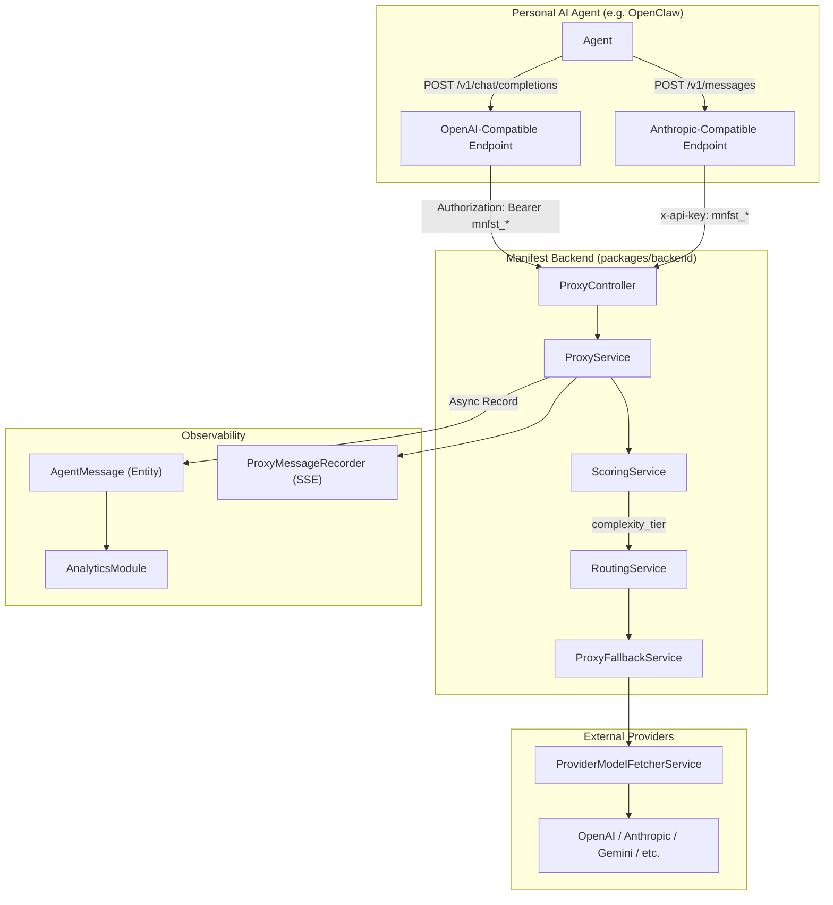
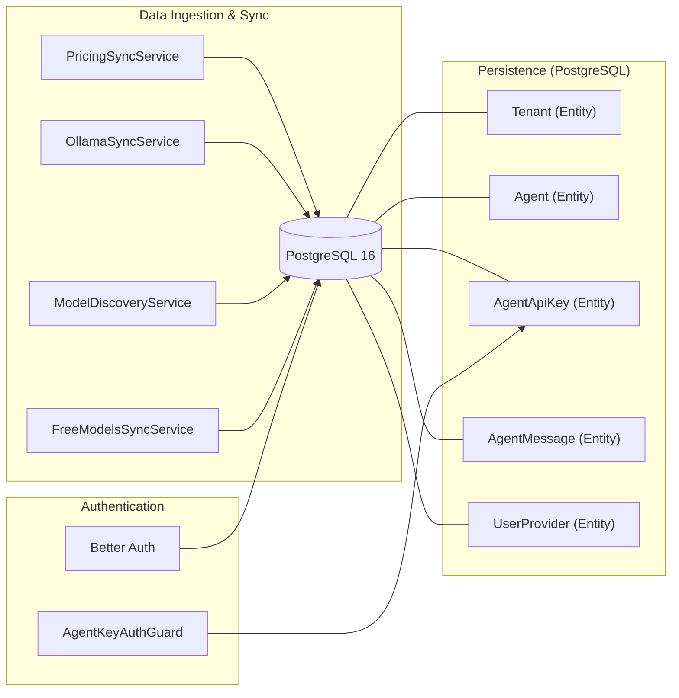

<!-- source: DeepWiki mcp.deepwiki.com · repo mnfst/manifest · page 1 Overview · fetched 2026-10-27 -->

# Overview

Relevant source files

The following files were used as context for generating this wiki page:

- [.changeset/README.md](.changeset/README.md)
- [.changeset/config.json](.changeset/config.json)
- [.github/dependabot.yml](.github/dependabot.yml)
- [.gitignore](.gitignore)
- [CLAUDE.md](CLAUDE.md)
- [CONTRIBUTING.md](CONTRIBUTING.md)
- [README.md](README.md)
- [package-lock.json](package-lock.json)
- [package.json](package.json)
- [packages/backend/package.json](packages/backend/package.json)
- [packages/manifest/CHANGELOG.md](packages/manifest/CHANGELOG.md)
- [packages/manifest/package.json](packages/manifest/package.json)
- [turbo.json](turbo.json)

Manifest is an intelligent Large Language Model (LLM) router designed for **personal AI agents**. It acts as a smart proxy between your agents and LLM providers, utilizing a 23-dimension scoring engine to evaluate each request and route it to the most cost-effective model capable of handling the task [README.md:38-42](), [CLAUDE.md:7-10](). By automatically directing simple queries to lightweight models and reserving complex reasoning for powerful ones, Manifest can reduce inference costs by up to 70% [README.md:38-40]().

### Core Value Proposition

| Feature | Description |
| :--- | :--- |
| **Cost Optimization** | Routes requests based on complexity, specificity, and custom headers [README.md:40-40](). |
| **Automatic Fallbacks** | Iterates through `fallback_models` on 4xx/5xx errors to ensure resilience [README.md:43-43](), [packages/manifest/CHANGELOG.md:22-23](). |
| **Budget Control** | Set hard spending caps and receive email alerts via a dedicated notification system [README.md:42-42](). |
| **Observability** | Real-time dashboard for tracking tokens, costs, and model performance [README.md:42-42](). |
| **Subscription Support** | Reuse existing flat-rate subscriptions like ChatGPT Plus, Claude Pro, or GitHub Copilot [README.md:68-87](). |
| **Anthropic Support** | Native support for Anthropic SDK clients via a compatible `/v1/messages` endpoint [packages/manifest/CHANGELOG.md:59-60](). |

---

### Deployment Modes

Manifest supports two primary deployment strategies. Note that the legacy `manifest` npm package and local SQLite mode are deprecated in favor of PostgreSQL-backed distributions [README.md:61-62](), [packages/manifest/CHANGELOG.md:122-123]().

1.  **Cloud / Managed Mode**:
    *   Hosted at [app.manifest.build](https://app.manifest.build) [README.md:49-49]().
    *   Ideal for quick setup without managing infrastructure.
2.  **Self-Hosted (Docker)**:
    *   The primary and only supported distribution method [README.md:53-54]().
    *   Uses **PostgreSQL 16** as the database and **Better Auth** for session management [CLAUDE.md:54-54]().
    *   Deployed via `docker-compose.yml` or a quick-start `install.sh` script [README.md:55-57]().

For detailed setup instructions, see **[Getting Started](#1.1)** and **[Deployment](#1.2)**.

**Sources:** [README.md:47-62](), [CLAUDE.md:11-30](), [packages/manifest/CHANGELOG.md:122-123]()

---

### Monorepo Structure

The project is organized as a monorepo using **npm workspaces** and **Turborepo** [package.json:29-34](), [CONTRIBUTING.md:26-27]().

| Package | Role | Key Technologies |
| :--- | :--- | :--- |
| `packages/backend` | NestJS API server handling routing, scoring, and analytics [CONTRIBUTING.md:154-160](). | NestJS 11, TypeORM, PostgreSQL 16 |
| `packages/frontend` | SolidJS dashboard for visualization and configuration [CONTRIBUTING.md:161-166](). | SolidJS, Vite, uPlot |
| `packages/shared` | Common TypeScript types and utility functions [CONTRIBUTING.md:168-172](). | TypeScript |
| `packages/manifest` | Canonical release package for Docker image versioning [packages/manifest/package.json:1-6](). | Changesets |
| `packages/wingman` | Dev-only gateway tester for impersonating various agents [CONTRIBUTING.md:144-149](). | SolidJS, Vite |

**Sources:** [package.json:29-34](), [CONTRIBUTING.md:28-33](), [CLAUDE.md:60-120]()

---

### System Architecture Overview

The following diagram illustrates how the various code entities interact during a request lifecycle from a personal AI agent through the proxy.

**Manifest Request Flow**

**Sources:** [CLAUDE.md:7-10](), [CLAUDE.md:111-116](), [CONTRIBUTING.md:108-110](), [packages/manifest/CHANGELOG.md:59-62]()

---

### Code Entity Mapping

The relationship between application services and the persistence layer is managed through TypeORM entities and specialized sync services.

**Entity and Service Mapping**

**Sources:** [CLAUDE.md:74-87](), [CLAUDE.md:108-110](), [packages/manifest/CHANGELOG.md:16-18](), [packages/backend/package.json:20-30]()

---

### Child Pages

*   **[Getting Started](#1.1)**: Guide users through installing and configuring Manifest in both cloud mode and self-hosted Docker mode. Covers the quick-start script and the `/setup` wizard.
*   **[Deployment](#1.2)**: Technical details on Docker multi-stage builds, environment variables (`BETTER_AUTH_SECRET`, `DATABASE_URL`), and deployment via Railway.

---

