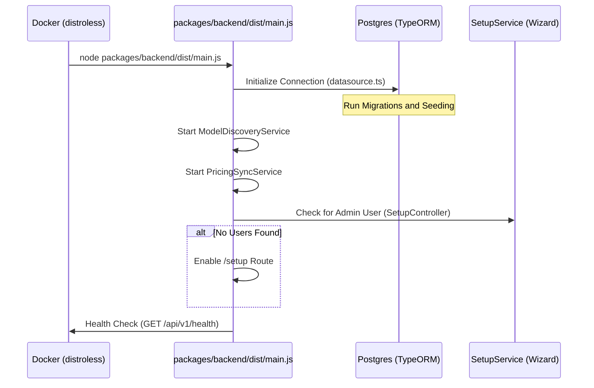

<!-- source: DeepWiki mcp.deepwiki.com · repo mnfst/manifest · page 1.2 Deployment · fetched 2026-10-27 -->

# Deployment

<details>
<summary>Relevant source files</summary>

The following files were used as context for generating this wiki page:

- [.github/workflows/docker-smoke.yml](.github/workflows/docker-smoke.yml)
- [.github/workflows/docker.yml](.github/workflows/docker.yml)
- [docker/.env.example](docker/.env.example)
- [docker/DOCKER_README.md](docker/DOCKER_README.md)
- [docker/Dockerfile](docker/Dockerfile)
- [docker/docker-compose.yml](docker/docker-compose.yml)
- [docker/install.sh](docker/install.sh)
- [packages/backend/.env.example](packages/backend/.env.example)
- [packages/backend/src/analytics/services/agent-analytics.service.ts](packages/backend/src/analytics/services/agent-analytics.service.ts)
- [packages/backend/src/common/common.module.ts](packages/backend/src/common/common.module.ts)
- [packages/backend/src/common/services/manifest-runtime.service.ts](packages/backend/src/common/services/manifest-runtime.service.ts)
- [packages/backend/src/config/app.config.spec.ts](packages/backend/src/config/app.config.spec.ts)
- [packages/backend/src/config/app.config.ts](packages/backend/src/config/app.config.ts)
- [packages/backend/src/routing/oauth/openai-oauth.controller.ts](packages/backend/src/routing/oauth/openai-oauth.controller.ts)
- [packages/backend/src/routing/openai-oauth.controller.spec.ts](packages/backend/src/routing/openai-oauth.controller.spec.ts)
- [railway.toml](railway.toml)

</details>


Manifest is designed for high-availability deployment using Docker as the primary distribution method. It supports self-hosting, a managed cloud service at [app.manifest.build](https://app.manifest.build), and streamlined deployment to PaaS providers like Railway. The system has transitioned away from the legacy npm package and local SQLite mode in favor of a robust PostgreSQL-backed architecture [docker/docker-compose.yml:59]().

## Deployment Options

### 1. Self-Hosted Docker (Primary)
Docker is the only supported distribution for self-hosting. The image is multi-arch (supporting `amd64` and `arm64`) and is signed using Cosign for security verification [.github/workflows/docker.yml:40-198]().

#### Dockerfile Multi-Stage Build
The build process uses a 4-stage pipeline to ensure a small production footprint and secure runtime environment [docker/Dockerfile:1-106]().

1.  **deps**: Uses `node:24-alpine` to install all dependencies (including dev dependencies) for the build using `npm ci` [docker/Dockerfile:10-17]().
2.  **build**: Compiles the frontend, backend, and shared bundles using `npx turbo build`. It sets `VITE_MANIFEST_SELFHOSTED=true` to enable self-hosted UI features [docker/Dockerfile:20-28]().
3.  **prod-deps**: Uses `node:24-slim` to install only production dependencies with `--omit=dev --omit=optional --ignore-scripts`. It purges unnecessary files (e.g., `.map`, `.ts`, `README`, `tests`) to minimize image size and CVE surface [docker/Dockerfile:37-58]().
4.  **runtime**: A distroless `gcr.io/distroless/nodejs24-debian13` runtime that runs as the `nonroot` user. It contains no shell or package manager [docker/Dockerfile:62-106]().

#### Quickstart Script
The `install.sh` script automates the setup by downloading the `docker-compose.yml`, generating a `BETTER_AUTH_SECRET` via `openssl` or `/dev/urandom`, and bringing up the stack [docker/install.sh:1-185]().
```bash
bash <(curl -sSL https://raw.githubusercontent.com/mnfst/manifest/main/docker/install.sh)
```

### 2. Managed Cloud Service
The official managed version at [app.manifest.build](https://app.manifest.build) provides a zero-config experience. It runs the same core engine but is optimized for multi-tenant cloud operations [docker/docker-compose.yml:76]().

### 3. Railway Deployment
Manifest includes a `railway.toml` for deployment to Railway. It defines the build command using `turbo build` and health checks against the `/api/v1/health` endpoint [railway.toml:1-10]().

## Infrastructure Architecture

The following diagram maps the deployment infrastructure to the code entities and services defined in the repository.

Title: Deployment Infrastructure and Code Entity Mapping
```mermaid
graph TD
    subgraph "External"
        "Agent"["Agent (OpenAI SDK/cURL)"] -- "POST /v1/chat/completions" --> "ManifestContainer"
        "User"["Admin User"] -- "HTTPS (Dashboard)" --> "ManifestContainer"
    end

    subgraph "Manifest Docker Container [docker/Dockerfile]"
        "ManifestContainer"["distroless/nodejs24"] --> "Backend"["packages/backend/dist/main.js"]
        "Backend" --> "Auth"["Better Auth (auth.instance.ts)"]
        "Backend" --> "Proxy"["ProxyController.ts"]
    end

    subgraph "Persistence & Services [docker/docker-compose.yml]"
        "Backend" -- "TypeORM" --> "PostgresDB"["PostgreSQL 16 (postgres:16-alpine)"]
        "Backend" -- "Ollama API" --> "Ollama"["Ollama Host (OLLAMA_HOST)"]
        "Backend" -- "SMTP/HTTP" --> "EmailSvc"["EmailProviderConfigService.ts"]
    end
```
Sources: [docker/Dockerfile:62-106](), [docker/docker-compose.yml:44-133](), [packages/backend/src/config/app.config.ts:3-14]()

## Configuration

### Environment Variables
Configuration is managed via environment variables defined in `app.config.ts` [packages/backend/src/config/app.config.ts:11-38]().

| Variable | Requirement | Description |
| :--- | :--- | :--- |
| `DATABASE_URL` | **Required** | PostgreSQL connection string. SQLite is deprecated [packages/backend/src/config/app.config.ts:3-9](). |
| `BETTER_AUTH_SECRET` | **Required** | Secret for session signing. Min 32 chars [packages/backend/.env.example:2](). |
| `MANIFEST_ENCRYPTION_KEY` | Recommended | Key for AES-256-GCM encryption of provider credentials [packages/backend/.env.example:5-11](). |
| `PORT` | Optional | App port on host. Default: `2099` (Self-hosted) or `3001` (Backend default) [docker/docker-compose.yml:58](). |
| `EMAIL_*` Suite | Optional | Includes `EMAIL_PROVIDER` (resend, mailgun, sendgrid), `EMAIL_API_KEY`, `EMAIL_DOMAIN`, and `EMAIL_FROM` [packages/backend/src/config/app.config.ts:25-29](). |
| `OLLAMA_HOST` | Optional | URL for local LLM servers. Default: `http://host.docker.internal:11434` [docker/docker-compose.yml:67](). |
| `AUTO_MIGRATE` | Optional | Handled by `DatabaseSeederService` on boot to ensure schema parity [docker/docker-compose.yml:105-108](). |

### Ollama Integration
To connect local LLM servers like Ollama, Manifest uses the `host.docker.internal` gateway to reach services running on the Docker host [docker/docker-compose.yml:48-53](). No specific Docker profile is required; the backend automatically attempts to sync models if `OLLAMA_HOST` is reachable [docker/docker-compose.yml:67]().

## Data Flow and Initialization

When the container starts, it executes the compiled NestJS entrypoint. The system handles database initialization and initial data seeding automatically if `SEED_DATA` is enabled [docker/docker-compose.yml:68]().

Title: System Bootstrap Sequence

Sources: [docker/Dockerfile:106](), [docker/docker-compose.yml:101-102](), [packages/backend/src/config/app.config.ts:11-38]()

## Production Hardening
The default deployment configuration follows security best practices:

*   **Distroless Runtime**: The production image uses `gcr.io/distroless/nodejs24-debian13`, containing no shell to minimize RCE impact [docker/Dockerfile:62]().
*   **Non-Root User**: The container runs as `nonroot` (UID 65532) [docker/Dockerfile:60]().
*   **Read-Only Root FS**: The `docker-compose.yml` sets `read_only: true`, using a `tmpfs` for `/tmp` [docker/docker-compose.yml:119-121]().
*   **Resource Limits**: Memory is capped at 1GB and PIDs at 512 [docker/docker-compose.yml:126-127]().
*   **Security Opts**: `no-new-privileges` is enabled and all Linux capabilities are dropped [docker/docker-compose.yml:122-125]().

Sources: [docker/Dockerfile:1-106](), [docker/docker-compose.yml:1-160](), [docker/.env.example:1-90]()

---

