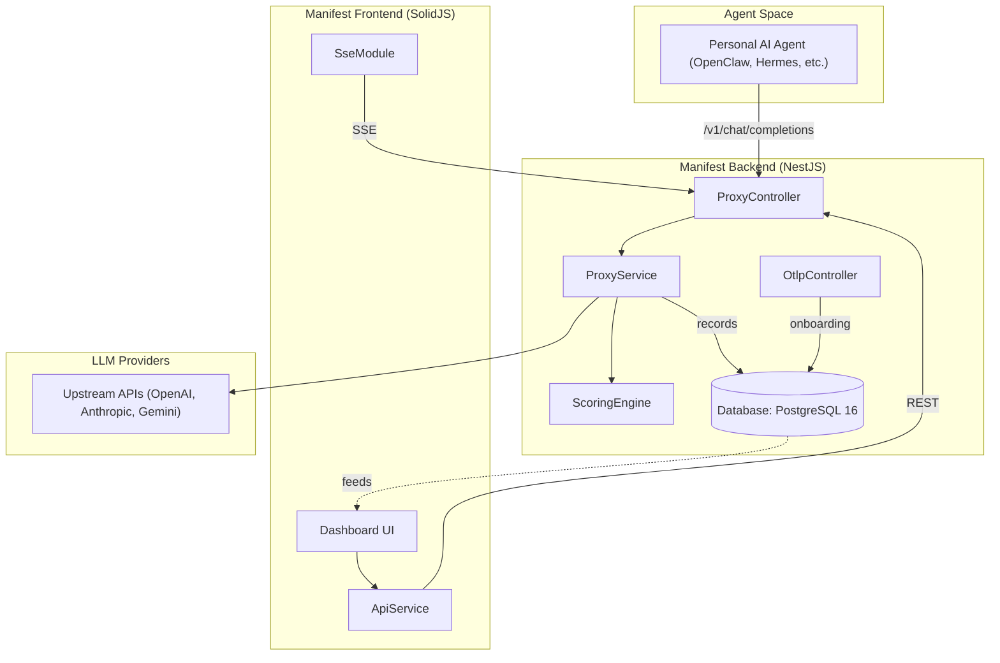
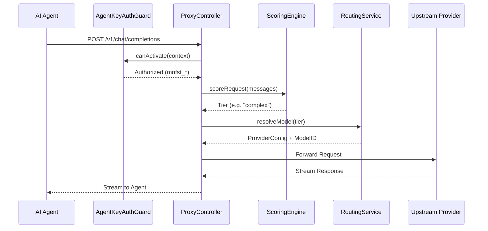

<!-- source: DeepWiki mcp.deepwiki.com · repo mnfst/manifest · page 2 Architecture · fetched 2026-10-27 -->

# Architecture

Relevant source files

The following files were used as context for generating this wiki page:

- [.changeset/README.md](.changeset/README.md)
- [.changeset/config.json](.changeset/config.json)
- [.github/dependabot.yml](.github/dependabot.yml)
- [.gitignore](.gitignore)
- [CLAUDE.md](CLAUDE.md)
- [CONTRIBUTING.md](CONTRIBUTING.md)
- [README.md](README.md)
- [package-lock.json](package-lock.json)
- [package.json](package.json)
- [packages/backend/package.json](packages/backend/package.json)
- [packages/backend/src/app.module.ts](packages/backend/src/app.module.ts)
- [packages/backend/src/common/filters/spa-fallback.filter.spec.ts](packages/backend/src/common/filters/spa-fallback.filter.spec.ts)
- [packages/backend/src/common/filters/spa-fallback.filter.ts](packages/backend/src/common/filters/spa-fallback.filter.ts)
- [packages/backend/src/common/utils/frontend-path.spec.ts](packages/backend/src/common/utils/frontend-path.spec.ts)
- [packages/backend/src/common/utils/frontend-path.ts](packages/backend/src/common/utils/frontend-path.ts)
- [packages/backend/test/helpers.ts](packages/backend/test/helpers.ts)
- [packages/backend/test/smoke-test.e2e-spec.ts](packages/backend/test/smoke-test.e2e-spec.ts)
- [packages/manifest/CHANGELOG.md](packages/manifest/CHANGELOG.md)
- [packages/manifest/package.json](packages/manifest/package.json)
- [turbo.json](turbo.json)

Manifest is a distributed system designed to optimize LLM inference costs through intelligent routing and observability. It is built as a TypeScript monorepo using **Turborepo** and **npm workspaces** [package.json:29-34](). The system consists of a high-performance NestJS backend, a reactive SolidJS dashboard, and a shared library that ensures type safety across the stack.

### System Overview

The architecture supports two primary deployment modes: **Self-hosted Docker** (the primary distribution) and **Cloud** (managed service at app.manifest.build) [README.md:46-62](). In both modes, Manifest acts as an OpenAI-compatible proxy that intercepts chat completion requests to perform real-time scoring and model selection.

High-level Component Interaction:
1.  **Personal AI Agent**: Sends requests to the `manifest/auto` virtual model via an OpenAI-compatible endpoint [README.md:38-40]().
2.  **Manifest Proxy**: Scores the request across 23 dimensions (latency <2ms) [README.md:66-67]().
3.  **Routing Engine**: Maps the score to a tier (Simple, Standard, Complex, Reasoning) and selects the optimal provider [README.md:66-67]().
4.  **LLM Provider**: Processes the request (OpenAI, Anthropic, Google, etc.) [README.md:68-87]().
5.  **Analytics Pipeline**: Records metadata, tokens, and costs for the Dashboard [README.md:42]().

### Component Relationship Diagram

The following diagram illustrates how the core packages interact and how code entities bridge the gap between the user's natural language request and the underlying execution.

"System Component Architecture"

Sources: [README.md:38-45](), [packages/backend/src/app.module.ts:1-50](), [CLAUDE.md:63-120]()

### Request Lifecycle: Agent to Provider

The request lifecycle is designed for minimal overhead while maximizing cost savings. When an agent targets `manifest/auto`, the request flows through the following pipeline:

1.  **Ingress**: The `ProxyController` receives an OpenAI-compatible POST request [CLAUDE.md:111-112]().
2.  **Authentication**: `AgentKeyAuthGuard` validates the `mnfst_*` API key or applies a loopback bypass in development [CLAUDE.md:108-110]().
3.  **Scoring**: The request body is passed to the scoring engine to evaluate complexity dimensions like token count and tool definitions [CLAUDE.md:115-116]().
4.  **Resolution**: The system selects a model from connected provider credentials based on the calculated tier [CLAUDE.md:112-114]().
5.  **Execution**: The proxy forwards the request to the upstream provider, handling streaming and potential fallbacks if the primary model fails [README.md:41-43]().
6.  **Telemetry**: Usage data (tokens, costs, duration) is persisted via TypeORM entities such as `LlmCall` and `AgentMessage` [CLAUDE.md:82-87](), [packages/backend/test/helpers.ts:12-13]().

"Request Flow to Code Entity Mapping"

Sources: [packages/backend/src/app.module.ts:1-50](), [CLAUDE.md:108-116](), [README.md:65-67]()

### Subsystems

Manifest is divided into four major architectural subsystems:

| Subsystem | Responsibility | Key Technologies |
| :--- | :--- | :--- |
| **[Backend (NestJS)](#2.1)** | API, Proxy, Scoring, Persistence | NestJS 11, TypeORM, Better Auth |
| **[Frontend (SolidJS Dashboard)](#2.2)** | Real-time Dashboard, Analytics UI | SolidJS, Vite, uPlot |
| **[Agent Integration](#2.3)** | Agent Onboarding, API Keys | OpenAI SDK, OtlpModule |
| **[Shared Package](#2.4)** | Common Types and Utilities | TypeScript |

#### Backend (NestJS)
The core engine. It manages multi-tenant data, handles the proxy pipeline, and performs background tasks like pricing synchronization and model discovery. It primarily supports PostgreSQL 16 [CLAUDE.md:54-57](). The backend also serves the frontend assets via `ServeStaticModule` and handles SPA routing via `SpaFallbackFilter` [packages/backend/src/common/filters/spa-fallback.filter.ts:10-11]().
For details, see **[Backend (NestJS)](#2.1)**.

#### Frontend (SolidJS Dashboard)
A reactive SPA that provides visibility into agent spending and routing performance. It connects to the backend via a REST API and uses Server-Sent Events (SSE) for real-time updates [packages/backend/test/helpers.ts:31]().
For details, see **[Frontend (SolidJS Dashboard)](#2.2)**.

#### Agent Integration
Manifest acts as a generic OpenAI-compatible HTTP endpoint. It supports a variety of agents including OpenClaw, Hermes, and standard SDKs [CLAUDE.md:9-10](). The `OtlpModule` and `AgentKeyAuthGuard` manage the onboarding and authentication of these agents [CLAUDE.md:107-110]().
For details, see **[Agent Integration](#2.3)**.

#### Shared Package
Provides the "source of truth" for types and constants. This ensures that the frontend and backend agree on entity structures, routing tiers, and API response shapes [package.json:30]().
For details, see **[Shared Package](#2.4)**.

Sources: [package.json:29-34](), [CONTRIBUTING.md:29-35](), [CLAUDE.md:63-120]()

---

