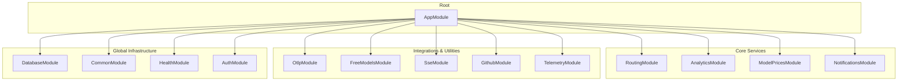
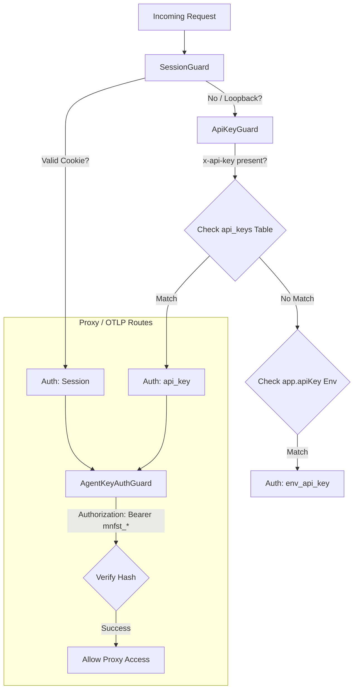
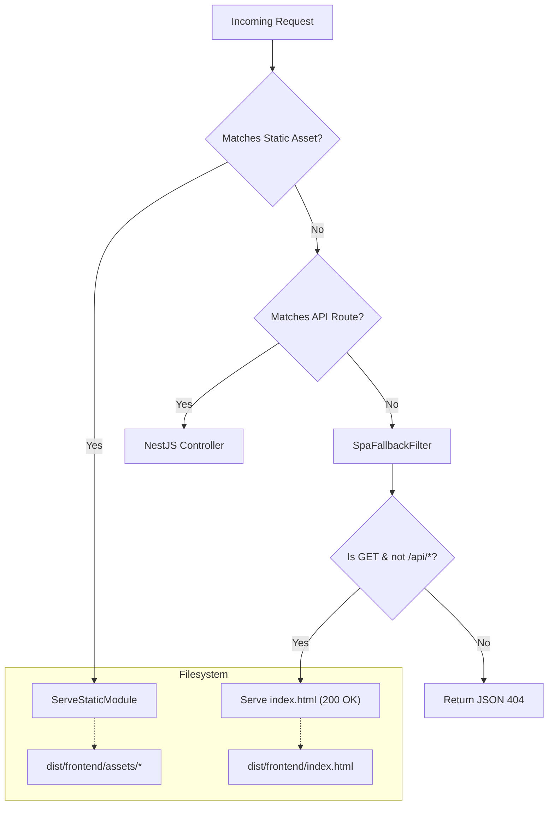

<!-- source: DeepWiki mcp.deepwiki.com · repo mnfst/manifest · page 2.1 Backend (NestJS) · fetched 2026-10-27 -->

# Backend (NestJS)

Relevant source files

The following files were used as context for generating this wiki page:

- [packages/backend/src/app.module.ts](packages/backend/src/app.module.ts)
- [packages/backend/src/auth/session.guard.spec.ts](packages/backend/src/auth/session.guard.spec.ts)
- [packages/backend/src/auth/session.guard.ts](packages/backend/src/auth/session.guard.ts)
- [packages/backend/src/common/filters/spa-fallback.filter.spec.ts](packages/backend/src/common/filters/spa-fallback.filter.spec.ts)
- [packages/backend/src/common/filters/spa-fallback.filter.ts](packages/backend/src/common/filters/spa-fallback.filter.ts)
- [packages/backend/src/common/guards/api-key.guard.ts](packages/backend/src/common/guards/api-key.guard.ts)
- [packages/backend/src/common/utils/frontend-path.spec.ts](packages/backend/src/common/utils/frontend-path.spec.ts)
- [packages/backend/src/common/utils/frontend-path.ts](packages/backend/src/common/utils/frontend-path.ts)
- [packages/backend/src/common/utils/local-ip.ts](packages/backend/src/common/utils/local-ip.ts)
- [packages/backend/src/main.ts](packages/backend/src/main.ts)
- [packages/backend/src/otlp/guards/agent-key-auth.guard.spec.ts](packages/backend/src/otlp/guards/agent-key-auth.guard.spec.ts)
- [packages/backend/src/otlp/guards/agent-key-auth.guard.ts](packages/backend/src/otlp/guards/agent-key-auth.guard.ts)
- [packages/backend/src/routing/oauth/openai-oauth.service.ts](packages/backend/src/routing/oauth/openai-oauth.service.ts)
- [packages/backend/src/routing/openai-oauth.service.spec.ts](packages/backend/src/routing/openai-oauth.service.spec.ts)
- [packages/backend/src/routing/routing.module.ts](packages/backend/src/routing/routing.module.ts)
- [packages/backend/test/helpers.ts](packages/backend/test/helpers.ts)
- [packages/backend/test/smoke-test.e2e-spec.ts](packages/backend/test/smoke-test.e2e-spec.ts)
- [packages/frontend/src/services/api/core.ts](packages/frontend/src/services/api/core.ts)

The Manifest backend is a NestJS application that serves as the central control plane for intelligent LLM routing. It handles request proxying, model discovery, telemetry processing, and serves the SolidJS dashboard.

## Application Lifecycle & Bootstrap

The application entry point is `bootstrap()` in `packages/backend/src/main.ts`. It initializes the NestJS factory with `AppModule` and configures global middleware.

### Bootstrap Sequence
1.  **Filter & Hooks**: Registers `SpaFallbackFilter` to handle frontend routing and enables shutdown hooks [packages/backend/src/main.ts:17-18]().
2.  **Security**: Applies `helmet` with a strict Content Security Policy (CSP). It explicitly disables `upgradeInsecureRequests` to support HTTP-only LAN deployments where browsers might otherwise break asset loading [packages/backend/src/main.ts:35-63]().
3.  **Validation**: Sets up a global `ValidationPipe` for DTO transformation and strict property whitelisting [packages/backend/src/main.ts:102-107]().
4.  **Reverse Proxy Trust**: In production mode, the Express instance is configured via `trust proxy` to correctly identify client IPs from headers like `X-Forwarded-For`. This is restricted to loopback and private subnets by default to prevent IP spoofing [packages/backend/src/main.ts:121-135]().
5.  **Auth Mounting**:
    *   **Rate Limiting**: Applies specific `express-rate-limit` instances to authentication endpoints. `/api/auth/sign-in` is limited to 20 attempts per 15 minutes, while sensitive routes like `forget-password` are capped at 5 [packages/backend/src/main.ts:141-176]().
    *   **Better Auth**: Mounts the `Better Auth` node handler to `/api/auth/*` before standard body parsing to allow it to handle raw requests [packages/backend/src/main.ts:178-180]().
6.  **Server Start**: Binds to the configured `PORT` (default 3001) and `BIND_ADDRESS` [packages/backend/src/main.ts:186-188]().

### Security Middleware
| Middleware | Function | Implementation |
| :--- | :--- | :--- |
| **Helmet** | Sets security headers (CSP, HSTS, etc.) | [packages/backend/src/main.ts:35-63]() |
| **CORS** | Restricted to `CORS_ORIGIN` and Wingman dev ports in dev mode | [packages/backend/src/main.ts:80-100]() |
| **Rate Limiting** | `express-rate-limit` on auth endpoints (login, signup, reset) | [packages/backend/src/main.ts:140-176]() |
| **HttpErrorLogger** | Logs 4xx/5xx errors with IP and User-Agent context | [packages/backend/src/main.ts:111](), [packages/backend/src/common/middleware/http-error-logger.middleware.ts:25-43]() |
| **Encryption** | AES-256-GCM for provider credentials at rest | [packages/backend/src/common/utils/crypto.util.ts:4-79]() |

**Sources:** [packages/backend/src/main.ts:1-188](), [packages/backend/src/common/middleware/http-error-logger.middleware.ts:1-43]()

---

## Module Structure

`AppModule` acts as the root, orchestrating specialized modules that handle the core business logic.

### AppModule Composition
`AppModule` imports several key modules [packages/backend/src/app.module.ts:53-78]():
*   **RoutingModule**: Handles the `/v1/chat/completions` proxy and routing logic [packages/backend/src/routing/routing.module.ts:19-42]().
*   **AnalyticsModule**: Provides dashboard stats (tokens, costs, message logs).
*   **OtlpModule**: Manages agent onboarding and the OpenTelemetry-compatible ingestion pipeline.
*   **ModelPricesModule**: Manages model pricing data and synchronization.
*   **NotificationsModule**: Handles usage limits and threshold alerts.
*   **FreeModelsModule**: Manages discovery and routing for free-tier LLM providers.
*   **GithubModule**: Integration for GitHub Copilot and model discovery.
*   **SseModule**: Provides real-time server-sent events for the dashboard.
*   **TelemetryModule**: Internal system telemetry and error reporting.

### Code Entity Mapping: Application Composition
Title: NestJS Module Dependency Graph

**Sources:** [packages/backend/src/app.module.ts:1-86]()

---

## Authentication & Guards

Manifest uses a multi-layered guard system to protect dashboard and agent endpoints.

### Global Guards
`AppModule` registers three global guards in sequence [packages/backend/src/app.module.ts:80-84]():
1.  **SessionGuard**: Protects dashboard `/api/` routes using `Better Auth` sessions. In `selfhosted` mode, it allows a loopback bypass for local programmatic access [packages/backend/src/auth/session.guard.ts:93-101]().
2.  **ApiKeyGuard**: Validates `x-api-key` headers against the `ApiKey` entity for administrative API access [packages/backend/src/common/guards/api-key.guard.ts:41-70]().
3.  **ThrottlerGuard**: Enforces global rate limits (configured via `THROTTLE_TTL` and `THROTTLE_LIMIT`) [packages/backend/src/app.module.ts:57-62]().

### Agent Authentication
The `OtlpModule` utilizes the `AgentKeyAuthGuard` to protect proxy and telemetry endpoints. It validates keys with the `mnfst_` prefix using a 5-minute in-memory cache to reduce database load during high-frequency inference [packages/backend/src/otlp/guards/agent-key-auth.guard.ts:37-42](). Keys are verified using a scrypt-based hash utility [packages/backend/src/otlp/guards/agent-key-auth.guard.ts:174]().

### Code Entity Mapping: Authentication Flow
Title: Multi-Tier Authentication Logic

**Sources:** [packages/backend/src/auth/session.guard.ts:18-139](), [packages/backend/src/common/guards/api-key.guard.ts:19-96](), [packages/backend/src/otlp/guards/agent-key-auth.guard.ts:86-117]()

---

## Frontend Integration (SPA Fallback)

The backend serves the compiled SolidJS frontend directly, ensuring a unified deployment.

### SpaFallbackFilter
The `SpaFallbackFilter` is a global NestJS filter that catches `NotFoundException` (404) errors. If the request is a `GET` method and does not target API paths (`/api/`, `/v1/`, `/otlp/`), it serves the frontend's `index.html` [packages/backend/src/common/filters/spa-fallback.filter.ts:24-42](). This enables client-side routing for the Single Page Application (SPA).

### ServeStatic Configuration
`AppModule` configures `ServeStaticModule` to serve assets from the frontend directory. It applies a one-year cache header to immutable assets but explicitly sets `Cache-Control: no-cache` for `index.html` to ensure users always receive the latest version of the application entry point [packages/backend/src/app.module.ts:32-48]().

### Code Entity Mapping: SPA Routing Flow
Title: SPA Fallback and Static Serving

**Sources:** [packages/backend/src/app.module.ts:30-50](), [packages/backend/src/common/filters/spa-fallback.filter.ts:7-54]()

---

## OAuth Integration

Manifest supports OAuth-based model discovery and routing for providers like OpenAI (ChatGPT Plus subscriptions).

### OpenaiOauthService
The `OpenaiOauthService` manages the PKCE-based OAuth flow. In development mode, it spins up a temporary loopback callback server on port 1455 to handle the redirect from OpenAI [packages/backend/src/routing/oauth/openai-oauth.service.ts:17-41]().

Key functions include:
*   `generateAuthorizationUrl`: Creates the authorize URL with a random state and code challenge [packages/backend/src/routing/oauth/openai-oauth.service.ts:44-77]().
*   `exchangeCode`: Exchanges the authorization code for an access/refresh token pair and stores them as an encrypted blob in the `UserProvider` entity [packages/backend/src/routing/oauth/openai-oauth.service.ts:79-128]().
*   `unwrapToken`: Automatically refreshes expired access tokens using the stored refresh token [packages/backend/src/routing/oauth/openai-oauth.service.ts:158-182]().

**Sources:** [packages/backend/src/routing/oauth/openai-oauth.service.ts:22-182]()

---

