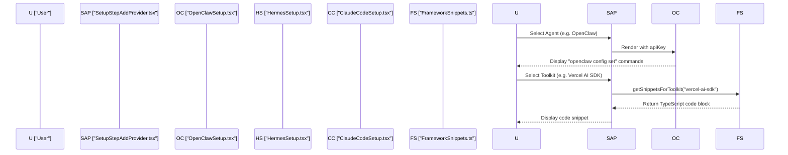
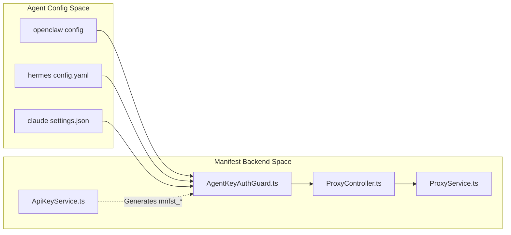

<!-- source: DeepWiki mcp.deepwiki.com · repo mnfst/manifest · page 2.3 Agent Integration · fetched 2026-10-27 -->

# Agent Integration

<details>
<summary>Relevant source files</summary>

The following files were used as context for generating this wiki page:

- [.changeset/README.md](.changeset/README.md)
- [.changeset/config.json](.changeset/config.json)
- [.github/dependabot.yml](.github/dependabot.yml)
- [.gitignore](.gitignore)
- [CLAUDE.md](CLAUDE.md)
- [CONTRIBUTING.md](CONTRIBUTING.md)
- [README.md](README.md)
- [package-lock.json](package-lock.json)
- [package.json](package.json)
- [packages/backend/package.json](packages/backend/package.json)
- [packages/backend/src/otlp/services/api-key.service.spec.ts](packages/backend/src/otlp/services/api-key.service.spec.ts)
- [packages/backend/src/otlp/services/api-key.service.ts](packages/backend/src/otlp/services/api-key.service.ts)
- [packages/frontend/public/icons/providers/claude-code.svg](packages/frontend/public/icons/providers/claude-code.svg)
- [packages/frontend/src/components/ClaudeCodeSetup.tsx](packages/frontend/src/components/ClaudeCodeSetup.tsx)
- [packages/frontend/src/components/FrameworkSnippets.tsx](packages/frontend/src/components/FrameworkSnippets.tsx)
- [packages/frontend/src/components/HermesSetup.tsx](packages/frontend/src/components/HermesSetup.tsx)
- [packages/frontend/src/components/OpenClawSetup.tsx](packages/frontend/src/components/OpenClawSetup.tsx)
- [packages/frontend/src/components/SetupStepAddProvider.tsx](packages/frontend/src/components/SetupStepAddProvider.tsx)
- [packages/frontend/src/services/framework-snippets.ts](packages/frontend/src/services/framework-snippets.ts)
- [packages/frontend/tests/components/FrameworkSnippets.test.tsx](packages/frontend/tests/components/FrameworkSnippets.test.tsx)
- [packages/frontend/tests/components/HermesSetup.test.tsx](packages/frontend/tests/components/HermesSetup.test.tsx)
- [packages/frontend/tests/components/OpenClawSetup.test.tsx](packages/frontend/tests/components/OpenClawSetup.test.tsx)
- [packages/frontend/tests/components/SetupStepAddProvider.test.tsx](packages/frontend/tests/components/SetupStepAddProvider.test.tsx)
- [packages/frontend/tests/services/framework-snippets.test.ts](packages/frontend/tests/services/framework-snippets.test.ts)
- [turbo.json](turbo.json)

</details>


Manifest acts as a smart LLM model router and observability layer for personal AI agents. It functions as a generic OpenAI-compatible HTTP endpoint, allowing any agent or SDK that supports the OpenAI API format to connect seamlessly. This integration enables intelligent request scoring, cost-optimized routing to the `manifest/auto` virtual model, and automated telemetry collection.

## Supported Agent Types

Manifest identifies and optimizes for various personal AI agent frameworks. Supported types are defined in the shared package and used to drive the UI onboarding experience and analytics categorization.

| Agent Type | Description |
| :--- | :--- |
| `openclaw` | Integration for the OpenClaw agent framework. |
| `hermes` | Support for the Hermes agent via `config.yaml`. |
| `claude-code` | Support for Anthropic's Claude Code CLI via `settings.json`. |
| `openai-sdk` | Standard OpenAI Node.js or Python SDKs. |
| `vercel-ai-sdk` | Vercel AI SDK (AI Core) with custom provider configuration. |
| `langchain` | LangChain framework integrations using `ChatOpenAI`. |
| `curl` | Direct HTTP requests via CLI or scripts. |
| `other` | Generic fallback for any OpenAI-compatible client. |

**Sources:**
- [packages/shared/src/agent-type.ts:1-20]()
- [packages/frontend/src/services/framework-snippets.ts:1-30]()
- [packages/frontend/src/components/SetupStepAddProvider.tsx:18-23]()

---

## The `manifest/auto` Virtual Model

The core of Manifest's integration is the `manifest/auto` virtual model. Instead of targeting a specific LLM (like `gpt-4o` or `claude-3.5-sonnet`), agents point their requests to `manifest/auto`.

1. **Endpoint**: Agents use the Manifest proxy URL, typically `http://localhost:3001/v1` for local installs or `https://app.manifest.build/v1` for cloud users [packages/frontend/tests/components/SetupStepAddProvider.test.tsx:14-15]().
2. **Routing**: The proxy intercepts requests for `auto`, runs them through the scoring engine, and routes them to the most cost-effective provider tier.
3. **Compatibility**: The interface remains 100% OpenAI-compatible, supporting both standard Chat Completions and the newer Responses API [packages/frontend/src/services/framework-snippets.ts:48-51]().

---

## Agent API Keys (`mnfst_*`)

Authentication for agents is handled via `AgentApiKey` entities. These keys use a specific format and are managed through the `OtlpModule` infrastructure.

### Key Characteristics
- **Prefix**: All agent keys are prefixed with `mnfst_` [packages/backend/src/otlp/services/api-key.service.ts:10-15]().
- **Hashing**: Keys are hashed using the `scrypt` KDF via `hash.util.ts` before being stored in the database for security [packages/backend/src/otlp/services/api-key.service.ts:45-50]().
- **Onboarding**: The `ApiKeyService` in the `OtlpModule` orchestrates the creation of a `Tenant`, an `Agent`, and the associated `AgentApiKey` during the initial setup flow [packages/backend/src/otlp/services/api-key.service.ts:20-40]().

### UI Onboarding Logic
The `SetupStepAddProvider` component guides users through connecting their agents by generating the correct snippets and configuration values.

Title: Frontend Setup Flow


**Sources:**
- [packages/backend/src/otlp/services/api-key.service.ts:1-60]()
- [packages/frontend/src/components/SetupStepAddProvider.tsx:25-47]()
- [packages/frontend/src/services/framework-snippets.ts:117-158]()

---

## Agent Integration Details

Manifest provides tailored instructions for connecting various agents. Note that there are no longer first-party OpenClaw plugins in this repository; it connects as a generic provider.

### OpenClaw Integration
OpenClaw users can configure Manifest using the `openclaw config set` command or the `openclaw onboard` interactive wizard [packages/frontend/src/components/OpenClawSetup.tsx:82-99]().

```bash
# Register Manifest as a custom provider in OpenClaw
openclaw config set models.providers.manifest '{
  "baseUrl": "http://localhost:3001/v1",
  "api": "openai-completions",
  "apiKey": "mnfst_YOUR_KEY",
  "models": [{"id": "auto", "name": "Manifest Auto"}]
}'
```

### Claude Code Integration
For Anthropic's `claude` CLI, Manifest provides a JSON snippet for `~/.claude/settings.json` that overrides the `ANTHROPIC_BASE_URL` and `ANTHROPIC_AUTH_TOKEN` [packages/frontend/src/components/ClaudeCodeSetup.tsx:53-57]().

Title: Agent to Code Entity Mapping


**Sources:**
- [packages/frontend/src/components/OpenClawSetup.tsx:71-75]()
- [packages/frontend/src/components/ClaudeCodeSetup.tsx:41-51]()
- [packages/backend/src/otlp/guards/agent-key-auth.guard.ts:10-30]()

---

## Framework and SDK Integration

For developers using standard SDKs, Manifest provides code snippets that override the default provider settings.

### OpenAI SDK (Node.js/Python)
The SDK is initialized with the Manifest `baseURL` and the `mnfst_` API key. It supports both the legacy Chat Completions and the new Responses API [packages/frontend/src/services/framework-snippets.ts:140-160]().

### Vercel AI SDK
Integration is achieved by using the `createOpenAI` provider factory, passing the Manifest endpoint as the `baseURL` [packages/frontend/src/services/framework-snippets.ts:230-242]().

### LangChain
The `ChatOpenAI` class is used with the `base_url` parameter set to the Manifest instance [packages/frontend/src/services/framework-snippets.ts:225-237]().

| Toolkit | Implementation Method | Code Entity Reference |
| :--- | :--- | :--- |
| **OpenAI SDK** | Constructor Overrides | `getOpenAIChatTypeScriptSnippet` |
| **Vercel AI SDK** | `createOpenAI` factory | `getTypeScriptSnippets` |
| **LangChain** | `ChatOpenAI` constructor | `getPythonSnippets` |
| **cURL** | Header `-H "Authorization: Bearer ..."` | `getCurlSnippet` |

**Sources:**
- [packages/frontend/src/services/framework-snippets.ts:139-159]()
- [packages/frontend/src/services/framework-snippets.ts:220-242]()
- [packages/frontend/src/services/framework-snippets.ts:260-267]()

---

## Development Mode Loopback Bypass

For local development, the `AgentKeyAuthGuard` includes a "loopback bypass". When Manifest is running in self-hosted mode and a request originates from a loopback IP (e.g., `127.0.0.1`), the guard accepts any non-`mnfst_*` token. This simplifies local testing with tools like OpenClaw without requiring a valid database-backed key [CLAUDE.md:52-53]().

**Sources:**
- [packages/backend/src/otlp/guards/agent-key-auth.guard.ts:15-25]()
- [CLAUDE.md:51-53]()

---

