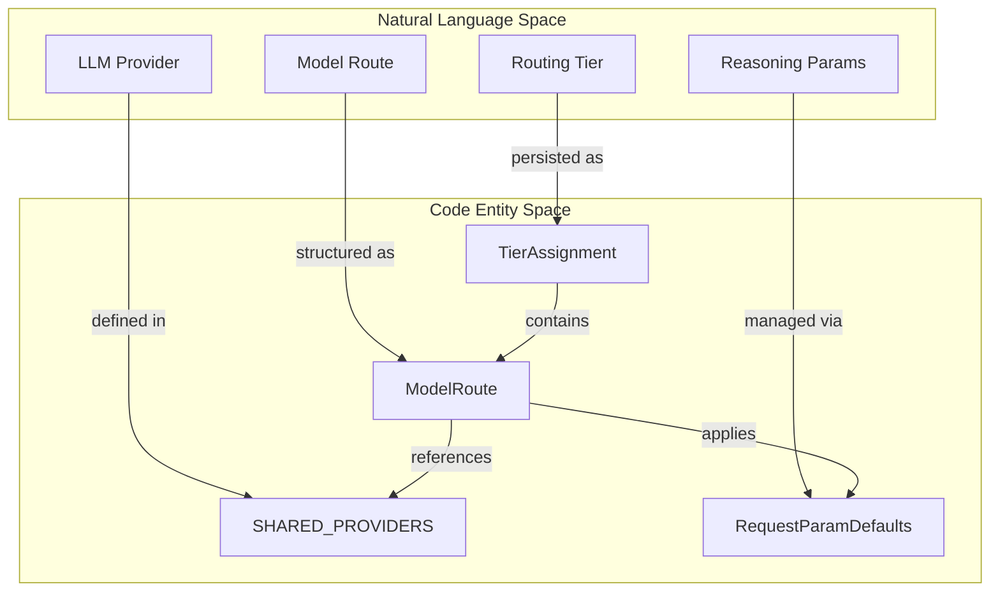
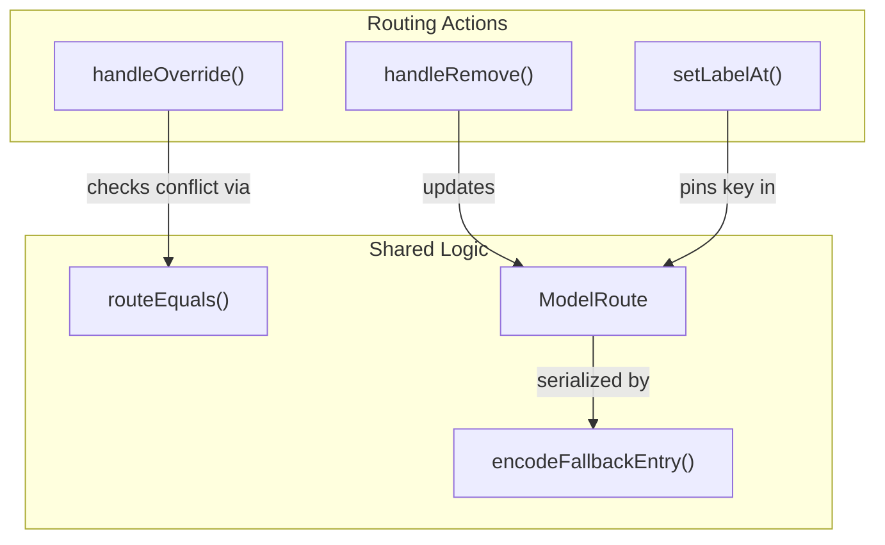

<!-- source: DeepWiki mcp.deepwiki.com · repo mnfst/manifest · page 2.4 Shared Package · fetched 2026-10-27 -->

# Shared Package

Relevant source files

The following files were used as context for generating this wiki page:

- [packages/backend/src/common/utils/crypto.util.ts](packages/backend/src/common/utils/crypto.util.ts)
- [packages/frontend/src/components/FallbackList.tsx](packages/frontend/src/components/FallbackList.tsx)
- [packages/frontend/src/components/ModelParamsDialog.tsx](packages/frontend/src/components/ModelParamsDialog.tsx)
- [packages/frontend/src/pages/RoutingTierCard.tsx](packages/frontend/src/pages/RoutingTierCard.tsx)
- [packages/frontend/src/services/routing-utils.ts](packages/frontend/src/services/routing-utils.ts)
- [packages/frontend/src/styles/routing.css](packages/frontend/src/styles/routing.css)
- [packages/frontend/tests/components/FallbackList.test.tsx](packages/frontend/tests/components/FallbackList.test.tsx)
- [packages/frontend/tests/components/ProviderKeyForm.test.tsx](packages/frontend/tests/components/ProviderKeyForm.test.tsx)
- [packages/frontend/tests/components/RoutingModals.test.tsx](packages/frontend/tests/components/RoutingModals.test.tsx)
- [packages/frontend/tests/pages/RoutingActions.test.ts](packages/frontend/tests/pages/RoutingActions.test.ts)
- [packages/frontend/tests/pages/RoutingPanels.test.tsx](packages/frontend/tests/pages/RoutingPanels.test.tsx)
- [packages/frontend/tests/pages/RoutingTierCard.test.tsx](packages/frontend/tests/pages/RoutingTierCard.test.tsx)
- [packages/frontend/tests/services/routing-utils.test.ts](packages/frontend/tests/services/routing-utils.test.ts)
- [packages/frontend/tests/services/routing.test.ts](packages/frontend/tests/services/routing.test.ts)
- [packages/shared/__tests__/fallback-encoding.spec.ts](packages/shared/__tests__/fallback-encoding.spec.ts)
- [packages/shared/__tests__/model-route.spec.ts](packages/shared/__tests__/model-route.spec.ts)
- [packages/shared/__tests__/subscription.spec.ts](packages/shared/__tests__/subscription.spec.ts)
- [packages/shared/__tests__/thinking-defaults.spec.ts](packages/shared/__tests__/thinking-defaults.spec.ts)
- [packages/shared/src/index.ts](packages/shared/src/index.ts)
- [packages/shared/src/subscription/configs.ts](packages/shared/src/subscription/configs.ts)
- [packages/shared/src/thinking-defaults.ts](packages/shared/src/thinking-defaults.ts)

The Shared Package (`manifest-shared`) provides a centralized set of TypeScript definitions, constants, and utility functions that unify the **Backend (NestJS)** and **Frontend (SolidJS)**. It ensures type safety across the monorepo, specifically for API responses, provider configurations, authentication types, and the intelligent routing logic.

## Package Architecture

The package is structured as a dual-module library, supporting both CommonJS and ESM to ensure compatibility with the NestJS backend and the Vite-based SolidJS frontend [packages/shared/src/index.ts:1-66]().

*   **Exports**: It exposes core routing logic, tier definitions, provider inference, and subscription configurations used by both the dashboard and the proxy pipeline [packages/shared/src/index.ts:1-66]().
*   **Testing**: Utilizes Vitest and Jest for unit testing of core logic like provider inference and thinking parameter defaults [packages/frontend/tests/services/routing-utils.test.ts:1-189]().

Sources: [packages/shared/src/index.ts:1-66](), [packages/frontend/tests/services/routing-utils.test.ts:1-189]()

---

## Data Flow: Model Discovery to Routing

The following diagram illustrates how shared types and utilities bridge the gap between raw provider data and the final routing decision.

### System Entity Mapping
Title: Natural Language Space to Code Entity Space

Sources: [packages/shared/src/index.ts:11-38](), [packages/frontend/src/pages/RoutingTierCard.tsx:19-27](), [packages/shared/src/model-route.ts:1-25]()

---

## Key Utilities

### Provider Inference Engine
The `inferProviderFromModel` utility is the source of truth for mapping model strings (e.g., `gpt-4o`, `claude-sonnet-4`) to their respective provider IDs.

*   **Priority Logic**:
    1.  **Custom**: Models starting with `custom:` are routed to user-defined endpoints [packages/frontend/tests/services/routing-utils.test.ts:181-184]().
    2.  **Ollama**: Models containing a colon (e.g., `llama3:latest`) that do not end in `:free` are treated as local Ollama models [packages/frontend/tests/services/routing-utils.test.ts:82-85]().
    3.  **Prefix Match**: Standard prefixes like `gpt-`, `o3-`, `claude-`, or `gemini-` are mapped to their respective vendors [packages/frontend/tests/services/routing-utils.test.ts:98-112]().
    4.  **Namespace Match**: Patterns like `copilot/` or `openrouter/` identify specific subscription wrappers or aggregators [packages/frontend/tests/services/routing-utils.test.ts:157-165]().
    5.  **Vendor Fallback**: Generic `vendor/model` patterns default to `openrouter` [packages/frontend/tests/services/routing-utils.test.ts:167-170]().

Sources: [packages/shared/src/provider-inference.ts:1-46](), [packages/frontend/tests/services/routing-utils.test.ts:81-185]()

### Subscription Configurations
Manifest maintains a comprehensive registry of supported subscription providers. Each configuration defines the authentication mode and technical capabilities [packages/shared/src/subscription/configs.ts:3-126]().

| Provider ID | Auth Mode | Label | Max Context |
| :--- | :--- | :--- | :--- |
| `anthropic` | `token` | Claude Max / Pro | 200,000 |
| `openai` | `popup_oauth` | ChatGPT Plus/Pro/Team | 200,000 |
| `minimax` | `device_code` | MiniMax Coding Plan | 200,000 |
| `zai` | `token` | GLM Coding Plan | 204,800 |
| `copilot` | `device_code` | GitHub Copilot | 200,000 |
| `ollama-cloud`| `token` | Ollama Cloud | 128,000 |

Sources: [packages/shared/src/subscription/configs.ts:6-126]()

---

## Routing Logic and Model Routes

The shared package defines the structure for how models are selected and prioritized. The `ModelRoute` type is the canonical way to represent a specific model on a specific provider with a specific authentication type [packages/shared/src/model-route.ts:20-26]().

### Routing Action Flow
Title: Primary and Fallback Routing Logic

Sources: [packages/frontend/tests/pages/RoutingActions.test.ts:89-109](), [packages/frontend/src/components/FallbackList.tsx:109-129](), [packages/shared/src/model-route.ts:20-25]()

*   **Route Equality**: `routeEquals` is used to prevent the same model/provider/key combination from appearing as both the primary and a fallback [packages/frontend/tests/pages/RoutingActions.test.ts:118-157]().
*   **Key Pinning**: The `keyLabel` property in `ModelRoute` allows users to pin a specific API key (e.g., "Work" vs "Personal") for a specific model tier [packages/frontend/src/components/FallbackList.tsx:109-129]().

Sources: [packages/shared/src/model-route.ts:20-26](), [packages/frontend/src/components/FallbackList.tsx:109-129]()

---

## Reasoning and Thinking Defaults

For models supporting "reasoning" or "thinking" blocks (like DeepSeek or OpenAI o1), the shared package provides the configuration for parameter handling [packages/shared/src/thinking-defaults.ts:1-38]().

*   **Provider Defaults**: `PROVIDER_THINKING_DEFAULTS` maps providers to their native thinking parameter keys (e.g., `thinking` for DeepSeek) [packages/shared/src/thinking-defaults.ts:32-37]().
*   **Parameter Filtering**: `filterParamDefaultsForProvider` ensures that parameters like `max_thinking_tokens` are only sent to providers that support them, preventing API errors [packages/frontend/src/pages/RoutingTierCard.tsx:158-175]().

Sources: [packages/shared/src/thinking-defaults.ts:1-38](), [packages/frontend/src/pages/RoutingTierCard.tsx:158-175]()

---

