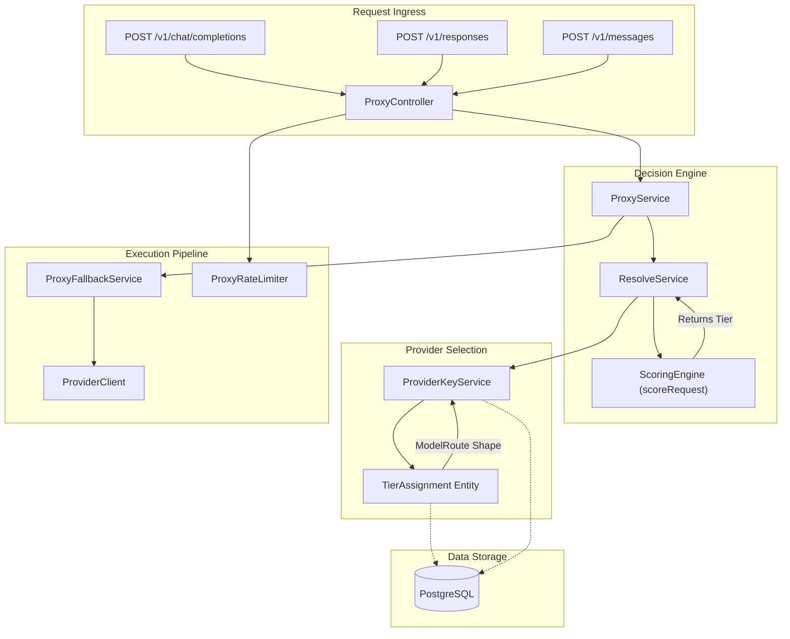
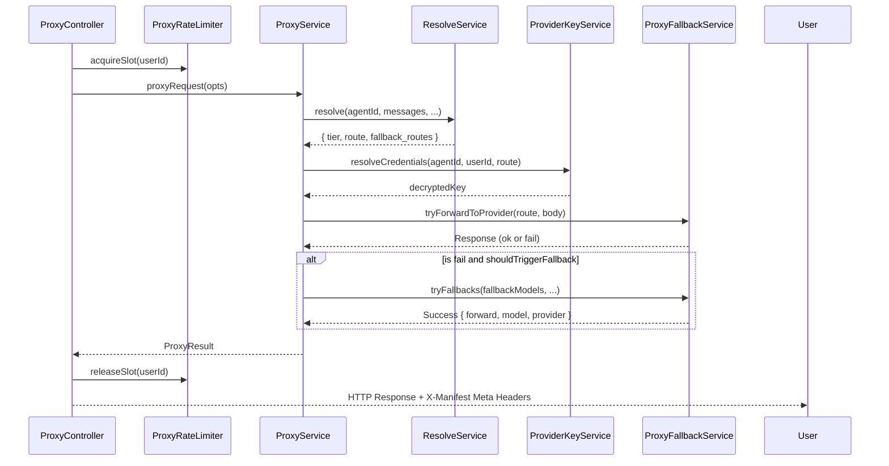

<!-- source: DeepWiki mcp.deepwiki.com · repo mnfst/manifest · page 3 Request Routing · fetched 2026-10-27 -->

# Request Routing

Relevant source files

The following files were used as context for generating this wiki page:

- [packages/backend/src/routing/dto/resolve-response.ts](packages/backend/src/routing/dto/resolve-response.ts)
- [packages/backend/src/routing/proxy/__tests__/proxy-fallback.service.spec.ts](packages/backend/src/routing/proxy/__tests__/proxy-fallback.service.spec.ts)
- [packages/backend/src/routing/proxy/__tests__/proxy-response-handler.spec.ts](packages/backend/src/routing/proxy/__tests__/proxy-response-handler.spec.ts)
- [packages/backend/src/routing/proxy/__tests__/proxy.controller.spec.ts](packages/backend/src/routing/proxy/__tests__/proxy.controller.spec.ts)
- [packages/backend/src/routing/proxy/__tests__/proxy.service.spec.ts](packages/backend/src/routing/proxy/__tests__/proxy.service.spec.ts)
- [packages/backend/src/routing/proxy/proxy-fallback.service.ts](packages/backend/src/routing/proxy/proxy-fallback.service.ts)
- [packages/backend/src/routing/proxy/proxy-response-handler.ts](packages/backend/src/routing/proxy/proxy-response-handler.ts)
- [packages/backend/src/routing/proxy/proxy-types.ts](packages/backend/src/routing/proxy/proxy-types.ts)
- [packages/backend/src/routing/proxy/proxy.controller.ts](packages/backend/src/routing/proxy/proxy.controller.ts)
- [packages/backend/src/routing/proxy/proxy.service.ts](packages/backend/src/routing/proxy/proxy.service.ts)
- [packages/backend/src/routing/resolve/__tests__/resolve.service.spec.ts](packages/backend/src/routing/resolve/__tests__/resolve.service.spec.ts)
- [packages/backend/src/routing/resolve/resolve.service.ts](packages/backend/src/routing/resolve/resolve.service.ts)
- [packages/backend/src/routing/routing-core/__tests__/provider-key.service.spec.ts](packages/backend/src/routing/routing-core/__tests__/provider-key.service.spec.ts)
- [packages/backend/src/routing/routing-core/provider-key.service.ts](packages/backend/src/routing/routing-core/provider-key.service.ts)

The Request Routing system is the core intelligence of Manifest. It transforms incoming generic LLM requests into optimized provider-specific calls by evaluating the complexity of the prompt, selecting the most cost-effective model tier, and managing the execution through a resilient proxy pipeline.

The system is designed to minimize inference costs while maintaining high response quality by using a multi-tiered routing logic that matches request difficulty to model capability.

## Routing Architecture

The routing process follows a linear pipeline from request ingestion to provider delivery.

### Request Flow Overview

1.  **Ingestion**: The `ProxyController` receives an OpenAI-compatible request at `POST /v1/chat/completions`, `POST /v1/responses`, or `POST /v1/messages` [packages/backend/src/routing/proxy/proxy.controller.ts:58-80]().
2.  **Scoring**: The `ProxyService` prepares messages and calls `ResolveService.resolve()` to analyze the request content and assign it a `Tier` (Simple, Standard, Complex, or Reasoning) [packages/backend/src/routing/proxy/proxy.service.ts:145-151]().
3.  **Resolution**: The `ProviderKeyService` finds the active model and credentials assigned to that tier for the specific agent [packages/backend/src/routing/proxy/proxy.service.ts:161-165]().
4.  **Execution**: The `ProxyService` forwards the request to the provider via the `ProxyFallbackService.tryForwardToProvider()` [packages/backend/src/routing/proxy/proxy.service.ts:228-238]().
5.  **Resilience**: If the primary provider fails with a retryable error, the `ProxyFallbackService.tryFallbacks()` iterates through configured `fallback_routes` [packages/backend/src/routing/proxy/proxy.service.ts:241-262]().

### Code Entity Space Mapping

The following diagram maps the high-level routing concepts to the specific classes and services in the codebase.

**Routing Logic to Code Entities**

Sources: [packages/backend/src/routing/proxy/proxy.controller.ts:45-56](), [packages/backend/src/routing/proxy/proxy.service.ts:101-116](), [packages/backend/src/routing/proxy/proxy.service.ts:145-151](), [packages/backend/src/routing/resolve/resolve.service.ts:84-87](), [packages/backend/src/routing/routing-core/provider-key.service.ts:19-29]()

---

## Core Components

### [Scoring Engine](#3.1)
The Scoring Engine classifies incoming requests using a 23-dimension evaluation.
*   **Dimensions**: It analyzes structural features like token count, tool count, and conversation depth via the `scoreRequest` function [packages/backend/src/routing/resolve/resolve.service.ts:84-84]().
*   **Tier Classification**: Maps scores to one of four tiers: `simple`, `standard`, `complex`, or `reasoning` [packages/backend/src/routing/proxy/proxy.service.ts:12-12]().
*   **Fast Path**: Specific roles like `system` or `developer` are excluded from scoring to prevent inflation from large agent system prompts [packages/backend/src/routing/proxy/proxy.service.ts:48-48]().
*   **Logic**: For details, see [Scoring Engine](#3.1).

### [Proxy Pipeline](#3.2)
The `ProxyController` and `ProxyService` manage the request lifecycle, including strict rate limiting and session management.
*   **Rate Limiting**: `ProxyRateLimiter` enforces per-user and per-IP limits and manages concurrency slots [packages/backend/src/routing/proxy/proxy.controller.ts:102-105]().
*   **Sanitization**: The pipeline cleanses request headers via `sanitizeRequestHeaders` and validates payloads before forwarding [packages/backend/src/routing/proxy/proxy.controller.ts:92-92](), [packages/backend/src/routing/proxy/proxy.service.ts:138-138]().
*   **Error Handling**: The `ProxyExceptionFilter` and `ProxyResponseHandler` convert technical exceptions into friendly, actionable messages [packages/backend/src/routing/proxy/proxy.controller.ts:43-43](), [packages/backend/src/routing/proxy/proxy-response-handler.ts:59-71]().
*   **Logic**: For details, see [Proxy Pipeline](#3.2).

### [Fallback and Resilience](#3.3)
Manifest ensures high availability through a multi-step fallback chain managed by `ProxyFallbackService`.
*   **Retry Logic**: Triggered by specific status codes (e.g., 429, 5xx) defined in `shouldTriggerFallback` [packages/backend/src/routing/proxy/proxy-fallback.service.ts:54-54]().
*   **Credential Rotation**: The system can rotate between different `auth_type` options (e.g., `api_key` vs `subscription`) if one fails [packages/backend/src/routing/proxy/proxy-fallback.service.ts:124-132]().
*   **Transport Errors**: Catches network-level failures and generates synthetic 503 responses via `buildTransportErrorResponse` [packages/backend/src/routing/proxy/proxy-fallback.service.ts:60-63]().
*   **Logic**: For details, see [Fallback and Resilience](#3.3).

### [Provider Management](#3.4)
This module handles provider configuration and the `ModelRoute` structured identity.
*   **ModelRoute**: Routing uses a structured shape containing `provider`, `authType`, and `model` [packages/backend/src/routing/proxy/proxy-fallback.service.ts:4-4]().
*   **Credential Resolution**: `ProviderKeyService` retrieves and decrypts stored keys using AES-256-GCM [packages/backend/src/routing/routing-core/provider-key.service.ts:11-11]().
*   **Custom Providers**: Supports user-defined endpoints via `CustomProviderService` and `buildCustomEndpoint` [packages/backend/src/routing/proxy/proxy-fallback.service.ts:41-41](), [packages/backend/src/routing/proxy/proxy-fallback.service.ts:47-47]().
*   **Logic**: For details, see [Provider Management](#3.4).

---

## Routing Tiers Overview

Manifest uses four standardized tiers. The system attempts to route to the cheapest model that satisfies the quality requirements of the assigned tier.

| Tier | Typical Use Case | Code Reference |
| :--- | :--- | :--- |
| **Simple** | Greetings, short messages, fast path responses. | `Tier.Simple` |
| **Standard** | General conversation and standard tasks. | `Tier.Standard` |
| **Complex** | Coding, complex instructions, tool-heavy tasks. | `Tier.Complex` |
| **Reasoning** | Tasks requiring deep logic or "thinking" models. | `Tier.Reasoning` |

Sources: [packages/backend/src/routing/proxy/proxy.service.ts:12-12](), [packages/backend/src/routing/resolve/resolve.service.ts:84-87]()

## Proxy Request Lifecycle

**Internal Service Interaction**

Sources: [packages/backend/src/routing/proxy/proxy.controller.ts:104-118](), [packages/backend/src/routing/proxy/proxy.service.ts:118-270](), [packages/backend/src/routing/proxy/proxy-fallback.service.ts:95-121]()

For detailed implementation of these components, refer to the child pages:
*   [Scoring Engine](#3.1)
*   [Proxy Pipeline](#3.2)
*   [Fallback and Resilience](#3.3)
*   [Provider Management](#3.4)

---

