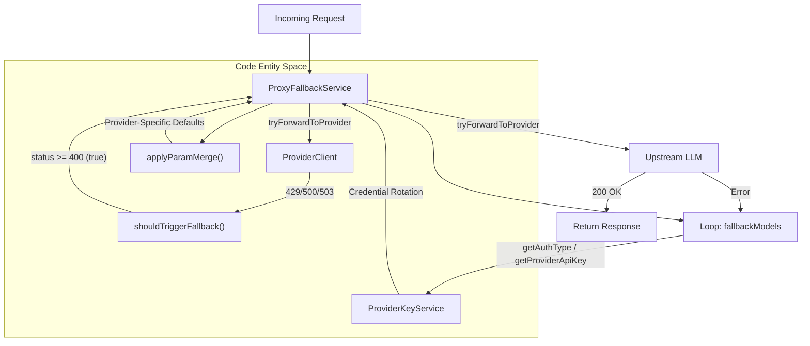
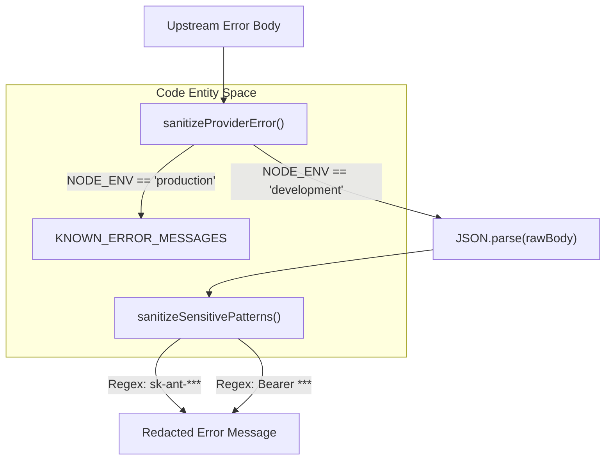

<!-- source: DeepWiki mcp.deepwiki.com · repo mnfst/manifest · page 3.3 Fallback and Resilience · fetched 2026-10-27 -->

# Fallback and Resilience

Relevant source files

The following files were used as context for generating this wiki page:

- [packages/backend/src/common/utils/hash.util.spec.ts](packages/backend/src/common/utils/hash.util.spec.ts)
- [packages/backend/src/common/utils/hash.util.ts](packages/backend/src/common/utils/hash.util.ts)
- [packages/backend/src/database/migrations/1771500000000-HashApiKeys.ts](packages/backend/src/database/migrations/1771500000000-HashApiKeys.ts)
- [packages/backend/src/database/migrations/1773900000000-AddKeyPrefixIndex.spec.ts](packages/backend/src/database/migrations/1773900000000-AddKeyPrefixIndex.spec.ts)
- [packages/backend/src/database/migrations/1773900000000-AddKeyPrefixIndex.ts](packages/backend/src/database/migrations/1773900000000-AddKeyPrefixIndex.ts)
- [packages/backend/src/routing/dto/resolve-response.ts](packages/backend/src/routing/dto/resolve-response.ts)
- [packages/backend/src/routing/proxy/__tests__/fallback-status-codes.spec.ts](packages/backend/src/routing/proxy/__tests__/fallback-status-codes.spec.ts)
- [packages/backend/src/routing/proxy/__tests__/proxy-fallback.service.spec.ts](packages/backend/src/routing/proxy/__tests__/proxy-fallback.service.spec.ts)
- [packages/backend/src/routing/proxy/fallback-status-codes.ts](packages/backend/src/routing/proxy/fallback-status-codes.ts)
- [packages/backend/src/routing/proxy/proxy-error-sanitizer.spec.ts](packages/backend/src/routing/proxy/proxy-error-sanitizer.spec.ts)
- [packages/backend/src/routing/proxy/proxy-error-sanitizer.ts](packages/backend/src/routing/proxy/proxy-error-sanitizer.ts)
- [packages/backend/src/routing/proxy/proxy-fallback.service.ts](packages/backend/src/routing/proxy/proxy-fallback.service.ts)
- [packages/backend/src/routing/resolve/__tests__/resolve.service.spec.ts](packages/backend/src/routing/resolve/__tests__/resolve.service.spec.ts)
- [packages/backend/src/routing/resolve/resolve.service.ts](packages/backend/src/routing/resolve/resolve.service.ts)
- [packages/backend/src/routing/routing-core/__tests__/provider-key.service.spec.ts](packages/backend/src/routing/routing-core/__tests__/provider-key.service.spec.ts)
- [packages/backend/src/routing/routing-core/provider-key.service.ts](packages/backend/src/routing/routing-core/provider-key.service.ts)
- [packages/backend/test/proxy-fallback-auth.e2e-spec.ts](packages/backend/test/proxy-fallback-auth.e2e-spec.ts)

The Manifest proxy is designed to maintain high availability for LLM requests even when upstream providers experience rate limits, outages, or authentication failures. This is achieved through a multi-layered fallback strategy that includes model iteration, credential rotation, and intelligent error handling.

## Fallback Chain Mechanism

The core logic for resilience resides in the `ProxyFallbackService` [packages/backend/src/routing/proxy/proxy-fallback.service.ts:81-82](). When a primary request fails with a status code deemed "fallback-eligible", the system initiates a fallback sequence.

### Iteration Process
1.  **Trigger**: The system detects a failed request. Eligibility is determined by `shouldTriggerFallback`, which returns `true` for any HTTP status code $\ge 400$ [packages/backend/src/routing/proxy/fallback-status-codes.ts:1-3]().
2.  **Structured Routes**: If `fallbackRoutes` (type `ModelRoute[]`) are provided, the system uses the explicit `provider`, `authType`, and `model` defined in the route [packages/backend/src/routing/proxy/proxy-fallback.service.ts:148-150]().
3.  **Legacy Inference**: If no structured routes exist, the system determines the provider by checking pricing data [packages/backend/src/routing/proxy/proxy-fallback.service.ts:152-152](), custom provider prefixes [packages/backend/src/routing/proxy/proxy-fallback.service.ts:153-155](), or model name inference [packages/backend/src/routing/proxy/proxy-fallback.service.ts:157-157]().
4.  **Credential Retrieval**: It resolves the API key using `ProviderKeyService.getProviderApiKey` [packages/backend/src/routing/proxy/proxy-fallback.service.ts:178-178]().
5.  **Param Merging**: For each attempt, the system re-applies parameter defaults (like `thinking` blocks) specific to the iteration's provider via `applyParamMerge` [packages/backend/src/routing/proxy/proxy-fallback.service.ts:24-38](). This prevents fields specific to one provider (e.g., DeepSeek) from leaking onto a fallback target (e.g., Anthropic) [packages/backend/src/routing/proxy/proxy-fallback.service.ts:12-17]().
6.  **Execution**: The system attempts to forward the request via `tryForwardToProvider` [packages/backend/src/routing/proxy/proxy-fallback.service.ts:221-236](). If the response is `ok`, the loop terminates [packages/backend/src/routing/proxy/proxy-fallback.service.ts:238-244]().
7.  **Failure Logging**: If it fails, the error body and status are recorded in a `failures` array [packages/backend/src/routing/proxy/proxy-fallback.service.ts:247-254]().

### Fallback Execution Flow
The following diagram illustrates the transition from a failed primary request to the fallback loop.

**Fallback Execution Flow**

Sources: [packages/backend/src/routing/proxy/proxy-fallback.service.ts:95-259](), [packages/backend/src/routing/proxy/fallback-status-codes.ts:1-3]()

## Credential Rotation

Manifest supports multiple authentication types: `api_key`, `subscription` (OAuth-based), and `local` (Ollama/LM Studio). To increase resilience, the system rotates between these types if one fails for a specific provider [packages/backend/src/routing/proxy/proxy-fallback.service.ts:124-128]().

*   **Failure Tracking**: The system maintains a `failedAuthByProvider` map during the fallback loop to track which auth types have already failed for a given provider [packages/backend/src/routing/proxy/proxy-fallback.service.ts:128-131]().
*   **Rotation Logic**: When requesting a credential for a fallback model in legacy mode, `ProxyFallbackService` calls `getAuthType` with an `excludeAuthTypes` set [packages/backend/src/routing/proxy/proxy-fallback.service.ts:170-174]().
*   **Selection Priority**: `ProviderKeyService.getAuthType` filters out previously failed types [packages/backend/src/routing/routing-core/provider-key.service.ts:89-92](). It prioritizes:
    1.  `local` providers [packages/backend/src/routing/routing-core/provider-key.service.ts:96-97]().
    2.  `subscription` if a usable encrypted key exists [packages/backend/src/routing/routing-core/provider-key.service.ts:99-100]().
    3.  Any record with a decryptable `api_key_encrypted` [packages/backend/src/routing/routing-core/provider-key.service.ts:103-104]().

Sources: [packages/backend/src/routing/proxy/proxy-fallback.service.ts:124-175](), [packages/backend/src/routing/routing-core/provider-key.service.ts:79-105]()

## Error Handling and Sanitization

### Transport Errors
Errors occurring at the network level (e.g., DNS failure, connection reset, or timeouts) are caught in `tryForwardToProvider` [packages/backend/src/routing/proxy/proxy-fallback.service.ts:271-273]().
*   **Detection**: The system uses `isTransportError` to identify network-level issues [packages/backend/src/routing/proxy/proxy-transport.ts:24-24]().
*   **Conversion**: These are converted into synthetic HTTP responses (e.g., 503 for connection errors, 504 for `TimeoutError`) using `buildTransportErrorResponse` [packages/backend/src/routing/proxy/proxy-transport.ts:24-30]().

### Sanitization
To prevent leaking sensitive upstream information or internal API keys, the `sanitizeProviderError` utility processes all error bodies [packages/backend/src/routing/proxy/proxy-error-sanitizer.ts:23-23]().

*   **Production Mode**: Returns generic messages mapped in `KNOWN_ERROR_MESSAGES` (e.g., 429 becomes "Rate limited by upstream provider") [packages/backend/src/routing/proxy/proxy-error-sanitizer.ts:1-13](), [packages/backend/src/routing/proxy/proxy-error-sanitizer.ts:27-27]().
*   **Development Mode**: Extracts the error message from the JSON body [packages/backend/src/routing/proxy/proxy-error-sanitizer.ts:30-35]() and applies regex redaction via `sanitizeSensitivePatterns` to mask OpenAI/Anthropic keys and Bearer tokens [packages/backend/src/routing/proxy/proxy-error-sanitizer.ts:15-21]().

**Error Sanitization Logic**

Sources: [packages/backend/src/routing/proxy/proxy-error-sanitizer.ts:1-42]()

## Implementation Details

### Key Functions and Classes

| Class/Function | Role |
| :--- | :--- |
| `ProxyFallbackService` | Orchestrates the fallback loop and credential rotation for retries [packages/backend/src/routing/proxy/proxy-fallback.service.ts:81](). |
| `shouldTriggerFallback` | Determines if a status code warrants a fallback attempt (status $\ge 400$) [packages/backend/src/routing/proxy/fallback-status-codes.ts:1](). |
| `ProviderKeyService` | Manages credential resolution, decryption (AES-256-GCM), and auth type prioritization [packages/backend/src/routing/routing-core/provider-key.service.ts:19](). |
| `isTransportError` | Identifies fetch-level exceptions that should be treated as 5xx errors [packages/backend/src/routing/proxy/proxy-transport.ts:24](). |
| `sanitizeProviderError` | Rewrites clinical upstream errors into friendly or redacted messages [packages/backend/src/routing/proxy/proxy-error-sanitizer.ts:23](). |

Sources: [packages/backend/src/routing/proxy/proxy-fallback.service.ts:81-93](), [packages/backend/src/routing/proxy/fallback-status-codes.ts:1-3](), [packages/backend/src/routing/routing-core/provider-key.service.ts:19-29](), [packages/backend/src/routing/proxy/proxy-error-sanitizer.ts:23-41]()

---

