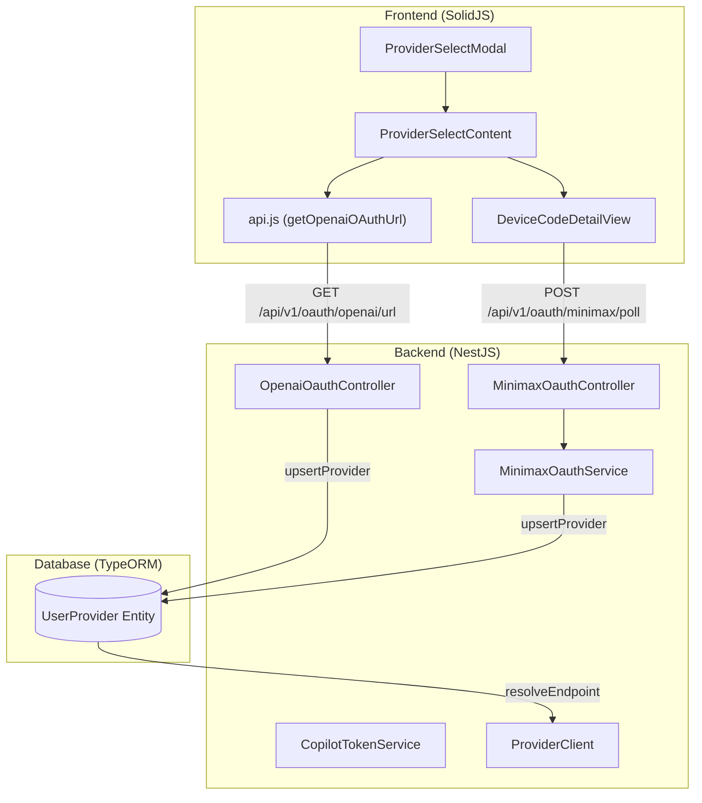
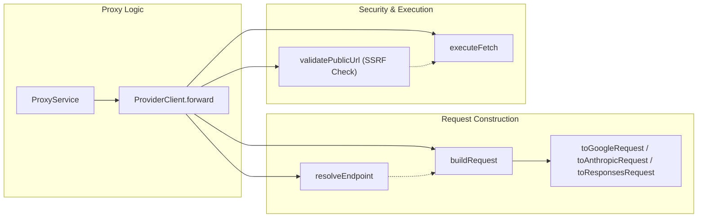

<!-- source: DeepWiki mcp.deepwiki.com · repo mnfst/manifest · page 3.4 Provider Management · fetched 2026-10-27 -->

# Provider Management

Relevant source files

The following files were used as context for generating this wiki page:

- [.changeset/copilot-codex-routing.md](.changeset/copilot-codex-routing.md)
- [packages/backend/src/common/constants/openai-models.ts](packages/backend/src/common/constants/openai-models.ts)
- [packages/backend/src/common/constants/subscription-clients.ts](packages/backend/src/common/constants/subscription-clients.ts)
- [packages/backend/src/model-prices/model-prices.module.ts](packages/backend/src/model-prices/model-prices.module.ts)
- [packages/backend/src/routing/custom-provider/custom-provider.module.ts](packages/backend/src/routing/custom-provider/custom-provider.module.ts)
- [packages/backend/src/routing/custom-provider/custom-provider.service.spec.ts](packages/backend/src/routing/custom-provider/custom-provider.service.spec.ts)
- [packages/backend/src/routing/custom-provider/custom-provider.service.ts](packages/backend/src/routing/custom-provider/custom-provider.service.ts)
- [packages/backend/src/routing/minimax-oauth.controller.spec.ts](packages/backend/src/routing/minimax-oauth.controller.spec.ts)
- [packages/backend/src/routing/minimax-oauth.service.spec.ts](packages/backend/src/routing/minimax-oauth.service.spec.ts)
- [packages/backend/src/routing/oauth/minimax-oauth-helpers.spec.ts](packages/backend/src/routing/oauth/minimax-oauth-helpers.spec.ts)
- [packages/backend/src/routing/oauth/minimax-oauth-helpers.ts](packages/backend/src/routing/oauth/minimax-oauth-helpers.ts)
- [packages/backend/src/routing/oauth/minimax-oauth.service.spec.ts](packages/backend/src/routing/oauth/minimax-oauth.service.spec.ts)
- [packages/backend/src/routing/oauth/minimax-oauth.service.ts](packages/backend/src/routing/oauth/minimax-oauth.service.ts)
- [packages/backend/src/routing/proxy/__tests__/provider-client-converters.spec.ts](packages/backend/src/routing/proxy/__tests__/provider-client-converters.spec.ts)
- [packages/backend/src/routing/proxy/__tests__/provider-client.spec.ts](packages/backend/src/routing/proxy/__tests__/provider-client.spec.ts)
- [packages/backend/src/routing/proxy/__tests__/provider-endpoints.spec.ts](packages/backend/src/routing/proxy/__tests__/provider-endpoints.spec.ts)
- [packages/backend/src/routing/proxy/chatgpt-adapter.spec.ts](packages/backend/src/routing/proxy/chatgpt-adapter.spec.ts)
- [packages/backend/src/routing/proxy/chatgpt-adapter.ts](packages/backend/src/routing/proxy/chatgpt-adapter.ts)
- [packages/backend/src/routing/proxy/provider-client-converters.ts](packages/backend/src/routing/proxy/provider-client-converters.ts)
- [packages/backend/src/routing/proxy/provider-client.ts](packages/backend/src/routing/proxy/provider-client.ts)
- [packages/backend/src/routing/proxy/provider-endpoints.ts](packages/backend/src/routing/proxy/provider-endpoints.ts)
- [packages/frontend/src/components/DeviceCodeDetailView.tsx](packages/frontend/src/components/DeviceCodeDetailView.tsx)
- [packages/frontend/src/components/ProviderDetailView.tsx](packages/frontend/src/components/ProviderDetailView.tsx)
- [packages/frontend/src/components/ProviderIcon.tsx](packages/frontend/src/components/ProviderIcon.tsx)
- [packages/frontend/src/components/ProviderSelectModal.tsx](packages/frontend/src/components/ProviderSelectModal.tsx)
- [packages/frontend/src/components/RoutingModals.tsx](packages/frontend/src/components/RoutingModals.tsx)
- [packages/frontend/src/services/api/routing.ts](packages/frontend/src/services/api/routing.ts)
- [packages/frontend/src/services/providers.ts](packages/frontend/src/services/providers.ts)
- [packages/frontend/src/styles/routing-providers.css](packages/frontend/src/styles/routing-providers.css)
- [packages/frontend/tests/components/ProviderDetailView.test.tsx](packages/frontend/tests/components/ProviderDetailView.test.tsx)
- [packages/frontend/tests/components/ProviderIcon.test.tsx](packages/frontend/tests/components/ProviderIcon.test.tsx)
- [packages/frontend/tests/components/ProviderSelectModal.test.tsx](packages/frontend/tests/components/ProviderSelectModal.test.tsx)
- [packages/frontend/tests/services/api-extra.test.ts](packages/frontend/tests/services/api-extra.test.ts)
- [packages/frontend/tests/services/providers.test.ts](packages/frontend/tests/services/providers.test.ts)

Manifest acts as a centralized controller for Large Language Model (LLM) providers, managing credentials, model routing, and automated tier assignments. It supports both standard API key authentication and OAuth-based subscription flows for consumer-grade LLM services.

## Provider Credential Management

Manifest handles two primary types of authentication: `api_key` and `subscription`. These are managed via the `UserProvider` entity and resolved by the `ProviderKeyService` to provide seamless proxying [packages/backend/src/routing/routing-core/provider-key.service.ts:1-20]().

### ProviderKeyService & Security
The `ProviderKeyService` is the central authority for credential resolution. It handles:
*   **Decryption:** Retrieving encrypted keys from the `UserProvider` table and decrypting them using AES-256-GCM [packages/backend/src/routing/routing-core/provider-key.service.ts:250-270]().
*   **Caching:** Utilizing `RoutingCacheService` to minimize database lookups for high-frequency proxy requests [packages/backend/src/routing/routing-core/provider-key.service.ts:92-99]().
*   **Ollama Bypass:** Automatically returning an empty string for `ollama` providers, as they typically do not require keys in local configurations [packages/backend/src/routing/routing-core/provider-key.service.ts:85-90]().

### Authentication Types
The system differentiates between standard developer API keys and subscription-based access:

| Auth Type | Description | Key Examples |
| :--- | :--- | :--- |
| `api_key` | Standard developer keys from provider dashboards. | `sk-...` (OpenAI), `sk-ant-...` (Anthropic) |
| `subscription` | Access via consumer accounts (ChatGPT Plus, Claude Pro, GitHub Copilot). | OAuth tokens, Setup tokens, Device codes |

Sources: [packages/frontend/src/services/providers.ts:15-31](), [packages/backend/src/routing/routing-core/provider-key.service.ts:109-130]()

## Routing and Tier Assignment

The `RoutingService` maps request tiers (Simple, Standard, Complex, Reasoning) to specific models and providers based on user configuration or automated logic.

### TierAutoAssignService
The `TierAutoAssignService` automatically selects the "best" model for a tier when a manual override is not present. It uses a multi-dimensional scoring logic based on `qualityScore`, `inputPricePerToken`, and `outputPricePerToken`.

**Selection Logic by Tier:**
*   **Simple:** Prioritizes the absolute cheapest model.
*   **Standard:** Selects the cheapest model among those with a `qualityScore >= 2`.
*   **Complex:** Prioritizes the highest `qualityScore`, using price only as a tiebreaker.
*   **Reasoning:** Filters for models with `capabilityReasoning: true` and then applies Complex logic.

### Provider Endpoints Map
The `PROVIDER_ENDPOINTS` constant in the backend defines the technical implementation for each provider's API [packages/backend/src/routing/proxy/provider-endpoints.ts:81-215]().

| Provider ID | Base URL | Format | Path |
| :--- | :--- | :--- | :--- |
| `openai` | `https://api.openai.com` | `openai` | `/v1/chat/completions` [packages/backend/src/routing/proxy/provider-endpoints.ts:82-87]() |
| `openai-responses`| `https://api.openai.com` | `chatgpt` | `/v1/responses` [packages/backend/src/routing/proxy/provider-endpoints.ts:96-101]() |
| `anthropic` | `https://api.anthropic.com` | `anthropic` | `/v1/messages` [packages/backend/src/routing/proxy/provider-endpoints.ts:102-107]() |
| `google` | `https://generativelanguage.googleapis.com` | `google` | `/v1beta/models/{model}:generateContent` [packages/backend/src/routing/proxy/provider-endpoints.ts:168-179]() |
| `qwen` | `https://dashscope.aliyuncs.com/compatible-mode` | `openai` | `/v1/chat/completions` [packages/backend/src/routing/proxy/provider-endpoints.ts:150-155]() |
| `copilot` | `https://api.githubcopilot.com` | `openai` | `/chat/completions` [packages/backend/src/routing/proxy/provider-endpoints.ts:180-191]() |

### Custom Providers and Aliases
*   **Custom Providers:** Users can define `CustomProvider` entities. The `CustomProviderService` handles management and probing of these endpoints [packages/backend/src/routing/custom-provider/custom-provider.service.ts:63-71]().
*   **Aliases:** The `resolveEndpointKey` function handles provider name normalization, mapping aliases like `gemini` to `google` or `alibaba` to `qwen` [packages/backend/src/routing/proxy/provider-endpoints.ts:2-10]().
*   **Qwen Region Routing:** Qwen requests are routed via `getQwenCompatibleBaseUrl` to optimize for regional availability (e.g., `beijing` region) [packages/backend/src/routing/proxy/provider-endpoints.ts:151]().
*   **Responses API:** Specific models like `o1-pro` and `gpt-5-codex` are routed to the `/v1/responses` endpoint rather than standard chat completions via `OPENAI_RESPONSES_ONLY_RE` [packages/backend/src/routing/proxy/provider-client.ts:172-180]().

Sources: [packages/backend/src/routing/proxy/provider-endpoints.ts:1-215](), [packages/backend/src/routing/custom-provider/custom-provider.service.ts:1-120](), [packages/backend/src/routing/proxy/provider-client.ts:151-184]()

## Subscription Providers (OAuth & Device Flows)

Manifest provides specialized handlers for consumer subscriptions, allowing users to route agent traffic through their personal or team accounts.

### Supported Subscription Flows
1.  **OpenAI (ChatGPT Plus/Team):** Uses a `popup_oauth` flow [packages/frontend/src/services/providers.ts:184](). The `OpenaiOauthService` handles the exchange of authorization codes for session tokens.
2.  **Anthropic (Claude Pro):** Uses a `token` flow where users paste a `setup-token` (prefixed with `sk-ant-oat`) [packages/frontend/src/services/providers.ts:88-90]().
3.  **GitHub Copilot:** Implements a `device_code` flow [packages/frontend/src/services/providers.ts:103](). The `CopilotTokenService` manages device activation and token polling.
4.  **MiniMax:** Uses a `device_code` flow managed by `MinimaxOauthService` [packages/frontend/src/services/providers.ts:149](). The frontend polls via `pollMinimaxOAuth` until approval [packages/frontend/src/components/DeviceCodeDetailView.tsx:102-129]().
5.  **OpenCode Go:** A specialized provider for coding tasks. It uses different API formats (Anthropic for MiniMax models, OpenAI for others) depending on the specific model requested [packages/backend/src/routing/proxy/provider-client.ts:181-187]().

### Code Entity Mapping: Subscription Auth
This diagram illustrates the relationship between the frontend UI components and the backend services during a subscription connection.

Title: Subscription Authentication Data Flow

Sources: [packages/frontend/src/components/ProviderSelectModal.tsx:16-48](), [packages/frontend/src/components/DeviceCodeDetailView.tsx:42-175](), [packages/backend/src/routing/proxy/provider-client.ts:151-168]()

## Implementation Details

### Provider Definitions
The `PROVIDER_UI` constant in the frontend defines metadata for all supported LLM vendors [packages/frontend/src/services/providers.ts:77-220]().

| Provider ID | Name | Key Prefix | Min Length | Subscription Mode |
| :--- | :--- | :--- | :--- | :--- |
| `openai` | OpenAI | `sk-` | 50 | `popup_oauth` [packages/frontend/src/services/providers.ts:184]() |
| `anthropic` | Anthropic | `sk-ant-` | 50 | `token` [packages/frontend/src/services/providers.ts:88]() |
| `copilot` | GitHub Copilot | (none) | 0 | `device_code` [packages/frontend/src/services/providers.ts:103]() |
| `minimax` | MiniMax | `sk-` | 30 | `device_code` [packages/frontend/src/services/providers.ts:149]() |
| `opencode-go` | OpenCode Go | `sk-` | 30 | `token` |

Sources: [packages/frontend/src/services/providers.ts:77-220](), [packages/frontend/tests/services/providers.test.ts:22-95]()

### Request Forwarding and SSRF Protection
The `ProviderClient` is responsible for building and executing the actual HTTP request to the upstream provider. It includes an SSRF defense layer that re-validates user-supplied URLs (from custom providers or subscription resources) immediately before the request is sent [packages/backend/src/routing/proxy/provider-client.ts:130-141]().

Title: Provider Execution Pipeline

Sources: [packages/backend/src/routing/proxy/provider-client.ts:82-149](), [packages/backend/src/routing/proxy/provider-endpoints.ts:1-60](), [packages/backend/src/routing/proxy/provider-client-converters.ts:1-69]()

---

