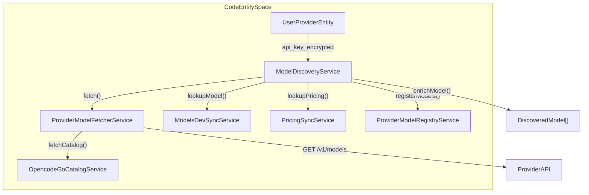
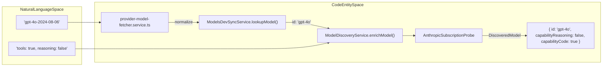

<!-- source: DeepWiki mcp.deepwiki.com · repo mnfst/manifest · page 4.1 Model Discovery Pipeline · fetched 2026-10-27 -->

# Model Discovery Pipeline

Relevant source files

The following files were used as context for generating this wiki page:

- [packages/backend/src/database/models-dev-sync.service.spec.ts](packages/backend/src/database/models-dev-sync.service.spec.ts)
- [packages/backend/src/database/models-dev-sync.service.ts](packages/backend/src/database/models-dev-sync.service.ts)
- [packages/backend/src/model-discovery/anthropic-subscription-probe.spec.ts](packages/backend/src/model-discovery/anthropic-subscription-probe.spec.ts)
- [packages/backend/src/model-discovery/anthropic-subscription-probe.ts](packages/backend/src/model-discovery/anthropic-subscription-probe.ts)
- [packages/backend/src/model-discovery/filter-non-chat-models.spec.ts](packages/backend/src/model-discovery/filter-non-chat-models.spec.ts)
- [packages/backend/src/model-discovery/known-model-prices.spec.ts](packages/backend/src/model-discovery/known-model-prices.spec.ts)
- [packages/backend/src/model-discovery/known-model-prices.ts](packages/backend/src/model-discovery/known-model-prices.ts)
- [packages/backend/src/model-discovery/model-discovery.service.spec.ts](packages/backend/src/model-discovery/model-discovery.service.spec.ts)
- [packages/backend/src/model-discovery/model-discovery.service.ts](packages/backend/src/model-discovery/model-discovery.service.ts)
- [packages/backend/src/model-discovery/model-fallback.spec.ts](packages/backend/src/model-discovery/model-fallback.spec.ts)
- [packages/backend/src/model-discovery/model-fallback.ts](packages/backend/src/model-discovery/model-fallback.ts)
- [packages/backend/src/model-discovery/provider-model-fetcher.service.spec.ts](packages/backend/src/model-discovery/provider-model-fetcher.service.spec.ts)
- [packages/backend/src/model-discovery/provider-model-fetcher.service.ts](packages/backend/src/model-discovery/provider-model-fetcher.service.ts)
- [packages/frontend/src/components/ModelPickerModal.tsx](packages/frontend/src/components/ModelPickerModal.tsx)
- [packages/frontend/src/services/formatters.ts](packages/frontend/src/services/formatters.ts)
- [packages/frontend/src/styles/routing-modal.css](packages/frontend/src/styles/routing-modal.css)
- [packages/frontend/tests/components/ModelPickerModal.test.tsx](packages/frontend/tests/components/ModelPickerModal.test.tsx)
- [packages/frontend/tests/services/formatters.test.ts](packages/frontend/tests/services/formatters.test.ts)

The **Model Discovery Pipeline** is a core subsystem responsible for identifying, validating, and enriching the list of available LLM models for each provider. It bridges the gap between raw provider APIs (which often return a mix of incompatible models like embeddings or TTS) and the Manifest routing engine, which requires chat-compatible models with accurate metadata (pricing, context windows, and capabilities).

## 1. Discovery Lifecycle Orchestration

The discovery process is orchestrated by the `ModelDiscoveryService`. It manages the flow from credential decryption to API querying, followed by a multi-stage enrichment and fallback process.

### Discovery Workflow
1.  **Credential Resolution**: The service decrypts the `api_key_encrypted` from the `UserProvider` entity using `AES-256-GCM` [packages/backend/src/model-discovery/model-discovery.service.ts:64-71]().
2.  **Auth Type Handling**: 
    *   For `api_key` providers, the raw key is used.
    *   For `subscription` providers (e.g., MiniMax, OpenAI OAuth), it unwraps the encrypted token blob or performs a token exchange via `CopilotTokenService` [packages/backend/src/model-discovery/model-discovery.service.ts:75-94]().
3.  **Provider Querying**: It calls `ProviderModelFetcherService.fetch()` to get models directly from the provider's native `/v1/models` (or equivalent) endpoint [packages/backend/src/model-discovery/model-discovery.service.ts:110-115]().
4.  **Registration**: Successfully fetched model IDs are registered in the `ProviderModelRegistryService` to assist future fallback filtering [packages/backend/src/model-discovery/model-discovery.service.ts:118-123]().
5.  **Enrichment**: Models are decorated with pricing data, context window limits, and capability tags (reasoning, tool use) via `enrichModel` [packages/backend/src/model-discovery/model-discovery.service.ts:164-167]().

### Code Entity Interaction: Discovery Logic
The following diagram illustrates how the `ModelDiscoveryService` coordinates between different code entities to produce a list of `DiscoveredModel` objects.

Title: Model Discovery Orchestration

Sources: [packages/backend/src/model-discovery/model-discovery.service.ts:37-58](), [packages/backend/src/model-discovery/model-discovery.service.ts:110-145](), [packages/backend/src/model-discovery/provider-model-fetcher.service.ts:1-13](), [packages/backend/src/model-discovery/provider-model-fetcher.service.ts:13-13]()

---

## 2. Provider Model Fetching

The `ProviderModelFetcherService` implements specialized parsers for 12+ providers. It uses a generic `createModelParser` factory to handle standard OpenAI-compatible responses while allowing overrides for unique structures like Anthropic, Gemini, or Ollama [packages/backend/src/model-discovery/provider-model-fetcher.service.ts:35-60]().

### Normalization and Filtering
To ensure only usable chat models reach the router, the fetcher applies several layers of filtering:

*   **Universal Non-Chat Filter**: A regex (`UNIVERSAL_NON_CHAT_RE`) blocks models containing terms like `embed`, `tts`, `whisper`, `dall-e`, or `audio` [packages/backend/src/model-discovery/provider-model-fetcher.service.ts:101-102]().
*   **Provider-Specific Filters**: Custom regex patterns for providers like OpenAI (filtering `moderation`, `davinci`) or Gemini (filtering `aqs-`, `nano-`, `robotics`) [packages/backend/src/model-discovery/provider-model-fetcher.service.ts:108-130]().
*   **OpenAI Deduplication**: OpenAI often returns both a generic alias (e.g., `gpt-4o`) and a dated snapshot (e.g., `gpt-4o-2024-05-13`). The fetcher keeps only the alias to simplify routing [packages/backend/src/model-discovery/provider-model-fetcher.service.ts:82-92]().
*   **Specialized Services**: 
    *   **OpenCode Go**: Uses `OpencodeGoCatalogService` to fetch a dynamic catalog of models specifically for the OpenCode Go provider [packages/backend/src/model-discovery/provider-model-fetcher.service.ts:13-13]().
    *   **Ollama Sync**: Handles local and cloud Ollama instances, parsing the unique response format of the Ollama `/api/tags` endpoint [packages/backend/src/model-discovery/provider-model-fetcher.service.ts:3-3]().

Sources: [packages/backend/src/model-discovery/provider-model-fetcher.service.ts:70-155](), [packages/backend/src/model-discovery/filter-non-chat-models.spec.ts:24-60](), [packages/backend/src/model-discovery/provider-model-fetcher.service.ts:101-130]()

---

## 3. Fallback Mechanisms

If a provider's native API is unreachable or returns an empty list, Manifest employs a multi-tier fallback strategy to ensure the dashboard remains functional.

| Fallback Tier | Source | Logic |
| :--- | :--- | :--- |
| **Tier 1: Native API** | Provider Endpoint | Direct fetch from the source via `ProviderModelFetcherService`. |
| **Tier 2: Models.dev** | `ModelsDevSyncService` | Uses a local cache of `models.dev/api.json` which maps native IDs to metadata [packages/backend/src/model-discovery/model-discovery.service.ts:127-133](). |
| **Tier 3: OpenRouter** | `PricingSyncService` | Fetches models from OpenRouter's catalog, filtered by `confirmedModels` to avoid "phantom" models [packages/backend/src/model-discovery/model-discovery.service.ts:136-144](). |
| **Tier 4: Known Models** | `known-model-prices.ts` | A hardcoded list of common models used as a last resort via `lookupKnownPrice` [packages/backend/src/model-discovery/known-model-prices.ts:26-26](). |

### Model ID Normalization
The `ModelsDevSyncService` utility attempts to resolve IDs by:
1.  **Stripping Version Suffixes**: Removing `-001` or `-002` suffixes common in Google APIs [packages/backend/src/database/models-dev-sync.service.ts:176-181]().
2.  **Date Normalization**: Stripping date suffixes (e.g., `-2025-04-14`) to find the base model [packages/backend/src/database/models-dev-sync.service.ts:183-188]().
3.  **Legacy Aliases**: Mapping legacy names like `open-mistral-nemo` to canonical names like `mistral-nemo` [packages/backend/src/database/models-dev-sync.service.ts:162-174]().

Sources: [packages/backend/src/model-discovery/model-discovery.service.ts:126-145](), [packages/backend/src/database/models-dev-sync.service.ts:153-200]()

---

## 4. Capability and Metadata Enrichment

Once models are discovered, they are enriched with metadata required for the Scoring Engine and Proxy Pipeline.

### Data Flow: Discovery to Enrichment
This diagram shows the transition from raw API strings to structured `DiscoveredModel` entities with capability flags.

Title: Model Metadata Enrichment Flow

Sources: [packages/backend/src/model-discovery/model-discovery.service.ts:164-167](), [packages/backend/src/model-discovery/provider-model-fetcher.service.ts:35-51](), [packages/backend/src/database/models-dev-sync.service.ts:121-126](), [packages/backend/src/model-discovery/anthropic-subscription-probe.ts:17-17]()

### Key Enrichment Steps
*   **Pricing**: Lookup via `PricingSyncService` (OpenRouter) or `ModelsDevSyncService`. Prices are handled via `lookupKnownPrice` if upstream sources fail [packages/backend/src/model-discovery/model-discovery.service.ts:26-26]().
*   **Capability Tagging**: Models are tagged with `capabilityReasoning` and `capabilityCode` (tool use) based on metadata from `models.dev` [packages/backend/src/database/models-dev-sync.service.ts:38-39]().
*   **Anthropic Subscription Probe**: For Anthropic subscriptions, `filterBySubscriptionAccess` performs a minimal request to one model per family. If the API returns an error, the entire family is filtered out as inaccessible for that user's tier [packages/backend/src/model-discovery/model-discovery.service.ts:156-158]().
*   **Quality Score**: A metric (1-5) computed via `computeQualityScore` based on the model's tier and capabilities [packages/backend/src/model-discovery/model-discovery.service.ts:11-11]().

Sources: [packages/backend/src/model-discovery/model-discovery.service.ts:152-163](), [packages/backend/src/model-discovery/provider-model-fetcher.service.ts:54-56](), [packages/backend/src/database/models-dev-sync.service.ts:34-47]()

---

