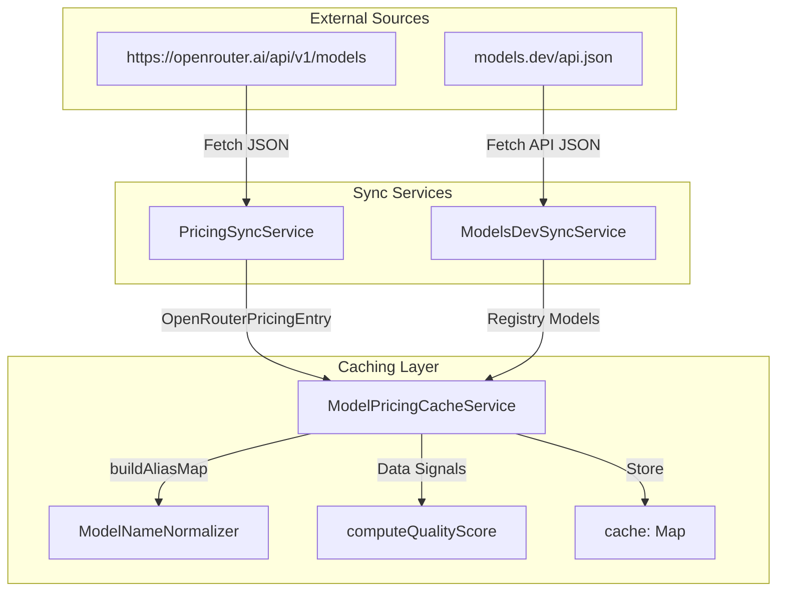
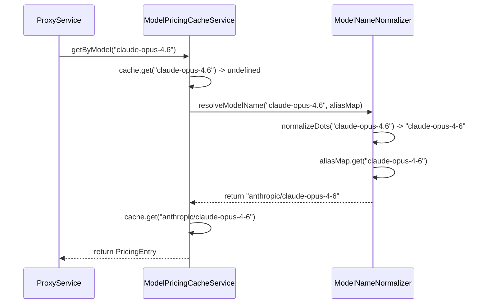

<!-- source: DeepWiki mcp.deepwiki.com · repo mnfst/manifest · page 4.2 Pricing Synchronization · fetched 2026-10-27 -->

# Pricing Synchronization

Relevant source files

The following files were used as context for generating this wiki page:

- [packages/backend/src/database/database-seeder.service.spec.ts](packages/backend/src/database/database-seeder.service.spec.ts)
- [packages/backend/src/database/database-seeder.service.ts](packages/backend/src/database/database-seeder.service.ts)
- [packages/backend/src/database/pricing-sync.service.spec.ts](packages/backend/src/database/pricing-sync.service.spec.ts)
- [packages/backend/src/database/pricing-sync.service.ts](packages/backend/src/database/pricing-sync.service.ts)
- [packages/backend/src/database/quality-score.util.spec.ts](packages/backend/src/database/quality-score.util.spec.ts)
- [packages/backend/src/database/quality-score.util.ts](packages/backend/src/database/quality-score.util.ts)
- [packages/backend/src/model-prices/model-name-normalizer.spec.ts](packages/backend/src/model-prices/model-name-normalizer.spec.ts)
- [packages/backend/src/model-prices/model-name-normalizer.ts](packages/backend/src/model-prices/model-name-normalizer.ts)
- [packages/backend/src/model-prices/model-prices.controller.spec.ts](packages/backend/src/model-prices/model-prices.controller.spec.ts)
- [packages/backend/src/model-prices/model-prices.controller.ts](packages/backend/src/model-prices/model-prices.controller.ts)
- [packages/backend/src/model-prices/model-prices.service.spec.ts](packages/backend/src/model-prices/model-prices.service.spec.ts)
- [packages/backend/src/model-prices/model-prices.service.ts](packages/backend/src/model-prices/model-prices.service.ts)
- [packages/backend/src/model-prices/model-pricing-cache.service.spec.ts](packages/backend/src/model-prices/model-pricing-cache.service.spec.ts)
- [packages/backend/src/model-prices/model-pricing-cache.service.ts](packages/backend/src/model-prices/model-pricing-cache.service.ts)

Manifest maintains a real-time, high-fidelity pricing database to power its cost-aware routing and analytics. The system aggregates data from broad coverage providers like OpenRouter and curated sources like `models.dev`, normalizing disparate model naming conventions into a unified schema.

## Data Flow Architecture

The pricing pipeline is a multi-stage process that moves from external API fetching to in-memory caching for low-latency lookups during request proxying and cost calculation.

### High-Level Pricing Pipeline

**Sources:** [packages/backend/src/model-prices/model-pricing-cache.service.ts:36-52](), [packages/backend/src/database/pricing-sync.service.ts:29-30](), [packages/backend/src/model-prices/model-pricing-cache.service.ts:64-102](), [packages/backend/src/database/quality-score.util.ts:41-93]()

---

## Key Components

### PricingSyncService
This service is responsible for fetching and sanitizing data from OpenRouter. It acts as the "broad coverage" source, ensuring that even obscure models have pricing data available.

*   **Endpoint:** `https://openrouter.ai/api/v1/models` [packages/backend/src/database/pricing-sync.service.ts:29]()
*   **Filtering:** It only caches models that are "chat compatible" via `isChatCompatible()` (supporting text input and output) [packages/backend/src/database/pricing-sync.service.ts:56](), [packages/backend/src/database/pricing-sync.service.ts:124-136]().
*   **Validation:** It skips models with negative, `NaN`, or `Infinity` pricing values [packages/backend/src/database/pricing-sync.service.ts:59-62]().
*   **Persistence:** Data is kept in an internal `Map<string, OpenRouterPricingEntry>` [packages/backend/src/database/pricing-sync.service.ts:34]().
*   **Scheduling:** Refreshes daily at 3 AM via `@Cron` [packages/backend/src/database/pricing-sync.service.ts:46-47](). It also performs a mandatory fetch on `onModuleInit` to ensure data availability at startup [packages/backend/src/database/pricing-sync.service.ts:37-44]().

### ModelsDevSyncService
A curated synchronization service that fetches highly accurate, provider-native pricing from `models.dev`. This source is prioritized over OpenRouter because it maps directly to the IDs used by primary providers (OpenAI, Anthropic, etc.) [packages/backend/src/model-prices/model-pricing-cache.service.ts:92-93](), [packages/backend/src/model-prices/model-pricing-cache.service.ts:172-187]().

### ModelPricingCacheService
The central orchestrator for pricing data. It implements `OnApplicationBootstrap` to ensure the cache is ready before the proxy starts accepting traffic [packages/backend/src/model-prices/model-pricing-cache.service.ts:36-56]().

*   **Tiered Overlay Logic:** It first loads OpenRouter data (broad coverage), then overlays `models.dev` data (curated). Curated data overrides OpenRouter entries for the same model ID [packages/backend/src/model-prices/model-pricing-cache.service.ts:67-93]().
*   **Custom Providers:** It also overlays user-defined pricing from the `custom_providers` table, keyed by `custom:<uuid>/<model_name>` [packages/backend/src/model-prices/model-pricing-cache.service.ts:98]().
*   **Normalization:** It extracts provider names from OpenRouter prefixes (e.g., `anthropic/` becomes provider "Anthropic") using `resolveProviderAndName()` [packages/backend/src/model-prices/model-pricing-cache.service.ts:140-165]().
*   **Validated Flag:** Pricing entries include a `validated` boolean, confirmed via provider-native APIs or registry checks [packages/backend/src/model-prices/model-pricing-cache.service.ts:30](), [packages/backend/src/model-prices/model-pricing-cache.service.ts:78]().

**Sources:** [packages/backend/src/model-prices/model-pricing-cache.service.ts:1-102](), [packages/backend/src/database/pricing-sync.service.ts:47-83]()

---

## Model Name Normalization

Because different providers and users refer to the same model using different strings (e.g., `gpt-4o` vs `openai/gpt-4o`), Manifest uses a `ModelNameNormalizer` utility.

### Normalization Sequence

*   **Alias Map:** `ModelPricingCacheService` builds an alias map using `buildAliasMap` during every reload [packages/backend/src/model-prices/model-pricing-cache.service.ts:100]().
*   **Fuzzy Matching:** `resolveModelName` handles dot-to-dash (e.g., `4.6` vs `4-6`), stripping provider prefixes, and removing date suffixes (e.g., `-2025-04-14`) [packages/backend/src/model-prices/model-name-normalizer.ts:128-161]().
*   **Google Variants:** Specifically handles Google-style suffixes like `-preview-MM-DD`, `-exp-MMDD`, or `-latest` [packages/backend/src/model-prices/model-name-normalizer.ts:59-64]().
*   **Known Aliases:** Hardcoded mappings for common shorthand names like `deepseek-v3` → `deepseek-chat` and `deepseek-r1` → `deepseek-reasoner` [packages/backend/src/model-prices/model-name-normalizer.ts:18-44]().

**Sources:** [packages/backend/src/model-prices/model-pricing-cache.service.ts:104-112](), [packages/backend/src/model-prices/model-name-normalizer.ts:1-161]()

---

## Quality Scores and Seeding

### Quality Score Calculation
The `computeQualityScore` utility derives a score from 1-5 based on pricing, capabilities (reasoning, code), and context window size [packages/backend/src/database/quality-score.util.ts:41-93]().
*   **Decision Tree:** Scores are assigned based on price thresholds. For example, a model with a total price $\ge \$8/M$ with both reasoning and code capabilities is assigned Score 5 [packages/backend/src/database/quality-score.util.ts:75-85]().
*   **Overrides:** Certain models have editorial overrides in `QUALITY_OVERRIDES` (e.g., `gpt-4o` is pinned to score 3 despite its price signals) [packages/backend/src/database/quality-score.util.ts:15-27]().

### DatabaseSeederService
Initializes the system on startup and handles initial data population [packages/backend/src/database/database-seeder.service.ts:20-58]().
*   **Better Auth:** Triggers migrations via `auth.$context.runMigrations()` to ensure auth tables exist [packages/backend/src/database/database-seeder.service.ts:60-63]().
*   **Idempotency:** Checks for existing records (e.g., `seed-api-key-001` or `seed-tenant-001`) before inserting to prevent duplication [packages/backend/src/database/database-seeder.service.ts:95-96](), [packages/backend/src/database/database-seeder.service.ts:124-125]().
*   **Environment Restriction:** Demo data seeding is restricted to `development` and `test` environments when `SEED_DATA=true` [packages/backend/src/database/database-seeder.service.ts:36-45]().

**Sources:** [packages/backend/src/database/quality-score.util.ts:1-93](), [packages/backend/src/database/database-seeder.service.ts:1-58]()

---

## Pricing Format and API

The backend internalizes pricing as `price_per_token` but exposes it to the frontend and API as `price_per_million` for readability [packages/backend/src/model-prices/model-prices.service.ts:20-23]().

### Model Prices Response Structure

| Field | Type | Description |
| :--- | :--- | :--- |
| `model_name` | `string` | Canonical ID (e.g., `openai/gpt-4o`) |
| `provider` | `string` | Display name of the provider (defaults to "Unknown") |
| `input_price_per_million` | `number` | Cost for 1M input tokens |
| `output_price_per_million` | `number` | Cost for 1M output tokens |
| `display_name` | `string \| null` | Human-readable name (e.g., "GPT-4o") |
| `validated` | `boolean` | Whether pricing is confirmed from a native source |

**Sources:** [packages/backend/src/model-prices/model-prices.service.ts:12-30](), [packages/backend/src/model-prices/model-pricing-cache.service.ts:23-33]()

---

