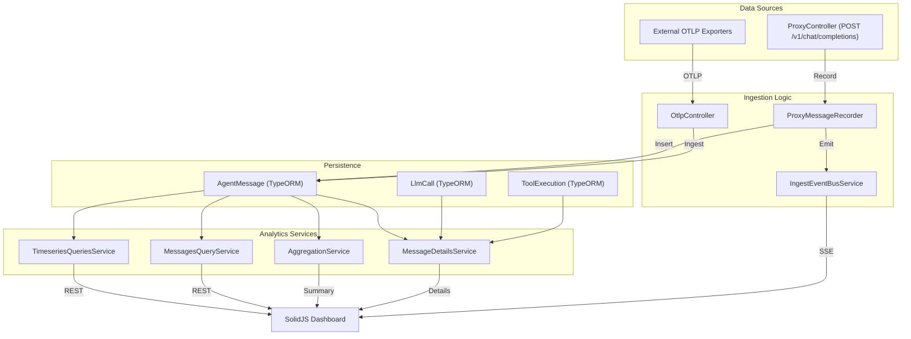
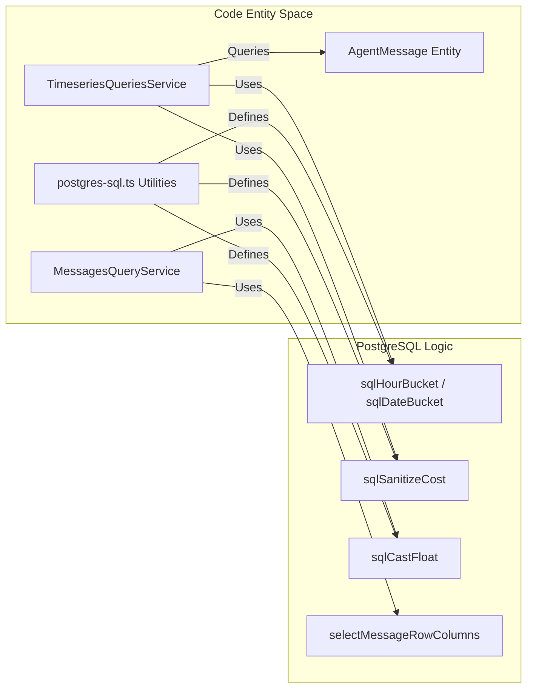

<!-- source: DeepWiki mcp.deepwiki.com · repo mnfst/manifest · page 5 Analytics and Observability · fetched 2026-10-27 -->

# Analytics and Observability

Relevant source files

The following files were used as context for generating this wiki page:

- [packages/backend/src/analytics/services/aggregation.service.spec.ts](packages/backend/src/analytics/services/aggregation.service.spec.ts)
- [packages/backend/src/analytics/services/aggregation.service.ts](packages/backend/src/analytics/services/aggregation.service.ts)
- [packages/backend/src/analytics/services/message-details.service.spec.ts](packages/backend/src/analytics/services/message-details.service.spec.ts)
- [packages/backend/src/analytics/services/message-details.service.ts](packages/backend/src/analytics/services/message-details.service.ts)
- [packages/backend/src/analytics/services/messages-query.service.spec.ts](packages/backend/src/analytics/services/messages-query.service.spec.ts)
- [packages/backend/src/analytics/services/messages-query.service.ts](packages/backend/src/analytics/services/messages-query.service.ts)
- [packages/backend/src/analytics/services/timeseries-queries.service.spec.ts](packages/backend/src/analytics/services/timeseries-queries.service.spec.ts)
- [packages/backend/src/analytics/services/timeseries-queries.service.ts](packages/backend/src/analytics/services/timeseries-queries.service.ts)
- [packages/backend/src/database/database.module.ts](packages/backend/src/database/database.module.ts)
- [packages/backend/src/entities/agent-message.entity.ts](packages/backend/src/entities/agent-message.entity.ts)
- [packages/backend/src/routing/proxy/__tests__/proxy-message-recorder.spec.ts](packages/backend/src/routing/proxy/__tests__/proxy-message-recorder.spec.ts)
- [packages/backend/src/routing/proxy/proxy-message-recorder.ts](packages/backend/src/routing/proxy/proxy-message-recorder.ts)
- [packages/frontend/src/components/MessageDetails.tsx](packages/frontend/src/components/MessageDetails.tsx)
- [packages/frontend/src/components/MessageDetailsSections.tsx](packages/frontend/src/components/MessageDetailsSections.tsx)
- [packages/frontend/src/services/api/messages.ts](packages/frontend/src/services/api/messages.ts)
- [packages/frontend/src/styles/data.css](packages/frontend/src/styles/data.css)
- [packages/frontend/tests/components/MessageDetails.test.tsx](packages/frontend/tests/components/MessageDetails.test.tsx)

The Analytics and Observability system in Manifest provides a comprehensive suite for tracking LLM usage, costs, and performance across multiple agents and providers. It serves as the data backbone for the dashboard, offering real-time insights and historical trends.

### System Overview

The system is built around the `AnalyticsModule`, which orchestrates several specialized services to process and query telemetry data stored in the `AgentMessage` entity [packages/backend/src/entities/agent-message.entity.ts:6-14](). It handles data ingestion via the proxy pipeline, live updates via Server-Sent Events (SSE), and complex historical analysis through optimized SQL queries.

The `ProxyMessageRecorder` acts as the primary sink for internal proxy telemetry, persisting successful and failed LLM calls to the `agent_messages` table while calculating costs and attributing calls to specific tiers or categories [packages/backend/src/routing/proxy/proxy-message-recorder.ts:130-152]().

**Sources:** [packages/backend/src/routing/proxy/proxy-message-recorder.ts:130-152](), [packages/backend/src/analytics/services/timeseries-queries.service.ts:27-34](), [packages/backend/src/analytics/services/messages-query.service.ts:31-35](), [packages/backend/src/analytics/services/message-details.service.ts:84-95]()

---

## Analytics API
The analytics system exposes several REST endpoints to drive the dashboard's visualizations and summaries.

*   **Time-series Data:** `TimeseriesQueriesService` generates hourly or daily buckets for usage charts, calculating token counts and costs using `sqlHourBucket` and `sqlDateBucket` abstractions [packages/backend/src/analytics/services/timeseries-queries.service.ts:43-57]().
*   **Message Logs:** `MessagesQueryService` handles paginated, filtered retrieval of telemetry logs. It uses `selectMessageRowColumns()` as the single source of truth for message projection to ensure the frontend receives consistent fields [packages/backend/src/analytics/services/messages-query.service.ts:55-62]().
*   **Cost Analysis:** `TimeseriesQueriesService.getCostByModel` computes the percentage share of tokens and costs per model, accounting for different `auth_type` and `provider` attributes [packages/backend/src/analytics/services/timeseries-queries.service.ts:128-166]().
*   **Message Details:** `MessageDetailsService` aggregates data from `AgentMessage`, `LlmCall`, and `ToolExecution` to provide a deep-dive view of a single request's lifecycle [packages/backend/src/analytics/services/message-details.service.ts:139-176]().
*   **Summary Metrics:** `AggregationService` calculates current vs. previous period totals for tokens, costs, and message counts, including trend percentages [packages/backend/src/analytics/services/aggregation.service.ts:52-94]().

For details, see [Analytics API](#5.1).

**Sources:** [packages/backend/src/analytics/services/messages-query.service.ts:37-97](), [packages/backend/src/analytics/services/timeseries-queries.service.ts:128-166](), [packages/backend/src/analytics/services/message-details.service.ts:97-138]()

---

## OTLP Ingestion and SSE
Manifest supports the OpenTelemetry Protocol (OTLP) for external telemetry ingestion and utilizes Server-Sent Events (SSE) for real-time dashboard updates.

*   **OTLP Pipeline:** The `OtlpController` (deprecated in favor of internal recording but still supported) allows external agents to push traces/logs. Authentication is enforced via `AgentKeyAuthGuard`.
*   **Real-time Updates:** When a message is recorded by the `ProxyMessageRecorder`, it emits an event via the `IngestEventBusService` [packages/backend/src/routing/proxy/proxy-message-recorder.ts:8-11](). These events are streamed to the dashboard via the SSE module, enabling live updates to the "Recent Activity" feed.
*   **Ingestion Recording:** The `ProxyMessageRecorder` captures detailed metadata including `duration_ms`, `cache_read_tokens`, `routing_tier`, and `routing_reason` to provide an audit trail of why a specific model was chosen [packages/backend/src/routing/proxy/proxy-message-recorder.ts:29-52]().

For details, see [OTLP Ingestion and SSE](#5.2).

**Sources:** [packages/backend/src/routing/proxy/proxy-message-recorder.ts:130-152](), [packages/backend/src/analytics/services/messages-query.service.ts:10-12]()

---

## Notifications and Alerts
The notification system monitors usage against user-defined rules to prevent cost overruns and provide operational awareness.

*   **Automated Checks:** `NotificationCronService` runs scheduled tasks to evaluate usage thresholds defined in the `NotificationRule` entity.
*   **Limit Enforcement:** `LimitCheckService` evaluates "hard" limits (blocking requests) and "soft" alerts (emailing warnings).
*   **Email Delivery:** `NotificationEmailService` utilizes pluggable providers (Resend, Mailgun, SendGrid) via `EmailProviderConfigService`. Alerts are styled using React Email templates like `threshold-alert.tsx`.

For details, see [Notifications and Alerts](#5.3).

**Sources:** [packages/backend/src/database/database.module.ts:13-15]()

---

## Dialect-Aware Analytics
Manifest primarily supports PostgreSQL. The analytics services use a set of SQL utility functions to handle time-bucketing and numeric casting consistently across the `AgentMessage` table [packages/backend/src/analytics/services/timeseries-queries.service.ts:9-15]().

| Component | Responsibility | File Reference |
| :--- | :--- | :--- |
| `selectMessageRowColumns` | Single source of truth for `AgentMessage` SQL projection | [packages/backend/src/analytics/services/query-helpers.ts:108-135]() |
| `sqlSanitizeCost` | Handles cleanup and COALESCE of `cost_usd` in SQL queries | [packages/backend/src/analytics/services/timeseries-queries.service.ts:53]() |
| `ProxyMessageRecorder` | Persists proxy results and calculates `cost_usd` using pricing cache | [packages/backend/src/routing/proxy/proxy-message-recorder.ts:130-152]() |
| `addTenantFilter` | Ensures data isolation by filtering queries by `tenant_id` or `user_id` | [packages/backend/src/analytics/services/query-helpers.ts:42-70]() |

**Sources:** [packages/backend/src/analytics/services/timeseries-queries.service.ts:45-57](), [packages/backend/src/analytics/services/query-helpers.ts:108-135](), [packages/backend/src/routing/proxy/proxy-message-recorder.ts:130-152]()

---

