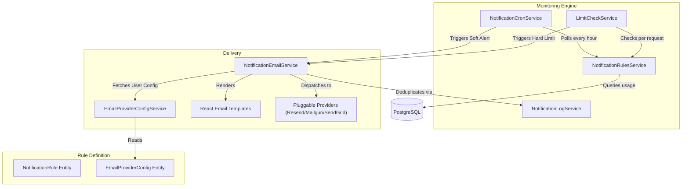
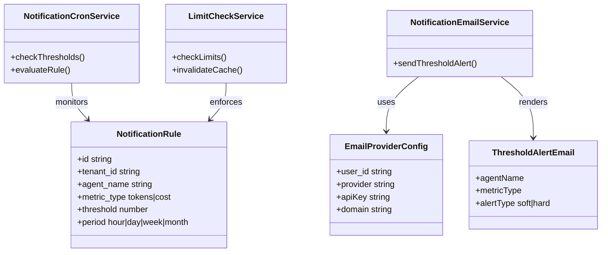

<!-- source: DeepWiki mcp.deepwiki.com · repo mnfst/manifest · page 5.3 Notifications and Alerts · fetched 2026-10-27 -->

# Notifications and Alerts

Relevant source files

The following files were used as context for generating this wiki page:

- [packages/backend/src/common/utils/period.util.spec.ts](packages/backend/src/common/utils/period.util.spec.ts)
- [packages/backend/src/common/utils/period.util.ts](packages/backend/src/common/utils/period.util.ts)
- [packages/backend/src/database/migrations/1771700000000-EmailProviderConfigs.ts](packages/backend/src/database/migrations/1771700000000-EmailProviderConfigs.ts)
- [packages/backend/src/entities/email-provider-config.entity.ts](packages/backend/src/entities/email-provider-config.entity.ts)
- [packages/backend/src/notifications/dto/set-email-provider.dto.ts](packages/backend/src/notifications/dto/set-email-provider.dto.ts)
- [packages/backend/src/notifications/emails/reset-password.tsx](packages/backend/src/notifications/emails/reset-password.tsx)
- [packages/backend/src/notifications/emails/test-email.tsx](packages/backend/src/notifications/emails/test-email.tsx)
- [packages/backend/src/notifications/emails/threshold-alert.tsx](packages/backend/src/notifications/emails/threshold-alert.tsx)
- [packages/backend/src/notifications/emails/verify-email.tsx](packages/backend/src/notifications/emails/verify-email.tsx)
- [packages/backend/src/notifications/notifications.controller.spec.ts](packages/backend/src/notifications/notifications.controller.spec.ts)
- [packages/backend/src/notifications/notifications.controller.ts](packages/backend/src/notifications/notifications.controller.ts)
- [packages/backend/src/notifications/services/email-provider-config.service.spec.ts](packages/backend/src/notifications/services/email-provider-config.service.spec.ts)
- [packages/backend/src/notifications/services/email-provider-config.service.ts](packages/backend/src/notifications/services/email-provider-config.service.ts)
- [packages/backend/src/notifications/services/email-provider-validation.spec.ts](packages/backend/src/notifications/services/email-provider-validation.spec.ts)
- [packages/backend/src/notifications/services/limit-check.service.spec.ts](packages/backend/src/notifications/services/limit-check.service.spec.ts)
- [packages/backend/src/notifications/services/limit-check.service.ts](packages/backend/src/notifications/services/limit-check.service.ts)
- [packages/backend/src/notifications/services/notification-cron.service.spec.ts](packages/backend/src/notifications/services/notification-cron.service.spec.ts)
- [packages/backend/src/notifications/services/notification-cron.service.ts](packages/backend/src/notifications/services/notification-cron.service.ts)
- [packages/backend/src/notifications/services/notification-email.service.spec.ts](packages/backend/src/notifications/services/notification-email.service.spec.ts)
- [packages/backend/src/notifications/services/notification-email.service.ts](packages/backend/src/notifications/services/notification-email.service.ts)
- [packages/frontend/src/components/Sidebar.tsx](packages/frontend/src/components/Sidebar.tsx)
- [packages/frontend/src/pages/Limits.tsx](packages/frontend/src/pages/Limits.tsx)
- [packages/frontend/src/styles/notifications.css](packages/frontend/src/styles/notifications.css)
- [packages/frontend/tests/components/LimitRuleModal.test.tsx](packages/frontend/tests/components/LimitRuleModal.test.tsx)
- [packages/frontend/tests/components/Sidebar.test.tsx](packages/frontend/tests/components/Sidebar.test.tsx)
- [packages/frontend/tests/pages/Limits-interactions.test.tsx](packages/frontend/tests/pages/Limits-interactions.test.tsx)
- [packages/frontend/tests/pages/Limits.test.tsx](packages/frontend/tests/pages/Limits.test.tsx)

The Manifest notification system provides automated monitoring of LLM usage against user-defined thresholds. It supports two primary modes of operation: **Soft Alerts** (asynchronous warnings via email) and **Hard Limits** (synchronous request blocking). The system tracks consumption across multiple metrics (tokens and cost) and time periods (hour, day, week, month).

## System Architecture

The notification system is composed of specialized services that handle scheduling, real-time enforcement, and pluggable email delivery providers.

### Data Flow and Service Interaction

The following diagram illustrates how notification rules are evaluated and how alerts are dispatched.

**Notification System Data Flow**

Sources: [packages/backend/src/notifications/services/notification-cron.service.ts:24-30](), [packages/backend/src/notifications/services/limit-check.service.ts:44-51](), [packages/backend/src/notifications/services/notification-log.service.ts:6-7]()

## Scheduled Alerts (NotificationCronService)

The `NotificationCronService` is responsible for background monitoring of usage thresholds. It is designed to notify users when their agents reach specific consumption milestones without interrupting the request flow.

- **Execution Frequency**: Runs every hour using a NestJS `@Cron` decorator with `CronExpression.EVERY_HOUR` [packages/backend/src/notifications/services/notification-cron.service.ts:43]().
- **Startup Catch-up**: On module initialization (`onModuleInit`), it performs an immediate check to catch any thresholds exceeded while the server was offline [packages/backend/src/notifications/services/notification-cron.service.ts:32-41]().
- **Efficiency**: Rules are grouped by `tenant_id`, `agent_name`, and `period` using a `Map` to deduplicate consumption queries to the database [packages/backend/src/notifications/services/notification-cron.service.ts:52-58]().
- **Evaluation**: The `evaluateRule` method checks if the threshold is met and ensures a notification hasn't already been sent for the current period via `NotificationLogService.hasAlreadySent` [packages/backend/src/notifications/services/notification-cron.service.ts:104-108]().

Sources: [packages/backend/src/notifications/services/notification-cron.service.ts:1-153](), [packages/backend/src/notifications/services/notification-cron.service.spec.ts:82-87]()

## Hard Limits (LimitCheckService)

The `LimitCheckService` provides real-time enforcement of "blocking" rules. This service is invoked by the proxy pipeline to determine if a request should be allowed to proceed based on budget constraints.

- **Caching**: Implements in-memory caches for rules (`rulesCache`) and consumption data (`consumptionCache`) with a 60-second TTL (`CACHE_TTL_MS`) and a maximum size of 10,000 entries [packages/backend/src/notifications/services/limit-check.service.ts:34-41]().
- **Reactive Invalidation**: Subscribes to the `IngestEventBusService` to clear the consumption cache whenever new telemetry (token usage or cost) is ingested, ensuring enforcement is based on fresh data [packages/backend/src/notifications/services/limit-check.service.ts:53-57]().
- **Blocking Logic**: If a threshold is exceeded, it returns a `LimitExceeded` object containing the `ruleId`, `metricType`, and `actual` usage [packages/backend/src/notifications/services/limit-check.service.ts:82-89](). It also triggers an asynchronous notification with `alertType: 'hard'` [packages/backend/src/notifications/services/limit-check.service.ts:141]().

Sources: [packages/backend/src/notifications/services/limit-check.service.ts:1-199](), [packages/backend/src/notifications/services/limit-check.service.spec.ts:169-176]()

## Email Delivery System

The system uses a pluggable architecture for email delivery, allowing users to configure their own providers or fall back to system-wide defaults.

### Pluggable Providers
The `NotificationEmailService` utilizes `EmailProviderConfigService` to resolve user-specific SMTP or API-based providers.
- **Supported Providers**: Resend, Mailgun, and SendGrid [packages/backend/src/notifications/services/notification-email.service.spec.ts:102-105]().
- **Provider Resolution**: The `createProvider` utility instantiates the correct client based on the user's stored `EmailProviderConfig` [packages/backend/src/notifications/services/notification-email.service.spec.ts:13-17]().
- **Configuration**: Managed via the `EmailProviderConfig` entity which stores API keys and sender domains [packages/backend/src/notifications/services/notification-cron.service.ts:111-115]().

### React Email Templates
Manifest uses **React Email** for modern, responsive templates located in `packages/backend/src/notifications/emails/`.
- **ThresholdAlertEmail**: Adapts UI based on `alertType`. Soft alerts use orange accents (`#ea580c`), while hard blocks use red (`#dc2626`) [packages/backend/src/notifications/emails/threshold-alert.tsx:63-66]().
- **Auth Emails**: Includes `VerifyEmailEmail` for account verification and `ResetPasswordEmail` for security flows.
- **Test Email**: A `TestEmail` template is provided to verify provider configuration from the dashboard [packages/backend/src/notifications/emails/test-email.tsx:19-63]().

Sources: [packages/backend/src/notifications/emails/threshold-alert.tsx:1-175](), [packages/backend/src/notifications/services/notification-email.service.spec.ts:1-25]()

## Frontend Management (Limits Page)

The dashboard provides a dedicated interface for managing notification rules and viewing alert history for each agent.

- **Rule Management**: Users can create, edit, and delete rules via the `Limits` page [packages/frontend/src/pages/Limits.tsx:72-111]().
- **Status Indicators**: A warning banner is displayed if any hard limits have been triggered, informing the user that requests are currently blocked [packages/frontend/src/pages/Limits.tsx:165-187]().
- **Navigation**: The Limits section is accessible via the sidebar under the "MANAGE" category [packages/frontend/src/components/Sidebar.tsx:58-65]().

Sources: [packages/frontend/src/pages/Limits.tsx:1-210](), [packages/frontend/src/components/Sidebar.tsx:58-65](), [packages/frontend/tests/pages/Limits.test.tsx:179-191]()

## Period Calculation

Usage boundaries and reset dates are calculated using `period.util.ts`. This ensures consistent logic for usage windows in UTC.

| Period | Start Boundary Logic | Reset Date Calculation |
| :--- | :--- | :--- |
| **Hour** | Start of current hour | Start of next hour |
| **Day** | Midnight UTC today | Midnight UTC tomorrow |
| **Week** | Monday at midnight UTC | Next Monday at midnight UTC |
| **Month** | 1st of current month at midnight | 1st of next month at midnight |

Sources: [packages/backend/src/notifications/services/limit-check.service.ts:142](), [packages/backend/src/notifications/services/notification-cron.service.ts:63](), [packages/backend/src/common/utils/period.util.ts:1-10]()

## Implementation Mapping

The following diagram maps high-level system concepts to specific code entities within the `notifications` module.

**Code Entity Map**

Sources: [packages/backend/src/notifications/services/notification-cron.service.ts:10-18](), [packages/backend/src/notifications/services/limit-check.service.ts:11-19](), [packages/backend/src/notifications/emails/threshold-alert.tsx:16-27]()

---

