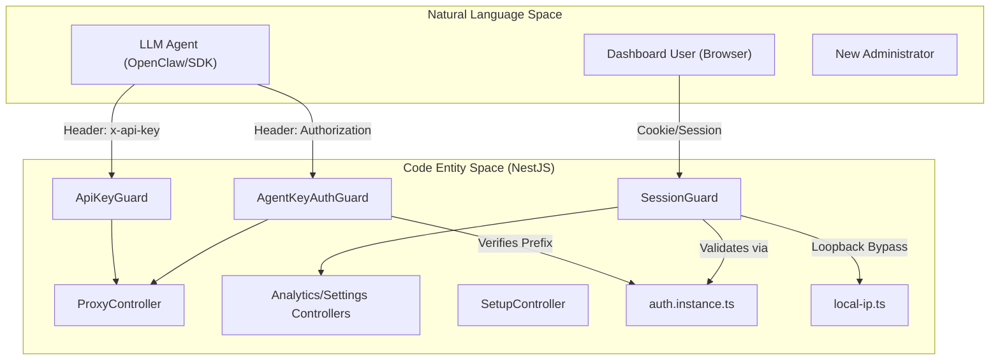
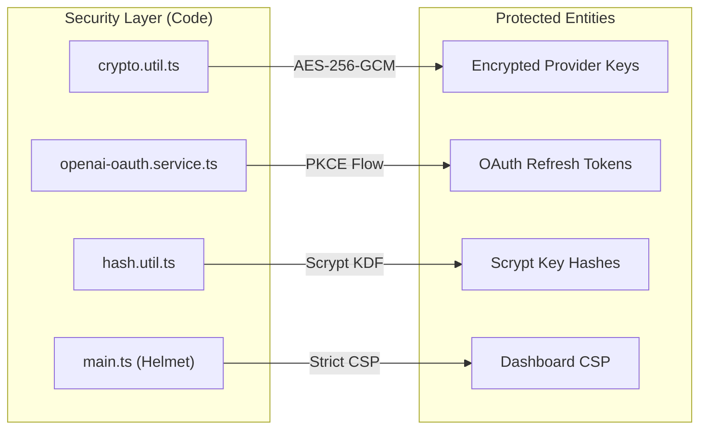

<!-- source: DeepWiki mcp.deepwiki.com · repo mnfst/manifest · page 6 Authentication and Security · fetched 2026-10-27 -->

# Authentication and Security

Relevant source files

The following files were used as context for generating this wiki page:

- [packages/backend/src/analytics/services/agent-analytics.service.spec.ts](packages/backend/src/analytics/services/agent-analytics.service.spec.ts)
- [packages/backend/src/auth/auth.instance.spec.ts](packages/backend/src/auth/auth.instance.spec.ts)
- [packages/backend/src/auth/auth.instance.ts](packages/backend/src/auth/auth.instance.ts)
- [packages/backend/src/auth/session.guard.spec.ts](packages/backend/src/auth/session.guard.spec.ts)
- [packages/backend/src/auth/session.guard.ts](packages/backend/src/auth/session.guard.ts)
- [packages/backend/src/common/guards/api-key.guard.spec.ts](packages/backend/src/common/guards/api-key.guard.spec.ts)
- [packages/backend/src/common/guards/api-key.guard.ts](packages/backend/src/common/guards/api-key.guard.ts)
- [packages/backend/src/common/utils/local-ip.ts](packages/backend/src/common/utils/local-ip.ts)
- [packages/backend/src/main.ts](packages/backend/src/main.ts)
- [packages/backend/src/notifications/services/notification-rules.service.spec.ts](packages/backend/src/notifications/services/notification-rules.service.spec.ts)
- [packages/backend/src/notifications/services/notification-rules.service.ts](packages/backend/src/notifications/services/notification-rules.service.ts)
- [packages/backend/src/otlp/guards/agent-key-auth.guard.spec.ts](packages/backend/src/otlp/guards/agent-key-auth.guard.spec.ts)
- [packages/backend/src/otlp/guards/agent-key-auth.guard.ts](packages/backend/src/otlp/guards/agent-key-auth.guard.ts)
- [packages/backend/src/routing/oauth/openai-oauth.service.ts](packages/backend/src/routing/oauth/openai-oauth.service.ts)
- [packages/backend/src/routing/openai-oauth.service.spec.ts](packages/backend/src/routing/openai-oauth.service.spec.ts)
- [packages/frontend/src/services/api/core.ts](packages/frontend/src/services/api/core.ts)

Manifest implements a dual-layered authentication architecture designed to secure both the management dashboard and the high-throughput LLM proxy. The system distinguishes between **User Authentication** (via Better Auth) for human administrators and **Agent Authentication** (via API Keys) for automated LLM clients.

## System Authentication Overview

The following diagram illustrates how different request types are handled by specific security guards within the NestJS backend, highlighting the distinction between session-based dashboard access and key-based proxy access.

### Authentication Flow and Code Entities

**Sources:** [packages/backend/src/auth/auth.instance.ts:48-118](), [packages/backend/src/auth/session.guard.ts:36-105](), [packages/backend/src/otlp/guards/agent-key-auth.guard.ts:86-117](), [packages/backend/src/common/guards/api-key.guard.ts:29-84]()

---

## Better Auth and Session Management
Dashboard security is powered by **Better Auth**, providing a robust session management layer for administrators. The configuration is centralized in `auth.instance.ts`.

*   **Deployment Modes**: In production, it supports Google, GitHub, and Discord OAuth providers alongside traditional Email/Password credentials [packages/backend/src/auth/auth.instance.ts:98-116]().
*   **Local Mode Loopback**: When running in `self-hosted` mode, the `SessionGuard` provides a synthetic "Local User" for loopback IP requests (detected via `isLoopbackPeer`) to facilitate programmatic access without manual login [packages/backend/src/auth/session.guard.ts:93-101]().
*   **Security Middleware**: The application uses `helmet` for CSP and HSTS, and applies specialized rate limiters for auth endpoints like `/api/auth/sign-in` and `/api/auth/forget-password` to prevent brute-force attacks [packages/backend/src/main.ts:35-63](), [packages/backend/src/main.ts:141-176]().
*   **Email Workflow**: Integrates with providers (Resend, Mailgun, SendGrid) for password resets and email verification, utilizing React-based email templates [packages/backend/src/auth/auth.instance.ts:65-97]().

For details, see [Better Auth and Session Management](#6.1).

---

## Agent API Key Authentication
Automated requests to the LLM proxy or OTLP ingestion endpoints are authenticated using Manifest API keys associated with `Agent` and `Tenant` entities.

*   **Key Format**: Keys use the `mnfst_` prefix (defined by `API_KEY_PREFIX`) for easy identification [packages/backend/src/otlp/guards/agent-key-auth.guard.ts:107-110]().
*   **Hashing and Security**: Keys are stored as hashes generated via `scrypt` KDF. The `AgentKeyAuthGuard` audits for legacy static-salt hashes on boot and warns operators to rotate them [packages/backend/src/otlp/guards/agent-key-auth.guard.ts:57-74]().
*   **Performance Caching**: To minimize DB overhead during high-frequency proxy requests, the `AgentKeyAuthGuard` maintains an in-memory cache of verified keys with a 5-minute TTL [packages/backend/src/otlp/guards/agent-key-auth.guard.ts:37-42]().
*   **Multi-Tenant Guarding**: The `ApiKeyGuard` allows requests to provide an `x-api-key` header, which populates the `request.user` context for downstream analytics and tenant filtering [packages/backend/src/common/guards/api-key.guard.ts:41-61]().

For details, see [Agent API Key Authentication](#6.2).

---

## Security Hardening
Manifest incorporates several OWASP-aligned measures to protect against common vulnerabilities, specifically targeting LLM-specific risks like SSRF and credential exposure.

### Security Architecture Diagram

**Sources:** [packages/backend/src/routing/oauth/openai-oauth.service.ts:50-53](), [packages/backend/src/main.ts:35-63]()

*   **Credential Encryption**: Upstream provider API keys and OAuth tokens are encrypted at rest using `aes-256-gcm`.
*   **OAuth Security**: The `OpenaiOauthService` implements PKCE (Proof Key for Code Exchange) with `code_challenge` and `state` validation to secure subscription-based provider links [packages/backend/src/routing/oauth/openai-oauth.service.ts:50-76]().
*   **Network Security**: The backend enforces strict CORS policies and trusts reverse proxies (e.g., Nginx, Traefik) only within private/loopback subnets to prevent IP spoofing [packages/backend/src/main.ts:80-100](), [packages/backend/src/main.ts:121-135]().
*   **SQL Safety**: Services like `NotificationRulesService` use TypeORM query builders or parameterized queries to ensure protection against SQL injection [packages/backend/src/notifications/services/notification-rules.service.ts:71-80]().

For details, see [Security Hardening](#6.3).

---

## Comparison of Auth Mechanisms

| Feature | Dashboard Auth (Better Auth) | Agent Auth (API Key) |
| :--- | :--- | :--- |
| **Primary Target** | Human Administrators | Automated Agents / SDKs |
| **Identifier** | Email / OAuth ID | `mnfst_` prefixed key |
| **Persistence** | Session Cookie | Header (`Authorization` or `x-api-key`) |
| **Local Mode** | Loopback Bypass [packages/backend/src/auth/session.guard.ts:93-101]() | Loopback Bypass [packages/backend/src/otlp/guards/agent-key-auth.guard.ts:131-137]() |
| **Storage** | Better Auth DB (Postgres) | `AgentApiKey` (Hashed) |
| **Rate Limiting** | Endpoint-specific (15m window) [packages/backend/src/main.ts:141-176]() | Proxy Pipeline Throttling |

**Sources:** [packages/backend/src/auth/auth.instance.ts:48-118](), [packages/backend/src/otlp/guards/agent-key-auth.guard.ts:107-116](), [packages/backend/src/main.ts:141-176]()

---

