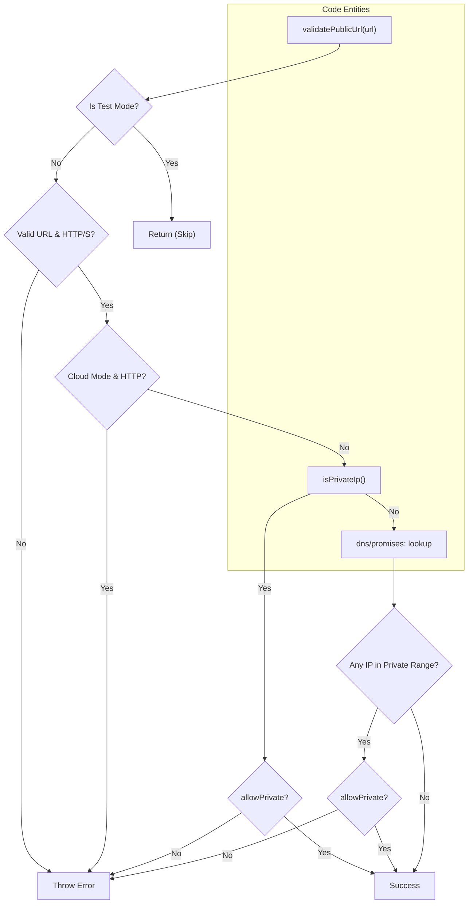
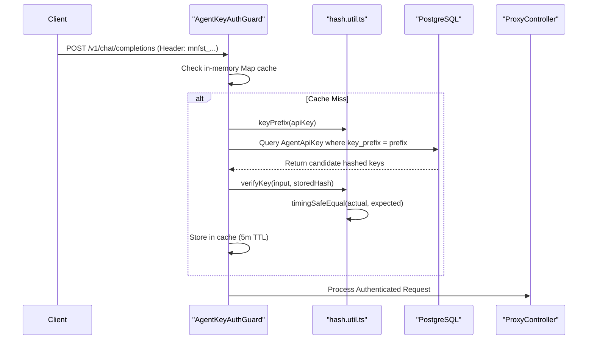

<!-- source: DeepWiki mcp.deepwiki.com · repo mnfst/manifest · page 6.3 Security Hardening · fetched 2026-10-27 -->

# Security Hardening

Relevant source files

The following files were used as context for generating this wiki page:

- [packages/backend/src/common/utils/detect-self-hosted.spec.ts](packages/backend/src/common/utils/detect-self-hosted.spec.ts)
- [packages/backend/src/common/utils/detect-self-hosted.ts](packages/backend/src/common/utils/detect-self-hosted.ts)
- [packages/backend/src/common/utils/hash.util.spec.ts](packages/backend/src/common/utils/hash.util.spec.ts)
- [packages/backend/src/common/utils/hash.util.ts](packages/backend/src/common/utils/hash.util.ts)
- [packages/backend/src/common/utils/secret-scrub.spec.ts](packages/backend/src/common/utils/secret-scrub.spec.ts)
- [packages/backend/src/common/utils/secret-scrub.ts](packages/backend/src/common/utils/secret-scrub.ts)
- [packages/backend/src/common/utils/url-validation.spec.ts](packages/backend/src/common/utils/url-validation.spec.ts)
- [packages/backend/src/common/utils/url-validation.ts](packages/backend/src/common/utils/url-validation.ts)
- [packages/backend/src/database/migrations/1771500000000-HashApiKeys.ts](packages/backend/src/database/migrations/1771500000000-HashApiKeys.ts)
- [packages/backend/src/database/migrations/1773900000000-AddKeyPrefixIndex.spec.ts](packages/backend/src/database/migrations/1773900000000-AddKeyPrefixIndex.spec.ts)
- [packages/backend/src/database/migrations/1773900000000-AddKeyPrefixIndex.ts](packages/backend/src/database/migrations/1773900000000-AddKeyPrefixIndex.ts)
- [packages/backend/src/routing/custom-provider/probe-error.spec.ts](packages/backend/src/routing/custom-provider/probe-error.spec.ts)
- [packages/backend/src/routing/custom-provider/probe-error.ts](packages/backend/src/routing/custom-provider/probe-error.ts)
- [packages/backend/src/routing/proxy/proxy-error-sanitizer.spec.ts](packages/backend/src/routing/proxy/proxy-error-sanitizer.spec.ts)
- [packages/backend/src/routing/proxy/proxy-error-sanitizer.ts](packages/backend/src/routing/proxy/proxy-error-sanitizer.ts)

Manifest implements a defense-in-depth security strategy aligned with OWASP best practices. The system protects against Server-Side Request Forgery (SSRF), ensures credential confidentiality through encryption and hashing, and minimizes information leakage via error sanitization and strict middleware configurations.

## SSRF Protection and URL Validation

To prevent Server-Side Request Forgery (SSRF), Manifest validates all custom provider URLs and external endpoints before making outbound requests. This is particularly critical when users configure custom LLM endpoints or when the system probes local servers like Ollama or LM Studio.

The `url-validation.ts` utility performs multi-step verification:
1.  **Protocol Enforcement**: Only `https:` schemes are permitted for outbound provider traffic in cloud mode to prevent passive wire-sniffing (AC-2) of API keys and prompts. Self-hosted installs allow `http:` for private destinations only [packages/backend/src/common/utils/url-validation.ts:107-122]().
2.  **IP Literal Blocking**: Direct use of private IP ranges (e.g., `127.0.0.1`, `10.x.x.x`, `192.168.x.x`) is rejected unless `allowPrivate` is explicitly set [packages/backend/src/common/utils/url-validation.ts:132-135]().
3.  **DNS Rebinding Protection**: The system resolves hostnames using `dns.lookup` and checks every resolved IP address against known private and link-local ranges [packages/backend/src/common/utils/url-validation.ts:146-172]().
4.  **Cloud Metadata Protection**: Specific checks are performed for cloud metadata service IPs (e.g., `169.254.169.254`, `fd00:ec2::254`) used by AWS, GCP, Azure, and Alibaba Cloud. These are blocked even in self-hosted mode to prevent credential exfiltration from the host environment [packages/backend/src/common/utils/url-validation.ts:62-87]().

### URL Validation Logic Flow

The following diagram illustrates the validation sequence for an outbound request to a custom provider.

**Diagram: SSRF Validation Pipeline**

**Sources:** [packages/backend/src/common/utils/url-validation.ts:89-179](), [packages/backend/src/common/utils/url-validation.spec.ts:167-225]()

## Credential Security: Hashing and Encryption

Manifest handles sensitive data, including Agent API keys and Provider credentials.

### Agent API Key Hashing
Agent keys (prefixed with `mnfst_`) are never stored in plain text. They are hashed using `scrypt` with a per-key random salt to mitigate rainbow table attacks [packages/backend/src/common/utils/hash.util.ts:12-16]().
*   **Storage Format**: `salt_hex:hash_hex` [packages/backend/src/common/utils/hash.util.ts:15]().
*   **Verification**: Uses `timingSafeEqual` to prevent timing attacks during key validation [packages/backend/src/common/utils/hash.util.ts:28]().
*   **Indexing**: A 12-character prefix is indexed for fast lookups without exposing the full key [packages/backend/src/common/utils/hash.util.ts:37-39]().

### Provider Credential Encryption
Credentials for upstream providers (stored in `UserProvider` entity) are encrypted at rest using **AES-256-GCM**. This ensures both confidentiality and integrity of stored secrets.

| Entity | Security Measure | Implementation |
| :--- | :--- | :--- |
| **Agent API Key** | Hashing | `scrypt` with random salt [packages/backend/src/common/utils/hash.util.ts:12-16]() |
| **Provider API Keys** | Encryption | AES-256-GCM (`crypto.util.ts`) |
| **Database Index** | Prefixing | `IDX_agent_api_keys_key_prefix` [packages/backend/src/database/migrations/1773900000000-AddKeyPrefixIndex.ts:1-30]() |

**Sources:** [packages/backend/src/common/utils/hash.util.ts:1-40](), [packages/backend/src/database/migrations/1773900000000-AddKeyPrefixIndex.ts:1-30]()

## Proxy Error Sanitization

To prevent leaking internal provider details or sensitive keys in error logs or client responses, the proxy utilizes the `proxy-error-sanitizer.ts` and `secret-scrub.ts` utilities.

*   **Production Mode**: Returns generic, mapped error messages (e.g., HTTP 429 becomes "Rate limited by upstream provider") via `sanitizeProviderError` to avoid leaking provider internals [packages/backend/src/routing/proxy/proxy-error-sanitizer.ts:24-27]().
*   **Credential Redaction**: Detailed messages (in non-production) pass through a regex-based redaction engine `scrubSecrets` that strips OpenAI keys (`sk-***`), Anthropic keys (`sk-ant-***`), and Bearer tokens [packages/backend/src/common/utils/secret-scrub.ts:17-36]().
*   **Message Truncation**: All sanitized messages are capped at 500 characters [packages/backend/src/routing/proxy/proxy-error-sanitizer.ts:34]().

**Sources:** [packages/backend/src/routing/proxy/proxy-error-sanitizer.ts:1-41](), [packages/backend/src/common/utils/secret-scrub.ts:1-45]()

## HTTP Security and Middleware

The NestJS backend application is hardened using several standard security middlewares in `main.ts`.

### Helmet and CSP
Manifest uses `helmet` to set secure HTTP headers [packages/backend/src/main.ts:24-50]():
*   **Content Security Policy (CSP)**: Restricts script, style, and image sources to `'self'` and trusted origins.
*   **Frame Ancestors**: Configurable via `FRAME_ANCESTORS` env, defaults to `'none'` to prevent clickjacking [packages/backend/src/main.ts:35-40]().

### Rate Limiting
Granular rate limits are applied to authentication endpoints via `express-rate-limit` to mitigate brute-force and enumeration attacks [packages/backend/src/main.ts:106-143]():
*   **Sign-in**: 20 attempts per 15 minutes.
*   **Sign-up**: 5 attempts per 15 minutes.
*   **Password Reset**: 5 attempts per 15 minutes.

### Auth Guards and Loopback Bypass
1.  **AgentKeyAuthGuard**: Authenticates incoming LLM requests using hashed API keys. It implements a 5-minute in-memory cache to amortize DB lookups [packages/backend/src/otlp/guards/agent-key-auth.guard.ts:37-43]().
2.  **Local Mode Bypass**: In `selfhosted` mode, the system detects if it is running inside Docker or Podman and identifies the host gateway (e.g., `host.docker.internal`) to allow local loopback traffic without strict authentication for specific dev scenarios [packages/backend/src/common/utils/detect-self-hosted.ts:1-44]().

**Diagram: Request Security Lifecycle**

**Sources:** [packages/backend/src/main.ts:24-143](), [packages/backend/src/otlp/guards/agent-key-auth.guard.ts:35-153](), [packages/backend/src/common/utils/hash.util.ts:22-35](), [packages/backend/src/common/utils/detect-self-hosted.ts:1-44]()

---

