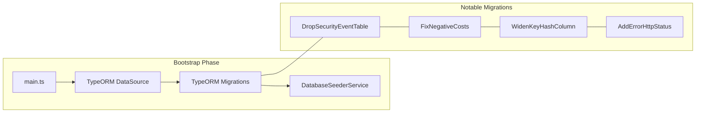

<!-- source: DeepWiki mcp.deepwiki.com · repo mnfst/manifest · page 7 Database and Persistence · fetched 2026-10-27 -->

# Database and Persistence

<details>
<summary>Relevant source files</summary>

The following files were used as context for generating this wiki page:

- [packages/backend/src/analytics/services/message-details.service.spec.ts](packages/backend/src/analytics/services/message-details.service.spec.ts)
- [packages/backend/src/analytics/services/message-details.service.ts](packages/backend/src/analytics/services/message-details.service.ts)
- [packages/backend/src/database/database.module.ts](packages/backend/src/database/database.module.ts)
- [packages/backend/src/database/datasource.ts](packages/backend/src/database/datasource.ts)
- [packages/backend/src/entities/agent-message.entity.ts](packages/backend/src/entities/agent-message.entity.ts)
- [packages/backend/src/routing/proxy/__tests__/proxy-message-recorder.spec.ts](packages/backend/src/routing/proxy/__tests__/proxy-message-recorder.spec.ts)
- [packages/backend/src/routing/proxy/proxy-message-recorder.ts](packages/backend/src/routing/proxy/proxy-message-recorder.ts)
- [packages/frontend/src/components/MessageDetails.tsx](packages/frontend/src/components/MessageDetails.tsx)
- [packages/frontend/src/components/MessageDetailsSections.tsx](packages/frontend/src/components/MessageDetailsSections.tsx)
- [packages/frontend/src/services/api/messages.ts](packages/frontend/src/services/api/messages.ts)
- [packages/frontend/src/styles/data.css](packages/frontend/src/styles/data.css)
- [packages/frontend/tests/components/MessageDetails.test.tsx](packages/frontend/tests/components/MessageDetails.test.tsx)

</details>


Manifest utilizes a robust persistence layer built on **TypeORM** to manage multi-tenant data, telemetry, and system configuration. While the system originally supported dual databases, it has transitioned to **PostgreSQL 16** as the primary and only fully supported production database.

## Architecture Overview

The persistence layer is managed by the `DatabaseModule` [packages/backend/src/database/database.module.ts:1-85](). It centralizes entity registration for the NestJS application and handles the integration of over 20 distinct entities [packages/backend/src/database/database.module.ts:5-21]().

### Data Interaction Flow
The following diagram illustrates how the system bridges high-level services to the underlying TypeORM entities and the PostgreSQL database.

**Persistence Architecture**
```mermaid
graph TD
    subgraph "Natural Language Space"
        "User Dashboard"
        "AI Agent Requests"
        "Price Updates"
    end

    subgraph "Code Entity Space"
        PR["ProxyMessageRecorder"]
        MDS["MessageDetailsService"]
        DBSS["DatabaseSeederService"]
        MPC["ModelPricingCacheService"]
    end

    subgraph "Database Entities"
        AM["AgentMessage"]
        TA["TierAssignment"]
        UP["UserProvider"]
        AG["Agent"]
        LC["LlmCall"]
        TE["ToolExecution"]
    end

    subgraph "Storage"
        PG[("PostgreSQL 16")]
    end

    "AI Agent Requests" --> PR
    PR -- "inserts" --> AM
    "User Dashboard" --> MDS
    MDS -- "queries" --> AM
    MDS -- "queries" --> LC
    MDS -- "queries" --> TE
    "User Dashboard" --> DBSS
    DBSS -- "seeds" --> UP
    "Price Updates" --> MPC
    AM & TA & UP & AG & LC & TE --> PG
```
Sources: [packages/backend/src/routing/proxy/proxy-message-recorder.ts:130-152](), [packages/backend/src/analytics/services/message-details.service.ts:84-138](), [packages/backend/src/database/database.module.ts:5-21](), [packages/backend/src/entities/agent-message.entity.ts:14-140]()

## Entity Schema

The data model is strictly multi-tenant. Every `AgentMessage`, `Agent`, and `AgentApiKey` is associated with a `Tenant` to ensure data isolation.

*   **Identity**: `Tenant`, `Agent`, `AgentApiKey` (using `mnfst_` prefixes).
*   **Credentials**: `UserProvider` stores encrypted API keys (AES-256-GCM) for LLM providers.
*   **Telemetry**: `AgentMessage` is the core telemetry entity, recording token counts, costs, routing tiers, and error statuses [packages/backend/src/entities/agent-message.entity.ts:39-67](). It also captures `caller_attribution`, `request_headers`, and `request_params` for auditability [packages/backend/src/entities/agent-message.entity.ts:111-118]().
*   **Routing**: `TierAssignment`, `SpecificityAssignment`, and `HeaderTier` define how requests are mapped to specific models.
*   **Notifications**: `NotificationRule` and `NotificationLog` manage usage limits and alerts [packages/backend/src/database/database.module.ts:13-14]().

For details, see [Entity Schema](#7.1).

**Sources:** [packages/backend/src/database/database.module.ts:5-21](), [packages/backend/src/entities/agent-message.entity.ts:14-140]()

## Database Configuration

Manifest uses TypeORM to manage its connection to PostgreSQL. The configuration prioritizes the `DATABASE_URL` or `MIGRATION_DATABASE_URL` environment variables [packages/backend/src/database/datasource.ts:4-15]().

| Feature | Specification |
| :--- | :--- |
| **Engine** | PostgreSQL 16+ |
| **ORM** | TypeORM |
| **Migrations** | Automated via `AUTO_MIGRATE=true` |
| **Dialect** | Custom `postgres-sql.ts` utilities for DB-specific types [packages/backend/src/entities/agent-message.entity.ts:2-33]() |

Note that the legacy SQLite/sql.js local mode is now deprecated in favor of a unified PostgreSQL backend for both cloud and self-hosted Docker deployments.

For details, see [Database Configuration and Migrations](#7.2).

**Sources:** [packages/backend/src/database/datasource.ts:4-18](), [packages/backend/src/entities/agent-message.entity.ts:2-33]()

## Migrations and Seeding

Manifest manages schema evolution through a sequence of versioned migration files registered in the `DatabaseModule` [packages/backend/src/database/database.module.ts:24-85]().

### Automated Lifecycle
1.  **Migration**: On startup, TypeORM compares the current database state against the migration history. Notable migrations include `DropSecurityEventTable` [packages/backend/src/database/database.module.ts:60](), `FixNegativeCosts` [packages/backend/src/database/database.module.ts:61](), and `WidenKeyHashColumn` [packages/backend/src/database/database.module.ts:63]().
2.  **Seeding**: The `DatabaseSeederService` [packages/backend/src/database/database.module.ts:22]() performs essential startup tasks, including seeding curated model quality scores and initializing default settings.
3.  **Sync**: Services like `OllamaSyncService` run periodically to update available models.

**Migration & Seeding Lifecycle**

Sources: [packages/backend/src/database/database.module.ts:22-85](), [packages/backend/src/database/datasource.ts:10-15]()

For details on specific migrations and setup, see [Database Configuration and Migrations](#7.2).

---

