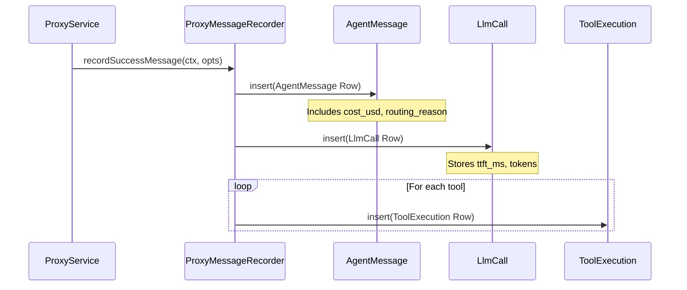

<!-- source: DeepWiki mcp.deepwiki.com · repo mnfst/manifest · page 7.1 Entity Schema · fetched 2026-10-27 -->

# Entity Schema

<details>
<summary>Relevant source files</summary>

The following files were used as context for generating this wiki page:

- [packages/backend/src/analytics/services/message-details.service.spec.ts](packages/backend/src/analytics/services/message-details.service.spec.ts)
- [packages/backend/src/analytics/services/message-details.service.ts](packages/backend/src/analytics/services/message-details.service.ts)
- [packages/backend/src/database/database.module.ts](packages/backend/src/database/database.module.ts)
- [packages/backend/src/database/migrations/1772843035514-AddPerformanceIndexes.ts](packages/backend/src/database/migrations/1772843035514-AddPerformanceIndexes.ts)
- [packages/backend/src/database/migrations/1772940000000-DropRedundantIndexes.spec.ts](packages/backend/src/database/migrations/1772940000000-DropRedundantIndexes.spec.ts)
- [packages/backend/src/database/migrations/1772940000000-DropRedundantIndexes.ts](packages/backend/src/database/migrations/1772940000000-DropRedundantIndexes.ts)
- [packages/backend/src/database/migrations/1772960000000-DropUnusedIndexes.spec.ts](packages/backend/src/database/migrations/1772960000000-DropUnusedIndexes.spec.ts)
- [packages/backend/src/database/migrations/1772960000000-DropUnusedIndexes.ts](packages/backend/src/database/migrations/1772960000000-DropUnusedIndexes.ts)
- [packages/backend/src/database/migrations/1782200000000-AddAgentSoftDelete.spec.ts](packages/backend/src/database/migrations/1782200000000-AddAgentSoftDelete.spec.ts)
- [packages/backend/src/database/migrations/1782200000000-AddAgentSoftDelete.ts](packages/backend/src/database/migrations/1782200000000-AddAgentSoftDelete.ts)
- [packages/backend/src/entities/agent-api-key.entity.ts](packages/backend/src/entities/agent-api-key.entity.ts)
- [packages/backend/src/entities/agent-log.entity.ts](packages/backend/src/entities/agent-log.entity.ts)
- [packages/backend/src/entities/agent-message.entity.ts](packages/backend/src/entities/agent-message.entity.ts)
- [packages/backend/src/entities/agent.entity.ts](packages/backend/src/entities/agent.entity.ts)
- [packages/backend/src/entities/api-key.entity.ts](packages/backend/src/entities/api-key.entity.ts)
- [packages/backend/src/entities/llm-call.entity.ts](packages/backend/src/entities/llm-call.entity.ts)
- [packages/backend/src/entities/notification-log.entity.ts](packages/backend/src/entities/notification-log.entity.ts)
- [packages/backend/src/entities/notification-rule.entity.ts](packages/backend/src/entities/notification-rule.entity.ts)
- [packages/backend/src/entities/tenant.entity.ts](packages/backend/src/entities/tenant.entity.ts)
- [packages/backend/src/entities/tool-execution.entity.ts](packages/backend/src/entities/tool-execution.entity.ts)
- [packages/backend/src/entities/user-provider.entity.spec.ts](packages/backend/src/entities/user-provider.entity.spec.ts)
- [packages/backend/src/entities/user-provider.entity.ts](packages/backend/src/entities/user-provider.entity.ts)
- [packages/backend/src/routing/proxy/__tests__/proxy-message-recorder.spec.ts](packages/backend/src/routing/proxy/__tests__/proxy-message-recorder.spec.ts)
- [packages/backend/src/routing/proxy/proxy-message-recorder.ts](packages/backend/src/routing/proxy/proxy-message-recorder.ts)
- [packages/frontend/src/components/MessageDetails.tsx](packages/frontend/src/components/MessageDetails.tsx)
- [packages/frontend/src/components/MessageDetailsSections.tsx](packages/frontend/src/components/MessageDetailsSections.tsx)
- [packages/frontend/src/services/api/messages.ts](packages/frontend/src/services/api/messages.ts)
- [packages/frontend/src/styles/data.css](packages/frontend/src/styles/data.css)
- [packages/frontend/tests/components/MessageDetails.test.tsx](packages/frontend/tests/components/MessageDetails.test.tsx)

</details>


The Manifest database schema is designed for multi-tenant LLM request routing, observability, and cost management. It utilizes TypeORM to manage a hierarchical data model primarily targeting PostgreSQL 16 [packages/backend/src/entities/tenant.entity.ts:6]().

## Multi-Tenant Data Model

Manifest uses a hierarchical structure where a **Tenant** (representing a user or organization) owns multiple **Agents**. Each Agent represents a specific integration (e.g., a coding assistant) and has its own routing configuration, API keys, and telemetry history. Agents support soft-deletion via the `deleted_at` column to preserve historical message data while allowing name reuse [packages/backend/src/entities/agent.entity.ts:53]().

### Natural Language to Code Entity Mapping

The following diagram maps high-level system concepts to the specific TypeORM entities.

Title: Concept to Entity Mapping
```mermaid
graph TD
    subgraph "NaturalLanguageSpace" ["Natural Language Space"]
        User["User / Organization"]
        Bot["AI Assistant Instance"]
        Secret["Access Token / API Key"]
        Log["Chat History / Telemetry"]
        Cost["Billing / Usage Stats"]
        Alert["Threshold Notification"]
    end

    subgraph "CodeEntitySpace" ["Code Entity Space"]
        User --> Tenant["Tenant Entity"]
        Bot --> Agent["Agent Entity"]
        Secret --> AgentApiKey["AgentApiKey Entity"]
        Log --> AgentMessage["AgentMessage Entity"]
        Cost --> CostSnapshot["CostSnapshot Entity"]
        Alert --> NotificationRule["NotificationRule Entity"]
    end

    Tenant --- [packages/backend/src/entities/tenant.entity.ts]
    Agent --- [packages/backend/src/entities/agent.entity.ts]
    AgentApiKey --- [packages/backend/src/entities/agent-api-key.entity.ts]
    AgentMessage --- [packages/backend/src/entities/agent-message.entity.ts]
    NotificationRule --- [packages/backend/src/entities/notification-rule.entity.ts]
```
Sources: [packages/backend/src/entities/tenant.entity.ts:6-30](), [packages/backend/src/entities/agent.entity.ts:8-54](), [packages/backend/src/entities/agent-api-key.entity.ts:7-49](), [packages/backend/src/entities/agent-message.entity.ts:14-140](), [packages/backend/src/entities/notification-rule.entity.ts:8-44]()

---

## Core Entities

### 1. Identity and Access
*   **Tenant**: The top-level container for all data [packages/backend/src/entities/tenant.entity.ts:6]().
*   **Agent**: Represents a logical AI agent [packages/backend/src/entities/agent.entity.ts:8](). It links to a `Tenant` via `tenant_id` [packages/backend/src/entities/agent.entity.ts:41](). It includes configuration for `complexity_routing_enabled` and `savings_baseline_model` [packages/backend/src/entities/agent.entity.ts:31-34]().
*   **AgentApiKey**: Manages authentication for agents using the `mnfst_*` prefix. It stores a `key_hash` (scrypt) and a `key_prefix` for efficient lookup [packages/backend/src/entities/agent-api-key.entity.ts:15-19]().
*   **InstallMetadata**: A singleton entity used for anonymous telemetry tracking of the installation itself [packages/backend/src/entities/install-metadata.entity.ts:11-26]().

### 2. Provider and Routing Configuration
*   **UserProvider**: Stores credentials for LLM providers. Credentials like `api_key` are encrypted using AES-256-GCM [packages/backend/src/entities/user-provider.entity.ts:40](). It supports different `auth_type` values: `api_key`, `subscription`, or `local` (e.g., Ollama) [packages/backend/src/entities/user-provider.entity.ts:44]().
*   **CustomProvider**: Allows defining OpenAI-compatible endpoints with custom base URLs and `api_kind` (openai, anthropic, etc.) [packages/backend/src/entities/custom-provider.entity.ts:6-25]().
*   **TierAssignment**: Maps routing tiers (`simple`, `standard`, `complex`, `reasoning`) to `ModelRoute` objects containing the model, provider, and auth type [packages/backend/src/entities/tier-assignment.entity.ts:7-31](). It distinguishes between `auto_assigned_route` and `override_route` [packages/backend/src/entities/tier-assignment.entity.ts:21-24]().
*   **SpecificityAssignment**: Maps specific task categories (e.g., CODING, IMAGE_GENERATION) to specific model routes [packages/backend/src/entities/specificity-assignment.entity.ts:5]().
*   **HeaderTier**: Defines custom routing tiers that can be triggered via HTTP headers like `x-manifest-tier` [packages/backend/src/entities/header-tier.entity.ts:5-35]().

### 3. Telemetry and Analytics
*   **AgentMessage**: The primary log for proxy requests. It records status, model used, routing tier, and cost [packages/backend/src/entities/agent-message.entity.ts:14-140](). It also stores `request_params` (e.g., DeepSeek thinking) and `caller_attribution` [packages/backend/src/entities/agent-message.entity.ts:112-118]().
*   **LlmCall & ToolExecution**: Detailed traces of individual LLM interactions [packages/backend/src/entities/llm-call.entity.ts:5]() and tool invocations [packages/backend/src/entities/tool-execution.entity.ts:4]().
*   **AgentLog**: General logs emitted by the agent, including OTLP `trace_id` [packages/backend/src/entities/agent-log.entity.ts:5-35]().
*   **TokenUsageSnapshot & CostSnapshot**: Time-series aggregations for dashboard performance [packages/backend/src/entities/cost-snapshot.entity.ts:5-26]().

### 4. Notifications and Alerts
*   **NotificationRule**: Defines thresholds for `tokens` or `cost` over a `period` (hour, day, week, month) [packages/backend/src/entities/notification-rule.entity.ts:25-31]().
*   **NotificationLog**: Records when a rule was triggered and the `actual_value` [packages/backend/src/entities/notification-log.entity.ts:11-37]().
*   **EmailProviderConfig**: Configuration for alert delivery services like Resend or Mailgun [packages/backend/src/entities/email-provider-config.entity.ts:5-27]().

---

## Data Flow: Message Recording

When a request passes through the proxy, the `ProxyMessageRecorder` persists the interaction details into the `AgentMessage` entity and associated sub-entities.

Title: Proxy Telemetry Flow

Sources: [packages/backend/src/routing/proxy/proxy-message-recorder.ts:110-127](), [packages/backend/src/analytics/services/message-details.service.ts:97-138](), [packages/backend/src/entities/agent-message.entity.ts:14-140]()

---

## Implementation Details

### Security and Removal of SecurityEvent
The `SecurityEvent` table was removed [packages/backend/src/database/migrations/1773700000000-DropSecurityEventTable.ts]() to consolidate audit logging into `AgentLog` and `AgentMessage`. Sensitive data (API keys) is protected via AES-256-GCM encryption in `UserProvider` [packages/backend/src/entities/user-provider.entity.ts:40]().

### Soft Deletion for Agents
The `Agent` entity uses a partial unique index `UQ_agents_tenant_name_live` to allow reusing names for new agents while keeping the data of deleted agents intact [packages/backend/src/database/migrations/1782200000000-AddAgentSoftDelete.ts:27-31]().

### Entity Summary Table

| Entity | Primary Responsibility | Key Columns |
| :--- | :--- | :--- |
| `Tenant` | Root owner | `id`, `name`, `email` |
| `Agent` | Identity & Routing Toggle | `name`, `complexity_routing_enabled`, `deleted_at` |
| `AgentApiKey` | Authentication | `key_hash`, `key_prefix`, `agent_id` |
| `UserProvider` | Credentials | `api_key_encrypted`, `auth_type`, `region` |
| `TierAssignment` | Tier-to-Model Map | `tier`, `override_route`, `auto_assigned_route` |
| `AgentMessage` | Telemetry | `status`, `cost_usd`, `input_tokens`, `output_tokens`, `routing_reason` |
| `NotificationRule` | Alerts | `metric_type`, `threshold`, `period`, `action` |
| `InstallMetadata` | Installation Identity | `install_id`, `first_send_at` |

Sources: [packages/backend/src/entities/tenant.entity.ts](), [packages/backend/src/entities/agent.entity.ts](), [packages/backend/src/entities/agent-api-key.entity.ts](), [packages/backend/src/entities/user-provider.entity.ts](), [packages/backend/src/entities/tier-assignment.entity.ts](), [packages/backend/src/entities/agent-message.entity.ts](), [packages/backend/src/entities/notification-rule.entity.ts](), [packages/backend/src/entities/install-metadata.entity.ts]()

---

