# Page: Overview

# Overview

<details>
<summary>Relevant source files</summary>

The following files were used as context for generating this wiki page:

- [.changeset/README.md](.changeset/README.md)
- [.changeset/config.json](.changeset/config.json)
- [.github/dependabot.yml](.github/dependabot.yml)
- [.gitignore](.gitignore)
- [CLAUDE.md](CLAUDE.md)
- [CONTRIBUTING.md](CONTRIBUTING.md)
- [README.md](README.md)
- [package-lock.json](package-lock.json)
- [package.json](package.json)
- [packages/backend/package.json](packages/backend/package.json)
- [packages/manifest/CHANGELOG.md](packages/manifest/CHANGELOG.md)
- [packages/manifest/package.json](packages/manifest/package.json)
- [turbo.json](turbo.json)

</details>


Manifest is an intelligent Large Language Model (LLM) router designed for **personal AI agents**. It acts as a smart proxy between your agents and LLM providers, utilizing a 23-dimension scoring engine to evaluate each request and route it to the most cost-effective model capable of handling the task [README.md:38-42](), [CLAUDE.md:7-10](). By automatically directing simple queries to lightweight models and reserving complex reasoning for powerful ones, Manifest can reduce inference costs by up to 70% [README.md:38-40]().

### Core Value Proposition

| Feature | Description |
| :--- | :--- |
| **Cost Optimization** | Routes requests based on complexity, specificity, and custom headers [README.md:40-40](). |
| **Automatic Fallbacks** | Iterates through `fallback_models` on 4xx/5xx errors to ensure resilience [README.md:43-43](), [packages/manifest/CHANGELOG.md:22-23](). |
| **Budget Control** | Set hard spending caps and receive email alerts via a dedicated notification system [README.md:42-42](). |
| **Observability** | Real-time dashboard for tracking tokens, costs, and model performance [README.md:42-42](). |
| **Subscription Support** | Reuse existing flat-rate subscriptions like ChatGPT Plus, Claude Pro, or GitHub Copilot [README.md:68-87](). |
| **Anthropic Support** | Native support for Anthropic SDK clients via a compatible `/v1/messages` endpoint [packages/manifest/CHANGELOG.md:59-60](). |

---

### Deployment Modes

Manifest supports two primary deployment strategies. Note that the legacy `manifest` npm package and local SQLite mode are deprecated in favor of PostgreSQL-backed distributions [README.md:61-62](), [packages/manifest/CHANGELOG.md:122-123]().

1.  **Cloud / Managed Mode**:
    *   Hosted at [app.manifest.build](https://app.manifest.build) [README.md:49-49]().
    *   Ideal for quick setup without managing infrastructure.
2.  **Self-Hosted (Docker)**:
    *   The primary and only supported distribution method [README.md:53-54]().
    *   Uses **PostgreSQL 16** as the database and **Better Auth** for session management [CLAUDE.md:54-54]().
    *   Deployed via `docker-compose.yml` or a quick-start `install.sh` script [README.md:55-57]().

For detailed setup instructions, see **[Getting Started](#1.1)** and **[Deployment](#1.2)**.

**Sources:** [README.md:47-62](), [CLAUDE.md:11-30](), [packages/manifest/CHANGELOG.md:122-123]()

---

### Monorepo Structure

The project is organized as a monorepo using **npm workspaces** and **Turborepo** [package.json:29-34](), [CONTRIBUTING.md:26-27]().

| Package | Role | Key Technologies |
| :--- | :--- | :--- |
| `packages/backend` | NestJS API server handling routing, scoring, and analytics [CONTRIBUTING.md:154-160](). | NestJS 11, TypeORM, PostgreSQL 16 |
| `packages/frontend` | SolidJS dashboard for visualization and configuration [CONTRIBUTING.md:161-166](). | SolidJS, Vite, uPlot |
| `packages/shared` | Common TypeScript types and utility functions [CONTRIBUTING.md:168-172](). | TypeScript |
| `packages/manifest` | Canonical release package for Docker image versioning [packages/manifest/package.json:1-6](). | Changesets |
| `packages/wingman` | Dev-only gateway tester for impersonating various agents [CONTRIBUTING.md:144-149](). | SolidJS, Vite |

**Sources:** [package.json:29-34](), [CONTRIBUTING.md:28-33](), [CLAUDE.md:60-120]()

---

### System Architecture Overview

The following diagram illustrates how the various code entities interact during a request lifecycle from a personal AI agent through the proxy.

**Manifest Request Flow**
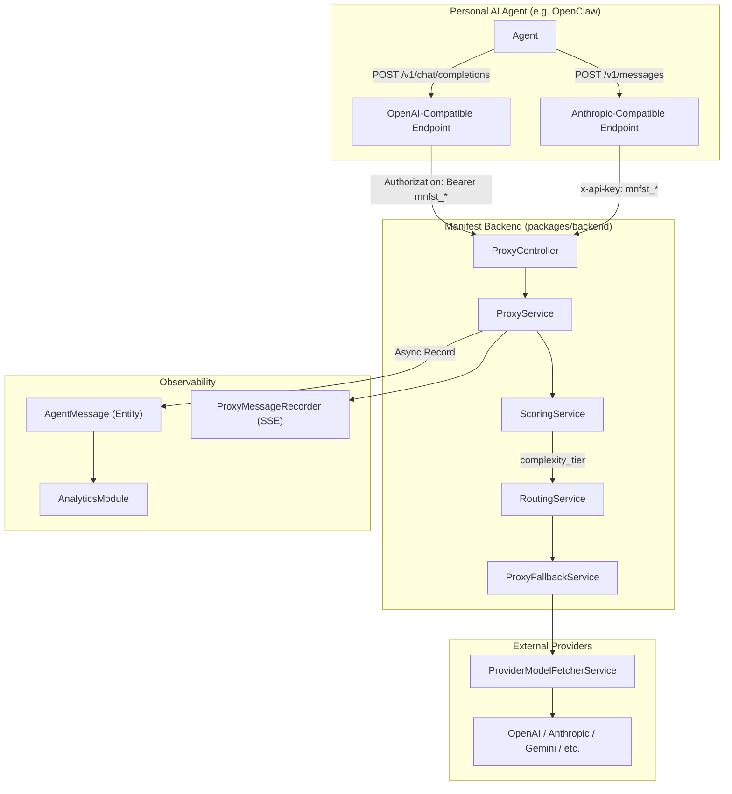
**Sources:** [CLAUDE.md:7-10](), [CLAUDE.md:111-116](), [CONTRIBUTING.md:108-110](), [packages/manifest/CHANGELOG.md:59-62]()

---

### Code Entity Mapping

The relationship between application services and the persistence layer is managed through TypeORM entities and specialized sync services.

**Entity and Service Mapping**
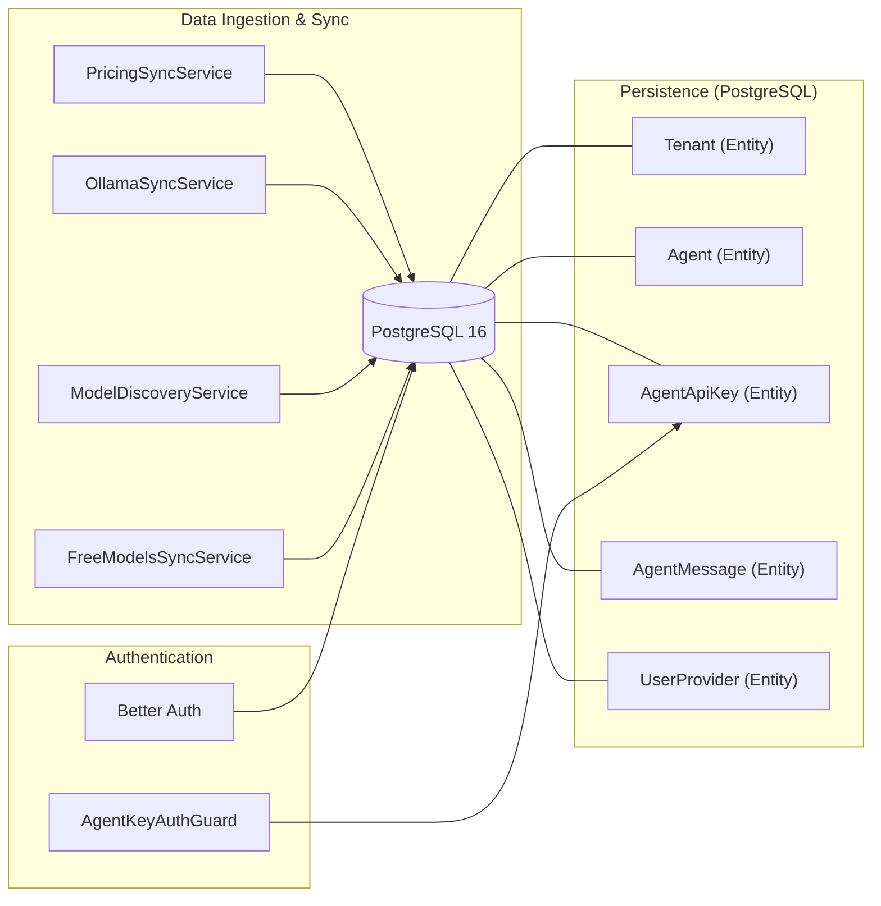
**Sources:** [CLAUDE.md:74-87](), [CLAUDE.md:108-110](), [packages/manifest/CHANGELOG.md:16-18](), [packages/backend/package.json:20-30]()

---

### Child Pages

*   **[Getting Started](#1.1)**: Guide users through installing and configuring Manifest in both cloud mode and self-hosted Docker mode. Covers the quick-start script and the `/setup` wizard.
*   **[Deployment](#1.2)**: Technical details on Docker multi-stage builds, environment variables (`BETTER_AUTH_SECRET`, `DATABASE_URL`), and deployment via Railway.

---

# Page: Getting Started

# Getting Started

<details>
<summary>Relevant source files</summary>

The following files were used as context for generating this wiki page:

- [.changeset/README.md](.changeset/README.md)
- [.changeset/config.json](.changeset/config.json)
- [.github/dependabot.yml](.github/dependabot.yml)
- [.github/workflows/docker-smoke.yml](.github/workflows/docker-smoke.yml)
- [.github/workflows/docker.yml](.github/workflows/docker.yml)
- [.gitignore](.gitignore)
- [CLAUDE.md](CLAUDE.md)
- [CONTRIBUTING.md](CONTRIBUTING.md)
- [README.md](README.md)
- [docker/.env.example](docker/.env.example)
- [docker/DOCKER_README.md](docker/DOCKER_README.md)
- [docker/Dockerfile](docker/Dockerfile)
- [docker/docker-compose.yml](docker/docker-compose.yml)
- [docker/install.sh](docker/install.sh)
- [package-lock.json](package-lock.json)
- [package.json](package.json)
- [packages/backend/package.json](packages/backend/package.json)
- [packages/backend/src/analytics/services/agent-analytics.service.ts](packages/backend/src/analytics/services/agent-analytics.service.ts)
- [packages/frontend/public/icons/providers/claude-code.svg](packages/frontend/public/icons/providers/claude-code.svg)
- [packages/frontend/src/components/ApiKeyDisplay.tsx](packages/frontend/src/components/ApiKeyDisplay.tsx)
- [packages/frontend/src/components/ClaudeCodeSetup.tsx](packages/frontend/src/components/ClaudeCodeSetup.tsx)
- [packages/frontend/src/components/CopyButton.tsx](packages/frontend/src/components/CopyButton.tsx)
- [packages/frontend/src/components/FrameworkSnippets.tsx](packages/frontend/src/components/FrameworkSnippets.tsx)
- [packages/frontend/src/components/OpenClawSetup.tsx](packages/frontend/src/components/OpenClawSetup.tsx)
- [packages/frontend/src/components/SetupModal.tsx](packages/frontend/src/components/SetupModal.tsx)
- [packages/frontend/src/components/SetupStepAddProvider.tsx](packages/frontend/src/components/SetupStepAddProvider.tsx)
- [packages/frontend/src/components/SetupStepProviders.tsx](packages/frontend/src/components/SetupStepProviders.tsx)
- [packages/frontend/src/services/framework-snippets.ts](packages/frontend/src/services/framework-snippets.ts)
- [packages/frontend/src/styles/overview.css](packages/frontend/src/styles/overview.css)
- [packages/frontend/tests/components/ApiKeyDisplay.test.tsx](packages/frontend/tests/components/ApiKeyDisplay.test.tsx)
- [packages/frontend/tests/components/CopyButton.test.tsx](packages/frontend/tests/components/CopyButton.test.tsx)
- [packages/frontend/tests/components/FrameworkSnippets.test.tsx](packages/frontend/tests/components/FrameworkSnippets.test.tsx)
- [packages/frontend/tests/components/OpenClawSetup.test.tsx](packages/frontend/tests/components/OpenClawSetup.test.tsx)
- [packages/frontend/tests/components/SetupModal.test.tsx](packages/frontend/tests/components/SetupModal.test.tsx)
- [packages/frontend/tests/components/SetupStepAddProvider.test.tsx](packages/frontend/tests/components/SetupStepAddProvider.test.tsx)
- [packages/frontend/tests/components/SetupStepProviders.test.tsx](packages/frontend/tests/components/SetupStepProviders.test.tsx)
- [packages/frontend/tests/services/framework-snippets.test.ts](packages/frontend/tests/services/framework-snippets.test.ts)
- [turbo.json](turbo.json)

</details>


Manifest is a smart LLM model router designed to reduce inference costs by scoring requests and routing them to the most cost-effective model. It sits between a personal AI agent and LLM providers, classifying requests into complexity tiers (simple, standard, complex, reasoning) to optimize routing.

## Deployment Modes

Manifest can be used via the managed cloud service or self-hosted using Docker. The legacy `manifest` npm package and local SQLite modes are deprecated in favor of PostgreSQL-backed deployments.

| Mode | Hosting | Database | Best For |
| :--- | :--- | :--- | :--- |
| **Cloud Mode** | [app.manifest.build](https://app.manifest.build) | Managed (PostgreSQL) | Zero-maintenance setup and multi-device access. |
| **Self-Hosted** | Docker (Primary) | PostgreSQL 16 | Privacy-conscious users and custom infrastructure. |

**Sources:** [README.md:36-62](), [CLAUDE.md:13-16](), [CONTRIBUTING.md:17-18]()

---

## Self-Hosted Installation (Docker)

Docker is the only supported distribution for self-hosting. The deployment consists of a NestJS backend, a SolidJS frontend (served by the backend via a SPA fallback filter), and a PostgreSQL database.

### Quick Start Script
The fastest way to deploy is using the automated install script, which downloads the `docker-compose.yml`, generates a secret, and starts the stack.

```bash
bash <(curl -sSL https://raw.githubusercontent.com/mnfst/manifest/main/docker/install.sh)
```

### Manual Configuration
For manual control, users configure the stack via environment variables in a `.env` file. Key variables include:
- `BETTER_AUTH_SECRET`: Used for session security and credential encryption (generate with `openssl rand -hex 32`) [docker/docker-compose.yml:60-60]().
- `DATABASE_URL`: Connection string for the PostgreSQL 16 instance [docker/docker-compose.yml:59-59]().
- `MANIFEST_MODE`: Set to `selfhosted` to enforce local semantics and allow private/HTTP URLs [docker/docker-compose.yml:76-76]().
- `PORT`: Defaults to `2099` [docker/docker-compose.yml:58-58]().

**Sources:** [README.md:51-59](), [docker/DOCKER_README.md:68-74](), [docker/docker-compose.yml:43-93]()

---

## Initial Configuration & Setup Wizard

After installation, if no users exist in the database, visitors are directed to the setup wizard at `/setup` [docker/docker-compose.yml:1-3]().

### Setup Flow
- **Admin Creation**: The setup process handles the creation of the first admin user. The first account created becomes the system administrator [docker/DOCKER_README.md:64-64]().
- **Ollama Integration**: Manifest automatically attempts to discover local models via `OLLAMA_HOST` (defaulting to `http://host.docker.internal:11434`) [docker/docker-compose.yml:67-67]().
- **Email & OAuth**: Optional configuration for Resend/Mailgun/SendGrid and Google/GitHub/Discord OAuth providers can be set in `.env` to enable advanced features [docker/docker-compose.yml:77-90]().

### Request Lifecycle and Code Entity Mapping
The following diagram bridges the "Natural Language Space" of a user request to the "Code Entity Space" of the Manifest backend.

Title: Request Lifecycle and Code Entity Mapping
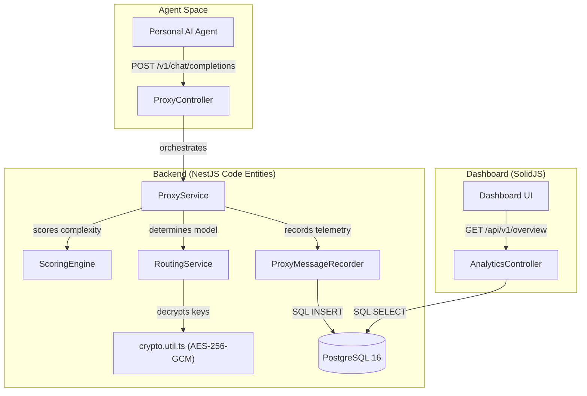
**Sources:** [CLAUDE.md:65-116](), [CONTRIBUTING.md:112-114](), [packages/frontend/src/services/framework-snippets.ts:118-160]()

---

## Agent Integration

To use Manifest, an agent must be configured to point to the Manifest proxy as an OpenAI-compatible endpoint.

### Virtual Model: `manifest/auto`
Agents should use the model ID `manifest/auto`. This virtual endpoint triggers the internal routing logic to select the best provider model based on complexity and specificity [README.md:64-66](), [CLAUDE.md:45-46]().

### Authentication
Agents authenticate using an `AgentApiKey` (prefixed with `mnfst_`) [CLAUDE.md:87-87]().
- **Onboarding**: The "Connect Agent" flow in the dashboard provides setup snippets for frameworks like OpenClaw, Hermes, OpenAI SDK, Vercel AI SDK, LangChain, and cURL [CONTRIBUTING.md:112-114]().
- **Code Snippets**: The `framework-snippets.ts` service generates the exact configuration code for these agents, including `base_url` and `api_key` [packages/frontend/src/services/framework-snippets.ts:118-138]().

**Sources:** [CLAUDE.md:9-10](), [packages/frontend/src/services/framework-snippets.ts:1-31](), [packages/frontend/tests/components/SetupStepAddProvider.test.tsx:49-56]()

---

## Local Development (`devMode`)

Developers contributing to the monorepo use a specialized setup to avoid environment conflicts and data pollution.

### Prerequisites
- **Node.js**: 24.x (LTS) [CONTRIBUTING.md:21-21]().
- **Database**: A **fresh PostgreSQL database** is required for every dev session. The `CLAUDE.md` guide recommends creating a pristine database with a unique name using `openssl rand -hex 4` to prevent cross-run pollution [CLAUDE.md:15-24]().

### Development Setup
1. **PostgreSQL**: Start a container (e.g., `postgres:16`).
2. **Environment**: Set `MANIFEST_MODE=cloud` (the default for development) and `SEED_DATA=true` to populate the DB with demo data [CLAUDE.md:15-30]().
3. **Execution**: Run the backend and frontend in separate terminals:
   - Backend: `cd packages/backend && NODE_OPTIONS='-r dotenv/config' npx nest start --watch` [CONTRIBUTING.md:98-98]().
   - Frontend: `npm run dev` (starts SolidJS and Wingman) [CONTRIBUTING.md:101-101]().

### Loopback Bypass
In development, the `AgentKeyAuthGuard` supports a loopback bypass. It accepts any non-`mnfst_*` token from loopback IPs (`127.0.0.1`) when in self-hosted mode, allowing developers to test without creating valid keys [CLAUDE.md:52-52]().

Title: DevMode Loopback Authentication Flow
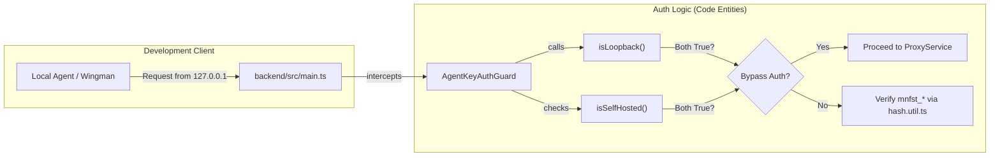
**Sources:** [CLAUDE.md:13-53](), [CONTRIBUTING.md:39-106](), [packages/backend/package.json:1-10]()

---

# Page: Deployment

# Deployment

<details>
<summary>Relevant source files</summary>

The following files were used as context for generating this wiki page:

- [.github/workflows/docker-smoke.yml](.github/workflows/docker-smoke.yml)
- [.github/workflows/docker.yml](.github/workflows/docker.yml)
- [docker/.env.example](docker/.env.example)
- [docker/DOCKER_README.md](docker/DOCKER_README.md)
- [docker/Dockerfile](docker/Dockerfile)
- [docker/docker-compose.yml](docker/docker-compose.yml)
- [docker/install.sh](docker/install.sh)
- [packages/backend/.env.example](packages/backend/.env.example)
- [packages/backend/src/analytics/services/agent-analytics.service.ts](packages/backend/src/analytics/services/agent-analytics.service.ts)
- [packages/backend/src/common/common.module.ts](packages/backend/src/common/common.module.ts)
- [packages/backend/src/common/services/manifest-runtime.service.ts](packages/backend/src/common/services/manifest-runtime.service.ts)
- [packages/backend/src/config/app.config.spec.ts](packages/backend/src/config/app.config.spec.ts)
- [packages/backend/src/config/app.config.ts](packages/backend/src/config/app.config.ts)
- [packages/backend/src/routing/oauth/openai-oauth.controller.ts](packages/backend/src/routing/oauth/openai-oauth.controller.ts)
- [packages/backend/src/routing/openai-oauth.controller.spec.ts](packages/backend/src/routing/openai-oauth.controller.spec.ts)
- [railway.toml](railway.toml)

</details>


Manifest is designed for high-availability deployment using Docker as the primary distribution method. It supports self-hosting, a managed cloud service at [app.manifest.build](https://app.manifest.build), and streamlined deployment to PaaS providers like Railway. The system has transitioned away from the legacy npm package and local SQLite mode in favor of a robust PostgreSQL-backed architecture [docker/docker-compose.yml:59]().

## Deployment Options

### 1. Self-Hosted Docker (Primary)
Docker is the only supported distribution for self-hosting. The image is multi-arch (supporting `amd64` and `arm64`) and is signed using Cosign for security verification [.github/workflows/docker.yml:40-198]().

#### Dockerfile Multi-Stage Build
The build process uses a 4-stage pipeline to ensure a small production footprint and secure runtime environment [docker/Dockerfile:1-106]().

1.  **deps**: Uses `node:24-alpine` to install all dependencies (including dev dependencies) for the build using `npm ci` [docker/Dockerfile:10-17]().
2.  **build**: Compiles the frontend, backend, and shared bundles using `npx turbo build`. It sets `VITE_MANIFEST_SELFHOSTED=true` to enable self-hosted UI features [docker/Dockerfile:20-28]().
3.  **prod-deps**: Uses `node:24-slim` to install only production dependencies with `--omit=dev --omit=optional --ignore-scripts`. It purges unnecessary files (e.g., `.map`, `.ts`, `README`, `tests`) to minimize image size and CVE surface [docker/Dockerfile:37-58]().
4.  **runtime**: A distroless `gcr.io/distroless/nodejs24-debian13` runtime that runs as the `nonroot` user. It contains no shell or package manager [docker/Dockerfile:62-106]().

#### Quickstart Script
The `install.sh` script automates the setup by downloading the `docker-compose.yml`, generating a `BETTER_AUTH_SECRET` via `openssl` or `/dev/urandom`, and bringing up the stack [docker/install.sh:1-185]().
```bash
bash <(curl -sSL https://raw.githubusercontent.com/mnfst/manifest/main/docker/install.sh)
```

### 2. Managed Cloud Service
The official managed version at [app.manifest.build](https://app.manifest.build) provides a zero-config experience. It runs the same core engine but is optimized for multi-tenant cloud operations [docker/docker-compose.yml:76]().

### 3. Railway Deployment
Manifest includes a `railway.toml` for deployment to Railway. It defines the build command using `turbo build` and health checks against the `/api/v1/health` endpoint [railway.toml:1-10]().

## Infrastructure Architecture

The following diagram maps the deployment infrastructure to the code entities and services defined in the repository.

Title: Deployment Infrastructure and Code Entity Mapping
```mermaid
graph TD
    subgraph "External"
        "Agent"["Agent (OpenAI SDK/cURL)"] -- "POST /v1/chat/completions" --> "ManifestContainer"
        "User"["Admin User"] -- "HTTPS (Dashboard)" --> "ManifestContainer"
    end

    subgraph "Manifest Docker Container [docker/Dockerfile]"
        "ManifestContainer"["distroless/nodejs24"] --> "Backend"["packages/backend/dist/main.js"]
        "Backend" --> "Auth"["Better Auth (auth.instance.ts)"]
        "Backend" --> "Proxy"["ProxyController.ts"]
    end

    subgraph "Persistence & Services [docker/docker-compose.yml]"
        "Backend" -- "TypeORM" --> "PostgresDB"["PostgreSQL 16 (postgres:16-alpine)"]
        "Backend" -- "Ollama API" --> "Ollama"["Ollama Host (OLLAMA_HOST)"]
        "Backend" -- "SMTP/HTTP" --> "EmailSvc"["EmailProviderConfigService.ts"]
    end
```
Sources: [docker/Dockerfile:62-106](), [docker/docker-compose.yml:44-133](), [packages/backend/src/config/app.config.ts:3-14]()

## Configuration

### Environment Variables
Configuration is managed via environment variables defined in `app.config.ts` [packages/backend/src/config/app.config.ts:11-38]().

| Variable | Requirement | Description |
| :--- | :--- | :--- |
| `DATABASE_URL` | **Required** | PostgreSQL connection string. SQLite is deprecated [packages/backend/src/config/app.config.ts:3-9](). |
| `BETTER_AUTH_SECRET` | **Required** | Secret for session signing. Min 32 chars [packages/backend/.env.example:2](). |
| `MANIFEST_ENCRYPTION_KEY` | Recommended | Key for AES-256-GCM encryption of provider credentials [packages/backend/.env.example:5-11](). |
| `PORT` | Optional | App port on host. Default: `2099` (Self-hosted) or `3001` (Backend default) [docker/docker-compose.yml:58](). |
| `EMAIL_*` Suite | Optional | Includes `EMAIL_PROVIDER` (resend, mailgun, sendgrid), `EMAIL_API_KEY`, `EMAIL_DOMAIN`, and `EMAIL_FROM` [packages/backend/src/config/app.config.ts:25-29](). |
| `OLLAMA_HOST` | Optional | URL for local LLM servers. Default: `http://host.docker.internal:11434` [docker/docker-compose.yml:67](). |
| `AUTO_MIGRATE` | Optional | Handled by `DatabaseSeederService` on boot to ensure schema parity [docker/docker-compose.yml:105-108](). |

### Ollama Integration
To connect local LLM servers like Ollama, Manifest uses the `host.docker.internal` gateway to reach services running on the Docker host [docker/docker-compose.yml:48-53](). No specific Docker profile is required; the backend automatically attempts to sync models if `OLLAMA_HOST` is reachable [docker/docker-compose.yml:67]().

## Data Flow and Initialization

When the container starts, it executes the compiled NestJS entrypoint. The system handles database initialization and initial data seeding automatically if `SEED_DATA` is enabled [docker/docker-compose.yml:68]().

Title: System Bootstrap Sequence
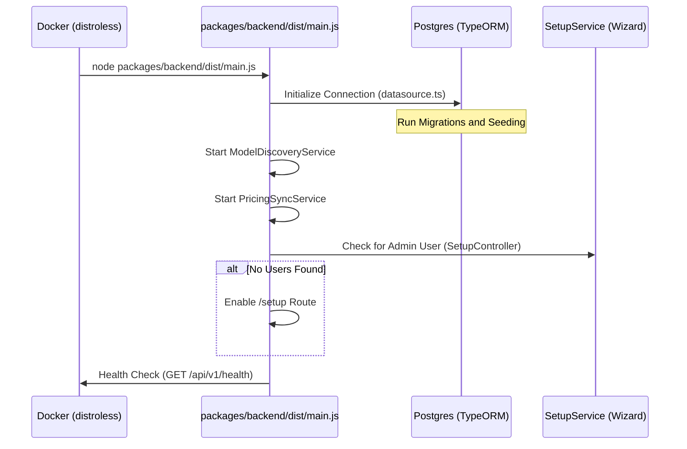
Sources: [docker/Dockerfile:106](), [docker/docker-compose.yml:101-102](), [packages/backend/src/config/app.config.ts:11-38]()

## Production Hardening
The default deployment configuration follows security best practices:

*   **Distroless Runtime**: The production image uses `gcr.io/distroless/nodejs24-debian13`, containing no shell to minimize RCE impact [docker/Dockerfile:62]().
*   **Non-Root User**: The container runs as `nonroot` (UID 65532) [docker/Dockerfile:60]().
*   **Read-Only Root FS**: The `docker-compose.yml` sets `read_only: true`, using a `tmpfs` for `/tmp` [docker/docker-compose.yml:119-121]().
*   **Resource Limits**: Memory is capped at 1GB and PIDs at 512 [docker/docker-compose.yml:126-127]().
*   **Security Opts**: `no-new-privileges` is enabled and all Linux capabilities are dropped [docker/docker-compose.yml:122-125]().

Sources: [docker/Dockerfile:1-106](), [docker/docker-compose.yml:1-160](), [docker/.env.example:1-90]()

---

# Page: Architecture

# Architecture

<details>
<summary>Relevant source files</summary>

The following files were used as context for generating this wiki page:

- [.changeset/README.md](.changeset/README.md)
- [.changeset/config.json](.changeset/config.json)
- [.github/dependabot.yml](.github/dependabot.yml)
- [.gitignore](.gitignore)
- [CLAUDE.md](CLAUDE.md)
- [CONTRIBUTING.md](CONTRIBUTING.md)
- [README.md](README.md)
- [package-lock.json](package-lock.json)
- [package.json](package.json)
- [packages/backend/package.json](packages/backend/package.json)
- [packages/backend/src/app.module.ts](packages/backend/src/app.module.ts)
- [packages/backend/src/common/filters/spa-fallback.filter.spec.ts](packages/backend/src/common/filters/spa-fallback.filter.spec.ts)
- [packages/backend/src/common/filters/spa-fallback.filter.ts](packages/backend/src/common/filters/spa-fallback.filter.ts)
- [packages/backend/src/common/utils/frontend-path.spec.ts](packages/backend/src/common/utils/frontend-path.spec.ts)
- [packages/backend/src/common/utils/frontend-path.ts](packages/backend/src/common/utils/frontend-path.ts)
- [packages/backend/test/helpers.ts](packages/backend/test/helpers.ts)
- [packages/backend/test/smoke-test.e2e-spec.ts](packages/backend/test/smoke-test.e2e-spec.ts)
- [packages/manifest/CHANGELOG.md](packages/manifest/CHANGELOG.md)
- [packages/manifest/package.json](packages/manifest/package.json)
- [turbo.json](turbo.json)

</details>


Manifest is a distributed system designed to optimize LLM inference costs through intelligent routing and observability. It is built as a TypeScript monorepo using **Turborepo** and **npm workspaces** [package.json:29-34](). The system consists of a high-performance NestJS backend, a reactive SolidJS dashboard, and a shared library that ensures type safety across the stack.

### System Overview

The architecture supports two primary deployment modes: **Self-hosted Docker** (the primary distribution) and **Cloud** (managed service at app.manifest.build) [README.md:46-62](). In both modes, Manifest acts as an OpenAI-compatible proxy that intercepts chat completion requests to perform real-time scoring and model selection.

High-level Component Interaction:
1.  **Personal AI Agent**: Sends requests to the `manifest/auto` virtual model via an OpenAI-compatible endpoint [README.md:38-40]().
2.  **Manifest Proxy**: Scores the request across 23 dimensions (latency <2ms) [README.md:66-67]().
3.  **Routing Engine**: Maps the score to a tier (Simple, Standard, Complex, Reasoning) and selects the optimal provider [README.md:66-67]().
4.  **LLM Provider**: Processes the request (OpenAI, Anthropic, Google, etc.) [README.md:68-87]().
5.  **Analytics Pipeline**: Records metadata, tokens, and costs for the Dashboard [README.md:42]().

### Component Relationship Diagram

The following diagram illustrates how the core packages interact and how code entities bridge the gap between the user's natural language request and the underlying execution.

"System Component Architecture"
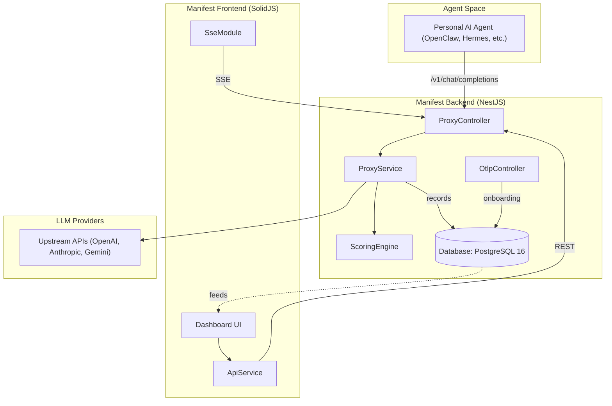
Sources: [README.md:38-45](), [packages/backend/src/app.module.ts:1-50](), [CLAUDE.md:63-120]()

### Request Lifecycle: Agent to Provider

The request lifecycle is designed for minimal overhead while maximizing cost savings. When an agent targets `manifest/auto`, the request flows through the following pipeline:

1.  **Ingress**: The `ProxyController` receives an OpenAI-compatible POST request [CLAUDE.md:111-112]().
2.  **Authentication**: `AgentKeyAuthGuard` validates the `mnfst_*` API key or applies a loopback bypass in development [CLAUDE.md:108-110]().
3.  **Scoring**: The request body is passed to the scoring engine to evaluate complexity dimensions like token count and tool definitions [CLAUDE.md:115-116]().
4.  **Resolution**: The system selects a model from connected provider credentials based on the calculated tier [CLAUDE.md:112-114]().
5.  **Execution**: The proxy forwards the request to the upstream provider, handling streaming and potential fallbacks if the primary model fails [README.md:41-43]().
6.  **Telemetry**: Usage data (tokens, costs, duration) is persisted via TypeORM entities such as `LlmCall` and `AgentMessage` [CLAUDE.md:82-87](), [packages/backend/test/helpers.ts:12-13]().

"Request Flow to Code Entity Mapping"
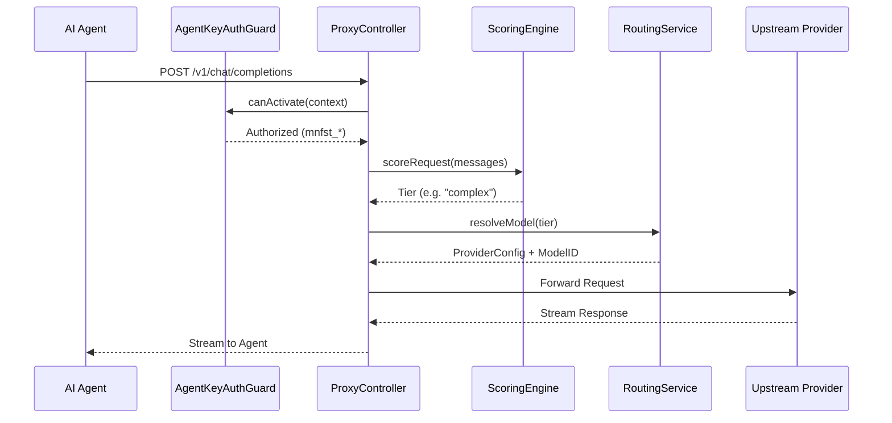
Sources: [packages/backend/src/app.module.ts:1-50](), [CLAUDE.md:108-116](), [README.md:65-67]()

### Subsystems

Manifest is divided into four major architectural subsystems:

| Subsystem | Responsibility | Key Technologies |
| :--- | :--- | :--- |
| **[Backend (NestJS)](#2.1)** | API, Proxy, Scoring, Persistence | NestJS 11, TypeORM, Better Auth |
| **[Frontend (SolidJS Dashboard)](#2.2)** | Real-time Dashboard, Analytics UI | SolidJS, Vite, uPlot |
| **[Agent Integration](#2.3)** | Agent Onboarding, API Keys | OpenAI SDK, OtlpModule |
| **[Shared Package](#2.4)** | Common Types and Utilities | TypeScript |

#### Backend (NestJS)
The core engine. It manages multi-tenant data, handles the proxy pipeline, and performs background tasks like pricing synchronization and model discovery. It primarily supports PostgreSQL 16 [CLAUDE.md:54-57](). The backend also serves the frontend assets via `ServeStaticModule` and handles SPA routing via `SpaFallbackFilter` [packages/backend/src/common/filters/spa-fallback.filter.ts:10-11]().
For details, see **[Backend (NestJS)](#2.1)**.

#### Frontend (SolidJS Dashboard)
A reactive SPA that provides visibility into agent spending and routing performance. It connects to the backend via a REST API and uses Server-Sent Events (SSE) for real-time updates [packages/backend/test/helpers.ts:31]().
For details, see **[Frontend (SolidJS Dashboard)](#2.2)**.

#### Agent Integration
Manifest acts as a generic OpenAI-compatible HTTP endpoint. It supports a variety of agents including OpenClaw, Hermes, and standard SDKs [CLAUDE.md:9-10](). The `OtlpModule` and `AgentKeyAuthGuard` manage the onboarding and authentication of these agents [CLAUDE.md:107-110]().
For details, see **[Agent Integration](#2.3)**.

#### Shared Package
Provides the "source of truth" for types and constants. This ensures that the frontend and backend agree on entity structures, routing tiers, and API response shapes [package.json:30]().
For details, see **[Shared Package](#2.4)**.

Sources: [package.json:29-34](), [CONTRIBUTING.md:29-35](), [CLAUDE.md:63-120]()

---

# Page: Backend (NestJS)

# Backend (NestJS)

<details>
<summary>Relevant source files</summary>

The following files were used as context for generating this wiki page:

- [packages/backend/src/app.module.ts](packages/backend/src/app.module.ts)
- [packages/backend/src/auth/session.guard.spec.ts](packages/backend/src/auth/session.guard.spec.ts)
- [packages/backend/src/auth/session.guard.ts](packages/backend/src/auth/session.guard.ts)
- [packages/backend/src/common/filters/spa-fallback.filter.spec.ts](packages/backend/src/common/filters/spa-fallback.filter.spec.ts)
- [packages/backend/src/common/filters/spa-fallback.filter.ts](packages/backend/src/common/filters/spa-fallback.filter.ts)
- [packages/backend/src/common/guards/api-key.guard.ts](packages/backend/src/common/guards/api-key.guard.ts)
- [packages/backend/src/common/utils/frontend-path.spec.ts](packages/backend/src/common/utils/frontend-path.spec.ts)
- [packages/backend/src/common/utils/frontend-path.ts](packages/backend/src/common/utils/frontend-path.ts)
- [packages/backend/src/common/utils/local-ip.ts](packages/backend/src/common/utils/local-ip.ts)
- [packages/backend/src/main.ts](packages/backend/src/main.ts)
- [packages/backend/src/otlp/guards/agent-key-auth.guard.spec.ts](packages/backend/src/otlp/guards/agent-key-auth.guard.spec.ts)
- [packages/backend/src/otlp/guards/agent-key-auth.guard.ts](packages/backend/src/otlp/guards/agent-key-auth.guard.ts)
- [packages/backend/src/routing/oauth/openai-oauth.service.ts](packages/backend/src/routing/oauth/openai-oauth.service.ts)
- [packages/backend/src/routing/openai-oauth.service.spec.ts](packages/backend/src/routing/openai-oauth.service.spec.ts)
- [packages/backend/src/routing/routing.module.ts](packages/backend/src/routing/routing.module.ts)
- [packages/backend/test/helpers.ts](packages/backend/test/helpers.ts)
- [packages/backend/test/smoke-test.e2e-spec.ts](packages/backend/test/smoke-test.e2e-spec.ts)
- [packages/frontend/src/services/api/core.ts](packages/frontend/src/services/api/core.ts)

</details>


The Manifest backend is a NestJS application that serves as the central control plane for intelligent LLM routing. It handles request proxying, model discovery, telemetry processing, and serves the SolidJS dashboard.

## Application Lifecycle & Bootstrap

The application entry point is `bootstrap()` in `packages/backend/src/main.ts`. It initializes the NestJS factory with `AppModule` and configures global middleware.

### Bootstrap Sequence
1.  **Filter & Hooks**: Registers `SpaFallbackFilter` to handle frontend routing and enables shutdown hooks [packages/backend/src/main.ts:17-18]().
2.  **Security**: Applies `helmet` with a strict Content Security Policy (CSP). It explicitly disables `upgradeInsecureRequests` to support HTTP-only LAN deployments where browsers might otherwise break asset loading [packages/backend/src/main.ts:35-63]().
3.  **Validation**: Sets up a global `ValidationPipe` for DTO transformation and strict property whitelisting [packages/backend/src/main.ts:102-107]().
4.  **Reverse Proxy Trust**: In production mode, the Express instance is configured via `trust proxy` to correctly identify client IPs from headers like `X-Forwarded-For`. This is restricted to loopback and private subnets by default to prevent IP spoofing [packages/backend/src/main.ts:121-135]().
5.  **Auth Mounting**:
    *   **Rate Limiting**: Applies specific `express-rate-limit` instances to authentication endpoints. `/api/auth/sign-in` is limited to 20 attempts per 15 minutes, while sensitive routes like `forget-password` are capped at 5 [packages/backend/src/main.ts:141-176]().
    *   **Better Auth**: Mounts the `Better Auth` node handler to `/api/auth/*` before standard body parsing to allow it to handle raw requests [packages/backend/src/main.ts:178-180]().
6.  **Server Start**: Binds to the configured `PORT` (default 3001) and `BIND_ADDRESS` [packages/backend/src/main.ts:186-188]().

### Security Middleware
| Middleware | Function | Implementation |
| :--- | :--- | :--- |
| **Helmet** | Sets security headers (CSP, HSTS, etc.) | [packages/backend/src/main.ts:35-63]() |
| **CORS** | Restricted to `CORS_ORIGIN` and Wingman dev ports in dev mode | [packages/backend/src/main.ts:80-100]() |
| **Rate Limiting** | `express-rate-limit` on auth endpoints (login, signup, reset) | [packages/backend/src/main.ts:140-176]() |
| **HttpErrorLogger** | Logs 4xx/5xx errors with IP and User-Agent context | [packages/backend/src/main.ts:111](), [packages/backend/src/common/middleware/http-error-logger.middleware.ts:25-43]() |
| **Encryption** | AES-256-GCM for provider credentials at rest | [packages/backend/src/common/utils/crypto.util.ts:4-79]() |

**Sources:** [packages/backend/src/main.ts:1-188](), [packages/backend/src/common/middleware/http-error-logger.middleware.ts:1-43]()

---

## Module Structure

`AppModule` acts as the root, orchestrating specialized modules that handle the core business logic.

### AppModule Composition
`AppModule` imports several key modules [packages/backend/src/app.module.ts:53-78]():
*   **RoutingModule**: Handles the `/v1/chat/completions` proxy and routing logic [packages/backend/src/routing/routing.module.ts:19-42]().
*   **AnalyticsModule**: Provides dashboard stats (tokens, costs, message logs).
*   **OtlpModule**: Manages agent onboarding and the OpenTelemetry-compatible ingestion pipeline.
*   **ModelPricesModule**: Manages model pricing data and synchronization.
*   **NotificationsModule**: Handles usage limits and threshold alerts.
*   **FreeModelsModule**: Manages discovery and routing for free-tier LLM providers.
*   **GithubModule**: Integration for GitHub Copilot and model discovery.
*   **SseModule**: Provides real-time server-sent events for the dashboard.
*   **TelemetryModule**: Internal system telemetry and error reporting.

### Code Entity Mapping: Application Composition
Title: NestJS Module Dependency Graph
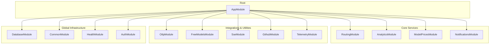
**Sources:** [packages/backend/src/app.module.ts:1-86]()

---

## Authentication & Guards

Manifest uses a multi-layered guard system to protect dashboard and agent endpoints.

### Global Guards
`AppModule` registers three global guards in sequence [packages/backend/src/app.module.ts:80-84]():
1.  **SessionGuard**: Protects dashboard `/api/` routes using `Better Auth` sessions. In `selfhosted` mode, it allows a loopback bypass for local programmatic access [packages/backend/src/auth/session.guard.ts:93-101]().
2.  **ApiKeyGuard**: Validates `x-api-key` headers against the `ApiKey` entity for administrative API access [packages/backend/src/common/guards/api-key.guard.ts:41-70]().
3.  **ThrottlerGuard**: Enforces global rate limits (configured via `THROTTLE_TTL` and `THROTTLE_LIMIT`) [packages/backend/src/app.module.ts:57-62]().

### Agent Authentication
The `OtlpModule` utilizes the `AgentKeyAuthGuard` to protect proxy and telemetry endpoints. It validates keys with the `mnfst_` prefix using a 5-minute in-memory cache to reduce database load during high-frequency inference [packages/backend/src/otlp/guards/agent-key-auth.guard.ts:37-42](). Keys are verified using a scrypt-based hash utility [packages/backend/src/otlp/guards/agent-key-auth.guard.ts:174]().

### Code Entity Mapping: Authentication Flow
Title: Multi-Tier Authentication Logic
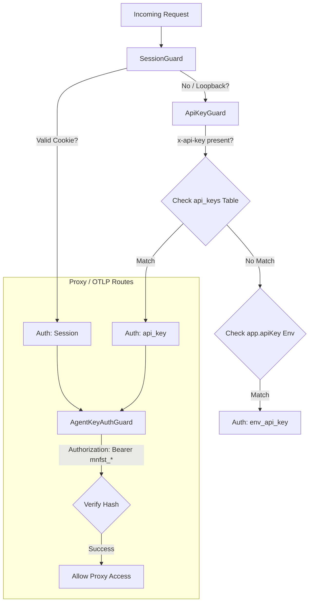
**Sources:** [packages/backend/src/auth/session.guard.ts:18-139](), [packages/backend/src/common/guards/api-key.guard.ts:19-96](), [packages/backend/src/otlp/guards/agent-key-auth.guard.ts:86-117]()

---

## Frontend Integration (SPA Fallback)

The backend serves the compiled SolidJS frontend directly, ensuring a unified deployment.

### SpaFallbackFilter
The `SpaFallbackFilter` is a global NestJS filter that catches `NotFoundException` (404) errors. If the request is a `GET` method and does not target API paths (`/api/`, `/v1/`, `/otlp/`), it serves the frontend's `index.html` [packages/backend/src/common/filters/spa-fallback.filter.ts:24-42](). This enables client-side routing for the Single Page Application (SPA).

### ServeStatic Configuration
`AppModule` configures `ServeStaticModule` to serve assets from the frontend directory. It applies a one-year cache header to immutable assets but explicitly sets `Cache-Control: no-cache` for `index.html` to ensure users always receive the latest version of the application entry point [packages/backend/src/app.module.ts:32-48]().

### Code Entity Mapping: SPA Routing Flow
Title: SPA Fallback and Static Serving
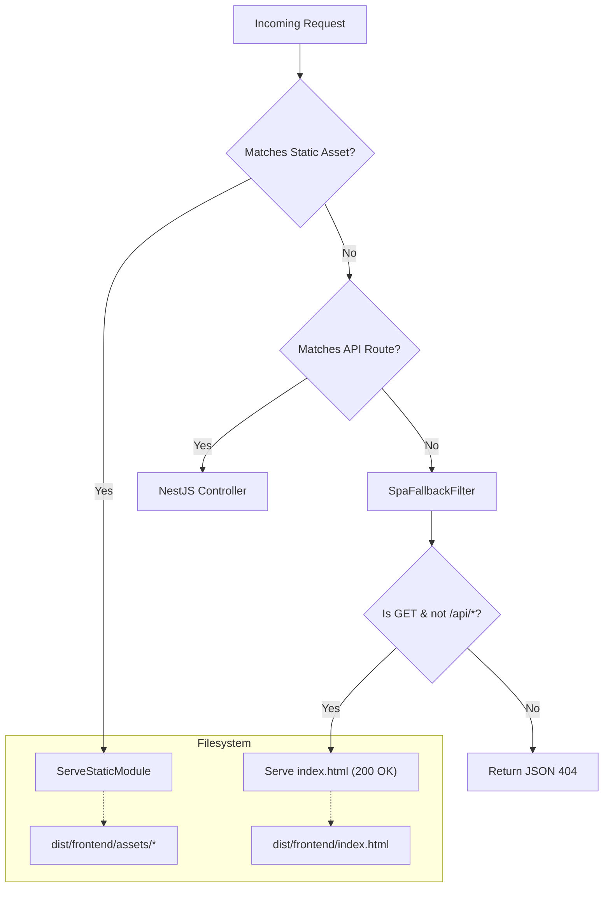
**Sources:** [packages/backend/src/app.module.ts:30-50](), [packages/backend/src/common/filters/spa-fallback.filter.ts:7-54]()

---

## OAuth Integration

Manifest supports OAuth-based model discovery and routing for providers like OpenAI (ChatGPT Plus subscriptions).

### OpenaiOauthService
The `OpenaiOauthService` manages the PKCE-based OAuth flow. In development mode, it spins up a temporary loopback callback server on port 1455 to handle the redirect from OpenAI [packages/backend/src/routing/oauth/openai-oauth.service.ts:17-41]().

Key functions include:
*   `generateAuthorizationUrl`: Creates the authorize URL with a random state and code challenge [packages/backend/src/routing/oauth/openai-oauth.service.ts:44-77]().
*   `exchangeCode`: Exchanges the authorization code for an access/refresh token pair and stores them as an encrypted blob in the `UserProvider` entity [packages/backend/src/routing/oauth/openai-oauth.service.ts:79-128]().
*   `unwrapToken`: Automatically refreshes expired access tokens using the stored refresh token [packages/backend/src/routing/oauth/openai-oauth.service.ts:158-182]().

**Sources:** [packages/backend/src/routing/oauth/openai-oauth.service.ts:22-182]()

---

# Page: Frontend (SolidJS Dashboard)

# Frontend (SolidJS Dashboard)

<details>
<summary>Relevant source files</summary>

The following files were used as context for generating this wiki page:

- [packages/frontend/index.html](packages/frontend/index.html)
- [packages/frontend/public/example-messages.svg](packages/frontend/public/example-messages.svg)
- [packages/frontend/public/example-overview.svg](packages/frontend/public/example-overview.svg)
- [packages/frontend/public/fonts/boxicons/boxicons-duotone.min.css](packages/frontend/public/fonts/boxicons/boxicons-duotone.min.css)
- [packages/frontend/public/fonts/boxicons/boxicons-duotone.woff2](packages/frontend/public/fonts/boxicons/boxicons-duotone.woff2)
- [packages/frontend/public/og-image.png](packages/frontend/public/og-image.png)
- [packages/frontend/src/App.tsx](packages/frontend/src/App.tsx)
- [packages/frontend/src/components/VersionIndicator.tsx](packages/frontend/src/components/VersionIndicator.tsx)
- [packages/frontend/src/index.tsx](packages/frontend/src/index.tsx)
- [packages/frontend/src/pages/MessageLog.tsx](packages/frontend/src/pages/MessageLog.tsx)
- [packages/frontend/src/pages/Overview.tsx](packages/frontend/src/pages/Overview.tsx)
- [packages/frontend/src/services/api.ts](packages/frontend/src/services/api.ts)
- [packages/frontend/src/styles/theme.css](packages/frontend/src/styles/theme.css)
- [packages/frontend/src/styles/version-indicator.css](packages/frontend/src/styles/version-indicator.css)
- [packages/frontend/src/vite-env.d.ts](packages/frontend/src/vite-env.d.ts)
- [packages/frontend/tests/components/App.test.tsx](packages/frontend/tests/components/App.test.tsx)
- [packages/frontend/tests/components/AuthLayout.test.tsx](packages/frontend/tests/components/AuthLayout.test.tsx)
- [packages/frontend/tests/components/VersionIndicator.test.tsx](packages/frontend/tests/components/VersionIndicator.test.tsx)
- [packages/frontend/tests/pages/MessageLog.test.tsx](packages/frontend/tests/pages/MessageLog.test.tsx)
- [packages/frontend/tests/pages/Overview.test.tsx](packages/frontend/tests/pages/Overview.test.tsx)
- [packages/frontend/vite.config.ts](packages/frontend/vite.config.ts)

</details>


The Manifest dashboard is a high-performance Single Page Application (SPA) built with **SolidJS**. It provides real-time monitoring of LLM usage, configuration of intelligent routing tiers, and management of provider credentials. The dashboard communicates with the NestJS backend via a REST API and receives real-time updates through Server-Sent Events (SSE).

## Component Architecture and Data Flow

The frontend follows a reactive architecture leveraging SolidJS signals and resources. Data fetching is centralized in an API service layer, while real-time UI updates are driven by a global SSE listener.

### Page Structure
The dashboard is organized into several primary views, each corresponding to a specific management or monitoring domain:

*   **Workspace (`/`)**: The entry point displaying a grid of all connected AI agents, including sparklines for recent activity and high-level stats (tokens, messages, cost) [packages/frontend/src/index.tsx:59-59]().
*   **Overview (`/agents/:agentName`)**: A detailed dashboard for a specific agent featuring time-series charts for costs, tokens, and messages, as well as a "Cost by Model" breakdown [packages/frontend/src/pages/Overview.tsx:83-180]().
*   **Routing (`/agents/:agentName/routing`)**: The core configuration interface where users assign models to complexity tiers and manage specificity overrides [packages/frontend/src/index.tsx:64-64]().
*   **Message Log (`/agents/:agentName/messages`)**: A paginated, searchable table of every LLM call processed by the proxy, including detailed metadata like cache hits, duration, and specific provider status [packages/frontend/src/pages/MessageLog.tsx:46-177]().
*   **Settings (`/agents/:agentName/settings`)**: Management of agent metadata, API key rotation, and setup instructions [packages/frontend/src/index.tsx:63-63]().
*   **Free Models**: Displays available free-tier models from various providers [packages/frontend/src/services/api.ts:9-9]().
*   **Model Prices**: A catalog of global model pricing synchronized from external sources [packages/frontend/src/index.tsx:66-66]().

### Real-Time Updates (SSE)
The dashboard maintains a live connection to the backend via `connectSse` [packages/frontend/src/App.tsx:10-16](). When the proxy processes a message, the backend emits an event that increments a global `messagePing` signal [packages/frontend/src/services/sse.ts:1-36](). Components use this signal as a dependency for their `createResource` calls, triggering automatic data refreshes [packages/frontend/src/pages/Overview.tsx:188-191](), [packages/frontend/src/pages/MessageLog.tsx:157-165]().

**Dashboard Data Flow**

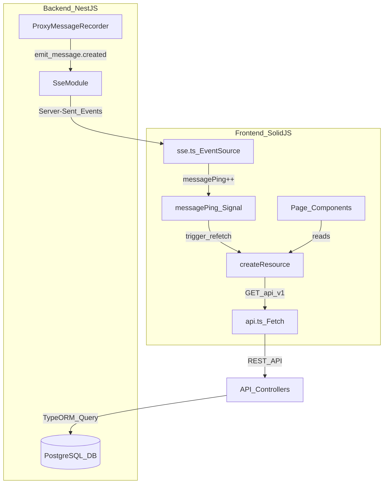
*Sources: [packages/frontend/src/services/sse.ts:1-36](), [packages/frontend/src/pages/Overview.tsx:188-191](), [packages/frontend/src/services/api.ts:1-10](), [packages/frontend/src/App.tsx:10-16]()*

---

## Core Routing Configuration

The Routing page allows users to define how requests are distributed across models based on the **Scoring Engine's** classification.

### Tier and Specificity Management
Requests are categorized into complexity tiers (simple, standard, complex, reasoning). The UI provides controls for:
1.  **Auto-Assignment**: Relying on Manifest's internal logic to pick the best model for that tier.
2.  **Overrides**: Manually selecting a specific model/provider for a tier.
3.  **Fallback Chains**: Defining a list of models to attempt if the primary model fails.
4.  **Specificity**: Overriding models for specific categories (e.g., `coding`, `trading`).

### Provider Integration
The dashboard manages the connection of various LLM providers through standard API keys or subscription-based authentication.
*   **API Keys**: Standard credential entry for providers like OpenAI, Anthropic, and Google.
*   **Subscriptions (OAuth)**: Web-based OAuth flow for ChatGPT Plus or Claude Pro [packages/frontend/src/services/api.ts:8-8]().
*   **Custom Providers**: Users can define custom endpoints via the `getCustomProviders` service [packages/frontend/src/pages/Overview.tsx:122-132]().

**Code-to-Entity Mapping: Routing and UI**

| UI Component | Code Entity | Purpose |
| :--- | :--- | :--- |
| `Header` | `Header.tsx` | Main navigation and agent breadcrumbs. |
| `Overview` | `Overview.tsx` | Visualizes `OverviewData` including `cost_by_model` [packages/frontend/src/pages/Overview.tsx:43-81](). |
| `MessageLog` | `MessageLog.tsx` | Renders `MessageRow` data in a filterable table [packages/frontend/src/pages/MessageLog.tsx:39-45](). |
| `Sidebar` | `Sidebar.tsx` | Provides context-sensitive navigation for agents [packages/frontend/src/App.tsx:32-34](). |
| `VersionIndicator` | `VersionIndicator.tsx` | Displays `__MANIFEST_VERSION__` in self-hosted environments [packages/frontend/src/components/VersionIndicator.tsx:3-17](). |

*Sources: [packages/frontend/src/pages/Overview.tsx:43-180](), [packages/frontend/src/services/api.ts:1-10](), [packages/frontend/src/App.tsx:18-50]()*

---

## Message Logging and Analytics

The `MessageLog` provides a high-fidelity audit trail of proxy activity. It utilizes a custom cursor-based pagination system to handle large volumes of telemetry data efficiently.

### Implementation Details
*   **Cursor Pagination**: Uses `createCursorPagination` to manage the `next_cursor` returned by the backend [packages/frontend/src/pages/MessageLog.tsx:138-138]().
*   **Filtering**: Real-time filtering by Provider, Min Cost, and Max Cost. Filters are debounced to prevent excessive API calls [packages/frontend/src/pages/MessageLog.tsx:140-153]().
*   **Feedback System**: Users can "Like" or "Dislike" messages. Dislikes trigger a `FeedbackModal` to collect tags and details, which are sent via `setMessageFeedback` [packages/frontend/src/pages/MessageLog.tsx:75-116]().

**Message Log Interaction**

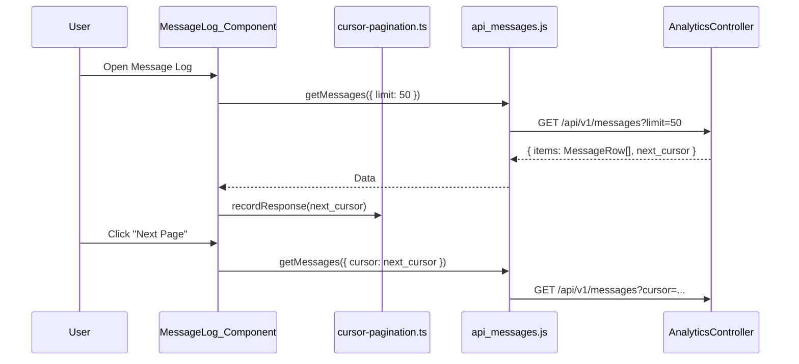
*Sources: [packages/frontend/src/pages/MessageLog.tsx:157-186](), [packages/frontend/src/services/api.ts:3-3](), [packages/frontend/src/services/cursor-pagination.ts:1-20]()*

---

## Authentication and Security

The dashboard integrates with **Better Auth** for user session management and provides tools for managing agent-level security.

1.  **Dashboard Auth**: Enforced by `AuthGuard` surrounding the application shell [packages/frontend/src/App.tsx:24-24]().
2.  **Agent Authentication**: Managed via `AgentGuard` which ensures the user has access to the requested agent context [packages/frontend/src/index.tsx:60-60]().
3.  **Self-Hosted Detection**: The UI detects if it is running in self-hosted mode via `checkIsSelfHosted` (checking `VITE_MANIFEST_SELFHOSTED`) and displays the `VersionIndicator` [packages/frontend/src/components/VersionIndicator.tsx:4-12](), [packages/frontend/src/pages/Overview.tsx:88-91]().
4.  **Dev Mode Tools**: When running in development mode (`__DEV_MODE__`), the `WingmanDevTools` component is injected for easier debugging [packages/frontend/src/App.tsx:45-45](), [packages/frontend/vite.config.ts:26-26]().

*Sources: [packages/frontend/src/App.tsx:24-45](), [packages/frontend/src/index.tsx:60-60](), [packages/frontend/src/components/VersionIndicator.tsx:1-17](), [packages/frontend/vite.config.ts:18-31]()*

---

# Page: Agent Integration

# Agent Integration

<details>
<summary>Relevant source files</summary>

The following files were used as context for generating this wiki page:

- [.changeset/README.md](.changeset/README.md)
- [.changeset/config.json](.changeset/config.json)
- [.github/dependabot.yml](.github/dependabot.yml)
- [.gitignore](.gitignore)
- [CLAUDE.md](CLAUDE.md)
- [CONTRIBUTING.md](CONTRIBUTING.md)
- [README.md](README.md)
- [package-lock.json](package-lock.json)
- [package.json](package.json)
- [packages/backend/package.json](packages/backend/package.json)
- [packages/backend/src/otlp/services/api-key.service.spec.ts](packages/backend/src/otlp/services/api-key.service.spec.ts)
- [packages/backend/src/otlp/services/api-key.service.ts](packages/backend/src/otlp/services/api-key.service.ts)
- [packages/frontend/public/icons/providers/claude-code.svg](packages/frontend/public/icons/providers/claude-code.svg)
- [packages/frontend/src/components/ClaudeCodeSetup.tsx](packages/frontend/src/components/ClaudeCodeSetup.tsx)
- [packages/frontend/src/components/FrameworkSnippets.tsx](packages/frontend/src/components/FrameworkSnippets.tsx)
- [packages/frontend/src/components/HermesSetup.tsx](packages/frontend/src/components/HermesSetup.tsx)
- [packages/frontend/src/components/OpenClawSetup.tsx](packages/frontend/src/components/OpenClawSetup.tsx)
- [packages/frontend/src/components/SetupStepAddProvider.tsx](packages/frontend/src/components/SetupStepAddProvider.tsx)
- [packages/frontend/src/services/framework-snippets.ts](packages/frontend/src/services/framework-snippets.ts)
- [packages/frontend/tests/components/FrameworkSnippets.test.tsx](packages/frontend/tests/components/FrameworkSnippets.test.tsx)
- [packages/frontend/tests/components/HermesSetup.test.tsx](packages/frontend/tests/components/HermesSetup.test.tsx)
- [packages/frontend/tests/components/OpenClawSetup.test.tsx](packages/frontend/tests/components/OpenClawSetup.test.tsx)
- [packages/frontend/tests/components/SetupStepAddProvider.test.tsx](packages/frontend/tests/components/SetupStepAddProvider.test.tsx)
- [packages/frontend/tests/services/framework-snippets.test.ts](packages/frontend/tests/services/framework-snippets.test.ts)
- [turbo.json](turbo.json)

</details>


Manifest acts as a smart LLM model router and observability layer for personal AI agents. It functions as a generic OpenAI-compatible HTTP endpoint, allowing any agent or SDK that supports the OpenAI API format to connect seamlessly. This integration enables intelligent request scoring, cost-optimized routing to the `manifest/auto` virtual model, and automated telemetry collection.

## Supported Agent Types

Manifest identifies and optimizes for various personal AI agent frameworks. Supported types are defined in the shared package and used to drive the UI onboarding experience and analytics categorization.

| Agent Type | Description |
| :--- | :--- |
| `openclaw` | Integration for the OpenClaw agent framework. |
| `hermes` | Support for the Hermes agent via `config.yaml`. |
| `claude-code` | Support for Anthropic's Claude Code CLI via `settings.json`. |
| `openai-sdk` | Standard OpenAI Node.js or Python SDKs. |
| `vercel-ai-sdk` | Vercel AI SDK (AI Core) with custom provider configuration. |
| `langchain` | LangChain framework integrations using `ChatOpenAI`. |
| `curl` | Direct HTTP requests via CLI or scripts. |
| `other` | Generic fallback for any OpenAI-compatible client. |

**Sources:**
- [packages/shared/src/agent-type.ts:1-20]()
- [packages/frontend/src/services/framework-snippets.ts:1-30]()
- [packages/frontend/src/components/SetupStepAddProvider.tsx:18-23]()

---

## The `manifest/auto` Virtual Model

The core of Manifest's integration is the `manifest/auto` virtual model. Instead of targeting a specific LLM (like `gpt-4o` or `claude-3.5-sonnet`), agents point their requests to `manifest/auto`.

1. **Endpoint**: Agents use the Manifest proxy URL, typically `http://localhost:3001/v1` for local installs or `https://app.manifest.build/v1` for cloud users [packages/frontend/tests/components/SetupStepAddProvider.test.tsx:14-15]().
2. **Routing**: The proxy intercepts requests for `auto`, runs them through the scoring engine, and routes them to the most cost-effective provider tier.
3. **Compatibility**: The interface remains 100% OpenAI-compatible, supporting both standard Chat Completions and the newer Responses API [packages/frontend/src/services/framework-snippets.ts:48-51]().

---

## Agent API Keys (`mnfst_*`)

Authentication for agents is handled via `AgentApiKey` entities. These keys use a specific format and are managed through the `OtlpModule` infrastructure.

### Key Characteristics
- **Prefix**: All agent keys are prefixed with `mnfst_` [packages/backend/src/otlp/services/api-key.service.ts:10-15]().
- **Hashing**: Keys are hashed using the `scrypt` KDF via `hash.util.ts` before being stored in the database for security [packages/backend/src/otlp/services/api-key.service.ts:45-50]().
- **Onboarding**: The `ApiKeyService` in the `OtlpModule` orchestrates the creation of a `Tenant`, an `Agent`, and the associated `AgentApiKey` during the initial setup flow [packages/backend/src/otlp/services/api-key.service.ts:20-40]().

### UI Onboarding Logic
The `SetupStepAddProvider` component guides users through connecting their agents by generating the correct snippets and configuration values.

Title: Frontend Setup Flow
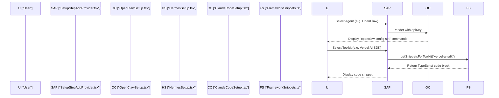

**Sources:**
- [packages/backend/src/otlp/services/api-key.service.ts:1-60]()
- [packages/frontend/src/components/SetupStepAddProvider.tsx:25-47]()
- [packages/frontend/src/services/framework-snippets.ts:117-158]()

---

## Agent Integration Details

Manifest provides tailored instructions for connecting various agents. Note that there are no longer first-party OpenClaw plugins in this repository; it connects as a generic provider.

### OpenClaw Integration
OpenClaw users can configure Manifest using the `openclaw config set` command or the `openclaw onboard` interactive wizard [packages/frontend/src/components/OpenClawSetup.tsx:82-99]().

```bash
# Register Manifest as a custom provider in OpenClaw
openclaw config set models.providers.manifest '{
  "baseUrl": "http://localhost:3001/v1",
  "api": "openai-completions",
  "apiKey": "mnfst_YOUR_KEY",
  "models": [{"id": "auto", "name": "Manifest Auto"}]
}'
```

### Claude Code Integration
For Anthropic's `claude` CLI, Manifest provides a JSON snippet for `~/.claude/settings.json` that overrides the `ANTHROPIC_BASE_URL` and `ANTHROPIC_AUTH_TOKEN` [packages/frontend/src/components/ClaudeCodeSetup.tsx:53-57]().

Title: Agent to Code Entity Mapping
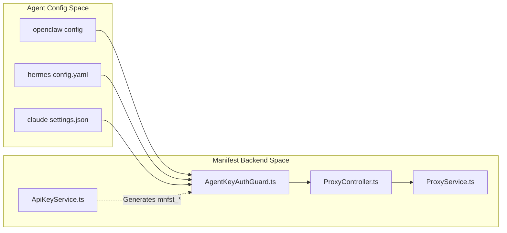

**Sources:**
- [packages/frontend/src/components/OpenClawSetup.tsx:71-75]()
- [packages/frontend/src/components/ClaudeCodeSetup.tsx:41-51]()
- [packages/backend/src/otlp/guards/agent-key-auth.guard.ts:10-30]()

---

## Framework and SDK Integration

For developers using standard SDKs, Manifest provides code snippets that override the default provider settings.

### OpenAI SDK (Node.js/Python)
The SDK is initialized with the Manifest `baseURL` and the `mnfst_` API key. It supports both the legacy Chat Completions and the new Responses API [packages/frontend/src/services/framework-snippets.ts:140-160]().

### Vercel AI SDK
Integration is achieved by using the `createOpenAI` provider factory, passing the Manifest endpoint as the `baseURL` [packages/frontend/src/services/framework-snippets.ts:230-242]().

### LangChain
The `ChatOpenAI` class is used with the `base_url` parameter set to the Manifest instance [packages/frontend/src/services/framework-snippets.ts:225-237]().

| Toolkit | Implementation Method | Code Entity Reference |
| :--- | :--- | :--- |
| **OpenAI SDK** | Constructor Overrides | `getOpenAIChatTypeScriptSnippet` |
| **Vercel AI SDK** | `createOpenAI` factory | `getTypeScriptSnippets` |
| **LangChain** | `ChatOpenAI` constructor | `getPythonSnippets` |
| **cURL** | Header `-H "Authorization: Bearer ..."` | `getCurlSnippet` |

**Sources:**
- [packages/frontend/src/services/framework-snippets.ts:139-159]()
- [packages/frontend/src/services/framework-snippets.ts:220-242]()
- [packages/frontend/src/services/framework-snippets.ts:260-267]()

---

## Development Mode Loopback Bypass

For local development, the `AgentKeyAuthGuard` includes a "loopback bypass". When Manifest is running in self-hosted mode and a request originates from a loopback IP (e.g., `127.0.0.1`), the guard accepts any non-`mnfst_*` token. This simplifies local testing with tools like OpenClaw without requiring a valid database-backed key [CLAUDE.md:52-53]().

**Sources:**
- [packages/backend/src/otlp/guards/agent-key-auth.guard.ts:15-25]()
- [CLAUDE.md:51-53]()

---

# Page: Shared Package

# Shared Package

<details>
<summary>Relevant source files</summary>

The following files were used as context for generating this wiki page:

- [packages/backend/src/common/utils/crypto.util.ts](packages/backend/src/common/utils/crypto.util.ts)
- [packages/frontend/src/components/FallbackList.tsx](packages/frontend/src/components/FallbackList.tsx)
- [packages/frontend/src/components/ModelParamsDialog.tsx](packages/frontend/src/components/ModelParamsDialog.tsx)
- [packages/frontend/src/pages/RoutingTierCard.tsx](packages/frontend/src/pages/RoutingTierCard.tsx)
- [packages/frontend/src/services/routing-utils.ts](packages/frontend/src/services/routing-utils.ts)
- [packages/frontend/src/styles/routing.css](packages/frontend/src/styles/routing.css)
- [packages/frontend/tests/components/FallbackList.test.tsx](packages/frontend/tests/components/FallbackList.test.tsx)
- [packages/frontend/tests/components/ProviderKeyForm.test.tsx](packages/frontend/tests/components/ProviderKeyForm.test.tsx)
- [packages/frontend/tests/components/RoutingModals.test.tsx](packages/frontend/tests/components/RoutingModals.test.tsx)
- [packages/frontend/tests/pages/RoutingActions.test.ts](packages/frontend/tests/pages/RoutingActions.test.ts)
- [packages/frontend/tests/pages/RoutingPanels.test.tsx](packages/frontend/tests/pages/RoutingPanels.test.tsx)
- [packages/frontend/tests/pages/RoutingTierCard.test.tsx](packages/frontend/tests/pages/RoutingTierCard.test.tsx)
- [packages/frontend/tests/services/routing-utils.test.ts](packages/frontend/tests/services/routing-utils.test.ts)
- [packages/frontend/tests/services/routing.test.ts](packages/frontend/tests/services/routing.test.ts)
- [packages/shared/__tests__/fallback-encoding.spec.ts](packages/shared/__tests__/fallback-encoding.spec.ts)
- [packages/shared/__tests__/model-route.spec.ts](packages/shared/__tests__/model-route.spec.ts)
- [packages/shared/__tests__/subscription.spec.ts](packages/shared/__tests__/subscription.spec.ts)
- [packages/shared/__tests__/thinking-defaults.spec.ts](packages/shared/__tests__/thinking-defaults.spec.ts)
- [packages/shared/src/index.ts](packages/shared/src/index.ts)
- [packages/shared/src/subscription/configs.ts](packages/shared/src/subscription/configs.ts)
- [packages/shared/src/thinking-defaults.ts](packages/shared/src/thinking-defaults.ts)

</details>


The Shared Package (`manifest-shared`) provides a centralized set of TypeScript definitions, constants, and utility functions that unify the **Backend (NestJS)** and **Frontend (SolidJS)**. It ensures type safety across the monorepo, specifically for API responses, provider configurations, authentication types, and the intelligent routing logic.

## Package Architecture

The package is structured as a dual-module library, supporting both CommonJS and ESM to ensure compatibility with the NestJS backend and the Vite-based SolidJS frontend [packages/shared/src/index.ts:1-66]().

*   **Exports**: It exposes core routing logic, tier definitions, provider inference, and subscription configurations used by both the dashboard and the proxy pipeline [packages/shared/src/index.ts:1-66]().
*   **Testing**: Utilizes Vitest and Jest for unit testing of core logic like provider inference and thinking parameter defaults [packages/frontend/tests/services/routing-utils.test.ts:1-189]().

Sources: [packages/shared/src/index.ts:1-66](), [packages/frontend/tests/services/routing-utils.test.ts:1-189]()

---

## Data Flow: Model Discovery to Routing

The following diagram illustrates how shared types and utilities bridge the gap between raw provider data and the final routing decision.

### System Entity Mapping
Title: Natural Language Space to Code Entity Space
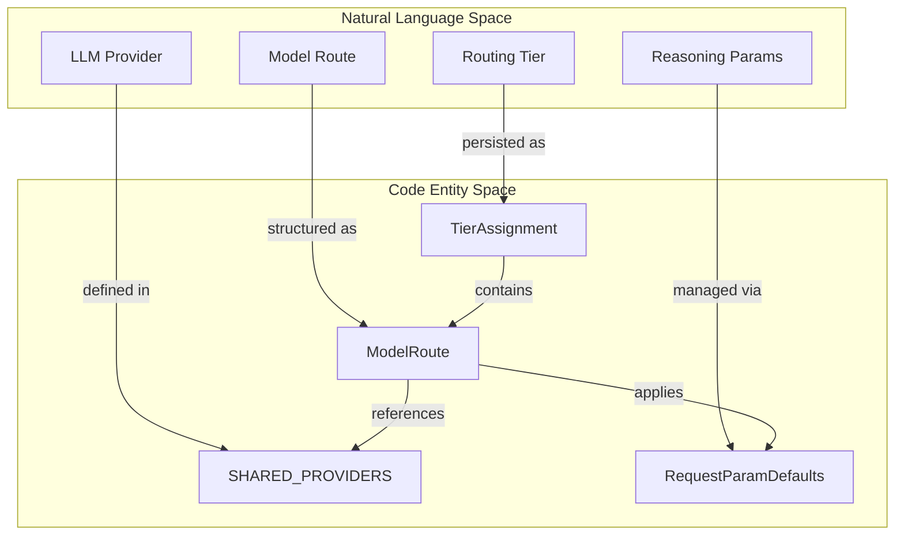
Sources: [packages/shared/src/index.ts:11-38](), [packages/frontend/src/pages/RoutingTierCard.tsx:19-27](), [packages/shared/src/model-route.ts:1-25]()

---

## Key Utilities

### Provider Inference Engine
The `inferProviderFromModel` utility is the source of truth for mapping model strings (e.g., `gpt-4o`, `claude-sonnet-4`) to their respective provider IDs.

*   **Priority Logic**:
    1.  **Custom**: Models starting with `custom:` are routed to user-defined endpoints [packages/frontend/tests/services/routing-utils.test.ts:181-184]().
    2.  **Ollama**: Models containing a colon (e.g., `llama3:latest`) that do not end in `:free` are treated as local Ollama models [packages/frontend/tests/services/routing-utils.test.ts:82-85]().
    3.  **Prefix Match**: Standard prefixes like `gpt-`, `o3-`, `claude-`, or `gemini-` are mapped to their respective vendors [packages/frontend/tests/services/routing-utils.test.ts:98-112]().
    4.  **Namespace Match**: Patterns like `copilot/` or `openrouter/` identify specific subscription wrappers or aggregators [packages/frontend/tests/services/routing-utils.test.ts:157-165]().
    5.  **Vendor Fallback**: Generic `vendor/model` patterns default to `openrouter` [packages/frontend/tests/services/routing-utils.test.ts:167-170]().

Sources: [packages/shared/src/provider-inference.ts:1-46](), [packages/frontend/tests/services/routing-utils.test.ts:81-185]()

### Subscription Configurations
Manifest maintains a comprehensive registry of supported subscription providers. Each configuration defines the authentication mode and technical capabilities [packages/shared/src/subscription/configs.ts:3-126]().

| Provider ID | Auth Mode | Label | Max Context |
| :--- | :--- | :--- | :--- |
| `anthropic` | `token` | Claude Max / Pro | 200,000 |
| `openai` | `popup_oauth` | ChatGPT Plus/Pro/Team | 200,000 |
| `minimax` | `device_code` | MiniMax Coding Plan | 200,000 |
| `zai` | `token` | GLM Coding Plan | 204,800 |
| `copilot` | `device_code` | GitHub Copilot | 200,000 |
| `ollama-cloud`| `token` | Ollama Cloud | 128,000 |

Sources: [packages/shared/src/subscription/configs.ts:6-126]()

---

## Routing Logic and Model Routes

The shared package defines the structure for how models are selected and prioritized. The `ModelRoute` type is the canonical way to represent a specific model on a specific provider with a specific authentication type [packages/shared/src/model-route.ts:20-26]().

### Routing Action Flow
Title: Primary and Fallback Routing Logic
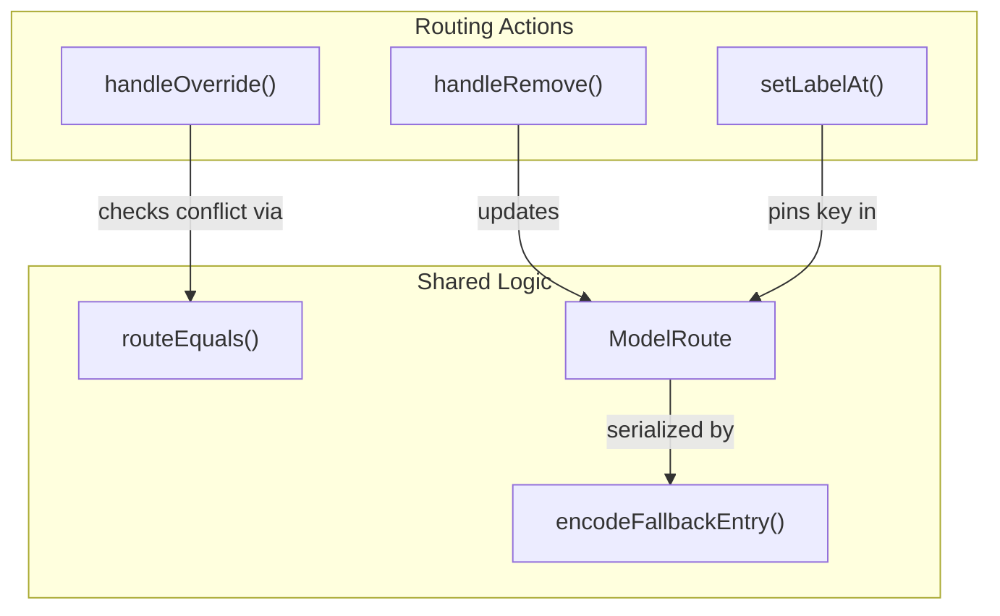
Sources: [packages/frontend/tests/pages/RoutingActions.test.ts:89-109](), [packages/frontend/src/components/FallbackList.tsx:109-129](), [packages/shared/src/model-route.ts:20-25]()

*   **Route Equality**: `routeEquals` is used to prevent the same model/provider/key combination from appearing as both the primary and a fallback [packages/frontend/tests/pages/RoutingActions.test.ts:118-157]().
*   **Key Pinning**: The `keyLabel` property in `ModelRoute` allows users to pin a specific API key (e.g., "Work" vs "Personal") for a specific model tier [packages/frontend/src/components/FallbackList.tsx:109-129]().

Sources: [packages/shared/src/model-route.ts:20-26](), [packages/frontend/src/components/FallbackList.tsx:109-129]()

---

## Reasoning and Thinking Defaults

For models supporting "reasoning" or "thinking" blocks (like DeepSeek or OpenAI o1), the shared package provides the configuration for parameter handling [packages/shared/src/thinking-defaults.ts:1-38]().

*   **Provider Defaults**: `PROVIDER_THINKING_DEFAULTS` maps providers to their native thinking parameter keys (e.g., `thinking` for DeepSeek) [packages/shared/src/thinking-defaults.ts:32-37]().
*   **Parameter Filtering**: `filterParamDefaultsForProvider` ensures that parameters like `max_thinking_tokens` are only sent to providers that support them, preventing API errors [packages/frontend/src/pages/RoutingTierCard.tsx:158-175]().

Sources: [packages/shared/src/thinking-defaults.ts:1-38](), [packages/frontend/src/pages/RoutingTierCard.tsx:158-175]()

---

# Page: Request Routing

# Request Routing

<details>
<summary>Relevant source files</summary>

The following files were used as context for generating this wiki page:

- [packages/backend/src/routing/dto/resolve-response.ts](packages/backend/src/routing/dto/resolve-response.ts)
- [packages/backend/src/routing/proxy/__tests__/proxy-fallback.service.spec.ts](packages/backend/src/routing/proxy/__tests__/proxy-fallback.service.spec.ts)
- [packages/backend/src/routing/proxy/__tests__/proxy-response-handler.spec.ts](packages/backend/src/routing/proxy/__tests__/proxy-response-handler.spec.ts)
- [packages/backend/src/routing/proxy/__tests__/proxy.controller.spec.ts](packages/backend/src/routing/proxy/__tests__/proxy.controller.spec.ts)
- [packages/backend/src/routing/proxy/__tests__/proxy.service.spec.ts](packages/backend/src/routing/proxy/__tests__/proxy.service.spec.ts)
- [packages/backend/src/routing/proxy/proxy-fallback.service.ts](packages/backend/src/routing/proxy/proxy-fallback.service.ts)
- [packages/backend/src/routing/proxy/proxy-response-handler.ts](packages/backend/src/routing/proxy/proxy-response-handler.ts)
- [packages/backend/src/routing/proxy/proxy-types.ts](packages/backend/src/routing/proxy/proxy-types.ts)
- [packages/backend/src/routing/proxy/proxy.controller.ts](packages/backend/src/routing/proxy/proxy.controller.ts)
- [packages/backend/src/routing/proxy/proxy.service.ts](packages/backend/src/routing/proxy/proxy.service.ts)
- [packages/backend/src/routing/resolve/__tests__/resolve.service.spec.ts](packages/backend/src/routing/resolve/__tests__/resolve.service.spec.ts)
- [packages/backend/src/routing/resolve/resolve.service.ts](packages/backend/src/routing/resolve/resolve.service.ts)
- [packages/backend/src/routing/routing-core/__tests__/provider-key.service.spec.ts](packages/backend/src/routing/routing-core/__tests__/provider-key.service.spec.ts)
- [packages/backend/src/routing/routing-core/provider-key.service.ts](packages/backend/src/routing/routing-core/provider-key.service.ts)

</details>


The Request Routing system is the core intelligence of Manifest. It transforms incoming generic LLM requests into optimized provider-specific calls by evaluating the complexity of the prompt, selecting the most cost-effective model tier, and managing the execution through a resilient proxy pipeline.

The system is designed to minimize inference costs while maintaining high response quality by using a multi-tiered routing logic that matches request difficulty to model capability.

## Routing Architecture

The routing process follows a linear pipeline from request ingestion to provider delivery.

### Request Flow Overview

1.  **Ingestion**: The `ProxyController` receives an OpenAI-compatible request at `POST /v1/chat/completions`, `POST /v1/responses`, or `POST /v1/messages` [packages/backend/src/routing/proxy/proxy.controller.ts:58-80]().
2.  **Scoring**: The `ProxyService` prepares messages and calls `ResolveService.resolve()` to analyze the request content and assign it a `Tier` (Simple, Standard, Complex, or Reasoning) [packages/backend/src/routing/proxy/proxy.service.ts:145-151]().
3.  **Resolution**: The `ProviderKeyService` finds the active model and credentials assigned to that tier for the specific agent [packages/backend/src/routing/proxy/proxy.service.ts:161-165]().
4.  **Execution**: The `ProxyService` forwards the request to the provider via the `ProxyFallbackService.tryForwardToProvider()` [packages/backend/src/routing/proxy/proxy.service.ts:228-238]().
5.  **Resilience**: If the primary provider fails with a retryable error, the `ProxyFallbackService.tryFallbacks()` iterates through configured `fallback_routes` [packages/backend/src/routing/proxy/proxy.service.ts:241-262]().

### Code Entity Space Mapping

The following diagram maps the high-level routing concepts to the specific classes and services in the codebase.

**Routing Logic to Code Entities**
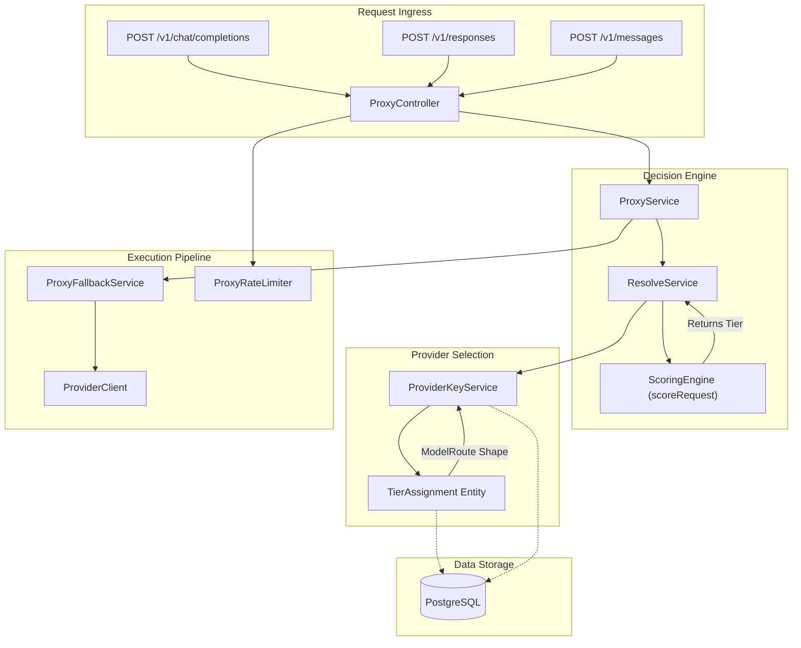
Sources: [packages/backend/src/routing/proxy/proxy.controller.ts:45-56](), [packages/backend/src/routing/proxy/proxy.service.ts:101-116](), [packages/backend/src/routing/proxy/proxy.service.ts:145-151](), [packages/backend/src/routing/resolve/resolve.service.ts:84-87](), [packages/backend/src/routing/routing-core/provider-key.service.ts:19-29]()

---

## Core Components

### [Scoring Engine](#3.1)
The Scoring Engine classifies incoming requests using a 23-dimension evaluation.
*   **Dimensions**: It analyzes structural features like token count, tool count, and conversation depth via the `scoreRequest` function [packages/backend/src/routing/resolve/resolve.service.ts:84-84]().
*   **Tier Classification**: Maps scores to one of four tiers: `simple`, `standard`, `complex`, or `reasoning` [packages/backend/src/routing/proxy/proxy.service.ts:12-12]().
*   **Fast Path**: Specific roles like `system` or `developer` are excluded from scoring to prevent inflation from large agent system prompts [packages/backend/src/routing/proxy/proxy.service.ts:48-48]().
*   **Logic**: For details, see [Scoring Engine](#3.1).

### [Proxy Pipeline](#3.2)
The `ProxyController` and `ProxyService` manage the request lifecycle, including strict rate limiting and session management.
*   **Rate Limiting**: `ProxyRateLimiter` enforces per-user and per-IP limits and manages concurrency slots [packages/backend/src/routing/proxy/proxy.controller.ts:102-105]().
*   **Sanitization**: The pipeline cleanses request headers via `sanitizeRequestHeaders` and validates payloads before forwarding [packages/backend/src/routing/proxy/proxy.controller.ts:92-92](), [packages/backend/src/routing/proxy/proxy.service.ts:138-138]().
*   **Error Handling**: The `ProxyExceptionFilter` and `ProxyResponseHandler` convert technical exceptions into friendly, actionable messages [packages/backend/src/routing/proxy/proxy.controller.ts:43-43](), [packages/backend/src/routing/proxy/proxy-response-handler.ts:59-71]().
*   **Logic**: For details, see [Proxy Pipeline](#3.2).

### [Fallback and Resilience](#3.3)
Manifest ensures high availability through a multi-step fallback chain managed by `ProxyFallbackService`.
*   **Retry Logic**: Triggered by specific status codes (e.g., 429, 5xx) defined in `shouldTriggerFallback` [packages/backend/src/routing/proxy/proxy-fallback.service.ts:54-54]().
*   **Credential Rotation**: The system can rotate between different `auth_type` options (e.g., `api_key` vs `subscription`) if one fails [packages/backend/src/routing/proxy/proxy-fallback.service.ts:124-132]().
*   **Transport Errors**: Catches network-level failures and generates synthetic 503 responses via `buildTransportErrorResponse` [packages/backend/src/routing/proxy/proxy-fallback.service.ts:60-63]().
*   **Logic**: For details, see [Fallback and Resilience](#3.3).

### [Provider Management](#3.4)
This module handles provider configuration and the `ModelRoute` structured identity.
*   **ModelRoute**: Routing uses a structured shape containing `provider`, `authType`, and `model` [packages/backend/src/routing/proxy/proxy-fallback.service.ts:4-4]().
*   **Credential Resolution**: `ProviderKeyService` retrieves and decrypts stored keys using AES-256-GCM [packages/backend/src/routing/routing-core/provider-key.service.ts:11-11]().
*   **Custom Providers**: Supports user-defined endpoints via `CustomProviderService` and `buildCustomEndpoint` [packages/backend/src/routing/proxy/proxy-fallback.service.ts:41-41](), [packages/backend/src/routing/proxy/proxy-fallback.service.ts:47-47]().
*   **Logic**: For details, see [Provider Management](#3.4).

---

## Routing Tiers Overview

Manifest uses four standardized tiers. The system attempts to route to the cheapest model that satisfies the quality requirements of the assigned tier.

| Tier | Typical Use Case | Code Reference |
| :--- | :--- | :--- |
| **Simple** | Greetings, short messages, fast path responses. | `Tier.Simple` |
| **Standard** | General conversation and standard tasks. | `Tier.Standard` |
| **Complex** | Coding, complex instructions, tool-heavy tasks. | `Tier.Complex` |
| **Reasoning** | Tasks requiring deep logic or "thinking" models. | `Tier.Reasoning` |

Sources: [packages/backend/src/routing/proxy/proxy.service.ts:12-12](), [packages/backend/src/routing/resolve/resolve.service.ts:84-87]()

## Proxy Request Lifecycle

**Internal Service Interaction**
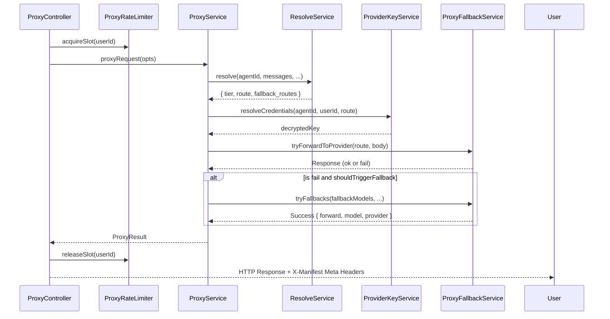
Sources: [packages/backend/src/routing/proxy/proxy.controller.ts:104-118](), [packages/backend/src/routing/proxy/proxy.service.ts:118-270](), [packages/backend/src/routing/proxy/proxy-fallback.service.ts:95-121]()

For detailed implementation of these components, refer to the child pages:
*   [Scoring Engine](#3.1)
*   [Proxy Pipeline](#3.2)
*   [Fallback and Resilience](#3.3)
*   [Provider Management](#3.4)

---

# Page: Scoring Engine

# Scoring Engine

<details>
<summary>Relevant source files</summary>

The following files were used as context for generating this wiki page:

- [packages/backend/src/common/utils/baseline-cost.spec.ts](packages/backend/src/common/utils/baseline-cost.spec.ts)
- [packages/backend/src/common/utils/baseline-cost.ts](packages/backend/src/common/utils/baseline-cost.ts)
- [packages/backend/src/database/migrations/1784000000000-DropLegacyRoutingColumns.spec.ts](packages/backend/src/database/migrations/1784000000000-DropLegacyRoutingColumns.spec.ts)
- [packages/backend/src/database/migrations/1784000000000-DropLegacyRoutingColumns.ts](packages/backend/src/database/migrations/1784000000000-DropLegacyRoutingColumns.ts)
- [packages/backend/src/routing/routing-core/__tests__/provider.service.spec.ts](packages/backend/src/routing/routing-core/__tests__/provider.service.spec.ts)
- [packages/backend/src/routing/routing-core/__tests__/routing-invalidation.service.spec.ts](packages/backend/src/routing/routing-core/__tests__/routing-invalidation.service.spec.ts)
- [packages/backend/src/routing/routing-core/__tests__/tier-auto-assign.service.spec.ts](packages/backend/src/routing/routing-core/__tests__/tier-auto-assign.service.spec.ts)
- [packages/backend/src/scoring/__tests__/agent-envelope-regression.spec.ts](packages/backend/src/scoring/__tests__/agent-envelope-regression.spec.ts)
- [packages/backend/src/scoring/__tests__/envelope-peeler.spec.ts](packages/backend/src/scoring/__tests__/envelope-peeler.spec.ts)
- [packages/backend/src/scoring/__tests__/score-request-advanced.spec.ts](packages/backend/src/scoring/__tests__/score-request-advanced.spec.ts)
- [packages/backend/src/scoring/__tests__/score-request.spec.ts](packages/backend/src/scoring/__tests__/score-request.spec.ts)
- [packages/backend/src/scoring/__tests__/specificity-signals.spec.ts](packages/backend/src/scoring/__tests__/specificity-signals.spec.ts)
- [packages/backend/src/scoring/__tests__/text-extractor.spec.ts](packages/backend/src/scoring/__tests__/text-extractor.spec.ts)
- [packages/backend/src/scoring/envelope-peeler.ts](packages/backend/src/scoring/envelope-peeler.ts)
- [packages/backend/src/scoring/index.ts](packages/backend/src/scoring/index.ts)
- [packages/backend/src/scoring/keywords.ts](packages/backend/src/scoring/keywords.ts)
- [packages/backend/src/scoring/specificity-signals.ts](packages/backend/src/scoring/specificity-signals.ts)
- [packages/backend/src/scoring/specificity-weights.ts](packages/backend/src/scoring/specificity-weights.ts)
- [packages/backend/src/scoring/text-extractor.ts](packages/backend/src/scoring/text-extractor.ts)

</details>


The Scoring Engine is the core intelligence of Manifest. It evaluates incoming LLM requests across 23 distinct dimensions to classify them into one of four routing tiers: **Simple**, **Standard**, **Complex**, or **Reasoning**. By analyzing both the semantic content and structural properties of a request, Manifest can route tasks to the most cost-effective model that meets the required quality threshold.

## Classification Tiers

Manifest uses a fixed hierarchy of tiers to categorize request difficulty:

| Tier | Description | Target Model Example |
| :--- | :--- | :--- |
| **Simple** | Greetings, short factual lookups, and basic chat. | GPT-4o-mini, Claude Haiku |
| **Standard** | General conversation, basic tool use, and moderate instructions. | GPT-4o, Claude Sonnet |
| **Complex** | Heavy coding, multi-step reasoning, or dense constraints. | Claude Opus, Llama 3.1 405B |
| **Reasoning** | Formal logic, complex math, or deep architectural planning. | OpenAI o1-preview, o3-mini |

Sources: `[packages/backend/src/scoring/types.ts:68-73]()`, `[packages/backend/src/routing/routing-core/__tests__/tier-auto-assign.service.spec.ts:128-136]()`

## Scoring Architecture

The engine processes requests through a pipeline that combines keyword analysis, structural heuristics, and session-aware momentum.

### Data Flow Diagram: Request to Tier

This diagram illustrates how a raw `ScorerInput` (OpenAI-compatible request) is transformed into a `ScoringResult` by the `scoreRequest` function in `packages/backend/src/scoring/index.ts`.

"Natural Language Space to Code Entity Space: Request Scoring"
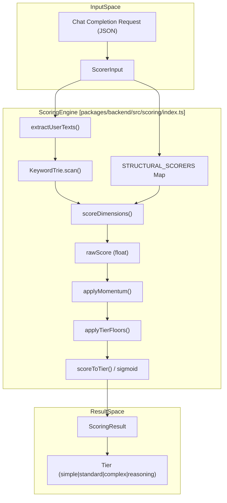
Sources: `[packages/backend/src/scoring/index.ts:155-231]()`, `[packages/backend/src/scoring/types.ts:1-40]()`, `[packages/backend/src/scoring/index.ts:99-109]()`

## Scoring Dimensions

The engine evaluates 23 dimensions, categorized into Keyword-based and Structural-based metrics.

### Keyword Analysis (`KeywordTrie`)
Manifest uses an Aho-Corasick inspired `KeywordTrie` to perform high-performance, single-pass scanning of the combined conversation text.
*   **Dimensions**: Includes complexity dimensions and specificity categories defined in `packages/backend/src/scoring/keywords.ts`.
*   **Implementation**: The `KeywordTrie` is built from `DEFAULT_CONFIG` and scans `combinedText` to return `TrieMatch` objects.

### Structural Dimensions
These dimensions look at the metadata and "shape" of the request rather than just the text.

| Dimension | Logic | Code Entity |
| :--- | :--- | :--- |
| **Token Count** | Estimated volume of input/output tokens. | `scoreTokenCount` |
| **Tool Count** | Number of available functions/tools. | `scoreToolCount` |
| **Conversation Depth**| Number of previous turns in the history. | `scoreConversationDepth` |
| **Code to Prose** | Ratio of code blocks to natural language. | `scoreCodeToProse` |
| **Constraint Density**| Frequency of imperative verbs and bullet points. | `scoreConstraintDensity` |

Sources: `[packages/backend/src/scoring/index.ts:99-109]()`, `[packages/backend/src/scoring/keyword-trie.ts:1-20]()`, `[packages/backend/src/scoring/keywords.ts:18-28]()`

## Special Logic and Overrides

### Short-Message Fast Path
To minimize latency and avoid over-complicating simple interactions, `scoreRequest` includes a fast path for brief messages (under 50 characters). 
*   **Logic**: If a message is short and lacks complex technical keywords, it is automatically assigned the `simple` tier with a `short_message` reason.
*   **Tools Bypass**: Greetings like "hi" or "hello" remain in the `simple` tier even if a `tools` array is present in the request, bypassing heavy tool-count scoring.

### Formal Logic Override
The `checkFormalLogicOverride` function looks for specific triggers (like complex mathematical notation or explicit "prove that" requests) that force the request into the **Reasoning** tier regardless of other scores.

### Specificity Detector and Signal Boosts
The `detectSpecificity` utility classifies requests into task-type categories like `CODING`, `TRADING`, or `WEB_BROWSING`. It uses a combination of weighted keywords and structural "signals".

"Natural Language Space to Code Entity Space: Specificity Detection"
```mermaid
graph TD
    subgraph "DetectionLogic [packages/backend/src/scoring/specificity-detector.ts]"
        T["Text + Tools"] --> S["computeSignalBoosts()"]
        T --> K["Keyword Matching"]
        
        subgraph "SignalAnalysis [packages/backend/src/scoring/specificity-signals.ts]"
            S --> URL["URL_REGEX (Web)"]
            S --> CF["CODE_FENCE_REGEX (Coding)"]
            S --> ST["STACK_TRACE_REGEX (Coding)"]
            S --> TN["CODING_TOOL_NAMES (Coding)"]
        end
        
        subgraph "Weighting [packages/backend/src/scoring/specificity-weights.ts]"
            K --> W["weightFor(keyword)"]
            W --> AT["ACTIVATION_THRESHOLDS"]
            URL --> AT
            CF --> AT
        end
    end
    
    AT --> R["SpecificityCategory"]
```

*   **Keyword Weights**: Strong anchor phrases like `navigate to` (weight: 4) are weighted more heavily than generics like `website` (weight: 1.5).
*   **Structural Signals**: Detection of URLs, code fences (minimum 40 characters), and specific tool names (e.g., `apply_patch`, `str_replace_editor`) provide boosts. Generic agent tools like `read` or `write` are excluded to prevent false coding classifications.
*   **Activation Thresholds**: Each category has a threshold; `web_browsing` requires a score of 3.0 to activate, whereas `coding` requires 1.0.
*   **SpecificityPenaltyService**: Applies per-category weight penalties based on user-flagged miscategorizations to refine future routing.

Sources: `[packages/backend/src/scoring/index.ts:180-212]()`, `[packages/backend/src/scoring/overrides.ts:1-32]()`, `[packages/backend/src/scoring/specificity-detector.ts:1-20]()`, `[packages/backend/src/scoring/specificity-weights.ts:11-89]()`, `[packages/backend/src/scoring/specificity-signals.ts:16-66]()`

## Normalization and Momentum

### Sigmoid Normalization
Raw scores are normalized using a sigmoid function in `sigmoid.ts` to map them onto a probability curve (0 to 1). This allows the engine to calculate a `confidence` metric for its classification.

### Session Momentum
The engine uses `applyMomentum` to prevent "model jumping" mid-conversation. It looks at `recentTiers` in the session and biases the current score toward the previously used tier if the text change is minimal.

Sources: `[packages/backend/src/scoring/sigmoid.ts:1-40]()`, `[packages/backend/src/scoring/momentum.ts:1-30]()`

## Text Pre-processing

### Envelope Peeling
The `peelEnvelope` function identifies and strips metadata wrappers (e.g., JSON or YAML blocks containing session IDs) added by agents like OpenClaw. This ensures the engine scores the human's actual intent rather than the agent's boilerplate, preventing short messages from being misclassified as complex coding tasks.

Sources: `[packages/backend/src/scoring/text-extractor.ts:46-48]()`, `[packages/backend/src/scoring/envelope-peeler.ts:1-33]()`

---

# Page: Proxy Pipeline

# Proxy Pipeline

<details>
<summary>Relevant source files</summary>

The following files were used as context for generating this wiki page:

- [.changeset/fix-messages-cache-token-roundtrip.md](.changeset/fix-messages-cache-token-roundtrip.md)
- [packages/backend/src/common/errors/__tests__/error-codes.spec.ts](packages/backend/src/common/errors/__tests__/error-codes.spec.ts)
- [packages/backend/src/common/errors/error-codes.ts](packages/backend/src/common/errors/error-codes.ts)
- [packages/backend/src/routing/proxy/__tests__/anthropic-cache-control-roundtrip.spec.ts](packages/backend/src/routing/proxy/__tests__/anthropic-cache-control-roundtrip.spec.ts)
- [packages/backend/src/routing/proxy/__tests__/anthropic-messages-adapter.spec.ts](packages/backend/src/routing/proxy/__tests__/anthropic-messages-adapter.spec.ts)
- [packages/backend/src/routing/proxy/__tests__/proxy-exception.filter.spec.ts](packages/backend/src/routing/proxy/__tests__/proxy-exception.filter.spec.ts)
- [packages/backend/src/routing/proxy/__tests__/proxy-friendly-response.spec.ts](packages/backend/src/routing/proxy/__tests__/proxy-friendly-response.spec.ts)
- [packages/backend/src/routing/proxy/__tests__/proxy-message-dedup.spec.ts](packages/backend/src/routing/proxy/__tests__/proxy-message-dedup.spec.ts)
- [packages/backend/src/routing/proxy/__tests__/proxy-rate-limiter.spec.ts](packages/backend/src/routing/proxy/__tests__/proxy-rate-limiter.spec.ts)
- [packages/backend/src/routing/proxy/__tests__/proxy-response-handler.spec.ts](packages/backend/src/routing/proxy/__tests__/proxy-response-handler.spec.ts)
- [packages/backend/src/routing/proxy/__tests__/proxy.controller.spec.ts](packages/backend/src/routing/proxy/__tests__/proxy.controller.spec.ts)
- [packages/backend/src/routing/proxy/__tests__/proxy.service.spec.ts](packages/backend/src/routing/proxy/__tests__/proxy.service.spec.ts)
- [packages/backend/src/routing/proxy/__tests__/responses-adapter.spec.ts](packages/backend/src/routing/proxy/__tests__/responses-adapter.spec.ts)
- [packages/backend/src/routing/proxy/__tests__/stream-warmup.spec.ts](packages/backend/src/routing/proxy/__tests__/stream-warmup.spec.ts)
- [packages/backend/src/routing/proxy/__tests__/stream-writer.spec.ts](packages/backend/src/routing/proxy/__tests__/stream-writer.spec.ts)
- [packages/backend/src/routing/proxy/anthropic-messages-adapter.ts](packages/backend/src/routing/proxy/anthropic-messages-adapter.ts)
- [packages/backend/src/routing/proxy/proxy-exception.filter.ts](packages/backend/src/routing/proxy/proxy-exception.filter.ts)
- [packages/backend/src/routing/proxy/proxy-friendly-response.ts](packages/backend/src/routing/proxy/proxy-friendly-response.ts)
- [packages/backend/src/routing/proxy/proxy-message-dedup.ts](packages/backend/src/routing/proxy/proxy-message-dedup.ts)
- [packages/backend/src/routing/proxy/proxy-rate-limiter.ts](packages/backend/src/routing/proxy/proxy-rate-limiter.ts)
- [packages/backend/src/routing/proxy/proxy-response-handler.ts](packages/backend/src/routing/proxy/proxy-response-handler.ts)
- [packages/backend/src/routing/proxy/proxy-types.ts](packages/backend/src/routing/proxy/proxy-types.ts)
- [packages/backend/src/routing/proxy/proxy.controller.ts](packages/backend/src/routing/proxy/proxy.controller.ts)
- [packages/backend/src/routing/proxy/proxy.service.ts](packages/backend/src/routing/proxy/proxy.service.ts)
- [packages/backend/src/routing/proxy/responses-adapter.ts](packages/backend/src/routing/proxy/responses-adapter.ts)
- [packages/backend/src/routing/proxy/stream-warmup.ts](packages/backend/src/routing/proxy/stream-warmup.ts)
- [packages/backend/src/routing/proxy/stream-writer.ts](packages/backend/src/routing/proxy/stream-writer.ts)

</details>


The Proxy Pipeline is the core execution engine of Manifest, responsible for intercepting OpenAI-compatible chat completion requests, determining the optimal routing tier, and forwarding the request to the appropriate LLM provider. It handles rate limiting, provider-specific protocol translation, streaming, and automatic fallback across multiple models and credentials.

## 1. Request Lifecycle Overview

When a client sends a request to `POST /v1/chat/completions`, `POST /v1/responses`, or `POST /v1/messages`, it enters the pipeline via the `ProxyController` [packages/backend/src/routing/proxy/proxy.controller.ts:58-80]().

### Code Entity Flow
The following diagram illustrates the transition from the HTTP request into the internal service orchestration.

**Diagram: Proxy Orchestration Flow**
```mermaid
graph TD
    Client["HTTP Client"] -- "POST /v1/chat/completions" --> PC["ProxyController"]
    PC -- "checkLimit / acquireSlot" --> PRL["ProxyRateLimiter"]
    PC -- "proxyRequest()" --> PS["ProxyService"]
    PS -- "resolve()" --> RS["ResolveService"]
    PS -- "tryFallbacks()" --> PFS["ProxyFallbackService"]
    PFS -- "forward()" --> PCl["ProviderClient"]
    PCl -- "fetch" --> Upstream["Upstream LLM Provider"]
```
Sources: [packages/backend/src/routing/proxy/proxy.controller.ts:58-72](), [packages/backend/src/routing/proxy/proxy.service.ts:118-158](), [packages/backend/src/routing/proxy/proxy.service.ts:192-205]()

## 2. Rate Limiting and Concurrency

Manifest implements a dual-layer rate limiting strategy at the proxy level to protect upstream providers and ensure system stability.

*   **Request Rate Limit**: Enforced via `checkLimit` (default 200 req/60s) and `checkIpLimit` in the `ProxyRateLimiter` [packages/backend/src/routing/proxy/proxy.controller.ts:102-103]().
*   **Concurrency Limit**: Restricted using `acquireSlot` and `releaseSlot` to manage active connections (default 10 concurrent) per user [packages/backend/src/routing/proxy/proxy-rate-limiter.ts:1-20]().

The `ProxyController` calls these methods before processing the request and ensures the slot is released in a `finally` block [packages/backend/src/routing/proxy/proxy.controller.ts:104-105](), [packages/backend/src/routing/proxy/proxy.controller.ts:205-205]().

## 3. Proxy Service Orchestration

The `ProxyService` manages the high-level logic of the request, including payload validation, limit enforcement, and routing resolution.

### Key Implementation Details
*   **Payload Validation**: The pipeline enforces a maximum of 1000 messages per request and ensures the `messages` array is present and non-empty [packages/backend/src/routing/proxy/proxy.service.ts:50-50](), [packages/backend/src/routing/proxy/proxy.service.ts:250-258]().
*   **System Prompt Stripping**: To prevent scoring inflation, roles defined in `SCORING_EXCLUDED_ROLES` (`system`, `developer`) are stripped before the request is sent to the `Scorer`, though they remain in the payload forwarded to providers [packages/backend/src/routing/proxy/proxy.service.ts:48-48](), [packages/backend/src/routing/proxy/proxy.service.ts:281-286]().
*   **Heartbeat & Limits**: Before routing, the service checks for usage limits via `LimitCheckService`. If exceeded, it returns a friendly "M200" error response [packages/backend/src/routing/proxy/proxy.service.ts:140-143]().
*   **Stream Warm-up**: For streaming responses, `peekStream` verifies the provider actually starts delivering data (within 15 seconds) before committing to the client. If the stream stalls, the service can still trigger a fallback [packages/backend/src/routing/proxy/proxy.service.ts:37-37](), [packages/backend/src/routing/proxy/proxy.service.ts:196-200]().

Sources: [packages/backend/src/routing/proxy/proxy.service.ts:118-260](), [packages/backend/src/routing/proxy/stream-warmup.ts:1-10]()

## 4. Provider Adapters and Protocol Translation

The `ProxyService` uses specific adapters to normalize incoming requests from different API formats (Anthropic Messages, OpenAI Responses) into a standard internal `chat_completions` format [packages/backend/src/routing/proxy/proxy.service.ts:131-137]().

| Adapter | Source File | Functionality |
| :--- | :--- | :--- |
| **Anthropic Messages** | `anthropic-messages-adapter.ts` | Translates `POST /v1/messages` to internal chat completions; handles `tool_use` and `thinking` blocks [packages/backend/src/routing/proxy/anthropic-messages-adapter.ts:1-6](). |
| **OpenAI Responses** | `responses-adapter.ts` | Converts `POST /v1/responses` instructions and input items into system/user messages [packages/backend/src/routing/proxy/responses-adapter.ts:78-96](). |

**Diagram: Protocol Normalization & Forwarding**
```mermaid
graph LR
    subgraph "Input Formats"
        CC["Chat Completions"]
        RA["Responses API"]
        MA["Messages API"]
    end
    
    RA -- "toChatCompletionsRequest()" --> CC
    MA -- "messagesToChatCompletionsRequest()" --> CC
    
    CC --> PS["ProxyService"]
    PS --> PCl["ProviderClient"]
    
    PCl -- "toAnthropicRequest()" --> Ant["Anthropic Native"]
    PCl -- "toGoogleRequest()" --> Gem["Google Gemini"]
    PCl -- "toNativeResponsesRequest()" --> CG["ChatGPT Codex"]
```
Sources: [packages/backend/src/routing/proxy/proxy.service.ts:131-137](), [packages/backend/src/routing/proxy/responses-adapter.ts:157-165](), [packages/backend/src/routing/proxy/anthropic-messages-adapter.ts:156-171]()

## 5. Cache Management & Message Recording

### Thinking and Signature Caches
*   **ThinkingBlockCache**: Stores extended thinking/reasoning blocks (e.g., from Claude 3.7 or DeepSeek-R1) associated with a `sessionKey`. This allows subsequent tool-use turns to include the model's "thought" context [packages/backend/src/routing/proxy/thinking-block-cache.ts:1-10](), [packages/backend/src/routing/proxy/proxy.service.ts:180-181]().
*   **ThoughtSignatureCache**: Specifically for Google Gemini, this cache stores `thought_signature` values required to link parallel tool calls back to the original reasoning step [packages/backend/src/routing/proxy/thought-signature-cache.ts:1-10](), [packages/backend/src/routing/proxy/proxy.service.ts:178-179]().

### Proxy Message Recorder
The `ProxyMessageRecorder` asynchronously persists telemetry to the `agent_messages` table. It handles:
*   **Success Recording**: Captures token usage (normalized via `parseUsageObject`), cost, and duration [packages/backend/src/routing/proxy/stream-writer.ts:21-43](), [packages/backend/src/routing/proxy/proxy-response-handler.ts:181-192]().
*   **Error Recording**: Logs `error_http_status` and `error_message` (scrubbed of secrets) [packages/backend/src/routing/proxy/proxy-response-handler.ts:89-109]().
*   **Fallback Tracking**: Records primary failures and failed fallback attempts even if a subsequent fallback eventually succeeds [packages/backend/src/routing/proxy/proxy-response-handler.ts:138-155](), [packages/backend/src/routing/proxy/proxy-response-handler.ts:204-211]().

Sources: [packages/backend/src/routing/proxy/proxy-message-recorder.ts:109-310](), [packages/backend/src/routing/proxy/proxy-response-handler.ts:59-198](), [packages/backend/src/routing/proxy/stream-writer.ts:21-81]()

## 6. Error Handling and Resilience

The `ProxyExceptionFilter` ensures that internal and auth errors are returned to the client in a friendly, OpenAI-compatible JSON format [packages/backend/src/routing/proxy/proxy-exception.filter.ts:32-45]().

*   **Friendly Error Responses**: If a request fails due to missing keys or limits, `sendFriendlyResponse` generates a canned assistant message (e.g., `[🦚 Manifest M100] ...`) so the user sees a helpful explanation in their chat UI [packages/backend/src/routing/proxy/proxy-friendly-response.ts:33-50]().
*   **Fallback Logic**: If an upstream provider returns a retryable status code, `ProxyFallbackService` iterates through the `fallback_routes` [packages/backend/src/routing/proxy/proxy.service.ts:192-205](), [packages/backend/src/routing/proxy/fallback-status-codes.ts:1-10]().
*   **Sanitization**: Upstream error bodies are passed through `sanitizeProviderError` to strip sensitive backend details before reaching the client [packages/backend/src/routing/proxy/proxy-error-sanitizer.ts:1-15](), [packages/backend/src/routing/proxy/proxy-response-handler.ts:118-118]().

Sources: [packages/backend/src/routing/proxy/proxy.controller.ts:209-230](), [packages/backend/src/routing/proxy/proxy-response-handler.ts:111-123](), [packages/backend/src/routing/proxy/proxy-friendly-response.ts:1-50]()

---

# Page: Fallback and Resilience

# Fallback and Resilience

<details>
<summary>Relevant source files</summary>

The following files were used as context for generating this wiki page:

- [packages/backend/src/common/utils/hash.util.spec.ts](packages/backend/src/common/utils/hash.util.spec.ts)
- [packages/backend/src/common/utils/hash.util.ts](packages/backend/src/common/utils/hash.util.ts)
- [packages/backend/src/database/migrations/1771500000000-HashApiKeys.ts](packages/backend/src/database/migrations/1771500000000-HashApiKeys.ts)
- [packages/backend/src/database/migrations/1773900000000-AddKeyPrefixIndex.spec.ts](packages/backend/src/database/migrations/1773900000000-AddKeyPrefixIndex.spec.ts)
- [packages/backend/src/database/migrations/1773900000000-AddKeyPrefixIndex.ts](packages/backend/src/database/migrations/1773900000000-AddKeyPrefixIndex.ts)
- [packages/backend/src/routing/dto/resolve-response.ts](packages/backend/src/routing/dto/resolve-response.ts)
- [packages/backend/src/routing/proxy/__tests__/fallback-status-codes.spec.ts](packages/backend/src/routing/proxy/__tests__/fallback-status-codes.spec.ts)
- [packages/backend/src/routing/proxy/__tests__/proxy-fallback.service.spec.ts](packages/backend/src/routing/proxy/__tests__/proxy-fallback.service.spec.ts)
- [packages/backend/src/routing/proxy/fallback-status-codes.ts](packages/backend/src/routing/proxy/fallback-status-codes.ts)
- [packages/backend/src/routing/proxy/proxy-error-sanitizer.spec.ts](packages/backend/src/routing/proxy/proxy-error-sanitizer.spec.ts)
- [packages/backend/src/routing/proxy/proxy-error-sanitizer.ts](packages/backend/src/routing/proxy/proxy-error-sanitizer.ts)
- [packages/backend/src/routing/proxy/proxy-fallback.service.ts](packages/backend/src/routing/proxy/proxy-fallback.service.ts)
- [packages/backend/src/routing/resolve/__tests__/resolve.service.spec.ts](packages/backend/src/routing/resolve/__tests__/resolve.service.spec.ts)
- [packages/backend/src/routing/resolve/resolve.service.ts](packages/backend/src/routing/resolve/resolve.service.ts)
- [packages/backend/src/routing/routing-core/__tests__/provider-key.service.spec.ts](packages/backend/src/routing/routing-core/__tests__/provider-key.service.spec.ts)
- [packages/backend/src/routing/routing-core/provider-key.service.ts](packages/backend/src/routing/routing-core/provider-key.service.ts)
- [packages/backend/test/proxy-fallback-auth.e2e-spec.ts](packages/backend/test/proxy-fallback-auth.e2e-spec.ts)

</details>


The Manifest proxy is designed to maintain high availability for LLM requests even when upstream providers experience rate limits, outages, or authentication failures. This is achieved through a multi-layered fallback strategy that includes model iteration, credential rotation, and intelligent error handling.

## Fallback Chain Mechanism

The core logic for resilience resides in the `ProxyFallbackService` [packages/backend/src/routing/proxy/proxy-fallback.service.ts:81-82](). When a primary request fails with a status code deemed "fallback-eligible", the system initiates a fallback sequence.

### Iteration Process
1.  **Trigger**: The system detects a failed request. Eligibility is determined by `shouldTriggerFallback`, which returns `true` for any HTTP status code $\ge 400$ [packages/backend/src/routing/proxy/fallback-status-codes.ts:1-3]().
2.  **Structured Routes**: If `fallbackRoutes` (type `ModelRoute[]`) are provided, the system uses the explicit `provider`, `authType`, and `model` defined in the route [packages/backend/src/routing/proxy/proxy-fallback.service.ts:148-150]().
3.  **Legacy Inference**: If no structured routes exist, the system determines the provider by checking pricing data [packages/backend/src/routing/proxy/proxy-fallback.service.ts:152-152](), custom provider prefixes [packages/backend/src/routing/proxy/proxy-fallback.service.ts:153-155](), or model name inference [packages/backend/src/routing/proxy/proxy-fallback.service.ts:157-157]().
4.  **Credential Retrieval**: It resolves the API key using `ProviderKeyService.getProviderApiKey` [packages/backend/src/routing/proxy/proxy-fallback.service.ts:178-178]().
5.  **Param Merging**: For each attempt, the system re-applies parameter defaults (like `thinking` blocks) specific to the iteration's provider via `applyParamMerge` [packages/backend/src/routing/proxy/proxy-fallback.service.ts:24-38](). This prevents fields specific to one provider (e.g., DeepSeek) from leaking onto a fallback target (e.g., Anthropic) [packages/backend/src/routing/proxy/proxy-fallback.service.ts:12-17]().
6.  **Execution**: The system attempts to forward the request via `tryForwardToProvider` [packages/backend/src/routing/proxy/proxy-fallback.service.ts:221-236](). If the response is `ok`, the loop terminates [packages/backend/src/routing/proxy/proxy-fallback.service.ts:238-244]().
7.  **Failure Logging**: If it fails, the error body and status are recorded in a `failures` array [packages/backend/src/routing/proxy/proxy-fallback.service.ts:247-254]().

### Fallback Execution Flow
The following diagram illustrates the transition from a failed primary request to the fallback loop.

**Fallback Execution Flow**
```mermaid
graph TD
    subgraph "Code Entity Space"
        PFS["ProxyFallbackService"]
        SFC["shouldTriggerFallback()"]
        PK["ProviderKeyService"]
        PC["ProviderClient"]
        APM["applyParamMerge()"]
    end

    A["Incoming Request"] --> PFS
    PFS -->|"tryForwardToProvider"| PC
    PC -->|"429/500/503"| SFC
    SFC -->|"status >= 400 (true)"| PFS
    
    PFS --> Loop["Loop: fallbackModels"]
    Loop -->|"getAuthType / getProviderApiKey"| PK
    PK -->|"Credential Rotation"| PFS
    PFS --> APM
    APM -->|"Provider-Specific Defaults"| PFS
    PFS -->|"tryForwardToProvider"| Upstream["Upstream LLM"]
    Upstream -->|"200 OK"| Success["Return Response"]
    Upstream -->|"Error"| Loop
```
Sources: [packages/backend/src/routing/proxy/proxy-fallback.service.ts:95-259](), [packages/backend/src/routing/proxy/fallback-status-codes.ts:1-3]()

## Credential Rotation

Manifest supports multiple authentication types: `api_key`, `subscription` (OAuth-based), and `local` (Ollama/LM Studio). To increase resilience, the system rotates between these types if one fails for a specific provider [packages/backend/src/routing/proxy/proxy-fallback.service.ts:124-128]().

*   **Failure Tracking**: The system maintains a `failedAuthByProvider` map during the fallback loop to track which auth types have already failed for a given provider [packages/backend/src/routing/proxy/proxy-fallback.service.ts:128-131]().
*   **Rotation Logic**: When requesting a credential for a fallback model in legacy mode, `ProxyFallbackService` calls `getAuthType` with an `excludeAuthTypes` set [packages/backend/src/routing/proxy/proxy-fallback.service.ts:170-174]().
*   **Selection Priority**: `ProviderKeyService.getAuthType` filters out previously failed types [packages/backend/src/routing/routing-core/provider-key.service.ts:89-92](). It prioritizes:
    1.  `local` providers [packages/backend/src/routing/routing-core/provider-key.service.ts:96-97]().
    2.  `subscription` if a usable encrypted key exists [packages/backend/src/routing/routing-core/provider-key.service.ts:99-100]().
    3.  Any record with a decryptable `api_key_encrypted` [packages/backend/src/routing/routing-core/provider-key.service.ts:103-104]().

Sources: [packages/backend/src/routing/proxy/proxy-fallback.service.ts:124-175](), [packages/backend/src/routing/routing-core/provider-key.service.ts:79-105]()

## Error Handling and Sanitization

### Transport Errors
Errors occurring at the network level (e.g., DNS failure, connection reset, or timeouts) are caught in `tryForwardToProvider` [packages/backend/src/routing/proxy/proxy-fallback.service.ts:271-273]().
*   **Detection**: The system uses `isTransportError` to identify network-level issues [packages/backend/src/routing/proxy/proxy-transport.ts:24-24]().
*   **Conversion**: These are converted into synthetic HTTP responses (e.g., 503 for connection errors, 504 for `TimeoutError`) using `buildTransportErrorResponse` [packages/backend/src/routing/proxy/proxy-transport.ts:24-30]().

### Sanitization
To prevent leaking sensitive upstream information or internal API keys, the `sanitizeProviderError` utility processes all error bodies [packages/backend/src/routing/proxy/proxy-error-sanitizer.ts:23-23]().

*   **Production Mode**: Returns generic messages mapped in `KNOWN_ERROR_MESSAGES` (e.g., 429 becomes "Rate limited by upstream provider") [packages/backend/src/routing/proxy/proxy-error-sanitizer.ts:1-13](), [packages/backend/src/routing/proxy/proxy-error-sanitizer.ts:27-27]().
*   **Development Mode**: Extracts the error message from the JSON body [packages/backend/src/routing/proxy/proxy-error-sanitizer.ts:30-35]() and applies regex redaction via `sanitizeSensitivePatterns` to mask OpenAI/Anthropic keys and Bearer tokens [packages/backend/src/routing/proxy/proxy-error-sanitizer.ts:15-21]().

**Error Sanitization Logic**
```mermaid
graph TD
    subgraph "Code Entity Space"
        SPE["sanitizeProviderError()"]
        SSP["sanitizeSensitivePatterns()"]
        KEM["KNOWN_ERROR_MESSAGES"]
    end

    Error["Upstream Error Body"] --> SPE
    SPE -->|"NODE_ENV == 'production'"| KEM
    SPE -->|"NODE_ENV == 'development'"| Parse["JSON.parse(rawBody)"]
    Parse --> SSP
    SSP -->|"Regex: sk-ant-***"| Cleaned["Redacted Error Message"]
    SSP -->|"Regex: Bearer ***"| Cleaned
```
Sources: [packages/backend/src/routing/proxy/proxy-error-sanitizer.ts:1-42]()

## Implementation Details

### Key Functions and Classes

| Class/Function | Role |
| :--- | :--- |
| `ProxyFallbackService` | Orchestrates the fallback loop and credential rotation for retries [packages/backend/src/routing/proxy/proxy-fallback.service.ts:81](). |
| `shouldTriggerFallback` | Determines if a status code warrants a fallback attempt (status $\ge 400$) [packages/backend/src/routing/proxy/fallback-status-codes.ts:1](). |
| `ProviderKeyService` | Manages credential resolution, decryption (AES-256-GCM), and auth type prioritization [packages/backend/src/routing/routing-core/provider-key.service.ts:19](). |
| `isTransportError` | Identifies fetch-level exceptions that should be treated as 5xx errors [packages/backend/src/routing/proxy/proxy-transport.ts:24](). |
| `sanitizeProviderError` | Rewrites clinical upstream errors into friendly or redacted messages [packages/backend/src/routing/proxy/proxy-error-sanitizer.ts:23](). |

Sources: [packages/backend/src/routing/proxy/proxy-fallback.service.ts:81-93](), [packages/backend/src/routing/proxy/fallback-status-codes.ts:1-3](), [packages/backend/src/routing/routing-core/provider-key.service.ts:19-29](), [packages/backend/src/routing/proxy/proxy-error-sanitizer.ts:23-41]()

---

# Page: Provider Management

# Provider Management

<details>
<summary>Relevant source files</summary>

The following files were used as context for generating this wiki page:

- [.changeset/copilot-codex-routing.md](.changeset/copilot-codex-routing.md)
- [packages/backend/src/common/constants/openai-models.ts](packages/backend/src/common/constants/openai-models.ts)
- [packages/backend/src/common/constants/subscription-clients.ts](packages/backend/src/common/constants/subscription-clients.ts)
- [packages/backend/src/model-prices/model-prices.module.ts](packages/backend/src/model-prices/model-prices.module.ts)
- [packages/backend/src/routing/custom-provider/custom-provider.module.ts](packages/backend/src/routing/custom-provider/custom-provider.module.ts)
- [packages/backend/src/routing/custom-provider/custom-provider.service.spec.ts](packages/backend/src/routing/custom-provider/custom-provider.service.spec.ts)
- [packages/backend/src/routing/custom-provider/custom-provider.service.ts](packages/backend/src/routing/custom-provider/custom-provider.service.ts)
- [packages/backend/src/routing/minimax-oauth.controller.spec.ts](packages/backend/src/routing/minimax-oauth.controller.spec.ts)
- [packages/backend/src/routing/minimax-oauth.service.spec.ts](packages/backend/src/routing/minimax-oauth.service.spec.ts)
- [packages/backend/src/routing/oauth/minimax-oauth-helpers.spec.ts](packages/backend/src/routing/oauth/minimax-oauth-helpers.spec.ts)
- [packages/backend/src/routing/oauth/minimax-oauth-helpers.ts](packages/backend/src/routing/oauth/minimax-oauth-helpers.ts)
- [packages/backend/src/routing/oauth/minimax-oauth.service.spec.ts](packages/backend/src/routing/oauth/minimax-oauth.service.spec.ts)
- [packages/backend/src/routing/oauth/minimax-oauth.service.ts](packages/backend/src/routing/oauth/minimax-oauth.service.ts)
- [packages/backend/src/routing/proxy/__tests__/provider-client-converters.spec.ts](packages/backend/src/routing/proxy/__tests__/provider-client-converters.spec.ts)
- [packages/backend/src/routing/proxy/__tests__/provider-client.spec.ts](packages/backend/src/routing/proxy/__tests__/provider-client.spec.ts)
- [packages/backend/src/routing/proxy/__tests__/provider-endpoints.spec.ts](packages/backend/src/routing/proxy/__tests__/provider-endpoints.spec.ts)
- [packages/backend/src/routing/proxy/chatgpt-adapter.spec.ts](packages/backend/src/routing/proxy/chatgpt-adapter.spec.ts)
- [packages/backend/src/routing/proxy/chatgpt-adapter.ts](packages/backend/src/routing/proxy/chatgpt-adapter.ts)
- [packages/backend/src/routing/proxy/provider-client-converters.ts](packages/backend/src/routing/proxy/provider-client-converters.ts)
- [packages/backend/src/routing/proxy/provider-client.ts](packages/backend/src/routing/proxy/provider-client.ts)
- [packages/backend/src/routing/proxy/provider-endpoints.ts](packages/backend/src/routing/proxy/provider-endpoints.ts)
- [packages/frontend/src/components/DeviceCodeDetailView.tsx](packages/frontend/src/components/DeviceCodeDetailView.tsx)
- [packages/frontend/src/components/ProviderDetailView.tsx](packages/frontend/src/components/ProviderDetailView.tsx)
- [packages/frontend/src/components/ProviderIcon.tsx](packages/frontend/src/components/ProviderIcon.tsx)
- [packages/frontend/src/components/ProviderSelectModal.tsx](packages/frontend/src/components/ProviderSelectModal.tsx)
- [packages/frontend/src/components/RoutingModals.tsx](packages/frontend/src/components/RoutingModals.tsx)
- [packages/frontend/src/services/api/routing.ts](packages/frontend/src/services/api/routing.ts)
- [packages/frontend/src/services/providers.ts](packages/frontend/src/services/providers.ts)
- [packages/frontend/src/styles/routing-providers.css](packages/frontend/src/styles/routing-providers.css)
- [packages/frontend/tests/components/ProviderDetailView.test.tsx](packages/frontend/tests/components/ProviderDetailView.test.tsx)
- [packages/frontend/tests/components/ProviderIcon.test.tsx](packages/frontend/tests/components/ProviderIcon.test.tsx)
- [packages/frontend/tests/components/ProviderSelectModal.test.tsx](packages/frontend/tests/components/ProviderSelectModal.test.tsx)
- [packages/frontend/tests/services/api-extra.test.ts](packages/frontend/tests/services/api-extra.test.ts)
- [packages/frontend/tests/services/providers.test.ts](packages/frontend/tests/services/providers.test.ts)

</details>


Manifest acts as a centralized controller for Large Language Model (LLM) providers, managing credentials, model routing, and automated tier assignments. It supports both standard API key authentication and OAuth-based subscription flows for consumer-grade LLM services.

## Provider Credential Management

Manifest handles two primary types of authentication: `api_key` and `subscription`. These are managed via the `UserProvider` entity and resolved by the `ProviderKeyService` to provide seamless proxying [packages/backend/src/routing/routing-core/provider-key.service.ts:1-20]().

### ProviderKeyService & Security
The `ProviderKeyService` is the central authority for credential resolution. It handles:
*   **Decryption:** Retrieving encrypted keys from the `UserProvider` table and decrypting them using AES-256-GCM [packages/backend/src/routing/routing-core/provider-key.service.ts:250-270]().
*   **Caching:** Utilizing `RoutingCacheService` to minimize database lookups for high-frequency proxy requests [packages/backend/src/routing/routing-core/provider-key.service.ts:92-99]().
*   **Ollama Bypass:** Automatically returning an empty string for `ollama` providers, as they typically do not require keys in local configurations [packages/backend/src/routing/routing-core/provider-key.service.ts:85-90]().

### Authentication Types
The system differentiates between standard developer API keys and subscription-based access:

| Auth Type | Description | Key Examples |
| :--- | :--- | :--- |
| `api_key` | Standard developer keys from provider dashboards. | `sk-...` (OpenAI), `sk-ant-...` (Anthropic) |
| `subscription` | Access via consumer accounts (ChatGPT Plus, Claude Pro, GitHub Copilot). | OAuth tokens, Setup tokens, Device codes |

Sources: [packages/frontend/src/services/providers.ts:15-31](), [packages/backend/src/routing/routing-core/provider-key.service.ts:109-130]()

## Routing and Tier Assignment

The `RoutingService` maps request tiers (Simple, Standard, Complex, Reasoning) to specific models and providers based on user configuration or automated logic.

### TierAutoAssignService
The `TierAutoAssignService` automatically selects the "best" model for a tier when a manual override is not present. It uses a multi-dimensional scoring logic based on `qualityScore`, `inputPricePerToken`, and `outputPricePerToken`.

**Selection Logic by Tier:**
*   **Simple:** Prioritizes the absolute cheapest model.
*   **Standard:** Selects the cheapest model among those with a `qualityScore >= 2`.
*   **Complex:** Prioritizes the highest `qualityScore`, using price only as a tiebreaker.
*   **Reasoning:** Filters for models with `capabilityReasoning: true` and then applies Complex logic.

### Provider Endpoints Map
The `PROVIDER_ENDPOINTS` constant in the backend defines the technical implementation for each provider's API [packages/backend/src/routing/proxy/provider-endpoints.ts:81-215]().

| Provider ID | Base URL | Format | Path |
| :--- | :--- | :--- | :--- |
| `openai` | `https://api.openai.com` | `openai` | `/v1/chat/completions` [packages/backend/src/routing/proxy/provider-endpoints.ts:82-87]() |
| `openai-responses`| `https://api.openai.com` | `chatgpt` | `/v1/responses` [packages/backend/src/routing/proxy/provider-endpoints.ts:96-101]() |
| `anthropic` | `https://api.anthropic.com` | `anthropic` | `/v1/messages` [packages/backend/src/routing/proxy/provider-endpoints.ts:102-107]() |
| `google` | `https://generativelanguage.googleapis.com` | `google` | `/v1beta/models/{model}:generateContent` [packages/backend/src/routing/proxy/provider-endpoints.ts:168-179]() |
| `qwen` | `https://dashscope.aliyuncs.com/compatible-mode` | `openai` | `/v1/chat/completions` [packages/backend/src/routing/proxy/provider-endpoints.ts:150-155]() |
| `copilot` | `https://api.githubcopilot.com` | `openai` | `/chat/completions` [packages/backend/src/routing/proxy/provider-endpoints.ts:180-191]() |

### Custom Providers and Aliases
*   **Custom Providers:** Users can define `CustomProvider` entities. The `CustomProviderService` handles management and probing of these endpoints [packages/backend/src/routing/custom-provider/custom-provider.service.ts:63-71]().
*   **Aliases:** The `resolveEndpointKey` function handles provider name normalization, mapping aliases like `gemini` to `google` or `alibaba` to `qwen` [packages/backend/src/routing/proxy/provider-endpoints.ts:2-10]().
*   **Qwen Region Routing:** Qwen requests are routed via `getQwenCompatibleBaseUrl` to optimize for regional availability (e.g., `beijing` region) [packages/backend/src/routing/proxy/provider-endpoints.ts:151]().
*   **Responses API:** Specific models like `o1-pro` and `gpt-5-codex` are routed to the `/v1/responses` endpoint rather than standard chat completions via `OPENAI_RESPONSES_ONLY_RE` [packages/backend/src/routing/proxy/provider-client.ts:172-180]().

Sources: [packages/backend/src/routing/proxy/provider-endpoints.ts:1-215](), [packages/backend/src/routing/custom-provider/custom-provider.service.ts:1-120](), [packages/backend/src/routing/proxy/provider-client.ts:151-184]()

## Subscription Providers (OAuth & Device Flows)

Manifest provides specialized handlers for consumer subscriptions, allowing users to route agent traffic through their personal or team accounts.

### Supported Subscription Flows
1.  **OpenAI (ChatGPT Plus/Team):** Uses a `popup_oauth` flow [packages/frontend/src/services/providers.ts:184](). The `OpenaiOauthService` handles the exchange of authorization codes for session tokens.
2.  **Anthropic (Claude Pro):** Uses a `token` flow where users paste a `setup-token` (prefixed with `sk-ant-oat`) [packages/frontend/src/services/providers.ts:88-90]().
3.  **GitHub Copilot:** Implements a `device_code` flow [packages/frontend/src/services/providers.ts:103](). The `CopilotTokenService` manages device activation and token polling.
4.  **MiniMax:** Uses a `device_code` flow managed by `MinimaxOauthService` [packages/frontend/src/services/providers.ts:149](). The frontend polls via `pollMinimaxOAuth` until approval [packages/frontend/src/components/DeviceCodeDetailView.tsx:102-129]().
5.  **OpenCode Go:** A specialized provider for coding tasks. It uses different API formats (Anthropic for MiniMax models, OpenAI for others) depending on the specific model requested [packages/backend/src/routing/proxy/provider-client.ts:181-187]().

### Code Entity Mapping: Subscription Auth
This diagram illustrates the relationship between the frontend UI components and the backend services during a subscription connection.

Title: Subscription Authentication Data Flow
```mermaid
graph TD
    subgraph "Frontend (SolidJS)"
        A["ProviderSelectModal"] --> B["ProviderSelectContent"]
        B --> C["DeviceCodeDetailView"]
        B --> D["api.js (getOpenaiOAuthUrl)"]
    end

    subgraph "Backend (NestJS)"
        E["OpenaiOauthController"]
        F["CopilotTokenService"]
        G["ProviderClient"]
        I["MinimaxOauthController"]
        J["MinimaxOauthService"]
    end

    subgraph "Database (TypeORM)"
        H[("UserProvider Entity")]
    end

    D -- "GET /api/v1/oauth/openai/url" --> E
    C -- "POST /api/v1/oauth/minimax/poll" --> I
    I --> J
    E -- "upsertProvider" --> H
    J -- "upsertProvider" --> H
    H -- "resolveEndpoint" --> G
```
Sources: [packages/frontend/src/components/ProviderSelectModal.tsx:16-48](), [packages/frontend/src/components/DeviceCodeDetailView.tsx:42-175](), [packages/backend/src/routing/proxy/provider-client.ts:151-168]()

## Implementation Details

### Provider Definitions
The `PROVIDER_UI` constant in the frontend defines metadata for all supported LLM vendors [packages/frontend/src/services/providers.ts:77-220]().

| Provider ID | Name | Key Prefix | Min Length | Subscription Mode |
| :--- | :--- | :--- | :--- | :--- |
| `openai` | OpenAI | `sk-` | 50 | `popup_oauth` [packages/frontend/src/services/providers.ts:184]() |
| `anthropic` | Anthropic | `sk-ant-` | 50 | `token` [packages/frontend/src/services/providers.ts:88]() |
| `copilot` | GitHub Copilot | (none) | 0 | `device_code` [packages/frontend/src/services/providers.ts:103]() |
| `minimax` | MiniMax | `sk-` | 30 | `device_code` [packages/frontend/src/services/providers.ts:149]() |
| `opencode-go` | OpenCode Go | `sk-` | 30 | `token` |

Sources: [packages/frontend/src/services/providers.ts:77-220](), [packages/frontend/tests/services/providers.test.ts:22-95]()

### Request Forwarding and SSRF Protection
The `ProviderClient` is responsible for building and executing the actual HTTP request to the upstream provider. It includes an SSRF defense layer that re-validates user-supplied URLs (from custom providers or subscription resources) immediately before the request is sent [packages/backend/src/routing/proxy/provider-client.ts:130-141]().

Title: Provider Execution Pipeline
```mermaid
graph LR
    subgraph "Proxy Logic"
        A["ProxyService"] --> B["ProviderClient.forward"]
    end

    subgraph "Request Construction"
        B --> C["resolveEndpoint"]
        B --> D["buildRequest"]
        D --> E["toGoogleRequest / toAnthropicRequest / toResponsesRequest"]
    end

    subgraph "Security & Execution"
        B --> F["validatePublicUrl (SSRF Check)"]
        B --> G["executeFetch"]
    end

    C -.-> D
    F -.-> G
```
Sources: [packages/backend/src/routing/proxy/provider-client.ts:82-149](), [packages/backend/src/routing/proxy/provider-endpoints.ts:1-60](), [packages/backend/src/routing/proxy/provider-client-converters.ts:1-69]()

---

# Page: Model Discovery and Pricing

# Model Discovery and Pricing

<details>
<summary>Relevant source files</summary>

The following files were used as context for generating this wiki page:

- [packages/backend/src/database/database-seeder.service.spec.ts](packages/backend/src/database/database-seeder.service.spec.ts)
- [packages/backend/src/database/database-seeder.service.ts](packages/backend/src/database/database-seeder.service.ts)
- [packages/backend/src/database/models-dev-sync.service.spec.ts](packages/backend/src/database/models-dev-sync.service.spec.ts)
- [packages/backend/src/database/models-dev-sync.service.ts](packages/backend/src/database/models-dev-sync.service.ts)
- [packages/backend/src/database/pricing-sync.service.spec.ts](packages/backend/src/database/pricing-sync.service.spec.ts)
- [packages/backend/src/database/pricing-sync.service.ts](packages/backend/src/database/pricing-sync.service.ts)
- [packages/backend/src/model-discovery/filter-non-chat-models.spec.ts](packages/backend/src/model-discovery/filter-non-chat-models.spec.ts)
- [packages/backend/src/model-discovery/known-model-prices.spec.ts](packages/backend/src/model-discovery/known-model-prices.spec.ts)
- [packages/backend/src/model-discovery/known-model-prices.ts](packages/backend/src/model-discovery/known-model-prices.ts)
- [packages/backend/src/model-discovery/model-fallback.spec.ts](packages/backend/src/model-discovery/model-fallback.spec.ts)
- [packages/backend/src/model-discovery/model-fallback.ts](packages/backend/src/model-discovery/model-fallback.ts)
- [packages/backend/src/model-discovery/provider-model-fetcher.service.spec.ts](packages/backend/src/model-discovery/provider-model-fetcher.service.spec.ts)
- [packages/backend/src/model-discovery/provider-model-fetcher.service.ts](packages/backend/src/model-discovery/provider-model-fetcher.service.ts)
- [packages/backend/src/model-prices/model-name-normalizer.spec.ts](packages/backend/src/model-prices/model-name-normalizer.spec.ts)
- [packages/backend/src/model-prices/model-name-normalizer.ts](packages/backend/src/model-prices/model-name-normalizer.ts)
- [packages/backend/src/model-prices/model-pricing-cache.service.spec.ts](packages/backend/src/model-prices/model-pricing-cache.service.spec.ts)
- [packages/backend/src/model-prices/model-pricing-cache.service.ts](packages/backend/src/model-prices/model-pricing-cache.service.ts)

</details>


Manifest maintains a comprehensive, real-time registry of LLM models and their associated costs. This system ensures that the [Scoring Engine](#3.1) has access to accurate metadata (like context window and capabilities) and that the [Analytics API](#5.1) can calculate precise inference costs. The system combines active discovery via provider APIs with synchronized pricing data from curated external sources.

## System Overview

The discovery and pricing architecture is divided into three primary pipelines:

1.  **Discovery Pipeline**: Actively queries configured LLM providers (OpenAI, Anthropic, Ollama, etc.) to identify which models are available for a specific API key or subscription.
2.  **Pricing Pipeline**: Synchronizes cost data from global sources (OpenRouter, models.dev) and normalizes model names to link discovered models with their market prices.
3.  **Free Models Pipeline**: Specifically tracks and exposes models available at zero cost across various providers to support the "Free" routing tier.

### Core Entity Mapping

The following diagram illustrates how natural language concepts map to specific code entities within the Manifest backend.

```mermaid
graph TD
    subgraph "Natural Language Space"
        A["LLM Provider API"]
        B["Model Pricing"]
        C["Model Capabilities"]
        D["Free Tier Models"]
    end

    subgraph "Code Entity Space"
        A1["ProviderModelFetcherService"]
        B1["PricingSyncService"]
        B2["ModelsDevSyncService"]
        C1["ModelDiscoveryService"]
        D1["ModelPricingCacheService"]
        E1["FreeModelsSyncService"]
    end

    A -- "fetches from" --> A1
    B -- "synced by" --> B1
    B -- "curated by" --> B2
    C -- "enriched by" --> C1
    D -- "cached by" --> E1
    A1 -- "feeds" --> C1
    B1 -- "feeds" --> D1
    B2 -- "feeds" --> D1
    C1 -- "notifies" --> D1
```
Sources: [packages/backend/src/model-discovery/provider-model-fetcher.service.ts:1-20](), [packages/backend/src/model-prices/model-pricing-cache.service.ts:36-52](), [packages/backend/src/database/pricing-sync.service.ts:32-44]()

---

## Model Discovery Pipeline

The discovery process is responsible for populating the system with models that are actually reachable by the user's credentials. It handles provider-specific API nuances, normalizes model identifiers, and filters out incompatible endpoints.

*   **Active Fetching**: The `ProviderModelFetcherService` [packages/backend/src/model-discovery/provider-model-fetcher.service.ts:1-20]() implements parsers for 12+ providers, including logic for OpenAI date-suffixed snapshots [packages/backend/src/model-discovery/provider-model-fetcher.service.ts:79-92]() and specialized subscription probes.
*   **Filtering**: Manifest uses a `UNIVERSAL_NON_CHAT_RE` [packages/backend/src/model-discovery/provider-model-fetcher.service.ts:101-102]() and provider-specific regex filters [packages/backend/src/model-discovery/provider-model-fetcher.service.ts:108-130]() to exclude non-chat models (TTS, Embeddings, Image Gen) from the routing pool.
*   **Discovery Orchestration**: The `ModelDiscoveryService` manages the lifecycle of discovering models across different providers and ensuring they are chat-compatible before adding them to the registry.

For details, see [Model Discovery Pipeline](#4.1).

Sources: [packages/backend/src/model-discovery/provider-model-fetcher.service.ts:143-155](), [packages/backend/src/model-discovery/provider-model-fetcher.service.spec.ts:18-42]()

---

## Pricing Synchronization

Pricing data is maintained in a high-performance in-memory cache, allowing for real-time cost estimation during request proxying.

*   **Multi-Source Sync**: The `PricingSyncService` [packages/backend/src/database/pricing-sync.service.ts:32-44]() fetches broad data from OpenRouter [packages/backend/src/database/pricing-sync.service.ts:29](), while `ModelsDevSyncService` provides curated pricing from `models.dev/api.json` [packages/backend/src/database/models-dev-sync.service.ts:69-70]().
*   **Normalization**: The `ModelPricingCacheService` uses `ModelNameNormalizer` [packages/backend/src/model-prices/model-name-normalizer.ts:1-16]() to ensure cost data is correctly mapped. This includes stripping provider prefixes [packages/backend/src/model-prices/model-name-normalizer.ts:66-73]() and date suffixes [packages/backend/src/model-prices/model-name-normalizer.ts:75-77]().
*   **Startup Seeding**: The `DatabaseSeederService` [packages/backend/src/database/database-seeder.service.ts:20-33]() ensures that initial credentials and demo data are present on startup for development and test environments when `SEED_DATA=true` [packages/backend/src/database/database-seeder.service.ts:36-37]().

For details, see [Pricing Synchronization](#4.2).

Sources: [packages/backend/src/model-prices/model-pricing-cache.service.ts:64-102](), [packages/backend/src/database/pricing-sync.service.ts:47-83](), [packages/backend/src/model-prices/model-name-normalizer.ts:128-161]()

---

## Free Models

Manifest includes a dedicated system for discovering and surfacing "Free" models, which are utilized by the routing tier to provide zero-cost inference when possible.

*   **Free Model Discovery**: The `FreeModelsSyncService` identifies models with zero pricing from provider catalogs and caches them for the frontend and routing logic.
*   **Tier Integration**: The `FreeModelsService` provides the underlying data used to assign models to the "Free" tier, often identifying models where `input_price_per_token` is zero [packages/backend/src/database/pricing-sync.service.ts:221-229]().

For details, see [Free Models](#4.3).

---

## Data Flow and Persistence

The relationship between discovery and pricing is orchestrated through the `ModelPricingCacheService`, which acts as the single source of truth for the rest of the application.

```mermaid
sequenceDiagram
    participant P as Provider APIs
    participant S as Sync Services (OpenRouter/Models.dev)
    participant C as ModelPricingCacheService
    participant R as Routing/Analytics

    Note over P, S: Background Tasks
    P->>C: Discovered Models (IDs, Capabilities)
    S->>C: Pricing Data (Input/Output Costs)
    
    C->>C: reload() & buildAliasMap()
    
    Note over C, R: Request Lifecycle
    R->>C: getByModel("gpt-4o")
    C-->>R: PricingEntry { provider: "OpenAI", input_price_per_token: 0.0000025, ... }
```

### Key Services
| Service | Responsibility | File Path |
| :--- | :--- | :--- |
| `ProviderModelFetcherService` | Low-level HTTP fetching and parsing of provider model lists. | [packages/backend/src/model-discovery/provider-model-fetcher.service.ts]() |
| `ModelPricingCacheService` | Aggregates pricing from all sources and provides a normalized lookup API. | [packages/backend/src/model-prices/model-pricing-cache.service.ts]() |
| `PricingSyncService` | Periodic synchronization with OpenRouter's model/pricing API. | [packages/backend/src/database/pricing-sync.service.ts]() |
| `ModelsDevSyncService` | Fetches curated model metadata and pricing from models.dev. | [packages/backend/src/database/models-dev-sync.service.ts]() |
| `DatabaseSeederService` | Initializes system data and demo credentials on startup. | [packages/backend/src/database/database-seeder.service.ts]() |

Sources: [packages/backend/src/model-prices/model-pricing-cache.service.ts:36-52](), [packages/backend/src/database/database-seeder.service.ts:33-58](), [packages/backend/src/database/models-dev-sync.service.ts:94-106]()

---

# Page: Model Discovery Pipeline

# Model Discovery Pipeline

<details>
<summary>Relevant source files</summary>

The following files were used as context for generating this wiki page:

- [packages/backend/src/database/models-dev-sync.service.spec.ts](packages/backend/src/database/models-dev-sync.service.spec.ts)
- [packages/backend/src/database/models-dev-sync.service.ts](packages/backend/src/database/models-dev-sync.service.ts)
- [packages/backend/src/model-discovery/anthropic-subscription-probe.spec.ts](packages/backend/src/model-discovery/anthropic-subscription-probe.spec.ts)
- [packages/backend/src/model-discovery/anthropic-subscription-probe.ts](packages/backend/src/model-discovery/anthropic-subscription-probe.ts)
- [packages/backend/src/model-discovery/filter-non-chat-models.spec.ts](packages/backend/src/model-discovery/filter-non-chat-models.spec.ts)
- [packages/backend/src/model-discovery/known-model-prices.spec.ts](packages/backend/src/model-discovery/known-model-prices.spec.ts)
- [packages/backend/src/model-discovery/known-model-prices.ts](packages/backend/src/model-discovery/known-model-prices.ts)
- [packages/backend/src/model-discovery/model-discovery.service.spec.ts](packages/backend/src/model-discovery/model-discovery.service.spec.ts)
- [packages/backend/src/model-discovery/model-discovery.service.ts](packages/backend/src/model-discovery/model-discovery.service.ts)
- [packages/backend/src/model-discovery/model-fallback.spec.ts](packages/backend/src/model-discovery/model-fallback.spec.ts)
- [packages/backend/src/model-discovery/model-fallback.ts](packages/backend/src/model-discovery/model-fallback.ts)
- [packages/backend/src/model-discovery/provider-model-fetcher.service.spec.ts](packages/backend/src/model-discovery/provider-model-fetcher.service.spec.ts)
- [packages/backend/src/model-discovery/provider-model-fetcher.service.ts](packages/backend/src/model-discovery/provider-model-fetcher.service.ts)
- [packages/frontend/src/components/ModelPickerModal.tsx](packages/frontend/src/components/ModelPickerModal.tsx)
- [packages/frontend/src/services/formatters.ts](packages/frontend/src/services/formatters.ts)
- [packages/frontend/src/styles/routing-modal.css](packages/frontend/src/styles/routing-modal.css)
- [packages/frontend/tests/components/ModelPickerModal.test.tsx](packages/frontend/tests/components/ModelPickerModal.test.tsx)
- [packages/frontend/tests/services/formatters.test.ts](packages/frontend/tests/services/formatters.test.ts)

</details>


The **Model Discovery Pipeline** is a core subsystem responsible for identifying, validating, and enriching the list of available LLM models for each provider. It bridges the gap between raw provider APIs (which often return a mix of incompatible models like embeddings or TTS) and the Manifest routing engine, which requires chat-compatible models with accurate metadata (pricing, context windows, and capabilities).

## 1. Discovery Lifecycle Orchestration

The discovery process is orchestrated by the `ModelDiscoveryService`. It manages the flow from credential decryption to API querying, followed by a multi-stage enrichment and fallback process.

### Discovery Workflow
1.  **Credential Resolution**: The service decrypts the `api_key_encrypted` from the `UserProvider` entity using `AES-256-GCM` [packages/backend/src/model-discovery/model-discovery.service.ts:64-71]().
2.  **Auth Type Handling**: 
    *   For `api_key` providers, the raw key is used.
    *   For `subscription` providers (e.g., MiniMax, OpenAI OAuth), it unwraps the encrypted token blob or performs a token exchange via `CopilotTokenService` [packages/backend/src/model-discovery/model-discovery.service.ts:75-94]().
3.  **Provider Querying**: It calls `ProviderModelFetcherService.fetch()` to get models directly from the provider's native `/v1/models` (or equivalent) endpoint [packages/backend/src/model-discovery/model-discovery.service.ts:110-115]().
4.  **Registration**: Successfully fetched model IDs are registered in the `ProviderModelRegistryService` to assist future fallback filtering [packages/backend/src/model-discovery/model-discovery.service.ts:118-123]().
5.  **Enrichment**: Models are decorated with pricing data, context window limits, and capability tags (reasoning, tool use) via `enrichModel` [packages/backend/src/model-discovery/model-discovery.service.ts:164-167]().

### Code Entity Interaction: Discovery Logic
The following diagram illustrates how the `ModelDiscoveryService` coordinates between different code entities to produce a list of `DiscoveredModel` objects.

Title: Model Discovery Orchestration
```mermaid
graph TD
    subgraph "CodeEntitySpace"
        MDS["ModelDiscoveryService"]
        PMF["ProviderModelFetcherService"]
        MDSYNC["ModelsDevSyncService"]
        PSYNC["PricingSyncService"]
        PMR["ProviderModelRegistryService"]
        UP["UserProviderEntity"]
        OGC["OpencodeGoCatalogService"]
    end

    UP -->|"api_key_encrypted"| MDS
    MDS -->|"fetch()"| PMF
    PMF -->|"fetchCatalog()"| OGC
    PMF -->|"GET /v1/models"| ExternalAPI["ProviderAPI"]
    
    MDS -->|"lookupModel()"| MDSYNC
    MDS -->|"lookupPricing()"| PSYNC
    
    MDS -->|"registerModels()"| PMR
    
    MDS -->|"enrichModel()"| FinalList["DiscoveredModel[]"]
```
Sources: [packages/backend/src/model-discovery/model-discovery.service.ts:37-58](), [packages/backend/src/model-discovery/model-discovery.service.ts:110-145](), [packages/backend/src/model-discovery/provider-model-fetcher.service.ts:1-13](), [packages/backend/src/model-discovery/provider-model-fetcher.service.ts:13-13]()

---

## 2. Provider Model Fetching

The `ProviderModelFetcherService` implements specialized parsers for 12+ providers. It uses a generic `createModelParser` factory to handle standard OpenAI-compatible responses while allowing overrides for unique structures like Anthropic, Gemini, or Ollama [packages/backend/src/model-discovery/provider-model-fetcher.service.ts:35-60]().

### Normalization and Filtering
To ensure only usable chat models reach the router, the fetcher applies several layers of filtering:

*   **Universal Non-Chat Filter**: A regex (`UNIVERSAL_NON_CHAT_RE`) blocks models containing terms like `embed`, `tts`, `whisper`, `dall-e`, or `audio` [packages/backend/src/model-discovery/provider-model-fetcher.service.ts:101-102]().
*   **Provider-Specific Filters**: Custom regex patterns for providers like OpenAI (filtering `moderation`, `davinci`) or Gemini (filtering `aqs-`, `nano-`, `robotics`) [packages/backend/src/model-discovery/provider-model-fetcher.service.ts:108-130]().
*   **OpenAI Deduplication**: OpenAI often returns both a generic alias (e.g., `gpt-4o`) and a dated snapshot (e.g., `gpt-4o-2024-05-13`). The fetcher keeps only the alias to simplify routing [packages/backend/src/model-discovery/provider-model-fetcher.service.ts:82-92]().
*   **Specialized Services**: 
    *   **OpenCode Go**: Uses `OpencodeGoCatalogService` to fetch a dynamic catalog of models specifically for the OpenCode Go provider [packages/backend/src/model-discovery/provider-model-fetcher.service.ts:13-13]().
    *   **Ollama Sync**: Handles local and cloud Ollama instances, parsing the unique response format of the Ollama `/api/tags` endpoint [packages/backend/src/model-discovery/provider-model-fetcher.service.ts:3-3]().

Sources: [packages/backend/src/model-discovery/provider-model-fetcher.service.ts:70-155](), [packages/backend/src/model-discovery/filter-non-chat-models.spec.ts:24-60](), [packages/backend/src/model-discovery/provider-model-fetcher.service.ts:101-130]()

---

## 3. Fallback Mechanisms

If a provider's native API is unreachable or returns an empty list, Manifest employs a multi-tier fallback strategy to ensure the dashboard remains functional.

| Fallback Tier | Source | Logic |
| :--- | :--- | :--- |
| **Tier 1: Native API** | Provider Endpoint | Direct fetch from the source via `ProviderModelFetcherService`. |
| **Tier 2: Models.dev** | `ModelsDevSyncService` | Uses a local cache of `models.dev/api.json` which maps native IDs to metadata [packages/backend/src/model-discovery/model-discovery.service.ts:127-133](). |
| **Tier 3: OpenRouter** | `PricingSyncService` | Fetches models from OpenRouter's catalog, filtered by `confirmedModels` to avoid "phantom" models [packages/backend/src/model-discovery/model-discovery.service.ts:136-144](). |
| **Tier 4: Known Models** | `known-model-prices.ts` | A hardcoded list of common models used as a last resort via `lookupKnownPrice` [packages/backend/src/model-discovery/known-model-prices.ts:26-26](). |

### Model ID Normalization
The `ModelsDevSyncService` utility attempts to resolve IDs by:
1.  **Stripping Version Suffixes**: Removing `-001` or `-002` suffixes common in Google APIs [packages/backend/src/database/models-dev-sync.service.ts:176-181]().
2.  **Date Normalization**: Stripping date suffixes (e.g., `-2025-04-14`) to find the base model [packages/backend/src/database/models-dev-sync.service.ts:183-188]().
3.  **Legacy Aliases**: Mapping legacy names like `open-mistral-nemo` to canonical names like `mistral-nemo` [packages/backend/src/database/models-dev-sync.service.ts:162-174]().

Sources: [packages/backend/src/model-discovery/model-discovery.service.ts:126-145](), [packages/backend/src/database/models-dev-sync.service.ts:153-200]()

---

## 4. Capability and Metadata Enrichment

Once models are discovered, they are enriched with metadata required for the Scoring Engine and Proxy Pipeline.

### Data Flow: Discovery to Enrichment
This diagram shows the transition from raw API strings to structured `DiscoveredModel` entities with capability flags.

Title: Model Metadata Enrichment Flow
```mermaid
graph LR
    subgraph "NaturalLanguageSpace"
        RawID["'gpt-4o-2024-08-06'"]
        RawCaps["'tools: true, reasoning: false'"]
    end

    subgraph "CodeEntitySpace"
        Parser["provider-model-fetcher.service.ts"]
        Normalizer["ModelsDevSyncService.lookupModel()"]
        Enricher["ModelDiscoveryService.enrichModel()"]
        Probe["AnthropicSubscriptionProbe"]
        
        RawID --> Parser
        Parser -->|"normalize"| Normalizer
        Normalizer -->|"id: 'gpt-4o'"| Enricher
        RawCaps --> Enricher
        Enricher --> Probe
        
        Probe -->|"DiscoveredModel"| Result["{ id: 'gpt-4o', capabilityReasoning: false, capabilityCode: true }"]
    end
```
Sources: [packages/backend/src/model-discovery/model-discovery.service.ts:164-167](), [packages/backend/src/model-discovery/provider-model-fetcher.service.ts:35-51](), [packages/backend/src/database/models-dev-sync.service.ts:121-126](), [packages/backend/src/model-discovery/anthropic-subscription-probe.ts:17-17]()

### Key Enrichment Steps
*   **Pricing**: Lookup via `PricingSyncService` (OpenRouter) or `ModelsDevSyncService`. Prices are handled via `lookupKnownPrice` if upstream sources fail [packages/backend/src/model-discovery/model-discovery.service.ts:26-26]().
*   **Capability Tagging**: Models are tagged with `capabilityReasoning` and `capabilityCode` (tool use) based on metadata from `models.dev` [packages/backend/src/database/models-dev-sync.service.ts:38-39]().
*   **Anthropic Subscription Probe**: For Anthropic subscriptions, `filterBySubscriptionAccess` performs a minimal request to one model per family. If the API returns an error, the entire family is filtered out as inaccessible for that user's tier [packages/backend/src/model-discovery/model-discovery.service.ts:156-158]().
*   **Quality Score**: A metric (1-5) computed via `computeQualityScore` based on the model's tier and capabilities [packages/backend/src/model-discovery/model-discovery.service.ts:11-11]().

Sources: [packages/backend/src/model-discovery/model-discovery.service.ts:152-163](), [packages/backend/src/model-discovery/provider-model-fetcher.service.ts:54-56](), [packages/backend/src/database/models-dev-sync.service.ts:34-47]()

---

# Page: Pricing Synchronization

# Pricing Synchronization

<details>
<summary>Relevant source files</summary>

The following files were used as context for generating this wiki page:

- [packages/backend/src/database/database-seeder.service.spec.ts](packages/backend/src/database/database-seeder.service.spec.ts)
- [packages/backend/src/database/database-seeder.service.ts](packages/backend/src/database/database-seeder.service.ts)
- [packages/backend/src/database/pricing-sync.service.spec.ts](packages/backend/src/database/pricing-sync.service.spec.ts)
- [packages/backend/src/database/pricing-sync.service.ts](packages/backend/src/database/pricing-sync.service.ts)
- [packages/backend/src/database/quality-score.util.spec.ts](packages/backend/src/database/quality-score.util.spec.ts)
- [packages/backend/src/database/quality-score.util.ts](packages/backend/src/database/quality-score.util.ts)
- [packages/backend/src/model-prices/model-name-normalizer.spec.ts](packages/backend/src/model-prices/model-name-normalizer.spec.ts)
- [packages/backend/src/model-prices/model-name-normalizer.ts](packages/backend/src/model-prices/model-name-normalizer.ts)
- [packages/backend/src/model-prices/model-prices.controller.spec.ts](packages/backend/src/model-prices/model-prices.controller.spec.ts)
- [packages/backend/src/model-prices/model-prices.controller.ts](packages/backend/src/model-prices/model-prices.controller.ts)
- [packages/backend/src/model-prices/model-prices.service.spec.ts](packages/backend/src/model-prices/model-prices.service.spec.ts)
- [packages/backend/src/model-prices/model-prices.service.ts](packages/backend/src/model-prices/model-prices.service.ts)
- [packages/backend/src/model-prices/model-pricing-cache.service.spec.ts](packages/backend/src/model-prices/model-pricing-cache.service.spec.ts)
- [packages/backend/src/model-prices/model-pricing-cache.service.ts](packages/backend/src/model-prices/model-pricing-cache.service.ts)

</details>


Manifest maintains a real-time, high-fidelity pricing database to power its cost-aware routing and analytics. The system aggregates data from broad coverage providers like OpenRouter and curated sources like `models.dev`, normalizing disparate model naming conventions into a unified schema.

## Data Flow Architecture

The pricing pipeline is a multi-stage process that moves from external API fetching to in-memory caching for low-latency lookups during request proxying and cost calculation.

### High-Level Pricing Pipeline

```mermaid
graph TD
    subgraph "External Sources"
        OR["https://openrouter.ai/api/v1/models"]
        MD["models.dev/api.json"]
    end

    subgraph "Sync Services"
        PSS["PricingSyncService"]
        MDSS["ModelsDevSyncService"]
    end

    subgraph "Caching Layer"
        MPCS["ModelPricingCacheService"]
        MNN["ModelNameNormalizer"]
        QSU["computeQualityScore"]
        InternalMap["cache: Map<string, PricingEntry>"]
    end

    OR -->|Fetch JSON| PSS
    MD -->|Fetch API JSON| MDSS
    
    PSS -->|OpenRouterPricingEntry| MPCS
    MDSS -->|Registry Models| MPCS
    
    MPCS -->|buildAliasMap| MNN
    MPCS -->|Data Signals| QSU
    
    MPCS -->|Store| InternalMap
```

**Sources:** [packages/backend/src/model-prices/model-pricing-cache.service.ts:36-52](), [packages/backend/src/database/pricing-sync.service.ts:29-30](), [packages/backend/src/model-prices/model-pricing-cache.service.ts:64-102](), [packages/backend/src/database/quality-score.util.ts:41-93]()

---

## Key Components

### PricingSyncService
This service is responsible for fetching and sanitizing data from OpenRouter. It acts as the "broad coverage" source, ensuring that even obscure models have pricing data available.

*   **Endpoint:** `https://openrouter.ai/api/v1/models` [packages/backend/src/database/pricing-sync.service.ts:29]()
*   **Filtering:** It only caches models that are "chat compatible" via `isChatCompatible()` (supporting text input and output) [packages/backend/src/database/pricing-sync.service.ts:56](), [packages/backend/src/database/pricing-sync.service.ts:124-136]().
*   **Validation:** It skips models with negative, `NaN`, or `Infinity` pricing values [packages/backend/src/database/pricing-sync.service.ts:59-62]().
*   **Persistence:** Data is kept in an internal `Map<string, OpenRouterPricingEntry>` [packages/backend/src/database/pricing-sync.service.ts:34]().
*   **Scheduling:** Refreshes daily at 3 AM via `@Cron` [packages/backend/src/database/pricing-sync.service.ts:46-47](). It also performs a mandatory fetch on `onModuleInit` to ensure data availability at startup [packages/backend/src/database/pricing-sync.service.ts:37-44]().

### ModelsDevSyncService
A curated synchronization service that fetches highly accurate, provider-native pricing from `models.dev`. This source is prioritized over OpenRouter because it maps directly to the IDs used by primary providers (OpenAI, Anthropic, etc.) [packages/backend/src/model-prices/model-pricing-cache.service.ts:92-93](), [packages/backend/src/model-prices/model-pricing-cache.service.ts:172-187]().

### ModelPricingCacheService
The central orchestrator for pricing data. It implements `OnApplicationBootstrap` to ensure the cache is ready before the proxy starts accepting traffic [packages/backend/src/model-prices/model-pricing-cache.service.ts:36-56]().

*   **Tiered Overlay Logic:** It first loads OpenRouter data (broad coverage), then overlays `models.dev` data (curated). Curated data overrides OpenRouter entries for the same model ID [packages/backend/src/model-prices/model-pricing-cache.service.ts:67-93]().
*   **Custom Providers:** It also overlays user-defined pricing from the `custom_providers` table, keyed by `custom:<uuid>/<model_name>` [packages/backend/src/model-prices/model-pricing-cache.service.ts:98]().
*   **Normalization:** It extracts provider names from OpenRouter prefixes (e.g., `anthropic/` becomes provider "Anthropic") using `resolveProviderAndName()` [packages/backend/src/model-prices/model-pricing-cache.service.ts:140-165]().
*   **Validated Flag:** Pricing entries include a `validated` boolean, confirmed via provider-native APIs or registry checks [packages/backend/src/model-prices/model-pricing-cache.service.ts:30](), [packages/backend/src/model-prices/model-pricing-cache.service.ts:78]().

**Sources:** [packages/backend/src/model-prices/model-pricing-cache.service.ts:1-102](), [packages/backend/src/database/pricing-sync.service.ts:47-83]()

---

## Model Name Normalization

Because different providers and users refer to the same model using different strings (e.g., `gpt-4o` vs `openai/gpt-4o`), Manifest uses a `ModelNameNormalizer` utility.

### Normalization Sequence

```mermaid
sequenceDiagram
    participant P as ProxyService
    participant C as ModelPricingCacheService
    participant N as ModelNameNormalizer

    P->>C: getByModel("claude-opus-4.6")
    C->>C: cache.get("claude-opus-4.6") -> undefined
    C->>N: resolveModelName("claude-opus-4.6", aliasMap)
    N->>N: normalizeDots("claude-opus-4.6") -> "claude-opus-4-6"
    N->>N: aliasMap.get("claude-opus-4-6")
    N-->>C: return "anthropic/claude-opus-4-6"
    C->>C: cache.get("anthropic/claude-opus-4-6")
    C-->>P: return PricingEntry
```

*   **Alias Map:** `ModelPricingCacheService` builds an alias map using `buildAliasMap` during every reload [packages/backend/src/model-prices/model-pricing-cache.service.ts:100]().
*   **Fuzzy Matching:** `resolveModelName` handles dot-to-dash (e.g., `4.6` vs `4-6`), stripping provider prefixes, and removing date suffixes (e.g., `-2025-04-14`) [packages/backend/src/model-prices/model-name-normalizer.ts:128-161]().
*   **Google Variants:** Specifically handles Google-style suffixes like `-preview-MM-DD`, `-exp-MMDD`, or `-latest` [packages/backend/src/model-prices/model-name-normalizer.ts:59-64]().
*   **Known Aliases:** Hardcoded mappings for common shorthand names like `deepseek-v3` → `deepseek-chat` and `deepseek-r1` → `deepseek-reasoner` [packages/backend/src/model-prices/model-name-normalizer.ts:18-44]().

**Sources:** [packages/backend/src/model-prices/model-pricing-cache.service.ts:104-112](), [packages/backend/src/model-prices/model-name-normalizer.ts:1-161]()

---

## Quality Scores and Seeding

### Quality Score Calculation
The `computeQualityScore` utility derives a score from 1-5 based on pricing, capabilities (reasoning, code), and context window size [packages/backend/src/database/quality-score.util.ts:41-93]().
*   **Decision Tree:** Scores are assigned based on price thresholds. For example, a model with a total price $\ge \$8/M$ with both reasoning and code capabilities is assigned Score 5 [packages/backend/src/database/quality-score.util.ts:75-85]().
*   **Overrides:** Certain models have editorial overrides in `QUALITY_OVERRIDES` (e.g., `gpt-4o` is pinned to score 3 despite its price signals) [packages/backend/src/database/quality-score.util.ts:15-27]().

### DatabaseSeederService
Initializes the system on startup and handles initial data population [packages/backend/src/database/database-seeder.service.ts:20-58]().
*   **Better Auth:** Triggers migrations via `auth.$context.runMigrations()` to ensure auth tables exist [packages/backend/src/database/database-seeder.service.ts:60-63]().
*   **Idempotency:** Checks for existing records (e.g., `seed-api-key-001` or `seed-tenant-001`) before inserting to prevent duplication [packages/backend/src/database/database-seeder.service.ts:95-96](), [packages/backend/src/database/database-seeder.service.ts:124-125]().
*   **Environment Restriction:** Demo data seeding is restricted to `development` and `test` environments when `SEED_DATA=true` [packages/backend/src/database/database-seeder.service.ts:36-45]().

**Sources:** [packages/backend/src/database/quality-score.util.ts:1-93](), [packages/backend/src/database/database-seeder.service.ts:1-58]()

---

## Pricing Format and API

The backend internalizes pricing as `price_per_token` but exposes it to the frontend and API as `price_per_million` for readability [packages/backend/src/model-prices/model-prices.service.ts:20-23]().

### Model Prices Response Structure

| Field | Type | Description |
| :--- | :--- | :--- |
| `model_name` | `string` | Canonical ID (e.g., `openai/gpt-4o`) |
| `provider` | `string` | Display name of the provider (defaults to "Unknown") |
| `input_price_per_million` | `number` | Cost for 1M input tokens |
| `output_price_per_million` | `number` | Cost for 1M output tokens |
| `display_name` | `string \| null` | Human-readable name (e.g., "GPT-4o") |
| `validated` | `boolean` | Whether pricing is confirmed from a native source |

**Sources:** [packages/backend/src/model-prices/model-prices.service.ts:12-30](), [packages/backend/src/model-prices/model-pricing-cache.service.ts:23-33]()

---

# Page: Free Models

# Free Models

<details>
<summary>Relevant source files</summary>

The following files were used as context for generating this wiki page:

- [packages/frontend/public/icons/gemini.svg](packages/frontend/public/icons/gemini.svg)
- [packages/frontend/public/icons/groq.svg](packages/frontend/public/icons/groq.svg)
- [packages/frontend/src/components/CostByModelTable.tsx](packages/frontend/src/components/CostByModelTable.tsx)
- [packages/frontend/src/components/ModelPricesFilterBar.tsx](packages/frontend/src/components/ModelPricesFilterBar.tsx)
- [packages/frontend/src/pages/FreeModels.tsx](packages/frontend/src/pages/FreeModels.tsx)
- [packages/frontend/src/pages/Help.tsx](packages/frontend/src/pages/Help.tsx)
- [packages/frontend/src/pages/ModelPrices.tsx](packages/frontend/src/pages/ModelPrices.tsx)
- [packages/frontend/src/services/cursor-pagination.ts](packages/frontend/src/services/cursor-pagination.ts)
- [packages/frontend/src/services/pagination.ts](packages/frontend/src/services/pagination.ts)
- [packages/frontend/tests/components/ModelPricesFilterBar.test.tsx](packages/frontend/tests/components/ModelPricesFilterBar.test.tsx)
- [packages/frontend/tests/pages/FreeModels.test.tsx](packages/frontend/tests/pages/FreeModels.test.tsx)
- [packages/frontend/tests/pages/ModelPrices.test.tsx](packages/frontend/tests/pages/ModelPrices.test.tsx)

</details>


The Free Models feature in Manifest provides a discovery and integration layer for LLM providers that offer free-tier API access. It consists of a backend synchronization service that tracks available free models from a curated repository, a management service for querying this data, and a frontend interface that allows users to quickly connect these providers to their agents.

## Architecture and Data Flow

The free models system operates by periodically fetching a JSON catalog from an external repository and caching it in memory. This data is then enriched with local metadata (logos, tags, warnings) before being served to the frontend.

### System Components Diagram

The following diagram illustrates the flow from the external data source to the user's routing configuration.

"Free Models System Architecture"
```mermaid
graph TD
    subgraph "ExternalSource"
        GitHub["GitHub: mnfst/awesome-free-llm-apis"]
    end

    subgraph "Backend(NestJS)"
        SyncService["FreeModelsSyncService"]
        Cache[("In-Memory Cache")]
        Metadata["FREE_MODEL_PROVIDER_METADATA"]
        Service["FreeModelsService"]
        Controller["FreeModelsController"]
    end

    subgraph "Frontend(SolidJS)"
        Page["FreeModels Page"]
        RoutingPage["Routing Settings Page"]
    end

    GitHub -- "fetchData()" --> SyncService
    SyncService -- "refreshCache()" --> Cache
    Cache -- "getAll()" --> Service
    Metadata -- "Enrichment" --> Service
    Service --> Controller
    Controller -- "GET /api/v1/free-models" --> Page
    Page -- "Connect Link" --> RoutingPage
```
Sources: [packages/frontend/src/pages/FreeModels.tsx:139-188](), [packages/frontend/src/services/api.js:6]()

## Backend Implementation

### FreeModelsSyncService
The `FreeModelsSyncService` (backend) is responsible for the lifecycle of the free models data. It implements `OnModuleInit` to fetch data immediately upon backend startup.

- **Data Source**: It fetches from a raw GitHub repository tracking free LLM APIs.
- **Caching**: Data is stored in an in-memory cache to ensure high performance for the dashboard.
- **Scheduling**: A Cron job refreshes the cache daily to keep the catalog up to date.

### FreeModelsService
This service acts as the transformation layer. It takes raw provider objects and maps them to `FreeProviderDto` objects used by the API.

- **Enrichment**: It joins the incoming data with local metadata to add UI-specific fields like `logo`, `tags`, and `warning` messages.
- **Model Normalization**: It maps model properties (context window, max output, modality) into a standardized format for the frontend.

### API Endpoints
The backend exposes the following endpoint for the frontend:
- `GET /api/v1/free-models`: Returns the list of enriched free providers and the `last_synced_at` timestamp [packages/frontend/src/services/api.js:6]().

## Frontend Integration

The Free Models page (`/agents/:agentName/free-models`) provides a catalog of providers [packages/frontend/src/pages/FreeModels.tsx:139-143](). Each provider card includes instructions on how to obtain an API key and a "Connect" button.

### Connection Logic
The `ConnectButton` component determines the destination based on whether the provider is a "built-in" Manifest provider or a generic OpenAI-compatible one [packages/frontend/src/pages/FreeModels.tsx:87-137]().

| Provider Type | Logic | Destination |
| :--- | :--- | :--- |
| **Built-in** | Matches `FREE_TO_BUILTIN` map | `/routing?provider={id}` [packages/frontend/src/pages/FreeModels.tsx:104-108]() |
| **Custom** | No built-in match (OpenAI-compatible) | `/routing?provider=custom&name={name}&baseUrl={url}&models={ids}` [packages/frontend/src/pages/FreeModels.tsx:109-112]() |

The `FREE_TO_BUILTIN` map ensures that popular providers like Google Gemini or Mistral AI use the dedicated provider modals instead of the generic custom form [packages/frontend/src/pages/FreeModels.tsx:69-85]().

### Code-to-Entity Mapping: Frontend UI

The following diagram maps UI components to their corresponding code entities and data structures.

"Frontend Free Models Component Mapping"
```mermaid
graph LR
    subgraph "UIComponentSpace"
        PageUI["Free Models Catalog Page"]
        CardUI["Provider Card"]
        BtnUI["Connect Button"]
    end

    subgraph "CodeEntitySpace"
        PageClass["FreeModels.tsx"]
        Dto["FreeProviderDto"]
        Utils["routing-utils.js"]
        Icon["ProviderIcon.jsx"]
    end

    PageUI --- PageClass
    CardUI --- Dto
    BtnUI --- Utils
    CardUI --- Icon
```
Sources: [packages/frontend/src/pages/FreeModels.tsx:1-135](), [packages/frontend/src/services/routing-utils.js:1-11](), [packages/frontend/src/components/ProviderIcon.jsx:3-4]()

## Routing Integration

Free models are integrated into the routing tier assignment. When a free model is connected, it appears in the routing configuration for the agent.

### Pricing Visualization
Free models are explicitly highlighted in the **Model Prices** table. The frontend uses `resolveDisplayName` to clean up model names and formats prices as `$0.00` or displays a dash if data is missing [packages/frontend/src/pages/ModelPrices.tsx:43-48](), [packages/frontend/src/pages/ModelPrices.tsx:94-95]().

- **Filtering**: Users can filter the pricing table to see only specific free providers or models using the `ModelPricesFilterBar` [packages/frontend/src/components/ModelPricesFilterBar.tsx:66-215]().
- **Sorting**: The pricing table allows sorting by input/output costs, which naturally floats free models to the top or bottom [packages/frontend/src/pages/ModelPrices.tsx:97-119]().
- **Display**: Model names are cleaned using a regex to remove "(free)" suffixes for display purposes [packages/frontend/src/pages/ModelPrices.tsx:95]().

### Local vs Cloud Restrictions
Certain free providers, specifically **Ollama**, are flagged as `localOnly` [packages/frontend/src/pages/FreeModels.tsx:115-118](). The frontend checks if the instance is self-hosted using `checkIsSelfHosted()` [packages/frontend/src/pages/FreeModels.tsx:90](). If the application is running in cloud mode (`app.manifest.build`), the "Connect" button for local-only providers is disabled with a tooltip explaining it is only available for self-hosted versions [packages/frontend/src/pages/FreeModels.tsx:121-135]().

### Analytics and Costs
In the **Cost by Model** table, free models are rendered with their respective provider icons and specific auth badges [packages/frontend/src/components/CostByModelTable.tsx:105-116](). 

- **Provider Resolution**: The table uses `resolveRowProvider` and `resolveRowProviderName` to identify the correct icon to display [packages/frontend/src/components/CostByModelTable.tsx:29-44]().
- **Visuals**: Since their `estimated_cost` is zero, they are visually distinguished from paid models in the cost distribution charts, often showing 0% share of total cost if only free models are used [packages/frontend/src/components/CostByModelTable.tsx:139-148]().

Sources: [packages/frontend/src/pages/FreeModels.tsx:69-137](), [packages/frontend/src/pages/ModelPrices.tsx:43-119](), [packages/frontend/src/components/CostByModelTable.tsx:29-148](), [packages/frontend/src/services/setup-status.js:8](), [packages/frontend/src/components/ModelPricesFilterBar.tsx:66-215]()

---

# Page: Analytics and Observability

# Analytics and Observability

<details>
<summary>Relevant source files</summary>

The following files were used as context for generating this wiki page:

- [packages/backend/src/analytics/services/aggregation.service.spec.ts](packages/backend/src/analytics/services/aggregation.service.spec.ts)
- [packages/backend/src/analytics/services/aggregation.service.ts](packages/backend/src/analytics/services/aggregation.service.ts)
- [packages/backend/src/analytics/services/message-details.service.spec.ts](packages/backend/src/analytics/services/message-details.service.spec.ts)
- [packages/backend/src/analytics/services/message-details.service.ts](packages/backend/src/analytics/services/message-details.service.ts)
- [packages/backend/src/analytics/services/messages-query.service.spec.ts](packages/backend/src/analytics/services/messages-query.service.spec.ts)
- [packages/backend/src/analytics/services/messages-query.service.ts](packages/backend/src/analytics/services/messages-query.service.ts)
- [packages/backend/src/analytics/services/timeseries-queries.service.spec.ts](packages/backend/src/analytics/services/timeseries-queries.service.spec.ts)
- [packages/backend/src/analytics/services/timeseries-queries.service.ts](packages/backend/src/analytics/services/timeseries-queries.service.ts)
- [packages/backend/src/database/database.module.ts](packages/backend/src/database/database.module.ts)
- [packages/backend/src/entities/agent-message.entity.ts](packages/backend/src/entities/agent-message.entity.ts)
- [packages/backend/src/routing/proxy/__tests__/proxy-message-recorder.spec.ts](packages/backend/src/routing/proxy/__tests__/proxy-message-recorder.spec.ts)
- [packages/backend/src/routing/proxy/proxy-message-recorder.ts](packages/backend/src/routing/proxy/proxy-message-recorder.ts)
- [packages/frontend/src/components/MessageDetails.tsx](packages/frontend/src/components/MessageDetails.tsx)
- [packages/frontend/src/components/MessageDetailsSections.tsx](packages/frontend/src/components/MessageDetailsSections.tsx)
- [packages/frontend/src/services/api/messages.ts](packages/frontend/src/services/api/messages.ts)
- [packages/frontend/src/styles/data.css](packages/frontend/src/styles/data.css)
- [packages/frontend/tests/components/MessageDetails.test.tsx](packages/frontend/tests/components/MessageDetails.test.tsx)

</details>


The Analytics and Observability system in Manifest provides a comprehensive suite for tracking LLM usage, costs, and performance across multiple agents and providers. It serves as the data backbone for the dashboard, offering real-time insights and historical trends.

### System Overview

The system is built around the `AnalyticsModule`, which orchestrates several specialized services to process and query telemetry data stored in the `AgentMessage` entity [packages/backend/src/entities/agent-message.entity.ts:6-14](). It handles data ingestion via the proxy pipeline, live updates via Server-Sent Events (SSE), and complex historical analysis through optimized SQL queries.

The `ProxyMessageRecorder` acts as the primary sink for internal proxy telemetry, persisting successful and failed LLM calls to the `agent_messages` table while calculating costs and attributing calls to specific tiers or categories [packages/backend/src/routing/proxy/proxy-message-recorder.ts:130-152]().

```mermaid
graph TD
    subgraph "Data Sources"
        Proxy["ProxyController (POST /v1/chat/completions)"]
        OTLP_Ext["External OTLP Exporters"]
    end

    subgraph "Ingestion Logic"
        OtlpCtrl["OtlpController"]
        Recorder["ProxyMessageRecorder"]
        EventBus["IngestEventBusService"]
    end

    subgraph "Persistence"
        AM_Entity["AgentMessage (TypeORM)"]
        LLM_Call["LlmCall (TypeORM)"]
        Tool_Exec["ToolExecution (TypeORM)"]
    end

    subgraph "Analytics Services"
        TSQuery["TimeseriesQueriesService"]
        MsgQuery["MessagesQueryService"]
        AggService["AggregationService"]
        DetailService["MessageDetailsService"]
    end

    Proxy -->|Record| Recorder
    OTLP_Ext -->|OTLP| OtlpCtrl
    Recorder -->|Insert| AM_Entity
    Recorder -->|Emit| EventBus
    OtlpCtrl -->|Ingest| AM_Entity
    
    AM_Entity --> TSQuery
    AM_Entity --> MsgQuery
    AM_Entity --> AggService
    AM_Entity --> DetailService
    LLM_Call --> DetailService
    Tool_Exec --> DetailService

    TSQuery -->|REST| Dashboard["SolidJS Dashboard"]
    MsgQuery -->|REST| Dashboard
    AggService -->|Summary| Dashboard
    DetailService -->|Details| Dashboard
    EventBus -->|SSE| Dashboard
```
**Sources:** [packages/backend/src/routing/proxy/proxy-message-recorder.ts:130-152](), [packages/backend/src/analytics/services/timeseries-queries.service.ts:27-34](), [packages/backend/src/analytics/services/messages-query.service.ts:31-35](), [packages/backend/src/analytics/services/message-details.service.ts:84-95]()

---

## Analytics API
The analytics system exposes several REST endpoints to drive the dashboard's visualizations and summaries.

*   **Time-series Data:** `TimeseriesQueriesService` generates hourly or daily buckets for usage charts, calculating token counts and costs using `sqlHourBucket` and `sqlDateBucket` abstractions [packages/backend/src/analytics/services/timeseries-queries.service.ts:43-57]().
*   **Message Logs:** `MessagesQueryService` handles paginated, filtered retrieval of telemetry logs. It uses `selectMessageRowColumns()` as the single source of truth for message projection to ensure the frontend receives consistent fields [packages/backend/src/analytics/services/messages-query.service.ts:55-62]().
*   **Cost Analysis:** `TimeseriesQueriesService.getCostByModel` computes the percentage share of tokens and costs per model, accounting for different `auth_type` and `provider` attributes [packages/backend/src/analytics/services/timeseries-queries.service.ts:128-166]().
*   **Message Details:** `MessageDetailsService` aggregates data from `AgentMessage`, `LlmCall`, and `ToolExecution` to provide a deep-dive view of a single request's lifecycle [packages/backend/src/analytics/services/message-details.service.ts:139-176]().
*   **Summary Metrics:** `AggregationService` calculates current vs. previous period totals for tokens, costs, and message counts, including trend percentages [packages/backend/src/analytics/services/aggregation.service.ts:52-94]().

For details, see [Analytics API](#5.1).

**Sources:** [packages/backend/src/analytics/services/messages-query.service.ts:37-97](), [packages/backend/src/analytics/services/timeseries-queries.service.ts:128-166](), [packages/backend/src/analytics/services/message-details.service.ts:97-138]()

---

## OTLP Ingestion and SSE
Manifest supports the OpenTelemetry Protocol (OTLP) for external telemetry ingestion and utilizes Server-Sent Events (SSE) for real-time dashboard updates.

*   **OTLP Pipeline:** The `OtlpController` (deprecated in favor of internal recording but still supported) allows external agents to push traces/logs. Authentication is enforced via `AgentKeyAuthGuard`.
*   **Real-time Updates:** When a message is recorded by the `ProxyMessageRecorder`, it emits an event via the `IngestEventBusService` [packages/backend/src/routing/proxy/proxy-message-recorder.ts:8-11](). These events are streamed to the dashboard via the SSE module, enabling live updates to the "Recent Activity" feed.
*   **Ingestion Recording:** The `ProxyMessageRecorder` captures detailed metadata including `duration_ms`, `cache_read_tokens`, `routing_tier`, and `routing_reason` to provide an audit trail of why a specific model was chosen [packages/backend/src/routing/proxy/proxy-message-recorder.ts:29-52]().

For details, see [OTLP Ingestion and SSE](#5.2).

**Sources:** [packages/backend/src/routing/proxy/proxy-message-recorder.ts:130-152](), [packages/backend/src/analytics/services/messages-query.service.ts:10-12]()

---

## Notifications and Alerts
The notification system monitors usage against user-defined rules to prevent cost overruns and provide operational awareness.

*   **Automated Checks:** `NotificationCronService` runs scheduled tasks to evaluate usage thresholds defined in the `NotificationRule` entity.
*   **Limit Enforcement:** `LimitCheckService` evaluates "hard" limits (blocking requests) and "soft" alerts (emailing warnings).
*   **Email Delivery:** `NotificationEmailService` utilizes pluggable providers (Resend, Mailgun, SendGrid) via `EmailProviderConfigService`. Alerts are styled using React Email templates like `threshold-alert.tsx`.

For details, see [Notifications and Alerts](#5.3).

**Sources:** [packages/backend/src/database/database.module.ts:13-15]()

---

## Dialect-Aware Analytics
Manifest primarily supports PostgreSQL. The analytics services use a set of SQL utility functions to handle time-bucketing and numeric casting consistently across the `AgentMessage` table [packages/backend/src/analytics/services/timeseries-queries.service.ts:9-15]().

```mermaid
graph LR
    subgraph "Code Entity Space"
        TSQ["TimeseriesQueriesService"]
        MQ["MessagesQueryService"]
        AM_Entity["AgentMessage Entity"]
        SQL_Util["postgres-sql.ts Utilities"]
    end

    subgraph "PostgreSQL Logic"
        Bucket["sqlHourBucket / sqlDateBucket"]
        Sanitize["sqlSanitizeCost"]
        Cast["sqlCastFloat"]
        Project["selectMessageRowColumns"]
    end

    TSQ -->|Queries| AM_Entity
    TSQ -->|Uses| Bucket
    TSQ -->|Uses| Sanitize
    MQ -->|Uses| Cast
    MQ -->|Uses| Project
    SQL_Util -->|Defines| Bucket
    SQL_Util -->|Defines| Sanitize
    SQL_Util -->|Defines| Cast
```

| Component | Responsibility | File Reference |
| :--- | :--- | :--- |
| `selectMessageRowColumns` | Single source of truth for `AgentMessage` SQL projection | [packages/backend/src/analytics/services/query-helpers.ts:108-135]() |
| `sqlSanitizeCost` | Handles cleanup and COALESCE of `cost_usd` in SQL queries | [packages/backend/src/analytics/services/timeseries-queries.service.ts:53]() |
| `ProxyMessageRecorder` | Persists proxy results and calculates `cost_usd` using pricing cache | [packages/backend/src/routing/proxy/proxy-message-recorder.ts:130-152]() |
| `addTenantFilter` | Ensures data isolation by filtering queries by `tenant_id` or `user_id` | [packages/backend/src/analytics/services/query-helpers.ts:42-70]() |

**Sources:** [packages/backend/src/analytics/services/timeseries-queries.service.ts:45-57](), [packages/backend/src/analytics/services/query-helpers.ts:108-135](), [packages/backend/src/routing/proxy/proxy-message-recorder.ts:130-152]()

---

# Page: Analytics API

# Analytics API

<details>
<summary>Relevant source files</summary>

The following files were used as context for generating this wiki page:

- [packages/backend/src/analytics/analytics.module.ts](packages/backend/src/analytics/analytics.module.ts)
- [packages/backend/src/analytics/controllers/messages.controller.spec.ts](packages/backend/src/analytics/controllers/messages.controller.spec.ts)
- [packages/backend/src/analytics/controllers/messages.controller.ts](packages/backend/src/analytics/controllers/messages.controller.ts)
- [packages/backend/src/analytics/services/agent-duplication.service.spec.ts](packages/backend/src/analytics/services/agent-duplication.service.spec.ts)
- [packages/backend/src/analytics/services/agent-duplication.service.ts](packages/backend/src/analytics/services/agent-duplication.service.ts)
- [packages/backend/src/analytics/services/aggregation.service.spec.ts](packages/backend/src/analytics/services/aggregation.service.spec.ts)
- [packages/backend/src/analytics/services/aggregation.service.ts](packages/backend/src/analytics/services/aggregation.service.ts)
- [packages/backend/src/analytics/services/messages-query.service.spec.ts](packages/backend/src/analytics/services/messages-query.service.spec.ts)
- [packages/backend/src/analytics/services/messages-query.service.ts](packages/backend/src/analytics/services/messages-query.service.ts)
- [packages/backend/src/analytics/services/query-helpers.spec.ts](packages/backend/src/analytics/services/query-helpers.spec.ts)
- [packages/backend/src/analytics/services/query-helpers.ts](packages/backend/src/analytics/services/query-helpers.ts)
- [packages/backend/src/analytics/services/timeseries-queries.service.spec.ts](packages/backend/src/analytics/services/timeseries-queries.service.spec.ts)
- [packages/backend/src/analytics/services/timeseries-queries.service.ts](packages/backend/src/analytics/services/timeseries-queries.service.ts)
- [packages/backend/src/common/dto/duplicate-agent.dto.ts](packages/backend/src/common/dto/duplicate-agent.dto.ts)
- [packages/backend/src/routing/routing-core/route-helpers.ts](packages/backend/src/routing/routing-core/route-helpers.ts)
- [packages/backend/test/agent-duplication.e2e-spec.ts](packages/backend/test/agent-duplication.e2e-spec.ts)
- [packages/backend/test/costs.e2e-spec.ts](packages/backend/test/costs.e2e-spec.ts)
- [packages/backend/test/messages.e2e-spec.ts](packages/backend/test/messages.e2e-spec.ts)
- [packages/frontend/src/components/DuplicateAgentModal.tsx](packages/frontend/src/components/DuplicateAgentModal.tsx)
- [packages/frontend/src/components/LimitRuleTable.tsx](packages/frontend/src/components/LimitRuleTable.tsx)
- [packages/frontend/src/pages/MessageLog.tsx](packages/frontend/src/pages/MessageLog.tsx)
- [packages/frontend/src/pages/Overview.tsx](packages/frontend/src/pages/Overview.tsx)
- [packages/frontend/src/services/api/analytics.ts](packages/frontend/src/services/api/analytics.ts)
- [packages/frontend/src/services/api/notifications.ts](packages/frontend/src/services/api/notifications.ts)
- [packages/frontend/tests/components/DuplicateAgentModal.test.tsx](packages/frontend/tests/components/DuplicateAgentModal.test.tsx)
- [packages/frontend/tests/pages/MessageLog.test.tsx](packages/frontend/tests/pages/MessageLog.test.tsx)
- [packages/frontend/tests/pages/Overview.test.tsx](packages/frontend/tests/pages/Overview.test.tsx)

</details>


The Analytics API provides a comprehensive suite of REST endpoints and services for monitoring LLM usage, costs, and performance. It powers the Manifest dashboard by aggregating telemetry data from the `AgentMessage` entity and providing time-series analysis, paginated message logs, and agent management capabilities.

## Architecture and Data Flow

The analytics system follows a layered architecture where controllers handle HTTP requests, services perform complex SQL aggregations using dialect-aware utilities, and the persistence layer interacts with PostgreSQL.

### System Components Mapping

The following diagram bridges the functional analytics concepts to their specific implementation classes in the codebase.

**Analytics Entity Mapping**
```mermaid
graph TD
    subgraph "Natural Language Space"
        A["Dashboard Summary"]
        B["Time-series Usage"]
        C["Telemetry Logs"]
        D["Agent Management"]
    end

    subgraph "Code Entity Space (packages/backend)"
        A --> AC["AggregationService"]
        AC --> R1["AgentMessage Entity"]
        
        B --> TS["TimeseriesQueriesService"]
        TS --> R1
        
        C --> MQ["MessagesQueryService"]
        MQ --> R1
        
        D --> AD["AgentDuplicationService"]
        AD --> AE["Agent Entity"]
    end

    subgraph "Controllers"
        AC --> OC["OverviewController"]
        TS --> OC
        MQ --> MC["MessagesController"]
        AD --> AG["AgentsController"]
    end
```
Sources: [packages/backend/src/analytics/analytics.module.ts:1-49](), [packages/backend/src/analytics/services/timeseries-queries.service.ts:27-34](), [packages/backend/src/analytics/services/agent-duplication.service.ts:34-39]()

## REST Endpoints

### Dashboard Overview
**Endpoint:** `GET /api/v1/overview`  
**Controller:** `OverviewController`  
Provides a summary of total tokens, costs, and message counts. It leverages the `AggregationService` to perform global or agent-specific sums over a defined time range, calculating trend percentages by comparing current data against previous intervals [packages/backend/src/analytics/services/aggregation.service.ts:52-94](). The frontend `Overview` component consumes this to render `ChartCard` and `CostByModelTable` components [packages/frontend/src/pages/Overview.tsx:188-191]().

### Time-series Data
**Endpoints:** `GET /api/v1/tokens`, `GET /api/v1/costs`  
**Service:** `TimeseriesQueriesService`  
Generates bucketed data for charts. The service dynamically calculates time intervals (hourly or daily) based on the requested range using `sqlHourBucket` and `sqlDateBucket` utilities [packages/backend/src/analytics/services/timeseries-queries.service.ts:36-81]().

### Telemetry Logs
**Endpoint:** `GET /api/v1/messages`  
**Service:** `MessagesQueryService`  
Returns paginated logs of all LLM calls. It supports advanced filtering by provider, service type, cost range, and agent [packages/backend/src/analytics/services/messages-query.service.ts:37-97](). The frontend `MessageLog` page uses `createCursorPagination` to manage the state of these paginated requests [packages/frontend/src/pages/MessageLog.tsx:138-177]().

| Feature | Implementation Detail |
| :--- | :--- |
| **Pagination** | Keyset-based cursor using a `timestamp\|id` string [packages/backend/src/analytics/services/messages-query.service.ts:186-196]() |
| **Caching** | `TtlCache` for total counts (30s) and distinct model lists (5m) [packages/backend/src/analytics/services/messages-query.service.ts:15-29]() |
| **Provider Inference** | Derived from stored `provider` column or inferred from model names via `inferProviderFromModel` [packages/backend/src/analytics/services/messages-query.service.ts:155-184]() |
| **Feedback** | Integrated via `MessagesController` to patch `feedback_rating` using `setMessageFeedback` [packages/backend/src/analytics/controllers/messages.controller.ts:48-56]() |

Sources: [packages/backend/src/analytics/services/messages-query.service.ts:37-184](), [packages/backend/src/analytics/services/timeseries-queries.service.ts:36-81](), [packages/frontend/src/pages/MessageLog.tsx:138-177]()

## Single Source of Truth for Message Projection

To ensure consistency between the backend API and the frontend `MessageTable`, the system uses `selectMessageRowColumns()` as the mandatory projection function for any query returning message rows.

**Message Projection Flow**
```mermaid
graph LR
    subgraph "Query Logic"
        MQ["MessagesQueryService"]
        TS["TimeseriesQueriesService"]
    end

    subgraph "Shared Helper"
        SH["query-helpers.ts"]
        AL["MESSAGE_ROW_SELECT_ALIASES"]
    end

    subgraph "Frontend"
        FT["MessageTable (SolidJS)"]
    end

    MQ -- "calls" --> SH
    TS -- "calls" --> SH
    SH -- "defines" --> AL
    MQ -- "returns JSON" --> FT
    TS -- "returns JSON" --> FT
```

The `selectMessageRowColumns()` function ensures that critical fields like `routing_tier`, `specificity_category`, `cost`, and `feedback_rating` are always present and correctly aliased [packages/backend/src/analytics/services/query-helpers.ts:108-137](). This aligns with the `MESSAGE_ROW_SELECT_ALIASES` constant which serves as the downstream contract for the frontend [packages/backend/src/analytics/services/query-helpers.ts:83-107]().

Sources: [packages/backend/src/analytics/services/query-helpers.ts:83-137](), [packages/backend/src/analytics/services/timeseries-queries.service.ts:120-123]()

## SQL Utilities

Manifest primarily supports PostgreSQL. The `TimeseriesQueriesService` and `MessagesQueryService` use custom SQL utilities to handle database-specific aggregation logic.

**Dialect Execution Flow**
```mermaid
sequenceDiagram
    participant S as TimeseriesQueriesService
    participant P as postgres-sql.ts
    participant DB as Database (PostgreSQL)

    S->>P: sqlHourBucket("at.timestamp")
    P-->>S: returns DATE_TRUNC('hour', ...)
    S->>P: sqlSanitizeCost("at.cost_usd")
    P-->>S: returns COALESCE(...)
    S->>DB: Executes SQL via TypeORM
```
Sources: [packages/backend/src/common/utils/postgres-sql.ts:1-50](), [packages/backend/src/analytics/services/timeseries-queries.service.ts:10-15]()

### Key Postgres SQL Functions
*   **`sqlHourBucket` / `sqlDateBucket`**: Handles time-series grouping [packages/backend/src/analytics/services/timeseries-queries.service.ts:45-46]().
*   **`sqlSanitizeCost`**: Wraps cost columns to handle potential `NULL` or invalid data by treating them as `0` [packages/backend/src/analytics/services/timeseries-queries.service.ts:53-53]().
*   **`sqlCastFloat`**: Ensures numeric precision during aggregation [packages/backend/src/analytics/services/timeseries-queries.service.ts:118-118]().

Sources: [packages/backend/src/analytics/services/timeseries-queries.service.ts:43-57](), [packages/backend/src/common/utils/postgres-sql.ts:1-60]()

## Implementation Details

### Aggregation Service
The `AggregationService` performs heavy-lifting calculations for the dashboard. It uses parallelized TypeORM queries to fetch current and previous period data simultaneously [packages/backend/src/analytics/services/aggregation.service.ts:70-80]().
1.  **Token Summary**: Returns input, output, and total tokens with trend percentages [packages/backend/src/analytics/services/aggregation.service.ts:82-90]().
2.  **Cost Summary**: Aggregates `cost_usd` across messages using `sqlSanitizeCost` [packages/backend/src/analytics/services/aggregation.service.ts:42-50]().
3.  **Has Data**: Efficiently checks for the existence of any telemetry to toggle dashboard empty states [packages/backend/src/analytics/services/aggregation.service.ts:25-31]().

### Agent Duplication Service
The `AgentDuplicationService` enables cloning an agent's configuration (provider credentials, custom providers, tier assignments, specificity overrides) into a new agent entity.
*   **Preview**: Generates a summary of what will be copied and suggests a unique name [packages/backend/src/analytics/services/agent-duplication.service.ts:64-102]().
*   **Duplication**: Executes a transaction to clone the `Agent` and its associated relations, including remapping `CustomProvider` references in `UserProvider` rows [packages/backend/src/analytics/services/agent-duplication.service.ts:104-184]().
*   **Frontend Integration**: The `DuplicateAgentModal` component allows users to initiate this process from the dashboard [packages/frontend/src/components/DuplicateAgentModal.tsx:67-95]().

### Timeseries Queries Service
*   **`getCostByModel`**: Groups usage by model ID and `auth_type` to show share percentages and estimated costs [packages/backend/src/analytics/services/timeseries-queries.service.ts:128-166]().
*   **`getActiveSkills`**: Identifies which agent tools/skills are most frequently utilized by grouping by `skill_name` [packages/backend/src/analytics/services/timeseries-queries.service.ts:83-105]().
*   **`getRecentActivity`**: Returns the most recent messages using the standard `selectMessageRowColumns` projection [packages/backend/src/analytics/services/timeseries-queries.service.ts:107-126]().

Sources: [packages/backend/src/analytics/services/aggregation.service.ts:1-117](), [packages/backend/src/analytics/services/timeseries-queries.service.ts:83-166](), [packages/backend/src/analytics/services/agent-duplication.service.ts:64-184](), [packages/frontend/src/components/DuplicateAgentModal.tsx:18-95]()

---

# Page: OTLP Ingestion and SSE

# OTLP Ingestion and SSE

<details>
<summary>Relevant source files</summary>

The following files were used as context for generating this wiki page:

- [packages/backend/src/analytics/services/message-details.service.spec.ts](packages/backend/src/analytics/services/message-details.service.spec.ts)
- [packages/backend/src/analytics/services/message-details.service.ts](packages/backend/src/analytics/services/message-details.service.ts)
- [packages/backend/src/common/constants/cache.constants.spec.ts](packages/backend/src/common/constants/cache.constants.spec.ts)
- [packages/backend/src/common/constants/cache.constants.ts](packages/backend/src/common/constants/cache.constants.ts)
- [packages/backend/src/common/middleware/http-error-logger.middleware.spec.ts](packages/backend/src/common/middleware/http-error-logger.middleware.spec.ts)
- [packages/backend/src/common/middleware/http-error-logger.middleware.ts](packages/backend/src/common/middleware/http-error-logger.middleware.ts)
- [packages/backend/src/common/utils/cost-calculator.spec.ts](packages/backend/src/common/utils/cost-calculator.spec.ts)
- [packages/backend/src/common/utils/cost-calculator.ts](packages/backend/src/common/utils/cost-calculator.ts)
- [packages/backend/src/database/database.module.ts](packages/backend/src/database/database.module.ts)
- [packages/backend/src/database/migrations/1773800000000-FixNegativeCosts.spec.ts](packages/backend/src/database/migrations/1773800000000-FixNegativeCosts.spec.ts)
- [packages/backend/src/database/migrations/1773800000000-FixNegativeCosts.ts](packages/backend/src/database/migrations/1773800000000-FixNegativeCosts.ts)
- [packages/backend/src/database/migrations/1782000000000-RetuneSpecificityMiscategorizedIndex.spec.ts](packages/backend/src/database/migrations/1782000000000-RetuneSpecificityMiscategorizedIndex.spec.ts)
- [packages/backend/src/database/migrations/1782000000000-RetuneSpecificityMiscategorizedIndex.ts](packages/backend/src/database/migrations/1782000000000-RetuneSpecificityMiscategorizedIndex.ts)
- [packages/backend/src/entities/agent-message.entity.ts](packages/backend/src/entities/agent-message.entity.ts)
- [packages/backend/src/otlp/otlp-deprecated.controller.spec.ts](packages/backend/src/otlp/otlp-deprecated.controller.spec.ts)
- [packages/backend/src/otlp/otlp-deprecated.controller.ts](packages/backend/src/otlp/otlp-deprecated.controller.ts)
- [packages/backend/src/otlp/otlp.module.ts](packages/backend/src/otlp/otlp.module.ts)
- [packages/backend/src/public-stats/public-stats.controller.spec.ts](packages/backend/src/public-stats/public-stats.controller.spec.ts)
- [packages/backend/src/public-stats/public-stats.controller.ts](packages/backend/src/public-stats/public-stats.controller.ts)
- [packages/backend/src/public-stats/public-stats.module.ts](packages/backend/src/public-stats/public-stats.module.ts)
- [packages/backend/src/public-stats/public-stats.service.spec.ts](packages/backend/src/public-stats/public-stats.service.spec.ts)
- [packages/backend/src/public-stats/public-stats.service.ts](packages/backend/src/public-stats/public-stats.service.ts)
- [packages/backend/src/routing/proxy/__tests__/proxy-message-recorder.spec.ts](packages/backend/src/routing/proxy/__tests__/proxy-message-recorder.spec.ts)
- [packages/backend/src/routing/proxy/proxy-message-recorder.ts](packages/backend/src/routing/proxy/proxy-message-recorder.ts)
- [packages/backend/src/sse/sse.controller.spec.ts](packages/backend/src/sse/sse.controller.spec.ts)
- [packages/backend/src/sse/sse.controller.ts](packages/backend/src/sse/sse.controller.ts)
- [packages/backend/test/public-stats.e2e-spec.ts](packages/backend/test/public-stats.e2e-spec.ts)
- [packages/frontend/src/components/MessageDetails.tsx](packages/frontend/src/components/MessageDetails.tsx)
- [packages/frontend/src/components/MessageDetailsSections.tsx](packages/frontend/src/components/MessageDetailsSections.tsx)
- [packages/frontend/src/services/api/agents.ts](packages/frontend/src/services/api/agents.ts)
- [packages/frontend/src/services/api/messages.ts](packages/frontend/src/services/api/messages.ts)
- [packages/frontend/src/services/sse.ts](packages/frontend/src/services/sse.ts)
- [packages/frontend/src/styles/data.css](packages/frontend/src/styles/data.css)
- [packages/frontend/tests/components/MessageDetails.test.tsx](packages/frontend/tests/components/MessageDetails.test.tsx)
- [packages/frontend/tests/services/sse.test.ts](packages/frontend/tests/services/sse.test.ts)

</details>


Manifest provides an OpenTelemetry-compatible ingestion pipeline designed to receive telemetry data (traces, metrics, and logs) and real-time proxy events. This system bridges the gap between high-volume request processing and live dashboard updates using a combination of specialized controllers, background recorders, and Server-Sent Events (SSE).

## OTLP Ingestion Pipeline

The ingestion pipeline is responsible for receiving data from agents and the internal proxy, authenticating requests, and persisting telemetry for analytics. While the `OtlpController` (deprecated) is the historical entry point for standard OTLP traces [packages/backend/src/otlp/otlp-deprecated.controller.ts:15-16](), the `ProxyController` serves as the primary ingestion point for LLM-specific telemetry generated during request routing.

### Data Flow Architecture

The following diagram illustrates the flow from an external agent through the ingestion guards into the persistence layer.

**Ingestion Sequence Diagram**
```mermaid
sequenceDiagram
    participant A as "External Agent"
    participant G as "AgentKeyAuthGuard"
    participant C as "ProxyController"
    participant S as "ProxyService"
    participant R as "ProxyMessageRecorder"
    participant DB as "AgentMessage (TypeORM)"
    participant E as "IngestEventBusService"

    A->>G: "POST /v1/chat/completions (with mnfst_* key)"
    G->>G: "verifyKey(token, key_hash)"
    G->>C: "Authorized (IngestionContext)"
    C->>S: "proxyRequest()"
    S-->>C: "ForwardResult + RoutingMeta"
    C->>R: "recordFallbackSuccess()"
    R->>DB: "insert(AgentMessage)"
    R->>E: "emit(userId)"
    C-->>A: "Chat Completion Response"
```
Sources: [packages/backend/src/routing/proxy/proxy-message-recorder.ts:247-308](), [packages/backend/src/entities/agent-message.entity.ts:6-14](), [packages/backend/src/otlp/otlp-deprecated.controller.ts:15-40]()

### Authentication: AgentKeyAuthGuard
Authentication for OTLP and proxy endpoints is handled by the `AgentKeyAuthGuard`. It validates API keys with the `mnfst_` prefix.

- **Key Verification**: The guard checks the provided token against the `key_hash` stored in the `AgentApiKey` table.
- **Caching**: To minimize database overhead, the guard implements a 5-minute in-memory cache for validated keys.
- **Context Injection**: Upon successful authentication, the guard attaches an `IngestionContext` to the request, containing `tenantId`, `agentId`, `agentName`, and `userId` [packages/backend/src/otlp/interfaces/ingestion-context.interface.ts:7-12]().

Sources: [packages/backend/src/routing/proxy/proxy-message-recorder.ts:7-9](), [packages/backend/src/otlp/otlp.module.ts:1-20]()

## Proxy Message Recording

The `ProxyMessageRecorder` is the primary service for persisting telemetry logs into the `agent_messages` table [packages/backend/src/routing/proxy/proxy-message-recorder.ts:137-138](). It captures distinct states of a request lifecycle:

| Function | Purpose | Key Data Captured |
| :--- | :--- | :--- |
| `recordFallbackSuccess` | Log successful completions (primary or fallback) | Model, Tier, Tokens, Cost, Duration, Auth Type [packages/backend/src/routing/proxy/proxy-message-recorder.ts:311-375]() |
| `recordProviderError` | Log 4xx/5xx errors from providers | HTTP Status, Error Message, Trace ID, Rate Limit status [packages/backend/src/routing/proxy/proxy-message-recorder.ts:158-210]() |
| `recordFailedFallbacks` | Log intermediate failures in a fallback chain | Fallback Index, Primary Model, Error Body [packages/backend/src/routing/proxy/proxy-message-recorder.ts:212-245]() |

### Token and Cost Calculation
The recorder calculates the USD cost of every message in real-time by joining the usage data with the `ModelPricingCacheService` [packages/backend/src/routing/proxy/proxy-message-recorder.ts:139-139]().
- **Subscription Auth**: If `auth_type` is `subscription`, the cost is explicitly recorded as `0` [packages/backend/src/routing/proxy/proxy-message-recorder.ts:364-364]().
- **API Key Auth**: For `api_key` auth, it uses the `computeTokenCost` utility, multiplying input/output tokens by the cached per-token price [packages/backend/src/common/utils/cost-calculator.ts:1-15]().
- **Secret Scrubbing**: Before persisting error messages, the recorder uses `scrubSecrets` to redact API keys and bearer tokens from upstream error bodies [packages/backend/src/routing/proxy/proxy-message-recorder.ts:203-203]().

Sources: [packages/backend/src/routing/proxy/proxy-message-recorder.ts:130-375](), [packages/backend/src/common/utils/cost-calculator.ts:1-15](), [packages/backend/src/entities/agent-message.entity.ts:51-59]()

## Real-Time Updates (SSE)

Manifest uses Server-Sent Events (SSE) to provide live updates to the dashboard without polling.

### IngestEventBusService
The `IngestEventBusService` acts as an internal pub/sub mechanism. When the `ProxyMessageRecorder` finishes persisting a message to the database, it calls `this.eventBus.emit(ctx.userId)` [packages/backend/src/routing/proxy/proxy-message-recorder.ts:209-209](), [packages/backend/src/routing/proxy/proxy-message-recorder.ts:374-374]().

### SSE Implementation
The frontend connects to the SSE stream to receive live message events.
- **Backend Controller**: The `SseController` handles the `GET /api/v1/sse` endpoint, maintaining persistent connections for users [packages/backend/src/sse/sse.controller.ts:12-17]().
- **Frontend Service**: The `sse.ts` service manages the `EventSource` connection and event parsing [packages/frontend/src/services/sse.ts:1-20]().
- **Trigger**: The dashboard receives a "ping" whenever new telemetry is available, triggering a refresh of the "Recent Messages" and "Overview" components.

Sources: [packages/backend/src/sse/sse.controller.ts:1-25](), [packages/frontend/src/services/sse.ts:1-30](), [packages/backend/src/routing/proxy/proxy-message-recorder.ts:141-141]()

## Public Stats Endpoint

The `PublicStatsController` exposes aggregated, non-sensitive usage data for public consumption (e.g., the Manifest landing page).

### Data Aggregation Logic
The `PublicStatsService` performs SQL queries to generate:
- **Top Models**: Models sorted by 7-day token usage, excluding custom or unknown models [packages/backend/src/public-stats/public-stats.service.ts:122-151]().
- **Provider Daily Tokens**: 30-day time-series data of token usage and costs per provider [packages/backend/src/public-stats/public-stats.service.ts:159-182]().
- **Dialect Awareness**: The service uses `sqlDateBucket` to ensure date grouping works across different database engines [packages/backend/src/public-stats/public-stats.service.ts:161-161]().

Sources: [packages/backend/src/public-stats/public-stats.service.ts:58-182](), [packages/backend/src/public-stats/public-stats.module.ts:1-15]()

## Implementation Detail: ProxyMessageRecorder

The `ProxyMessageRecorder` serves as the bridge between the high-performance `ProxyController` and the database.

**Code Entity Space: Recording Logic**
```mermaid
graph TD
    subgraph Controller ["ProxyController / ProxyResponseHandler"]
        PH["handleProviderError()"]
        PS["recordSuccess()"]
    end

    subgraph Recorder ["ProxyMessageRecorder"]
        R1["recordProviderError()"]
        R2["recordFailedFallbacks()"]
        R3["recordFallbackSuccess()"]
    end

    subgraph Database ["TypeORM Entities"]
        AM["AgentMessage Entity"]
    end

    PH --> R1
    PH --> R2
    PS --> R3
    R1 --> AM
    R2 --> AM
    R3 --> AM
    AM --> E["IngestEventBusService"]
```

### Key Logic
- **Error Truncation**: Error messages are truncated to 2,000 characters before insertion [packages/backend/src/routing/proxy/proxy-message-recorder.ts:203-203]().
- **Rate Limit Cooldown**: To prevent log spam, the recorder implements a 60-second cooldown per agent for recording 429 Rate Limit errors [packages/backend/src/routing/proxy/proxy-message-recorder.ts:183-195]().
- **Baseline Cost**: The recorder computes a `baseline_cost_usd` for comparison against actual costs to track savings [packages/backend/src/routing/proxy/proxy-message-recorder.ts:354-361]().

Sources: [packages/backend/src/routing/proxy/proxy-message-recorder.ts:130-375](), [packages/backend/src/entities/agent-message.entity.ts:14-140](), [packages/backend/src/analytics/services/message-details.service.ts:84-108]()

---

# Page: Notifications and Alerts

# Notifications and Alerts

<details>
<summary>Relevant source files</summary>

The following files were used as context for generating this wiki page:

- [packages/backend/src/common/utils/period.util.spec.ts](packages/backend/src/common/utils/period.util.spec.ts)
- [packages/backend/src/common/utils/period.util.ts](packages/backend/src/common/utils/period.util.ts)
- [packages/backend/src/database/migrations/1771700000000-EmailProviderConfigs.ts](packages/backend/src/database/migrations/1771700000000-EmailProviderConfigs.ts)
- [packages/backend/src/entities/email-provider-config.entity.ts](packages/backend/src/entities/email-provider-config.entity.ts)
- [packages/backend/src/notifications/dto/set-email-provider.dto.ts](packages/backend/src/notifications/dto/set-email-provider.dto.ts)
- [packages/backend/src/notifications/emails/reset-password.tsx](packages/backend/src/notifications/emails/reset-password.tsx)
- [packages/backend/src/notifications/emails/test-email.tsx](packages/backend/src/notifications/emails/test-email.tsx)
- [packages/backend/src/notifications/emails/threshold-alert.tsx](packages/backend/src/notifications/emails/threshold-alert.tsx)
- [packages/backend/src/notifications/emails/verify-email.tsx](packages/backend/src/notifications/emails/verify-email.tsx)
- [packages/backend/src/notifications/notifications.controller.spec.ts](packages/backend/src/notifications/notifications.controller.spec.ts)
- [packages/backend/src/notifications/notifications.controller.ts](packages/backend/src/notifications/notifications.controller.ts)
- [packages/backend/src/notifications/services/email-provider-config.service.spec.ts](packages/backend/src/notifications/services/email-provider-config.service.spec.ts)
- [packages/backend/src/notifications/services/email-provider-config.service.ts](packages/backend/src/notifications/services/email-provider-config.service.ts)
- [packages/backend/src/notifications/services/email-provider-validation.spec.ts](packages/backend/src/notifications/services/email-provider-validation.spec.ts)
- [packages/backend/src/notifications/services/limit-check.service.spec.ts](packages/backend/src/notifications/services/limit-check.service.spec.ts)
- [packages/backend/src/notifications/services/limit-check.service.ts](packages/backend/src/notifications/services/limit-check.service.ts)
- [packages/backend/src/notifications/services/notification-cron.service.spec.ts](packages/backend/src/notifications/services/notification-cron.service.spec.ts)
- [packages/backend/src/notifications/services/notification-cron.service.ts](packages/backend/src/notifications/services/notification-cron.service.ts)
- [packages/backend/src/notifications/services/notification-email.service.spec.ts](packages/backend/src/notifications/services/notification-email.service.spec.ts)
- [packages/backend/src/notifications/services/notification-email.service.ts](packages/backend/src/notifications/services/notification-email.service.ts)
- [packages/frontend/src/components/Sidebar.tsx](packages/frontend/src/components/Sidebar.tsx)
- [packages/frontend/src/pages/Limits.tsx](packages/frontend/src/pages/Limits.tsx)
- [packages/frontend/src/styles/notifications.css](packages/frontend/src/styles/notifications.css)
- [packages/frontend/tests/components/LimitRuleModal.test.tsx](packages/frontend/tests/components/LimitRuleModal.test.tsx)
- [packages/frontend/tests/components/Sidebar.test.tsx](packages/frontend/tests/components/Sidebar.test.tsx)
- [packages/frontend/tests/pages/Limits-interactions.test.tsx](packages/frontend/tests/pages/Limits-interactions.test.tsx)
- [packages/frontend/tests/pages/Limits.test.tsx](packages/frontend/tests/pages/Limits.test.tsx)

</details>


The Manifest notification system provides automated monitoring of LLM usage against user-defined thresholds. It supports two primary modes of operation: **Soft Alerts** (asynchronous warnings via email) and **Hard Limits** (synchronous request blocking). The system tracks consumption across multiple metrics (tokens and cost) and time periods (hour, day, week, month).

## System Architecture

The notification system is composed of specialized services that handle scheduling, real-time enforcement, and pluggable email delivery providers.

### Data Flow and Service Interaction

The following diagram illustrates how notification rules are evaluated and how alerts are dispatched.

**Notification System Data Flow**
```mermaid
graph TD
    subgraph "Rule Definition"
        NR["NotificationRule Entity"]
        EPC["EmailProviderConfig Entity"]
    end

    subgraph "Monitoring Engine"
        NCS["NotificationCronService"]
        LCS["LimitCheckService"]
        NRS["NotificationRulesService"]
        NLS["NotificationLogService"]
    end

    subgraph "Delivery"
        NES["NotificationEmailService"]
        EPCS["EmailProviderConfigService"]
        RE["React Email Templates"]
        P["Pluggable Providers (Resend/Mailgun/SendGrid)"]
    end

    NCS -- "Polls every hour" --> NRS
    LCS -- "Checks per request" --> NRS
    NRS -- "Queries usage" --> DB[("PostgreSQL")]
    
    NCS -- "Triggers Soft Alert" --> NES
    LCS -- "Triggers Hard Limit" --> NES
    
    NES -- "Fetches User Config" --> EPCS
    EPCS -- "Reads" --> EPC
    NES -- "Deduplicates via" --> NLS
    NES -- "Renders" --> RE
    NES -- "Dispatches to" --> P
```
Sources: [packages/backend/src/notifications/services/notification-cron.service.ts:24-30](), [packages/backend/src/notifications/services/limit-check.service.ts:44-51](), [packages/backend/src/notifications/services/notification-log.service.ts:6-7]()

## Scheduled Alerts (NotificationCronService)

The `NotificationCronService` is responsible for background monitoring of usage thresholds. It is designed to notify users when their agents reach specific consumption milestones without interrupting the request flow.

- **Execution Frequency**: Runs every hour using a NestJS `@Cron` decorator with `CronExpression.EVERY_HOUR` [packages/backend/src/notifications/services/notification-cron.service.ts:43]().
- **Startup Catch-up**: On module initialization (`onModuleInit`), it performs an immediate check to catch any thresholds exceeded while the server was offline [packages/backend/src/notifications/services/notification-cron.service.ts:32-41]().
- **Efficiency**: Rules are grouped by `tenant_id`, `agent_name`, and `period` using a `Map` to deduplicate consumption queries to the database [packages/backend/src/notifications/services/notification-cron.service.ts:52-58]().
- **Evaluation**: The `evaluateRule` method checks if the threshold is met and ensures a notification hasn't already been sent for the current period via `NotificationLogService.hasAlreadySent` [packages/backend/src/notifications/services/notification-cron.service.ts:104-108]().

Sources: [packages/backend/src/notifications/services/notification-cron.service.ts:1-153](), [packages/backend/src/notifications/services/notification-cron.service.spec.ts:82-87]()

## Hard Limits (LimitCheckService)

The `LimitCheckService` provides real-time enforcement of "blocking" rules. This service is invoked by the proxy pipeline to determine if a request should be allowed to proceed based on budget constraints.

- **Caching**: Implements in-memory caches for rules (`rulesCache`) and consumption data (`consumptionCache`) with a 60-second TTL (`CACHE_TTL_MS`) and a maximum size of 10,000 entries [packages/backend/src/notifications/services/limit-check.service.ts:34-41]().
- **Reactive Invalidation**: Subscribes to the `IngestEventBusService` to clear the consumption cache whenever new telemetry (token usage or cost) is ingested, ensuring enforcement is based on fresh data [packages/backend/src/notifications/services/limit-check.service.ts:53-57]().
- **Blocking Logic**: If a threshold is exceeded, it returns a `LimitExceeded` object containing the `ruleId`, `metricType`, and `actual` usage [packages/backend/src/notifications/services/limit-check.service.ts:82-89](). It also triggers an asynchronous notification with `alertType: 'hard'` [packages/backend/src/notifications/services/limit-check.service.ts:141]().

Sources: [packages/backend/src/notifications/services/limit-check.service.ts:1-199](), [packages/backend/src/notifications/services/limit-check.service.spec.ts:169-176]()

## Email Delivery System

The system uses a pluggable architecture for email delivery, allowing users to configure their own providers or fall back to system-wide defaults.

### Pluggable Providers
The `NotificationEmailService` utilizes `EmailProviderConfigService` to resolve user-specific SMTP or API-based providers.
- **Supported Providers**: Resend, Mailgun, and SendGrid [packages/backend/src/notifications/services/notification-email.service.spec.ts:102-105]().
- **Provider Resolution**: The `createProvider` utility instantiates the correct client based on the user's stored `EmailProviderConfig` [packages/backend/src/notifications/services/notification-email.service.spec.ts:13-17]().
- **Configuration**: Managed via the `EmailProviderConfig` entity which stores API keys and sender domains [packages/backend/src/notifications/services/notification-cron.service.ts:111-115]().

### React Email Templates
Manifest uses **React Email** for modern, responsive templates located in `packages/backend/src/notifications/emails/`.
- **ThresholdAlertEmail**: Adapts UI based on `alertType`. Soft alerts use orange accents (`#ea580c`), while hard blocks use red (`#dc2626`) [packages/backend/src/notifications/emails/threshold-alert.tsx:63-66]().
- **Auth Emails**: Includes `VerifyEmailEmail` for account verification and `ResetPasswordEmail` for security flows.
- **Test Email**: A `TestEmail` template is provided to verify provider configuration from the dashboard [packages/backend/src/notifications/emails/test-email.tsx:19-63]().

Sources: [packages/backend/src/notifications/emails/threshold-alert.tsx:1-175](), [packages/backend/src/notifications/services/notification-email.service.spec.ts:1-25]()

## Frontend Management (Limits Page)

The dashboard provides a dedicated interface for managing notification rules and viewing alert history for each agent.

- **Rule Management**: Users can create, edit, and delete rules via the `Limits` page [packages/frontend/src/pages/Limits.tsx:72-111]().
- **Status Indicators**: A warning banner is displayed if any hard limits have been triggered, informing the user that requests are currently blocked [packages/frontend/src/pages/Limits.tsx:165-187]().
- **Navigation**: The Limits section is accessible via the sidebar under the "MANAGE" category [packages/frontend/src/components/Sidebar.tsx:58-65]().

Sources: [packages/frontend/src/pages/Limits.tsx:1-210](), [packages/frontend/src/components/Sidebar.tsx:58-65](), [packages/frontend/tests/pages/Limits.test.tsx:179-191]()

## Period Calculation

Usage boundaries and reset dates are calculated using `period.util.ts`. This ensures consistent logic for usage windows in UTC.

| Period | Start Boundary Logic | Reset Date Calculation |
| :--- | :--- | :--- |
| **Hour** | Start of current hour | Start of next hour |
| **Day** | Midnight UTC today | Midnight UTC tomorrow |
| **Week** | Monday at midnight UTC | Next Monday at midnight UTC |
| **Month** | 1st of current month at midnight | 1st of next month at midnight |

Sources: [packages/backend/src/notifications/services/limit-check.service.ts:142](), [packages/backend/src/notifications/services/notification-cron.service.ts:63](), [packages/backend/src/common/utils/period.util.ts:1-10]()

## Implementation Mapping

The following diagram maps high-level system concepts to specific code entities within the `notifications` module.

**Code Entity Map**
```mermaid
classDiagram
    class NotificationRule {
        +id string
        +tenant_id string
        +agent_name string
        +metric_type tokens|cost
        +threshold number
        +period hour|day|week|month
    }

    class EmailProviderConfig {
        +user_id string
        +provider string
        +apiKey string
        +domain string
    }

    class NotificationCronService {
        +checkThresholds()
        +evaluateRule()
    }

    class LimitCheckService {
        +checkLimits()
        +invalidateCache()
    }

    class NotificationEmailService {
        +sendThresholdAlert()
    }

    class ThresholdAlertEmail {
        +agentName
        +metricType
        +alertType soft|hard
    }

    NotificationCronService --> NotificationRule : monitors
    LimitCheckService --> NotificationRule : enforces
    NotificationEmailService --> EmailProviderConfig : uses
    NotificationEmailService --> ThresholdAlertEmail : renders
```
Sources: [packages/backend/src/notifications/services/notification-cron.service.ts:10-18](), [packages/backend/src/notifications/services/limit-check.service.ts:11-19](), [packages/backend/src/notifications/emails/threshold-alert.tsx:16-27]()

---

# Page: Authentication and Security

# Authentication and Security

<details>
<summary>Relevant source files</summary>

The following files were used as context for generating this wiki page:

- [packages/backend/src/analytics/services/agent-analytics.service.spec.ts](packages/backend/src/analytics/services/agent-analytics.service.spec.ts)
- [packages/backend/src/auth/auth.instance.spec.ts](packages/backend/src/auth/auth.instance.spec.ts)
- [packages/backend/src/auth/auth.instance.ts](packages/backend/src/auth/auth.instance.ts)
- [packages/backend/src/auth/session.guard.spec.ts](packages/backend/src/auth/session.guard.spec.ts)
- [packages/backend/src/auth/session.guard.ts](packages/backend/src/auth/session.guard.ts)
- [packages/backend/src/common/guards/api-key.guard.spec.ts](packages/backend/src/common/guards/api-key.guard.spec.ts)
- [packages/backend/src/common/guards/api-key.guard.ts](packages/backend/src/common/guards/api-key.guard.ts)
- [packages/backend/src/common/utils/local-ip.ts](packages/backend/src/common/utils/local-ip.ts)
- [packages/backend/src/main.ts](packages/backend/src/main.ts)
- [packages/backend/src/notifications/services/notification-rules.service.spec.ts](packages/backend/src/notifications/services/notification-rules.service.spec.ts)
- [packages/backend/src/notifications/services/notification-rules.service.ts](packages/backend/src/notifications/services/notification-rules.service.ts)
- [packages/backend/src/otlp/guards/agent-key-auth.guard.spec.ts](packages/backend/src/otlp/guards/agent-key-auth.guard.spec.ts)
- [packages/backend/src/otlp/guards/agent-key-auth.guard.ts](packages/backend/src/otlp/guards/agent-key-auth.guard.ts)
- [packages/backend/src/routing/oauth/openai-oauth.service.ts](packages/backend/src/routing/oauth/openai-oauth.service.ts)
- [packages/backend/src/routing/openai-oauth.service.spec.ts](packages/backend/src/routing/openai-oauth.service.spec.ts)
- [packages/frontend/src/services/api/core.ts](packages/frontend/src/services/api/core.ts)

</details>


Manifest implements a dual-layered authentication architecture designed to secure both the management dashboard and the high-throughput LLM proxy. The system distinguishes between **User Authentication** (via Better Auth) for human administrators and **Agent Authentication** (via API Keys) for automated LLM clients.

## System Authentication Overview

The following diagram illustrates how different request types are handled by specific security guards within the NestJS backend, highlighting the distinction between session-based dashboard access and key-based proxy access.

### Authentication Flow and Code Entities

```mermaid
graph TD
    subgraph "Natural Language Space"
        User["Dashboard User (Browser)"]
        Agent["LLM Agent (OpenClaw/SDK)"]
        Setup["New Administrator"]
    end

    subgraph "Code Entity Space (NestJS)"
        Proxy["ProxyController"]
        Dash["Analytics/Settings Controllers"]
        SetupCtrl["SetupController"]
        
        SGuard["SessionGuard"]
        AGuard["AgentKeyAuthGuard"]
        AKGuard["ApiKeyGuard"]
        
        AuthInst["auth.instance.ts"]
        LocalIP["local-ip.ts"]
    end

    User -->|Cookie/Session| SGuard
    Agent -->|Header: Authorization| AGuard
    Agent -->|Header: x-api-key| AKGuard

    SGuard -->|Validates via| AuthInst
    SGuard -->|Loopback Bypass| LocalIP
    AGuard -->|Verifies Prefix| AuthInst
    
    AGuard --> Proxy
    AKGuard --> Proxy
    SGuard --> Dash
```
**Sources:** [packages/backend/src/auth/auth.instance.ts:48-118](), [packages/backend/src/auth/session.guard.ts:36-105](), [packages/backend/src/otlp/guards/agent-key-auth.guard.ts:86-117](), [packages/backend/src/common/guards/api-key.guard.ts:29-84]()

---

## Better Auth and Session Management
Dashboard security is powered by **Better Auth**, providing a robust session management layer for administrators. The configuration is centralized in `auth.instance.ts`.

*   **Deployment Modes**: In production, it supports Google, GitHub, and Discord OAuth providers alongside traditional Email/Password credentials [packages/backend/src/auth/auth.instance.ts:98-116]().
*   **Local Mode Loopback**: When running in `self-hosted` mode, the `SessionGuard` provides a synthetic "Local User" for loopback IP requests (detected via `isLoopbackPeer`) to facilitate programmatic access without manual login [packages/backend/src/auth/session.guard.ts:93-101]().
*   **Security Middleware**: The application uses `helmet` for CSP and HSTS, and applies specialized rate limiters for auth endpoints like `/api/auth/sign-in` and `/api/auth/forget-password` to prevent brute-force attacks [packages/backend/src/main.ts:35-63](), [packages/backend/src/main.ts:141-176]().
*   **Email Workflow**: Integrates with providers (Resend, Mailgun, SendGrid) for password resets and email verification, utilizing React-based email templates [packages/backend/src/auth/auth.instance.ts:65-97]().

For details, see [Better Auth and Session Management](#6.1).

---

## Agent API Key Authentication
Automated requests to the LLM proxy or OTLP ingestion endpoints are authenticated using Manifest API keys associated with `Agent` and `Tenant` entities.

*   **Key Format**: Keys use the `mnfst_` prefix (defined by `API_KEY_PREFIX`) for easy identification [packages/backend/src/otlp/guards/agent-key-auth.guard.ts:107-110]().
*   **Hashing and Security**: Keys are stored as hashes generated via `scrypt` KDF. The `AgentKeyAuthGuard` audits for legacy static-salt hashes on boot and warns operators to rotate them [packages/backend/src/otlp/guards/agent-key-auth.guard.ts:57-74]().
*   **Performance Caching**: To minimize DB overhead during high-frequency proxy requests, the `AgentKeyAuthGuard` maintains an in-memory cache of verified keys with a 5-minute TTL [packages/backend/src/otlp/guards/agent-key-auth.guard.ts:37-42]().
*   **Multi-Tenant Guarding**: The `ApiKeyGuard` allows requests to provide an `x-api-key` header, which populates the `request.user` context for downstream analytics and tenant filtering [packages/backend/src/common/guards/api-key.guard.ts:41-61]().

For details, see [Agent API Key Authentication](#6.2).

---

## Security Hardening
Manifest incorporates several OWASP-aligned measures to protect against common vulnerabilities, specifically targeting LLM-specific risks like SSRF and credential exposure.

### Security Architecture Diagram

```mermaid
graph LR
    subgraph "Security Layer (Code)"
        AES["crypto.util.ts"]
        OAuth["openai-oauth.service.ts"]
        Hash["hash.util.ts"]
        Main["main.ts (Helmet)"]
    end

    subgraph "Protected Entities"
        Creds["Encrypted Provider Keys"]
        Tokens["OAuth Refresh Tokens"]
        Hashes["Scrypt Key Hashes"]
        Browser["Dashboard CSP"]
    end

    AES -->|AES-256-GCM| Creds
    OAuth -->|PKCE Flow| Tokens
    Hash -->|Scrypt KDF| Hashes
    Main -->|Strict CSP| Browser
```
**Sources:** [packages/backend/src/routing/oauth/openai-oauth.service.ts:50-53](), [packages/backend/src/main.ts:35-63]()

*   **Credential Encryption**: Upstream provider API keys and OAuth tokens are encrypted at rest using `aes-256-gcm`.
*   **OAuth Security**: The `OpenaiOauthService` implements PKCE (Proof Key for Code Exchange) with `code_challenge` and `state` validation to secure subscription-based provider links [packages/backend/src/routing/oauth/openai-oauth.service.ts:50-76]().
*   **Network Security**: The backend enforces strict CORS policies and trusts reverse proxies (e.g., Nginx, Traefik) only within private/loopback subnets to prevent IP spoofing [packages/backend/src/main.ts:80-100](), [packages/backend/src/main.ts:121-135]().
*   **SQL Safety**: Services like `NotificationRulesService` use TypeORM query builders or parameterized queries to ensure protection against SQL injection [packages/backend/src/notifications/services/notification-rules.service.ts:71-80]().

For details, see [Security Hardening](#6.3).

---

## Comparison of Auth Mechanisms

| Feature | Dashboard Auth (Better Auth) | Agent Auth (API Key) |
| :--- | :--- | :--- |
| **Primary Target** | Human Administrators | Automated Agents / SDKs |
| **Identifier** | Email / OAuth ID | `mnfst_` prefixed key |
| **Persistence** | Session Cookie | Header (`Authorization` or `x-api-key`) |
| **Local Mode** | Loopback Bypass [packages/backend/src/auth/session.guard.ts:93-101]() | Loopback Bypass [packages/backend/src/otlp/guards/agent-key-auth.guard.ts:131-137]() |
| **Storage** | Better Auth DB (Postgres) | `AgentApiKey` (Hashed) |
| **Rate Limiting** | Endpoint-specific (15m window) [packages/backend/src/main.ts:141-176]() | Proxy Pipeline Throttling |

**Sources:** [packages/backend/src/auth/auth.instance.ts:48-118](), [packages/backend/src/otlp/guards/agent-key-auth.guard.ts:107-116](), [packages/backend/src/main.ts:141-176]()

---

# Page: Better Auth and Session Management

# Better Auth and Session Management

<details>
<summary>Relevant source files</summary>

The following files were used as context for generating this wiki page:

- [packages/backend/src/analytics/services/agent-analytics.service.spec.ts](packages/backend/src/analytics/services/agent-analytics.service.spec.ts)
- [packages/backend/src/auth/auth.instance.spec.ts](packages/backend/src/auth/auth.instance.spec.ts)
- [packages/backend/src/auth/auth.instance.ts](packages/backend/src/auth/auth.instance.ts)
- [packages/backend/src/common/guards/api-key.guard.spec.ts](packages/backend/src/common/guards/api-key.guard.spec.ts)
- [packages/backend/src/notifications/services/notification-rules.service.spec.ts](packages/backend/src/notifications/services/notification-rules.service.spec.ts)
- [packages/backend/src/notifications/services/notification-rules.service.ts](packages/backend/src/notifications/services/notification-rules.service.ts)
- [packages/backend/src/setup/setup.controller.spec.ts](packages/backend/src/setup/setup.controller.spec.ts)
- [packages/backend/src/setup/setup.controller.ts](packages/backend/src/setup/setup.controller.ts)
- [packages/backend/src/setup/setup.service.spec.ts](packages/backend/src/setup/setup.service.spec.ts)
- [packages/backend/src/setup/setup.service.ts](packages/backend/src/setup/setup.service.ts)
- [packages/backend/test/setup.e2e-spec.ts](packages/backend/test/setup.e2e-spec.ts)
- [packages/frontend/src/components/AuthGuard.tsx](packages/frontend/src/components/AuthGuard.tsx)
- [packages/frontend/src/components/ProviderApiKeyTab.tsx](packages/frontend/src/components/ProviderApiKeyTab.tsx)
- [packages/frontend/src/components/ProviderSelectContent.tsx](packages/frontend/src/components/ProviderSelectContent.tsx)
- [packages/frontend/src/layouts/AuthLayout.tsx](packages/frontend/src/layouts/AuthLayout.tsx)
- [packages/frontend/src/pages/Account.tsx](packages/frontend/src/pages/Account.tsx)
- [packages/frontend/src/pages/Login.tsx](packages/frontend/src/pages/Login.tsx)
- [packages/frontend/src/pages/Register.tsx](packages/frontend/src/pages/Register.tsx)
- [packages/frontend/src/pages/ResetPassword.tsx](packages/frontend/src/pages/ResetPassword.tsx)
- [packages/frontend/src/pages/Settings.tsx](packages/frontend/src/pages/Settings.tsx)
- [packages/frontend/src/pages/Workspace.tsx](packages/frontend/src/pages/Workspace.tsx)
- [packages/frontend/src/services/setup-status.ts](packages/frontend/src/services/setup-status.ts)
- [packages/frontend/tests/components/AuthGuard.test.tsx](packages/frontend/tests/components/AuthGuard.test.tsx)
- [packages/frontend/tests/components/CustomProviderForm.test.tsx](packages/frontend/tests/components/CustomProviderForm.test.tsx)
- [packages/frontend/tests/components/ProviderApiKeyTab.test.tsx](packages/frontend/tests/components/ProviderApiKeyTab.test.tsx)
- [packages/frontend/tests/pages/Account.test.tsx](packages/frontend/tests/pages/Account.test.tsx)
- [packages/frontend/tests/services/setup-status.test.ts](packages/frontend/tests/services/setup-status.test.ts)

</details>


This page documents the authentication and session management architecture of Manifest. The system employs a hybrid approach: a robust, multi-provider OAuth and email-based system for Cloud/Production deployments via **Better Auth**, and a zero-config loopback bypass for local development.

## Overview

Manifest's authentication strategy is determined by the environment configuration and the `isSelfHosted()` utility [packages/backend/src/setup/setup.service.ts:24-26]().

*   **Cloud Mode:** Utilizes [Better Auth](https://www.better-auth.com/) to manage users, sessions, and OAuth providers (Google, GitHub, Discord) [packages/backend/src/auth/auth.instance.ts:48-118](). It requires a PostgreSQL database for persistence [packages/backend/src/auth/auth.instance.ts:14-22]().
*   **Local/Self-Hosted Mode:** Optimized for Docker and local development. It provides an automated setup wizard flow and supports local LLM host detection (e.g., `host.docker.internal`) [packages/backend/src/setup/setup.service.ts:34-36]().

### Authentication Request Lifecycle

The following diagram illustrates how requests are authenticated and how the system transitions from "Natural Language" requirements to "Code Entities".

**Diagram: Authentication Flow and Code Mapping**
```mermaid
sequenceDiagram
    participant U as "User (Dashboard)"
    participant G as "SessionGuard [session.guard.ts]"
    participant BA as "Better Auth [auth.instance.ts]"
    participant S as "SetupService [setup.service.ts]"
    participant C as "Controller (e.g. AnalyticsController)"

    U->>G: "GET /api/v1/overview"
    G->>G: "Check IS_PUBLIC_KEY metadata"
    
    alt "No Session & isLocalMode() & isLoopbackIp()"
        G->>G: "Inject Synthetic 'Local User'"
        G-->>C: "Authorized"
    else "Standard Auth Path"
        G->>BA: "auth.api.getSession(headers)"
        BA-->>G: "Session Object"
        
        alt "Session Valid"
            G->>C: "Inject req.user / req.session"
        else "Unauthorized"
            G->>S: "needsSetup()"
            S-->>U: "Redirect to /setup if user count == 0"
        end
    end
```
**Sources:** [packages/backend/src/setup/setup.service.ts:73-79](), [packages/backend/src/auth/auth.instance.ts:48-51]()

---

## Better Auth Configuration

The `auth.instance.ts` file exports the configured `auth` object used throughout the backend.

### Database Integration
Better Auth connects to PostgreSQL via the `pg` driver [packages/backend/src/auth/auth.instance.ts:14-22](). It uses the `DATABASE_URL` environment variable, defaulting to a standard local postgres string if unset [packages/backend/src/auth/auth.instance.ts:17-19]().

### Supported Providers
The instance supports the following authentication methods:
1.  **Email and Password:** Includes 8-character minimum length [packages/backend/src/auth/auth.instance.ts:63]() and mandatory email verification in production if an email provider is configured [packages/backend/src/auth/auth.instance.ts:64]().
2.  **Google OAuth:** Enabled via `GOOGLE_CLIENT_ID` and `GOOGLE_CLIENT_SECRET` [packages/backend/src/auth/auth.instance.ts:99-103]().
3.  **GitHub OAuth:** Enabled via `GITHUB_CLIENT_ID` and `GITHUB_CLIENT_SECRET` [packages/backend/src/auth/auth.instance.ts:104-109]().
4.  **Discord OAuth:** Enabled via `DISCORD_CLIENT_ID` and `DISCORD_CLIENT_SECRET` [packages/backend/src/auth/auth.instance.ts:110-115]().

### Security Features
*   **Trusted Origins:** Dynamically built based on `BETTER_AUTH_URL`, `CORS_ORIGIN`, and local ports to prevent CSRF [packages/backend/src/auth/auth.instance.ts:31-46]().
*   **Account Linking:** Enabled for trusted providers to prevent duplicate accounts for the same email address [packages/backend/src/auth/auth.instance.ts:55-60]().
*   **Secret Requirement:** The `BETTER_AUTH_SECRET` must be at least 32 characters in non-test environments [packages/backend/src/auth/auth.instance.ts:27-29]().

**Sources:** [packages/backend/src/auth/auth.instance.ts:1-118]()

---

## Setup Wizard Flow

On a fresh installation where no users exist in the database, Manifest enters a "Setup" state.

### SetupService and First Admin Creation
The `SetupService` handles the logic for detecting if setup is required and creating the initial administrative user [packages/backend/src/setup/setup.service.ts:15-154]().

1.  **Detection:** `needsSetup()` queries the `user` table; if the count is 0, the wizard is triggered [packages/backend/src/setup/setup.service.ts:73-79]().
2.  **Advisory Locking:** To prevent race conditions during the first-run setup, `createFirstAdmin` acquires a PostgreSQL session-level advisory lock using `SETUP_ADVISORY_LOCK_KEY` (9001) [packages/backend/src/setup/setup.service.ts:12](), [packages/backend/src/setup/setup.service.ts:102]().
3.  **User Creation:** It calls `auth.api.signUpEmail()` and then manually updates the user to `emailVerified = true` so the admin can log in immediately even without a configured SMTP server [packages/backend/src/setup/setup.service.ts:134-144]().
4.  **Recovery Branch:** If a previous setup attempt partially failed (user created but not verified), the service completes the verification step instead of throwing a conflict [packages/backend/src/setup/setup.service.ts:114-125]().

### Frontend Guards and Logic
The `GuestGuard` component in the SolidJS dashboard ensures that unauthenticated users are redirected to `/setup` if the system is uninitialized.

**Diagram: Setup State Logic**
```mermaid
graph TD
    A["Request to Dashboard /"] --> B{"Session exists?"}
    B -- "Yes" --> C["Dashboard View"]
    B -- "No" --> D{"SetupService.needsSetup()"}
    D -- "True (0 Users)" --> E["Redirect to /setup"]
    D -- "False (>0 Users)" --> F["Redirect to /login"]
    
    subgraph "Setup Wizard [SetupController]"
        E --> G["POST /api/v1/setup/admin"]
        G --> H["auth.api.signUpEmail()"]
        H --> I["Update user SET emailVerified = true"]
    end
```
**Sources:** [packages/backend/src/setup/setup.service.ts:73-144](), [packages/frontend/src/pages/Login.tsx:57-78]()

---

## Session Management Logic

The system distinguishes between user sessions (dashboard) and agent sessions (API).

### Dashboard Authentication
The dashboard uses `authClient` (Better Auth's client-side library) to manage the sign-in and sign-up flows [packages/frontend/src/pages/Login.tsx:57-60]().
*   **Login Flow:** `authClient.signIn.email()` is used for credential-based login [packages/frontend/src/pages/Login.tsx:57]().
*   **Registration Flow:** `authClient.signUp.email()` handles new user creation [packages/frontend/src/pages/Register.tsx:55-59]().
*   **Verification Resend:** If a user is not verified, they can trigger a resend via `authClient.sendVerificationEmail()` [packages/frontend/src/pages/Login.tsx:84-87]().
*   **Social Providers:** The login and register pages dynamically render social buttons based on the providers enabled in the backend environment [packages/frontend/src/pages/Login.tsx:27](), [packages/backend/src/setup/setup.service.ts:42-51]().

### Email Services
Better Auth is integrated with Manifest's internal email service for verification and password resets.
*   **Verification:** `VerifyEmailEmail` component is rendered and sent on sign-up [packages/backend/src/auth/auth.instance.ts:83-96]().
*   **Password Resets:** `ResetPasswordEmail` component handles the reset flow [packages/backend/src/auth/auth.instance.ts:65-78]().

Emails are rendered using `@react-email/render` and dispatched via the `sendEmail` utility [packages/backend/src/auth/auth.instance.ts:2-5]().

**Sources:** [packages/backend/src/auth/auth.instance.ts:61-97](), [packages/frontend/src/pages/Login.tsx:81-96](), [packages/frontend/src/pages/Register.tsx:55-59]()

---

## Summary of Differences

| Feature | Cloud Mode (`MANIFEST_MODE=cloud`) | Local/Self-Hosted Mode |
| :--- | :--- | :--- |
| **Auth Engine** | Better Auth [packages/backend/src/auth/auth.instance.ts:48]() | Better Auth [packages/backend/src/auth/auth.instance.ts:48]() |
| **Local LLM Host** | N/A | `host.docker.internal` or `localhost` [packages/backend/src/setup/setup.service.ts:34-36]() |
| **Verification** | Required in Production [packages/backend/src/auth/auth.instance.ts:64]() | Auto-verified during setup [packages/backend/src/setup/setup.service.ts:142]() |
| **Ollama Check** | N/A | Auto-probed during setup [packages/backend/src/setup/setup.service.ts:56-66]() |
| **Setup Wizard** | Used for first admin [packages/backend/src/setup/setup.service.ts:73]() | Primary initialization path [packages/backend/src/setup/setup.service.ts:73]() |

**Sources:** [packages/backend/src/auth/auth.instance.ts:1-118](), [packages/backend/src/setup/setup.service.ts:15-154](), [packages/frontend/src/pages/Login.tsx:10-28]()

---

# Page: Agent API Key Authentication

# Agent API Key Authentication

<details>
<summary>Relevant source files</summary>

The following files were used as context for generating this wiki page:

- [packages/backend/src/auth/session.guard.spec.ts](packages/backend/src/auth/session.guard.spec.ts)
- [packages/backend/src/auth/session.guard.ts](packages/backend/src/auth/session.guard.ts)
- [packages/backend/src/common/guards/api-key.guard.ts](packages/backend/src/common/guards/api-key.guard.ts)
- [packages/backend/src/common/utils/hash.util.spec.ts](packages/backend/src/common/utils/hash.util.spec.ts)
- [packages/backend/src/common/utils/hash.util.ts](packages/backend/src/common/utils/hash.util.ts)
- [packages/backend/src/common/utils/local-ip.ts](packages/backend/src/common/utils/local-ip.ts)
- [packages/backend/src/database/migrations/1771500000000-HashApiKeys.ts](packages/backend/src/database/migrations/1771500000000-HashApiKeys.ts)
- [packages/backend/src/database/migrations/1773900000000-AddKeyPrefixIndex.spec.ts](packages/backend/src/database/migrations/1773900000000-AddKeyPrefixIndex.spec.ts)
- [packages/backend/src/database/migrations/1773900000000-AddKeyPrefixIndex.ts](packages/backend/src/database/migrations/1773900000000-AddKeyPrefixIndex.ts)
- [packages/backend/src/main.ts](packages/backend/src/main.ts)
- [packages/backend/src/otlp/guards/agent-key-auth.guard.spec.ts](packages/backend/src/otlp/guards/agent-key-auth.guard.spec.ts)
- [packages/backend/src/otlp/guards/agent-key-auth.guard.ts](packages/backend/src/otlp/guards/agent-key-auth.guard.ts)
- [packages/backend/src/otlp/services/api-key.service.spec.ts](packages/backend/src/otlp/services/api-key.service.spec.ts)
- [packages/backend/src/otlp/services/api-key.service.ts](packages/backend/src/otlp/services/api-key.service.ts)
- [packages/backend/src/routing/oauth/openai-oauth.service.ts](packages/backend/src/routing/oauth/openai-oauth.service.ts)
- [packages/backend/src/routing/openai-oauth.service.spec.ts](packages/backend/src/routing/openai-oauth.service.spec.ts)
- [packages/backend/src/routing/proxy/proxy-error-sanitizer.spec.ts](packages/backend/src/routing/proxy/proxy-error-sanitizer.spec.ts)
- [packages/backend/src/routing/proxy/proxy-error-sanitizer.ts](packages/backend/src/routing/proxy/proxy-error-sanitizer.ts)
- [packages/frontend/src/services/api/core.ts](packages/frontend/src/services/api/core.ts)

</details>


Manifest implements a custom API key authentication system to secure communication between personal AI agents and the Manifest backend. This system is designed for high performance, utilizing in-memory caching and salted hashing via scrypt to validate requests with minimal latency.

## Implementation Overview

The authentication lifecycle revolves around the `AgentApiKey` entity and the `AgentKeyAuthGuard`. Every request to the proxy endpoints (`/v1/chat/completions`) or OTLP ingestion endpoints must include a valid Manifest API key.

### Key Characteristics
- **Prefix**: All keys use the `mnfst_` prefix for easy identification and secret scanning compatibility [[packages/backend/src/otlp/guards/agent-key-auth.guard.ts:18-18](), [packages/backend/src/otlp/guards/agent-key-auth.guard.ts:107-110](), [packages/backend/src/otlp/services/api-key.service.ts:11-11]()].
- **Hashing**: Keys are hashed using a Key Derivation Function (KDF) via `scrypt` (implemented in `hash.util.ts`). Only the first few characters are stored in plaintext as a `key_prefix` to optimize database lookups [[packages/backend/src/otlp/guards/agent-key-auth.guard.ts:155-172](), [packages/backend/src/otlp/services/api-key.service.ts:9-9]()].
- **Caching**: The `AgentKeyAuthGuard` maintains an in-memory `Map` of validated tokens to `CachedKey` objects with a 5-minute TTL to avoid redundant database hits [[packages/backend/src/otlp/guards/agent-key-auth.guard.ts:37-42]()].
- **Onboarding**: The `ApiKeyGeneratorService` orchestrates the creation of a new `Tenant`, `Agent`, and `AgentApiKey` in a single flow, ensuring a consistent setup for new integrations [[packages/backend/src/otlp/services/api-key.service.ts:30-84]()].

### Data Flow: Authentication Request
The following diagram illustrates how a request is authenticated when hitting a protected endpoint.

**Authentication Sequence**
```mermaid
sequenceDiagram
    participant A as "AI Agent (e.g. OpenClaw)"
    participant G as "AgentKeyAuthGuard"
    participant M as "In-Memory Cache (Map)"
    participant DB as "PostgreSQL"
    participant S as "Proxy/Otlp Service"

    A->>G: POST /v1/chat/completions (Auth: Bearer mnfst_...)
    G->>G: cacheKey(sha256(token))
    G->>M: Check cache
    alt Cache Hit
        M-->>G: Return CachedKey
    else Cache Miss
        G->>DB: Query AgentApiKey WHERE key_prefix = prefix
        DB-->>G: Return Candidates[]
        G->>G: verifyKey(token, candidate.key_hash)
        G->>M: Store validated key (TTL 5m)
        G->>DB: UPDATE last_used_at = NOW()
    end
    G->>S: setContext(request, IngestionContext)
    S-->>A: 200 OK / Stream
```
**Sources:** [packages/backend/src/otlp/guards/agent-key-auth.guard.ts:86-116](), [packages/backend/src/otlp/guards/agent-key-auth.guard.ts:139-194]()

---

## Core Components

### AgentKeyAuthGuard
The central security gatekeeper. It extracts the token from the `Authorization` header and performs multi-stage validation.

- **Loopback Bypass**: In `development` mode, the guard allows unauthenticated requests from loopback IPs by automatically resolving a `devContext` [[packages/backend/src/otlp/guards/agent-key-auth.guard.ts:92-98](), [packages/backend/src/otlp/guards/agent-key-auth.guard.ts:131-137]()]. This facilitates local testing without needing to manage keys.
- **Context Injection**: Upon successful validation, it attaches an `IngestionContext` to the request object, providing the `tenantId`, `agentId`, `agentName`, and `userId` for downstream logic [[packages/backend/src/otlp/guards/agent-key-auth.guard.ts:127-129](), [packages/backend/src/otlp/guards/agent-key-auth.guard.ts:146-152]()].
- **Cache Management**: Automatically evicts expired entries using a 60-second cleanup timer and enforces a maximum cache size of 10,000 entries [[packages/backend/src/otlp/guards/agent-key-auth.guard.ts:42-44](), [packages/backend/src/otlp/guards/agent-key-auth.guard.ts:51-55]()].

**Sources:** [packages/backend/src/otlp/guards/agent-key-auth.guard.ts:35-55]()

### ApiKeyGeneratorService
This service handles the lifecycle of agent keys, including onboarding and rotation.

- **Agent Onboarding**: The `onboardAgent` method creates a `Tenant` (if it doesn't exist), an `Agent`, and generates the first `AgentApiKey` [[packages/backend/src/otlp/services/api-key.service.ts:30-84]()].
- **Key Rotation**: The `rotateKey` method deletes existing keys for an agent, clears the `AgentKeyAuthGuard` cache to prevent staleness, and generates a new key [[packages/backend/src/otlp/services/api-key.service.ts:116-143]()].
- **Secure Storage**: Keys are encrypted at rest using AES-256-GCM before being stored in the database [[packages/backend/src/otlp/services/api-key.service.ts:74-74](), [packages/backend/src/otlp/services/api-key.service.ts:133-133]()].

**Sources:** [packages/backend/src/otlp/services/api-key.service.ts:14-144]()

---

## Key Security Entities

The relationship between authentication logic and the database schema is defined by the following entities:

**Entity Mapping**
```mermaid
classDiagram
    class "AgentApiKey" {
        +string id
        +string key (Encrypted AES-256-GCM)
        +string key_hash (scrypt)
        +string key_prefix
        +datetime expires_at
        +datetime last_used_at
        +boolean is_active
    }
    class "Agent" {
        +string id
        +string name
        +string tenant_id
        +datetime deleted_at
    }
    class "Tenant" {
        +string id
        +string name
    }

    "AgentApiKey" --> "Agent" : "agent_id"
    "AgentApiKey" --> "Tenant" : "tenant_id"
    "Agent" --> "Tenant" : "tenant_id"
```
**Sources:** [packages/backend/src/otlp/services/api-key.service.ts:6-8](), [packages/backend/src/otlp/services/api-key.service.ts:71-81]()

---

## Technical Reference Table

| Feature | Implementation Detail | Source |
| :--- | :--- | :--- |
| **Token Prefix** | `mnfst_` | [packages/backend/src/otlp/guards/agent-key-auth.guard.ts:18-18]() |
| **KDF Hashing** | scrypt via `hash.util.ts` | [packages/backend/src/otlp/guards/agent-key-auth.guard.ts:17-17]() |
| **Encryption** | AES-256-GCM (for storage) | [packages/backend/src/otlp/services/api-key.service.ts:10-10]() |
| **Cache TTL** | 5 Minutes (300,000 ms) | [packages/backend/src/otlp/guards/agent-key-auth.guard.ts:42-42]() |
| **Cache Limit** | 10,000 Entries | [packages/backend/src/otlp/guards/agent-key-auth.guard.ts:43-43]() |
| **Min Key Length**| 12 characters | [packages/backend/src/otlp/guards/agent-key-auth.guard.ts:20-20]() |
| **Dev Bypass** | Loopback IP check | [packages/backend/src/otlp/guards/agent-key-auth.guard.ts:92-93]() |

**Sources:** [packages/backend/src/otlp/guards/agent-key-auth.guard.ts:1-55](), [packages/backend/src/otlp/services/api-key.service.ts:1-144]()

---

# Page: Security Hardening

# Security Hardening

<details>
<summary>Relevant source files</summary>

The following files were used as context for generating this wiki page:

- [packages/backend/src/common/utils/detect-self-hosted.spec.ts](packages/backend/src/common/utils/detect-self-hosted.spec.ts)
- [packages/backend/src/common/utils/detect-self-hosted.ts](packages/backend/src/common/utils/detect-self-hosted.ts)
- [packages/backend/src/common/utils/hash.util.spec.ts](packages/backend/src/common/utils/hash.util.spec.ts)
- [packages/backend/src/common/utils/hash.util.ts](packages/backend/src/common/utils/hash.util.ts)
- [packages/backend/src/common/utils/secret-scrub.spec.ts](packages/backend/src/common/utils/secret-scrub.spec.ts)
- [packages/backend/src/common/utils/secret-scrub.ts](packages/backend/src/common/utils/secret-scrub.ts)
- [packages/backend/src/common/utils/url-validation.spec.ts](packages/backend/src/common/utils/url-validation.spec.ts)
- [packages/backend/src/common/utils/url-validation.ts](packages/backend/src/common/utils/url-validation.ts)
- [packages/backend/src/database/migrations/1771500000000-HashApiKeys.ts](packages/backend/src/database/migrations/1771500000000-HashApiKeys.ts)
- [packages/backend/src/database/migrations/1773900000000-AddKeyPrefixIndex.spec.ts](packages/backend/src/database/migrations/1773900000000-AddKeyPrefixIndex.spec.ts)
- [packages/backend/src/database/migrations/1773900000000-AddKeyPrefixIndex.ts](packages/backend/src/database/migrations/1773900000000-AddKeyPrefixIndex.ts)
- [packages/backend/src/routing/custom-provider/probe-error.spec.ts](packages/backend/src/routing/custom-provider/probe-error.spec.ts)
- [packages/backend/src/routing/custom-provider/probe-error.ts](packages/backend/src/routing/custom-provider/probe-error.ts)
- [packages/backend/src/routing/proxy/proxy-error-sanitizer.spec.ts](packages/backend/src/routing/proxy/proxy-error-sanitizer.spec.ts)
- [packages/backend/src/routing/proxy/proxy-error-sanitizer.ts](packages/backend/src/routing/proxy/proxy-error-sanitizer.ts)

</details>


Manifest implements a defense-in-depth security strategy aligned with OWASP best practices. The system protects against Server-Side Request Forgery (SSRF), ensures credential confidentiality through encryption and hashing, and minimizes information leakage via error sanitization and strict middleware configurations.

## SSRF Protection and URL Validation

To prevent Server-Side Request Forgery (SSRF), Manifest validates all custom provider URLs and external endpoints before making outbound requests. This is particularly critical when users configure custom LLM endpoints or when the system probes local servers like Ollama or LM Studio.

The `url-validation.ts` utility performs multi-step verification:
1.  **Protocol Enforcement**: Only `https:` schemes are permitted for outbound provider traffic in cloud mode to prevent passive wire-sniffing (AC-2) of API keys and prompts. Self-hosted installs allow `http:` for private destinations only [packages/backend/src/common/utils/url-validation.ts:107-122]().
2.  **IP Literal Blocking**: Direct use of private IP ranges (e.g., `127.0.0.1`, `10.x.x.x`, `192.168.x.x`) is rejected unless `allowPrivate` is explicitly set [packages/backend/src/common/utils/url-validation.ts:132-135]().
3.  **DNS Rebinding Protection**: The system resolves hostnames using `dns.lookup` and checks every resolved IP address against known private and link-local ranges [packages/backend/src/common/utils/url-validation.ts:146-172]().
4.  **Cloud Metadata Protection**: Specific checks are performed for cloud metadata service IPs (e.g., `169.254.169.254`, `fd00:ec2::254`) used by AWS, GCP, Azure, and Alibaba Cloud. These are blocked even in self-hosted mode to prevent credential exfiltration from the host environment [packages/backend/src/common/utils/url-validation.ts:62-87]().

### URL Validation Logic Flow

The following diagram illustrates the validation sequence for an outbound request to a custom provider.

**Diagram: SSRF Validation Pipeline**
```mermaid
graph TD
    A["validatePublicUrl(url)"] --> B{"Is Test Mode?"}
    B -- "Yes" --> C["Return (Skip)"]
    B -- "No" --> D{"Valid URL & HTTP/S?"}
    D -- "No" --> E["Throw Error"]
    D -- "Yes" --> F{"Cloud Mode & HTTP?"}
    F -- "Yes" --> E
    F -- "No" --> I{"Is Private IP Literal?"}
    
    I -- "Yes" --> G{"allowPrivate?"}
    G -- "No" --> E
    G -- "Yes" --> L["Success"]
    
    I -- "No" --> J["DNS Lookup (All IPs)"]
    
    J --> K{"Any IP in Private Range?"}
    K -- "Yes" --> H{"allowPrivate?"}
    H -- "No" --> E
    H -- "Yes" --> L
    K -- "No" --> L
    
    subgraph "Code Entities"
    A
    I["isPrivateIp()"]
    J["dns/promises: lookup"]
    end
```
**Sources:** [packages/backend/src/common/utils/url-validation.ts:89-179](), [packages/backend/src/common/utils/url-validation.spec.ts:167-225]()

## Credential Security: Hashing and Encryption

Manifest handles sensitive data, including Agent API keys and Provider credentials.

### Agent API Key Hashing
Agent keys (prefixed with `mnfst_`) are never stored in plain text. They are hashed using `scrypt` with a per-key random salt to mitigate rainbow table attacks [packages/backend/src/common/utils/hash.util.ts:12-16]().
*   **Storage Format**: `salt_hex:hash_hex` [packages/backend/src/common/utils/hash.util.ts:15]().
*   **Verification**: Uses `timingSafeEqual` to prevent timing attacks during key validation [packages/backend/src/common/utils/hash.util.ts:28]().
*   **Indexing**: A 12-character prefix is indexed for fast lookups without exposing the full key [packages/backend/src/common/utils/hash.util.ts:37-39]().

### Provider Credential Encryption
Credentials for upstream providers (stored in `UserProvider` entity) are encrypted at rest using **AES-256-GCM**. This ensures both confidentiality and integrity of stored secrets.

| Entity | Security Measure | Implementation |
| :--- | :--- | :--- |
| **Agent API Key** | Hashing | `scrypt` with random salt [packages/backend/src/common/utils/hash.util.ts:12-16]() |
| **Provider API Keys** | Encryption | AES-256-GCM (`crypto.util.ts`) |
| **Database Index** | Prefixing | `IDX_agent_api_keys_key_prefix` [packages/backend/src/database/migrations/1773900000000-AddKeyPrefixIndex.ts:1-30]() |

**Sources:** [packages/backend/src/common/utils/hash.util.ts:1-40](), [packages/backend/src/database/migrations/1773900000000-AddKeyPrefixIndex.ts:1-30]()

## Proxy Error Sanitization

To prevent leaking internal provider details or sensitive keys in error logs or client responses, the proxy utilizes the `proxy-error-sanitizer.ts` and `secret-scrub.ts` utilities.

*   **Production Mode**: Returns generic, mapped error messages (e.g., HTTP 429 becomes "Rate limited by upstream provider") via `sanitizeProviderError` to avoid leaking provider internals [packages/backend/src/routing/proxy/proxy-error-sanitizer.ts:24-27]().
*   **Credential Redaction**: Detailed messages (in non-production) pass through a regex-based redaction engine `scrubSecrets` that strips OpenAI keys (`sk-***`), Anthropic keys (`sk-ant-***`), and Bearer tokens [packages/backend/src/common/utils/secret-scrub.ts:17-36]().
*   **Message Truncation**: All sanitized messages are capped at 500 characters [packages/backend/src/routing/proxy/proxy-error-sanitizer.ts:34]().

**Sources:** [packages/backend/src/routing/proxy/proxy-error-sanitizer.ts:1-41](), [packages/backend/src/common/utils/secret-scrub.ts:1-45]()

## HTTP Security and Middleware

The NestJS backend application is hardened using several standard security middlewares in `main.ts`.

### Helmet and CSP
Manifest uses `helmet` to set secure HTTP headers [packages/backend/src/main.ts:24-50]():
*   **Content Security Policy (CSP)**: Restricts script, style, and image sources to `'self'` and trusted origins.
*   **Frame Ancestors**: Configurable via `FRAME_ANCESTORS` env, defaults to `'none'` to prevent clickjacking [packages/backend/src/main.ts:35-40]().

### Rate Limiting
Granular rate limits are applied to authentication endpoints via `express-rate-limit` to mitigate brute-force and enumeration attacks [packages/backend/src/main.ts:106-143]():
*   **Sign-in**: 20 attempts per 15 minutes.
*   **Sign-up**: 5 attempts per 15 minutes.
*   **Password Reset**: 5 attempts per 15 minutes.

### Auth Guards and Loopback Bypass
1.  **AgentKeyAuthGuard**: Authenticates incoming LLM requests using hashed API keys. It implements a 5-minute in-memory cache to amortize DB lookups [packages/backend/src/otlp/guards/agent-key-auth.guard.ts:37-43]().
2.  **Local Mode Bypass**: In `selfhosted` mode, the system detects if it is running inside Docker or Podman and identifies the host gateway (e.g., `host.docker.internal`) to allow local loopback traffic without strict authentication for specific dev scenarios [packages/backend/src/common/utils/detect-self-hosted.ts:1-44]().

**Diagram: Request Security Lifecycle**
```mermaid
sequenceDiagram
    participant Client
    participant Guard as "AgentKeyAuthGuard"
    participant HashUtil as "hash.util.ts"
    participant DB as "PostgreSQL"
    participant App as "ProxyController"

    Client->>Guard: POST /v1/chat/completions (Header: mnfst_...)
    Guard->>Guard: Check in-memory Map cache
    alt Cache Miss
        Guard->>HashUtil: keyPrefix(apiKey)
        Guard->>DB: Query AgentApiKey where key_prefix = prefix
        DB-->>Guard: Return candidate hashed keys
        Guard->>HashUtil: verifyKey(input, storedHash)
        HashUtil->>HashUtil: timingSafeEqual(actual, expected)
        Guard->>Guard: Store in cache (5m TTL)
    end
    Guard->>App: Process Authenticated Request
```
**Sources:** [packages/backend/src/main.ts:24-143](), [packages/backend/src/otlp/guards/agent-key-auth.guard.ts:35-153](), [packages/backend/src/common/utils/hash.util.ts:22-35](), [packages/backend/src/common/utils/detect-self-hosted.ts:1-44]()

---

# Page: Database and Persistence

# Database and Persistence

<details>
<summary>Relevant source files</summary>

The following files were used as context for generating this wiki page:

- [packages/backend/src/analytics/services/message-details.service.spec.ts](packages/backend/src/analytics/services/message-details.service.spec.ts)
- [packages/backend/src/analytics/services/message-details.service.ts](packages/backend/src/analytics/services/message-details.service.ts)
- [packages/backend/src/database/database.module.ts](packages/backend/src/database/database.module.ts)
- [packages/backend/src/database/datasource.ts](packages/backend/src/database/datasource.ts)
- [packages/backend/src/entities/agent-message.entity.ts](packages/backend/src/entities/agent-message.entity.ts)
- [packages/backend/src/routing/proxy/__tests__/proxy-message-recorder.spec.ts](packages/backend/src/routing/proxy/__tests__/proxy-message-recorder.spec.ts)
- [packages/backend/src/routing/proxy/proxy-message-recorder.ts](packages/backend/src/routing/proxy/proxy-message-recorder.ts)
- [packages/frontend/src/components/MessageDetails.tsx](packages/frontend/src/components/MessageDetails.tsx)
- [packages/frontend/src/components/MessageDetailsSections.tsx](packages/frontend/src/components/MessageDetailsSections.tsx)
- [packages/frontend/src/services/api/messages.ts](packages/frontend/src/services/api/messages.ts)
- [packages/frontend/src/styles/data.css](packages/frontend/src/styles/data.css)
- [packages/frontend/tests/components/MessageDetails.test.tsx](packages/frontend/tests/components/MessageDetails.test.tsx)

</details>


Manifest utilizes a robust persistence layer built on **TypeORM** to manage multi-tenant data, telemetry, and system configuration. While the system originally supported dual databases, it has transitioned to **PostgreSQL 16** as the primary and only fully supported production database.

## Architecture Overview

The persistence layer is managed by the `DatabaseModule` [packages/backend/src/database/database.module.ts:1-85](). It centralizes entity registration for the NestJS application and handles the integration of over 20 distinct entities [packages/backend/src/database/database.module.ts:5-21]().

### Data Interaction Flow
The following diagram illustrates how the system bridges high-level services to the underlying TypeORM entities and the PostgreSQL database.

**Persistence Architecture**
```mermaid
graph TD
    subgraph "Natural Language Space"
        "User Dashboard"
        "AI Agent Requests"
        "Price Updates"
    end

    subgraph "Code Entity Space"
        PR["ProxyMessageRecorder"]
        MDS["MessageDetailsService"]
        DBSS["DatabaseSeederService"]
        MPC["ModelPricingCacheService"]
    end

    subgraph "Database Entities"
        AM["AgentMessage"]
        TA["TierAssignment"]
        UP["UserProvider"]
        AG["Agent"]
        LC["LlmCall"]
        TE["ToolExecution"]
    end

    subgraph "Storage"
        PG[("PostgreSQL 16")]
    end

    "AI Agent Requests" --> PR
    PR -- "inserts" --> AM
    "User Dashboard" --> MDS
    MDS -- "queries" --> AM
    MDS -- "queries" --> LC
    MDS -- "queries" --> TE
    "User Dashboard" --> DBSS
    DBSS -- "seeds" --> UP
    "Price Updates" --> MPC
    AM & TA & UP & AG & LC & TE --> PG
```
Sources: [packages/backend/src/routing/proxy/proxy-message-recorder.ts:130-152](), [packages/backend/src/analytics/services/message-details.service.ts:84-138](), [packages/backend/src/database/database.module.ts:5-21](), [packages/backend/src/entities/agent-message.entity.ts:14-140]()

## Entity Schema

The data model is strictly multi-tenant. Every `AgentMessage`, `Agent`, and `AgentApiKey` is associated with a `Tenant` to ensure data isolation.

*   **Identity**: `Tenant`, `Agent`, `AgentApiKey` (using `mnfst_` prefixes).
*   **Credentials**: `UserProvider` stores encrypted API keys (AES-256-GCM) for LLM providers.
*   **Telemetry**: `AgentMessage` is the core telemetry entity, recording token counts, costs, routing tiers, and error statuses [packages/backend/src/entities/agent-message.entity.ts:39-67](). It also captures `caller_attribution`, `request_headers`, and `request_params` for auditability [packages/backend/src/entities/agent-message.entity.ts:111-118]().
*   **Routing**: `TierAssignment`, `SpecificityAssignment`, and `HeaderTier` define how requests are mapped to specific models.
*   **Notifications**: `NotificationRule` and `NotificationLog` manage usage limits and alerts [packages/backend/src/database/database.module.ts:13-14]().

For details, see [Entity Schema](#7.1).

**Sources:** [packages/backend/src/database/database.module.ts:5-21](), [packages/backend/src/entities/agent-message.entity.ts:14-140]()

## Database Configuration

Manifest uses TypeORM to manage its connection to PostgreSQL. The configuration prioritizes the `DATABASE_URL` or `MIGRATION_DATABASE_URL` environment variables [packages/backend/src/database/datasource.ts:4-15]().

| Feature | Specification |
| :--- | :--- |
| **Engine** | PostgreSQL 16+ |
| **ORM** | TypeORM |
| **Migrations** | Automated via `AUTO_MIGRATE=true` |
| **Dialect** | Custom `postgres-sql.ts` utilities for DB-specific types [packages/backend/src/entities/agent-message.entity.ts:2-33]() |

Note that the legacy SQLite/sql.js local mode is now deprecated in favor of a unified PostgreSQL backend for both cloud and self-hosted Docker deployments.

For details, see [Database Configuration and Migrations](#7.2).

**Sources:** [packages/backend/src/database/datasource.ts:4-18](), [packages/backend/src/entities/agent-message.entity.ts:2-33]()

## Migrations and Seeding

Manifest manages schema evolution through a sequence of versioned migration files registered in the `DatabaseModule` [packages/backend/src/database/database.module.ts:24-85]().

### Automated Lifecycle
1.  **Migration**: On startup, TypeORM compares the current database state against the migration history. Notable migrations include `DropSecurityEventTable` [packages/backend/src/database/database.module.ts:60](), `FixNegativeCosts` [packages/backend/src/database/database.module.ts:61](), and `WidenKeyHashColumn` [packages/backend/src/database/database.module.ts:63]().
2.  **Seeding**: The `DatabaseSeederService` [packages/backend/src/database/database.module.ts:22]() performs essential startup tasks, including seeding curated model quality scores and initializing default settings.
3.  **Sync**: Services like `OllamaSyncService` run periodically to update available models.

**Migration & Seeding Lifecycle**
```mermaid
graph LR
    subgraph "Bootstrap Phase"
        Init["main.ts"] --> DS["TypeORM DataSource"]
        DS --> Mig["TypeORM Migrations"]
        Mig --> Seed["DatabaseSeederService"]
    end

    subgraph "Notable Migrations"
        M1["DropSecurityEventTable"]
        M2["FixNegativeCosts"]
        M3["WidenKeyHashColumn"]
        M4["AddErrorHttpStatus"]
    end

    Mig --- M1
    M1 --- M2
    M2 --- M3
    M3 --- M4
```
Sources: [packages/backend/src/database/database.module.ts:22-85](), [packages/backend/src/database/datasource.ts:10-15]()

For details on specific migrations and setup, see [Database Configuration and Migrations](#7.2).

---

# Page: Entity Schema

# Entity Schema

<details>
<summary>Relevant source files</summary>

The following files were used as context for generating this wiki page:

- [packages/backend/src/analytics/services/message-details.service.spec.ts](packages/backend/src/analytics/services/message-details.service.spec.ts)
- [packages/backend/src/analytics/services/message-details.service.ts](packages/backend/src/analytics/services/message-details.service.ts)
- [packages/backend/src/database/database.module.ts](packages/backend/src/database/database.module.ts)
- [packages/backend/src/database/migrations/1772843035514-AddPerformanceIndexes.ts](packages/backend/src/database/migrations/1772843035514-AddPerformanceIndexes.ts)
- [packages/backend/src/database/migrations/1772940000000-DropRedundantIndexes.spec.ts](packages/backend/src/database/migrations/1772940000000-DropRedundantIndexes.spec.ts)
- [packages/backend/src/database/migrations/1772940000000-DropRedundantIndexes.ts](packages/backend/src/database/migrations/1772940000000-DropRedundantIndexes.ts)
- [packages/backend/src/database/migrations/1772960000000-DropUnusedIndexes.spec.ts](packages/backend/src/database/migrations/1772960000000-DropUnusedIndexes.spec.ts)
- [packages/backend/src/database/migrations/1772960000000-DropUnusedIndexes.ts](packages/backend/src/database/migrations/1772960000000-DropUnusedIndexes.ts)
- [packages/backend/src/database/migrations/1782200000000-AddAgentSoftDelete.spec.ts](packages/backend/src/database/migrations/1782200000000-AddAgentSoftDelete.spec.ts)
- [packages/backend/src/database/migrations/1782200000000-AddAgentSoftDelete.ts](packages/backend/src/database/migrations/1782200000000-AddAgentSoftDelete.ts)
- [packages/backend/src/entities/agent-api-key.entity.ts](packages/backend/src/entities/agent-api-key.entity.ts)
- [packages/backend/src/entities/agent-log.entity.ts](packages/backend/src/entities/agent-log.entity.ts)
- [packages/backend/src/entities/agent-message.entity.ts](packages/backend/src/entities/agent-message.entity.ts)
- [packages/backend/src/entities/agent.entity.ts](packages/backend/src/entities/agent.entity.ts)
- [packages/backend/src/entities/api-key.entity.ts](packages/backend/src/entities/api-key.entity.ts)
- [packages/backend/src/entities/llm-call.entity.ts](packages/backend/src/entities/llm-call.entity.ts)
- [packages/backend/src/entities/notification-log.entity.ts](packages/backend/src/entities/notification-log.entity.ts)
- [packages/backend/src/entities/notification-rule.entity.ts](packages/backend/src/entities/notification-rule.entity.ts)
- [packages/backend/src/entities/tenant.entity.ts](packages/backend/src/entities/tenant.entity.ts)
- [packages/backend/src/entities/tool-execution.entity.ts](packages/backend/src/entities/tool-execution.entity.ts)
- [packages/backend/src/entities/user-provider.entity.spec.ts](packages/backend/src/entities/user-provider.entity.spec.ts)
- [packages/backend/src/entities/user-provider.entity.ts](packages/backend/src/entities/user-provider.entity.ts)
- [packages/backend/src/routing/proxy/__tests__/proxy-message-recorder.spec.ts](packages/backend/src/routing/proxy/__tests__/proxy-message-recorder.spec.ts)
- [packages/backend/src/routing/proxy/proxy-message-recorder.ts](packages/backend/src/routing/proxy/proxy-message-recorder.ts)
- [packages/frontend/src/components/MessageDetails.tsx](packages/frontend/src/components/MessageDetails.tsx)
- [packages/frontend/src/components/MessageDetailsSections.tsx](packages/frontend/src/components/MessageDetailsSections.tsx)
- [packages/frontend/src/services/api/messages.ts](packages/frontend/src/services/api/messages.ts)
- [packages/frontend/src/styles/data.css](packages/frontend/src/styles/data.css)
- [packages/frontend/tests/components/MessageDetails.test.tsx](packages/frontend/tests/components/MessageDetails.test.tsx)

</details>


The Manifest database schema is designed for multi-tenant LLM request routing, observability, and cost management. It utilizes TypeORM to manage a hierarchical data model primarily targeting PostgreSQL 16 [packages/backend/src/entities/tenant.entity.ts:6]().

## Multi-Tenant Data Model

Manifest uses a hierarchical structure where a **Tenant** (representing a user or organization) owns multiple **Agents**. Each Agent represents a specific integration (e.g., a coding assistant) and has its own routing configuration, API keys, and telemetry history. Agents support soft-deletion via the `deleted_at` column to preserve historical message data while allowing name reuse [packages/backend/src/entities/agent.entity.ts:53]().

### Natural Language to Code Entity Mapping

The following diagram maps high-level system concepts to the specific TypeORM entities.

Title: Concept to Entity Mapping
```mermaid
graph TD
    subgraph "NaturalLanguageSpace" ["Natural Language Space"]
        User["User / Organization"]
        Bot["AI Assistant Instance"]
        Secret["Access Token / API Key"]
        Log["Chat History / Telemetry"]
        Cost["Billing / Usage Stats"]
        Alert["Threshold Notification"]
    end

    subgraph "CodeEntitySpace" ["Code Entity Space"]
        User --> Tenant["Tenant Entity"]
        Bot --> Agent["Agent Entity"]
        Secret --> AgentApiKey["AgentApiKey Entity"]
        Log --> AgentMessage["AgentMessage Entity"]
        Cost --> CostSnapshot["CostSnapshot Entity"]
        Alert --> NotificationRule["NotificationRule Entity"]
    end

    Tenant --- [packages/backend/src/entities/tenant.entity.ts]
    Agent --- [packages/backend/src/entities/agent.entity.ts]
    AgentApiKey --- [packages/backend/src/entities/agent-api-key.entity.ts]
    AgentMessage --- [packages/backend/src/entities/agent-message.entity.ts]
    NotificationRule --- [packages/backend/src/entities/notification-rule.entity.ts]
```
Sources: [packages/backend/src/entities/tenant.entity.ts:6-30](), [packages/backend/src/entities/agent.entity.ts:8-54](), [packages/backend/src/entities/agent-api-key.entity.ts:7-49](), [packages/backend/src/entities/agent-message.entity.ts:14-140](), [packages/backend/src/entities/notification-rule.entity.ts:8-44]()

---

## Core Entities

### 1. Identity and Access
*   **Tenant**: The top-level container for all data [packages/backend/src/entities/tenant.entity.ts:6]().
*   **Agent**: Represents a logical AI agent [packages/backend/src/entities/agent.entity.ts:8](). It links to a `Tenant` via `tenant_id` [packages/backend/src/entities/agent.entity.ts:41](). It includes configuration for `complexity_routing_enabled` and `savings_baseline_model` [packages/backend/src/entities/agent.entity.ts:31-34]().
*   **AgentApiKey**: Manages authentication for agents using the `mnfst_*` prefix. It stores a `key_hash` (scrypt) and a `key_prefix` for efficient lookup [packages/backend/src/entities/agent-api-key.entity.ts:15-19]().
*   **InstallMetadata**: A singleton entity used for anonymous telemetry tracking of the installation itself [packages/backend/src/entities/install-metadata.entity.ts:11-26]().

### 2. Provider and Routing Configuration
*   **UserProvider**: Stores credentials for LLM providers. Credentials like `api_key` are encrypted using AES-256-GCM [packages/backend/src/entities/user-provider.entity.ts:40](). It supports different `auth_type` values: `api_key`, `subscription`, or `local` (e.g., Ollama) [packages/backend/src/entities/user-provider.entity.ts:44]().
*   **CustomProvider**: Allows defining OpenAI-compatible endpoints with custom base URLs and `api_kind` (openai, anthropic, etc.) [packages/backend/src/entities/custom-provider.entity.ts:6-25]().
*   **TierAssignment**: Maps routing tiers (`simple`, `standard`, `complex`, `reasoning`) to `ModelRoute` objects containing the model, provider, and auth type [packages/backend/src/entities/tier-assignment.entity.ts:7-31](). It distinguishes between `auto_assigned_route` and `override_route` [packages/backend/src/entities/tier-assignment.entity.ts:21-24]().
*   **SpecificityAssignment**: Maps specific task categories (e.g., CODING, IMAGE_GENERATION) to specific model routes [packages/backend/src/entities/specificity-assignment.entity.ts:5]().
*   **HeaderTier**: Defines custom routing tiers that can be triggered via HTTP headers like `x-manifest-tier` [packages/backend/src/entities/header-tier.entity.ts:5-35]().

### 3. Telemetry and Analytics
*   **AgentMessage**: The primary log for proxy requests. It records status, model used, routing tier, and cost [packages/backend/src/entities/agent-message.entity.ts:14-140](). It also stores `request_params` (e.g., DeepSeek thinking) and `caller_attribution` [packages/backend/src/entities/agent-message.entity.ts:112-118]().
*   **LlmCall & ToolExecution**: Detailed traces of individual LLM interactions [packages/backend/src/entities/llm-call.entity.ts:5]() and tool invocations [packages/backend/src/entities/tool-execution.entity.ts:4]().
*   **AgentLog**: General logs emitted by the agent, including OTLP `trace_id` [packages/backend/src/entities/agent-log.entity.ts:5-35]().
*   **TokenUsageSnapshot & CostSnapshot**: Time-series aggregations for dashboard performance [packages/backend/src/entities/cost-snapshot.entity.ts:5-26]().

### 4. Notifications and Alerts
*   **NotificationRule**: Defines thresholds for `tokens` or `cost` over a `period` (hour, day, week, month) [packages/backend/src/entities/notification-rule.entity.ts:25-31]().
*   **NotificationLog**: Records when a rule was triggered and the `actual_value` [packages/backend/src/entities/notification-log.entity.ts:11-37]().
*   **EmailProviderConfig**: Configuration for alert delivery services like Resend or Mailgun [packages/backend/src/entities/email-provider-config.entity.ts:5-27]().

---

## Data Flow: Message Recording

When a request passes through the proxy, the `ProxyMessageRecorder` persists the interaction details into the `AgentMessage` entity and associated sub-entities.

Title: Proxy Telemetry Flow
```mermaid
sequenceDiagram
    participant P as ProxyService
    participant R as ProxyMessageRecorder
    participant AM as AgentMessage
    participant LC as LlmCall
    participant TE as ToolExecution

    P->>R: recordSuccessMessage(ctx, opts)
    R->>AM: insert(AgentMessage Row)
    Note over AM: Includes cost_usd, routing_reason
    R->>LC: insert(LlmCall Row)
    Note over LC: Stores ttft_ms, tokens
    loop For each tool
        R->>TE: insert(ToolExecution Row)
    end
```
Sources: [packages/backend/src/routing/proxy/proxy-message-recorder.ts:110-127](), [packages/backend/src/analytics/services/message-details.service.ts:97-138](), [packages/backend/src/entities/agent-message.entity.ts:14-140]()

---

## Implementation Details

### Security and Removal of SecurityEvent
The `SecurityEvent` table was removed [packages/backend/src/database/migrations/1773700000000-DropSecurityEventTable.ts]() to consolidate audit logging into `AgentLog` and `AgentMessage`. Sensitive data (API keys) is protected via AES-256-GCM encryption in `UserProvider` [packages/backend/src/entities/user-provider.entity.ts:40]().

### Soft Deletion for Agents
The `Agent` entity uses a partial unique index `UQ_agents_tenant_name_live` to allow reusing names for new agents while keeping the data of deleted agents intact [packages/backend/src/database/migrations/1782200000000-AddAgentSoftDelete.ts:27-31]().

### Entity Summary Table

| Entity | Primary Responsibility | Key Columns |
| :--- | :--- | :--- |
| `Tenant` | Root owner | `id`, `name`, `email` |
| `Agent` | Identity & Routing Toggle | `name`, `complexity_routing_enabled`, `deleted_at` |
| `AgentApiKey` | Authentication | `key_hash`, `key_prefix`, `agent_id` |
| `UserProvider` | Credentials | `api_key_encrypted`, `auth_type`, `region` |
| `TierAssignment` | Tier-to-Model Map | `tier`, `override_route`, `auto_assigned_route` |
| `AgentMessage` | Telemetry | `status`, `cost_usd`, `input_tokens`, `output_tokens`, `routing_reason` |
| `NotificationRule` | Alerts | `metric_type`, `threshold`, `period`, `action` |
| `InstallMetadata` | Installation Identity | `install_id`, `first_send_at` |

Sources: [packages/backend/src/entities/tenant.entity.ts](), [packages/backend/src/entities/agent.entity.ts](), [packages/backend/src/entities/agent-api-key.entity.ts](), [packages/backend/src/entities/user-provider.entity.ts](), [packages/backend/src/entities/tier-assignment.entity.ts](), [packages/backend/src/entities/agent-message.entity.ts](), [packages/backend/src/entities/notification-rule.entity.ts](), [packages/backend/src/entities/install-metadata.entity.ts]()

---

# Page: Database Configuration and Migrations

# Database Configuration and Migrations

<details>
<summary>Relevant source files</summary>

The following files were used as context for generating this wiki page:

- [packages/backend/src/database/database-seeder.service.spec.ts](packages/backend/src/database/database-seeder.service.spec.ts)
- [packages/backend/src/database/database-seeder.service.ts](packages/backend/src/database/database-seeder.service.ts)
- [packages/backend/src/database/datasource.ts](packages/backend/src/database/datasource.ts)
- [packages/backend/src/database/migrations/1772960000000-PurgeNonCuratedModels.spec.ts](packages/backend/src/database/migrations/1772960000000-PurgeNonCuratedModels.spec.ts)
- [packages/backend/src/database/migrations/1772960000000-PurgeNonCuratedModels.ts](packages/backend/src/database/migrations/1772960000000-PurgeNonCuratedModels.ts)
- [packages/backend/src/database/migrations/1774000000000-WidenKeyHashColumn.spec.ts](packages/backend/src/database/migrations/1774000000000-WidenKeyHashColumn.spec.ts)
- [packages/backend/src/database/migrations/1774000000000-WidenKeyHashColumn.ts](packages/backend/src/database/migrations/1774000000000-WidenKeyHashColumn.ts)
- [packages/backend/src/database/migrations/1780000000000-DropComplexityRoutingFlag.spec.ts](packages/backend/src/database/migrations/1780000000000-DropComplexityRoutingFlag.spec.ts)
- [packages/backend/src/database/migrations/1780000000000-DropComplexityRoutingFlag.ts](packages/backend/src/database/migrations/1780000000000-DropComplexityRoutingFlag.ts)
- [packages/backend/src/database/migrations/1782200000000-AddAgentSoftDelete.spec.ts](packages/backend/src/database/migrations/1782200000000-AddAgentSoftDelete.spec.ts)
- [packages/backend/src/database/migrations/1782200000000-AddAgentSoftDelete.ts](packages/backend/src/database/migrations/1782200000000-AddAgentSoftDelete.ts)
- [packages/backend/src/database/migrations/1783000000000-AddModelRouteColumns.ts](packages/backend/src/database/migrations/1783000000000-AddModelRouteColumns.ts)
- [packages/backend/src/database/pricing-sync.service.spec.ts](packages/backend/src/database/pricing-sync.service.spec.ts)
- [packages/backend/src/database/pricing-sync.service.ts](packages/backend/src/database/pricing-sync.service.ts)
- [packages/backend/src/entities/agent-api-key.entity.ts](packages/backend/src/entities/agent-api-key.entity.ts)
- [packages/backend/src/entities/agent.entity.ts](packages/backend/src/entities/agent.entity.ts)
- [packages/backend/src/entities/api-key.entity.ts](packages/backend/src/entities/api-key.entity.ts)
- [packages/backend/src/entities/notification-log.entity.ts](packages/backend/src/entities/notification-log.entity.ts)
- [packages/backend/src/entities/notification-rule.entity.ts](packages/backend/src/entities/notification-rule.entity.ts)
- [packages/backend/src/entities/tenant.entity.ts](packages/backend/src/entities/tenant.entity.ts)
- [packages/backend/src/model-prices/model-name-normalizer.spec.ts](packages/backend/src/model-prices/model-name-normalizer.spec.ts)
- [packages/backend/src/model-prices/model-name-normalizer.ts](packages/backend/src/model-prices/model-name-normalizer.ts)
- [packages/backend/src/model-prices/model-pricing-cache.service.spec.ts](packages/backend/src/model-prices/model-pricing-cache.service.spec.ts)
- [packages/backend/src/model-prices/model-pricing-cache.service.ts](packages/backend/src/model-prices/model-pricing-cache.service.ts)

</details>


Manifest utilizes **PostgreSQL 16** as its primary and only fully supported database engine [packages/backend/src/database/datasource.ts:11-11](). While legacy versions supported SQLite (sql.js), the current architecture is optimized for PostgreSQL to ensure high-concurrency performance and multi-tenant reliability in both self-hosted Docker and cloud-managed environments.

## Data Persistence Strategy

The system relies on **TypeORM** as its Object-Relational Mapper (ORM) to abstract database interactions [packages/backend/src/database/datasource.ts:2-2](). The configuration is centralized in a `DataSource` instance that manages entity discovery and migration execution.

### Database Configuration (`datasource.ts`)
The `DataSource` is configured via environment variables, primarily `DATABASE_URL` [packages/backend/src/database/datasource.ts:5-8]().
*   **Entities**: Automatically loaded from the entity registry.
*   **Migrations**: Managed via a comprehensive list of versioned files in `packages/backend/src/database/migrations/`.

### Database Entity Space to Code Mapping
The following diagram illustrates how database management concepts map to specific NestJS services and TypeORM entities.

**Database Management Architecture**
```mermaid
graph TD
    subgraph "Natural Language Space"
        A["Data Persistence"]
        B["Schema Updates"]
        C["Initial Setup"]
        D["Pricing Data"]
    end

    subgraph "Code Entity Space"
        A --> E["TypeORM_DataSource"]
        B --> F["Migration_Interface"]
        C --> H["DatabaseSeederService"]
        D --> I["PricingSyncService"]
        D --> J["ModelPricingCacheService"]
        D --> L["OllamaSyncService"]
    end

    E --> K["PostgreSQL_16"]
    H --> N["runBetterAuthMigrations"]
    I --> O["refreshCache"]
    J --> P["reload"]
```
Sources: [packages/backend/src/database/datasource.ts:4-16](), [packages/backend/src/database/database-seeder.service.ts:20-31](), [packages/backend/src/database/pricing-sync.service.ts:32-34]().

## Migration and Seeding

Manifest manages schema evolution through standard TypeORM migrations and handles initial data population through the `DatabaseSeederService`.

### Notable Migrations
The system includes several critical migrations to maintain data integrity and support new features:
*   **WidenKeyHashColumn**: Increases column width to support more robust hashing algorithms for API keys [packages/backend/src/database/migrations/1774000000000-WidenKeyHashColumn.ts:10-10]().
*   **PurgeNonCuratedModels**: Cleans up the local model catalog to focus on high-quality, verified models [packages/backend/src/database/migrations/1772960000000-PurgeNonCuratedModels.ts:10-10]().
*   **AddAgentSoftDelete**: Implements soft-deletion for agents by adding a `deleted_at` column and replacing the unique constraint on `(tenant_id, name)` with a partial unique index that only covers live rows [packages/backend/src/database/migrations/1782200000000-AddAgentSoftDelete.ts:10-32]().
*   **AddModelRouteColumns**: Purely additive migration that introduces `jsonb` route columns (`override_route`, `auto_assigned_route`, `fallback_routes`) to `tier_assignments`, `specificity_assignments`, and `header_tiers` with best-effort backfill logic [packages/backend/src/database/migrations/1783000000000-AddModelRouteColumns.ts:23-51]().
*   **DropComplexityRoutingFlag**: Removes the legacy complexity routing column once the new routing logic is authoritative [packages/backend/src/database/migrations/1780000000000-DropComplexityRoutingFlag.ts:6-6]().

### DatabaseSeederService
This service handles administrative setup and demo data population during the `onModuleInit` lifecycle [packages/backend/src/database/database-seeder.service.ts:33-58]().
*   **runBetterAuthMigrations()**: Automatically executes internal migrations required by the `Better Auth` framework by accessing `$context.runMigrations()` [packages/backend/src/database/database-seeder.service.ts:60-63]().
*   **seedAdminUser()**: Creates the default `admin@manifest.build` account using `auth.api.signUpEmail` if the user table is empty [packages/backend/src/database/database-seeder.service.ts:65-80]().
*   **seedApiKey()**: Seeds a well-known development API key (`dev-api-key-manifest-001`) for the admin user [packages/backend/src/database/database-seeder.service.ts:94-109]().
*   **seedTenantAndAgent()**: In `development` or `test` modes (controlled by `SEED_DATA=true`), it populates a demo organization, agent, and OTLP ingestion key [packages/backend/src/database/database-seeder.service.ts:123-160]().
*   **seedAgentMessages()**: Populates the dashboard with sample message logs via `seedAgentMessages` utility [packages/backend/src/database/database-seeder.service.ts:162-166]().

Sources: [packages/backend/src/database/database-seeder.service.ts:1-167](), [packages/backend/src/database/migrations/1782200000000-AddAgentSoftDelete.ts:10-32](), [packages/backend/src/database/migrations/1783000000000-AddModelRouteColumns.ts:23-51]().

## Pricing Data Synchronization

Manifest maintains a sophisticated pricing cache by aggregating data from multiple upstream sources and local providers.

**Pricing Data Flow**
```mermaid
graph LR
    subgraph "External Sources"
        OR["OpenRouter_API"]
        MD["Models_dev_API"]
        OL["Ollama_Local_API"]
    end

    subgraph "Internal Services"
        PS["PricingSyncService"]
        MS["ModelsDevSyncService"]
        OS["OllamaSyncService"]
        PC["ModelPricingCacheService"]
    end

    subgraph "Persistence"
        DB[("PostgreSQL_16")]
    end

    OR -- "fetchOpenRouterModels" --> PS
    MD -- "getModelsForProvider" --> MS
    OL -- "sync" --> OS
    PS -- "OpenRouterPricingEntry" --> PC
    MS -- "RegistryEntry" --> PC
    PC -- "PricingEntry" --> DB
```
Sources: [packages/backend/src/database/pricing-sync.service.ts:47-50](), [packages/backend/src/model-prices/model-pricing-cache.service.ts:35-43]().

### Synchronization Services
1.  **PricingSyncService**: Fetches global pricing from OpenRouter daily at 3 AM [packages/backend/src/database/pricing-sync.service.ts:46-49](). It filters for `isChatCompatible` models and validates that pricing is finite and non-negative [packages/backend/src/database/pricing-sync.service.ts:55-63]().
2.  **ModelPricingCacheService**: The central orchestrator. It loads OpenRouter data as a baseline and then overlays "curated" pricing from `ModelsDevSyncService`, which is the preferred source for native provider IDs [packages/backend/src/model-prices/model-pricing-cache.service.ts:67-93](). It also loads user-defined prices from the `custom_providers` table [packages/backend/src/model-prices/model-pricing-cache.service.ts:98-98]().
3.  **Normalization**: The `ModelNameNormalizer` provides strategies to resolve variant model names (e.g., `anthropic/claude-opus-4-6`) to canonical pricing entries by stripping prefixes, date suffixes, and handling known aliases like `deepseek-v3` → `deepseek-chat` [packages/backend/src/model-prices/model-name-normalizer.ts:5-16](). It uses `buildAliasMap` to create a lookup table of variants [packages/backend/src/model-prices/model-name-normalizer.ts:79-82]().

Sources: [packages/backend/src/database/pricing-sync.service.ts:1-137](), [packages/backend/src/model-prices/model-pricing-cache.service.ts:1-102](), [packages/backend/src/model-prices/model-name-normalizer.ts:1-44]().

---

# Page: Development Guide

# Development Guide

<details>
<summary>Relevant source files</summary>

The following files were used as context for generating this wiki page:

- [.changeset/README.md](.changeset/README.md)
- [.changeset/config.json](.changeset/config.json)
- [.github/dependabot.yml](.github/dependabot.yml)
- [.gitignore](.gitignore)
- [.husky/pre-commit](.husky/pre-commit)
- [.prettierrc](.prettierrc)
- [CLAUDE.md](CLAUDE.md)
- [CONTRIBUTING.md](CONTRIBUTING.md)
- [LICENSE](LICENSE)
- [README.md](README.md)
- [eslint.config.mjs](eslint.config.mjs)
- [package-lock.json](package-lock.json)
- [package.json](package.json)
- [packages/backend/package.json](packages/backend/package.json)
- [turbo.json](turbo.json)

</details>


This guide provides an overview of the development practices, infrastructure, and workflows for the Manifest codebase. Manifest is built as a TypeScript monorepo using **npm workspaces**, featuring a NestJS backend and a SolidJS frontend.

For detailed instructions on specific areas, please refer to the following child pages:

*   [Environment Setup](#8.1) — Local development prerequisites (Node.js 24, Docker, PostgreSQL 16), `MANIFEST_MODE=cloud` requirements, and monorepo build pipeline.
*   [Testing Infrastructure](#8.2) — Unit, E2E, and smoke testing suites using Jest and Vitest across the monorepo.
*   [CI/CD and Release Process](#8.3) — GitHub Actions workflows, Turborepo orchestration, and automated versioning with Changesets.

## Monorepo Structure

The codebase is organized into distinct packages to separate concerns while sharing logic through a common library. The monorepo is managed by **Turborepo** [package.json:25-25]().

| Package Path | Entity Name | Description |
|:---|:---|:---|
| `packages/backend` | `manifest-backend` | NestJS server handling routing, analytics, and OTLP ingestion [packages/backend/package.json:2-2](). |
| `packages/frontend` | `manifest-frontend` | SolidJS dashboard for workspace management and monitoring [package.json:31-31](). |
| `packages/shared` | `manifest-shared` | Shared TypeScript types, schemas, and utility functions [packages/shared/package.json:2-2](). |
| `packages/wingman` | `manifest-wingman` | Dev-only gateway tester for agent impersonation [CONTRIBUTING.md:144-146](). |

Sources: [package.json:29-34](), [CLAUDE.md:62-66](), [CONTRIBUTING.md:24-34]()

## Development Workflow Overview

Development typically involves running the backend in `cloud` mode to utilize a PostgreSQL database [CLAUDE.md:13-15](). Every development session should use a **fresh PostgreSQL database** via Docker to avoid cross-run data pollution and intermittent failures [CLAUDE.md:15-32]().

### From Code to Deployment

The following diagram bridges the natural language development concepts to the specific code entities and scripts used in the workflow.

**Development Lifecycle Mapping**
```mermaid
graph TD
    subgraph "Natural Language Space"
        "Developer"
        "Pull Request"
        "Release"
    end

    subgraph "Code Entity Space"
        ["npm workspaces"]
        ["turbo build"]
        ["npm test"]
        ["npx changeset"]
        
        subgraph "Backend (NestJS)"
            ["packages/backend/src/main.ts"]
            ["DatabaseSeederService"]
        end

        subgraph "Frontend (SolidJS)"
            ["vite build"]
            ["packages/frontend/dist/"]
        end
    end

    "Developer" --> ["npm workspaces"]
    ["npm workspaces"] --> ["turbo build"]
    ["npm workspaces"] --> ["npm test"]
    ["turbo build"] --> ["packages/backend/src/main.ts"]
    ["turbo build"] --> ["vite build"]
    "Pull Request" --> ["npx changeset"]
    ["npx changeset"] --> "Release"
    ["DatabaseSeederService"] --> ["packages/backend/src/main.ts"]
```
Sources: [package.json:36-48](), [CLAUDE.md:60-116](), [CONTRIBUTING.md:38-48]()

## System Verification

Manifest employs a multi-layered testing strategy to ensure reliability. Tests are run via Turborepo to leverage caching and parallelization [package.json:39-39]().

**Verification Flow**
```mermaid
graph LR
    subgraph "Testing Layers"
        "Unit Tests"
        "E2E Integration"
        "Linting"
    end

    subgraph "Code Entities"
        ["Jest (Backend)"]
        ["Vitest (Frontend)"]
        ["packages/backend/test/"]
        ["eslint.config.mjs"]
    end

    "Unit Tests" --> ["Jest (Backend)"]
    "Unit Tests" --> ["Vitest (Frontend)"]
    "E2E Integration" --> ["packages/backend/test/"]
    "Linting" --> ["eslint.config.mjs"]
```
Sources: [package.json:39-42](), [packages/backend/package.json:10-12](), [CLAUDE.md:54-60]()

### Key Development Commands

| Command | Scope | Purpose |
|:---|:---|:---|
| `npm run dev` | Frontend/Wingman | Starts the dev servers for frontend and the Wingman tester [package.json:37-37](). |
| `npm run build` | Global | Compiles all packages via Turborepo [package.json:38-38](). |
| `npm test` | Global | Runs all unit tests across the monorepo [package.json:39-39](). |
| `npm run test:e2e` | Backend | Runs API integration tests against a live PostgreSQL DB [packages/backend/package.json:12-12](). |
| `npx changeset` | Release | Generates a new version bump entry for the release process [package.json:44-44](). |
| `npm run lint` | Global | Runs ESLint across shared, backend, frontend, and wingman [package.json:42-42](). |

For details on setting up your local machine, see [Environment Setup](#8.1).
For details on the testing suites, see [Testing Infrastructure](#8.2).
For details on how changes reach production via Docker, see [CI/CD and Release Process](#8.3).

---

# Page: Environment Setup

# Environment Setup

<details>
<summary>Relevant source files</summary>

The following files were used as context for generating this wiki page:

- [.changeset/README.md](.changeset/README.md)
- [.changeset/config.json](.changeset/config.json)
- [.github/dependabot.yml](.github/dependabot.yml)
- [.gitignore](.gitignore)
- [CLAUDE.md](CLAUDE.md)
- [CONTRIBUTING.md](CONTRIBUTING.md)
- [README.md](README.md)
- [package-lock.json](package-lock.json)
- [package.json](package.json)
- [packages/backend/.env.example](packages/backend/.env.example)
- [packages/backend/package.json](packages/backend/package.json)
- [packages/backend/src/common/common.module.ts](packages/backend/src/common/common.module.ts)
- [packages/backend/src/common/services/manifest-runtime.service.ts](packages/backend/src/common/services/manifest-runtime.service.ts)
- [packages/backend/src/config/app.config.spec.ts](packages/backend/src/config/app.config.spec.ts)
- [packages/backend/src/config/app.config.ts](packages/backend/src/config/app.config.ts)
- [packages/backend/src/routing/oauth/openai-oauth.controller.ts](packages/backend/src/routing/oauth/openai-oauth.controller.ts)
- [packages/backend/src/routing/openai-oauth.controller.spec.ts](packages/backend/src/routing/openai-oauth.controller.spec.ts)
- [packages/wingman/src/App.tsx](packages/wingman/src/App.tsx)
- [packages/wingman/src/profiles.ts](packages/wingman/src/profiles.ts)
- [turbo.json](turbo.json)

</details>


This page documents the requirements and procedures for setting up a local development environment for the Manifest monorepo. Manifest is a smart model router for personal AI agents, and its development environment is designed to simulate the cloud-managed production stack using Node.js 24 and PostgreSQL 16.

## Prerequisites

The Manifest development environment relies on the following core technologies:

| Requirement | Version | Role |
| :--- | :--- | :--- |
| **Node.js** | 24.x (LTS) | Primary runtime for Backend, Frontend, and Shared packages [CLAUDE.md:58](), [CONTRIBUTING.md:21]() |
| **npm** | 10.x | Package management and workspace orchestration [package.json:28](), [CONTRIBUTING.md:22]() |
| **Docker** | Latest | Running PostgreSQL and managing the primary distribution container [README.md:53](), [CLAUDE.md:18-20]() |
| **PostgreSQL** | 16 | Primary and only fully supported database for development and production [CONTRIBUTING.md:12](), [CLAUDE.md:56]() |

## Development Mode Requirements

Development must always be performed in `cloud` mode to ensure data integrity and feature parity with the production environment.

### MANIFEST_MODE=cloud Requirement
While Manifest historically supported a local SQLite mode, developers must now use `MANIFEST_MODE=cloud` (the default) during development [CLAUDE.md:13-15](). This is mandatory because:
1. **Concurrency**: Multiple concurrent development instances sharing one database cause cross-run data pollution and intermittent failures [CLAUDE.md:15-16]().
2. **Feature Parity**: Cloud mode uses the full Better Auth integration and PostgreSQL-specific features [CONTRIBUTING.md:12-13]().
3. **Deprecation**: SQLite/sql.js local mode and the legacy npm package are deprecated [README.md:61]().

### Fresh Database per Session
To prevent cross-instance conflicts and stale state, every development session should start with a pristine PostgreSQL database [CLAUDE.md:15-16]().

**Database Setup Workflow:**
1. Start the PostgreSQL container: `docker run -d --name postgres_db -e POSTGRES_USER=myuser -e POSTGRES_PASSWORD=mypassword -e POSTGRES_DB=mydatabase -p 5432:5432 postgres:16` [CLAUDE.md:19-20]().
2. Create a unique database for the session: `DB_NAME="manifest_$(openssl rand -hex 4)"` [CLAUDE.md:23-24]().
3. Update `DATABASE_URL` in `packages/backend/.env` with the new database string [CLAUDE.md:26-27]().
4. Set `SEED_DATA=true` in `.env` to ensure the database is populated on startup [CLAUDE.md:29-30]().

**Sources:** [CLAUDE.md:13-32](), [CONTRIBUTING.md:17-18](), [CONTRIBUTING.md:66-77]()

## Monorepo Build Pipeline

Manifest is organized as a monorepo using **npm workspaces** and **Turborepo** for task orchestration [package.json:29-35](), [CONTRIBUTING.md:24-26]().

### Project Structure
- `packages/shared`: Common TypeScript types and constants [package.json:30](), [CONTRIBUTING.md:30]().
- `packages/backend`: NestJS API server [package.json:32](), [CONTRIBUTING.md:31]().
- `packages/frontend`: SolidJS dashboard [package.json:31](), [CONTRIBUTING.md:32]().
- `packages/wingman`: Dev-only gateway tester (excluded from Docker/cloud) [package.json:34](), [CONTRIBUTING.md:33]().

### Core Commands
| Command | Action |
| :--- | :--- |
| `npm install` | Install dependencies for all workspaces [CONTRIBUTING.md:45](). |
| `npm run build` | Orchestrate production build via Turborepo [package.json:38](), [turbo.json:8-11](). |
| `npm run dev` | Start frontend and wingman in watch mode [package.json:37](), [turbo.json:4-7](). |
| `nest start --watch` | Start backend in watch mode (separate terminal) [CONTRIBUTING.md:98](). |

### Build Pipeline Logic
Titled: "Monorepo Task and Dependency Flow"
```mermaid
graph TD
    subgraph "Monorepo Root (Turborepo)"
        INSTALL["npm install"] --> BUILD["npm run build"]
        INSTALL --> DEV["npm run dev"]
    end

    subgraph "Dependency Graph"
        BUILD --> SHARED["packages/shared (tsc)"]
        SHARED --> FRONTEND["packages/frontend (Vite)"]
        SHARED --> BACKEND["packages/backend (NestJS)"]
    end

    subgraph "Development Runtime"
        MODE["MANIFEST_MODE=cloud"] --> PG[("PostgreSQL 16")]
        SEED_FLAG["SEED_DATA=true"] --> SEED_SVC["DatabaseSeederService"]
    end
```
**Sources:** [package.json:29-38](), [turbo.json:1-19](), [CLAUDE.md:58-62](), [CONTRIBUTING.md:93-106]()

## Configuring Personal AI Agents for Development

To test routing logic against a local development server, personal AI agents must be configured to point to the local backend as a generic OpenAI-compatible provider.

### Testing with OpenClaw
OpenClaw integration is tested by pointing the agent at the local Manifest proxy directly. There are no longer first-party OpenClaw plugins in the Manifest repository [CLAUDE.md:9-10](), [CONTRIBUTING.md:132-136]().

**Configuration Steps:**
1. Build and start the backend on a specific port (e.g., 38238) [CLAUDE.md:40-42]().
2. Configure OpenClaw to use the dev server:
   - `openclaw config set models.providers.manifest '{"baseUrl":"http://localhost:38238/v1","api":"openai-completions","apiKey":"mnfst_YOUR_KEY","models":[{"id":"auto","name":"Manifest Auto"}]}'` [CLAUDE.md:45]().
3. Set the default model to `manifest/auto` [CLAUDE.md:46]().
4. Restart the gateway: `openclaw gateway restart` [CLAUDE.md:49]().

### Loopback Bypass (Auth)
In development, the `AgentKeyAuthGuard` implements a loopback bypass. If the request originates from a loopback address, the guard trusts the connection without requiring a valid `mnfst_*` API key [CLAUDE.md:52-53]().

### Natural Language to Code Entity Space
Titled: "System Requirements mapped to Implementation Entities"
```mermaid
graph LR
    subgraph "Natural Language Concept"
        S_MODE["Cloud Mode"]
        S_AUTH["Agent Auth"]
        S_DB["Data Persistence"]
        S_SEC["Encryption"]
    end

    subgraph "Code Entity Space"
        E_MAIN["packages/backend/src/main.ts"]
        E_GUARD["AgentKeyAuthGuard"]
        E_DS["packages/backend/src/database/datasource.ts"]
        E_SEED["DatabaseSeederService"]
        E_CRYPTO["crypto.util.ts"]
    end

    S_MODE -- "Environment Flag" --> E_MAIN
    S_AUTH -- "Loopback Bypass" --> E_GUARD
    S_DB -- "PostgreSQL DataSource" --> E_DS
    S_DB -- "Initial Seed Data" --> E_SEED
    S_SEC -- "AES-256-GCM" --> E_CRYPTO
```
**Sources:** [CLAUDE.md:52-53](), [CLAUDE.md:68-78](), [CLAUDE.md:99](), [CONTRIBUTING.md:118-136]()

## Backend Environment Configuration

The backend requires a `.env` file located at `packages/backend/.env`. Key variables include:

| Variable | Recommended Dev Value | Description |
| :--- | :--- | :--- |
| `PORT` | `3001` | The port the NestJS server listens on [packages/backend/.env.example:15](). |
| `BIND_ADDRESS` | `127.0.0.1` | Local bind address [packages/backend/.env.example:16](). |
| `DATABASE_URL` | `postgresql://...` | Connection string to the fresh session DB [packages/backend/.env.example:3](). |
| `BETTER_AUTH_SECRET` | `openssl rand -hex 32` | Secret for session management [packages/backend/.env.example:2](). |
| `SEED_DATA` | `true` | Auto-populates database on startup [packages/backend/.env.example:88](). |
| `MANIFEST_ENCRYPTION_KEY` | `openssl rand -hex 32` | Key for AES-256-GCM credential encryption [packages/backend/.env.example:11](). |

### Server Bootstrap Process
The `main.ts` file handles the initialization of the NestJS application. It configures security middleware such as `Helmet`, sets up the `ValidationPipe` for DTOs, and mounts the `Better Auth` instance for dashboard authentication [CLAUDE.md:68]().

### Request Flow to Entities
Titled: "Agent Request Lifecycle to Persistence"
```mermaid
graph LR
    subgraph "Request Entry"
        PROXY["POST /v1/chat/completions"]
    end

    subgraph "Middleware & Guards"
        E_GUARD["AgentKeyAuthGuard"]
        E_THROTTLE["ThrottlerGuard"]
    end

    subgraph "Data Storage"
        E_MSG["AgentMessage Entity"]
        E_LLM["LlmCall Entity"]
        E_DB[("PostgreSQL")]
    end

    PROXY --> E_GUARD
    E_GUARD --> E_THROTTLE
    E_THROTTLE --> E_MSG
    E_MSG --> E_LLM
    E_LLM --> E_DB
```
**Sources:** [CLAUDE.md:68-88](), [CONTRIBUTING.md:13-14](), [packages/backend/src/config/app.config.ts:18-19]()

---

# Page: Testing Infrastructure

# Testing Infrastructure

<details>
<summary>Relevant source files</summary>

The following files were used as context for generating this wiki page:

- [.github/workflows/ci.yml](.github/workflows/ci.yml)
- [.github/workflows/release.yml](.github/workflows/release.yml)
- [codecov.yml](codecov.yml)
- [packages/backend/src/app.module.ts](packages/backend/src/app.module.ts)
- [packages/backend/src/common/filters/spa-fallback.filter.spec.ts](packages/backend/src/common/filters/spa-fallback.filter.spec.ts)
- [packages/backend/src/common/filters/spa-fallback.filter.ts](packages/backend/src/common/filters/spa-fallback.filter.ts)
- [packages/backend/src/common/utils/frontend-path.spec.ts](packages/backend/src/common/utils/frontend-path.spec.ts)
- [packages/backend/src/common/utils/frontend-path.ts](packages/backend/src/common/utils/frontend-path.ts)
- [packages/backend/src/database/seed-messages.spec.ts](packages/backend/src/database/seed-messages.spec.ts)
- [packages/backend/src/database/seed-messages.ts](packages/backend/src/database/seed-messages.ts)
- [packages/backend/test/helpers.ts](packages/backend/test/helpers.ts)
- [packages/backend/test/model-prices.e2e-spec.ts](packages/backend/test/model-prices.e2e-spec.ts)
- [packages/backend/test/proxy.e2e-spec.ts](packages/backend/test/proxy.e2e-spec.ts)
- [packages/backend/test/routing-flow.e2e-spec.ts](packages/backend/test/routing-flow.e2e-spec.ts)
- [packages/backend/test/smoke-test.e2e-spec.ts](packages/backend/test/smoke-test.e2e-spec.ts)
- [packages/frontend/package.json](packages/frontend/package.json)

</details>


The Manifest testing infrastructure provides a multi-layered verification system across the monorepo, covering unit logic, integration behavior, and end-to-end (E2E) flows. The setup utilizes **Jest** for backend and shared package logic, **Vitest** for frontend components, and specialized E2E suites to validate the proxy pipeline, routing engine, and data ingestion.

## Test Orchestration and Runners

Manifest uses a workspace-aware testing strategy to run tests across the monorepo.

| Package | Test Runner | Purpose | Coverage Tool |
|:---|:---|:---|:---|
| `packages/backend` | Jest | Unit and E2E API/Proxy tests | `jest --coverage` |
| `packages/frontend` | Vitest | SolidJS component and service tests | `vitest --coverage` |
| `packages/shared` | Jest | Shared types and utility logic | `jest --coverage` |

### Cross-Package Execution
Tests are typically executed via `npm test` within specific workspaces. The CI pipeline orchestrates these runs to ensure that the `shared` package is built before backend or frontend tests execute, as they depend on its compiled output [.github/workflows/ci.yml:55-58]().

**Sources:** [.github/workflows/ci.yml:54-62](), [.github/workflows/ci.yml:106-110]().

---

## Backend Testing (NestJS & Jest)

The backend testing suite is divided into unit tests for services/controllers and E2E tests for the full application stack.

### Unit Tests
Unit tests use `@nestjs/testing` to create isolated modules. Dependencies are frequently mocked to focus on specific logic. For example, the `SpaFallbackFilter` is tested by mocking `fs` and `resolveFrontendDir` to verify it correctly handles SPA routing vs. API 404s [packages/backend/src/common/filters/spa-fallback.filter.spec.ts:3-15]().

### E2E Test Suites
E2E tests reside in `packages/backend/test/` and use `supertest` to perform HTTP requests against a running NestJS application instance. The `createTestApp` helper initializes a full `TestingModule` with a PostgreSQL database, dropping the schema and re-seeding it to ensure a clean state [packages/backend/test/helpers.ts:141-185]().

**Key E2E Test Coverage Areas:**
*   **Proxy Pipeline:** Validates `/v1/chat/completions` and `/v1/responses` authentication, header forwarding (e.g., `X-Manifest-Tier`), and error sanitization [packages/backend/test/proxy.e2e-spec.ts:68-180]().
*   **Routing Flow:** Validates that the scoring engine correctly classifies queries (e.g., "hi" vs. complex React components) and routes them to the appropriate model tier [packages/backend/test/routing-flow.e2e-spec.ts:148-195]().
*   **Smoke Test:** A sequential suite of 9 tests covering the entire lifecycle: auth, agent creation, data seeding, routing, and fallback chains [packages/backend/test/smoke-test.e2e-spec.ts:1-7]().
*   **Model Prices:** Validates the pricing synchronization and cache reload logic [packages/backend/test/model-prices.e2e-spec.ts]().

### Data Entity to Test Entity Mapping
This diagram shows how production code entities are exercised by specific test suites and helpers.

**Code to Test Mapping**
```mermaid
graph TD
    subgraph "Code Entity Space"
        PC["ProxyController"]
        SFF["SpaFallbackFilter"]
        AE["Agent (Entity)"]
        TAS["TierAutoAssignService"]
        MS["MessageService"]
    end

    subgraph "Test Suite Space"
        PE2E["proxy.e2e-spec.ts"]
        SFFSPEC["spa-fallback.filter.spec.ts"]
        RFE2E["routing-flow.e2e-spec.ts"]
        THELP["test/helpers.ts"]
        SMOKE["smoke-test.e2e-spec.ts"]
    end

    PE2E -->|"tests POST /v1/chat/completions"| PC
    SFFSPEC -->|"unit tests"| SFF
    SMOKE -->|"verifies persistence in"| AE
    RFE2E -->|"triggers recalculation via"| TAS
    THELP -->|"seeds test keys for"| PC
    SMOKE -->|"validates logs via"| MS
```
**Sources:** [packages/backend/test/proxy.e2e-spec.ts:68-70](), [packages/backend/src/common/filters/spa-fallback.filter.spec.ts:42-45](), [packages/backend/test/routing-flow.e2e-spec.ts:143-146](), [packages/backend/test/helpers.ts:182-186](), [packages/backend/test/smoke-test.e2e-spec.ts:137-140]().

---

## Database Seeding and Test Data

Manifest utilizes a combination of manual SQL seeding in tests and a deterministic data generator for large datasets.

### Test Application Lifecycle
The `createTestApp` function handles the bootstrap process for E2E tests:
1.  **Environment Setup:** Sets `NODE_ENV` to `test` and configures a `BETTER_AUTH_SECRET` [.github/workflows/ci.yml:43-46](), [packages/backend/test/helpers.ts:143-144]().
2.  **Mocking:** Overrides the `SessionGuard` with a `MockSessionGuard` to bypass dashboard authentication during tests [packages/backend/test/helpers.ts:119-139]().
3.  **Seeding:** Manually inserts a test `Tenant`, `Agent`, and `AgentApiKey` (hashed) into the PostgreSQL database to allow immediate API access [packages/backend/test/helpers.ts:182-200]().

### Deterministic Message Seeder
The `seedAgentMessages` utility generates realistic, time-series telemetry data for development and testing. It uses a `seededRandom` function to ensure that generated IDs, timestamps, and token counts are reproducible across runs [packages/backend/src/database/seed-messages.ts:12-15](). It generates ~4-8 messages per hour over a 7-day window, simulating realistic work-hour patterns [packages/backend/src/database/seed-messages.ts:41-50]().

**Sources:** [packages/backend/src/database/seed-messages.ts:17-90](), [packages/backend/test/helpers.ts:141-200]().

---

## Continuous Integration & Coverage

Manifest uses GitHub Actions and Codecov for automated quality assurance.

### CI Workflow (`ci.yml`)
The CI pipeline runs on every push to `main` and all pull requests. It executes the following matrix:
1.  **Linting:** Runs `npm run lint` across the monorepo [.github/workflows/ci.yml:22]().
2.  **Backend (PostgreSQL):** Spins up a `postgres:16` service and runs both unit and E2E tests with coverage [.github/workflows/ci.yml:24-62]().
3.  **Frontend:** Builds the SolidJS app and runs Vitest tests [.github/workflows/ci.yml:72-86]().
4.  **Shared:** Validates the shared utility package [.github/workflows/ci.yml:98-108]().

### Codecov Integration
Coverage reports are generated in `lcov` format and uploaded to Codecov with per-flag separation [.github/workflows/ci.yml:65-68](). The `codecov.yml` file maps these flags to specific directory paths to provide granular coverage insights [codecov.yml:13-22]().

**Infrastructure Flow**
```mermaid
graph LR
    subgraph "GitHub Actions CI"
        CI["ci.yml"] --> B_JOB["Backend Job"]
        CI --> F_JOB["Frontend Job"]
        CI --> S_JOB["Shared Job"]
    end

    subgraph "Test Execution"
        B_JOB -->|"jest --coverage"| B_COV["Backend LCOV"]
        F_JOB -->|"vitest --coverage"| F_COV["Frontend LCOV"]
        S_JOB -->|"jest --coverage"| S_COV["Shared LCOV"]
    end

    subgraph "Codecov.io"
        B_COV -->|"flag: backend"| CC["Codecov Dashboard"]
        F_COV -->|"flag: frontend"| CC
        S_COV -->|"flag: shared"| CC
    end

    B_JOB -.->|"depends on build"| S_JOB
    F_JOB -.->|"depends on build"| S_JOB
```
**Sources:** [.github/workflows/ci.yml:12-117](), [codecov.yml:1-22]().

## Release Verification

During the release process, the `release.yml` workflow performs a version bump detection by comparing the `package.json` version between the `BEFORE_SHA` and `AFTER_SHA` of the push event [.github/workflows/release.yml:42-73](). This ensures that Docker tags and GitHub Releases are only created when a substantive version change has occurred, preventing clobbering of existing artifacts [.github/workflows/release.yml:52-58]().

**Sources:** [.github/workflows/release.yml:14-117]().

---

# Page: CI/CD and Release Process

# CI/CD and Release Process

<details>
<summary>Relevant source files</summary>

The following files were used as context for generating this wiki page:

- [.github/workflows/ci.yml](.github/workflows/ci.yml)
- [.github/workflows/docker-smoke.yml](.github/workflows/docker-smoke.yml)
- [.github/workflows/docker.yml](.github/workflows/docker.yml)
- [.github/workflows/release.yml](.github/workflows/release.yml)
- [codecov.yml](codecov.yml)
- [docker/.env.example](docker/.env.example)
- [docker/DOCKER_README.md](docker/DOCKER_README.md)
- [docker/Dockerfile](docker/Dockerfile)
- [docker/docker-compose.yml](docker/docker-compose.yml)
- [docker/install.sh](docker/install.sh)
- [packages/backend/src/analytics/services/agent-analytics.service.ts](packages/backend/src/analytics/services/agent-analytics.service.ts)
- [packages/frontend/package.json](packages/frontend/package.json)

</details>


The Manifest codebase utilizes GitHub Actions to automate continuous integration, security scanning, and a multi-arch release process. The pipeline is designed to support a monorepo structure, ensuring that changes to shared packages, backend services, and the frontend dashboard are validated and released as a unified Docker distribution.

## Continuous Integration (CI)

The CI workflow, defined in `ci.yml`, orchestrates linting and testing across the monorepo. It leverages npm workspaces to target specific packages and validates the system against its primary production database, PostgreSQL 16.

### Workflow Orchestration
The CI process is triggered on every push and pull request to the `main` branch [[.github/workflows/ci.yml:5-9]](). It is divided into several parallel jobs:

| Job Name | Responsibility | Key Commands |
| :--- | :--- | :--- |
| `lint` | Static code analysis | `npm run lint` [[.github/workflows/ci.yml:22-22]]() |
| `backend-postgres` | Backend testing with a live PostgreSQL 16 instance | `npm run test:e2e` [[.github/workflows/ci.yml:62-62]]() |
| `frontend` | SolidJS dashboard unit and build tests | `npx vite build` [[.github/workflows/ci.yml:85-85]]() |
| `shared` | Validation of common types and utilities | `npm test` [[.github/workflows/ci.yml:108-108]]() |
| `changeset-check` | Verifies presence of versioning metadata | `npx changeset status` [[.github/workflows/ci.yml:132-132]]() |

### PostgreSQL Validation
The backend is validated against a `postgres:16` service container [[.github/workflows/ci.yml:29-30]](). This job ensures that:
1.  **Migrations**: The `npm run migration:run` command successfully applies all TypeORM migrations to a fresh database [[.github/workflows/ci.yml:60-60]]().
2.  **E2E Flows**: The `test:e2e` suite validates the full request lifecycle, including authentication and proxy routing [[.github/workflows/ci.yml:62-62]]().

### Coverage and Quality
Code coverage is collected using Jest/Vitest and uploaded to Codecov. The `codecov.yml` configuration defines specific flags (`backend`, `frontend`, `shared`) to track coverage trends independently based on source paths [[.github/workflows/ci.yml:63-70]](), [[codecov.yml:13-22]]().

**CI Data Flow and Code Association**

```mermaid
graph TD
    subgraph "GitHub Actions (ci.yml)"
        A["Checkout Code"] --> B["npm ci"]
        B --> C["Build packages/shared"]
        C --> D1["Backend Job"]
        C --> D2["Frontend Job"]
        C --> D3["Shared Job"]
    end

    subgraph "Backend Validation"
        D1 --> E1["PostgreSQL 16 Service"]
        E1 --> F1["migration:run"]
        F1 --> G1["test:e2e"]
        G1 --> H1["Codecov (flag: backend)"]
    end

    subgraph "Code Entities"
        F1 -.-> I1["packages/backend/src/database/datasource.ts"]
        G1 -.-> I2["packages/backend/package.json"]
        D2 -.-> I3["packages/frontend/package.json"]
    end
    
    Sources: [".github/workflows/ci.yml:24-97"](), ["codecov.yml:13-22"](), ["packages/backend/package.json:1-92"]()
```

Sources: [[.github/workflows/ci.yml:1-134]](), [[codecov.yml:1-30]]()

---

## Release Process

Manifest uses **Changesets** for version management. The process is automated via `release.yml`, which handles version detection, changelog generation, and triggering the Docker distribution. Note that the npm package is deprecated; Docker is the sole distribution channel.

### Version Detection and Tagging
The workflow uses a custom detection script to identify version bumps by comparing the current `package.json` against the previous commit using `git show` [[.github/workflows/release.yml:59-73]]().

1.  **Changesets**: `changesets/action` consumes pending changesets to update versions via `npm run version-packages` [[.github/workflows/release.yml:34-41]]().
2.  **Detection**: The `detect` step extracts the version from `packages/manifest/package.json` and compares `PREV` vs `CURR` version strings [[.github/workflows/release.yml:59-73]](). This mechanism guards against falsely reporting bumps during side-branch PR creation [[.github/workflows/release.yml:48-58]]().
3.  **GitHub Release**: A release is created with a tag like `manifest@v1.2.3` [[.github/workflows/release.yml:88-88]](). The release notes are automatically extracted from `packages/manifest/CHANGELOG.md` using `awk` and enhanced with emoji headers for Major, Minor, and Patch changes [[.github/workflows/release.yml:91-99]]().

### The Docker Build Pipeline
The `docker.yml` workflow is the primary distribution mechanism. It builds multi-arch images (`amd64` and `arm64`) using a digest-based manifest merging process to ensure identical content across architectures. The `Dockerfile` uses a multi-stage approach, leveraging `node:24-alpine` for builds and `gcr.io/distroless/nodejs24-debian13` for the final runtime to minimize CVE surface [[docker/Dockerfile:10-73]]().

**Multi-Arch Build and Signing Flow**

```mermaid
graph TD
    subgraph "Build Phase (Parallel)"
        B1["Build amd64 Image"]
        B2["Build arm64 Image"]
    end

    subgraph "Merge Phase"
        B1 --> D1["Export amd64 Digest"]
        B2 --> D2["Export arm64 Digest"]
        D1 & D2 --> M["docker buildx imagetools create"]
        M --> P["Push Manifest List to Docker Hub"]
    end

    subgraph "Security"
        P --> S["Cosign Signing"]
        S --> T["Final Signed Image"]
    end

    subgraph "Code Entities"
        B1 & B2 -.-> DE["docker/Dockerfile"]
        M -.-> DT["docker/docker-compose.yml"]
        S -.-> CS["sigstore/cosign-installer"]
    end

    Sources: [".github/workflows/docker.yml:38-198"](), [".github/workflows/release.yml:109-117"](), ["docker/Dockerfile:1-107"]()
```

### Deployment and Smoke Testing
To prevent regressions in the production environment (which runs with a `read_only` filesystem [[docker/docker-compose.yml:119-119]]()), the `docker-smoke.yml` workflow performs an end-to-end validation:
1.  **Local Build**: Builds the image as `manifestdotbuild/manifest:latest` [[.github/workflows/docker-smoke.yml:39-50]]().
2.  **Stack Boot**: Starts the full stack via `docker compose up -d` using the production `docker-compose.yml` [[.github/workflows/docker-smoke.yml:68-72]]().
3.  **Health Check**: Polls `http://127.0.0.1:2099/api/v1/health` to verify the application successfully initialized and connected to the database [[.github/workflows/docker-smoke.yml:74-83]]().
4.  **Install Script**: Exercises the `docker/install.sh` script to ensure it correctly generates `BETTER_AUTH_SECRET` and writes a valid `.env` file [[.github/workflows/docker-smoke.yml:162-181]]().

### Image Signing and Verification
Images are signed using **Cosign**. The workflow extracts the manifest-list digest after pushing via `docker buildx imagetools inspect` and applies a signature to all associated semver tags [[.github/workflows/docker.yml:178-196]](). This allows users to verify the integrity of the image using the `cosign verify` command as documented in the Docker README [[docker/DOCKER_README.md:37-37]]().

Sources: [[.github/workflows/release.yml:1-117]](), [[.github/workflows/docker.yml:1-198]](), [[.github/workflows/docker-smoke.yml:1-200]](), [[docker/DOCKER_README.md:1-136]](), [[docker/Dockerfile:1-107]](), [[docker/docker-compose.yml:1-165]]()

---

# Page: Glossary

# Glossary

<details>
<summary>Relevant source files</summary>

The following files were used as context for generating this wiki page:

- [.changeset/README.md](.changeset/README.md)
- [.changeset/config.json](.changeset/config.json)
- [.changeset/copilot-codex-routing.md](.changeset/copilot-codex-routing.md)
- [.github/dependabot.yml](.github/dependabot.yml)
- [.gitignore](.gitignore)
- [CLAUDE.md](CLAUDE.md)
- [CONTRIBUTING.md](CONTRIBUTING.md)
- [README.md](README.md)
- [package-lock.json](package-lock.json)
- [package.json](package.json)
- [packages/backend/package.json](packages/backend/package.json)
- [packages/backend/src/common/constants/openai-models.ts](packages/backend/src/common/constants/openai-models.ts)
- [packages/backend/src/routing/proxy/__tests__/provider-client-converters.spec.ts](packages/backend/src/routing/proxy/__tests__/provider-client-converters.spec.ts)
- [packages/backend/src/routing/proxy/__tests__/provider-client.spec.ts](packages/backend/src/routing/proxy/__tests__/provider-client.spec.ts)
- [packages/backend/src/routing/proxy/__tests__/provider-endpoints.spec.ts](packages/backend/src/routing/proxy/__tests__/provider-endpoints.spec.ts)
- [packages/backend/src/routing/proxy/__tests__/proxy-response-handler.spec.ts](packages/backend/src/routing/proxy/__tests__/proxy-response-handler.spec.ts)
- [packages/backend/src/routing/proxy/__tests__/proxy.controller.spec.ts](packages/backend/src/routing/proxy/__tests__/proxy.controller.spec.ts)
- [packages/backend/src/routing/proxy/__tests__/proxy.service.spec.ts](packages/backend/src/routing/proxy/__tests__/proxy.service.spec.ts)
- [packages/backend/src/routing/proxy/chatgpt-adapter.spec.ts](packages/backend/src/routing/proxy/chatgpt-adapter.spec.ts)
- [packages/backend/src/routing/proxy/chatgpt-adapter.ts](packages/backend/src/routing/proxy/chatgpt-adapter.ts)
- [packages/backend/src/routing/proxy/provider-client-converters.ts](packages/backend/src/routing/proxy/provider-client-converters.ts)
- [packages/backend/src/routing/proxy/provider-client.ts](packages/backend/src/routing/proxy/provider-client.ts)
- [packages/backend/src/routing/proxy/provider-endpoints.ts](packages/backend/src/routing/proxy/provider-endpoints.ts)
- [packages/backend/src/routing/proxy/proxy-response-handler.ts](packages/backend/src/routing/proxy/proxy-response-handler.ts)
- [packages/backend/src/routing/proxy/proxy-types.ts](packages/backend/src/routing/proxy/proxy-types.ts)
- [packages/backend/src/routing/proxy/proxy.controller.ts](packages/backend/src/routing/proxy/proxy.controller.ts)
- [packages/backend/src/routing/proxy/proxy.service.ts](packages/backend/src/routing/proxy/proxy.service.ts)
- [packages/frontend/src/components/FallbackList.tsx](packages/frontend/src/components/FallbackList.tsx)
- [packages/frontend/src/components/ModelParamsDialog.tsx](packages/frontend/src/components/ModelParamsDialog.tsx)
- [packages/frontend/src/pages/RoutingTierCard.tsx](packages/frontend/src/pages/RoutingTierCard.tsx)
- [packages/frontend/src/styles/routing.css](packages/frontend/src/styles/routing.css)
- [packages/frontend/tests/components/FallbackList.test.tsx](packages/frontend/tests/components/FallbackList.test.tsx)
- [packages/frontend/tests/pages/RoutingTierCard.test.tsx](packages/frontend/tests/pages/RoutingTierCard.test.tsx)
- [packages/manifest/CHANGELOG.md](packages/manifest/CHANGELOG.md)
- [packages/manifest/package.json](packages/manifest/package.json)
- [packages/shared/__tests__/subscription.spec.ts](packages/shared/__tests__/subscription.spec.ts)
- [packages/shared/__tests__/thinking-defaults.spec.ts](packages/shared/__tests__/thinking-defaults.spec.ts)
- [packages/shared/src/index.ts](packages/shared/src/index.ts)
- [packages/shared/src/subscription/configs.ts](packages/shared/src/subscription/configs.ts)
- [packages/shared/src/thinking-defaults.ts](packages/shared/src/thinking-defaults.ts)
- [turbo.json](turbo.json)

</details>


This glossary defines technical terms, domain-specific jargon, and infrastructure concepts used within the Manifest codebase. It provides code pointers to implementations to assist onboarding engineers in navigating the monorepo.

## Routing Tiers and Scoring

Manifest categorizes LLM requests into "Tiers" based on complexity. This allows the system to route simple requests to inexpensive models (e.g., GPT-4o-mini) and complex reasoning tasks to high-end models (e.g., o1).

| Term | Definition | Code Pointer |
| :--- | :--- | :--- |
| **Tier** | A classification level for a request. Possible values: `simple`, `standard`, `complex`, `reasoning`. | [packages/backend/src/scoring/types.ts:12-12]() |
| **Scoring Engine** | The algorithm that analyzes message content, tool definitions, and history to assign a tier. | [packages/backend/src/routing/proxy/proxy.service.ts:145-151]() |
| **Tier Assignment** | The mapping of a specific Tier to a concrete Model and Provider for a given Agent. | [packages/backend/src/entities/tier-assignment.entity.ts:1-20]() |
| **Specificity Category** | A specialized classification (e.g., `CODING`, `TRADING`) that can override the general complexity tier. | [packages/backend/src/routing/proxy/proxy.service.ts:13-14]() |
| **Specificity Penalty** | A system that applies per-category weight penalties based on user-flagged miscategorizations to prevent over-routing. | [packages/manifest/CHANGELOG.md:21-31]() |
| **ModelRoute** | The structured shape `(provider, authType, model)` used as the primary identity for routing since version 6.0.0. | [packages/backend/src/routing/proxy/proxy-types.ts:22-30]() |
| **Param Defaults** | Per-assignment JSONB defaults (e.g., DeepSeek's thinking toggle) merged into the request body before forwarding. | [packages/manifest/CHANGELOG.md:19-21]() |

### Data Flow: Natural Language to Tier Assignment
The following diagram illustrates how a natural language request is transformed into a specific code-driven routing decision.

**Request Classification Flow**
```mermaid
graph TD
    subgraph "Natural Language Space"
        A["User Prompt: 'Write a Python script'"]
    end

    subgraph "Code Entity Space"
        B["ProxyController::chatCompletions"]
        C["ProxyService::proxyRequest"]
        D["ResolveService::resolve"]
        E["ScoringEngine::score"]
        F["TierAssignment Entity"]
        G["ProxyFallbackService::tryForwardToProvider"]
    end

    A --> B
    B --> C
    C --> D
    D --> E
    E -- "Returns 'complex' + 'CODING'" --> D
    D -- "Look up Agent's ModelRoute" --> F
    F -- "Returns 'claude-3-5-sonnet'" --> C
    C --> G
```
Sources: [packages/backend/src/routing/proxy/proxy.controller.ts:172-207](), [packages/backend/src/routing/proxy/proxy.service.ts:118-176](), [packages/backend/src/routing/proxy/proxy-fallback.service.ts:157-172]()

---

## Agent Concepts

Manifest is built around "Agents," representing the identity of the software calling the LLM.

*   **Agent**: A logical entity representing an LLM application. It owns routing configuration, API keys, and logs. [packages/backend/src/entities/agent.entity.ts:1-15]().
*   **Agent API Key**: A credential prefixed with `mnfst_` used by agents to authenticate proxy requests. These are hashed using scrypt. [packages/backend/src/entities/agent-api-key.entity.ts:1-10](), [packages/backend/src/common/utils/hash.util.ts:98-98]().
*   **Ingestion Context**: A metadata object attached to requests containing the `agentId`, `tenantId`, and `agentName` resolved from the API key. [packages/backend/src/routing/proxy/proxy.controller.ts:62-67]().
*   **Session Momentum**: A mechanism that tracks recent tiers in a conversation to prevent "tier-jittering" (switching models too frequently in one chat). [packages/backend/src/routing/proxy/proxy.service.ts:101-110]().
*   **Wingman**: An in-dashboard gateway tester for contributors to impersonate various agent SDKs during development. [packages/manifest/CHANGELOG.md:62-63]().

---

## Proxy Internals

The proxy is the core of Manifest, acting as an OpenAI-compatible gateway.

*   **Fallback Chain**: A list of `fallback_routes` defined in the `TierAssignment`. If the primary model fails (e.g., 4xx/5xx), the proxy iterates through these. [packages/backend/src/routing/proxy/proxy.service.ts:112-112](), [packages/backend/src/routing/proxy/proxy-fallback.service.ts:181-190]().
*   **Responses API**: A specialized mode for models like `o1-pro` and `gpt-5-codex` that use the `/v1/responses` endpoint instead of `/v1/chat/completions`. [packages/backend/src/routing/proxy/provider-client.ts:169-175]().
*   **Thought Signature Cache**: Stores reasoning tokens for models like `o1` to maintain state across streamed chunks. [packages/backend/src/routing/proxy/thought-signature-cache.ts:1-10]().
*   **Thinking Block Cache**: A cache for Anthropic-style "thinking" blocks to ensure continuity in streaming. [packages/backend/src/routing/proxy/thinking-block-cache.ts:1-10]().
*   **Stream Warm-up**: A mechanism that verifies the provider starts delivering data before committing the response to the client. [packages/backend/src/routing/proxy/proxy.service.ts:32-37]().
*   **Proxy Rate Limiter**: Enforces concurrency (10 slots) and request-per-minute limits (200 req/60s). [packages/backend/src/routing/proxy/proxy.controller.ts:158-165]().

### Data Flow: Proxy Response Handling
This diagram shows how the system handles the response from an upstream provider and converts it for the client.

**Response Transformation**
```mermaid
graph TD
    subgraph "Provider Space"
        H["Anthropic/Google/OpenAI API"]
    end

    subgraph "Proxy Pipeline (Code)"
        I["ProxyService::proxyRequest"]
        J["ProxyFallbackService::tryForwardToProvider"]
        K["ProviderClient::forward"]
        L["ProviderClientConverters::convertAnthropicStreamChunk"]
        M["ProxyMessageRecorder::recordSuccess"]
    end

    H -- "Raw Stream/JSON" --> K
    K --> J
    J --> I
    I -- "Success" --> L
    L -- "Standardized OpenAI Format" --> M
    M -- "SSE Broadcast" --> N["IngestEventBusService"]
```
Sources: [packages/backend/src/routing/proxy/proxy.controller.ts:172-207](), [packages/backend/src/routing/proxy/provider-client.ts:85-149](), [packages/backend/src/routing/proxy/proxy-message-recorder.ts:147-157]()

---

## Authentication and Provider Types

| Type | Description | Code Pointer |
| :--- | :--- | :--- |
| **API Key** | Standard `sk-...` style keys for direct provider access. | [packages/backend/src/routing/proxy/proxy-fallback.service.ts:19-20]() |
| **Subscription** | Credentials obtained via OAuth (OpenAI/MiniMax) or browser tokens for "Pro" accounts. | [packages/backend/src/routing/proxy/proxy.service.ts:165-166]() |
| **Custom Provider** | User-defined OpenAI/Anthropic-compatible endpoints with SSRF protection. | [packages/backend/src/routing/proxy/provider-client.ts:158-160]() |
| **OpenCode Go** | A subscription-based aggregator for models like Qwen, MiniMax, and Kimi. | [packages/backend/src/routing/proxy/provider-client.ts:181-187]() |
| **Loopback Bypass** | A development security exception allowing local connections to bypass `mnfst_` key requirements. | [CLAUDE.md:52-52]() |

---

## Infrastructure and Data Model

*   **Tenant**: The top-level multi-tenant entity that owns all other data. [packages/backend/src/entities/tenant.entity.ts:1-10]().
*   **Pricing Sync**: Background service fetching costs from OpenRouter and models.dev. [packages/backend/src/database/pricing-sync.service.ts:80-80]().
*   **Model Discovery**: The pipeline for querying provider APIs to find available chat models. [packages/backend/src/routing/routing-core/provider-model-fetcher.service.ts:1-20]().
*   **Limit Check**: Service that enforces hard cost/token limits and sends threshold alerts. [packages/backend/src/notifications/services/limit-check.service.ts:1-20]().
*   **Manifest Error Codes**: Stable `M###` error codes (e.g., `M100` for missing keys, `M200` for limits) embedded in proxy responses. [packages/backend/src/routing/proxy/proxy.service.ts:168-169]().

Sources: [README.md:38-70](), [CONTRIBUTING.md:9-15](), [CLAUDE.md:1-10](), [packages/backend/src/routing/proxy/proxy.service.ts:1-116](), [packages/backend/src/routing/proxy/provider-client.ts:1-189]()