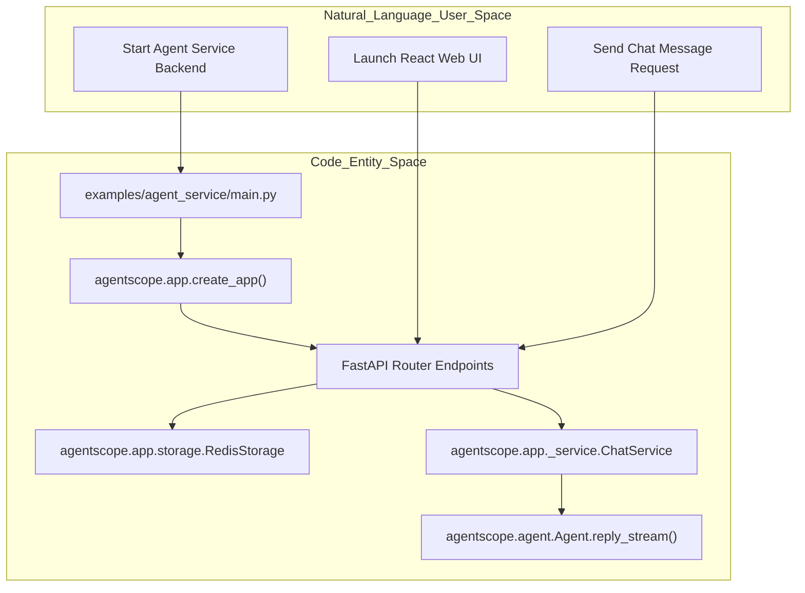

<!-- source: DeepWiki mcp.deepwiki.com · repo modelscope/agentscope · page 1.1 Installation and Setup · fetched 2026-10-27 -->

# Installation and Setup

<details>
<summary>Relevant source files</summary>

The following files were used as context for generating this wiki page:

- [.gemini/styleguide.md](.gemini/styleguide.md)
- [.github/copilot-instructions.md](.github/copilot-instructions.md)
- [README.md](README.md)
- [README_zh.md](README_zh.md)
- [assets/images/agentscope.png](assets/images/agentscope.png)
- [docs/NEWS.md](docs/NEWS.md)
- [docs/NEWS_zh.md](docs/NEWS_zh.md)
- [examples/agent_service/README.md](examples/agent_service/README.md)
- [examples/rag/README.md](examples/rag/README.md)
- [pyproject.toml](pyproject.toml)
- [src/agentscope/_version.py](src/agentscope/_version.py)
- [src/agentscope/middleware/__init__.py](src/agentscope/middleware/__init__.py)
- [src/agentscope/middleware/_longterm_memory/__init__.py](src/agentscope/middleware/_longterm_memory/__init__.py)
- [src/agentscope/middleware/_longterm_memory/_reme/__init__.py](src/agentscope/middleware/_longterm_memory/_reme/__init__.py)
- [src/agentscope/rag/__init__.py](src/agentscope/rag/__init__.py)
- [src/agentscope/rag/_vdb/__init__.py](src/agentscope/rag/_vdb/__init__.py)
- [src/agentscope/realtime/__init__.py](src/agentscope/realtime/__init__.py)
- [src/agentscope/realtime/_base.py](src/agentscope/realtime/_base.py)

</details>


This page guides users through setting up AgentScope 2.0, detailing Python requirements, installation options via `pip` or `uv`, optional dependency groups defined in `pyproject.toml`, Redis configuration for persistent storage and message bus routing, and launching the FastAPI-based agent service example.

Sources: [pyproject.toml:1-216]()

---

## Prerequisites

AgentScope 2.0 requires specific runtime environments, package managers, and external services depending on the features utilized.

- **Python Version**: Python `>=3.11` is strictly required for advanced typing, modern syntax features, and async primitives [pyproject.toml:20]().
- **Package Managers**: `pip` or `uv` (recommended for high-performance dependency resolution).
- **Redis**: Required for stateful storage via `RedisStorage` and message passing via `RedisMessageBus` [pyproject.toml:74](), [examples/agent_service/README.md:28-41]().
- **ripgrep (`rg`)**: Required if executing the built-in `Grep` tool inside a `LocalWorkspace` [pyproject.toml:111-112]().
- **Sandboxing Backends**: `Docker`, `Kubernetes`, or specialized sandbox libraries if using containerized or isolated workspace backend options [pyproject.toml:92-102]().

Sources: [pyproject.toml:20](), [pyproject.toml:74](), [pyproject.toml:92-102](), [pyproject.toml:111-112](), [examples/agent_service/README.md:28-41]()

---

## Installation Methods

### Via Package Managers

To install the core framework (including foundational LLM clients and message protocols), run:

```bash
# Using uv (recommended)
uv pip install agentscope

# Using pip
pip install agentscope
```

Sources: [pyproject.toml:1-216]()

### From Source (Editable Mode)

For framework contributors or users tracking the repository source code:

```bash
# Pull the source code from GitHub
git clone https://github.com/agentscope-ai/agentscope.git
cd agentscope

# Install the package in editable mode
uv pip install -e .
```

For development and running test suites (`pytest`, `aiosqlite`, `moto`), install the `dev` extra group [pyproject.toml:197-216]():

```bash
uv pip install -e ".[dev]"
```

Sources: [pyproject.toml:197-216](), [README.md:112-120]()

---

## Optional Dependency Groups

AgentScope organizes specialized capabilities into modular optional dependency groups inside `pyproject.toml` [pyproject.toml:54-195](). This prevents bloating core installations with heavy domain-specific libraries.

### Natural Language Space to Code Entity Space: Optional Dependencies

The following diagram bridges natural language installation extras to their corresponding Python package requirements and code modules.

```mermaid
graph TD
    subgraph "Natural_Language_Space"
        E_MODELS["Model Extensions"]
        E_SERVICE["Service & API Layer"]
        E_STORAGE["Storage & Redis Bus"]
        E_WORKSPACE["Sandboxed Workspaces"]
        E_RAG["RAG & Document Parsers"]
        E_VDB["Vector Databases"]
        E_MEMORY["Long-term Memory"]
        E_REALTIME["Realtime Voice"]
        E_TUI["Terminal UI"]
        E_A2A["A2A Protocol"]
    end

    subgraph "Code_Entity_Space"
        PY_MOD["pyproject.toml [pyproject.toml:54-195]"]
        M_PKG["google-genai, ollama, xai-sdk, typesafe-sdk [pyproject.toml:55-59]"]
        S_PKG["fastapi, uvicorn, apscheduler, ag-ui-protocol [pyproject.toml:67-73]"]
        ST_PKG["redis, sqlalchemy, alembic, aioboto3 [pyproject.toml:75-84]"]
        WS_PKG["aiodocker, e2b, daytona, kubernetes-asyncio, opensandbox [pyproject.toml:92-102]"]
        RAG_PKG["pypdf, python-pptx, python-docx, openpyxl, xlrd, pandas [pyproject.toml:137-144]"]
        VDB_PKG["qdrant-client, pymilvus, milvus-lite, pymongo, elasticsearch [pyproject.toml:128-134]"]
        MEM_PKG["mem0ai, reme-ai [pyproject.toml:153-155]"]
        RT_PKG["websockets, sounddevice [pyproject.toml:115-118]"]
        TUI_PKG["textual [pyproject.toml:120-122]"]
        A2A_PKG["a2a-sdk [pyproject.toml:124-126]"]
    end

    E_MODELS --> PY_MOD
    E_SERVICE --> PY_MOD
    E_STORAGE --> PY_MOD
    E_WORKSPACE --> PY_MOD
    E_RAG --> PY_MOD
    E_VDB --> PY_MOD
    E_MEMORY --> PY_MOD
    E_REALTIME --> PY_MOD
    E_TUI --> PY_MOD
    E_A2A --> PY_MOD

    PY_MOD --> M_PKG
    PY_MOD --> S_PKG
    PY_MOD --> ST_PKG
    PY_MOD --> WS_PKG
    PY_MOD --> RAG_PKG
    PY_MOD --> VDB_PKG
    PY_MOD --> MEM_PKG
    PY_MOD --> RT_PKG
    PY_MOD --> TUI_PKG
    PY_MOD --> A2A_PKG
```



Sources: [pyproject.toml:54-195](), [pyproject.toml:55-59](), [pyproject.toml:67-73](), [pyproject.toml:75-84](), [pyproject.toml:92-102](), [pyproject.toml:115-118](), [pyproject.toml:120-122](), [pyproject.toml:124-126](), [pyproject.toml:128-134](), [pyproject.toml:137-144](), [pyproject.toml:153-155]()

### Group Reference Table

| Extra Group | Install Command | Target Capabilities |
| :--- | :--- | :--- |
| `model-gemini` | `pip install "agentscope[model-gemini]"` | Gemini (`google-genai`) integration [pyproject.toml:56]() |
| `model-ollama` | `pip install "agentscope[model-ollama]"` | Ollama (`ollama`) integration [pyproject.toml:57]() |
| `model-xai` | `pip install "agentscope[model-xai]"` | xAI (`xai-sdk`) integration [pyproject.toml:58]() |
| `classifier-jev` | `pip install "agentscope[classifier-jev]"` | Jev classifier (`typesafe-sdk`) integration [pyproject.toml:59]() |
| `models` | `pip install "agentscope[models]"` | All model integrations (Gemini, Ollama, xAI) [pyproject.toml:60-64]() |
| `classifiers` | `pip install "agentscope[classifiers]"` | All classifier integrations (Jev) [pyproject.toml:65]() |
| `service` | `pip install "agentscope[service]"` | FastAPI app hosting, Uvicorn, APScheduler, and `ag-ui-protocol` [pyproject.toml:67-73]() |
| `storage-redis` | `pip install "agentscope[storage-redis]"` | Redis client for `RedisStorage` and `RedisMessageBus` [pyproject.toml:75]() |
| `storage-sql` | `pip install "agentscope[storage-sql]"` | SQLAlchemy 2.0 async and Alembic database migrations [pyproject.toml:79-82]() |
| `storage-s3` | `pip install "agentscope[storage-s3]"` | S3-compatible blob store (`aioboto3`) [pyproject.toml:84]() |
| `channel` | `pip install "agentscope[channel]"` | Lark, Discord, and DingTalk channel integrations [pyproject.toml:86-90]() |
| `workspace-docker` | `pip install "agentscope[workspace-docker]"` | Docker workspace backend (`aiodocker`) [pyproject.toml:92]() |
| `workspace-e2b` | `pip install "agentscope[workspace-e2b]"` | E2B workspace backend (`e2b`) [pyproject.toml:93]() |
| `workspace-daytona` | `pip install "agentscope[workspace-daytona]"` | Daytona workspace backend (`daytona`) [pyproject.toml:94]() |
| `workspace-k8s` | `pip install "agentscope[workspace-k8s]"` | Kubernetes workspace backend (`kubernetes-asyncio`) [pyproject.toml:95]() |
| `workspace-opensandbox` | `pip install "agentscope[workspace-opensandbox]"` | OpenSandbox workspace backend (`opensandbox`) [pyproject.toml:96]() |
| `workspace` | `pip install "agentscope[workspace]"` | All workspace backends [pyproject.toml:97-103]() |
| `tools` | `pip install "agentscope[tools]"` | `ripgrep` binary for the built-in `Grep` tool [pyproject.toml:111-113]() |
| `realtime` | `pip install "agentscope[realtime]"` | `websockets` and `sounddevice` for realtime voice features [pyproject.toml:115-118]() |
| `tui` | `pip install "agentscope[tui]"` | `textual` for terminal UI [pyproject.toml:120-122]() |
| `a2a` | `pip install "agentscope[a2a]"` | `a2a-sdk` for A2A protocol support [pyproject.toml:124-126]() |
| `vdb-qdrant` | `pip install "agentscope[vdb-qdrant]"` | Qdrant vector store backend (`qdrant-client`) [pyproject.toml:128]() |
| `vdb-milvus` | `pip install "agentscope[vdb-milvus]"` | Milvus Lite and PyMilvus vector store backend [pyproject.toml:129-132]() |
| `vdb-mongodb`| `pip install "agentscope[vdb-mongodb]"`| MongoDB vector search backend (`pymongo`) [pyproject.toml:133]() |
| `vdb-elasticsearch` | `pip install "agentscope[vdb-elasticsearch]"` | Elasticsearch dense-vector store backend (`elasticsearch`) [pyproject.toml:134]() |
| `rag` | `pip install "agentscope[rag]"` | Document parsers (`pypdf`, `python-pptx`, `python-docx`, `openpyxl`, `xlrd`, `pandas`) [pyproject.toml:137-144]() |
| `memory-mem0` | `pip install "agentscope[memory-mem0]"` | Mem0 long-term memory middleware (`mem0ai`) [pyproject.toml:153]() |
| `memory-reme` | `pip install "agentscope[memory-reme]"` | ReMe long-term memory middleware (`reme-ai`) [pyproject.toml:155]() |
| `memory` | `pip install "agentscope[memory]"` | All long-term memory middlewares (Mem0, ReMe) [pyproject.toml:156-159]() |
| `full` | `pip install "agentscope[full]"` | Complete installation including all optional extras [pyproject.toml:176-195]() |

Sources: [pyproject.toml:54-195]()

---

## Redis Setup

The multi-tenant Agent Service relies on Redis for maintaining distributed session states via `RedisStorage` and coordinating agent messaging via `RedisMessageBus` [pyproject.toml:75](), [examples/agent_service/README.md:28-41]().

### Platform Deployment Commands

| Operating System / Tool | Command |
| :--- | :--- |
| **macOS (Homebrew)** | `brew install redis && brew services start redis` [examples/agent_service/README.md:31-33]() |
| **Linux (APT / Systemd)** | `sudo apt install redis-server && sudo systemctl start redis-server` [examples/agent_service/README.md:35-37]() |
| **Docker Container** | `docker run --rm -p 6379:6379 redis:7` [examples/agent_service/README.md:39-41]() |

Sources: [pyproject.toml:75](), [examples/agent_service/README.md:28-41]()

---

## Running the Example Agent Service

The `examples/agent_service` directory provides a FastAPI application demonstrating multi-tenant session management, scheduling, and workspace execution [examples/agent_service/README.md:1-11]().

### Natural Language Space to Code Entity Space: Agent Service Execution

The diagram below connects user-facing actions in natural language to backend routing functions, application factories, and execution services.



Sources: [examples/agent_service/README.md:1-63]()

### Execution Steps

1. **Start the Backend Service**:
   Navigate to the service directory and run the main entry point:
   ```bash
   cd examples/agent_service
   python main.py
   ```
   [examples/agent_service/README.md:43-49]()

2. **Launch the Companion Web UI**:
   In a separate terminal, install dependencies and start the React development server:
   ```bash
   cd examples/web_ui/
   pnpm install
   pnpm dev
   ```
   [examples/agent_service/README.md:51-61]()

3. Configure the Web UI endpoint to point to `http://localhost:8000` to interact with the multi-tenant agent system [examples/agent_service/README.md:63-63]().

Sources: [examples/agent_service/README.md:1-63]()

---

