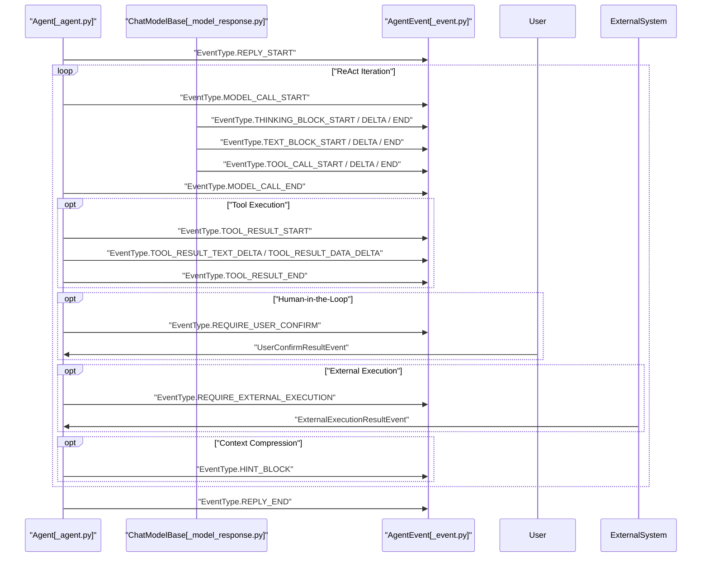
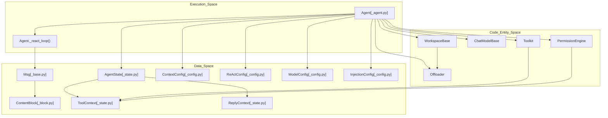
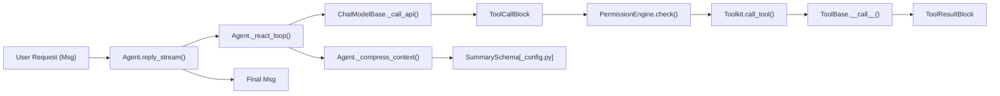

<!-- source: DeepWiki mcp.deepwiki.com · repo modelscope/agentscope · page 1.2 Core Concepts and Architecture · fetched 2026-10-27 -->

# Core Concepts and Architecture

Relevant source files

The following files were used as context for generating this wiki page:

- [.pre-commit-config.yaml](.pre-commit-config.yaml)
- [src/agentscope/__init__.py](src/agentscope/__init__.py)
- [src/agentscope/agent/_agent.py](src/agentscope/agent/_agent.py)
- [src/agentscope/agent/_config.py](src/agentscope/agent/_config.py)
- [src/agentscope/event/_event.py](src/agentscope/event/_event.py)
- [src/agentscope/message/_base.py](src/agentscope/message/_base.py)
- [src/agentscope/middleware/_base.py](src/agentscope/middleware/_base.py)
- [tests/agent_basic_test.py](tests/agent_basic_test.py)
- [tests/agent_injection_test.py](tests/agent_injection_test.py)
- [tests/agent_interrupt_test.py](tests/agent_interrupt_test.py)
- [tests/compress_context_test.py](tests/compress_context_test.py)
- [tests/event_test.py](tests/event_test.py)
- [tests/event_to_message_test.py](tests/event_to_message_test.py)
- [tests/hitl_external_execution_test.py](tests/hitl_external_execution_test.py)
- [tests/hitl_user_confirmation_test.py](tests/hitl_user_confirmation_test.py)
- [tests/message_test.py](tests/message_test.py)
- [tests/middleware_test.py](tests/middleware_test.py)

## Purpose and Scope
This page explains the fundamental building blocks of AgentScope 2.0 and how they work together to create production-ready agent applications. You will learn about the core architectural abstractions—the unified `Agent` class `[src/agentscope/agent/_agent.py:117]`, block-based messaging (`Msg` and `ContentBlock`) `[src/agentscope/message/_base.py:71]`, `Toolkit`, `WorkspaceBase`, `MiddlewareBase`, `PermissionEngine`, the `EventType` stream `[src/agentscope/event/_event.py:25]`, `MessageBus`, and how they compose. We also detail the ReAct reasoning-acting loop and the streaming event model.

Sources: `[src/agentscope/agent/_agent.py:117-203]`, `[src/agentscope/message/_base.py:71-117]`, `[src/agentscope/event/_event.py:25-68]`

---

## 1. Core Abstractions and Composition

AgentScope 2.0 is built around several primary classes that coordinate to handle complex multi-tenant reasoning, tool execution, and state management.

### The Unified Agent Class
The central orchestrator of AgentScope is the `Agent` class `[src/agentscope/agent/_agent.py:117]`. An agent combines a chat model, a toolkit, permissions, runtime configs, and state management.

**Key Components of an Agent**:
- **`model`**: A `ChatModelBase` instance used for generating reasoning and responses `[src/agentscope/agent/_agent.py:143]`.
- **`toolkit`**: A `Toolkit` instance containing registered tools, Model Context Protocol (MCP) servers, and skills `[src/agentscope/agent/_agent.py:201]`.
- **`state`**: An `AgentState` instance tracking conversation history, context, and permissions `[src/agentscope/agent/_agent.py:175]`.
- **`_engine`**: A `PermissionEngine` initialized with the agent's permission context to govern tool execution safety `[src/agentscope/agent/_agent.py:193]`.
- **`middlewares`**: A list of middleware objects intercepting execution at key lifecycle hooks `[src/agentscope/agent/_agent.py:148]`.
- **`offloader`**: An optional offloader to move compressed context or large tool results to external storage backends `[src/agentscope/agent/_agent.py:196]`.
- **`model_config`**: Configuration for the chat model, including fallback models and retries `[src/agentscope/agent/_agent.py:176]`.
- **`context_config`**: Configuration for context management, including compression triggers and reserved ratios `[src/agentscope/agent/_agent.py:177]`.
- **`react_config`**: Configuration for the ReAct loop, such as maximum iterations `[src/agentscope/agent/_agent.py:178]`.
- **`injection_config`**: Configuration for injecting runtime state (e.g., time, tasks) into the agent's context `[src/agentscope/agent/_agent.py:179]`.

Sources: `[src/agentscope/agent/_agent.py:117-203]`, `[src/agentscope/agent/_config.py:51-165]`, `[src/agentscope/state/_state.py:32-203]`

---

## 2. Message Protocol and Content Blocks

Communication in AgentScope uses the `Msg` class `[src/agentscope/message/_base.py:71]`. Rather than raw strings, messages contain structured lists of `ContentBlock` items `[src/agentscope/message/_base.py:80]`.

### Content Block Types
- **`TextBlock`**: Holds textual content or output fragments `[src/agentscope/message/_block.py:13]`.
- **`ThinkingBlock`**: Contains the model's internal reasoning chain or extended thinking output `[src/agentscope/message/_block.py:24]`.
- **`ToolCallBlock`**: Represents a model request to invoke a specific tool with JSON arguments and a lifecycle state (`ToolCallState`) `[src/agentscope/message/_block.py:50]`.
- **`ToolResultBlock`**: Stores the output of a tool execution, supporting both text chunks and multimodal data `[src/agentscope/message/_block.py:69]`.
- **`DataBlock`**: Handles binary media (images, audio, video) via `Base64Source` or `URLSource` `[src/agentscope/message/_block.py:35]`.
- **`HintBlock`**: Injected context or system hints, used for runtime notifications or background memory retrieval `[src/agentscope/message/_block.py:88]`.

The `Msg` class also includes fields for `id`, `created_at`, `metadata`, `usage`, `finished_at`, `finished_reason`, `structured_output`, and `error` to track the message's lifecycle and outcome `[src/agentscope/message/_base.py:84-117]`.

Sources: `[src/agentscope/message/_base.py:71-117]`, `[src/agentscope/message/_block.py:13-96]`

---

## 3. ReAct Reasoning-Acting Loop and Event Stream

AgentScope agents execute tasks through an automated Reasoning-Acting (ReAct) loop driven by streaming generator methods `[src/agentscope/agent/_agent.py:290]`. Execution emits a fine-grained stream of `AgentEvent` objects defined by the `EventType` enum `[src/agentscope/event/_event.py:25]`.

### Event Stream Lifecycle
Title: "Agent Event Stream Lifecycle"

Sources: `[src/agentscope/agent/_agent.py:36-66]`, `[src/agentscope/event/_event.py:25-68]`, `[tests/middleware_test.py:183-197]`, `[tests/hitl_user_confirmation_test.py:158-172]`, `[tests/compress_context_test.py:26-27]`

---

## 4. Middleware System and Hook Points

Middlewares (`MiddlewareBase`) allow developers to intercept and modify agent behavior without altering core source code. 

### Hook Points and the Onion Pattern
Middlewares wrap execution using an onion pattern across several asynchronous hook points:
- **`on_reply`**: Wraps the entire reply generation generator `[src/agentscope/middleware/_base.py:68]`.
- **`on_reasoning`**: Intercepts model reasoning cycles `[src/agentscope/middleware/_base.py:101]`.
- **`on_acting`**: Intercepts individual tool call execution `[src/agentscope/middleware/_base.py:124]`.
- **`on_model_call`**: Intercepts raw API requests to `ChatModelBase` `[src/agentscope/middleware/_base.py:24]`.
- **`on_system_prompt`**: Dynamically modifies or extends system prompts `[src/agentscope/middleware/_base.py:28]`.
- **`on_check_permission`**: Intercepts permission evaluations `[src/agentscope/middleware/_base.py:170]`.
- **`on_compress_context`**: Manages context compression workflows `[src/agentscope/middleware/_base.py:25]`.

Sources: `[src/agentscope/middleware/_base.py:13-179]`, `[tests/middleware_test.py:43-123]`

---

## 5. Supporting Architectural Subsystems

### Toolkit and Tool Orchestration
The `Toolkit` class manages tool registration, schema generation (`get_tool_schemas()`), and unified async/sync execution (`call_tool()`). Tools can be standard Python functions wrapped via `FunctionTool`, external tools, or MCP tools. The toolkit also manages tool groups for organizing tools and loaders for loading skills.

### Workspace and Sandboxing
The workspace system provides sandboxed execution environments via workspace base subclasses. It isolates filesystem changes, manages skills, and injects workspace instructions into the agent runtime. The offloader interface is used to offload large data, such as compressed context or tool results, to external storage.

### PermissionEngine
The `PermissionEngine` evaluates tool calls against user-defined or default permission rules (`PermissionRule`), returning a `PermissionDecision` (`ALLOW`, `DENY`, or `ASK`) which triggers human-in-the-loop confirmation workflows when required `[src/agentscope/agent/_agent.py:193]`, `[tests/agent_basic_test.py:46-56]`.

### MessageBus
In multi-agent and service deployments, communication across sessions and agents is mediated by the `MessageBus` abstraction (with concrete implementations for distributed Redis and in-memory brokers), handling real-time event broadcasting and message routing.

Sources: `[src/agentscope/agent/_agent.py:106-193]`, `[tests/agent_basic_test.py:46-56]`

---

## 6. Component Interaction Architecture

The following diagrams bridge natural language concepts to their precise code entities in the codebase:

Title: "AgentScope 2.0 Core Entity Mapping"

Sources: `[src/agentscope/agent/_agent.py:117-203]`, `[src/agentscope/message/_base.py:71-117]`, `[src/agentscope/message/_block.py:13-96]`, `[src/agentscope/state/_state.py:32-203]`, `[src/agentscope/agent/_config.py:51-165]`

Title: "Agent Runtime Flow to Code Mapping"

Sources: `[src/agentscope/agent/_agent.py:290-354]`, `[src/agentscope/agent/_config.py:9-49]`

### Core Concepts to Code Entity Mapping

| Concept | Primary Class / Interface | File Path |
|---------|-------------------------|-----------|
| Central Orchestrator | `Agent` | `[src/agentscope/agent/_agent.py:117]` |
| Tool Management | `Toolkit` | `[src/agentscope/tool/_toolkit.py:66]` |
| Safety & Permission | `PermissionEngine` | `[src/agentscope/permission/_permission.py:13]` |
| Structured Message | `Msg` | `[src/agentscope/message/_base.py:71]` |
| Sandbox Workspace | `WorkspaceBase` | `[src/agentscope/workspace/_base.py:13]` |
| Event Stream | `EventType` / `AgentEvent` | `[src/agentscope/event/_event.py:25]` |
| Agent State | `AgentState` | `[src/agentscope/state/_state.py:220]` |
| Tool Context | `ToolContext` | `[src/agentscope/state/_state.py:32]` |
| Reply Context | `ReplyContext` | `[src/agentscope/state/_state.py:182]` |
| Context Configuration | `ContextConfig` | `[src/agentscope/agent/_config.py:51]` |

Sources: `[src/agentscope/agent/_agent.py:73-203]`, `[src/agentscope/event/_event.py:25-68]`, `[src/agentscope/message/_base.py:71]`, `[src/agentscope/state/_state.py:32-229]`, `[src/agentscope/agent/_config.py:51-165]`

---

