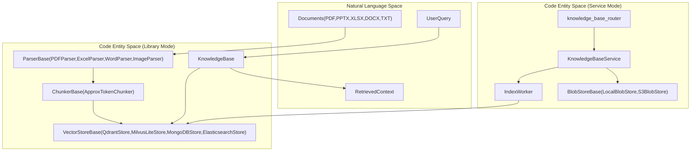
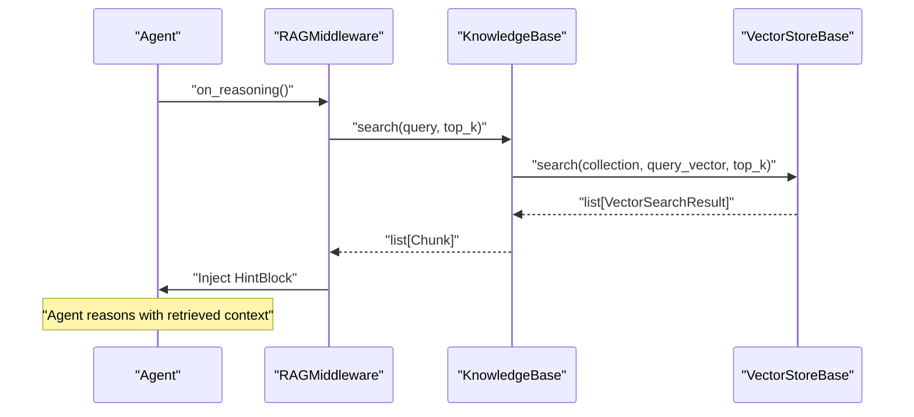

<!-- source: DeepWiki mcp.deepwiki.com · repo modelscope/agentscope · page 10 RAG System · fetched 2026-10-27 -->

# RAG System

<details>
<summary>Relevant source files</summary>

The following files were used as context for generating this wiki page:

- [examples/rag/README.md](examples/rag/README.md)
- [pyproject.toml](pyproject.toml)
- [src/agentscope/rag/__init__.py](src/agentscope/rag/__init__.py)
- [src/agentscope/rag/_knowledge.py](src/agentscope/rag/_knowledge.py)
- [src/agentscope/rag/_vdb/__init__.py](src/agentscope/rag/_vdb/__init__.py)
- [src/agentscope/rag/_vdb/_elasticsearch.py](src/agentscope/rag/_vdb/_elasticsearch.py)
- [src/agentscope/rag/_vdb/_milvus_lite.py](src/agentscope/rag/_vdb/_milvus_lite.py)
- [src/agentscope/rag/_vdb/_mongodb.py](src/agentscope/rag/_vdb/_mongodb.py)
- [src/agentscope/rag/_vdb/_qdrant.py](src/agentscope/rag/_vdb/_qdrant.py)
- [src/agentscope/rag/_vdb/_vector_store.py](src/agentscope/rag/_vdb/_vector_store.py)
- [tests/rag_knowledge_metadata_test.py](tests/rag_knowledge_metadata_test.py)
- [tests/rag_vdb_elasticsearch_test.py](tests/rag_vdb_elasticsearch_test.py)
- [tests/rag_vdb_milvus_lite_test.py](tests/rag_vdb_milvus_lite_test.py)
- [tests/rag_vdb_mongodb_test.py](tests/rag_vdb_mongodb_test.py)
- [tests/rag_vdb_qdrant_test.py](tests/rag_vdb_qdrant_test.py)

</details>


The Retrieval-Augmented Generation (RAG) system in AgentScope provides a modular framework for enhancing agent intelligence with external corpora. It supports two primary operational modes: **Library Mode**, where developers compose the core pipeline directly in local scripts [examples/rag/README.md:3-3](), and **Service Mode**, where knowledge management is handled through a distributed service layer with asynchronous background indexing and RESTful APIs.

For deep technical details, refer to the child pages:
- RAG Core Pipeline: See [RAG Core Pipeline](#10.1)
- Vector Store Backends: See [Vector Store Backends](#10.2)
- RAG Service Layer: See [RAG Service Layer](#10.3)
- RAGMiddleware: See [RAGMiddleware](#10.4)

---

## 1. System Architecture and Core Components

The RAG architecture bridges unstructured document data with agent reasoning through specialized components that map raw text and files into dense vector embeddings.

### Figure 1: RAG Natural Language to Code Entity Mapping

Sources: [src/agentscope/rag/__init__.py:4-28](), [src/agentscope/rag/_vdb/__init__.py:4-13](), [examples/rag/README.md:1-10]()

The core building blocks defined in `agentscope.rag` manage data containers and processing units:

| Component | Code Entity | Responsibility |
| :--- | :--- | :--- |
| **Facade** | `KnowledgeBase` | High-level interface for indexing and searching [src/agentscope/rag/__init__.py:28-28](). |
| **Parser** | `ParserBase` | Extracts content from heterogeneous file formats [src/agentscope/rag/__init__.py:9-17](). |
| **Chunker** | `ChunkerBase` | Splits text into segments (e.g., `ApproxTokenChunker`) [src/agentscope/rag/__init__.py:4-4](). |
| **Storage** | `VectorStoreBase` | Manages vector embeddings and metadata [src/agentscope/rag/_vdb/__init__.py:4-13](). |
| **Data Models** | `Section`, `Chunk`, `VectorRecord`, `VectorSearchResult`, `DocumentSummary` | Structured containers for document segments, chunks, and vector records [src/agentscope/rag/__init__.py:5-24](). |

Sources: [src/agentscope/rag/__init__.py:4-51](), [src/agentscope/rag/_vdb/__init__.py:4-24]()

For implementation specifics of the library-mode pipeline, see [RAG Core Pipeline](#10.1). For vector store backends (`QdrantStore` [src/agentscope/rag/_vdb/__init__.py:24](), `MilvusLiteStore` [src/agentscope/rag/_vdb/__init__.py:21-21](), `MongoDBStore` [src/agentscope/rag/_vdb/__init__.py:24](), `ElasticsearchStore` [src/agentscope/rag/_vdb/__init__.py:20-20]()), see [Vector Store Backends](#10.2).

---

## 2. Vector Store Backends Overview

AgentScope abstracts vector operations behind `VectorStoreBase`, allowing seamless integration with various vector databases depending on infrastructure requirements.

- **Qdrant**: Supports in-memory (`:memory:`) and persistent client storage via `QdrantStore` [src/agentscope/rag/_vdb/__init__.py:24]().
- **Milvus Lite**: Local file-backed vector database via `MilvusLiteStore` [src/agentscope/rag/_vdb/__init__.py:21-21]().
- **MongoDB**: Leverages MongoDB Vector Search (`$vectorSearch`) via `MongoDBStore` [src/agentscope/rag/_vdb/__init__.py:24]().
- **Elasticsearch**: Dense vector indexes with approximate kNN search via `ElasticsearchStore` [src/agentscope/rag/_vdb/__init__.py:20-20](), [src/agentscope/rag/_vdb/_elasticsearch.py:20-31]().

For detailed configuration parameters, connection strings, and backend-specific requirements, see [Vector Store Backends](#10.2).

Sources: [src/agentscope/rag/_vdb/__init__.py:4-24](), [src/agentscope/rag/_vdb/_elasticsearch.py:20-31]()

---

## 3. Service-Oriented RAG Layer

For multi-tenant and production environments, AgentScope exposes a service-layer implementation that offloads heavy indexing tasks and manages document persistence via the `knowledge_base_router`.

*   **KnowledgeBaseService**: Orchestrates the document CRUD lifecycle and search operations over HTTP.
*   **Asynchronous Indexing**: Utilizes `IndexWorker` and `IndexSweeper` to parse and embed files in the background without blocking execution threads.
*   **Blob Storage**: `BlobStoreBase` implementations (`LocalBlobStore` or `S3BlobStore`) handle raw byte storage of uploaded assets.
*   **Management**: `KnowledgeBaseManagerBase` (such as `CollectionPerKbManager`) handles collection mappings and dimensionality policies.

For architectural details, endpoint specifications, and Web UI integration, see [RAG Service Layer](#10.3).

Sources: [pyproject.toml:67-74](), [pyproject.toml:79-84]()

---

## 4. Agent Integration via RAGMiddleware

Integration with the agent reasoning loop is implemented through `RAGMiddleware`. Knowledge bases can be exposed to agents in two operational modes:

1.  **Static Mode**: Automatically retrieves context based on the user prompt and injects it as a `HintBlock` prior to agent reasoning [examples/rag/README.md:8-8]().
2.  **Agentic Mode**: Exposes a `search_knowledge` tool, allowing the agent to dynamically decide when and what to retrieve [examples/rag/README.md:8-8]().

### Figure 2: Agent-RAG Interaction Flow

Sources: [src/agentscope/rag/__init__.py:28-28](), [examples/rag/README.md:7-8]()

For configuration parameters, `SearchConfig` specifications, and event emissions, see [RAGMiddleware](#10.4).

Sources: [src/agentscope/rag/__init__.py:28-28](), [examples/rag/README.md:7-8]()

---

## 5. Dependencies and Installation

Using the RAG framework requires installing the appropriate optional dependency extras declared in `pyproject.toml`.

| Extra | Purpose | Dependencies |
| :--- | :--- | :--- |
| `rag` | Document parsers | `pypdf`, `python-pptx`, `python-docx`, `openpyxl`, `pandas` [pyproject.toml:137-144]() |
| `vdb-qdrant` | Qdrant vector store | `qdrant-client` [pyproject.toml:128-128]() |
| `vdb-milvus` | Milvus Lite storage | `pymilvus`, `milvus-lite` [pyproject.toml:129-132]() |
| `vdb-mongodb` | MongoDB Vector Search | `pymongo>=4.7` [pyproject.toml:133-133]() |
| `vdb-elasticsearch` | Elasticsearch backend | `elasticsearch[async]` [pyproject.toml:134-134]() |
| `storage-s3` | S3-compatible blob storage | `aioboto3` [pyproject.toml:84-84]() |

```bash
# Example installation for full RAG and local vector store support
pip install "agentscope[rag,vdb-milvus]"
```

Sources: [pyproject.toml:84-84](), [pyproject.toml:128-144](), [examples/rag/README.md:12-32]()

---

