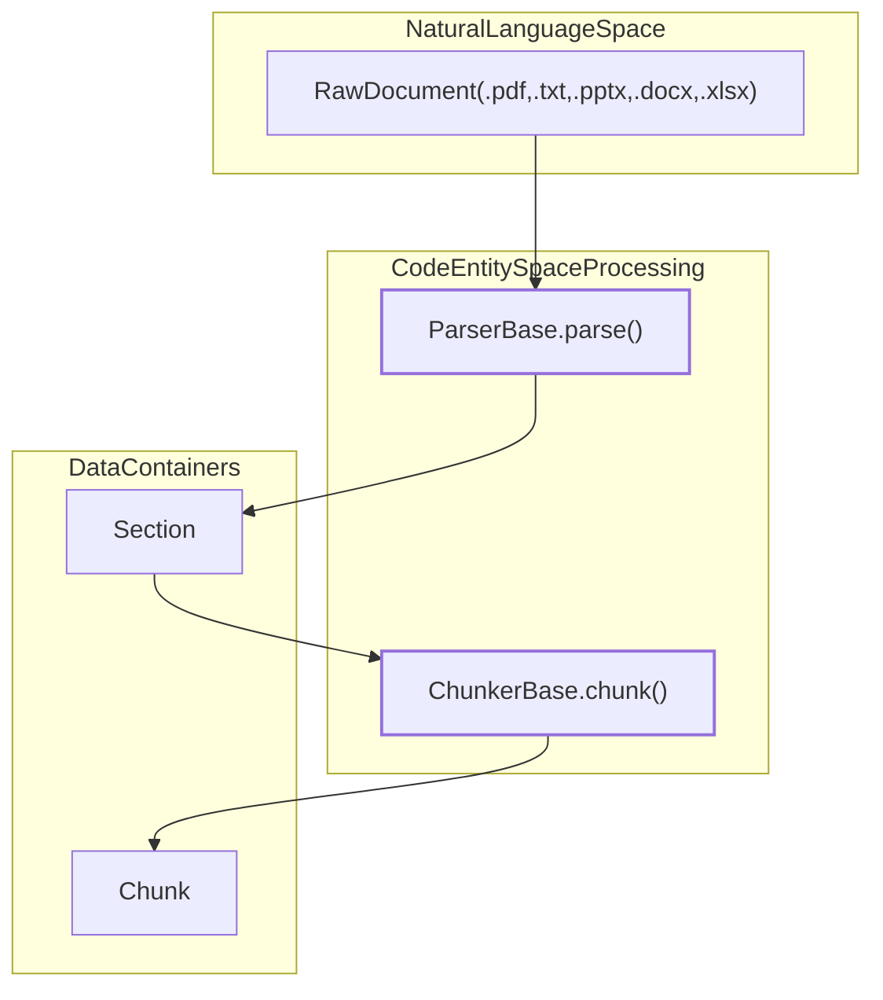
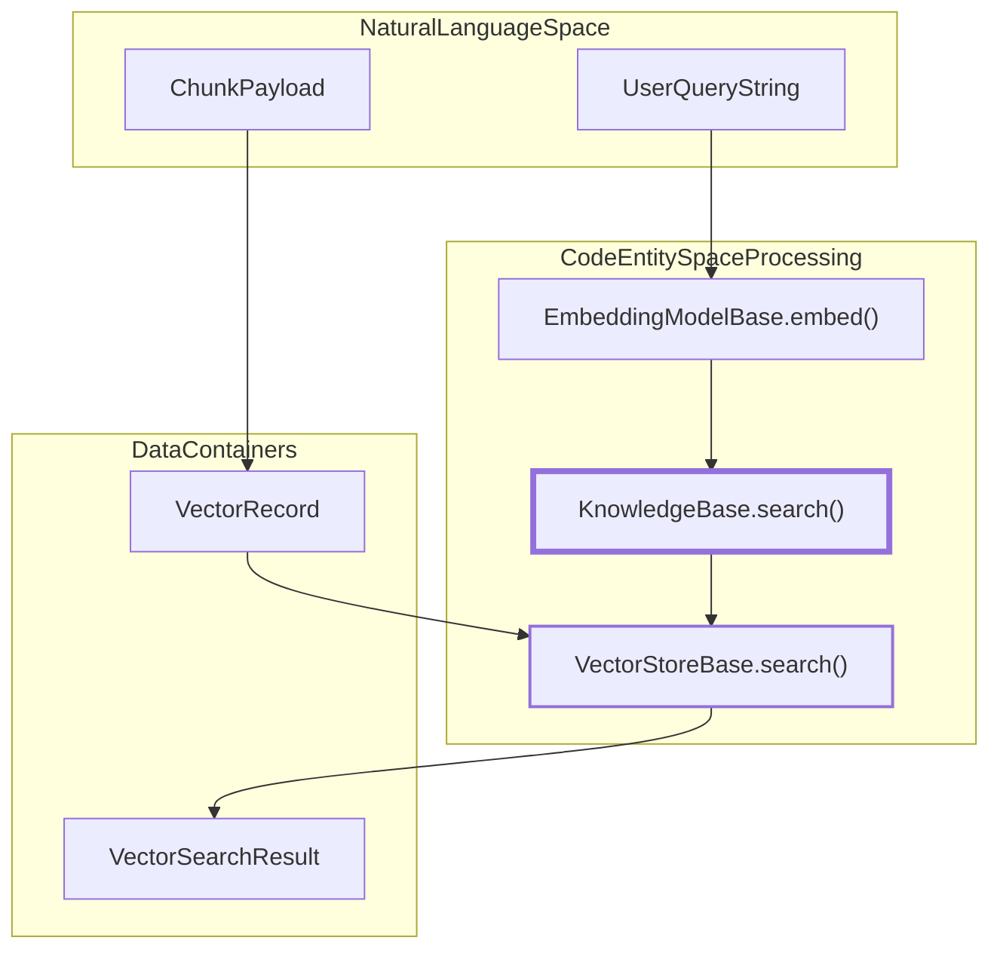
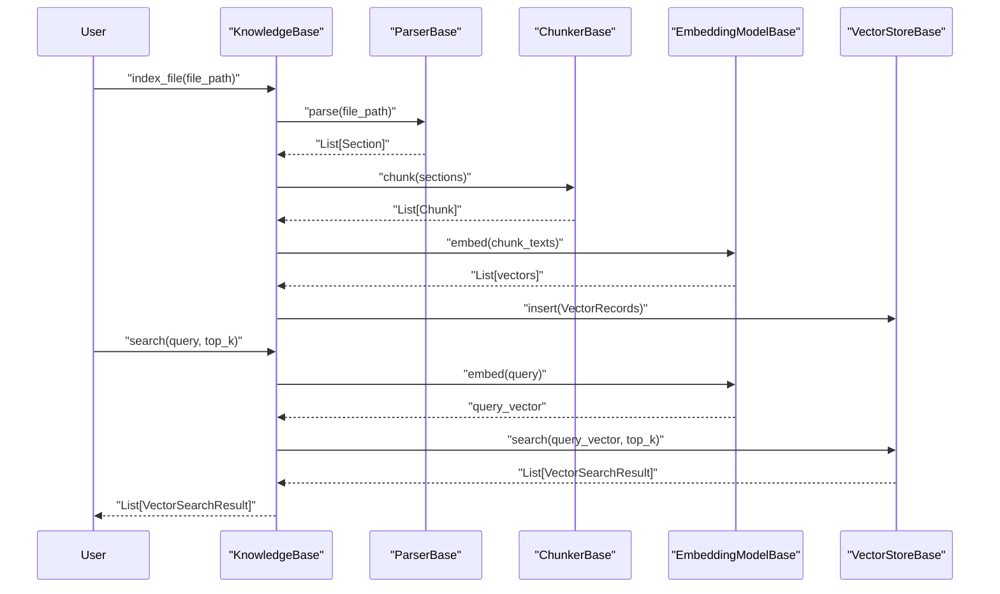

<!-- source: DeepWiki mcp.deepwiki.com · repo modelscope/agentscope · page 10.1 RAG Core Pipeline · fetched 2026-10-27 -->

# RAG Core Pipeline

Relevant source files

The following files were used as context for generating this wiki page:

- [src/agentscope/rag/_chunker/_approx_token_chunker.py](src/agentscope/rag/_chunker/_approx_token_chunker.py)
- [src/agentscope/rag/_chunker/_base.py](src/agentscope/rag/_chunker/_base.py)
- [src/agentscope/rag/_knowledge.py](src/agentscope/rag/_knowledge.py)
- [src/agentscope/rag/_parser/__init__.py](src/agentscope/rag/_parser/__init__.py)
- [src/agentscope/rag/_parser/_excel.py](src/agentscope/rag/_parser/_excel.py)
- [src/agentscope/rag/_parser/_pdf.py](src/agentscope/rag/_parser/_pdf.py)
- [src/agentscope/rag/_parser/_ppt.py](src/agentscope/rag/_parser/_ppt.py)
- [src/agentscope/rag/_parser/_utils.py](src/agentscope/rag/_parser/_utils.py)
- [src/agentscope/rag/_parser/_word.py](src/agentscope/rag/_parser/_word.py)
- [src/agentscope/rag/_vdb/_elasticsearch.py](src/agentscope/rag/_vdb/_elasticsearch.py)
- [src/agentscope/rag/_vdb/_milvus_lite.py](src/agentscope/rag/_vdb/_milvus_lite.py)
- [src/agentscope/rag/_vdb/_mongodb.py](src/agentscope/rag/_vdb/_mongodb.py)
- [src/agentscope/rag/_vdb/_qdrant.py](src/agentscope/rag/_vdb/_qdrant.py)
- [src/agentscope/rag/_vdb/_vector_store.py](src/agentscope/rag/_vdb/_vector_store.py)
- [tests/rag_chunker_approx_token_test.py](tests/rag_chunker_approx_token_test.py)
- [tests/rag_knowledge_metadata_test.py](tests/rag_knowledge_metadata_test.py)
- [tests/rag_parser_test.py](tests/rag_parser_test.py)
- [tests/rag_vdb_elasticsearch_test.py](tests/rag_vdb_elasticsearch_test.py)
- [tests/rag_vdb_milvus_lite_test.py](tests/rag_vdb_milvus_lite_test.py)
- [tests/rag_vdb_mongodb_test.py](tests/rag_vdb_mongodb_test.py)
- [tests/rag_vdb_qdrant_test.py](tests/rag_vdb_qdrant_test.py)

The purpose and scope of this document is to provide a comprehensive technical specification of the Retrieval-Augmented Generation (RAG) core pipeline in AgentScope 2.0. This includes the `KnowledgeBase` facade [src/agentscope/rag/_knowledge.py:44-64](), binary and text file parsers implementing `ParserBase`, token-aware chunkers extending `ChunkerBase` and implemented by `ApproxTokenChunker`, asynchronous vector database abstractions via `VectorStoreBase`, standard Pydantic data containers, and library-mode RAG examples.

Sources: [src/agentscope/rag/_knowledge.py:44-64]()

## Architecture Overview

The RAG core pipeline establishes a deterministic data transformation architecture that ingests raw documents, converts them into text and multimedia sections, segments them into token-bounded chunks, computes dense embeddings, and persists them into asynchronous vector database collections.

### Natural Language to Code Entity Mapping: Ingestion Pipeline

The diagram below bridges natural-channel document parsing and chunking phases with their corresponding code entities.

**Parser and Chunker Data Mapping**

Sources: [src/agentscope/rag/_knowledge.py:44-64](), [src/agentscope/rag/_vdb/_vector_store.py:28-52]()

### Natural Language to Code Entity Mapping: Storage and Retrieval

The diagram below maps vector storage operations and query execution to the backing code entities.

**KnowledgeBase and VectorStore Mapping**

Sources: [src/agentscope/rag/_knowledge.py:44-64](), [src/agentscope/rag/_vdb/_vector_store.py:28-102]()

## KnowledgeBase Facade

The `KnowledgeBase` class acts as the central coordination facade for RAG operations [src/agentscope/rag/_knowledge.py:44-64](). It binds an embedding model (`EmbeddingModelBase`) with a vector store collection (`VectorStoreBase`), supporting optional tenant payload scoping via `metadata_filter` [src/agentscope/rag/_knowledge.py:74-126]().

Key methods on `KnowledgeBase`:
* `ensure_collection()`: Idempotently creates the backing vector collection on first use [src/agentscope/rag/_knowledge.py:163-165]().
* `search()`: Embeds query strings and executes vector similarity search against the bound collection [src/agentscope/rag/_knowledge.py:44-64]().
* `insert_document()`: Parses, chunks, embeds, and upserts document sections into the vector store.

Sources: [src/agentscope/rag/_knowledge.py:44-165]()

## Data Containers

AgentScope defines strict Pydantic data containers to pass state across pipeline boundaries:

| Class | Role | Description |
| :--- | :--- | :--- |
| `Section` | Parsing Output | Represents a contiguous logical block of content extracted from a document [src/agentscope/rag/_document.py:5-8](). |
| `Chunk` | Chunking Output | Segment derived from a `Section`, containing a `content` (`TextBlock`), source identifier, `chunk_index`, and `total_chunks` [src/agentscope/rag/_document.py:5-8](). |
| `VectorRecord` | Storage Unit | Pairs a numerical `vector` with `document_id` and the underlying `Chunk` for database insertion [src/agentscope/rag/_vdb/_vector_store.py:28-52](). |
| `VectorSearchResult` | Retrieval Output | Holds the matched `Chunk`, normalized relevance `score`, and `document_id` [src/agentscope/rag/_vdb/_vector_store.py:53-76](). |
| `DocumentSummary` | Document Metadata | Lightweight summary of an indexed document including `document_id`, source name, `chunk_count`, and `metadata` [src/agentscope/rag/_vdb/_vector_store.py:78-102](). |

Sources: [src/agentscope/rag/_document.py:5-8](), [src/agentscope/rag/_vdb/_vector_store.py:28-102]()

## ParserBase Implementations

Parsers inherit from `ParserBase` [src/agentscope/rag/_parser/_base.py:1-25]() to convert binary files or raw streams into ordered lists of `Section` objects.

*   **`TextParser`**: Ingests plain text files and raw strings [src/agentscope/rag/_parser/__init__.py:8-10]().
*   **`PDFParser`**: Extracts text from PDF files using `pypdf` [src/agentscope/rag/_parser/_pdf.py:66-73](), returning one `Section` per page [src/agentscope/rag/_parser/_pdf.py:80-88]().
*   **`PPTParser`**: Walks PowerPoint decks (`.pptx`) slide-by-slide using `_iter_shapes()` to process text, tables (`_table_to_markdown()`, `_table_to_json()`), and embedded images (`_extract_image_data()`) [src/agentscope/rag/_parser/_ppt.py:32-120]().
*   **`WordParser`**: Parses `.docx` files via `_extract_text_from_paragraph()`, `_extract_table_data()`, and image block extraction, handling nested VML shapes and drawing nodes [src/agentscope/rag/_parser/_word.py:38-181]().
*   **`ExcelParser`**: Reads workbooks (`.xlsx`/`.xls`) via `openpyxl` and `pandas`, translating sheets into markdown or JSON tables and extracting anchor-based worksheet images via `_extract_images_from_worksheet()` [src/agentscope/rag/_parser/_excel.py:145-194]().
*   **`ImageParser`**: Processes images for multimodal RAG tasks [src/agentscope/rag/_parser/__init__.py:5-7]().

Sources: [src/agentscope/rag/_parser/_base.py:1-25](), [src/agentscope/rag/_parser/_word.py:38-181](), [src/agentscope/rag/_parser/_ppt.py:32-120](), [src/agentscope/rag/_parser/_excel.py:145-194](), [src/agentscope/rag/_parser/_pdf.py:66-73]()

## ChunkerBase and ApproxTokenChunker

Chunker implementations inherit from `ChunkerBase` to split `Section` instances into LLM-context-compliant `Chunk` objects without crossing section boundaries [src/agentscope/rag/_chunker/_base.py:26-54]().
*   **`ApproxTokenChunker`**: Estimates token length heuristically via UTF-8 byte length division to group text streams into chunks while managing sliding overlapping windows, passing `DataBlock` instances through unchanged [src/agentscope/rag/_chunker/_approx_token_chunker.py:20-67]().

Sources: [src/agentscope/rag/_chunker/_base.py:26-54](), [src/agentscope/rag/_chunker/_approx_token_chunker.py:20-67]()

## VectorStoreBase and Backends

`VectorStoreBase` provides the asynchronous abstraction for vector indexing, collection lifecycle management, and similarity search [src/agentscope/rag/_vdb/_vector_store.py:104-194]().

Concrete database backends:
*   **`QdrantStore`**: Wraps `AsyncQdrantClient` supporting in-memory (`:memory:`), local disk (`path`), and remote server (`url`) deployments with deterministic point IDs [src/agentscope/rag/_vdb/_qdrant.py:32-57]().
*   **`MilvusLiteStore`**: Leverages `pymilvus` and `MilvusClient` for local file-based vector storage (`.db`), supporting `COSINE`, `IP`, and `L2` metrics with automatic collection initialization [src/agentscope/rag/_vdb/_milvus_lite.py:26-44]().
*   **`MongoDBStore`**: Implements MongoDB Vector Search (`$vectorSearch`) using `pymongo.AsyncMongoClient` with payload metadata filters and declared `filter_fields` [src/agentscope/rag/_vdb/_mongodb.py:31-63]().
*   **`ElasticsearchStore`**: Integrates Elasticsearch for dense vector approximate nearest neighbor queries with bulk operations [src/agentscope/rag/_vdb/_elasticsearch.py:20-32](). It uses `num_candidates` to control the HNSW search performance and `refresh` for write policy [src/agentscope/rag/_vdb/_elasticsearch.py:33-58]().

Sources: [src/agentscope/rag/_vdb/_vector_store.py:104-194](), [src/agentscope/rag/_vdb/_qdrant.py:32-57](), [src/agentscope/rag/_vdb/_milvus_lite.py:26-44](), [src/agentscope/rag/_vdb/_mongodb.py:31-63](), [src/agentscope/rag/_vdb/_elasticsearch.py:20-58]()

## Pipeline Data Flow and Sequence

The following sequence diagram outlines execution flows between components during document indexing and vector similarity search, mapping natural language ingestion to stored vector records.

**Indexing and Search Sequence**

Sources: [src/agentscope/rag/_knowledge.py:44-165](), [src/agentscope/rag/_vdb/_vector_store.py:104-194]()

## RAG Usage Examples

Examples under `examples/rag/` illustrate library-mode usage:
*   **Manual Composition**: Combination of parsers, chunkers, embedding models, and vector stores (`QdrantStore`, `MilvusLiteStore`, `MongoDBStore`, `ElasticsearchStore`) to parse and query files [examples/rag/README.md:3-10]().
*   **Agent Integration**: Binds a `KnowledgeBase` instance to an agent via `RAGMiddleware`, supporting both **Static Mode** (automatic context hint block injection) and **Agentic Mode** (dynamic `search_knowledge` tool calls) [examples/rag/README.md:8-8]().

Sources: [examples/rag/README.md:1-10]()

---

