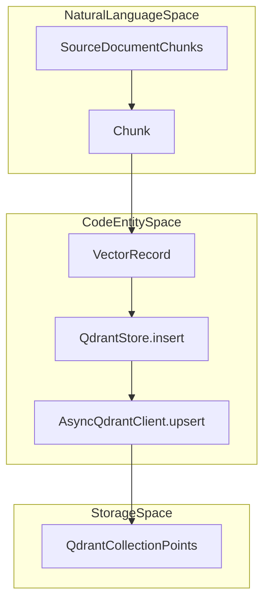
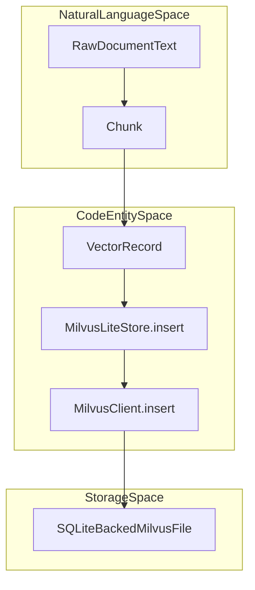
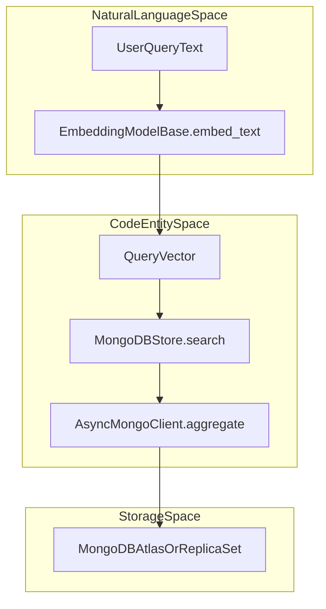
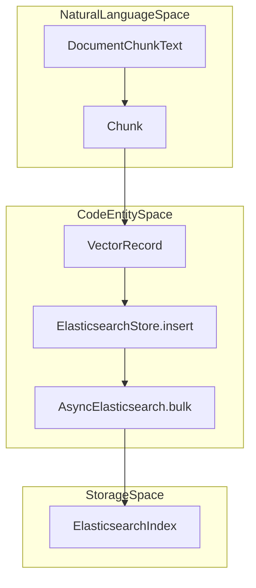

<!-- source: DeepWiki mcp.deepwiki.com · repo modelscope/agentscope · page 10.2 Vector Store Backends · fetched 2026-10-27 -->

# Vector Store Backends

<details>
<summary>Relevant source files</summary>

The following files were used as context for generating this wiki page:

- [examples/rag/README.md](examples/rag/README.md)
- [pyproject.toml](pyproject.toml)
- [src/agentscope/rag/__init__.py](src/agentscope/rag/__init__.py)
- [src/agentscope/rag/_knowledge.py](src/agentscope/rag/_knowledge.py)
- [src/agentscope/rag/_vdb/__init__.py](src/agentscope/rag/_vdb/__init__.py)
- [src/agentscope/rag/_vdb/_elasticsearch.py](src/agentscope/rag/_vdb/_elasticsearch.py)
- [src/agentscope/rag/_vdb/_milvus_lite.py](src/agentscope/rag/_vdb/_milvus_lite.py)
- [src/agentscope/rag/_vdb/_mongodb.py](src/agentscope/rag/_vdb/_mongodb.py)
- [src/agentscope/rag/_vdb/_qdrant.py](src/agentscope/rag/_vdb/_qdrant.py)
- [src/agentscope/rag/_vdb/_vector_store.py](src/agentscope/rag/_vdb/_vector_store.py)
- [tests/rag_knowledge_metadata_test.py](tests/rag_knowledge_metadata_test.py)
- [tests/rag_vdb_elasticsearch_test.py](tests/rag_vdb_elasticsearch_test.py)
- [tests/rag_vdb_milvus_lite_test.py](tests/rag_vdb_milvus_lite_test.py)
- [tests/rag_vdb_mongodb_test.py](tests/rag_vdb_mongodb_test.py)
- [tests/rag_vdb_qdrant_test.py](tests/rag_vdb_qdrant_test.py)

</details>


This page documents all `VectorStoreBase` implementations in AgentScope for Retrieval-Augmented Generation (RAG): `QdrantStore`, `MilvusLiteStore`, `MongoDBStore`, and `ElasticsearchStore`, along with their corresponding optional dependency extras [src/agentscope/rag/__init__.py:18-27]().

Sources: [src/agentscope/rag/__init__.py:18-27]()

---

## QdrantStore

The `QdrantStore` provides an asynchronous interface to Qdrant, a vector similarity search engine, utilizing `AsyncQdrantClient` for non-blocking execution [src/agentscope/rag/_vdb/_qdrant.py:4-7]().

### Optional Dependencies
To use `QdrantStore`, install the `vdb-qdrant` optional dependency [pyproject.toml:127-127]():
```bash
pip install "agentscope[vdb-qdrant]"
```
This installs the `qdrant-client` package [pyproject.toml:127-127]().

Sources: [pyproject.toml:127-127]()

### Initialization and Configuration
`QdrantStore` can be initialized with `location`, `url`, or `path` parameters to specify the instance mode (in-memory, local file, or remote server), supporting `api_key` and custom `distance` metrics [src/agentscope/rag/_vdb/_qdrant.py:58-93]().

```python
from agentscope.rag import QdrantStore

store = QdrantStore(location=":memory:")
```

The `get_client()` method lazily creates and caches the `AsyncQdrantClient` [src/agentscope/rag/_vdb/_qdrant.py:95-112]().

Sources: [src/agentscope/rag/_vdb/_qdrant.py:58-112]()

### Data Flow and Architecture

Title: "QdrantStore Data Flow"

Sources: [src/agentscope/rag/_vdb/_qdrant.py:183-201](), [src/agentscope/rag/_vdb/_vector_store.py:28-51]()

---

## MilvusLiteStore

The `MilvusLiteStore` is designed for local development and lightweight RAG workloads, backed by `pymilvus` `MilvusClient` running Milvus Lite within the Python process [src/agentscope/rag/_vdb/_milvus_lite.py:2-7]().

### Optional Dependencies
Install with `vdb-milvus` [pyproject.toml:129-132]():
```bash
pip install "agentscope[vdb-milvus]"
```
This installs `pymilvus` and `milvus_lite` [pyproject.toml:129-132]().

Sources: [pyproject.toml:129-132]()

### Initialization and Schema
Initialized with a local `.db` file path or remote endpoint URI [src/agentscope/rag/_vdb/_milvus_lite.py:45-77](). Collections contain schema fields for `id`, `vector`, `document_id`, `chunk`, and `metadata` [src/agentscope/rag/_vdb/_milvus_lite.py:133-160]().

Title: "MilvusLiteStore Insertion Flow"

Sources: [src/agentscope/rag/_vdb/_milvus_lite.py:108-175](), [src/agentscope/rag/_vdb/_milvus_lite.py:195-201](), [src/agentscope/rag/_vdb/_vector_store.py:28-51]()

---

## MongoDBStore

The `MongoDBStore` integrates with MongoDB Vector Search via `pymongo.AsyncMongoClient` [src/agentscope/rag/_vdb/_mongodb.py:2-6]().

### Optional Dependencies
Install with `vdb-mongodb` [pyproject.toml:133-133]():
```bash
pip install "agentscope[vdb-mongodb]"
```
This installs `pymongo>=4.7` [pyproject.toml:133-133]().

Sources: [pyproject.toml:133-133]()

### Initialization and Configuration
Requires `uri`, `database`, and declared `filter_fields` for metadata filtering [src/agentscope/rag/_vdb/_mongodb.py:65-99]().

Title: "MongoDBStore Search Flow"

Sources: [src/agentscope/rag/_vdb/_mongodb.py:65-122](), [src/agentscope/rag/_vdb/_mongodb.py:250-258]()

---

## ElasticsearchStore

The `ElasticsearchStore` provides vector search capabilities over Elasticsearch dense-vector indexes using `AsyncElasticsearch` [src/agentscope/rag/_vdb/_elasticsearch.py:2-27]().

### Optional Dependencies
Install with `vdb-elasticsearch` [pyproject.toml:134-134]():
```bash
pip install "agentscope[vdb-elasticsearch]"
```
This installs `elasticsearch[async]>=8.12` [pyproject.toml:134-134]().

Sources: [pyproject.toml:134-134]()

### Initialization and Configuration
Initialized with `hosts`, `num_candidates`, `refresh`, and optional `client_kwargs` [src/agentscope/rag/_vdb/_elasticsearch.py:33-64]().

Title: "ElasticsearchStore Data Flow"

Sources: [src/agentscope/rag/_vdb/_elasticsearch.py:33-76](), [src/agentscope/rag/_vdb/_elasticsearch.py:119-161](), [src/agentscope/rag/_vdb/_vector_store.py:28-51]()

---

## Optional Dependency Extras Reference

| Vector Store Backend | pyproject.toml Extra | Package Requirement | Source Class |
| --- | --- | --- | --- |
| Qdrant | `vdb-qdrant` [pyproject.toml:127-127]() | `qdrant-client` | `QdrantStore` [src/agentscope/rag/_vdb/_qdrant.py:32-32]() |
| Milvus Lite | `vdb-milvus` [pyproject.toml:129-132]() | `pymilvus>=2.4.0`, `milvus-lite>=3.1.0` | `MilvusLiteStore` [src/agentscope/rag/_vdb/_milvus_lite.py:26-26]() |
| MongoDB | `vdb-mongodb` [pyproject.toml:133-133]() | `pymongo>=4.7` | `MongoDBStore` [src/agentscope/rag/_vdb/_mongodb.py:31-31]() |
| Elasticsearch | `vdb-elasticsearch` [pyproject.toml:134-134]() | `elasticsearch[async]>=8.12` | `ElasticsearchStore` [src/agentscope/rag/_vdb/_elasticsearch.py:20-20]() |

Sources: [pyproject.toml:127-134](), [src/agentscope/rag/_vdb/__init__.py:1-24]()

---

