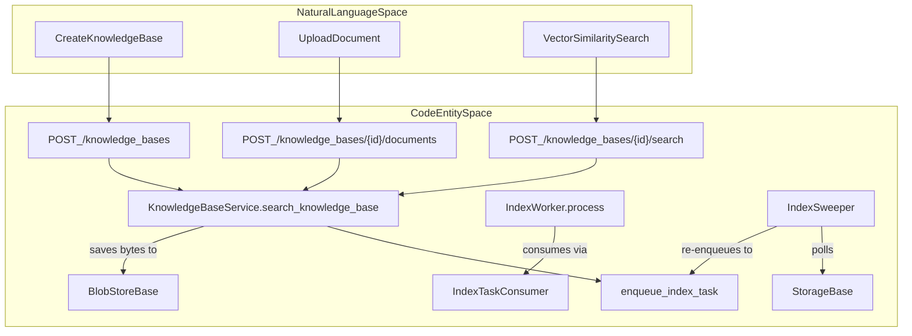
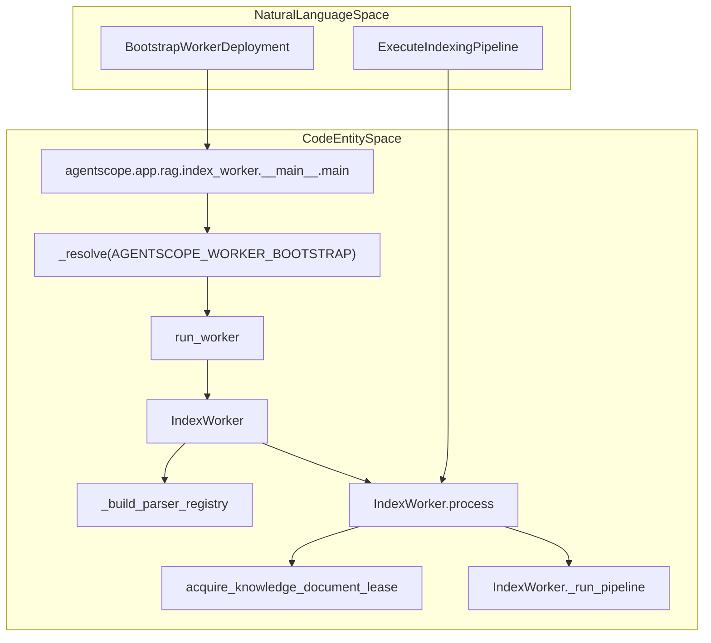
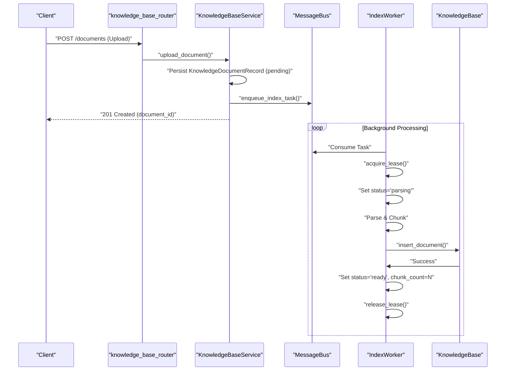

<!-- source: DeepWiki mcp.deepwiki.com · repo modelscope/agentscope · page 10.3 RAG Service Layer · fetched 2026-10-27 -->

# RAG Service Layer

Relevant source files

The following files were used as context for generating this wiki page:

- [examples/web_ui/frontend/src/api/knowledgeBase.ts](examples/web_ui/frontend/src/api/knowledgeBase.ts)
- [examples/web_ui/frontend/src/components/knowledge/DocumentDetailDrawer.tsx](examples/web_ui/frontend/src/components/knowledge/DocumentDetailDrawer.tsx)
- [examples/web_ui/frontend/src/components/knowledge/KnowledgeDocumentsPanel.tsx](examples/web_ui/frontend/src/components/knowledge/KnowledgeDocumentsPanel.tsx)
- [examples/web_ui/frontend/src/hooks/useKnowledgeBases.ts](examples/web_ui/frontend/src/hooks/useKnowledgeBases.ts)
- [examples/web_ui/frontend/src/hooks/useKnowledgeDocuments.ts](examples/web_ui/frontend/src/hooks/useKnowledgeDocuments.ts)
- [src/agentscope/app/_service/_index_worker.py](src/agentscope/app/_service/_index_worker.py)
- [src/agentscope/app/rag/index_worker/__main__.py](src/agentscope/app/rag/index_worker/__main__.py)
- [tests/index_worker_content_type_test.py](tests/index_worker_content_type_test.py)
- [tests/index_worker_lease_test.py](tests/index_worker_lease_test.py)
- [tests/index_worker_main_test.py](tests/index_worker_main_test.py)

The RAG Service Layer provides a production-ready, multi-tenant orchestration environment for Retrieval-Augmented Generation. While the RAG Core Pipeline handles library-mode logic for parsing and searching, the Service Layer manages document lifecycles, asynchronous indexing via a message bus, persistent storage of vector collections, and raw document blob management.

Sources: [src/agentscope/app/_service/_knowledge_base.py:2-19]()

---

## 1. Architectural Overview and Component Map

The service layer is built on a distributed task-queue model that decouples HTTP requests (such as document uploads) from compute-intensive embedding and indexing tasks.

### Core Service Components

1.  **`KnowledgeBaseService`**: Coordinates persistence, blob storage, message bus dispatching, and resource access policies [src/agentscope/app/_service/_knowledge_base.py:58-77]().
2.  **`KnowledgeBaseManagerBase` / `CollectionPerKbManager`**: Manages the mapping between logical knowledge bases and physical vector store collections [src/agentscope/app/rag/knowledge_base_manager/_collection_per_kb.py:31-38]().
3.  **`BlobStoreBase` / `LocalBlobStore`**: Durable storage abstraction holding raw document bytes after upload until indexing completes [src/agentscope/app/rag/blob_store/__init__.py:1-12]().
4.  **`IndexWorker` & `IndexSweeper`**: Background workers that drive parsing, chunking, and embedding [src/agentscope/app/_service/_index_worker.py:105-113](), protected by storage-backed leases and managed by an `IndexSweeper` to handle crashed workers.

### RAG Service Entity Mapping (NL Space to Code Entity Space)

Sources: [src/agentscope/app/_service/_knowledge_base.py:70-115](), [src/agentscope/app/_service/_index_worker.py:4-22](), [src/agentscope/app/_router/_knowledge_base.py:69-87]()

### Background Worker Architecture Bridge

Sources: [src/agentscope/app/rag/index_worker/__main__.py:53-107](), [src/agentscope/app/_service/_index_worker.py:46-113]()

---

## 2. Document Lifecycle and Async Indexing

When a document is uploaded via the `knowledge_base_router`, service-mode orchestration ensures processing occurs asynchronously without blocking API threads.

### The Upload and Indexing Pipeline

1.  **Ingestion**: `KnowledgeBaseService.upload_document` receives the file stream, saves raw bytes to the `BlobStoreBase`, and creates a `KnowledgeDocumentRecord` with status `pending` [src/agentscope/app/_service/_knowledge_base.py:236-283]().
2.  **Task Dispatch**: A task is published to the `MessageBus` via `enqueue_index_task` [src/agentscope/app/_service/_knowledge_base.py:91-96]().
3.  **Consumption**: An `IndexTaskConsumer` dequeues the task and invokes `IndexWorker.process` [src/agentscope/app/_service/_index_worker.py:105-113]().
4.  **Processing**: The worker transitions the document through `parsing`, `chunking`, and `indexing` states [src/agentscope/app/_service/_index_worker.py:10-15](). It acquires a processing lease via storage CAS to enforce mutual exclusion [src/agentscope/app/_service/_index_worker.py:7-8]().
5.  **Parser Normalization**: `_build_parser_registry` accepts either lists (expanding `supported_media_types` with last-wins override rules) or dictionaries (verbatim custom routing tables) [src/agentscope/app/_service/_index_worker.py:46-102](). Content types are normalized and parameter-stripped [tests/index_worker_content_type_test.py:120-128]().
6.  **Completion**: The worker embeds chunks and writes them to the vector store through `KnowledgeBase`, updating records to `ready` or `error` [src/agentscope/app/_service/_index_worker.py:10-15]().

### Indexing Data Flow

Sources: [src/agentscope/app/_service/_index_worker.py:4-22](), [src/agentscope/app/_service/_knowledge_base.py:236-283](), [tests/index_worker_lease_test.py:140-150]()

### Lease and Heartbeat Mechanism

To prevent duplicate processing if a worker hangs or crashes:
*   **Acquisition**: Before running the pipeline, the worker acquires a lease in storage [tests/index_worker_lease_test.py:32-38]().
*   **Heartbeat**: A background task periodically renews the lease via `renew_knowledge_document_lease` [tests/index_worker_lease_test.py:40-49]().
*   **Cancellation**: If lease renewal returns `False` (indicating the lease was claimed by the `IndexSweeper`), the worker immediately aborts execution [tests/index_worker_lease_test.py:140-147](). The worker will also mark the document with an `error` status, including the reason "Lost lease" [tests/index_worker_lease_test.py:173-176]().

Sources: [src/agentscope/app/_service/_index_worker.py:4-22](), [tests/index_worker_lease_test.py:1-77]()

---

## 3. Service Components and Storage Layer

### `KnowledgeBaseService` & `CollectionPerKbManager`

*   `KnowledgeBaseService` acts as the service-mode orchestrator for CRUD operations, search routing, and lifecycle states [src/agentscope/app/_service/_knowledge_base.py:58-67]().
*   `CollectionPerKbManager` creates a dedicated vector collection (`kb_<uuid>`) for each knowledge base and implements the `DimensionPolicy` contract [src/agentscope/app/rag/knowledge_base_manager/_collection_per_kb.py:31-97]().

### BlobStore Base and Implementations

Raw files are persisted through `BlobStoreBase` implementations (`LocalBlobStore` and `S3BlobStore`) during upload, streaming data in 1 MiB blocks (`_READ_CHUNK`) to prevent memory exhaustion [src/agentscope/app/_service/_index_worker.py:41-43]().

Sources: [src/agentscope/app/_service/_knowledge_base.py:70-115](), [src/agentscope/app/rag/knowledge_base_manager/_collection_per_kb.py:31-97]()

---

## 4. REST Endpoints (`knowledge_base_router`)

The HTTP API exposes endpoints under `/knowledge_bases` that map directly to `KnowledgeBaseService` methods:

| Endpoint | Method | Description |
| :--- | :--- | :--- |
| `/knowledge_bases/` | `POST` | Create a new knowledge base [src/agentscope/app/_router/_knowledge_base.py:76-87]() |
| `/knowledge_bases/` | `GET` | List visible knowledge bases with pagination |
| `/knowledge_bases/{id}/documents` | `POST` | Upload a document for background indexing |
| `/knowledge_bases/{id}/documents` | `GET` | Paginated listing of uploaded documents |
| `/knowledge_bases/{id}/search` | `POST` | Perform vector similarity search against the KB |

Sources: [src/agentscope/app/_router/_knowledge_base.py:69-87]()

---

## 5. Frontend Integration and Web UI Panels

The React-based Web UI provides tools for managing knowledge bases and monitoring document pipelines:

*   **`KnowledgeDocumentsPanel`**: Renders a combined view of server-side documents and in-flight upload tasks using `useKnowledgeDocuments` [examples/web_ui/frontend/src/components/knowledge/KnowledgeDocumentsPanel.tsx:31-38](), [examples/web_ui/frontend/src/hooks/useKnowledgeDocuments.ts:16-47]().
    *   It defines a `Row` type to represent either a server-side document (`kind: 'server'`) or a local upload task (`kind: 'local'`) [examples/web_ui/frontend/src/components/knowledge/KnowledgeDocumentsPanel.tsx:36-38]().
    *   The `StatusBadge` component visually indicates the current phase of an upload or indexing process, including `queued`, `uploading`, `pending`, `parsing`, `chunking`, `indexing`, `ready`, `error`, and `cancelled` [examples/web_ui/frontend/src/components/knowledge/KnowledgeDocumentsPanel.tsx:54-90]().
    *   Progress is shown either as byte-level for `uploading` or as coarse phase-derived values for other states [examples/web_ui/frontend/src/components/knowledge/KnowledgeDocumentsPanel.tsx:125-149]().
*   **`DocumentDetailDrawer`**: Provides a detailed view of a `ready` document, including its indexed chunks and a preview of the original file [examples/web_ui/frontend/src/components/knowledge/DocumentDetailDrawer.tsx:58-61]().
    *   It uses tabs for "Chunks" and "Preview" [examples/web_ui/frontend/src/components/knowledge/DocumentDetailDrawer.tsx:79-87]().
    *   The "Chunks" tab paginates and displays `KnowledgeChunk` objects, handling cases where chunk listing is unsupported by the vector store [examples/web_ui/frontend/src/components/knowledge/DocumentDetailDrawer.tsx:120-167]().
    *   The "Preview" tab attempts to render inline content for certain image and text types, falling back to a download option for others or large files [examples/web_ui/frontend/src/components/knowledge/DocumentDetailDrawer.tsx:35-43]().
*   **API Client**: `knowledgeBaseApi` handles paginated listing, schema discovery, and XHR-based file uploads with progress reporting [examples/web_ui/frontend/src/api/knowledgeBase.ts:86-153]().
    *   The `uploadDocumentXhr` function uses `XMLHttpRequest` to provide byte-level progress updates for file uploads, which `fetch` API does not natively support [examples/web_ui/frontend/src/api/knowledgeBase.ts:86-153]().
    *   `fetchAllPages` is a utility function to drain paginated API endpoints into a single flat array, ensuring all items are retrieved regardless of page count [examples/web_ui/frontend/src/api/knowledgeBase.ts:45-54]().

Sources: [examples/web_ui/frontend/src/components/knowledge/KnowledgeDocumentsPanel.tsx:31-52](), [examples/web_ui/frontend/src/hooks/useKnowledgeDocuments.ts:16-47](), [examples/web_ui/frontend/src/api/knowledgeBase.ts:158-220](), [examples/web_ui/frontend/src/components/knowledge/DocumentDetailDrawer.tsx:1-362]()

---

