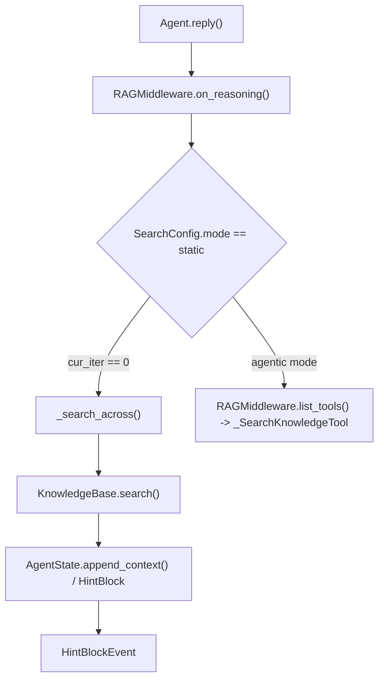
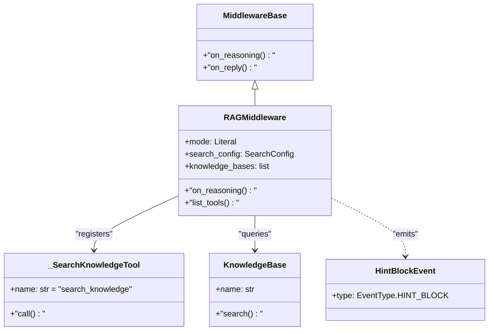

<!-- source: DeepWiki mcp.deepwiki.com · repo modelscope/agentscope · page 10.4 RAGMiddleware · fetched 2026-10-27 -->

# RAGMiddleware

Relevant source files

The following files were used as context for generating this wiki page:

- [src/agentscope/middleware/_rag.py](src/agentscope/middleware/_rag.py)
- [tests/middleware_rag_test.py](tests/middleware_rag_test.py)

## Overview and Purpose

`RAGMiddleware` is a core component of the AgentScope middleware system that bridges the gap between the agent's reasoning loop and external knowledge bases (`KnowledgeBase`). It enables agents to leverage large-scale vector stores for Retrieval-Augmented Generation (RAG) through two distinct operational modes: **Static** (auto-injection) and **Agentic** (tool-driven) [src/agentscope/middleware/_rag.py:10-21]().

The middleware manages interactions between an agent and one or more `KnowledgeBase` runtime handles, each carrying its own embedding model, vector store, and metadata filter [src/agentscope/middleware/_rag.py:4-8](). In the Agent Service architecture, it is attached during agent assembly when a knowledge configuration is present.

Sources: [src/agentscope/middleware/_rag.py:4-31]()

---

## Architecture and Data Flow

The following diagram illustrates how `RAGMiddleware` integrates into the agent ReAct loop and maps natural language retrieval tasks to specific code entities.

### RAGMiddleware Execution Flow and Code Entity Mapping

Sources: [src/agentscope/middleware/_rag.py:10-21](), [src/agentscope/event.py:56](), [src/agentscope/message.py:58]()

---

## Configuration: SearchConfig

The behavior of `RAGMiddleware` is governed by configuration parameters declared on Pydantic models. These parameters control retrieval strategies, top-k limits, score thresholds, hint formatting templates, and reranking options [src/agentscope/middleware/_rag.py:23-25]().

| Parameter | Type | Description |
| :--- | :--- | :--- |
| `mode` | `Literal["static", "agentic"]` | `"static"` (auto-inject before reasoning) or `"agentic"` (expose as a tool) [src/agentscope/middleware/_rag.py:10-15](). |
| `top_k` | `int` | Maximum number of chunks to return after merging and reranking [src/agentscope/middleware/_rag.py:151-164](). |
| `score_threshold` | `float | None` | Minimum similarity score for a chunk to be included [src/agentscope/middleware/_rag.py:165-167](). |
| `hint_template` | `str` | Template used to format retrieved content into the agent's prompt (`_DEFAULT_HINT_TEMPLATE`) [src/agentscope/middleware/_rag.py:72-76](). |
| `kb_ids` | `list[str] | None` | List of knowledge base IDs to search against. If `None`, all equipped KBs are searched [src/agentscope/middleware/_rag.py:120-128](). |
| `rerank_model_name` | `str | None` | Name of the chat model to use for reranking [src/agentscope/middleware/_rag.py:168-170](). |
| `rerank_candidate_k` | `int | None` | Number of top candidates to retrieve for the reranker to judge (capped at `_MAX_CANDIDATE_K`) [src/agentscope/middleware/_rag.py:80-82](). |
| `rerank_prompt` | `str` | The instruction part of the reranker prompt (`_DEFAULT_RERANK_PROMPT`) [src/agentscope/middleware/_rag.py:84-93](). |

Sources: [src/agentscope/middleware/_rag.py:72-93](), [src/agentscope/middleware/_rag.py:120-128](), [src/agentscope/middleware/_rag.py:151-170]()

---

## Operational Modes

### 1. Static Mode (Auto-Injection)
In static mode, the middleware intercepts the reasoning hook. On the first reasoning step of each reply turn (`agent.state.cur_iter == 0`), the middleware:
1. Performs a search across configured knowledge bases using the fresh user turn as the query via internal search routines [src/agentscope/middleware/_rag.py:15-21]().
2. Formats results into a `HintBlock` using `_DEFAULT_HINT_TEMPLATE` [src/agentscope/middleware/_rag.py:72-76]().
3. Injects the `HintBlock` into `agent.state.context` [src/agentscope/middleware/_rag.py:17-18]().
4. Emits a `HintBlockEvent` [src/agentscope/event.py:11]() so frontend interfaces can display matched snippets [src/agentscope/middleware/_rag.py:19-21]().

### 2. Agentic Mode (Tool-Driven)
In agentic mode, the middleware provides a `_SearchKnowledgeTool` via tool registration hooks [src/agentscope/middleware/_rag.py:12-14]().
- The agent decides when and which knowledge bases to query based on parameters defined in `_SearchParams` [src/agentscope/middleware/_rag.py:105-130]().
- Nothing is injected automatically; search results are returned as tool execution outputs (`ToolResultBlock`) [src/agentscope/message.py:61]().

Sources: [src/agentscope/middleware/_rag.py:10-21](), [src/agentscope/middleware/_rag.py:105-130](), [src/agentscope/event.py:11](), [src/agentscope/message.py:61]()

---

## Code Entity Mapping

The following diagram maps high-level RAG middleware concepts to concrete code classes and interfaces.

### RAGMiddleware Class Hierarchy and Components

Sources: [src/agentscope/middleware/_rag.py:35-70](), [src/agentscope/event.py:11](), [src/agentscope/message.py:58]()

---

## Implementation Details

### Multi-KB Search Logic
`RAGMiddleware` orchestrates searches across multiple `KnowledgeBase` instances through helper functions like `_search_across` [src/agentscope/middleware/_rag.py:20](). This architecture allows querying across disparate vector stores that may use different embedding models or storage backend configurations.

### Reranking with LLMs
When `rerank_model_name` is configured, the middleware retrieves a larger set of candidates (`rerank_candidate_k`, capped at `_MAX_CANDIDATE_K`) [src/agentscope/middleware/_rag.py:80-82]() and delegates to an LLM using structured output to rank results according to `_DEFAULT_RERANK_PROMPT` [src/agentscope/middleware/_rag.py:84-93](). Unit tests in `tests/middleware_rag_test.py` validate this behavior using stub models such as `_RecordingRerankModel` [tests/middleware_rag_test.py:151-184]().

Sources: [src/agentscope/middleware/_rag.py:20-31](), [src/agentscope/middleware/_rag.py:80-93](), [tests/middleware_rag_test.py:151-184]()

---

