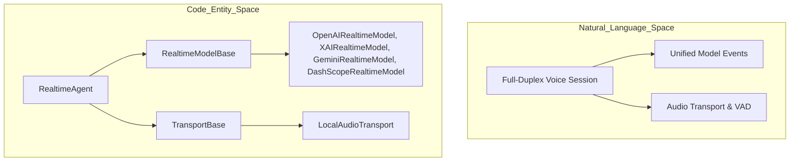
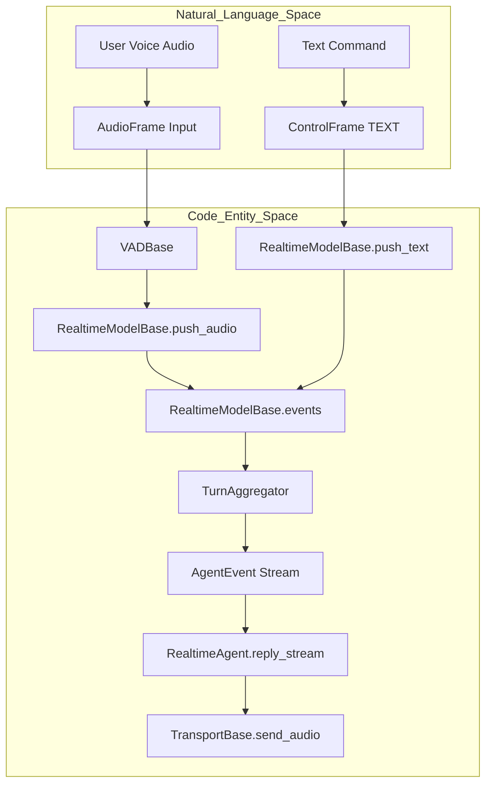

<!-- source: DeepWiki mcp.deepwiki.com · repo modelscope/agentscope · page 11 Realtime Voice Agents · fetched 2026-10-27 -->

# Realtime Voice Agents

Relevant source files

The following files were used as context for generating this wiki page:

- [.gemini/styleguide.md](.gemini/styleguide.md)
- [.github/copilot-instructions.md](.github/copilot-instructions.md)
- [README.md](README.md)
- [README_zh.md](README_zh.md)
- [assets/images/agentscope.png](assets/images/agentscope.png)
- [docs/NEWS.md](docs/NEWS.md)
- [docs/NEWS_zh.md](docs/NEWS_zh.md)
- [examples/agent_service/README.md](examples/agent_service/README.md)
- [src/agentscope/_version.py](src/agentscope/_version.py)
- [src/agentscope/agent/_realtime/_agent.py](src/agentscope/agent/_realtime/_agent.py)
- [src/agentscope/middleware/__init__.py](src/agentscope/middleware/__init__.py)
- [src/agentscope/middleware/_longterm_memory/__init__.py](src/agentscope/middleware/_longterm_memory/__init__.py)
- [src/agentscope/middleware/_longterm_memory/_reme/__init__.py](src/agentscope/middleware/_longterm_memory/_reme/__init__.py)
- [src/agentscope/realtime/__init__.py](src/agentscope/realtime/__init__.py)
- [src/agentscope/realtime/_base.py](src/agentscope/realtime/_base.py)
- [src/agentscope/realtime/_dashscope/_audio_models/qwen-audio-3.0-realtime-flash.yaml](src/agentscope/realtime/_dashscope/_audio_models/qwen-audio-3.0-realtime-flash.yaml)
- [src/agentscope/realtime/_dashscope/_audio_models/qwen-audio-3.0-realtime-plus.yaml](src/agentscope/realtime/_dashscope/_audio_models/qwen-audio-3.0-realtime-plus.yaml)
- [src/agentscope/realtime/_dashscope/_models/qwen-omni-turbo-realtime.yaml](src/agentscope/realtime/_dashscope/_models/qwen-omni-turbo-realtime.yaml)
- [src/agentscope/realtime/_dashscope/_models/qwen3-omni-flash-realtime.yaml](src/agentscope/realtime/_dashscope/_models/qwen3-omni-flash-realtime.yaml)
- [src/agentscope/realtime/_dashscope/_models/qwen3.5-omni-flash-realtime.yaml](src/agentscope/realtime/_dashscope/_models/qwen3.5-omni-flash-realtime.yaml)
- [src/agentscope/realtime/_dashscope/_models/qwen3.5-omni-plus-realtime.yaml](src/agentscope/realtime/_dashscope/_models/qwen3.5-omni-plus-realtime.yaml)
- [src/agentscope/realtime/_gemini/_models/gemini-2.5-flash-native-audio-preview-12-2025.yaml](src/agentscope/realtime/_gemini/_models/gemini-2.5-flash-native-audio-preview-12-2025.yaml)
- [src/agentscope/realtime/_gemini/_models/gemini-3.1-flash-live-preview.yaml](src/agentscope/realtime/_gemini/_models/gemini-3.1-flash-live-preview.yaml)
- [src/agentscope/realtime/_model_card.py](src/agentscope/realtime/_model_card.py)
- [tests/realtime_agent_test.py](tests/realtime_agent_test.py)

This page provides an overview of the realtime speech-to-speech subsystem in AgentScope, spanning `src/agentscope/realtime` and `src/agentscope/agent/_realtime` [src/agentscope/realtime/__init__.py:1-7](). This architecture supports full-duplex voice sessions, unified event streaming, audio transport adapters, and the `RealtimeAgent` coordination loop [src/agentscope/realtime/__init__.py:2-6]().

Title: "Realtime Voice Subsystem Architecture"

Sources: `src/agentscope/realtime/__init__.py`, `src/agentscope/realtime/_base.py`

---

## 11.1 RealtimeModelBase and Provider Implementations

`RealtimeModelBase` defines the core abstract contract for bidirectional WebSocket-based speech-to-speech streaming models [src/agentscope/realtime/_base.py:20-26](). It handles connection lifecycles (`connect`/`close`) [src/agentscope/realtime/_base.py:151-174](), WebSocket read loops with protocol-specific translation (`events`) [src/agentscope/realtime/_base.py:176-179](), and model configuration through model cards (`RealtimeModelCard`) [src/agentscope/realtime/_base.py:46-70]().

Concrete implementations include `OpenAIRealtimeModel`, `XAIRealtimeModel`, `GeminiRealtimeModel`, and `DashScopeRealtimeModel` [src/agentscope/realtime/__init__.py:44-50](), each mapping model card configurations and provider-specific parameters. These models manage their own WebSocket connections and translate incoming JSON messages into a unified `ModelEvent` stream [src/agentscope/realtime/__init__.py:63-75](). Model cards, such as `qwen3.5-omni-flash-realtime.yaml` [src/agentscope/realtime/_dashscope/_models/qwen3.5-omni-flash-realtime.yaml:1](), define model capabilities like `supports_tools` and `input_sample_rate` [src/agentscope/realtime/_dashscope/_models/qwen3.5-omni-flash-realtime.yaml:1]().

For details, see [RealtimeModelBase and Provider Implementations](#11.1).

Sources: `src/agentscope/realtime/__init__.py`, `src/agentscope/realtime/_base.py`, `src/agentscope/realtime/_dashscope/_models/qwen3.5-omni-flash-realtime.yaml`

---

## 11.2 Realtime Events, Transports, and the RealtimeAgent

The realtime subsystem normalizes incoming protocol events into unified `ModelEvent` subclasses (such as `AudioDeltaEvent`, `TranscriptDeltaEvent`, `ToolCallEvent`, `ResponseDoneEvent`, and `SpeechStartedEvent`) [src/agentscope/realtime/__init__.py:13-26](). Voice activity detection (`VADBase`) [src/agentscope/realtime/__init__.py:39]() and audio transports (`TransportBase`, `LocalAudioTransport`) [src/agentscope/realtime/__init__.py:31-38]() manage audio streaming and endpointing.

`RealtimeAgent` [src/agentscope/agent/_realtime/_agent.py:102-131]() ties these components together, managing separate lifecycles for the model session, transport connection, and temporary stream borrows during `reply_stream()` execution while wiring state and tool execution. The `RealtimeAgent` constructor takes a `RealtimeModelBase`, a `TransportBase`, and optionally a `VADBase` and `TurnAggregator` [src/agentscope/agent/_realtime/_agent.py:133-184](). It processes `AudioFrame` and `ControlFrame` from the transport [src/agentscope/realtime/_transport/_base.py:1] FileResource and emits `AgentEvent` instances [src/agentscope/agent/_realtime/_agent.py:24-45]().

Title: "Realtime Agent Event Flow"

Sources: `src/agentscope/realtime/__init__.py`, `src/agentscope/realtime/_base.py`, `src/agentscope/agent/_realtime/_agent.py`, `src/agentscope/realtime/_transport/_base.py`

For details, see [Realtime Events, Transports, and the RealtimeAgent](#11.2).

Sources: `src/agentscope/realtime/__init__.py`, `src/agentscope/realtime/_base.py`

---

