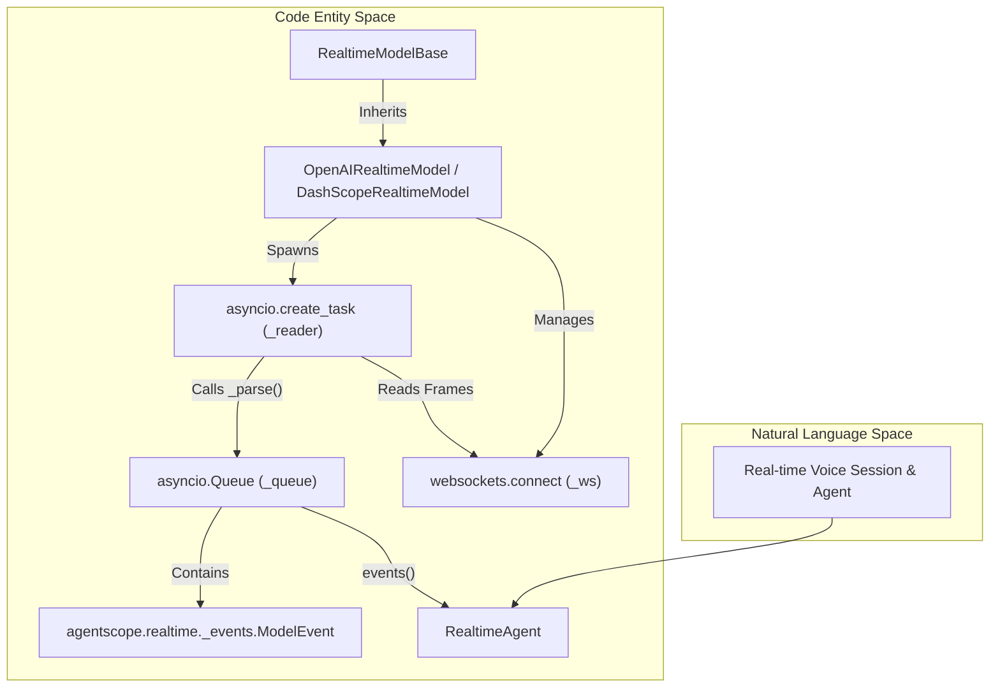
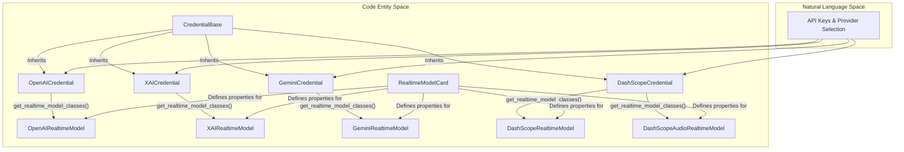

<!-- source: DeepWiki mcp.deepwiki.com · repo modelscope/agentscope · page 11.1 RealtimeModelBase and Provider Implementations · fetched 2026-10-27 -->

# RealtimeModelBase and Provider Implementations

<details>
<summary>Relevant source files</summary>

The following files were used as context for generating this wiki page:

- [examples/realtime/README.md](examples/realtime/README.md)
- [examples/realtime/local_mic.py](examples/realtime/local_mic.py)
- [src/agentscope/realtime/_dashscope/_audio_model.py](src/agentscope/realtime/_dashscope/_audio_model.py)
- [src/agentscope/realtime/_dashscope/_model.py](src/agentscope/realtime/_dashscope/_model.py)
- [src/agentscope/realtime/_dashscope/_models/qwen3.8-omni-flash-realtime.yaml](src/agentscope/realtime/_dashscope/_models/qwen3.8-omni-flash-realtime.yaml)
- [src/agentscope/realtime/_gemini/_model.py](src/agentscope/realtime/_gemini/_model.py)
- [src/agentscope/realtime/_gemini/_models/gemini-3.8-live.yaml](src/agentscope/realtime/_gemini/_models/gemini-3.8-live.yaml)
- [src/agentscope/realtime/_openai/_model.py](src/agentscope/realtime/_openai/_model.py)
- [src/agentscope/realtime/_openai/_models/gpt-realtime-1.5.yaml](src/agentscope/realtime/_openai/_models/gpt-realtime-1.5.yaml)
- [src/agentscope/realtime/_openai/_models/gpt-realtime-2.1-mini.yaml](src/agentscope/realtime/_openai/_models/gpt-realtime-2.1-mini.yaml)
- [src/agentscope/realtime/_openai/_models/gpt-realtime-2.1.yaml](src/agentscope/realtime/_openai/_models/gpt-realtime-2.1.yaml)
- [src/agentscope/realtime/_openai/_models/gpt-realtime-2.yaml](src/agentscope/realtime/_openai/_models/gpt-realtime-2.yaml)
- [src/agentscope/realtime/_xai/_model.py](src/agentscope/realtime/_xai/_model.py)
- [tests/realtime_dashscope_test.py](tests/realtime_dashscope_test.py)
- [tests/realtime_gemini_test.py](tests/realtime_gemini_test.py)
- [tests/realtime_reconnect_test.py](tests/realtime_reconnect_test.py)

</details>


## Purpose and Scope

This document specifies the realtime voice model architecture in AgentScope 2.0 (`src/agentscope/realtime/__init__.py`) [src/agentscope/realtime/__init__.py:1-7](), which provides full-duplex speech-to-speech capabilities. It covers the lifecycle managed by `RealtimeModelBase` [src/agentscope/realtime/_base.py:33-40](), WebSocket asynchronous read loops and protocol translation via `_parse`, model card YAML schemas, credential integration (`get_realtime_model_classes`) [src/agentscope/credential/_xai.py:48-53](), and concrete provider implementations for OpenAI (`OpenAIRealtimeModel`) [src/agentscope/realtime/_openai/_model.py:20-30](), xAI (`XAIRealtimeModel`) [src/agentscope/realtime/_xai/_model.py:18-31](), Gemini (`GeminiRealtimeModel`) [src/agentscope/realtime/_gemini/_model.py:27-45](), DashScope (`DashScopeRealtimeModel`) [src/agentscope/realtime/_dashscope/_model.py:31-38](), and DashScope Audio (`DashScopeAudioRealtimeModel`) [src/agentscope/realtime/_dashscope/_audio_model.py:16-22]().

Sources: `src/agentscope/realtime/__init__.py:1-7`, `src/agentscope/realtime/_base.py:33-40`, `src/agentscope/credential/_xai.py:48-53`, `src/agentscope/realtime/_openai/_model.py:20-30`, `src/agentscope/realtime/_xai/_model.py:18-31`, `src/agentscope/realtime/_gemini/_model.py:27-45`, `src/agentscope/realtime/_dashscope/_model.py:31-38`, `src/agentscope/realtime/_dashscope/_audio_model.py:16-22`

---

## 1. RealtimeModelBase Lifecycle & Abstract Interface

`RealtimeModelBase` serves as the abstract base class for all full-duplex realtime models in AgentScope [src/agentscope/realtime/_base.py:33-39](). It standardizes connection state, bi-directional audio/text streaming, tool result submission, turn committing, and event iteration over WebSockets.

### Core Lifecycle Methods and Properties

*   `connect(instructions: str, tools: list[dict] | None = None, **kwargs)`: Establishes the WebSocket connection with the provider and transmits initial instructions, tools, and provider-specific session configurations [src/agentscope/realtime/_base.py:146-164]().
*   `close()`: Cancels background reader tasks and gracefully closes the underlying WebSocket connection [src/agentscope/realtime/_base.py:167-168]().
*   `push_audio(pcm: bytes)`: Pushes raw PCM16 mono audio buffers into the model input stream [src/agentscope/realtime/_base.py:180-182]().
*   `push_text(text: str)`: Sends a text user turn and requests an immediate model response [src/agentscope/realtime/_base.py:184-188]().
*   `push_tool_result(block: ToolResultBlock)`: Transmits function execution outputs back to the model session [src/agentscope/realtime/_base.py:190-192]().
*   `commit_turn()`: Commits the current input audio buffer as a complete user turn (used when server VAD is disabled) [src/agentscope/realtime/_base.py:194-196]().
*   `events()`: An asynchronous generator yielding unified `ModelEvent` instances from the internal response queue [src/agentscope/realtime/_base.py:171-173]().

### Truncation Support (`TruncationSupport`)

Realtime adapters declare their truncation capabilities using the `TruncationSupport` enum [src/agentscope/realtime/_base.py:21-31]():
*   `TruncationSupport.NONE`: The provider does not support server-side interruption corrections (e.g., `XAIRealtimeModel`) [src/agentscope/realtime/_base.py:25]().
*   `TruncationSupport.EXPLICIT`: The provider accepts an explicit truncate frame (e.g., `OpenAIRealtimeModel`) [src/agentscope/realtime/_base.py:29]().
*   `TruncationSupport.SERVER`: The provider corrects itself; `truncate` is a no-op (e.g., `GeminiRealtimeModel`) [src/agentscope/realtime/_base.py:26]().

Sources: `src/agentscope/realtime/_base.py:1-232`, `src/agentscope/realtime/_base.py:21-31`, `src/agentscope/realtime/_base.py:33-40`, `src/agentscope/realtime/_base.py:146-196`

---

## 2. WebSocket Read Loop and Event Translation (`_parse`)

Realtime model implementations run a persistent background reader task (`_reader`) upon connection [src/agentscope/realtime/_openai/_model.py:136](). This task consumes raw WebSocket frames, decodes JSON payloads, and normalizes them into unified `ModelEvent` subclasses via an internal parsing routine.

The `_read()` method in each concrete `RealtimeModelBase` implementation is responsible for continuously receiving messages from the WebSocket and placing parsed `ModelEvent` objects into an `asyncio.Queue` [src/agentscope/realtime/_openai/_model.py:136-137](). The `events()` method then yields these events from the queue [src/agentscope/realtime/_openai/_model.py:149-155](). The `_parse()` method (or similar logic within `_read()`) is crucial for translating provider-specific WebSocket messages into the standardized `agentscope.realtime._events.ModelEvent` types.

### Diagram: Realtime WebSocket Transport and Event Normalization


Sources: `src/agentscope/realtime/_xai/_model.py:84-136`, `src/agentscope/realtime/_openai/_model.py:92-155`, `src/agentscope/realtime/_events.py:1-75`

---

## 3. Model Cards and Credential Integration

Realtime models rely on YAML-based model cards (`RealtimeModelCard`) and credential subclasses to define capability constraints, sample rates, token limits, and factory mappings.

### Model Card YAML Schema

Each realtime model has an associated YAML card defining its specifications [src/agentscope/realtime/_dashscope/_models/qwen3.8-omni-flash-realtime.yaml:1-26]() (`RealtimeModelCard`):
```yaml
type: realtime_model
name: qwen3.8-omni-flash-realtime
label: Qwen3.8-Omni-Flash Realtime
status: active

input_types:
  - audio/pcm
  - image/jpeg
output_types:
  - audio/pcm
  - text/plain

input_sample_rate: 16000
output_sample_rate: 24000

supports_tools: true

max_context_tokens: 196608
max_audio_turns: 100
max_audio_duration_s: 600
max_session_duration_s: 7200
```
The `RealtimeModelBase._find_card` method is responsible for locating the appropriate `RealtimeModelCard` based on the model name [src/agentscope/realtime/_base.py:90-99](). The `list_models` class method discovers all supported model cards for a given adapter [src/agentscope/realtime/_base.py:101-125]().

### Credential Registration

Credentials act as factories linking provider configurations to concrete `RealtimeModelBase` implementations via `get_realtime_model_classes()` [src/agentscope/credential/_xai.py:48-53]().

### Diagram: Credential and Model Card Resolution


Sources: `src/agentscope/realtime/_model_card.py:1-50`, `src/agentscope/credential/_xai.py:48-53`, `src/agentscope/realtime/_dashscope/_models/qwen3.8-omni-flash-realtime.yaml:1-26`, `src/agentscope/realtime/_base.py:90-125`

---

## 4. Provider Implementations

### 4.1 OpenAI Realtime Model (`OpenAIRealtimeModel`)

`OpenAIRealtimeModel` communicates via the OpenAI Realtime WebSocket protocol (`/v1/realtime`) [src/agentscope/realtime/_openai/_model.py:20-30]().
*   **Parameters**: Configurable via `OpenAIRealtimeModel.Parameters` including `voice` (`alloy`, `marin`, etc.), `turn_detection` (`server_vad`, `semantic_vad`, `none`), VAD thresholds, and `input_audio_transcription` model [src/agentscope/realtime/_openai/_model.py:28-62]().
*   **Audio Format**: PCM 24 kHz mono input and output [src/agentscope/realtime/_openai/_model.py:21-26]().
*   **Truncation**: Supports explicit interruption management (`TruncationSupport.EXPLICIT`) [src/agentscope/realtime/_base.py:29]().
*   **Connection**: Establishes a WebSocket connection and sends a `session.update` message with instructions and tool definitions [src/agentscope/realtime/_openai/_model.py:102-137]().

Sources: `src/agentscope/realtime/_openai/_model.py:20-191`, `tests/realtime_openai_test.py:23-180`

### 4.2 xAI Realtime Model (`XAIRealtimeModel`)

`XAIRealtimeModel` implements the Grok voice speech-to-speech API over WebSocket (`/v1/realtime`) [src/agentscope/realtime/_xai/_model.py:18-31]().
*   **Parameters**: Includes `voice` (e.g., `"eve"`), `turn_detection`, `vad_threshold`, `reasoning_effort`, and `language_hint` [src/agentscope/realtime/_xai/_model.py:29-54]().
*   **Protocol Variations**: Utilizes nested `session.audio` blocks, General Availability (GA) reply-side frames (`response.output_audio.delta`), and response aggregation keyed by `response_id` [src/agentscope/realtime/_xai/_model.py:20-27]().
*   **Truncation**: Declares `TruncationSupport.NONE` [src/agentscope/realtime/_base.py:25]().
*   **Connection**: Connects to `wss://{credential.api_host}/v1/realtime` and sends a session update message [src/agentscope/realtime/_xai/_model.py:114-122]().

Sources: `src/agentscope/realtime/_xai/_model.py:18-188`

### 4.3 Gemini Realtime Model (`GeminiRealtimeModel`)

`GeminiRealtimeModel` integrates Google's Gemini Live bidirectional audio protocol over WebSocket (`BidiGenerateContent`) [src/agentscope/realtime/_gemini/_model.py:27-45]().
*   **Audio Format**: 16 kHz input sample rate, 24 kHz output sample rate [tests/realtime_gemini_test.py:108-116]().
*   **Setup Configuration**: Transmits `setup` payloads containing generation configs, prebuilt voice configurations (e.g., `"Puck"` or `"Kore"`), automatic activity detection parameters, and tool declarations [tests/realtime_gemini_test.py:121-173]().
*   **Truncation**: Declares `TruncationSupport.SERVER` [src/agentscope/realtime/_base.py:26]().
*   **Connection**: Connects to `wss://generativelanguage.googleapis.com/ws/google.ai.generativelanguage.v1beta.GenerativeService.BidiGenerateContent` and sends a `setup` message [src/agentscope/realtime/_gemini/_model.py:136-147](). It waits for server acknowledgment before accepting further input [src/agentscope/realtime/_gemini/_model.py:148-150]().

Sources: `src/agentscope/realtime/_gemini/_model.py:1-489`, `tests/realtime_gemini_test.py:1-191`

### 4.4 DashScope Realtime Model (`DashScopeRealtimeModel` and `DashScopeAudioRealtimeModel`)

`DashScopeRealtimeModel` and `DashScopeAudioRealtimeModel` provide integration with Alibaba's Qwen-Omni and Qwen-Audio realtime voice APIs over WebSocket (`/api-ws/v1/realtime`) [src/agentscope/realtime/_dashscope/_model.py:31-38](), [src/agentscope/realtime/_dashscope/_audio_model.py:16-22]().
*   **Parameters**: Configurable via `Parameters` including `voice` (e.g., `"Cherry"` or `"longanqian"`), `turn_detection`, VAD thresholds, and `input_audio_transcription` [src/agentscope/realtime/_dashscope/_model.py:40-55](), [src/agentscope/realtime/_dashscope/_audio_model.py:24-41]().
*   **Capabilities**: Full-duplex WebSocket communication supporting 16 kHz audio input, 24 kHz output, tool invocation, and session configuration updates (`session.update`) [src/agentscope/realtime/_dashscope/_model.py:136-146]().
*   **Text Input**: `DashScopeRealtimeModel` supports audio/image input, whereas `DashScopeAudioRealtimeModel` supports text input (`supports_text_input = True`) [src/agentscope/realtime/_dashscope/_audio_model.py:43]() and history replay (`replay_history`) [src/agentscope/realtime/_dashscope/_audio_model.py:44]().
*   **Connection**: Connects to the DashScope realtime WebSocket endpoint derived from `credential.base_url` and sends session initialization data [src/agentscope/realtime/_dashscope/_model.py:22-28](), [src/agentscope/realtime/_dashscope/_model.py:121-136]().

Sources: `src/agentscope/realtime/_dashscope/_model.py:1-445`, `src/agentscope/realtime/_dashscope/_audio_model.py:1-251`, `tests/realtime_dashscope_test.py:1-206`

---

