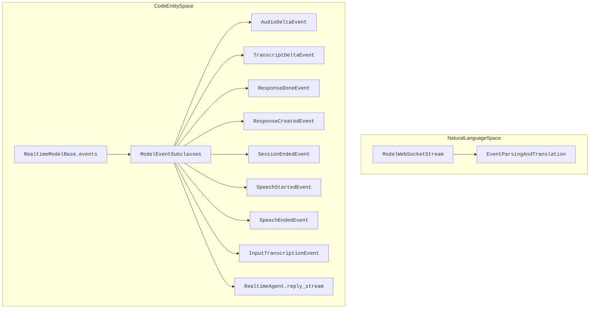
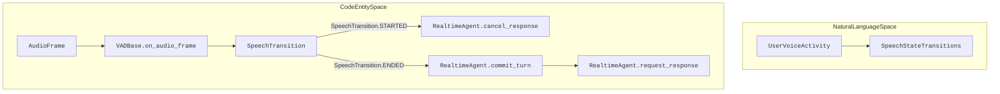
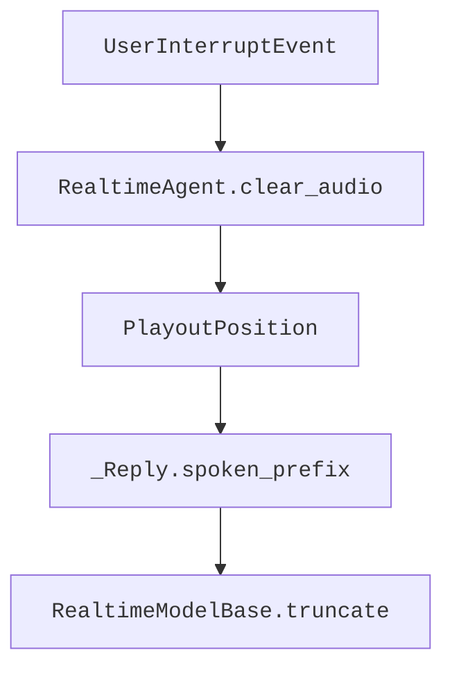
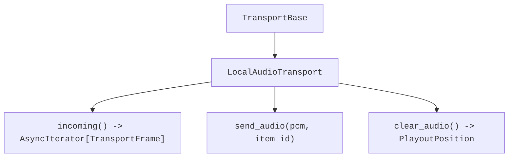
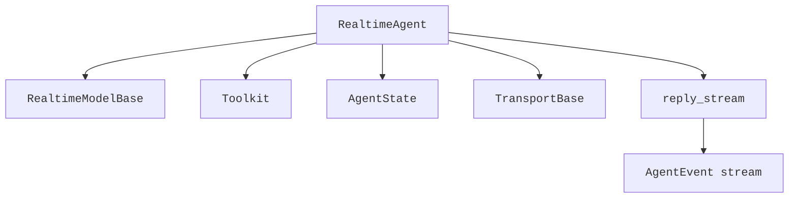

<!-- source: DeepWiki mcp.deepwiki.com · repo modelscope/agentscope · page 11.2 Realtime Events, Transports, and the RealtimeAgent · fetched 2026-10-27 -->

# Realtime Events, Transports, and the RealtimeAgent

Relevant source files

The following files were used as context for generating this wiki page:

- [examples/web_ui/frontend/src/components/select/RealtimeModelSelect.tsx](examples/web_ui/frontend/src/components/select/RealtimeModelSelect.tsx)
- [examples/web_ui/frontend/src/hooks/useAvailableRealtimeModels.ts](examples/web_ui/frontend/src/hooks/useAvailableRealtimeModels.ts)
- [src/agentscope/agent/_realtime/_agent.py](src/agentscope/agent/_realtime/_agent.py)
- [src/agentscope/realtime/_dashscope/_audio_models/qwen-audio-3.0-realtime-flash.yaml](src/agentscope/realtime/_dashscope/_audio_models/qwen-audio-3.0-realtime-flash.yaml)
- [src/agentscope/realtime/_dashscope/_audio_models/qwen-audio-3.0-realtime-plus.yaml](src/agentscope/realtime/_dashscope/_audio_models/qwen-audio-3.0-realtime-plus.yaml)
- [src/agentscope/realtime/_dashscope/_audio_models/qwen-audio-3.1-realtime-plus.yaml](src/agentscope/realtime/_dashscope/_audio_models/qwen-audio-3.1-realtime-plus.yaml)
- [src/agentscope/realtime/_dashscope/_models/qwen-omni-turbo-realtime.yaml](src/agentscope/realtime/_dashscope/_models/qwen-omni-turbo-realtime.yaml)
- [src/agentscope/realtime/_dashscope/_models/qwen3-omni-flash-realtime.yaml](src/agentscope/realtime/_dashscope/_models/qwen3-omni-flash-realtime.yaml)
- [src/agentscope/realtime/_dashscope/_models/qwen3.5-omni-flash-realtime.yaml](src/agentscope/realtime/_dashscope/_models/qwen3.5-omni-flash-realtime.yaml)
- [src/agentscope/realtime/_dashscope/_models/qwen3.5-omni-plus-realtime.yaml](src/agentscope/realtime/_dashscope/_models/qwen3.5-omni-plus-realtime.yaml)
- [src/agentscope/realtime/_gemini/_models/gemini-2.5-flash-native-audio-preview-12-2025.yaml](src/agentscope/realtime/_gemini/_models/gemini-2.5-flash-native-audio-preview-12-2025.yaml)
- [src/agentscope/realtime/_gemini/_models/gemini-3.1-flash-live-preview.yaml](src/agentscope/realtime/_gemini/_models/gemini-3.1-flash-live-preview.yaml)
- [src/agentscope/realtime/_model_card.py](src/agentscope/realtime/_model_card.py)
- [tests/realtime_agent_test.py](tests/realtime_agent_test.py)

This wiki page documents the realtime speech-to-speech subsystem in AgentScope, focusing on the event type definitions (`ModelEvent`), Voice Activity Detection (VAD) and turn detection mechanics, truncation support for barge-in handling, audio transport abstractions (`TransportBase` and `LocalAudioTransport`), and the `RealtimeAgent` class wiring model sessions, state, and tools into a bidirectional voice loop [src/agentscope/agent/_realtime/_agent.py:102-131](), [tests/realtime_agent_test.py:29-40]().

Sources: [src/agentscope/agent/_realtime/_agent.py:102-131](), [tests/realtime_agent_test.py:29-40]()

---

## 1. Realtime Model Events (`ModelEvent`)

Realtime model integrations stream asynchronous events from WebSocket connections. These events are parsed into typed subclasses of `ModelEvent` defined in the realtime event module [src/agentscope/agent/_realtime/_agent.py:10-10](), [tests/realtime_agent_test.py:59-59](). Key event types include:

*   `AudioDeltaEvent`: Carries incremental PCM audio chunks (`pcm`) and sample rate metadata from the model [tests/realtime_agent_test.py:103-103]()
*   `TranscriptDeltaEvent`: Carries incremental text transcription fragments for assistant speech [tests/realtime_agent_test.py:102-102]()
*   `ResponseDoneEvent`: Indicates the completion of a model response turn, including token usage counts [tests/realtime_agent_test.py:111-111]()
*   `SpeechStartedEvent` / `SpeechEndedEvent`: Signals VAD state transitions for user or model speech [tests/realtime_agent_test.py:88-88]()
*   `InputTranscriptionEvent`: Contains the transcribed text of the user's audio input [tests/realtime_agent_test.py:89-89]()
*   `ResponseCreatedEvent`: Indicates that the model has started generating a response [tests/realtime_agent_test.py:90-90]()
*   `SessionEndedEvent`: Indicates that the model session has ended [tests/realtime_agent_test.py:188-193]()

These events are consumed within the `RealtimeAgent.reply_stream()` asynchronous generator to update internal tracking states and emit corresponding `AgentEvent` objects to downstream consumers [src/agentscope/agent/_realtime/_agent.py:102-131](), [tests/realtime_agent_test.py:182-190]().

Sources: [src/agentscope/agent/_realtime/_agent.py:102-131](), [tests/realtime_agent_test.py:88-112]()

---

## 2. VAD and Turn Detection

Voice Activity Detection (VAD) governs how user speech boundaries are determined. AgentScope supports both provider-native turn detection and caller-managed VAD via `VADBase` [src/agentscope/agent/_realtime/_agent.py:162-170](), [tests/realtime_agent_test.py:39-40]().

*   `VADBase` and `SpeechTransition`: When a custom VAD engine is supplied to `RealtimeAgent`, provider-side turn detection is disabled (`turn_detection_disabled=True`), ensuring a single source of truth for turn boundaries [src/agentscope/agent/_realtime/_agent.py:162-170](), [tests/realtime_agent_test.py:171-174]()
*   **Barge-in handling**: A `STARTED` speech transition cuts off any assistant reply currently playing when the user speaks over the model [src/agentscope/agent/_realtime/_agent.py:165-167]()
*   **Turn completion**: An `ENDED` speech transition closes the user's audio turn, commits the buffer, and requests a model response [src/agentscope/agent/_realtime/_agent.py:167-170]()

Sources: [src/agentscope/agent/_realtime/_agent.py:162-170](), [tests/realtime_agent_test.py:39-40]()

---

## 3. Truncation Support and Interruption Management

When a user interrupts an ongoing assistant turn (barge-in), the system must reconcile what audio was actually played to the user versus what the model generated. This is managed via truncation configuration and the `_Reply` alignment helper [src/agentscope/agent/_realtime/_agent.py:69-83](), [tests/realtime_agent_test.py:30-34]().

*   `_Reply`: Tracks an in-flight assistant response item, maintaining alignment marks between audio duration in milliseconds and transcript length [src/agentscope/agent/_realtime/_agent.py:69-83]().
*   Interruption handling calculates the exact transcript prefix matching the audio duration played back to the user before interruption [src/agentscope/agent/_realtime/_agent.py:69-83]().

Sources: [src/agentscope/agent/_realtime/_agent.py:69-83](), [tests/realtime_agent_test.py:30-34]()

---

## 4. Transports (`TransportBase` & `LocalAudioTransport`)

Transports abstract the input/output channels (such as local microphones/speakers or browser WebRTC/WebSocket connections) from the `RealtimeAgent` logic [src/agentscope/agent/_realtime/_agent.py:102-121](), [tests/realtime_agent_test.py:38-38]().

*   `TransportBase`: Abstract base class defining interface methods for streaming incoming audio and control frames [tests/realtime_agent_test.py:38-38]().
*   `AudioFrame`: Data container for incoming PCM audio chunks [tests/realtime_agent_test.py:30-30]().
*   `ControlFrame`: Carries control instructions (e.g., UI interruption, typed user turns) [tests/realtime_agent_test.py:31-32]().
*   `PlayoutPosition`: Tracks playout timestamps to coordinate barge-in cleanup [tests/realtime_agent_test.py:34-34]().
*   `LocalAudioTransport`: Implements sound card input and output loops for local testing and terminal execution [tests/realtime_agent_test.py:3-3]().

Sources: [src/agentscope/agent/_realtime/_agent.py:102-121](), [tests/realtime_agent_test.py:29-40]()

---

## 5. The `RealtimeAgent` and Voice Loop Wiring

The `RealtimeAgent` class orchestrates bidirectional voice conversations by decoupling the model session lifecycle from individual transport connections [src/agentscope/agent/_realtime/_agent.py:102-121]().

### Session Separation and Lifetimes
Three distinct lifetimes are kept apart on purpose [src/agentscope/agent/_realtime/_agent.py:102-121]():
1.  **Agent & Model Session**: Opened via `async with agent:` and remains active across multiple client connections and transport reconnects [src/agentscope/agent/_realtime/_agent.py:102-121](). The model session can time out during a long silence and be re-established on the next word without touching the transport [src/agentscope/agent/_realtime/_agent.py:102-121]().
2.  **Transport Connection**: Owned by the caller; can drop and reconnect without losing model session state [src/agentscope/agent/_realtime/_agent.py:102-121]().
3.  **`reply_stream()`**: Borrows both the agent session and transport for active streaming execution [src/agentscope/agent/_realtime/_agent.py:102-121]().

### Toolkit and State Integration
The `RealtimeAgent` accepts an optional `Toolkit` and `AgentState` [src/agentscope/agent/_realtime/_agent.py:133-181](). When the model triggers a tool call event, the agent executes the tool locally, evaluates permissions via `state.permission_context`, and pushes the resulting `ToolResultBlock` back to the model [src/agentscope/agent/_realtime/_agent.py:133-181](), [tests/realtime_agent_test.py:205-208]().

Sources: [src/agentscope/agent/_realtime/_agent.py:102-181](), [tests/realtime_agent_test.py:205-208]()

---

